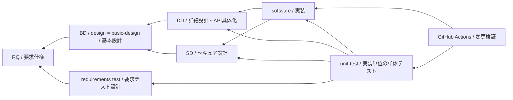

# MVVM UIライブラリ 要求仕様

- 文書版: 1.7
- 要求基準: 従来Acceptedの要求と、旧本文に記載された承認済み要求事項を継承
- 再編集版の状態: 全RQ章の要求分離改訂承認済み（利用者、2026-10-17）。RQ-09 v0.7全文承認済み（利用者、2026-10-31）。RQ-15は各機能章へ統合し旧IDを廃止
- 更新日: 2026-10-31
- 対象言語: C++ / C# / Rust / Python 3

## 概要

4言語で共通のMVVMモデルを利用できるクロスプラットフォームUIライブラリを構築する。要求は提供する機能、利用者が観測する結果、対応範囲、実施・検証の条件を定める。Rust Coreとversioned C ABIは従来承認済みのアーキテクチャ制約として継承する。

各RQ章は要求本文、対象段階、承認・改訂履歴を管理する。現行の承認済み要求は282 IDで、要求分離時の249 IDを維持し、具体化レビューの承認により31 ID、Window背景色に1 ID、未指定fontのPlatform defaultに1 IDを追加した。RQ-15の22 IDは各機能章へ統合し、履歴参照用として再利用しない。受入確認の操作・観測・証拠監査は要求本文から分離する。要求の承認は本書と各RQ章で完結する。

## 文書と成果物の関係

以下は成果物の生産・依存関係を逆向きにたどり、各文書が参照する上位根拠を示す。矢印は「参照元から参照先」を表す。

要求から実現への生産順は `RQ → BD → (DD + SD) → (software + 対応するunit-test)` とする。`design`と`basic-design`は同じ基本設計（BD）を指す。要求testはRQから検証条件を導出する別の検証成果物として作成し、BDと検証条件の整合を確認する。DDにはAPIの具体化を含む。実装単位ごとに対応するunit-testを設計・実行し、実装とテストを同じ変更単位で追跡する。文書内の根拠参照はこの関係を逆にたどる。要求仕様は下流成果物へのリンクを持たず、要求test・BD・DD・SD・実装・unit-testが必要な要求や設計根拠を上流参照する。RQ章へのリンクは本書から各章への目次ナビゲーションとして扱う。

GitHub Actionsは、変更がpushまたはpull request更新としてGitHubへ届いた時点で、変更ファイルに対応する実装単位のunit-testと必要な影響回帰を実行する方針とする。ローカルで未pushの編集をGitHub Actionsが検証する意味ではない。変更ファイルとテストの対応が不明な場合に一部テストだけを通して成功扱いにしない。実行方式・job・runnerの詳細はunit-test設計と実装基盤を確認してから定める。

| 成果物 | 役割・承認範囲 | 参照方向 |
|---|---|---|
| RQ / requirements | 提供する機能、満たす条件、従う一般規則、対象範囲・保証、例外・除外条件など利用者から見える結果を定める。「〇〇を提供する」「▲▲すること」「××という一般規則に従う」。要求の採否と受入条件を要求側で承認する | 上位のADR・調査根拠を参照する |
| requirements test / 要求テスト設計 | 要求ごとの観測・case・不足・実装/実行証跡。要求を新設・変更しない | 対象RQを参照する |
| BD / design / basic-design | 「RQ-xx-xxxを実現するための設計は〜」として、層の責務分担、データ・所有の流れ、主要な状態遷移、実現方針をまとめる。要求上の例外・保証を設計判断へ移さず、新しい条件が必要ならRQへ戻す | 対応するRQを参照する |
| DD / detailed-design | BDを具体化し、クラスとinterfaceの構成、メソッド名・signature・呼出し手順、データフロー、所有と参照、詳細な状態遷移、ライフサイクル、言語特有の実現仕様をまとめる。外部に保証する動作・例外・結果はRQを参照する | 具体化するBDおよび関連RQを参照する |
| SD / secure-design | セキュア設計。RQ/BDを根拠に脅威、信頼境界、防御策、対策の成立条件をまとめる。新たなセキュリティ保証の採否はRQで扱う | 基本設計および関連RQを参照する |
| software | 設計済みの実装単位を作る。実装単位IDと変更ファイルを管理する | 適用するDD・SDを参照する |
| unit-test | 各実装単位に対応するテストを設計・実行し、対象revisionと結果を記録する | 実装対象、適用設計、関連要求・検証caseを参照する |
| GitHub Actions | push/PR更新で変更ファイルを検出し、対応するunit-test・影響回帰を実行する | 実装単位とunit-testの対応情報・test commandを参照する |

要求の例外・除外・保証はRQに記載する。設計で実現できない要求や新たな必要条件が見つかった場合は、要求変更として要求側へ差し戻して承認する。BD/DD承認を理由に要求を暗黙に書き換えない。既存Accepted ADRとの不整合は差異を記録し、要求変更またはADR変更として承認する。今回の文書再編では既存ADRの技術的制約は変更しない。

API設計はDD内にまとめ、独立した設計段階・必須の別仕様書にはしない。量に応じてDD内の章・分冊を設けられる。以前の「計画済みDD完了後にAPI設計を整理する」作業順は、DD内で未決のAPI事項をまとめる作業として引き継ぐ。文書構成の統合によって、未決のクラス名・メソッド名・signatureを確定したことにはならない。

## 章別目次

| 章 | 要求文書 | 要求数 |
|---|---|---:|
| RQ-01 | [目的と共通アーキテクチャ](RQ-01_purpose-architecture.md) | 2 |
| RQ-02 | [Core機能](RQ-02_core-features.md) | 22 |
| RQ-03 | [対応言語と共通意味論](RQ-03_language-support.md) | 17 |
| RQ-04 | [公開ABI境界](RQ-04_abi-boundary.md) | 30 |
| RQ-05 | [所有権とcallback](RQ-05_ownership-callbacks.md) | 15 |
| RQ-06 | [Threadと非同期処理](RQ-06_threading-dispatch.md) | 13 |
| RQ-07 | [Binding](RQ-07_binding.md) | 17 |
| RQ-09 | [UI機能と段階的な対象範囲](RQ-09_ui-scope.md) | 73 |
| RQ-10 | [Accessibility](RQ-10_accessibility.md) | 14 |
| RQ-11 | [Platformと組み込みLinux](RQ-11_platform.md) | 24 |
| RQ-12 | [ビルドと配布](RQ-12_build-distribution.md) | 25 |
| RQ-13 | [非機能要求と実測](RQ-13_nonfunctional-measurement.md) | 11 |
| RQ-14 | [開発・検証の実施順序](RQ-14_delivery-sequence.md) | 13 |
| RQ-15 | [旧要求判断の移管案内（22 ID廃止）](RQ-15_requirement-decisions.md) | 0 |
| RQ-16 | [要求・設計文書の管理と承認](RQ-16_document-governance.md) | 4 |

## 要求ID・状態の運用

`RQ-<章番号>-<3桁連番>` を要求IDとし、例は `RQ-07-001`。章番号は2桁で管理する。番号は安定識別子であり、並べ替え・削除によって採番し直さず、廃止IDを再利用しない。章移動時も元IDを維持して参照を残すか、旧新対応を明示する。

RQ-08は、旧縦断シナリオの各項目がRQ-01～03、RQ-07、RQ-09～10の既存要求と重複するため、独立した要求章を設けない。旧REQ-5項目の移行先は移行表に記録し、RQ-08-001～008は廃止IDとして再利用しない。

製品要求、実施・管理要求、対象候補、将来候補を区別する。将来候補の記載は採用承認を意味しない。要求の対象範囲が未確定の場合は要求側で承認し、要求が確定して実現方式だけが未決の場合は下流設計で具体化する。数値性能の実測要求と、未承認の性能保証閾値を混同しない。

各文書の承認履歴には日付・対象版/要求ID・承認者・結論・根拠を記す。改訂履歴には版・日付・変更内容/理由・作成者・承認記録との対応を記す。新しい履歴を追記し、過去の承認結果を最新状態で上書きしない。版の承認と、その版に含まれる既承認要求の継承は別に記録する。

## 移行・参照

- [具体化レビュー31要求のID対応](remaining-requirements-id-migration.md)

- [今回の要求分離・正式ID対応](requirements-separation-id-migration.md)

- [旧文書・暫定REQ IDから正式RQ IDへの対応](requirements-id-migration.md)
- 旧版の保存記録（Git管理対象外のローカルarchive: `archive/mvvm-ui-library-requirements-20261012.md`）
- [旧パスからの移行入口](mvvm-ui-library-requirements.md)
- [Accepted ADR-0001](../04_approval/adr-0001-rust-core.md)
- [技術調査・外部根拠](../01_memory/common-ui-library-research.md)

旧要件§1～2の文書位置づけ・外部資料分類は旧版に保存する。WPF、Qt、Slint、W3C等は比較・根拠資料であり、参照先の記述をそのまま製品要求へ昇格させない。要求の根拠は要求本文と要求承認履歴で確認する。

旧対応表196行を正式RQ ID195件へ移行した。旧REQ-6.2-16とREQ-6.3-11は同じ共通モデル先行要求を指していたため、RQ-09-037へ統合し、両方の由来を残した。要求追加・削除を意味する統合ではない。

今回、旧要求にすでに記載されているBD由来の承認事項を要求承認台帳に集約した。参照元BDは過去の判断経緯・実現方法として保持し、要求の採否は各RQ本文と本書・各章の承認履歴で完結させる。BDにある内容をすべて自動的に要求へ転記する運用にはしない。

## 承認履歴

| 日付 | 対象版・ID / 範囲 | 承認者 | 結果・根拠 |
|---|---|---|---|
| 2026-09-26 | 旧要求仕様の該当範囲 | 利用者 | Acceptedを継承。後日追記の承認日・未決範囲は旧版で確認 |
| 2026-10-12 | 要求承認管理・章分割・RQ ID化 | 利用者 | 今回の指示による管理方針。旧本文に記載済みの承認事項を要求側で管理する |
| 2026-10-12 | 参照方向・secure-design追加 | 利用者 | 今回指示による構造更新。要求本文・セキュリティ判断の承認ではない |
| 2026-10-12 | softwareとunit-testの同段階配置 | 利用者 | 今回指示による成果物関係の追加。unit-test方式の詳細承認ではない |
| — | 総目次・章構成・ID運用・要求承認管理 / 再編集版0.2 | — | 継承要求の再編集版はレビュー待ち |
| 2026-10-12 | 再編集版0.3 | 利用者 | 「0.3版はすべて承認」による承認。従前の0.2版レビュー待ち記録を保持 |
| 2026-10-12 | 0.4のRQ/BD/DD/SDロールとAPI具体化のDD統合 | 利用者 | 今回の役割指定と、DDにまとめられるAPI設計を独立させない指示を反映。個別の方式・API仕様の承認は含まない |
| 2026-10-12 | 0.5 / designとbasic-designの統一 | 利用者 | 今回の指示により同一のBDとして扱う。要求testは検証成果物として区別する |
| 2026-10-12 | 0.6 / 要求と設計の境界具体化 | 利用者 | 利用者から見える例外・保証はRQ、BD/DDはそれを満たす層構造・データ/所有フロー・状態遷移・interfaceの実現手段を記すという今回の指示を反映 |
| 2026-10-12 | X01の要求・設計改訂案 | 利用者 | X01方針を承認し、RQ-05/RQ-07等の正本改訂を開始 |
| 2026-10-13 | RQ-05 v0.8、requirements-test v0.5のRQ-05対応範囲 | 利用者 | RQ-05全掲載IDとTC-LIFE/OWN/CALLBACKへの対応内容を承認。requirements-test文書全体やABI/DD改訂の承認は含まない |

## 改訂履歴

| 版 | 日付 | 変更内容・理由 | 作成者 | 承認履歴への対応 |
|---|---|---|---|---|
| 旧版 | 2026-09-25 | 旧要求仕様を作成。2026-09-26にAccepted | 旧文書参照 | 旧要求仕様の承認記録 |
| 0.1 | 2026-10-12 | 章分割、RQ ID、受入確認案、要求承認履歴の集約 | Codex | 管理方針の指示に基づく再編集。版全体のレビューは未完了 |
| 0.2 | 2026-10-12 | 参照方向を修正し、secure-designを詳細設計/API設計と並列の成果物に追加 | Codex | 構造変更の指示。要求本文とセキュリティ判断は未承認 |
| 0.3 | 2026-10-12 | softwareとunit-testを同段階の対応成果物として追加し、GitHub Actionsでの変更検証方針を記載 | Codex | 利用者指示に基づく構造更新。unit-test設計案は未承認 |
| 0.4 | 2026-10-12 | RQ/BD/DD/SDの役割を明記し、クラス・メソッド/API具体化をDDへ統合。参照図を更新し、0.3版の承認をヘッダに反映 | Codex | 今回の役割指定・DD統合指示に対応 |
| 0.5 | 2026-10-12 | designとbasic-designをBDに統一し、要求testを別の検証成果物として関係図・説明・役割表を更新 | Codex | 今回の命名・段階統一の指示に対応 |
| 0.6 | 2026-10-12 | RQに利用者から見える例外・保証を含め、BD/DDを実現手段・状態遷移・フロー・interface設計として具体化 | Codex | 今回の利用者指示を反映。個別の製品要求変更は別途レビュー |
| 0.7 | 2026-10-12 | X01改訂着手とRQ-05/RQ-07 v0.4レビュー案の状態を追記 | Codex | X01方針承認に基づく。個別文書改訂案は未承認 |
| 0.8 | 2026-10-13 | RQ-07-009/010の要求と設計の境界を整理したv0.5案の状態を記録 | Codex | 利用者指摘を反映 |
| 0.9 | 2026-10-13 | RQ-07 v0.5の承認状態を反映し、要求test対応表への展開を開始 | Codex | 利用者承認を記録。test対応表自体は未承認 |
| 1.0 | 2026-10-13 | RQ-05のCore所有表現を要求から除き、改訂案v0.5の状態を記録 | Codex | 利用者指摘を反映。RQ-05 v0.5は未承認 |
| 1.1 | 2026-10-13 | RQ-05の所有参照要件を取得・破棄の独立性と参照寿命に整理したv0.6案を記録 | Codex | 利用者指摘を反映。RQ-05 v0.6は未承認 |
| 1.2 | 2026-10-13 | RQ-05全IDを利用者の能力・外部保証中心に改訂したv0.7案を記録 | Codex | 利用者指示を反映。RQ-05 v0.7は未承認 |
| 1.3 | 2026-10-13 | RQ-05から受入確認欄を除き、requirements-test対応表へ確認内容を展開したv0.8案を記録 | Codex | 利用者指摘を反映。RQ-05 v0.8と対応表は未承認 |
| 1.4 | 2026-10-13 | RQ-05 v0.8とrequirements-test v0.5のRQ-05対応範囲の承認を記録 | Codex | 利用者承認を反映。対応表の他範囲とABI/DD改訂は未承認 |
| 1.7 | 2026-10-30 | RQ-09-074承認を反映し、現行要求件数を281へ更新 | Codex | RQ-09 v0.6全文承認を記録 |

## 承認履歴（今回）

| 日付 | 対象版 | 承認者 | 結果 |
| --- | --- | --- | --- |
| 2026-10-30 | 1.7 / RQ-09 v0.6 | 利用者 | 「ok」によりRQ-09-074の追加と要求件数281を含む索引更新を承認 |

## 2026-10-17 適用結果

全レビュー案に含む要求補足・移管を要求側で承認し、現行249 IDへ統合した。要求の正本から下流成果物への参照は追加していない。

### 承認履歴

| 日付 | 範囲 | 承認者 | 結果 |
| --- | --- | --- | --- |
| 2026-10-17 | 全レビュー案の反映 | 利用者 | 「すべて反映して下さい。」により採用・正本適用を承認 |

### 改訂履歴

| 版 | 日付 | 内容 |
| --- | --- | --- |
| 1.5 | 2026-10-17 | 承認と正本適用結果を追記。作成時点の比較・引用を保持 |

## 承認履歴（具体化適用）

| 日付 | 対象版・範囲 | 承認者 | 結果・根拠 |
| --- | --- | --- | --- |
| 2026-10-17 | 1.6 / 31要求の追加と既存の通常終了・offline・profile条件の整合 | 利用者 | 全件反映を指示。設計採用・本文適用を承認。実装・公開・試験合格を意味しない |

## 改訂履歴（具体化適用）

| 版 | 日付 | 変更内容 | 作成者 |
| --- | --- | --- | --- |
| 1.6 | 2026-10-17 | 31要求の追加と既存の通常終了・offline・profile条件の整合を正本へ適用し、旧判断との対応を保持 | Codex |
