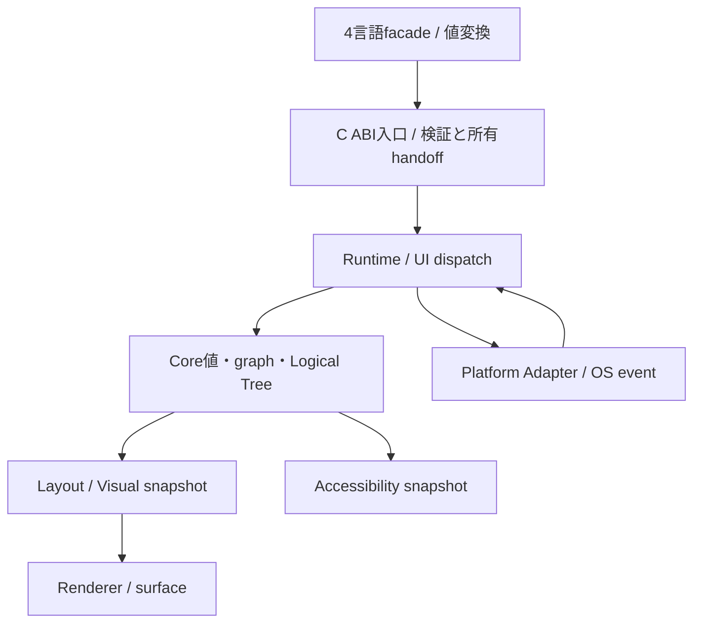

# 全体アーキテクチャと分野の責務

- 文書版: 1.0
- 文書ロール: basic-design
- 更新日: 2026-10-17
- 状態: 承認済み（利用者、2026-10-17、本書1.0全文）

## 目的と責務境界

要求を実現する層の責務分担、主要なデータ・所有の受渡し、状態遷移を定める。具体的なclass/interface・関数署名・wire field・call flowは詳細設計、防御の実現条件はセキュア設計で具体化する。要求・ADRの保証や採用範囲を本書だけで変更しない。

アーキテクチャ制約: [Rust Coreとversioned C ABI](../04_approval/adr-0001-rust-core.md)。

## 要求と基本設計項目の対応

| 設計項目 | 要求根拠 |
| --- | --- |
| 文書ロールと根拠参照 | [RQ-01-001](../11_requirements/RQ-01_purpose-architecture.md#rq-01-001)、[RQ-01-002](../11_requirements/RQ-01_purpose-architecture.md#rq-01-002)、[RQ-16-003](../11_requirements/RQ-16_document-governance.md#rq-16-003)、[RQ-16-004](../11_requirements/RQ-16_document-governance.md#rq-16-004) |
| Core・言語境界・Platformの全体構成 | [RQ-03-014](../11_requirements/RQ-03_language-support.md#rq-03-014)、[RQ-06-012](../11_requirements/RQ-06_threading-dispatch.md#rq-06-012)、[RQ-11-001](../11_requirements/RQ-11_platform.md#rq-11-001)、[RQ-11-002](../11_requirements/RQ-11_platform.md#rq-11-002)、[RQ-11-021](../11_requirements/RQ-11_platform.md#rq-11-021)、[RQ-12-010](../11_requirements/RQ-12_build-distribution.md#rq-12-010)、[RQ-12-023](../11_requirements/RQ-12_build-distribution.md#rq-12-023)、[RQ-16-003](../11_requirements/RQ-16_document-governance.md#rq-16-003)、[RQ-16-004](../11_requirements/RQ-16_document-governance.md#rq-16-004) |

## 文書ロールと根拠参照

要求を層の責務・主要data/ownership flow・stateへ分解する。基本設計はRQとADRを根拠とし、詳細設計とセキュア設計が本書群を具体化する。基本設計から下流の設計・実装へ仕様根拠のリンクを逆流させない。

## Core・言語境界・Platformの全体構成

### 層の責務と主要flow

Core Runtimeは公開ABIから受け取るtyped操作をUI threadへ直列化し、Object/Property/Binding/CommandとLogical Treeの状態を保持する。UI更新後にLayoutを解決し、Visual snapshotをRendererとAccessibilityへ渡す。Platform AdapterはOS eventを中立入力へ変換し、Coreの意味状態を正本にWindow/surface/IME/providerを更新する。



### 全体アーキテクチャ

```text
C++ / C# / Rust / Python
            │
      Language Wrappers
            │
      Versioned C ABI
            │
        Rust UI Core
            │
   Platform / Renderer Adapters
            │
 Windows / Linux / 組み込みLinux（macOSは後続候補）
```

#### Coreの責務

Rust UI Coreは、次の共通意味論を提供する。

- Objectとライフサイクル
- Propertyと変更通知
- Binding
- Command
- CollectionとSelection
- Logical TreeとVisual Tree
- Layout
- Input、Focus、IME
- Errorと診断
- UI threadとdispatcher

#### Adapterの責務

Coreから分離する対象は次のとおりとする。

- Renderer
- Platform backend
- Text engine
- Image codec
- Input backend
- Accessibility backend

GPU、入力デバイス、IME、画面回転、電源管理、Window Systemなどの実機依存要素はPlatform Adapterに閉じ込める。

### 設計領域

| 領域 | 主な責務 |
| --- | --- |
| 共通契約 | 用語、ID、エラー、ライフサイクル、スレッド |
| C ABI | handle、所有権、文字列、callback、ABI version |
| Core Runtime | Object、UI thread、dispatcher、diagnostics |
| MVVMモデル | Property、Binding、Command、Validation |
| データモデル | Collection、Selection、差分通知 |
| UIツリー | Element、Logical Tree、Visual Tree |
| Layout | Measure、Arrange、サイズ、配置 |
| Input | Pointer、Keyboard、Focus、IME |
| Control | Text、TextBox、Button、StackPanel、Window |
| Rendering | Scene、描画コマンド、Renderer抽象 |
| Platform | Linux、Windows、macOS、組み込みLinux |
| Accessibility | role、name、state、focus、platform API |
| Language Binding | C++、C#、Rust、Python wrapper |
| Build / Package | target、CI、native artifact、配布 |

### 依存関係

```text
共通契約 / ABI
        │
   Core Runtime
     ┌──┴──┐
 MVVM基盤  UI Tree / Layout
     │        │
     └──┬─────┘
     基本Control
        │
 Renderer / Platform
```

Core内部のstate/ownershipの依存を上図の境界に閉じ、各Adapterへ共通snapshotまたはtyped requestを渡す。

### 具体化後の共通責務

ABI adapterはtyped値とtokenの入口検査を担当し、Coreはprepare/commitと通知、Hostはevent境界とUI safe point、wrapperは言語ownerとcleanup ticketを担当する。終了要求の観測は[RQ-06-012](../11_requirements/RQ-06_threading-dispatch.md#rq-06-012)、言語基準・管理終了条件は[RQ-03-014/015](../11_requirements/RQ-03_language-support.md#rq-03-014)、artifact期限は[RQ-12-023](../11_requirements/RQ-12_build-distribution.md#rq-12-023)を根拠に各層を接続する。

## 承認履歴

| 日付 | 対象文書・版 | 承認者 | 結論・根拠 |
| --- | --- | --- | --- |
| 2026-10-17 | 旧基本設計の既承認内容 | 利用者 | 従前の方式承認を継承。旧本文と承認記録はローカルarchiveへ保存 |
| — | 本書1.0全文 / 作成時点 | — | 再編集版の確認待ちだった記録。承認結果は次行に記載 |
| 2026-10-17 | 本書1.0全文 | 利用者 | 「OK、承認します。」により再編集版全文を承認。実装・試験合格を意味しない |

## 改訂履歴

| 版 | 日付 | 内容・理由 | 作成者 | 承認記録との対応 |
| --- | --- | --- | --- | --- |
| 1.0 | 2026-10-17 | 利用者のBD再編集指示に基づき責務別に再構成。旧設計ID追跡を廃止 | Codex | 既承認内容の継承と再編集版全文の承認を区別 |
