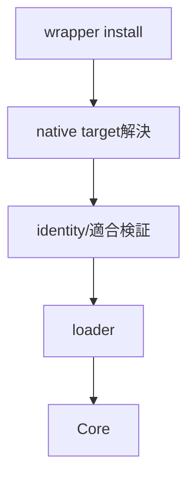
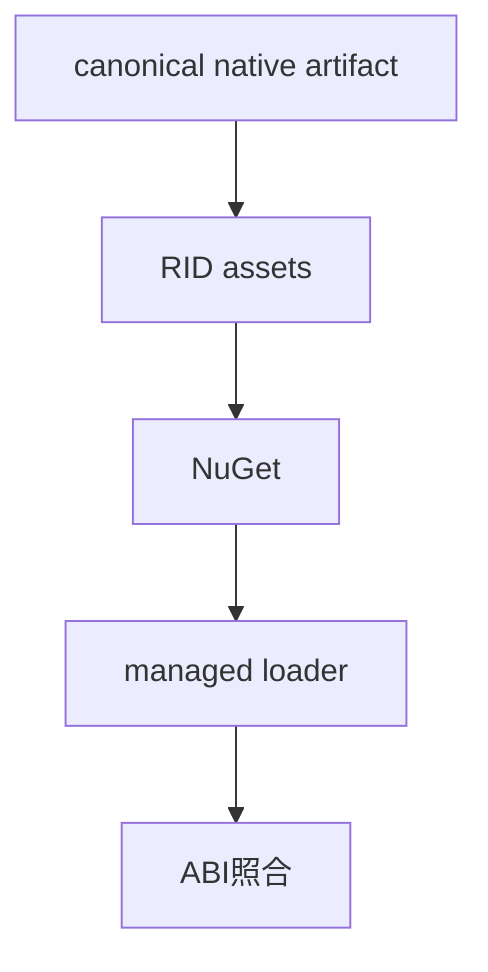
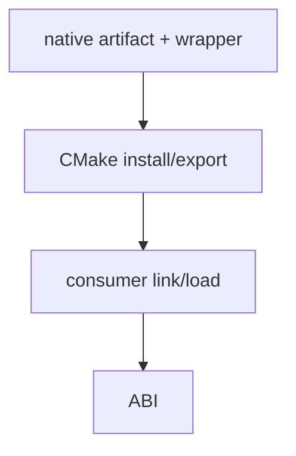
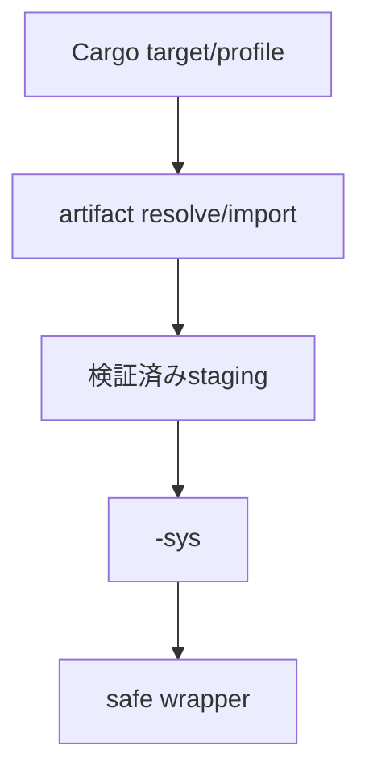
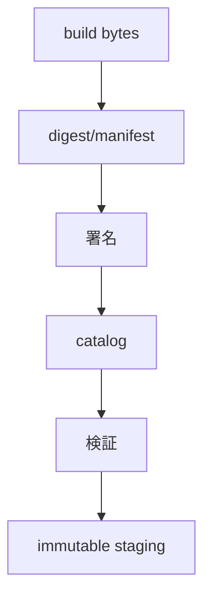
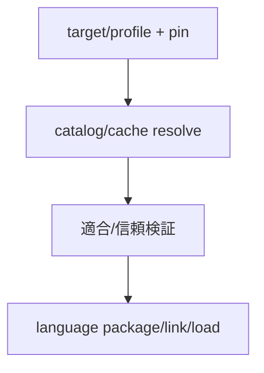
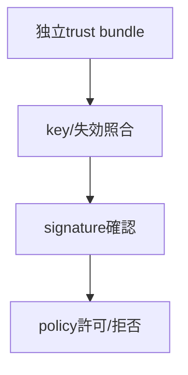
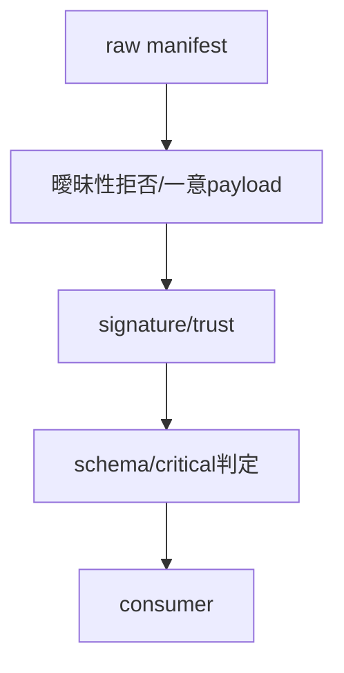

# ビルド・配布：package・artifact・信頼境界

- 文書版: 1.0
- 文書ロール: basic-design
- 更新日: 2026-10-17
- 状態: 承認済み（利用者、2026-10-17、本書1.0全文）

## 目的と責務境界

要求を実現する層の責務分担、主要なデータ・所有の受渡し、状態遷移を定める。具体的なclass/interface・関数署名・wire field・call flowは詳細設計、防御の実現条件はセキュア設計で具体化する。要求・ADRの保証や採用範囲を本書だけで変更しない。

アーキテクチャ制約: [Rust Coreとversioned C ABI](../../04_approval/adr-0001-rust-core.md)。

## 要求と基本設計項目の対応

| 設計項目 | 要求根拠 |
| --- | --- |
| package名・loader・artifact取得・catalog | [RQ-12-025](../../11_requirements/RQ-12_build-distribution.md#rq-12-025) |
| Python packageとnative artifact | [RQ-11-001](../../11_requirements/RQ-11_platform.md#rq-11-001)、[RQ-11-002](../../11_requirements/RQ-11_platform.md#rq-11-002)、[RQ-11-021](../../11_requirements/RQ-11_platform.md#rq-11-021)、[RQ-12-001](../../11_requirements/RQ-12_build-distribution.md#rq-12-001)、[RQ-12-003](../../11_requirements/RQ-12_build-distribution.md#rq-12-003)、[RQ-12-004](../../11_requirements/RQ-12_build-distribution.md#rq-12-004)、[RQ-12-005](../../11_requirements/RQ-12_build-distribution.md#rq-12-005)、[RQ-12-006](../../11_requirements/RQ-12_build-distribution.md#rq-12-006)、[RQ-12-007](../../11_requirements/RQ-12_build-distribution.md#rq-12-007)、[RQ-12-008](../../11_requirements/RQ-12_build-distribution.md#rq-12-008)、[RQ-12-010](../../11_requirements/RQ-12_build-distribution.md#rq-12-010)、[RQ-12-011](../../11_requirements/RQ-12_build-distribution.md#rq-12-011)、[RQ-12-012](../../11_requirements/RQ-12_build-distribution.md#rq-12-012)、[RQ-12-013](../../11_requirements/RQ-12_build-distribution.md#rq-12-013)、[RQ-12-014](../../11_requirements/RQ-12_build-distribution.md#rq-12-014)、[RQ-12-015](../../11_requirements/RQ-12_build-distribution.md#rq-12-015) |
| C# packageとRID別native assets | [RQ-11-001](../../11_requirements/RQ-11_platform.md#rq-11-001)、[RQ-11-002](../../11_requirements/RQ-11_platform.md#rq-11-002)、[RQ-11-021](../../11_requirements/RQ-11_platform.md#rq-11-021)、[RQ-12-001](../../11_requirements/RQ-12_build-distribution.md#rq-12-001)、[RQ-12-003](../../11_requirements/RQ-12_build-distribution.md#rq-12-003)、[RQ-12-005](../../11_requirements/RQ-12_build-distribution.md#rq-12-005)、[RQ-12-006](../../11_requirements/RQ-12_build-distribution.md#rq-12-006)、[RQ-12-010](../../11_requirements/RQ-12_build-distribution.md#rq-12-010)、[RQ-12-011](../../11_requirements/RQ-12_build-distribution.md#rq-12-011)、[RQ-12-012](../../11_requirements/RQ-12_build-distribution.md#rq-12-012)、[RQ-12-013](../../11_requirements/RQ-12_build-distribution.md#rq-12-013) |
| C++ CMake packageとimported target | [RQ-03-001](../../11_requirements/RQ-03_language-support.md#rq-03-001)、[RQ-03-005](../../11_requirements/RQ-03_language-support.md#rq-03-005)、[RQ-11-001](../../11_requirements/RQ-11_platform.md#rq-11-001)、[RQ-11-002](../../11_requirements/RQ-11_platform.md#rq-11-002)、[RQ-11-021](../../11_requirements/RQ-11_platform.md#rq-11-021)、[RQ-12-001](../../11_requirements/RQ-12_build-distribution.md#rq-12-001)、[RQ-12-003](../../11_requirements/RQ-12_build-distribution.md#rq-12-003)、[RQ-12-004](../../11_requirements/RQ-12_build-distribution.md#rq-12-004)、[RQ-12-005](../../11_requirements/RQ-12_build-distribution.md#rq-12-005)、[RQ-12-010](../../11_requirements/RQ-12_build-distribution.md#rq-12-010)、[RQ-12-011](../../11_requirements/RQ-12_build-distribution.md#rq-12-011)、[RQ-12-012](../../11_requirements/RQ-12_build-distribution.md#rq-12-012)、[RQ-12-013](../../11_requirements/RQ-12_build-distribution.md#rq-12-013) |
| Rust crateとnative artifact | [RQ-03-003](../../11_requirements/RQ-03_language-support.md#rq-03-003)、[RQ-03-007](../../11_requirements/RQ-03_language-support.md#rq-03-007)、[RQ-12-001](../../11_requirements/RQ-12_build-distribution.md#rq-12-001)、[RQ-12-003](../../11_requirements/RQ-12_build-distribution.md#rq-12-003)、[RQ-12-004](../../11_requirements/RQ-12_build-distribution.md#rq-12-004)、[RQ-12-005](../../11_requirements/RQ-12_build-distribution.md#rq-12-005)、[RQ-12-006](../../11_requirements/RQ-12_build-distribution.md#rq-12-006)、[RQ-12-008](../../11_requirements/RQ-12_build-distribution.md#rq-12-008)、[RQ-12-011](../../11_requirements/RQ-12_build-distribution.md#rq-12-011)、[RQ-12-012](../../11_requirements/RQ-12_build-distribution.md#rq-12-012)、[RQ-12-013](../../11_requirements/RQ-12_build-distribution.md#rq-12-013)、[RQ-12-014](../../11_requirements/RQ-12_build-distribution.md#rq-12-014)、[RQ-12-015](../../11_requirements/RQ-12_build-distribution.md#rq-12-015) |
| 署名envelope・schema・parser | [RQ-12-022](../../11_requirements/RQ-12_build-distribution.md#rq-12-022) |
| 鍵管理・失効・offline・staging | [RQ-12-023](../../11_requirements/RQ-12_build-distribution.md#rq-12-023) |
| artifact identityとprovenance | [RQ-12-001](../../11_requirements/RQ-12_build-distribution.md#rq-12-001)、[RQ-12-002](../../11_requirements/RQ-12_build-distribution.md#rq-12-002)、[RQ-12-003](../../11_requirements/RQ-12_build-distribution.md#rq-12-003)、[RQ-12-004](../../11_requirements/RQ-12_build-distribution.md#rq-12-004)、[RQ-12-005](../../11_requirements/RQ-12_build-distribution.md#rq-12-005)、[RQ-12-006](../../11_requirements/RQ-12_build-distribution.md#rq-12-006)、[RQ-12-008](../../11_requirements/RQ-12_build-distribution.md#rq-12-008)、[RQ-12-011](../../11_requirements/RQ-12_build-distribution.md#rq-12-011)、[RQ-12-012](../../11_requirements/RQ-12_build-distribution.md#rq-12-012)、[RQ-12-013](../../11_requirements/RQ-12_build-distribution.md#rq-12-013)、[RQ-12-014](../../11_requirements/RQ-12_build-distribution.md#rq-12-014)、[RQ-12-015](../../11_requirements/RQ-12_build-distribution.md#rq-12-015) |
| artifact取得・配布・cache | [RQ-12-001](../../11_requirements/RQ-12_build-distribution.md#rq-12-001)、[RQ-12-003](../../11_requirements/RQ-12_build-distribution.md#rq-12-003)、[RQ-12-004](../../11_requirements/RQ-12_build-distribution.md#rq-12-004)、[RQ-12-005](../../11_requirements/RQ-12_build-distribution.md#rq-12-005)、[RQ-12-006](../../11_requirements/RQ-12_build-distribution.md#rq-12-006)、[RQ-12-007](../../11_requirements/RQ-12_build-distribution.md#rq-12-007)、[RQ-12-008](../../11_requirements/RQ-12_build-distribution.md#rq-12-008)、[RQ-12-011](../../11_requirements/RQ-12_build-distribution.md#rq-12-011)、[RQ-12-012](../../11_requirements/RQ-12_build-distribution.md#rq-12-012)、[RQ-12-013](../../11_requirements/RQ-12_build-distribution.md#rq-12-013)、[RQ-12-014](../../11_requirements/RQ-12_build-distribution.md#rq-12-014)、[RQ-12-015](../../11_requirements/RQ-12_build-distribution.md#rq-12-015) |
| 署名・trust root・検証責務 | [RQ-12-004](../../11_requirements/RQ-12_build-distribution.md#rq-12-004)、[RQ-12-005](../../11_requirements/RQ-12_build-distribution.md#rq-12-005)、[RQ-12-006](../../11_requirements/RQ-12_build-distribution.md#rq-12-006)、[RQ-12-008](../../11_requirements/RQ-12_build-distribution.md#rq-12-008)、[RQ-12-011](../../11_requirements/RQ-12_build-distribution.md#rq-12-011)、[RQ-12-012](../../11_requirements/RQ-12_build-distribution.md#rq-12-012)、[RQ-12-013](../../11_requirements/RQ-12_build-distribution.md#rq-12-013)、[RQ-12-014](../../11_requirements/RQ-12_build-distribution.md#rq-12-014)、[RQ-12-015](../../11_requirements/RQ-12_build-distribution.md#rq-12-015) |
| manifestとschemaの適合検査 | [RQ-12-004](../../11_requirements/RQ-12_build-distribution.md#rq-12-004)、[RQ-12-005](../../11_requirements/RQ-12_build-distribution.md#rq-12-005)、[RQ-12-006](../../11_requirements/RQ-12_build-distribution.md#rq-12-006)、[RQ-12-008](../../11_requirements/RQ-12_build-distribution.md#rq-12-008)、[RQ-12-011](../../11_requirements/RQ-12_build-distribution.md#rq-12-011)、[RQ-12-012](../../11_requirements/RQ-12_build-distribution.md#rq-12-012)、[RQ-12-013](../../11_requirements/RQ-12_build-distribution.md#rq-12-013)、[RQ-12-014](../../11_requirements/RQ-12_build-distribution.md#rq-12-014)、[RQ-12-015](../../11_requirements/RQ-12_build-distribution.md#rq-12-015) |

## package名・loader・artifact取得・catalog

配布assemblerは一native identityを4wrapper packageへ接続する。fetch/import toolは明示取得と検証を行い、各loaderはverified path/lockだけを使う。通常import/buildでnetwork取得を開始しない。

## Python packageとnative artifact

### 層の責務と主要flow

pure-Python wrapper packageには公開API、ctypes宣言、型情報を収録する。native runtimeはtarget別distributionとして解決し、wrapper loaderがversion/ABI/feature適合を確認してからロードする。ARMはboard/libc/profile互換性が確認された形式で導入し、package labelと実際の互換性を照合する。

## C# packageとRID別native assets

### 層の責務と主要flow

NuGet assemblyとRID別native assetsを同じpackageへ組み立てる。managed wrapper loaderは対象RIDのnative assetと依存libraryを解決し、共通manifest identityとABI適合を確認する。ARMの一般RID対応はboard/profile互換性の検証を経た対象だけにする。

## C++ CMake packageとimported target

### 層の責務と主要flow

C++ header/source、target native library、CMake Config/export targetをrelocatable install treeへ収録する。consumerはfind_packageでtargetを解決し、include/link/runtime dependencyをexport情報から受け取る。CoreをC++ ABIとして公開せず、wrapperはC ABIの所有・statusをC++型へ変換する。

## Rust crateとnative artifact

### 層の責務と主要flow

Cargo配布はraw FFIの-sysとsafe wrapperを分け、target native runtimeを独立artifactとしてlink/loadする。Cargo targetとnamed profileをartifact解決へ渡し、明示importは検証済みstagingへ取り込んでからlink search情報を返す。safe crateの通常利用からraw handle/userdataを隠し、unsafe実装でCore契約を満たす。

## 署名envelope・schema・parser

Producerは全payloadをJCS化してdomain付き署名を生成する。Verifierは構文一意性→独立trust/署名→schema/critical/適合→artifact digestの順に処理し、未検証recordを成功型へ変換しない。

## 鍵管理・失効・offline・staging

TrustResolverは独立provisionしたrole鍵とsequence/時刻を照合する。root更新は旧新thresholdで認証し、Verifierはprivate stagingの同bytesを検証してatomic publishする。loaderまでimmutable file ownerを保持する。

## artifact identityとprovenance

### 層の責務と主要flow

build結果にmanifestを対応付け、native bytesのdigestとtarget/profile/ABI/featureをimmutable identityへ束縛する。配布catalogはそのidentityを公開し、consumerはsignatureと適合条件を照合して検証済みstagingへ取り込む。aliasは解決入口だけに使い、解決済みidentity/digestをlockへ記録する。

## artifact取得・配布・cache

### 層の責務と主要flow

canonical catalogをartifact identityの取得元とし、language package assemblerは同じ検証済みnative bytesを取り込む。selectorはconsumer target/profileを入力として必要featureとABIを照合する。fetch/importは明示要求から起動し、既存cacheに同じidentityで異なるbytesを上書きしない。offlineでは検証済みbundleを同じselectorへ渡す。

## 署名・trust root・検証責務

### 層の責務と主要flow

consumerの検証器は配布物または運用者provisionのtrust bundleを入力としてkey identityを解決する。artifactと同時に取得した鍵だけで信頼を開始しない。認証済みkeyset更新でrotationを適用し、revocation状態を先に確認して署名検証結果と利用可否を分ける。offlineでも明示bundleから同じpolicyを評価する。

## manifestとschemaの適合検査

### 層の責務と主要flow

manifest producerはschema versionと全意味payloadを署名対象へ入れる。readerは曖昧表現を構文検査で拒否し、署名対象bytesを一意に求めた後に信頼と意味互換を検証する。同major未知optional項目も署名対象として保持してから無視し、critical/target/ABI/trust情報は必須判定へ渡す。

## 承認履歴

| 日付 | 対象文書・版 | 承認者 | 結論・根拠 |
| --- | --- | --- | --- |
| 2026-10-17 | 旧基本設計の既承認内容 | 利用者 | 従前の方式承認を継承。旧本文と承認記録はローカルarchiveへ保存 |
| — | 本書1.0全文 / 作成時点 | — | 再編集版の確認待ちだった記録。承認結果は次行に記載 |
| 2026-10-17 | 本書1.0全文 | 利用者 | 「OK、承認します。」により再編集版全文を承認。実装・試験合格を意味しない |

## 改訂履歴

| 版 | 日付 | 内容・理由 | 作成者 | 承認記録との対応 |
| --- | --- | --- | --- | --- |
| 1.0 | 2026-10-17 | 利用者のBD再編集指示に基づき責務別に再構成。旧設計ID追跡を廃止 | Codex | 既承認内容の継承と再編集版全文の承認を区別 |
