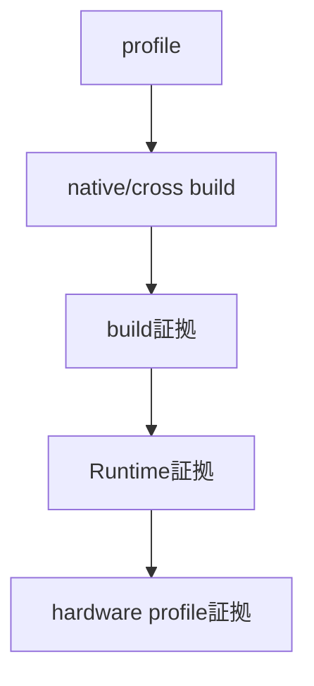
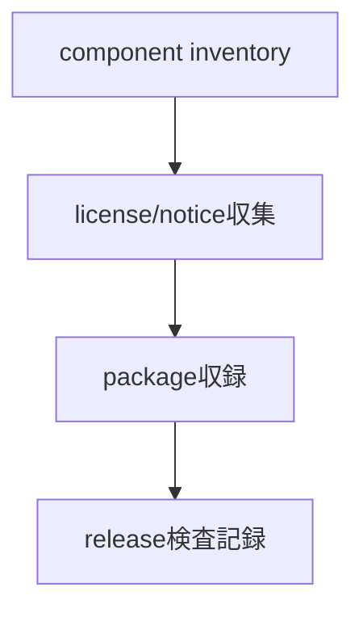
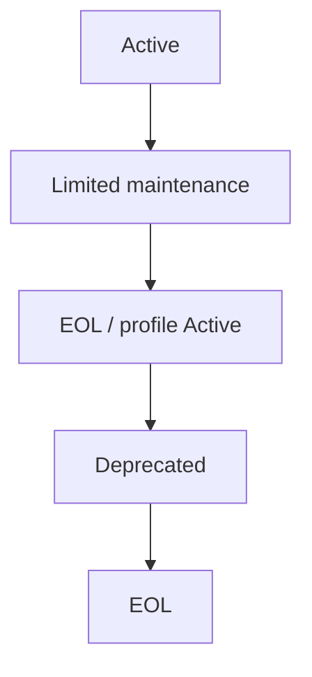

# ビルド環境：toolchain・検証・support

- 文書版: 1.0
- 文書ロール: basic-design
- 更新日: 2026-10-17
- 状態: 承認済み（利用者、2026-10-17、本書1.0全文）

## 目的と責務境界

要求を実現する層の責務分担、主要なデータ・所有の受渡し、状態遷移を定める。具体的なclass/interface・関数署名・wire field・call flowは詳細設計、防御の実現条件はセキュア設計で具体化する。要求・ADRの保証や採用範囲を本書だけで変更しない。

アーキテクチャ制約: [Rust Coreとversioned C ABI](../../04_approval/adr-0001-rust-core.md)。

## 要求と基本設計項目の対応

| 設計項目 | 要求根拠 |
| --- | --- |
| 最低版・target matrix・toolchain lock・保守 | [RQ-03-014](../../11_requirements/RQ-03_language-support.md#rq-03-014)、[RQ-04-030](../../11_requirements/RQ-04_abi-boundary.md#rq-04-030)、[RQ-11-024](../../11_requirements/RQ-11_platform.md#rq-11-024)、[RQ-12-024](../../11_requirements/RQ-12_build-distribution.md#rq-12-024) |
| 実装unit台帳・test ID・CI・scenario | [RQ-03-014](../../11_requirements/RQ-03_language-support.md#rq-03-014)、[RQ-04-030](../../11_requirements/RQ-04_abi-boundary.md#rq-04-030)、[RQ-11-001](../../11_requirements/RQ-11_platform.md#rq-11-001)、[RQ-11-002](../../11_requirements/RQ-11_platform.md#rq-11-002)、[RQ-11-003](../../11_requirements/RQ-11_platform.md#rq-11-003)、[RQ-11-004](../../11_requirements/RQ-11_platform.md#rq-11-004)、[RQ-11-021](../../11_requirements/RQ-11_platform.md#rq-11-021)、[RQ-11-024](../../11_requirements/RQ-11_platform.md#rq-11-024)、[RQ-12-009](../../11_requirements/RQ-12_build-distribution.md#rq-12-009)、[RQ-12-010](../../11_requirements/RQ-12_build-distribution.md#rq-12-010)、[RQ-12-024](../../11_requirements/RQ-12_build-distribution.md#rq-12-024)、[RQ-13-001](../../11_requirements/RQ-13_nonfunctional-measurement.md#rq-13-001)、[RQ-13-011](../../11_requirements/RQ-13_nonfunctional-measurement.md#rq-13-011) |
| target profile・cross-build・CI | [RQ-11-001](../../11_requirements/RQ-11_platform.md#rq-11-001)、[RQ-11-002](../../11_requirements/RQ-11_platform.md#rq-11-002)、[RQ-11-003](../../11_requirements/RQ-11_platform.md#rq-11-003)、[RQ-11-004](../../11_requirements/RQ-11_platform.md#rq-11-004)、[RQ-11-021](../../11_requirements/RQ-11_platform.md#rq-11-021)、[RQ-12-009](../../11_requirements/RQ-12_build-distribution.md#rq-12-009)、[RQ-12-010](../../11_requirements/RQ-12_build-distribution.md#rq-12-010)、[RQ-13-001](../../11_requirements/RQ-13_nonfunctional-measurement.md#rq-13-001)、[RQ-13-011](../../11_requirements/RQ-13_nonfunctional-measurement.md#rq-13-011) |
| license・第三者依存の管理 | [RQ-12-004](../../11_requirements/RQ-12_build-distribution.md#rq-12-004)、[RQ-12-005](../../11_requirements/RQ-12_build-distribution.md#rq-12-005)、[RQ-12-006](../../11_requirements/RQ-12_build-distribution.md#rq-12-006)、[RQ-12-008](../../11_requirements/RQ-12_build-distribution.md#rq-12-008)、[RQ-12-016](../../11_requirements/RQ-12_build-distribution.md#rq-12-016)、[RQ-12-021](../../11_requirements/RQ-12_build-distribution.md#rq-12-021) |
| support状態と保守の責務 | [RQ-11-001](../../11_requirements/RQ-11_platform.md#rq-11-001)、[RQ-11-002](../../11_requirements/RQ-11_platform.md#rq-11-002)、[RQ-11-020](../../11_requirements/RQ-11_platform.md#rq-11-020)、[RQ-11-021](../../11_requirements/RQ-11_platform.md#rq-11-021)、[RQ-12-010](../../11_requirements/RQ-12_build-distribution.md#rq-12-010)、[RQ-12-017](../../11_requirements/RQ-12_build-distribution.md#rq-12-017)、[RQ-12-018](../../11_requirements/RQ-12_build-distribution.md#rq-12-018)、[RQ-12-019](../../11_requirements/RQ-12_build-distribution.md#rq-12-019)、[RQ-12-020](../../11_requirements/RQ-12_build-distribution.md#rq-12-020) |

## 最低版・target matrix・toolchain lock・保守

BuildProfileResolverはtarget/CPU/libc/依存条件をlockへ固定する。CIはcross-buildと実機gateを分け、release assemblerは全採取fieldと必要証拠が揃ったprofileだけを公開可能状態へ進める。

## 実装unit台帳・test ID・CI・scenario

変更検出器は旧新台帳のpathと共有入力を照合し、依存逆閉包からsuiteを選ぶ。実装とtestを同じcheckout SHAで実行し、未対応pathは定義済み広域fallbackまたはmapping failureへ送る。

## target profile・cross-build・CI

### 層の責務と主要flow

build profileからhostとtargetを別々に取り出し、native buildまたは指定sysrootでcross-buildする。compile/link/artifact inspectionの結果をbuild検証記録へ出し、Runtime suiteと実機suiteは別の検証記録へ出す。release metadataはこの三種の証拠をprofile単位で参照する。CI job/board選択と測定caseはtest計画へ移す。

## license・第三者依存の管理

### 層の責務と主要flow

本書のlicense選択理由と当時の承認記録を履歴として保持する。現行の再配布条件はRQへまとめ、配布pipelineの実現説明は、first-partyと依存componentのinventoryをpackage構成へ対応付け、必要なlicense/notice/変更表示を収録してrelease検査へ渡すflowに置き換える。

## support状態と保守の責務

### 層の責務と主要flow

ABI major×profileをsupport記録のkeyとし、通常保守・限定保守・非推奨・EOLの状態と開始/終了根拠を管理する。新major公開を旧majorの限定保守期間へ対応付け、profile変更告知と公開物への参照をrelease metadataに結ぶ。保守期間・例外・EOL後の利用者可視結果はRQを正本にする。

## 承認履歴

| 日付 | 対象文書・版 | 承認者 | 結論・根拠 |
| --- | --- | --- | --- |
| 2026-10-17 | 旧基本設計の既承認内容 | 利用者 | 従前の方式承認を継承。旧本文と承認記録はローカルarchiveへ保存 |
| — | 本書1.0全文 / 作成時点 | — | 再編集版の確認待ちだった記録。承認結果は次行に記載 |
| 2026-10-17 | 本書1.0全文 | 利用者 | 「OK、承認します。」により再編集版全文を承認。実装・試験合格を意味しない |

## 改訂履歴

| 版 | 日付 | 内容・理由 | 作成者 | 承認記録との対応 |
| --- | --- | --- | --- | --- |
| 1.0 | 2026-10-17 | 利用者のBD再編集指示に基づき責務別に再構成。旧設計ID追跡を廃止 | Codex | 既承認内容の継承と再編集版全文の承認を区別 |
