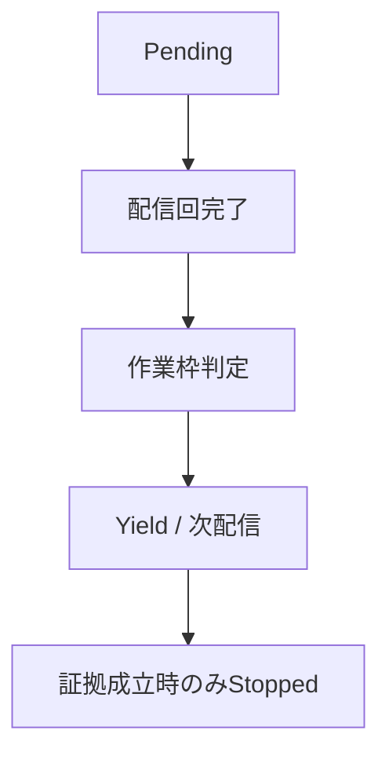
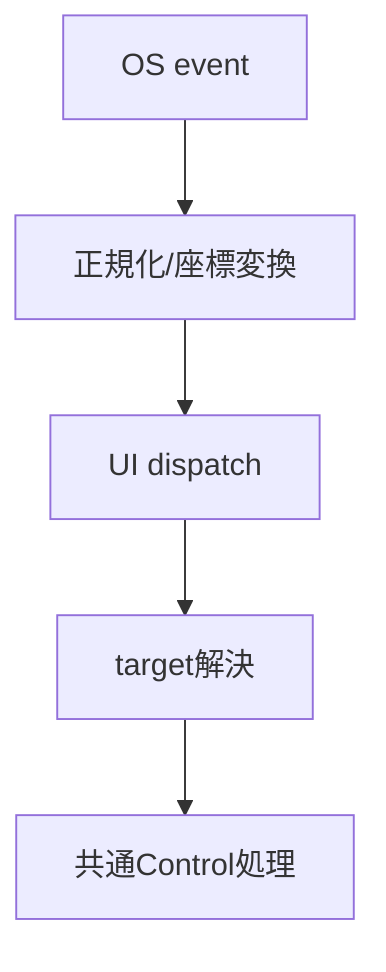
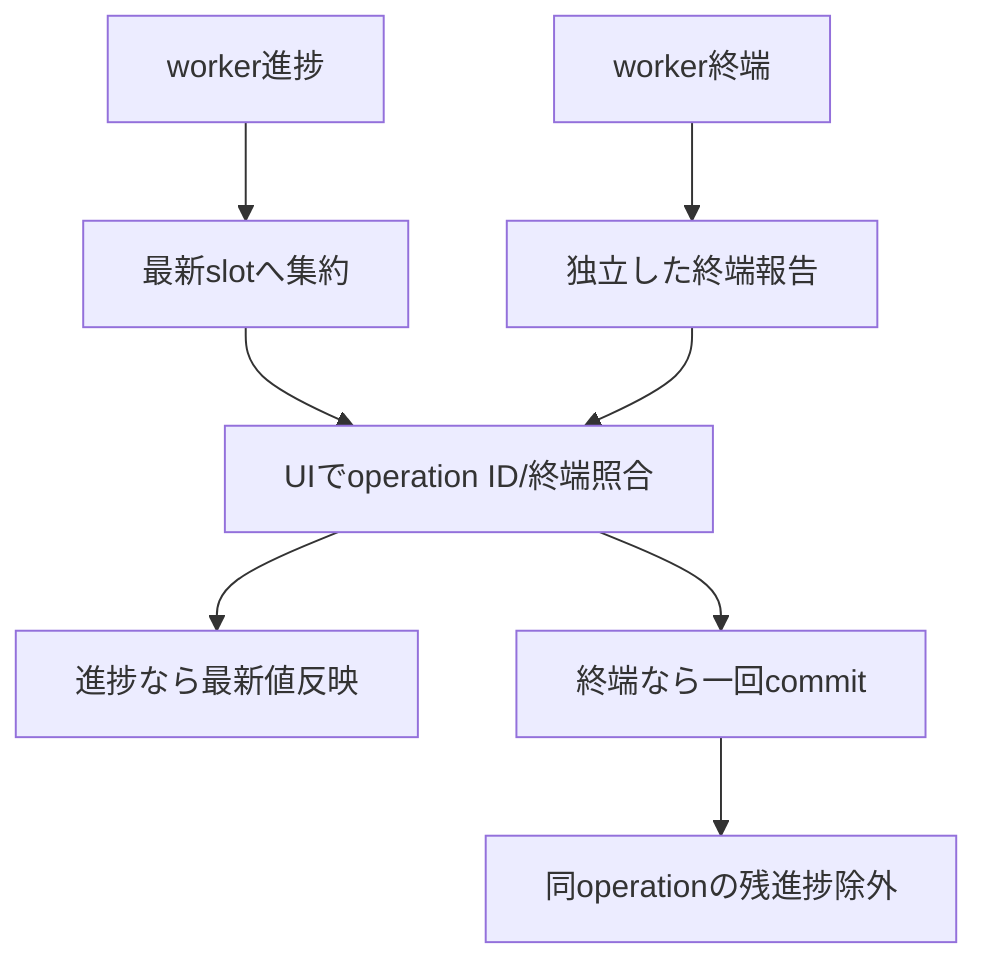

# イベントハンドリング：通知・入力・Command

- 文書版: 1.0
- 文書ロール: basic-design
- 更新日: 2026-10-17
- 状態: 承認済み（利用者、2026-10-17、本書1.0全文）

## 目的と責務境界

要求を実現する層の責務分担、主要なデータ・所有の受渡し、状態遷移を定める。具体的なclass/interface・関数署名・wire field・call flowは詳細設計、防御の実現条件はセキュア設計で具体化する。要求・ADRの保証や採用範囲を本書だけで変更しない。

アーキテクチャ制約: [Rust Coreとversioned C ABI](../../04_approval/adr-0001-rust-core.md)。

## 要求と基本設計項目の対応

| 設計項目 | 要求根拠 |
| --- | --- |
| 通知・非収束・Command・エラーcatalog | [RQ-06-013](../../11_requirements/RQ-06_threading-dispatch.md#rq-06-013)、[RQ-07-017](../../11_requirements/RQ-07_binding.md#rq-07-017) |
| 通知作業・yield・診断 | [RQ-03-011](../../11_requirements/RQ-03_language-support.md#rq-03-011)、[RQ-03-012](../../11_requirements/RQ-03_language-support.md#rq-03-012)、[RQ-07-008](../../11_requirements/RQ-07_binding.md#rq-07-008)、[RQ-07-013](../../11_requirements/RQ-07_binding.md#rq-07-013)、[RQ-07-014](../../11_requirements/RQ-07_binding.md#rq-07-014)、[RQ-12-007](../../11_requirements/RQ-12_build-distribution.md#rq-12-007) |
| 入力eventのCore/OS境界 | [RQ-02-009](../../11_requirements/RQ-02_core-features.md#rq-02-009)、[RQ-09-005](../../11_requirements/RQ-09_ui-scope.md#rq-09-005)、[RQ-09-009](../../11_requirements/RQ-09_ui-scope.md#rq-09-009)、[RQ-09-010](../../11_requirements/RQ-09_ui-scope.md#rq-09-010)、[RQ-09-038](../../11_requirements/RQ-09_ui-scope.md#rq-09-038)、[RQ-09-049](../../11_requirements/RQ-09_ui-scope.md#rq-09-049)、[RQ-11-012](../../11_requirements/RQ-11_platform.md#rq-11-012) |
| Command進捗と終端 | [RQ-05-002](../../11_requirements/RQ-05_ownership-callbacks.md#rq-05-002)、[RQ-06-004](../../11_requirements/RQ-06_threading-dispatch.md#rq-06-004)、[RQ-06-008](../../11_requirements/RQ-06_threading-dispatch.md#rq-06-008)、[RQ-06-009](../../11_requirements/RQ-06_threading-dispatch.md#rq-06-009)、[RQ-06-010](../../11_requirements/RQ-06_threading-dispatch.md#rq-06-010)、[RQ-06-011](../../11_requirements/RQ-06_threading-dispatch.md#rq-06-011) |

## 通知・非収束・Command・エラーcatalog

通知queueは有限sliceでyieldし、連鎖履歴は意味snapshot一致時だけ停止証拠にする。WatchDogは独立診断、Commandはoperationごとの開始leaseと終端recordを所有し、error catalogは生成lockで識別値を固定する。

## 通知作業・yield・診断

### 層の責務と主要flow

Runtimeは因果連鎖を識別して未配信作業を保持する。有限作業枠の終点では完了した配信回までを確定し、残件を保持してhost loopへ制御を返す。次の処理機会に同じ順序から再開する。長期保留の観測と循環証拠の判定を別に行い、証拠が成立した連鎖だけを停止状態へ移す。診断経路は通常通知連鎖を再発生させず、停止状態の不変snapshotを公開する。

## 入力eventのCore/OS境界

### 層の責務と主要flow

Platform Input Adapterはraw eventを中立eventへ変換し、座標はCore Layoutの座標系へ一度だけ写像する。Runtime UI threadがFocusまたはVisual hit-testとLogical対応からtargetを決め、Core Inputへ渡す。TextBox編集候補は共通入力検証へ接続し、backend固有のnative動作で判定結果を上書きしない。

## Command進捗と終端

### 層の責務と主要flow

進捗格納と終端報告を別経路にする。同一operationの未配信進捗は最新slotへ置換し、wakeはまとめる。UI threadはoperation IDを照合して進捗を適用し、終端状態へ遷移した後は同じoperationの保留進捗を落とす。終端報告は進捗slotの置換対象に含めない。

## 承認履歴

| 日付 | 対象文書・版 | 承認者 | 結論・根拠 |
| --- | --- | --- | --- |
| 2026-10-17 | 旧基本設計の既承認内容 | 利用者 | 従前の方式承認を継承。旧本文と承認記録はローカルarchiveへ保存 |
| — | 本書1.0全文 / 作成時点 | — | 再編集版の確認待ちだった記録。承認結果は次行に記載 |
| 2026-10-17 | 本書1.0全文 | 利用者 | 「OK、承認します。」により再編集版全文を承認。実装・試験合格を意味しない |

## 改訂履歴

| 版 | 日付 | 内容・理由 | 作成者 | 承認記録との対応 |
| --- | --- | --- | --- | --- |
| 1.0 | 2026-10-17 | 利用者のBD再編集指示に基づき責務別に再構成。旧設計ID追跡を廃止 | Codex | 既承認内容の継承と再編集版全文の承認を区別 |
