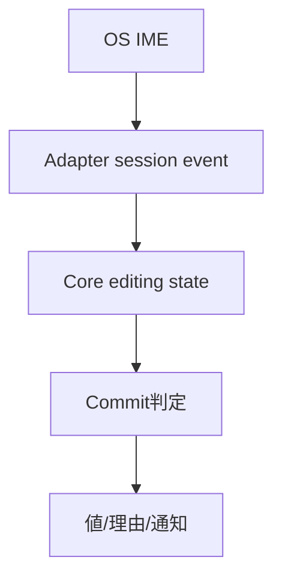
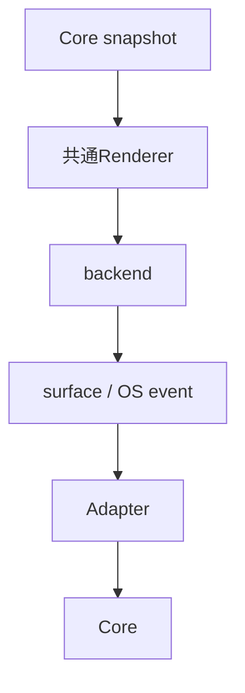
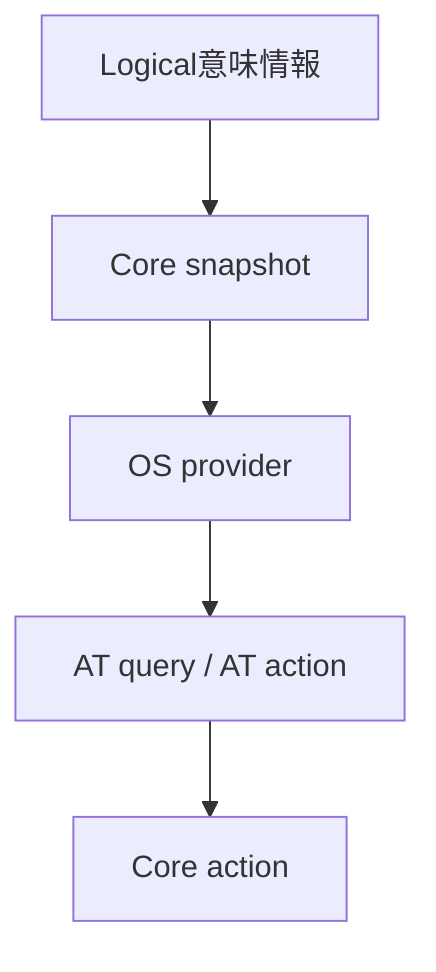
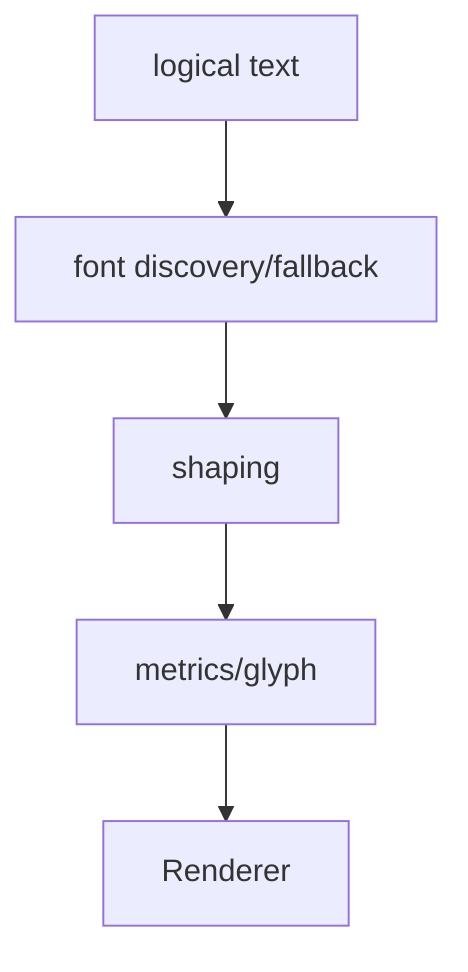

# プラットフォーム：抽象化・描画・text・OS接続

- 文書版: 1.1
- 文書ロール: basic-design
- 更新日: 2026-10-30
- 状態: 1.1全文承認済み（利用者、2026-10-30）。実装・試験状態は別管理

## 目的と責務境界

要求を実現する層の責務分担、主要なデータ・所有の受渡し、状態遷移を定める。具体的なclass/interface・関数署名・wire field・call flowは詳細設計、防御の実現条件はセキュア設計で具体化する。要求・ADRの保証や採用範囲を本書だけで変更しない。

アーキテクチャ制約: [Rust Coreとversioned C ABI](../../04_approval/adr-0001-rust-core.md)。

## 要求と基本設計項目の対応

| 設計項目 | 要求根拠 |
| --- | --- |
| Control API・Window close・描画backend | [RQ-09-071](../../11_requirements/RQ-09_ui-scope.md#rq-09-071)、[RQ-09-072](../../11_requirements/RQ-09_ui-scope.md#rq-09-072)、[RQ-09-074](../../11_requirements/RQ-09_ui-scope.md#rq-09-074)（改訂案）、[RQ-11-022](../../11_requirements/RQ-11_platform.md#rq-11-022) |
| Text engine・IME OS接続・Accessibility | [RQ-10-014](../../11_requirements/RQ-10_accessibility.md#rq-10-014)、[RQ-11-023](../../11_requirements/RQ-11_platform.md#rq-11-023) |
| IMEのCore/OS責務境界 | [RQ-02-011](../../11_requirements/RQ-02_core-features.md#rq-02-011)、[RQ-09-005](../../11_requirements/RQ-09_ui-scope.md#rq-09-005)、[RQ-09-038](../../11_requirements/RQ-09_ui-scope.md#rq-09-038)、[RQ-09-040](../../11_requirements/RQ-09_ui-scope.md#rq-09-040)、[RQ-09-042](../../11_requirements/RQ-09_ui-scope.md#rq-09-042)、[RQ-09-055](../../11_requirements/RQ-09_ui-scope.md#rq-09-055)、[RQ-09-056](../../11_requirements/RQ-09_ui-scope.md#rq-09-056) |
| Renderer・surface・Platform接続 | [RQ-01-002](../../11_requirements/RQ-01_purpose-architecture.md#rq-01-002)、[RQ-09-005](../../11_requirements/RQ-09_ui-scope.md#rq-09-005)、[RQ-09-053](../../11_requirements/RQ-09_ui-scope.md#rq-09-053)、[RQ-09-054](../../11_requirements/RQ-09_ui-scope.md#rq-09-054)、[RQ-11-001](../../11_requirements/RQ-11_platform.md#rq-11-001)、[RQ-11-002](../../11_requirements/RQ-11_platform.md#rq-11-002)、[RQ-11-003](../../11_requirements/RQ-11_platform.md#rq-11-003)、[RQ-11-004](../../11_requirements/RQ-11_platform.md#rq-11-004)、[RQ-11-008](../../11_requirements/RQ-11_platform.md#rq-11-008)、[RQ-11-009](../../11_requirements/RQ-11_platform.md#rq-11-009)、[RQ-11-020](../../11_requirements/RQ-11_platform.md#rq-11-020)、[RQ-11-021](../../11_requirements/RQ-11_platform.md#rq-11-021)、[RQ-12-010](../../11_requirements/RQ-12_build-distribution.md#rq-12-010)、[RQ-13-001](../../11_requirements/RQ-13_nonfunctional-measurement.md#rq-13-001)、[RQ-13-011](../../11_requirements/RQ-13_nonfunctional-measurement.md#rq-13-011) |
| Accessibility意味情報とOS provider | [RQ-09-011](../../11_requirements/RQ-09_ui-scope.md#rq-09-011)、[RQ-10-001](../../11_requirements/RQ-10_accessibility.md#rq-10-001)、[RQ-10-002](../../11_requirements/RQ-10_accessibility.md#rq-10-002)、[RQ-10-003](../../11_requirements/RQ-10_accessibility.md#rq-10-003)、[RQ-10-004](../../11_requirements/RQ-10_accessibility.md#rq-10-004)、[RQ-10-005](../../11_requirements/RQ-10_accessibility.md#rq-10-005)、[RQ-10-006](../../11_requirements/RQ-10_accessibility.md#rq-10-006)、[RQ-10-007](../../11_requirements/RQ-10_accessibility.md#rq-10-007)、[RQ-10-008](../../11_requirements/RQ-10_accessibility.md#rq-10-008)、[RQ-10-009](../../11_requirements/RQ-10_accessibility.md#rq-10-009)、[RQ-10-011](../../11_requirements/RQ-10_accessibility.md#rq-10-011)、[RQ-10-012](../../11_requirements/RQ-10_accessibility.md#rq-10-012)、[RQ-10-013](../../11_requirements/RQ-10_accessibility.md#rq-10-013) |
| text engineとglyph snapshot | [RQ-04-003](../../11_requirements/RQ-04_abi-boundary.md#rq-04-003)、[RQ-04-020](../../11_requirements/RQ-04_abi-boundary.md#rq-04-020)、[RQ-09-005](../../11_requirements/RQ-09_ui-scope.md#rq-09-005)、[RQ-09-053](../../11_requirements/RQ-09_ui-scope.md#rq-09-053)、[RQ-09-054](../../11_requirements/RQ-09_ui-scope.md#rq-09-054) |

## Control API・Window close・描画backend

WindowはCore状態とnative peerを分け、表示開始・close判断・surface喪失を状態機械で処理する。RendererはControlを保持しないSceneSnapshotとdamageを受け、backendがGPU completionを所有する。

## Text engine・IME OS接続・Accessibility

TextServiceがGlyphRunを作り、IME adapterが中立編集eventへ変換する。AccessibilityStoreはcommit後snapshotを公開し、OS queryは不変値だけを読む。actionはUI要求recordを通して開始前取消と開始済みを区別する。

## IMEのCore/OS責務境界

### 層の責務と主要flow

Core TextBoxが編集全文・selection/caret・preeditと入力状態を保持し、AdapterはOS IME sessionとcandidate UIを所有する。UpdateはCore編集状態だけを書き換え、Commitは完全候補を入力Validatorへ一度渡す。candidate UIの配置にはCoreのcaret/layout座標を渡し、native候補windowを編集値の正本にしない。

## Renderer・surface・Platform接続

### 層の責務と主要flow

Core Visual/Layout snapshotを共通Rendererへ渡し、RendererがPlatform backendのsurfaceへ描画する。AdapterはWindow/surface、input、IME、AccessibilityとOSとの接点を所有する。Linux x64とARMで共通source/build logicを共有し、target別linker/sysroot/dependencyから別native artifactを作る。開発順は計画へ、公開support範囲はRQへ分ける。

## Core-owned Window background RGBのbackend伝達（1.1改訂案）

Window/Control layerで未指定overrideを規定値opaque white `#FFFFFF`へ解決し、SceneSnapshotには有効な正規化RGB値を必ず格納する。Renderer/backendはOS、GPU、window managerの暗黙色へ依存せず、受け取った値でsurface client領域をclearしてからDrawOpを実行する。Windowごとの明示RGB overrideとresetはCore stateで保持し、renderer選択やprofile変更で値を失わない。

背景色更新はLayoutを走らせず、次のscene/frame更新を要求する。現在のrendererが指定値をsurfaceへ反映できない場合は既存Platform failure契約に従い、別の色やbackendへ黙って置き換えない。実装API・RGB値のC ABI表現・wrapper表現はWindow Control/API DDで確定する。

要求根拠: [RQ-09-074](../../11_requirements/RQ-09_ui-scope.md#rq-09-074)（改訂案）、[RQ-11-008](../../11_requirements/RQ-11_platform.md#rq-11-008)、[RQ-11-020](../../11_requirements/RQ-11_platform.md#rq-11-020)。

## Accessibility意味情報とOS provider

### 層の責務と主要flow

Logical Controlのrole/name/state/value/focus/actionからCore Accessibility snapshotを構成し、Platform providerがOS語彙へ写像する。Button invokeは通常activation、TextBox editは共通編集判定へ戻す。queryはsnapshotを読み、actionはUI dispatch経路を通す。Visual内部部品の追加だけではLogical公開階層を増やさない。

## text engineとglyph snapshot

### 層の責務と主要flow

Coreはlogical UTF-8 textを保持し、text serviceへfont条件・文字列・layout条件を渡す。text serviceはfont discovery/fallback、shaping、glyph rasterizationを分担し、Rendererへmetricsとglyph情報を返す。target profileにfont assetと依存条件を結び、対応文字corpusの測定はtest側で管理する。

## 承認履歴

| 日付 | 対象文書・版 | 承認者 | 結論・根拠 |
| --- | --- | --- | --- |
| 2026-10-17 | 旧基本設計の既承認内容 | 利用者 | 従前の方式承認を継承。旧本文と承認記録はローカルarchiveへ保存 |
| — | 本書1.0全文 / 作成時点 | — | 再編集版の確認待ちだった記録。承認結果は次行に記載 |
| 2026-10-17 | 本書1.0全文 | 利用者 | 「OK、承認します。」により再編集版全文を承認。実装・試験合格を意味しない |
| 2026-10-30 | 本書1.1改訂案 | — | Core-owned Window background RGBのscene伝達とrenderer failure境界を追加提案。1.0承認範囲を維持し全文レビュー待ち |
| 2026-10-30 | 本書1.1全文 | 利用者 | 「ok」によりCore解決色のbackend伝達とfailure境界を含む全文を承認。実装・試験合格を意味しない |

## 改訂履歴

| 版 | 日付 | 内容・理由 | 作成者 | 承認記録との対応 |
| --- | --- | --- | --- | --- |
| 1.0 | 2026-10-17 | 利用者のBD再編集指示に基づき責務別に再構成。旧設計ID追跡を廃止 | Codex | 既承認内容の継承と再編集版全文の承認を区別 |
| 1.1 | 2026-10-30 | Window背景色のCore解決とbackendへの明示伝達を追加 | Codex | 全文承認済み。実装・試験は別管理 |
