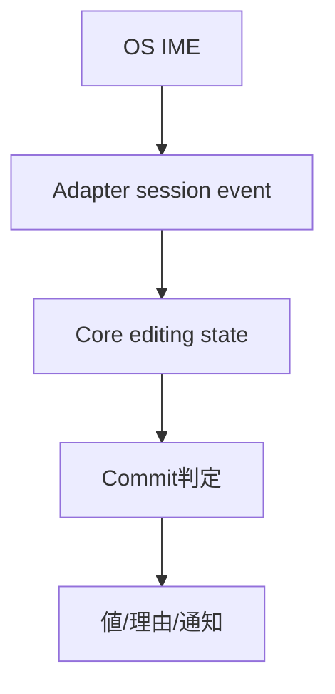
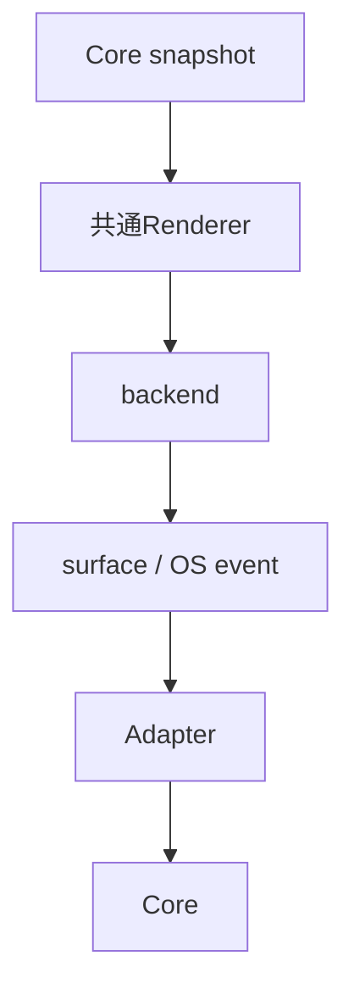
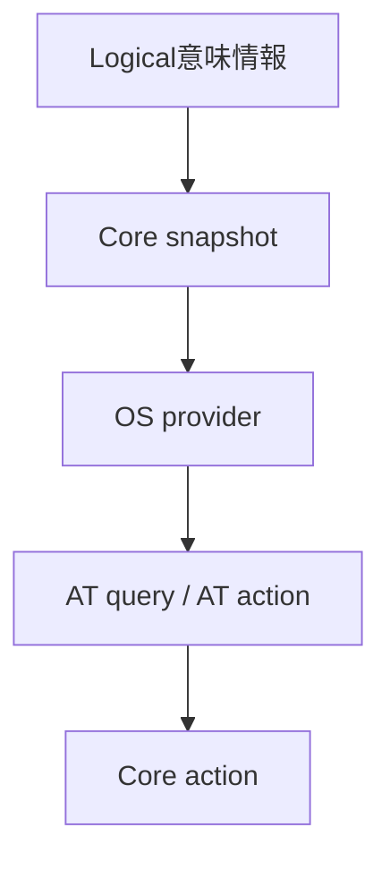
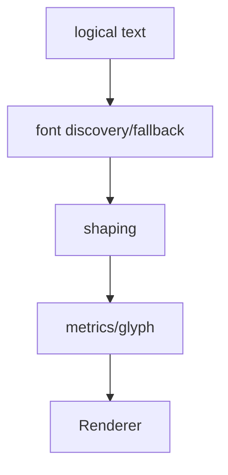
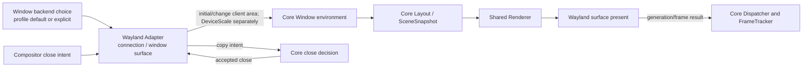

# プラットフォーム：抽象化・描画・text・OS接続

- 文書版: 1.5
- 文書ロール: basic-design
- 更新日: 2026-11-14
- 状態: 1.2全文承認済み（利用者、2026-11-09）。1.3全文承認済み（利用者、2026-11-10）。1.4全文承認済み（利用者、2026-11-14）。1.5改訂案レビュー待ち。実装・試験状態は別管理

## 目的と責務境界

要求を実現する層の責務分担、主要なデータ・所有の受渡し、状態遷移を定める。具体的なclass/interface・関数署名・wire field・call flowは詳細設計、防御の実現条件はセキュア設計で具体化する。要求・ADRの保証や採用範囲を本書だけで変更しない。

アーキテクチャ制約: [Rust Coreとversioned C ABI](../../04_approval/adr-0001-rust-core.md)。

## 要求と基本設計項目の対応

| 設計項目 | 要求根拠 |
| --- | --- |
| Control API・Window初期client size・close・描画backend | [RQ-09-071](../../11_requirements/RQ-09_ui-scope.md#rq-09-071)、[RQ-09-072](../../11_requirements/RQ-09_ui-scope.md#rq-09-072)、[RQ-09-074](../../11_requirements/RQ-09_ui-scope.md#rq-09-074)、[RQ-09-076](../../11_requirements/RQ-09_ui-scope.md#rq-09-076)（改訂案）、[RQ-11-022](../../11_requirements/RQ-11_platform.md#rq-11-022)、[RQ-11-025](../../11_requirements/RQ-11_platform.md#rq-11-025) |
| Text engine・IME OS接続・Accessibility | [RQ-10-014](../../11_requirements/RQ-10_accessibility.md#rq-10-014)、[RQ-11-023](../../11_requirements/RQ-11_platform.md#rq-11-023) |
| IMEのCore/OS責務境界 | [RQ-02-011](../../11_requirements/RQ-02_core-features.md#rq-02-011)、[RQ-09-005](../../11_requirements/RQ-09_ui-scope.md#rq-09-005)、[RQ-09-038](../../11_requirements/RQ-09_ui-scope.md#rq-09-038)、[RQ-09-040](../../11_requirements/RQ-09_ui-scope.md#rq-09-040)、[RQ-09-042](../../11_requirements/RQ-09_ui-scope.md#rq-09-042)、[RQ-09-055](../../11_requirements/RQ-09_ui-scope.md#rq-09-055)、[RQ-09-056](../../11_requirements/RQ-09_ui-scope.md#rq-09-056) |
| Renderer・surface・Platform接続 | [RQ-01-002](../../11_requirements/RQ-01_purpose-architecture.md#rq-01-002)、[RQ-09-005](../../11_requirements/RQ-09_ui-scope.md#rq-09-005)、[RQ-09-053](../../11_requirements/RQ-09_ui-scope.md#rq-09-053)、[RQ-09-054](../../11_requirements/RQ-09_ui-scope.md#rq-09-054)、[RQ-11-001](../../11_requirements/RQ-11_platform.md#rq-11-001)、[RQ-11-002](../../11_requirements/RQ-11_platform.md#rq-11-002)、[RQ-11-003](../../11_requirements/RQ-11_platform.md#rq-11-003)、[RQ-11-004](../../11_requirements/RQ-11_platform.md#rq-11-004)、[RQ-11-008](../../11_requirements/RQ-11_platform.md#rq-11-008)、[RQ-11-009](../../11_requirements/RQ-11_platform.md#rq-11-009)、[RQ-11-020](../../11_requirements/RQ-11_platform.md#rq-11-020)、[RQ-11-021](../../11_requirements/RQ-11_platform.md#rq-11-021)、[RQ-12-010](../../11_requirements/RQ-12_build-distribution.md#rq-12-010)、[RQ-13-001](../../11_requirements/RQ-13_nonfunctional-measurement.md#rq-13-001)、[RQ-13-011](../../11_requirements/RQ-13_nonfunctional-measurement.md#rq-13-011) |
| Accessibility意味情報とOS provider | [RQ-09-011](../../11_requirements/RQ-09_ui-scope.md#rq-09-011)、[RQ-10-001](../../11_requirements/RQ-10_accessibility.md#rq-10-001)、[RQ-10-002](../../11_requirements/RQ-10_accessibility.md#rq-10-002)、[RQ-10-003](../../11_requirements/RQ-10_accessibility.md#rq-10-003)、[RQ-10-004](../../11_requirements/RQ-10_accessibility.md#rq-10-004)、[RQ-10-005](../../11_requirements/RQ-10_accessibility.md#rq-10-005)、[RQ-10-006](../../11_requirements/RQ-10_accessibility.md#rq-10-006)、[RQ-10-007](../../11_requirements/RQ-10_accessibility.md#rq-10-007)、[RQ-10-008](../../11_requirements/RQ-10_accessibility.md#rq-10-008)、[RQ-10-009](../../11_requirements/RQ-10_accessibility.md#rq-10-009)、[RQ-10-011](../../11_requirements/RQ-10_accessibility.md#rq-10-011)、[RQ-10-012](../../11_requirements/RQ-10_accessibility.md#rq-10-012)、[RQ-10-013](../../11_requirements/RQ-10_accessibility.md#rq-10-013) |
| text engineとglyph snapshot | [RQ-04-003](../../11_requirements/RQ-04_abi-boundary.md#rq-04-003)、[RQ-04-020](../../11_requirements/RQ-04_abi-boundary.md#rq-04-020)、[RQ-09-005](../../11_requirements/RQ-09_ui-scope.md#rq-09-005)、[RQ-09-053](../../11_requirements/RQ-09_ui-scope.md#rq-09-053)、[RQ-09-054](../../11_requirements/RQ-09_ui-scope.md#rq-09-054) |
| Linux desktop/console profileとWayland resize | [RQ-09-067](../../11_requirements/RQ-09_ui-scope.md#rq-09-067)、[RQ-09-071](../../11_requirements/RQ-09_ui-scope.md#rq-09-071)、[RQ-11-003](../../11_requirements/RQ-11_platform.md#rq-11-003)、[RQ-11-014](../../11_requirements/RQ-11_platform.md#rq-11-014)、[RQ-11-015](../../11_requirements/RQ-11_platform.md#rq-11-015)、[RQ-11-020](../../11_requirements/RQ-11_platform.md#rq-11-020)、[RQ-11-021](../../11_requirements/RQ-11_platform.md#rq-11-021)、[RQ-11-022](../../11_requirements/RQ-11_platform.md#rq-11-022)、[RQ-11-025](../../11_requirements/RQ-11_platform.md#rq-11-025)、[RQ-12-010](../../11_requirements/RQ-12_build-distribution.md#rq-12-010) |

## Control API・Window close・描画backend

WindowはCore状態とnative peerを分け、表示開始・close判断・surface喪失を状態機械で処理する。RendererはControlを保持しないSceneSnapshotとdamageを受け、backendがGPU completionを所有する。

Window生成設定は初期client sizeの希望値（論理DIP）をCoreに保持し、省略時の共通既定値を800×600 DIPとする。Coreはその値を初回peer openへ渡し、PlatformはOS/Window systemへ適用可能な範囲で提示する。実際のclient areaはPlatformからCoreへ戻し、Layoutはその実寸を使う。初期希望値と実寸は別の状態として扱う。

## Text engine・IME OS接続・Accessibility

TextServiceがGlyphRunを作り、IME adapterが中立編集eventへ変換する。AccessibilityStoreはcommit後snapshotを公開し、OS queryは不変値だけを読む。actionはUI要求recordを通して開始前取消と開始済みを区別する。

## IMEのCore/OS責務境界

### 層の責務と主要flow

Core TextBoxが編集全文・selection/caret・preeditと入力状態を保持し、AdapterはOS IME sessionとcandidate UIを所有する。UpdateはCore編集状態だけを書き換え、Commitは完全候補を入力Validatorへ一度渡す。candidate UIの配置にはCoreのcaret/layout座標を渡し、native候補windowを編集値の正本にしない。

## Renderer・surface・Platform接続

### 1.3 review draft: Window単位backend選択

RQ-11-025の選択要件を、UI構築時にWindowへ渡す設定として実現する案。`Window`生成時に任意のbackend identityを指定し、未指定時はtarget profileの公表defaultを使う。選択値はWindow objectの寿命中固定し、実行中またはclose/reopen間にbackendを差し替えるAPIは設けない。surface/scene capabilityとの最終適合確認とnative資源初期化はopen時に行い、未知・非互換・初期化失敗は明示failureとして扱い、別backendを試さない。

BDの責務は、UI構築設定からCoreのWindow選択状態、profileに結び付いたPlatform backend registry、surface/rendererへの接続を示すことに留める。identityの書式、C ABI/wrapper API、registry登録、package収録方式、詳細な失敗型は下流DDでレビューする。現時点で各profileに複数backendが登録済みとは扱わない。

### 0.6 profile範囲（承認済み）

本節は承認済み[RQ-11 0.6](../../11_requirements/RQ-11_platform.md)を実現する設計である。0.6は要求・設計文書単位で承認済み。

| profile区分 | 層の責務案 | 境界 |
|---|---|---|
| Windows 11 x64 | Windows peer/rendererとCore snapshotを接続し、可視frameを表示する | 他Windows architectureへの一般化はしない |
| Ubuntu 24.04 x64 | Linux Platform Adapterをprofile単位で構成し、OS/session・surface・present条件を記録する | Ubuntu通常desktopと直接DRM/KMSを同一視せず、実際の接続方式はDD reviewで確定する |
| Debian 12 x64 VM | 仮想GPU/driverを含む特定VM profileでLinux Adapterを動作させる | device/surface openからvisible presentまで確認できた組合せだけをprofile evidenceとする |
| Linux ARMv7/AArch64 | Core snapshotからframebuffer描画に限定した実験的経路を提供する候補 | cross-build/fake testとboard runtimeを別statusにし、board未確認中はformal hardware supportとしない |
| その他Linux framebuffer限定 | Core snapshotから限定描画出力までを分離可能にする | fbdev、DRM/KMS dumb buffer、software memory bufferを区別する。input/IME/Accessibility/window managementを暗黙に含めない |

0.0.1ではARM board hardware profileをrelease runtime gateから分離する。Linux x64とARMがsourceを共有しても、実機動作・support範囲は同一とみなさない。対象profileとbackendの正本はRQ改訂の承認後に確定する。

### 層の責務と主要flow

Core Visual/Layout snapshotを共通Rendererへ渡し、RendererがPlatform backendのsurfaceへ描画する。AdapterはWindow/surface、input、IME、AccessibilityとOSとの接点を所有する。Linux targetは共通Coreを利用し、target/profile別のbackend・build条件・runtime support evidenceを分けて記録する。開発順は計画へ、公開support範囲はRQへ分ける。

## Core-owned Window background RGBのbackend伝達（1.1改訂案）

Window/Control layerで未指定overrideを規定値opaque white `#FFFFFF`へ解決し、SceneSnapshotには有効な正規化RGB値を必ず格納する。Renderer/backendはOS、GPU、window managerの暗黙色へ依存せず、受け取った値でsurface client領域をclearしてからDrawOpを実行する。Windowごとの明示RGB overrideとresetはCore stateで保持し、renderer選択やprofile変更で値を失わない。

背景色更新はLayoutを走らせず、次のscene/frame更新を要求する。現在のrendererが指定値をsurfaceへ反映できない場合は既存Platform failure契約に従い、別の色やbackendへ黙って置き換えない。実装API・RGB値のC ABI表現・wrapper表現はWindow Control/API DDで確定する。

要求根拠: [RQ-09-074](../../11_requirements/RQ-09_ui-scope.md#rq-09-074)（改訂案）、[RQ-11-008](../../11_requirements/RQ-11_platform.md#rq-11-008)、[RQ-11-020](../../11_requirements/RQ-11_platform.md#rq-11-020)。

## Accessibility意味情報とOS provider

### 層の責務と主要flow

Logical Controlのrole/name/state/value/focus/actionからCore Accessibility snapshotを構成し、Platform providerがOS語彙へ写像する。Button invokeは通常activation、TextBox editは共通編集判定へ戻す。queryはsnapshotを読み、actionはUI dispatch経路を通す。Visual内部部品の追加だけではLogical公開階層を増やさない。

## text engineとglyph snapshot

### 層の責務と主要flow

Coreはlogical UTF-8 textを保持し、text serviceへfont条件・文字列・layout条件を渡す。text serviceはfont discovery/fallback、shaping、glyph rasterizationを分担し、Rendererへmetricsとglyph情報を返す。target profileにfont assetと依存条件を結び、対応文字corpusの測定はtest側で管理する。

### 1.4改訂案: Linux Wayland desktop profileとdirect-display profile

RQ-11-003/014/015/024とRQ-12-010で承認されたLinux profile候補を、通常desktop sessionで動作するcompositor-managed Window経路と、DRM/KMS direct-display console経路に分ける。Debian 13を先に検証し、Debian 12は後続で独立検証する。Ubuntu 24.04/26.04もOS版・session/backendごとに独立した候補profileとして扱う。profile候補の列挙やVM test passは、別profileのformal runtime supportを意味しない。

| 項目 | Linux Wayland desktop profile案 | DRM/KMS direct-display console profile境界 |
|---|---|---|
| 表示責務 | Wayland compositorがWindowの表示位置とoutput modeを管理する。AdapterはWindow surfaceへの描画・presentを担当し、物理display modeを直接設定しない | AdapterがDRM connector/CRTCを直接扱うconsole向けprofile。通常desktop windowやcompositor管理下のWindowとして扱わない |
| backend選択 | RQ-11-025に従い、選択済みprofileのWayland backendをWindow構築時に固定する。Wayland sessionまたは必要surfaceを利用できない場合は明示failureとし、KMS/X11/別backendへfallbackしない | profileで明示選択された時だけ開く。Wayland desktop sessionから自動選択・fallbackしない |
| client areaとLayout | AdapterがWayland surfaceの論理client areaとDeviceScaleをCoreへ別々に通知する。Coreが値をWindow世代に結び付けて保持し、client area変更でroot Layoutと次frameを更新する。DeviceScaleは論理寸法と混同しない | connector mode由来のextentをprofile値として返す。desktop Windowのresize通知源と共通化しない |
| sceneと描画 | Core owns logical tree/layout/scene/background. 共通RendererがSceneSnapshotを選択backendへ渡し、Wayland surfaceへ可視frameを提出する | 現行Linux GLES rendererとDRM/GBM/EGL直接表示を別profileで利用する。Wayland clientのsurface ownershipを共有しない |
| frame状態 | backendはgeneration付きframe結果をCoreへ返し、Coreが現行scene/frameと照合してPresentedまたはfailureを確定する。submit受付だけでPresentedとしない | 同じCore completion契約を利用するが、DRM page-flip/console側のcompletion根拠はprofile別に保つ |
| close/reopen | compositor由来のWindow close intentを既存Core close-decisionへ渡す。明示close後はnative surface資源を解放し、Core Window/contentを保って新generationで再openする | native window-manager close intentは前提にしない。明示Window.close/Runtime shutdownは既存契約に従う |
| profile evidence | Ubuntu 24.04/26.04、Debian 13/12を個別に記録し、Debian 13のpassをDebian 12へ一般化しない。build・VM起動・TTY表示をWayland visible-present passとしない | VM/実機・GPU/driver・device accessを個別記録し、desktop profileの証拠に流用しない |

Core remains the source of UI state, layout, DeviceScale, background color and immutable scene. Adapter owns the Wayland connection/window resources and translates compositor state into Core-owned environment updates. Each Renderer instance owns GPU objects for its selected backend context. A close/reopen or surface recreation creates a new generation; stale area/frame results cannot replace current Core state. DeviceScale reporting does not add a guarantee for dynamic output-scale transitions; the existing requirements govern that behavior and DD must specify the realization.

This section does not add X11, multi-output, hot migration between outputs/backends, or undocumented IME/Accessibility guarantees. Rendering pass does not imply input, Japanese IME, or Accessibility pass; each remains tied to its own approved requirement and profile evidence. Backend library, protocol object sequence, event polling, configure serial handling, EGL display/surface construction, frame callback interpretation, dependency/link/package layout, and exact failure/status mapping are DD responsibilities and remain undecided here.

### 1.4改訂履歴

| 日付 | 状態 | 範囲 |
|---|---|---|
| 2026-11-14 | 文書全体承認済み | RQ-11 v0.8/RQ-12 v0.7に合わせ、Linux Wayland desktopとDRM/KMS direct-display profileの責務・環境値・scene/present flowを分離。既承認1.3範囲は保持 |

## 承認履歴

| 日付 | 対象文書・版 | 承認者 | 結論・根拠 |
| --- | --- | --- | --- |
| 2026-10-17 | 旧基本設計の既承認内容 | 利用者 | 従前の方式承認を継承。旧本文と承認記録はローカルarchiveへ保存 |
| — | 本書1.0全文 / 作成時点 | — | 再編集版の確認待ちだった記録。承認結果は次行に記載 |
| 2026-10-17 | 本書1.0全文 | 利用者 | 「OK、承認します。」により再編集版全文を承認。実装・試験合格を意味しない |
| 2026-10-30 | 本書1.1改訂案 | — | Core-owned Window background RGBのscene伝達とrenderer failure境界を追加提案。1.0承認範囲を維持し全文レビュー待ち |
| 2026-10-30 | 本書1.1全文 | 利用者 | 「ok」によりCore解決色のbackend伝達とfailure境界を含む全文を承認。実装・試験合格を意味しない |
| 2026-11-09 | 本書1.2全文 | 利用者 | 「ok」によりRQ-11/12のprofile変更に伴うWindows/Ubuntu/Debian VM profileと限定framebuffer責務を含む全文を承認。実装・試験合格は別管理 |
| 2026-11-10 | 本書1.3全文 | 利用者 | 「ok」によりRQ-11-025のWindow構築時選択とWindow寿命中固定を含む全文を承認。実装・試験は別管理 |
| 2026-11-14 | 本書1.4全文 | 利用者 | 「ok」によりLinux Wayland desktopとDRM/KMS direct-display profileの責務・client area/DeviceScale・frame・close境界を含む全文を承認。DeviceScaleの動的遷移保証、DD・実装・試験は別管理 |

## 改訂履歴

| 版 | 日付 | 内容・理由 | 作成者 | 承認記録との対応 |
| --- | --- | --- | --- | --- |
| 1.0 | 2026-10-17 | 利用者のBD再編集指示に基づき責務別に再構成。旧設計ID追跡を廃止 | Codex | 既承認内容の継承と再編集版全文の承認を区別 |
| 1.1 | 2026-10-30 | Window背景色のCore解決とbackendへの明示伝達を追加 | Codex | 全文承認済み。実装・試験は別管理 |
| 1.2 | 2026-11-09 | Windows/Ubuntu/Debian VM profileと限定framebuffer責務 | Codex | 全文承認済み。実装・試験は別管理 |
| 1.3 | 2026-11-10 | RQ-11-025のbackend選択をWindow構築設定として追加 | Codex | 全文承認済み。実装・試験は別管理 |
| 1.4 | 2026-11-14 | Linux Wayland desktopとDRM/KMS direct-display profileを分離 | Codex | 全文承認済み。DD・実装・試験は別管理 |
| 1.5改訂案 | 2026-11-14 | RQ-09-076案に基づくWindow初期希望寸法のCore→Platform受渡しと実client areaとの分離を追加。全文レビュー待ち | Codex | 全文未承認 |
