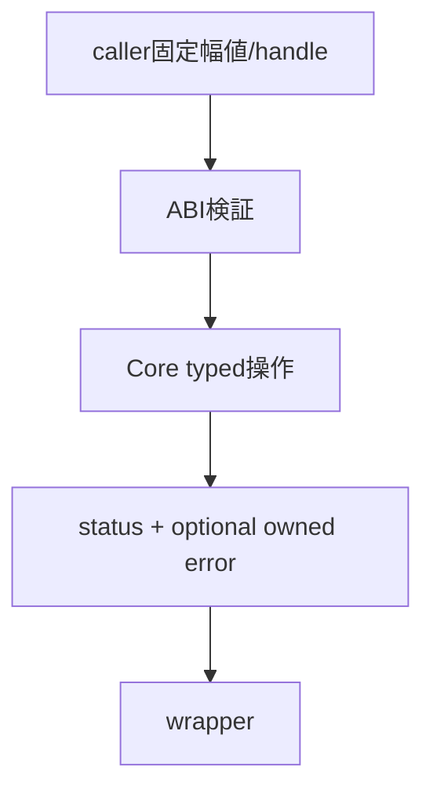
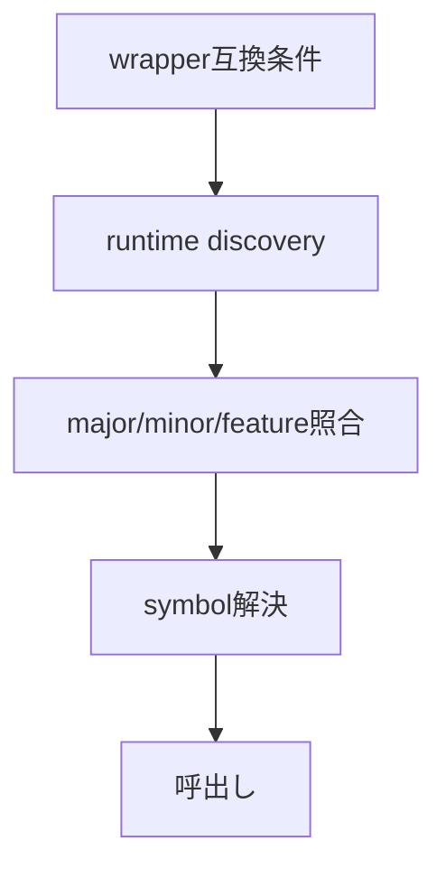

# 共通ABI：言語非依存境界と互換性

- 文書版: 1.0
- 文書ロール: basic-design
- 更新日: 2026-10-17
- 状態: 承認済み（利用者、2026-10-17、本書1.0全文）

## 目的と責務境界

要求を実現する層の責務分担、主要なデータ・所有の受渡し、状態遷移を定める。具体的なclass/interface・関数署名・wire field・call flowは詳細設計、防御の実現条件はセキュア設計で具体化する。要求・ADRの保証や採用範囲を本書だけで変更しない。

アーキテクチャ制約: [Rust Coreとversioned C ABI](../../04_approval/adr-0001-rust-core.md)。

## 要求と基本設計項目の対応

| 設計項目 | 要求根拠 |
| --- | --- |
| 共通API表・feature・status優先順・互換移行 | [RQ-02-002](../../11_requirements/RQ-02_core-features.md#rq-02-002)、[RQ-02-012](../../11_requirements/RQ-02_core-features.md#rq-02-012)、[RQ-02-013](../../11_requirements/RQ-02_core-features.md#rq-02-013)、[RQ-02-015](../../11_requirements/RQ-02_core-features.md#rq-02-015)、[RQ-02-016](../../11_requirements/RQ-02_core-features.md#rq-02-016)、[RQ-02-017](../../11_requirements/RQ-02_core-features.md#rq-02-017)、[RQ-02-018](../../11_requirements/RQ-02_core-features.md#rq-02-018)、[RQ-02-019](../../11_requirements/RQ-02_core-features.md#rq-02-019)、[RQ-02-022](../../11_requirements/RQ-02_core-features.md#rq-02-022)、[RQ-03-013](../../11_requirements/RQ-03_language-support.md#rq-03-013)、[RQ-03-014](../../11_requirements/RQ-03_language-support.md#rq-03-014)、[RQ-03-015](../../11_requirements/RQ-03_language-support.md#rq-03-015)、[RQ-03-016](../../11_requirements/RQ-03_language-support.md#rq-03-016)、[RQ-04-001](../../11_requirements/RQ-04_abi-boundary.md#rq-04-001)、[RQ-04-002](../../11_requirements/RQ-04_abi-boundary.md#rq-04-002)、[RQ-04-003](../../11_requirements/RQ-04_abi-boundary.md#rq-04-003)、[RQ-04-006](../../11_requirements/RQ-04_abi-boundary.md#rq-04-006)、[RQ-04-007](../../11_requirements/RQ-04_abi-boundary.md#rq-04-007)、[RQ-04-009](../../11_requirements/RQ-04_abi-boundary.md#rq-04-009)、[RQ-04-010](../../11_requirements/RQ-04_abi-boundary.md#rq-04-010)、[RQ-04-020](../../11_requirements/RQ-04_abi-boundary.md#rq-04-020)、[RQ-04-022](../../11_requirements/RQ-04_abi-boundary.md#rq-04-022)、[RQ-04-023](../../11_requirements/RQ-04_abi-boundary.md#rq-04-023)、[RQ-04-024](../../11_requirements/RQ-04_abi-boundary.md#rq-04-024)、[RQ-04-027](../../11_requirements/RQ-04_abi-boundary.md#rq-04-027)、[RQ-04-028](../../11_requirements/RQ-04_abi-boundary.md#rq-04-028)、[RQ-04-029](../../11_requirements/RQ-04_abi-boundary.md#rq-04-029)、[RQ-05-003](../../11_requirements/RQ-05_ownership-callbacks.md#rq-05-003)、[RQ-05-009](../../11_requirements/RQ-05_ownership-callbacks.md#rq-05-009)、[RQ-06-002](../../11_requirements/RQ-06_threading-dispatch.md#rq-06-002)、[RQ-06-005](../../11_requirements/RQ-06_threading-dispatch.md#rq-06-005)、[RQ-06-006](../../11_requirements/RQ-06_threading-dispatch.md#rq-06-006)、[RQ-06-007](../../11_requirements/RQ-06_threading-dispatch.md#rq-06-007)、[RQ-06-012](../../11_requirements/RQ-06_threading-dispatch.md#rq-06-012)、[RQ-06-013](../../11_requirements/RQ-06_threading-dispatch.md#rq-06-013)、[RQ-07-017](../../11_requirements/RQ-07_binding.md#rq-07-017)、[RQ-09-019](../../11_requirements/RQ-09_ui-scope.md#rq-09-019)、[RQ-09-050](../../11_requirements/RQ-09_ui-scope.md#rq-09-050) |
| 公開境界の検証・copy・結果handoff | [RQ-02-002](../../11_requirements/RQ-02_core-features.md#rq-02-002)、[RQ-02-013](../../11_requirements/RQ-02_core-features.md#rq-02-013)、[RQ-02-015](../../11_requirements/RQ-02_core-features.md#rq-02-015)、[RQ-02-021](../../11_requirements/RQ-02_core-features.md#rq-02-021)、[RQ-03-014](../../11_requirements/RQ-03_language-support.md#rq-03-014)、[RQ-04-002](../../11_requirements/RQ-04_abi-boundary.md#rq-04-002)、[RQ-04-003](../../11_requirements/RQ-04_abi-boundary.md#rq-04-003)、[RQ-04-006](../../11_requirements/RQ-04_abi-boundary.md#rq-04-006)、[RQ-04-007](../../11_requirements/RQ-04_abi-boundary.md#rq-04-007)、[RQ-04-009](../../11_requirements/RQ-04_abi-boundary.md#rq-04-009)、[RQ-04-010](../../11_requirements/RQ-04_abi-boundary.md#rq-04-010)、[RQ-04-019](../../11_requirements/RQ-04_abi-boundary.md#rq-04-019)、[RQ-04-020](../../11_requirements/RQ-04_abi-boundary.md#rq-04-020)、[RQ-04-021](../../11_requirements/RQ-04_abi-boundary.md#rq-04-021)、[RQ-04-022](../../11_requirements/RQ-04_abi-boundary.md#rq-04-022)、[RQ-04-024](../../11_requirements/RQ-04_abi-boundary.md#rq-04-024)、[RQ-05-002](../../11_requirements/RQ-05_ownership-callbacks.md#rq-05-002)、[RQ-05-003](../../11_requirements/RQ-05_ownership-callbacks.md#rq-05-003)、[RQ-05-004](../../11_requirements/RQ-05_ownership-callbacks.md#rq-05-004)、[RQ-05-006](../../11_requirements/RQ-05_ownership-callbacks.md#rq-05-006)、[RQ-05-009](../../11_requirements/RQ-05_ownership-callbacks.md#rq-05-009)、[RQ-05-013](../../11_requirements/RQ-05_ownership-callbacks.md#rq-05-013)、[RQ-06-004](../../11_requirements/RQ-06_threading-dispatch.md#rq-06-004)、[RQ-06-008](../../11_requirements/RQ-06_threading-dispatch.md#rq-06-008)、[RQ-06-009](../../11_requirements/RQ-06_threading-dispatch.md#rq-06-009)、[RQ-06-010](../../11_requirements/RQ-06_threading-dispatch.md#rq-06-010)、[RQ-06-012](../../11_requirements/RQ-06_threading-dispatch.md#rq-06-012)、[RQ-09-005](../../11_requirements/RQ-09_ui-scope.md#rq-09-005)、[RQ-09-038](../../11_requirements/RQ-09_ui-scope.md#rq-09-038)、[RQ-09-042](../../11_requirements/RQ-09_ui-scope.md#rq-09-042)、[RQ-12-023](../../11_requirements/RQ-12_build-distribution.md#rq-12-023) |
| ABIとreleaseの互換管理 | [RQ-04-009](../../11_requirements/RQ-04_abi-boundary.md#rq-04-009)、[RQ-04-010](../../11_requirements/RQ-04_abi-boundary.md#rq-04-010)、[RQ-04-024](../../11_requirements/RQ-04_abi-boundary.md#rq-04-024)、[RQ-04-028](../../11_requirements/RQ-04_abi-boundary.md#rq-04-028) |

## 共通API表・feature・status優先順・互換移行

ABI inventoryがsymbol・thread/context・commit・失敗時所有を定義する。entry検査を共通順にし、生成adapterが各言語宣言を接続する。featureは全操作と外部契約の提供確認後だけ有効にする。

## 公開境界の検証・copy・結果handoff

### 層の責務と主要flow

公開境界層はcallerの固定幅値・opaque handleを検証し、呼出し中のborrowをCoreが保持するcopy/pinへ変換する。Core typed操作のcommit後にstatusを一次結果として確定し、失敗詳細は任意のowned error snapshotとしてwrapperへ返す。詳細errorの確保失敗は一次statusを置換しない。入力検証・必要資源準備が失敗した場合はCoreのcommitへ進まない。

### 具体化後の共通責務

ABI adapterはtyped値とtokenの入口検査を担当し、Coreはprepare/commitと通知、Hostはevent境界とUI safe point、wrapperは言語ownerとcleanup ticketを担当する。終了要求の観測は[RQ-06-012](../../11_requirements/RQ-06_threading-dispatch.md#rq-06-012)、言語基準・管理終了条件は[RQ-03-014/015](../../11_requirements/RQ-03_language-support.md#rq-03-014)、artifact期限は[RQ-12-023](../../11_requirements/RQ-12_build-distribution.md#rq-12-023)を根拠に各層を接続する。

## ABIとreleaseの互換管理

### 層の責務と主要flow

Runtime version、ABI major、wrapper versionを独立metadataとして持ち、loaderはwrapperのrequired major/minimum minorとRuntimeの提供情報を照合する。同majorの互換追加は新symbol/featureへ割り当て、破壊変更は別majorのsymbol空間に置く。release metadataとqueryの値を同じversion情報から生成する。

## 値・参照・登録の境界

公開PropertyはBOOL/I64/UTF8/F64/DECIMALを扱い、OBJECTは予約で生成経路を提供しない。型別値領域と比較はモデル設計の責務、C ABIは固定幅値・opaque handleと検証/copy/pinを介したhandoffの責務を持つ。所有参照の消費と登録解除を別操作として扱い、releaseだけでSubscription・Binding・Validatorを暗黙解除しない。

## 承認履歴

| 日付 | 対象文書・版 | 承認者 | 結論・根拠 |
| --- | --- | --- | --- |
| 2026-10-17 | 旧基本設計の既承認内容 | 利用者 | 従前の方式承認を継承。旧本文と承認記録はローカルarchiveへ保存 |
| — | 本書1.0全文 / 作成時点 | — | 再編集版の確認待ちだった記録。承認結果は次行に記載 |
| 2026-10-17 | 本書1.0全文 | 利用者 | 「OK、承認します。」により再編集版全文を承認。実装・試験合格を意味しない |

## 改訂履歴

| 版 | 日付 | 内容・理由 | 作成者 | 承認記録との対応 |
| --- | --- | --- | --- | --- |
| 1.0 | 2026-10-17 | 利用者のBD再編集指示に基づき責務別に再構成。旧設計ID追跡を廃止 | Codex | 既承認内容の継承と再編集版全文の承認を区別 |
