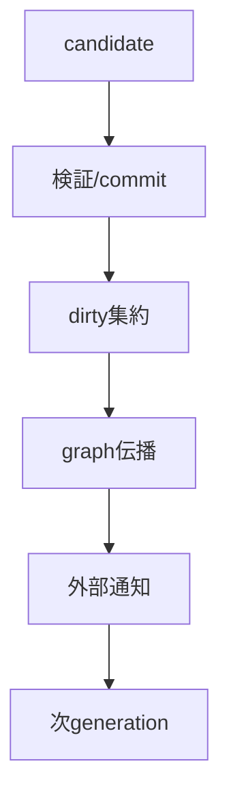
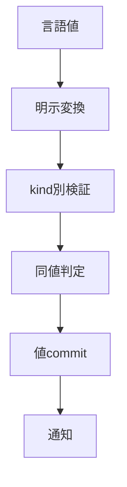
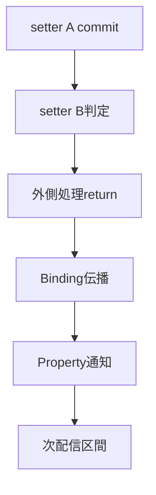
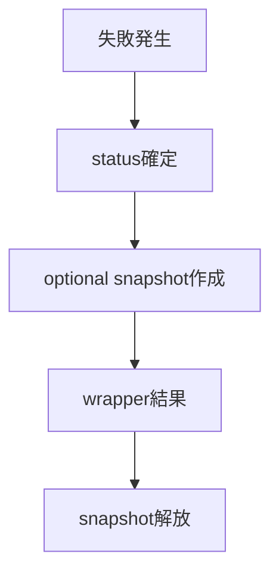
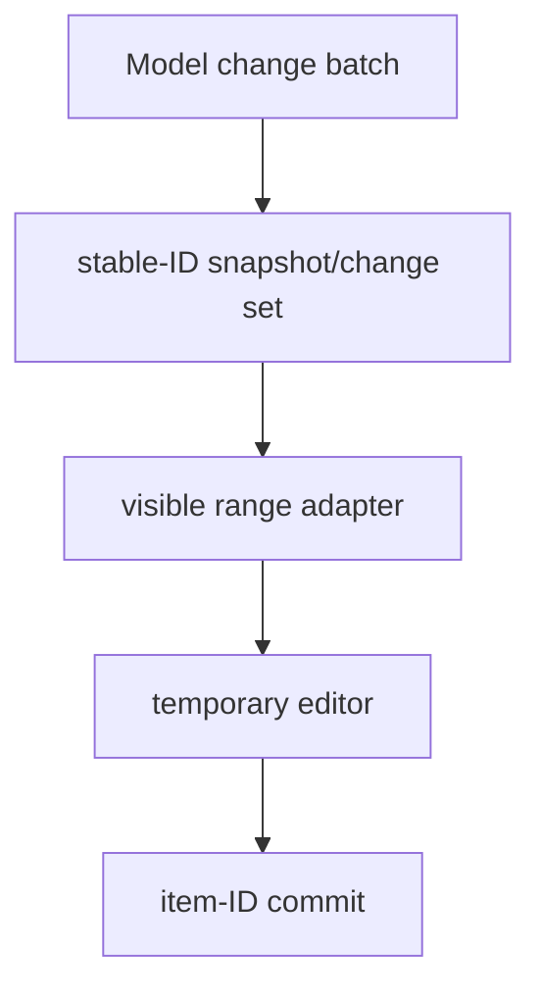
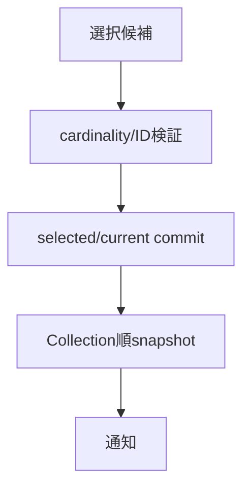
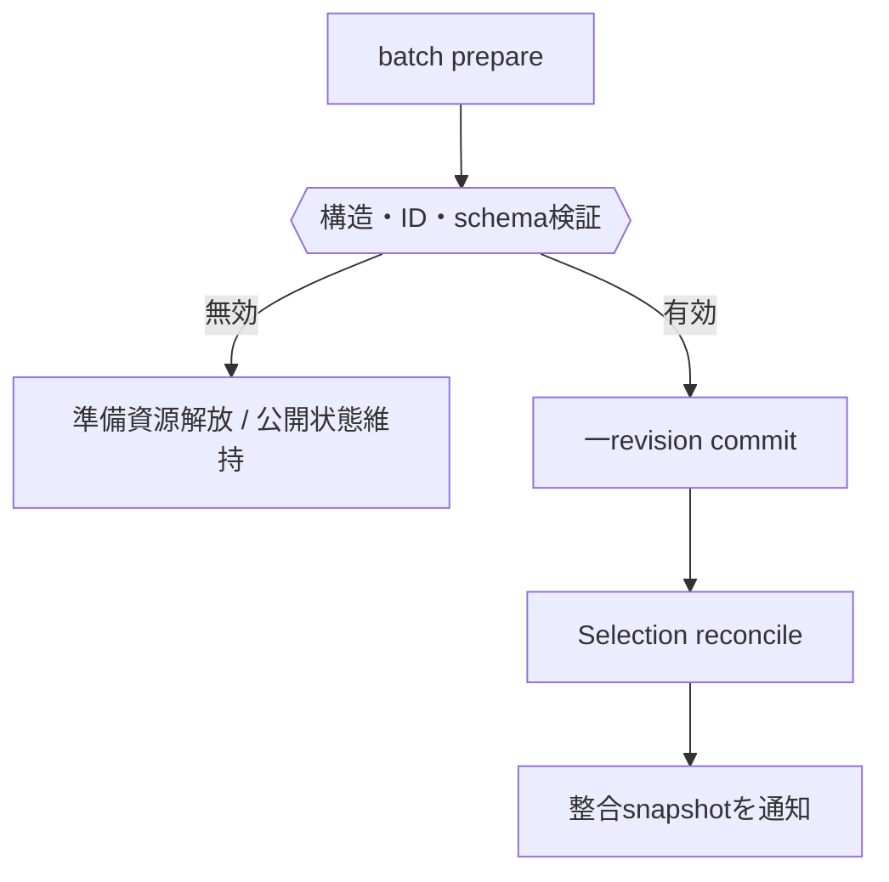

# オブジェクト管理：値・モデル・更新整合性

- 文書版: 1.0
- 文書ロール: basic-design
- 更新日: 2026-10-17
- 状態: 承認済み（利用者、2026-10-17、本書1.0全文）

## 目的と責務境界

要求を実現する層の責務分担、主要なデータ・所有の受渡し、状態遷移を定める。具体的なclass/interface・関数署名・wire field・call flowは詳細設計、防御の実現条件はセキュア設計で具体化する。要求・ADRの保証や採用範囲を本書だけで変更しない。

アーキテクチャ制約: [Rust Coreとversioned C ABI](../../04_approval/adr-0001-rust-core.md)。

## 要求と基本設計項目の対応

| 設計項目 | 要求根拠 |
| --- | --- |
| Property・Binding・Command・Validationの接続 | [RQ-02-002](../../11_requirements/RQ-02_core-features.md#rq-02-002)、[RQ-02-020](../../11_requirements/RQ-02_core-features.md#rq-02-020)、[RQ-02-021](../../11_requirements/RQ-02_core-features.md#rq-02-021)、[RQ-03-014](../../11_requirements/RQ-03_language-support.md#rq-03-014)、[RQ-05-002](../../11_requirements/RQ-05_ownership-callbacks.md#rq-05-002)、[RQ-05-006](../../11_requirements/RQ-05_ownership-callbacks.md#rq-05-006)、[RQ-06-004](../../11_requirements/RQ-06_threading-dispatch.md#rq-06-004)、[RQ-06-008](../../11_requirements/RQ-06_threading-dispatch.md#rq-06-008)、[RQ-06-009](../../11_requirements/RQ-06_threading-dispatch.md#rq-06-009)、[RQ-06-010](../../11_requirements/RQ-06_threading-dispatch.md#rq-06-010)、[RQ-06-012](../../11_requirements/RQ-06_threading-dispatch.md#rq-06-012)、[RQ-07-006](../../11_requirements/RQ-07_binding.md#rq-07-006)、[RQ-07-008](../../11_requirements/RQ-07_binding.md#rq-07-008)、[RQ-07-012](../../11_requirements/RQ-07_binding.md#rq-07-012)、[RQ-07-014](../../11_requirements/RQ-07_binding.md#rq-07-014)、[RQ-09-005](../../11_requirements/RQ-09_ui-scope.md#rq-09-005)、[RQ-09-038](../../11_requirements/RQ-09_ui-scope.md#rq-09-038)、[RQ-09-042](../../11_requirements/RQ-09_ui-scope.md#rq-09-042)、[RQ-12-023](../../11_requirements/RQ-12_build-distribution.md#rq-12-023) |
| F32の提供経路・数値変換 | [RQ-02-022](../../11_requirements/RQ-02_core-features.md#rq-02-022)、[RQ-04-029](../../11_requirements/RQ-04_abi-boundary.md#rq-04-029) |
| 型別値領域と比較・変換 | [RQ-02-002](../../11_requirements/RQ-02_core-features.md#rq-02-002)、[RQ-02-017](../../11_requirements/RQ-02_core-features.md#rq-02-017)、[RQ-02-018](../../11_requirements/RQ-02_core-features.md#rq-02-018)、[RQ-02-019](../../11_requirements/RQ-02_core-features.md#rq-02-019)、[RQ-04-001](../../11_requirements/RQ-04_abi-boundary.md#rq-04-001)、[RQ-04-002](../../11_requirements/RQ-04_abi-boundary.md#rq-04-002)、[RQ-04-003](../../11_requirements/RQ-04_abi-boundary.md#rq-04-003)、[RQ-04-020](../../11_requirements/RQ-04_abi-boundary.md#rq-04-020)、[RQ-09-019](../../11_requirements/RQ-09_ui-scope.md#rq-09-019)、[RQ-09-050](../../11_requirements/RQ-09_ui-scope.md#rq-09-050) |
| UI更新とtransaction境界 | [RQ-02-002](../../11_requirements/RQ-02_core-features.md#rq-02-002)、[RQ-02-020](../../11_requirements/RQ-02_core-features.md#rq-02-020)、[RQ-07-005](../../11_requirements/RQ-07_binding.md#rq-07-005)、[RQ-07-006](../../11_requirements/RQ-07_binding.md#rq-07-006)、[RQ-07-009](../../11_requirements/RQ-07_binding.md#rq-07-009) |
| error snapshotとdiagnostic | [RQ-02-012](../../11_requirements/RQ-02_core-features.md#rq-02-012)、[RQ-04-006](../../11_requirements/RQ-04_abi-boundary.md#rq-04-006)、[RQ-04-007](../../11_requirements/RQ-04_abi-boundary.md#rq-04-007)、[RQ-04-022](../../11_requirements/RQ-04_abi-boundary.md#rq-04-022)、[RQ-04-023](../../11_requirements/RQ-04_abi-boundary.md#rq-04-023)、[RQ-04-027](../../11_requirements/RQ-04_abi-boundary.md#rq-04-027) |
| Collection・Selectionの所有、batch、snapshot | [RQ-09-062](../../11_requirements/RQ-09_ui-scope.md#rq-09-062)、[RQ-09-063](../../11_requirements/RQ-09_ui-scope.md#rq-09-063)、[RQ-09-064](../../11_requirements/RQ-09_ui-scope.md#rq-09-064) |
| Collection共通モデルとvirtualization | [RQ-02-005](../../11_requirements/RQ-02_core-features.md#rq-02-005)、[RQ-02-006](../../11_requirements/RQ-02_core-features.md#rq-02-006)、[RQ-09-019](../../11_requirements/RQ-09_ui-scope.md#rq-09-019)、[RQ-09-020](../../11_requirements/RQ-09_ui-scope.md#rq-09-020)、[RQ-09-022](../../11_requirements/RQ-09_ui-scope.md#rq-09-022)、[RQ-09-050](../../11_requirements/RQ-09_ui-scope.md#rq-09-050)、[RQ-09-052](../../11_requirements/RQ-09_ui-scope.md#rq-09-052) |
| Selectionとstable identity | [RQ-02-006](../../11_requirements/RQ-02_core-features.md#rq-02-006)、[RQ-09-020](../../11_requirements/RQ-09_ui-scope.md#rq-09-020)、[RQ-09-051](../../11_requirements/RQ-09_ui-scope.md#rq-09-051) |
| Collection差分の原子的commit | [RQ-02-005](../../11_requirements/RQ-02_core-features.md#rq-02-005)、[RQ-07-009](../../11_requirements/RQ-07_binding.md#rq-07-009)、[RQ-09-019](../../11_requirements/RQ-09_ui-scope.md#rq-09-019)、[RQ-09-052](../../11_requirements/RQ-09_ui-scope.md#rq-09-052) |

## Property・Binding・Command・Validationの接続

### 層の責務と主要flow

Propertyのcommit→dirty集約→Binding評価→外部通知のflowを基本設計として残す。TwoWay同期groupとOneWay DAGを用いた伝播、Command operation状態と終端、入力候補と確定値の分離を責務単位に記す。各外部結果はRQを根拠にし、具体getter/signatureや状態保持構造はDDへ分ける。

### 機能間のdata/ownership flow

| 経路 | 主要構成と更新 |
| --- | --- |
| Property | typed candidateを検証・比較し、成功差分を値領域へcommitしてdirty queueへ登録する |
| Binding | TwoWay同期groupを縮約したOneWay DAGを順序評価する。source revisionとgroup直近直接変更を比較し、対象値のprepare後にcommitする |
| Validation | 生成時・setter時のProperty validatorとView編集validatorを分ける。Bindingはtarget拒否を自身のerror snapshotへ格納し、次の成功で差し替える |
| Command | UI ownerがoperationを生成しworkerへ渡す。progress slotとterminal channelを分け、operation identityをUIで照合してstateをcommitする |
| 登録寿命 | Runtime registryがActive登録を強保持し、object側indexは非所有。cancelでindexとregistryの参照を解除し、in-flight後にclosureを回収する |

### 具体化後の共通責務

ABI adapterはtyped値とtokenの入口検査を担当し、Coreはprepare/commitと通知、Hostはevent境界とUI safe point、wrapperは言語ownerとcleanup ticketを担当する。終了要求の観測は[RQ-06-012](../../11_requirements/RQ-06_threading-dispatch.md#rq-06-012)、言語基準・管理終了条件は[RQ-03-014/015](../../11_requirements/RQ-03_language-support.md#rq-03-014)、artifact期限は[RQ-12-023](../../11_requirements/RQ-12_build-distribution.md#rq-12-023)を根拠に各層を接続する。

## F32の提供経路・数値変換

NumericCodecは分類→表現可能性検査→局所値構築→出力commitを担当する。Converterは文字列parser/formatterへ分離し、Property/Bindingに暗黙変換を持ち込まない。

## 型別値領域と比較・変換

### 層の責務と主要flow

初期Property値はCoreの型別値領域へ格納し、wrapperの値変換層から固定幅値またはUTF-8を受け取る。数値比較層はkind別の同値判定を行い、setterは検証に成功して差分がある場合だけ値をcommitする。同値時は格納表現を保持し通知を作らない。DECIMALは符号・scale・係数を論理要素として扱い、bit配置はDDのwire表現へ分ける。CollectionModelは値kindに含めず、model handleをControlへ接続する。

### 型別処理層

数値比較はkindごとに分岐し、F64はNaN/zero/infinityを分類してから比較する。十進値はsign・scale・coefficientから桁数と正規化係数を比較し、単純な最大scale倍で作業整数をあふれさせない。元のbit表現は値領域に保持し、比較用の正規化と分離する。UTF-8は長さ・妥当性を確認してcopyし、byte列を比較する。

## UI更新とtransaction境界

### 層の責務と主要flow

Core setterは一つの候補に対して検証・必要copyを行い、そのPropertyへ直ちにcommitする。Runtimeは外側のUI処理区間にdirty Propertyを集約し、その区間が戻った後にBinding伝播と外部通知を処理する。配信callback起因の変更は次の配信区間へ入れる。複数setterをまとめるrollback状態は持たず、通知の集約区間を値のtransactionと分ける。

## error snapshotとdiagnostic

### 層の責務と主要flow

APIはstatusを一次結果として返し、必要なら失敗時点のerror snapshotを生成する。snapshotはdomain/code、説明message、任意causeとdiagnosticを分けて所有し、後のoperationで書き換えない。wrapperは機械識別値を言語結果へ保持し、messageは表示情報として渡す。詳細確保失敗時にも元statusを保持する。

## Collection・Selectionの所有、batch、snapshot

Collectionはschemaと行stateを所有し、Selectionは対象Collectionを保持する。batch候補の値・順序・Selectionをprepareし、一commit後に同revisionの通知snapshotを配送する。UIは不変snapshotとstable IDで表示を再利用する。

## Collection共通モデルとvirtualization

### 層の責務と主要flow

CollectionModelはitem IDとordered dataを保持し、SelectionModelとControl adapterへ構造化change setを渡す。Controlはvisible rangeとoverscanのsnapshotから表示要素を再利用し、編集中itemだけeditor stateを持つ。表示indexとitem identityを分け、commitはitem IDへ戻す。Gridの列IDはGridの具体化時に別schemaとして扱う。

## Selectionとstable identity

### 層の責務と主要flow

SelectionModelはcollection identityに関連付けたselected ID集合とoptional current IDを持つ。更新候補のcardinalityを検証してから集合をcommitし、読取り時はCollectionの現在順へ投影する。Collection commit時に削除IDをselected/currentから除き、整合したsnapshotを通知する。keyboard focusはRuntimeの別stateを使う。

## Collection差分の原子的commit

### 層の責務と主要flow

Collection batchの各operationを構造・ID・index・schemaについて事前検証し、必要資源を確保する。有効な候補だけを一revisionとしてcommitし、同じ論理更新区間でSelectionをreconcileしてから外部callbackへ一貫したsnapshotを公開する。失敗時は準備資源だけを解放し、公開revisionへ到達しない。

## 承認履歴

| 日付 | 対象文書・版 | 承認者 | 結論・根拠 |
| --- | --- | --- | --- |
| 2026-10-17 | 旧基本設計の既承認内容 | 利用者 | 従前の方式承認を継承。旧本文と承認記録はローカルarchiveへ保存 |
| — | 本書1.0全文 / 作成時点 | — | 再編集版の確認待ちだった記録。承認結果は次行に記載 |
| 2026-10-17 | 本書1.0全文 | 利用者 | 「OK、承認します。」により再編集版全文を承認。実装・試験合格を意味しない |

## 改訂履歴

| 版 | 日付 | 内容・理由 | 作成者 | 承認記録との対応 |
| --- | --- | --- | --- | --- |
| 1.0 | 2026-10-17 | 利用者のBD再編集指示に基づき責務別に再構成。旧設計ID追跡を廃止 | Codex | 既承認内容の継承と再編集版全文の承認を区別 |
