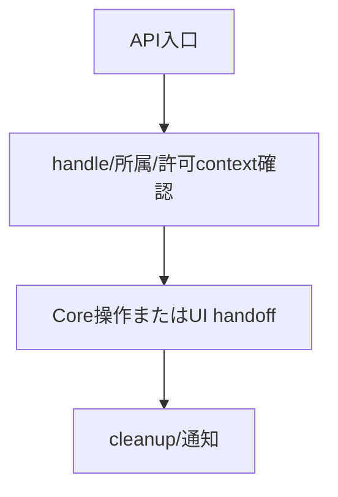
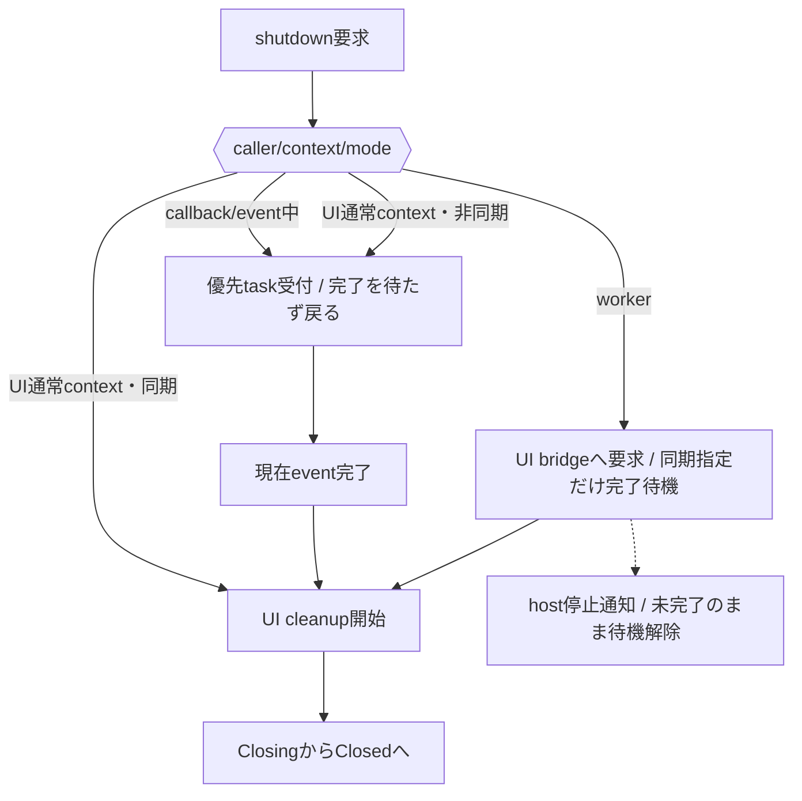

# ランタイム：実行context・所有・終了

- 文書版: 1.0
- 文書ロール: basic-design
- 更新日: 2026-10-17
- 状態: 承認済み（利用者、2026-10-17、本書1.0全文）

## 目的と責務境界

要求を実現する層の責務分担、主要なデータ・所有の受渡し、状態遷移を定める。具体的なclass/interface・関数署名・wire field・call flowは詳細設計、防御の実現条件はセキュア設計で具体化する。要求・ADRの保証や採用範囲を本書だけで変更しない。

アーキテクチャ制約: [Rust Coreとversioned C ABI](../../04_approval/adr-0001-rust-core.md)。

## 要求と基本設計項目の対応

| 設計項目 | 要求根拠 |
| --- | --- |
| 実行thread・登録所有・値のhandoff | [RQ-02-013](../../11_requirements/RQ-02_core-features.md#rq-02-013)、[RQ-02-015](../../11_requirements/RQ-02_core-features.md#rq-02-015)、[RQ-02-016](../../11_requirements/RQ-02_core-features.md#rq-02-016)、[RQ-03-014](../../11_requirements/RQ-03_language-support.md#rq-03-014)、[RQ-04-005](../../11_requirements/RQ-04_abi-boundary.md#rq-04-005)、[RQ-04-018](../../11_requirements/RQ-04_abi-boundary.md#rq-04-018)、[RQ-05-002](../../11_requirements/RQ-05_ownership-callbacks.md#rq-05-002)、[RQ-05-003](../../11_requirements/RQ-05_ownership-callbacks.md#rq-05-003)、[RQ-05-009](../../11_requirements/RQ-05_ownership-callbacks.md#rq-05-009)、[RQ-05-010](../../11_requirements/RQ-05_ownership-callbacks.md#rq-05-010)、[RQ-05-011](../../11_requirements/RQ-05_ownership-callbacks.md#rq-05-011)、[RQ-05-012](../../11_requirements/RQ-05_ownership-callbacks.md#rq-05-012)、[RQ-05-013](../../11_requirements/RQ-05_ownership-callbacks.md#rq-05-013)、[RQ-06-002](../../11_requirements/RQ-06_threading-dispatch.md#rq-06-002)、[RQ-06-005](../../11_requirements/RQ-06_threading-dispatch.md#rq-06-005)、[RQ-06-006](../../11_requirements/RQ-06_threading-dispatch.md#rq-06-006)、[RQ-06-007](../../11_requirements/RQ-06_threading-dispatch.md#rq-06-007)、[RQ-06-012](../../11_requirements/RQ-06_threading-dispatch.md#rq-06-012)、[RQ-12-023](../../11_requirements/RQ-12_build-distribution.md#rq-12-023) |
| Host境界・shutdown完了観測・cleanup drain | [RQ-03-013](../../11_requirements/RQ-03_language-support.md#rq-03-013)、[RQ-06-012](../../11_requirements/RQ-06_threading-dispatch.md#rq-06-012) |
| 終了受付・cleanup・完了観測 | [RQ-02-013](../../11_requirements/RQ-02_core-features.md#rq-02-013)、[RQ-02-015](../../11_requirements/RQ-02_core-features.md#rq-02-015)、[RQ-02-016](../../11_requirements/RQ-02_core-features.md#rq-02-016)、[RQ-05-003](../../11_requirements/RQ-05_ownership-callbacks.md#rq-05-003)、[RQ-05-009](../../11_requirements/RQ-05_ownership-callbacks.md#rq-05-009)、[RQ-06-002](../../11_requirements/RQ-06_threading-dispatch.md#rq-06-002)、[RQ-06-005](../../11_requirements/RQ-06_threading-dispatch.md#rq-06-005)、[RQ-06-006](../../11_requirements/RQ-06_threading-dispatch.md#rq-06-006)、[RQ-06-007](../../11_requirements/RQ-06_threading-dispatch.md#rq-06-007) |

## 実行thread・登録所有・値のhandoff

### 層の責務と主要flow

RuntimeはUI実行thread identity、object所属と公開/内部参照、dispatch経路、closure寿命を統合する。worker releaseは最終UI破棄だけをUI経路へ引き渡す。callback種別で許可APIを検査し、通知は外側処理後に進める。shutdown要求はthread/contextを検査して受付recordへ登録し、実体cleanupはUI threadで実行する。

### 所有と停止の主要状態

公開ownerとRuntimeのregistration ownerを分ける。登録成功時にclosureをCoreへ移し、cancelで新規invokeを止め、最後のin-flight終了後にUI safe pointでdestroyする。worker releaseは最終UI破棄をfinalizer queueへ引き渡す。RuntimeはRunning → Closing → Closedへ進み、Closed shellは残存ownerと不変errorが保持する。

UI thread identityとdispatch実行contextを別に持つ。shutdown要求はどのthreadからも受付し、実体cleanupはUI threadへmarshalする。host停止通知は同期待機者へ未完了結果を返し、UI資源をworkerで破棄しない。

### 具体化後の共通責務

ABI adapterはtyped値とtokenの入口検査を担当し、Coreはprepare/commitと通知、Hostはevent境界とUI safe point、wrapperは言語ownerとcleanup ticketを担当する。終了要求の観測は[RQ-06-012](../../11_requirements/RQ-06_threading-dispatch.md#rq-06-012)、言語基準・管理終了条件は[RQ-03-014/015](../../11_requirements/RQ-03_language-support.md#rq-03-014)、artifact期限は[RQ-12-023](../../11_requirements/RQ-12_build-distribution.md#rq-12-023)を根拠に各層を接続する。

## Host境界・shutdown完了観測・cleanup drain

HostScopeが外側eventの完了を通知し、Dispatcherは優先終了flagを先に処理する。CompletionRecordをClosed commitと停止通知で更新し、workerの条件待機を解除する。cleanup ticketはUI再開まで所有下へ保持する。

## 終了受付・cleanup・完了観測

### 層の責務と主要flow

shutdown受付層はcallerのthreadと実行contextを評価し、現在callback/event中なら優先control taskを登録して戻る。worker要求はbridgeへmarshalし、同期指定の場合のみ完了状態を待つ。UI thread上のcleanupはRunning→Closing→Closedへ遷移し、未開始workのcancel、in-flight終了、UI資源解放を一つの終了解決へ集約する。

### 要求受付と終了待機

停止通知による待機解除とcleanup完了は[RQ-06-012](../../11_requirements/RQ-06_threading-dispatch.md#rq-06-012)に従って区別する。

RuntimeはUI thread ID、dispatch depth、優先shutdown flag、completion recordを持つ。非同期はflag登録後に戻る。同期はUI通常contextでcleanupを直呼出しし、callback/event中は次safe pointへ登録して戻る。worker同期はcompletion recordを待つ。hostの停止通知でUI実行不可が確定したら待機を解除し、未完了理由を返す。cleanup taskのownerはRuntimeに保持し、待機解除だけでClosedへ遷移しない。

## 承認履歴

| 日付 | 対象文書・版 | 承認者 | 結論・根拠 |
| --- | --- | --- | --- |
| 2026-10-17 | 旧基本設計の既承認内容 | 利用者 | 従前の方式承認を継承。旧本文と承認記録はローカルarchiveへ保存 |
| — | 本書1.0全文 / 作成時点 | — | 再編集版の確認待ちだった記録。承認結果は次行に記載 |
| 2026-10-17 | 本書1.0全文 | 利用者 | 「OK、承認します。」により再編集版全文を承認。実装・試験合格を意味しない |

## 改訂履歴

| 版 | 日付 | 内容・理由 | 作成者 | 承認記録との対応 |
| --- | --- | --- | --- | --- |
| 1.0 | 2026-10-17 | 利用者のBD再編集指示に基づき責務別に再構成。旧設計ID追跡を廃止 | Codex | 既承認内容の継承と再編集版全文の承認を区別 |
