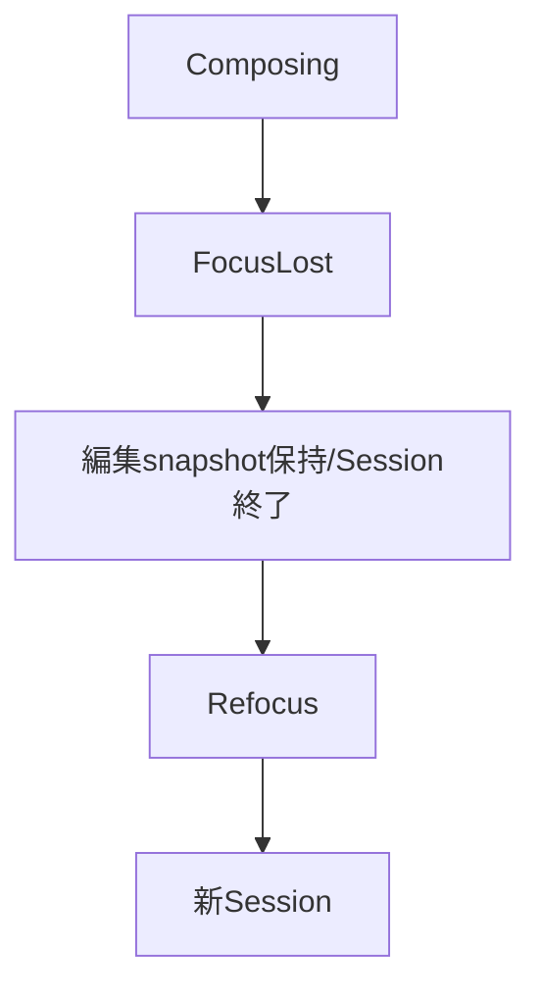
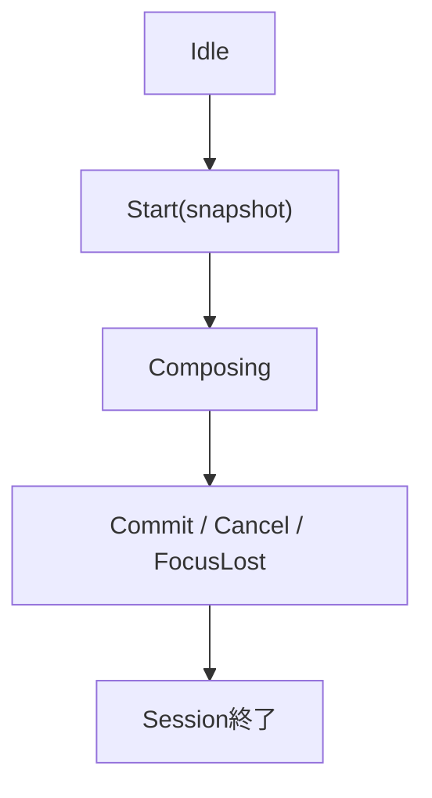
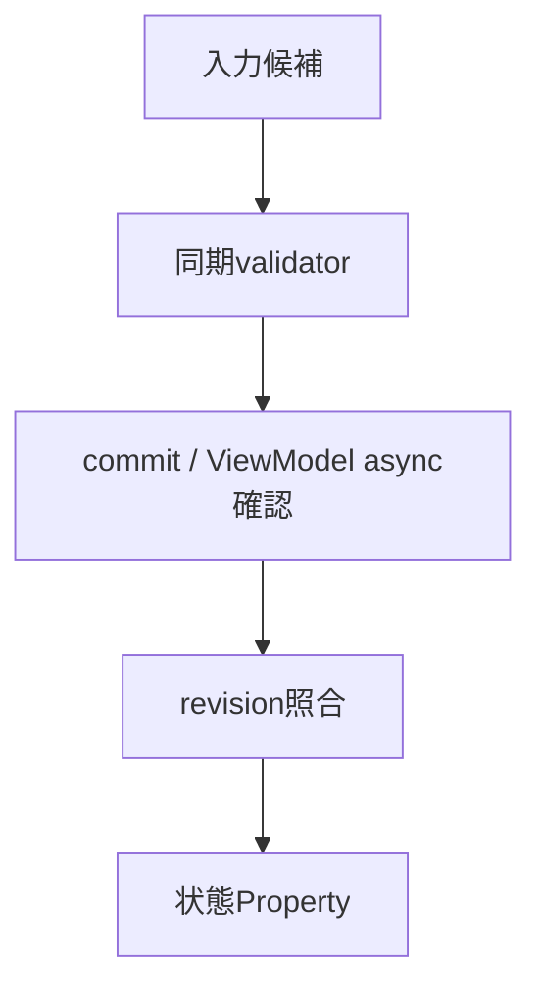

# UIクラス：TextBox・編集・Validation

- 文書版: 1.0
- 文書ロール: basic-design
- 更新日: 2026-10-17
- 状態: 承認済み（利用者、2026-10-17、本書1.0全文）

## 目的と責務境界

要求を実現する層の責務分担、主要なデータ・所有の受渡し、状態遷移を定める。具体的なclass/interface・関数署名・wire field・call flowは詳細設計、防御の実現条件はセキュア設計で具体化する。要求・ADRの保証や採用範囲を本書だけで変更しない。

アーキテクチャ制約: [Rust Coreとversioned C ABI](../../04_approval/adr-0001-rust-core.md)。

## 要求と基本設計項目の対応

| 設計項目 | 要求根拠 |
| --- | --- |
| 編集API・Unicode位置・IME回復 | [RQ-09-065](../../11_requirements/RQ-09_ui-scope.md#rq-09-065)、[RQ-09-066](../../11_requirements/RQ-09_ui-scope.md#rq-09-066) |
| FocusとIME sessionの切替 | [RQ-02-011](../../11_requirements/RQ-02_core-features.md#rq-02-011)、[RQ-09-005](../../11_requirements/RQ-09_ui-scope.md#rq-09-005)、[RQ-09-038](../../11_requirements/RQ-09_ui-scope.md#rq-09-038)、[RQ-09-040](../../11_requirements/RQ-09_ui-scope.md#rq-09-040)、[RQ-09-042](../../11_requirements/RQ-09_ui-scope.md#rq-09-042)、[RQ-09-055](../../11_requirements/RQ-09_ui-scope.md#rq-09-055)、[RQ-09-056](../../11_requirements/RQ-09_ui-scope.md#rq-09-056) |
| 確定値・編集候補・IME session | [RQ-02-011](../../11_requirements/RQ-02_core-features.md#rq-02-011)、[RQ-09-005](../../11_requirements/RQ-09_ui-scope.md#rq-09-005)、[RQ-09-038](../../11_requirements/RQ-09_ui-scope.md#rq-09-038)、[RQ-09-040](../../11_requirements/RQ-09_ui-scope.md#rq-09-040)、[RQ-09-041](../../11_requirements/RQ-09_ui-scope.md#rq-09-041)、[RQ-09-042](../../11_requirements/RQ-09_ui-scope.md#rq-09-042)、[RQ-09-055](../../11_requirements/RQ-09_ui-scope.md#rq-09-055)、[RQ-09-056](../../11_requirements/RQ-09_ui-scope.md#rq-09-056) |
| 同期Validationと長時間処理の分担 | [RQ-02-002](../../11_requirements/RQ-02_core-features.md#rq-02-002)、[RQ-02-021](../../11_requirements/RQ-02_core-features.md#rq-02-021)、[RQ-05-006](../../11_requirements/RQ-05_ownership-callbacks.md#rq-05-006)、[RQ-05-009](../../11_requirements/RQ-05_ownership-callbacks.md#rq-05-009)、[RQ-05-013](../../11_requirements/RQ-05_ownership-callbacks.md#rq-05-013)、[RQ-07-010](../../11_requirements/RQ-07_binding.md#rq-07-010)、[RQ-07-016](../../11_requirements/RQ-07_binding.md#rq-07-016)、[RQ-09-005](../../11_requirements/RQ-09_ui-scope.md#rq-09-005)、[RQ-09-038](../../11_requirements/RQ-09_ui-scope.md#rq-09-038) |

## 編集API・Unicode位置・IME回復

TextBoxは確定Propertyと不変編集snapshotを分離する。Adapterは位置とsessionを正規化し、Coreは候補copy→入力検証→確定値検証→commitを行う。資源不足時の再送leaseとCore回復recordを分ける。

## FocusとIME sessionの切替

### 層の責務と主要flow

FocusLostではCore編集値・caret・selectionを保持したままAdapterのIME sessionを閉じる。preeditをcommit候補に昇格させず、Validator/Bindingを実行しない。再Focusでは保持編集値を表示し、新しいsessionを開始する。明示cancelは別イベントとして開始snapshotを復元する。detach時もCore objectが存続する範囲で編集値を保持する。

## 確定値・編集候補・IME session

### 層の責務と主要flow

Adapterがsession identityと順序を付けてIME eventを渡し、Coreはactive sessionに一致するeventだけを編集状態へ適用する。Startで編集snapshotを保存し、Updateではpreedit範囲だけを更新する。Commitは完全候補を作り一度判定し、Cancelは開始snapshotへ戻す。FocusLostはsnapshot復元と区別し最新preeditを保持する。

## 同期Validationと長時間処理の分担

### 層の責務と主要flow

Core validatorはsetterまたは編集候補処理から同期で呼ばれ、その戻り値を受けてcommit可否を決める。network等の非同期確認はViewModelのAsyncCommandへ分離し、結果と入力revisionをアプリ側で照合して状態Propertyへ書く。Core同期のIncompleteとViewModelの非同期確認中を別状態として接続する。

## 承認履歴

| 日付 | 対象文書・版 | 承認者 | 結論・根拠 |
| --- | --- | --- | --- |
| 2026-10-17 | 旧基本設計の既承認内容 | 利用者 | 従前の方式承認を継承。旧本文と承認記録はローカルarchiveへ保存 |
| — | 本書1.0全文 / 作成時点 | — | 再編集版の確認待ちだった記録。承認結果は次行に記載 |
| 2026-10-17 | 本書1.0全文 | 利用者 | 「OK、承認します。」により再編集版全文を承認。実装・試験合格を意味しない |

## 改訂履歴

| 版 | 日付 | 内容・理由 | 作成者 | 承認記録との対応 |
| --- | --- | --- | --- | --- |
| 1.0 | 2026-10-17 | 利用者のBD再編集指示に基づき責務別に再構成。旧設計ID追跡を廃止 | Codex | 既承認内容の継承と再編集版全文の承認を区別 |
