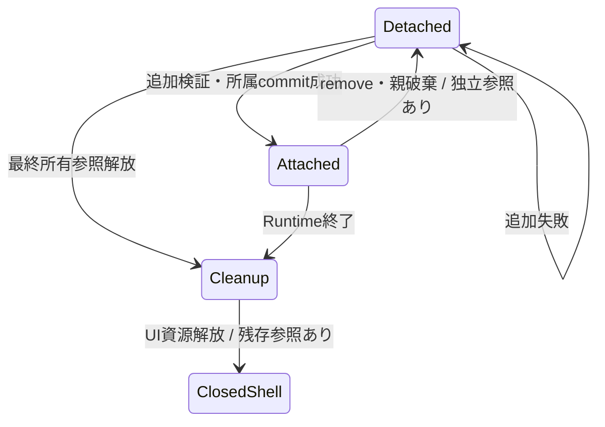
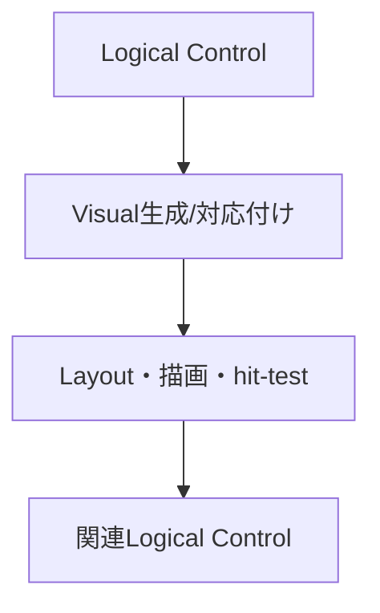
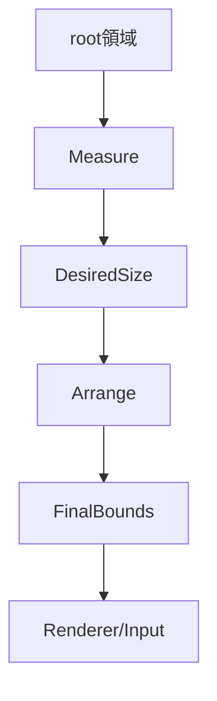
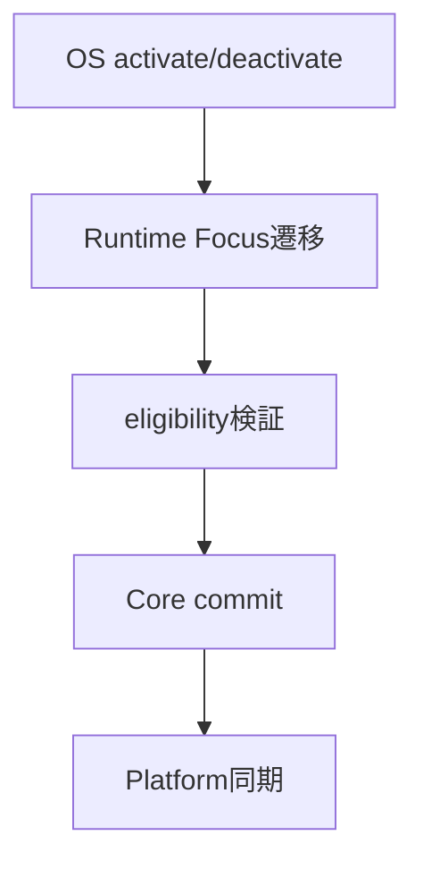
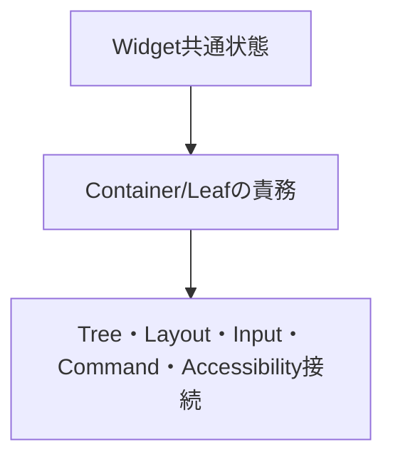

# UIクラス：Tree・Layout・Focus・Control

- 文書版: 1.1
- 文書ロール: basic-design
- 更新日: 2026-10-30
- 状態: 1.1全文承認済み（利用者、2026-10-30）。実装・試験状態は別管理

## 目的と責務境界

要求を実現する層の責務分担、主要なデータ・所有の受渡し、状態遷移を定める。具体的なclass/interface・関数署名・wire field・call flowは詳細設計、防御の実現条件はセキュア設計で具体化する。要求・ADRの保証や採用範囲を本書だけで変更しない。

アーキテクチャ制約: [Rust Coreとversioned C ABI](../../04_approval/adr-0001-rust-core.md)。

## 要求と基本設計項目の対応

| 設計項目 | 要求根拠 |
| --- | --- |
| Layout・座標・Input route・Tree所属 | [RQ-09-067](../../11_requirements/RQ-09_ui-scope.md#rq-09-067)、[RQ-09-068](../../11_requirements/RQ-09_ui-scope.md#rq-09-068)、[RQ-09-069](../../11_requirements/RQ-09_ui-scope.md#rq-09-069)、[RQ-09-070](../../11_requirements/RQ-09_ui-scope.md#rq-09-070) |
| 次段階UI・将来候補の範囲と拡張点 | [RQ-09-073](../../11_requirements/RQ-09_ui-scope.md#rq-09-073) |
| 所属owner・detach・資源寿命 | [RQ-02-007](../../11_requirements/RQ-02_core-features.md#rq-02-007)、[RQ-02-013](../../11_requirements/RQ-02_core-features.md#rq-02-013)、[RQ-05-002](../../11_requirements/RQ-05_ownership-callbacks.md#rq-05-002)、[RQ-05-003](../../11_requirements/RQ-05_ownership-callbacks.md#rq-05-003)、[RQ-09-003](../../11_requirements/RQ-09_ui-scope.md#rq-09-003)、[RQ-09-043](../../11_requirements/RQ-09_ui-scope.md#rq-09-043)、[RQ-09-044](../../11_requirements/RQ-09_ui-scope.md#rq-09-044) |
| Logical TreeとVisual Tree | [RQ-02-007](../../11_requirements/RQ-02_core-features.md#rq-02-007)、[RQ-05-003](../../11_requirements/RQ-05_ownership-callbacks.md#rq-05-003)、[RQ-09-003](../../11_requirements/RQ-09_ui-scope.md#rq-09-003)、[RQ-09-026](../../11_requirements/RQ-09_ui-scope.md#rq-09-026)、[RQ-09-043](../../11_requirements/RQ-09_ui-scope.md#rq-09-043) |
| Measure/Arrangeと配置責務 | [RQ-02-008](../../11_requirements/RQ-02_core-features.md#rq-02-008)、[RQ-09-007](../../11_requirements/RQ-09_ui-scope.md#rq-09-007)、[RQ-09-008](../../11_requirements/RQ-09_ui-scope.md#rq-09-008)、[RQ-09-045](../../11_requirements/RQ-09_ui-scope.md#rq-09-045)、[RQ-09-057](../../11_requirements/RQ-09_ui-scope.md#rq-09-057)、[RQ-09-058](../../11_requirements/RQ-09_ui-scope.md#rq-09-058)、[RQ-09-059](../../11_requirements/RQ-09_ui-scope.md#rq-09-059)、[RQ-09-060](../../11_requirements/RQ-09_ui-scope.md#rq-09-060)、[RQ-09-061](../../11_requirements/RQ-09_ui-scope.md#rq-09-061) |
| WindowとFocusの状態管理 | [RQ-02-010](../../11_requirements/RQ-02_core-features.md#rq-02-010)、[RQ-09-009](../../11_requirements/RQ-09_ui-scope.md#rq-09-009)、[RQ-09-010](../../11_requirements/RQ-09_ui-scope.md#rq-09-010)、[RQ-09-046](../../11_requirements/RQ-09_ui-scope.md#rq-09-046)、[RQ-09-049](../../11_requirements/RQ-09_ui-scope.md#rq-09-049)、[RQ-10-008](../../11_requirements/RQ-10_accessibility.md#rq-10-008) |
| 共通Controlの構成と接続 | [RQ-09-001](../../11_requirements/RQ-09_ui-scope.md#rq-09-001)、[RQ-09-002](../../11_requirements/RQ-09_ui-scope.md#rq-09-002)、[RQ-09-003](../../11_requirements/RQ-09_ui-scope.md#rq-09-003)、[RQ-09-004](../../11_requirements/RQ-09_ui-scope.md#rq-09-004)、[RQ-09-005](../../11_requirements/RQ-09_ui-scope.md#rq-09-005)、[RQ-09-006](../../11_requirements/RQ-09_ui-scope.md#rq-09-006)、[RQ-09-007](../../11_requirements/RQ-09_ui-scope.md#rq-09-007)、[RQ-09-009](../../11_requirements/RQ-09_ui-scope.md#rq-09-009)、[RQ-09-010](../../11_requirements/RQ-09_ui-scope.md#rq-09-010)、[RQ-09-011](../../11_requirements/RQ-09_ui-scope.md#rq-09-011)、[RQ-09-045](../../11_requirements/RQ-09_ui-scope.md#rq-09-045)、[RQ-09-046](../../11_requirements/RQ-09_ui-scope.md#rq-09-046)、[RQ-09-047](../../11_requirements/RQ-09_ui-scope.md#rq-09-047)、[RQ-09-048](../../11_requirements/RQ-09_ui-scope.md#rq-09-048)、[RQ-09-074](../../11_requirements/RQ-09_ui-scope.md#rq-09-074)、[RQ-10-003](../../11_requirements/RQ-10_accessibility.md#rq-10-003)、[RQ-10-008](../../11_requirements/RQ-10_accessibility.md#rq-10-008)、[RQ-10-012](../../11_requirements/RQ-10_accessibility.md#rq-10-012) |

## Layout・座標・Input route・Tree所属

Layoutは論理寸法のMeasure/Arrange候補を一括commitし、Rendererが共有edgeをdevice pixelへ変換する。InputはpinしたLogical routeを順に検査する。Treeはpeer/Visual候補準備後だけ親所有を変更する。

## 次段階UI・将来候補の範囲と拡張点

次段階UIはCollection/Selection snapshot、Viewport、typed Style/Resource/Theme/Templateを組み合わせる。Visual差替えは全準備後に行いLogical identityを維持する。未採用拡張は別featureの境界だけを記録する。

## 所属owner・detach・資源寿命

### 層の責務と主要flow

Logical parentは所属childへの内部所有参照を持ち、childからparentへの所属参照は非所有とする。detachはparentの所属参照だけを解放し、独立所有参照のあるchild以下をDetached subtreeとして保持する。Platform接続はCore object寿命と別管理し、detach/親破棄では古いpeerを切り離す。再所属では親子検証の後に所属参照を取得し、新たなPlatform接続を構築する。

## Logical TreeとVisual Tree

### 層の責務と主要flow

Logical Treeをアプリ構成と所有の正本にし、Visual TreeをMeasure/Arrange・描画・hit-testの入力にする。各Visual要素に関連Logical Controlを引ける対応を持たせ、入力候補はこの対応を経て共通Controlへ渡す。template由来VisualのownerはControl/template内部へ置き、Logical childとしての所有を追加しない。初期Controlでは同じ順序の単純なVisualを生成する。

## Measure/Arrangeと配置責務

### 層の責務と主要flow

Platformはrootの利用可能領域と環境scaleをCoreへ渡す。Core Sizerが子からDesiredSizeを集約し、Locationerがrootから子へ矩形を配分してboundsを確定する。RendererとInputは同じboundsを読み、backend側で配置規則を再計算しない。設定値は組み込みSizer/Locationerへの入力として扱い、利用者callbackの独自配置アルゴリズムとは別にする。

## WindowとFocusの状態管理

### 層の責務と主要flow

Runtimeがactive Windowとactive focusを一元保持する。deactivate時はactive focusを外し、Windowごとの復帰候補を非active情報として保持する。activate時は候補の所属とeligibilityを再検証してfocusをcommitする。detach時はactive/candidate参照を無効化する。Core変更をAdapterへ通知し、OSからの同じ変更の折返しを重複遷移として扱わない。

## 共通Controlの構成と接続

### 層の責務と主要flow

Widgetに共通Core寿命と意味情報を持たせ、ContainerにLogical child所有を持たせる。Windowはcontent rootを介して表示領域へ接続し、StackPanelは順序付きchildrenをLayoutへ渡す。Textは表示値、TextBoxは確定値と編集状態、Buttonはsemantic activationからCommandへ接続する。初期Controlの列挙はRQを参照し、この責務表から製品範囲を追加しない。

## Window背景色の所有と描画への伝達（1.1）

- WindowごとにCoreが背景色override状態を持ち、未指定の場合は初期規定値（opaque RGB #FFFFFF）を解決する。値の設定解除はoverrideを外し、同じ規定値へ戻す。
- 背景色はWindow client領域のsurface clearへ使う。Window自身の描画設定であり、子Controlの色・Text/Button label・AccessibleName・Layout寸法に波及しない。一般Style/Theme/ResourceはRQ-09-073の次段階scopeに残す。
- Coreは解決済みRGBをimmutable SceneSnapshotに格納する。各RenderBackendはその色で描画面をclearし、backend自身の既定色を使わない。
- 設定変更はpaint/scene dirtyとして扱い、Layout再計算を要求しない。次のcomplete scene/frameで反映し、失敗時は以前のcomplete sceneと色設定を保持する。

要求根拠: [RQ-09-074](../../11_requirements/RQ-09_ui-scope.md#rq-09-074)（改訂案）。

## 承認履歴

| 日付 | 対象文書・版 | 承認者 | 結論・根拠 |
| --- | --- | --- | --- |
| 2026-10-17 | 旧基本設計の既承認内容 | 利用者 | 従前の方式承認を継承。旧本文と承認記録はローカルarchiveへ保存 |
| — | 本書1.0全文 / 作成時点 | — | 再編集版の確認待ちだった記録。承認結果は次行に記載 |
| 2026-10-17 | 本書1.0全文 | 利用者 | 「OK、承認します。」により再編集版全文を承認。実装・試験合格を意味しない |
| 2026-10-30 | 本書1.1改訂案 | — | RQ-09-074に対応するWindow単位override、opaque white default、paint-only invalidation、SceneSnapshotへのCore解決値伝達を追加。全文レビュー待ち |
| 2026-10-30 | 本書1.1全文 | 利用者 | 「ok」によりWindow背景色のCore state・paint/scene flowを含む全文を承認。実装・試験合格を意味しない |

## 改訂履歴

| 版 | 日付 | 内容・理由 | 作成者 | 承認記録との対応 |
| --- | --- | --- | --- | --- |
| 1.0 | 2026-10-17 | 利用者のBD再編集指示に基づき責務別に再構成。旧設計ID追跡を廃止 | Codex | 既承認内容の継承と再編集版全文の承認を区別 |
| 1.1 | 2026-10-30 | Window背景色のCore ownershipとpaint/scene dirty伝播を追加 | Codex | 全文承認済み。実装・試験は別管理 |
