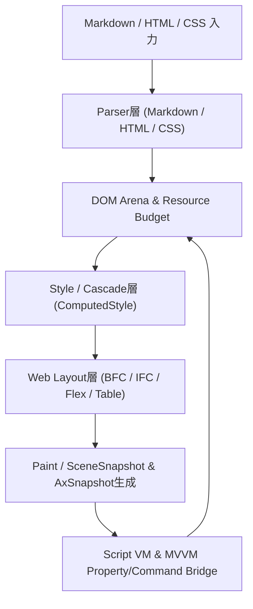
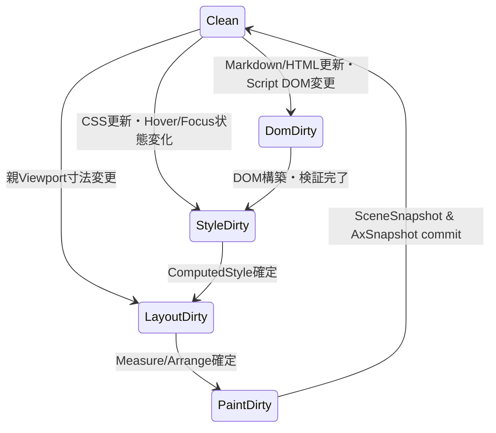

# UIクラス：WebViewエンジンプラグイン

- 文書版: 1.0
- 文書ロール: basic-design
- 更新日: 2026-10-24
- 状態: 承認済み（利用者、2026-10-24、本書1.0全文）

## 目的と責務境界

WebViewエンジンプラグインに関する要求を実現するための層構造、責務分担、主要なデータ・所有の受渡し、状態遷移を定める。具体的なクラス/構造体・関数署名・ABI宣言・アルゴリズム詳細は詳細設計で具体化し、非信頼入力に対する防御境界とリソース上限パラメータはセキュア設計で定義する。

アーキテクチャ制約: [Rust Coreとversioned C ABI](../../04_approval/adr-0001-rust-core.md)。

## 要求と基本設計項目の対応

| 設計項目 | 要求根拠 |
| --- | --- |
| 6層パイプラインとOS非依存Core描画 | [RQ-17-001](../../11_requirements/RQ-17_webview-plugin.md#rq-17-001)、[RQ-17-002](../../11_requirements/RQ-17_webview-plugin.md#rq-17-002)、[RQ-11-001](../../11_requirements/RQ-11_platform.md#rq-11-001)、[RQ-11-005](../../11_requirements/RQ-11_platform.md#rq-11-005) |
| 文書解析とDOM・CSSカスケード解決 | [RQ-17-003](../../11_requirements/RQ-17_webview-plugin.md#rq-17-003)、[RQ-17-004](../../11_requirements/RQ-17_webview-plugin.md#rq-17-004)、[RQ-17-009](../../11_requirements/RQ-17_webview-plugin.md#rq-17-009)、[RQ-17-010](../../11_requirements/RQ-17_webview-plugin.md#rq-17-010) |
| WebレイアウトとCore Measure/Arrange・Scene統合 | [RQ-17-005](../../11_requirements/RQ-17_webview-plugin.md#rq-17-005)、[RQ-09-008](../../11_requirements/RQ-09_ui-scope.md#rq-09-008)、[RQ-09-043](../../11_requirements/RQ-09_ui-scope.md#rq-09-043)、[RQ-09-067](../../11_requirements/RQ-09_ui-scope.md#rq-09-067) |
| 軽量スクリプトVMとDOM・MVVMブリッジ | [RQ-17-006](../../11_requirements/RQ-17_webview-plugin.md#rq-17-006)、[RQ-17-007](../../11_requirements/RQ-17_webview-plugin.md#rq-17-007)、[RQ-17-008](../../11_requirements/RQ-17_webview-plugin.md#rq-17-008)、[RQ-17-009](../../11_requirements/RQ-17_webview-plugin.md#rq-17-009) |
| 4言語ラッパー・View言語境界とAccessibility投影 | [RQ-17-011](../../11_requirements/RQ-17_webview-plugin.md#rq-17-011)、[RQ-17-012](../../11_requirements/RQ-17_webview-plugin.md#rq-17-012)、[RQ-10-001](../../11_requirements/RQ-10_accessibility.md#rq-10-001)、[RQ-10-009](../../11_requirements/RQ-10_accessibility.md#rq-10-009) |

## 6層パイプラインとOS非依存Core描画

### 層の責務と主要flow

WebViewはOS固有ブラウザ部品をラップするのではなく、Core内部で完結する6層パイプライン（Parser層 → DOM Arena層 → Style/Cascade層 → Web Layout層 → Paint/Scene層 → Script/MVVM Bridge層）として構成する。これによりWindows、Linux、組み込みLinuxのすべてのRenderer/Platform Adapter上で同一のレイアウト・描画プリミティブ・Accessibilityツリーを生成する。

## 文書解析とDOM・CSSカスケード解決

### 層の責務と主要flow

1. **Markdown Parser**: CommonMarkおよびGFMのブロック・インライン要素を直接DOM Arena上の意味要素（`h1`～`h6`, `p`, `ul`, `ol`, `li`, `table`, `pre`, `code`, `blockquote`, `a`, `em`, `strong`, `del`等）へ変換する。
2. **HTML Parser**: HTML文字列をトークナイズし、暗黙閉じタグやvoid要素を正規化してDOM Arenaを構築する。文書内の`<style>`および`<script>`要素はそれぞれStyle層とScript層へ引き渡す。
3. **CSS Cascade**: User-Agent既定スタイルシート、文書内`<style>`、外部から注入されたUTF-8 CSS Property、およびインライン`style`属性を詳細度（Specificity）と出現順に従って統合し、各DOMノードの`ComputedStyle`を決定する。
4. **トランザクション更新**: 新しい文書ソースの解析がリソース上限超過等で失敗した場合は、進行中の候補DOMを破棄し、直前の有効な公開DOM・レイアウト状態を維持する。

## WebレイアウトとCore Measure/Arrange・Scene統合

### 層の責務と主要flow

WebViewはCoreのLogical Tree上では単一の葉Widget（`ControlKind::WebView`）として振る舞い、内部にWeb DOM/Layoutサブツリーを所有する。

1. **Measure / Arrange**: 親Containerから与えられた`LayoutConstraint`（`f64` DIP）を受け取り、内部ルートブロックのBlock Formatting Context（BFC）、Inline Formatting Context（IFC、Coreの`TextService`を用いた行折り返しとグリフ計測）、Flexbox、Tableレイアウトを計算する。コンテンツ高がビューポート高を超える場合は内部スクロール範囲（`extent_height`）を確定する。
2. **SceneSnapshot出力**: 確定したレイアウトボックスから、ビューポート矩形でクリップされた`SceneSnapshot`描画コマンド列（背景塗潰し、枠線、テキスト`GlyphRun`、取消線/下線）を生成する。

## 軽量スクリプトVMとDOM・MVVMブリッジ

### 層の責務と主要flow

1. **サンドボックスScript VM**: 純粋Rust実装のバイトコードVMにより、UIスレッド上でイベントハンドラや初期化スクリプトを実行する。1回の実行ごとに命令ステップ数上限・コールスタック深さ上限・VMヒープ上限を適用し、上限到達時は即座に実行を打ち切ってUIスレッドの応答性を保護する。
2. **DOM / MVVM双方向連携**:
   - スクリプトからは許可されたDOM操作APIと、WebViewにバインドされたViewModelの`Property`読書き・`Command`起動APIのみを呼び出せる。
   - WebView内の`<input>`等の編集確定はCoreのTwoWay Bindingと`PropertyValidator`を通り、検証拒否時は拒否理由を保持してViewModel値を汚染しない。
   - リンク選択やボタン操作は接続されたCore `Command`を起動し、`CanExecute == false`または実行中の再入を防止する。

## 4言語ラッパー・View言語境界とAccessibility投影

### 層の責務と主要flow

1. **共通ABIとラッパー**: WebViewの生成、Markdown/HTML/CSS設定、Property/Command接続、スクリプト評価はすべて`ui_abi_1_webview_*`のversioned C ABIを通じ、C++ / C# / Rust / Python 3および将来のView用言語コンパイラへ同一の意味論で公開する。
2. **Accessibility投影**: WebViewの内部DOMのうち意味を持つ要素（見出し、リンク、ボタン、入力欄、テキスト、表）をWebView Control配下のサブノードとして`AxSnapshot`へ投影し、支援技術からの参照・フォーカス・アクション起動を通常のWebView入力経路へ合流させる。

## 承認履歴

| 日付 | 対象文書・版 | 承認者 | 結論・根拠 |
| --- | --- | --- | --- |
| — | 0.1 | — | レビュー待ち（未承認案） |
| 2026-10-24 | 1.0全文 | 利用者 | 「OK 専用ブランチを作って開始してください」により承認 |

## 改訂履歴

| 版 | 日付 | 変更内容 | 作成者 |
| --- | --- | --- | --- |
| 0.1 | 2026-10-24 | WebViewエンジンプラグインの基本設計初版案を作成 | Antigravity |
| 1.0 | 2026-10-24 | 利用者承認を反映し正本化 | Antigravity |
