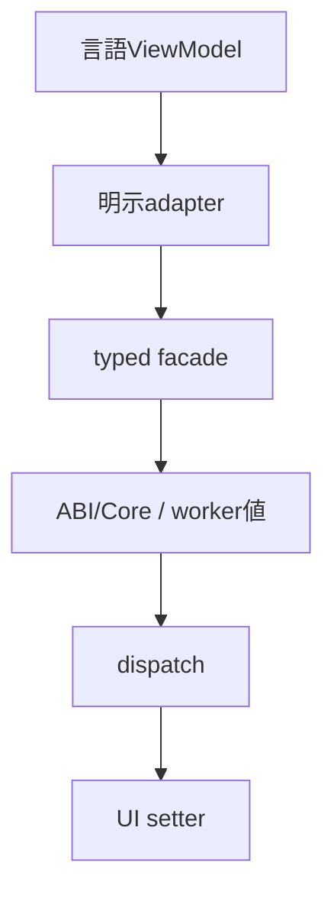
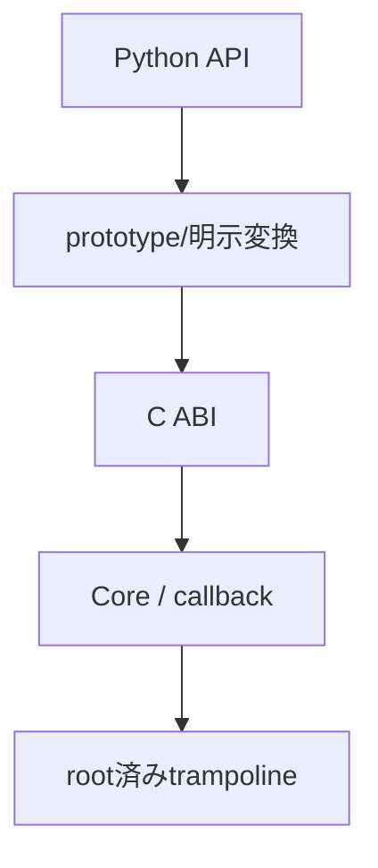
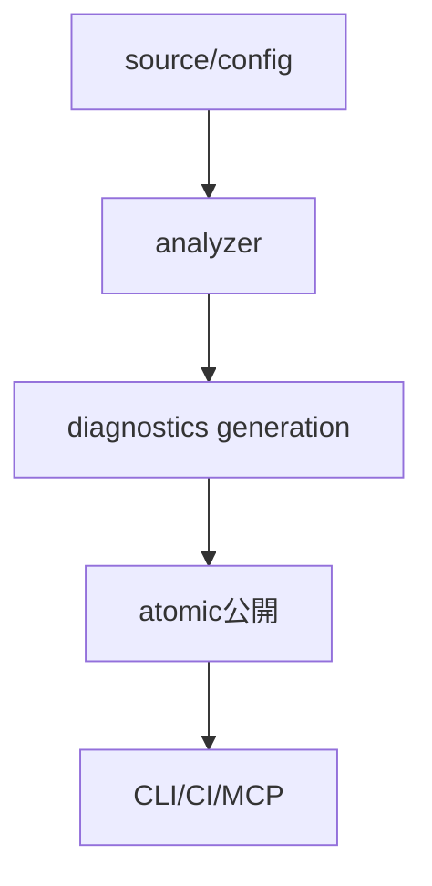

# 言語ラッパー：共通facade・所有変換・解析

- 文書版: 1.0
- 文書ロール: basic-design
- 更新日: 2026-10-17
- 状態: 承認済み（利用者、2026-10-17、本書1.0全文）

## 目的と責務境界

要求を実現する層の責務分担、主要なデータ・所有の受渡し、状態遷移を定める。具体的なclass/interface・関数署名・wire field・call flowは詳細設計、防御の実現条件はセキュア設計で具体化する。要求・ADRの保証や採用範囲を本書だけで変更しない。

アーキテクチャ制約: [Rust Coreとversioned C ABI](../../04_approval/adr-0001-rust-core.md)。

## 要求と基本設計項目の対応

| 設計項目 | 要求根拠 |
| --- | --- |
| callback識別・禁止検知・lint/MCP | [RQ-03-016](../../11_requirements/RQ-03_language-support.md#rq-03-016)、[RQ-03-017](../../11_requirements/RQ-03_language-support.md#rq-03-017) |
| C++公開型・handler・cleanup同期 | [RQ-03-014](../../11_requirements/RQ-03_language-support.md#rq-03-014) |
| C# token owner・interop・Dispose・load | [RQ-03-013](../../11_requirements/RQ-03_language-support.md#rq-03-013)、[RQ-03-014](../../11_requirements/RQ-03_language-support.md#rq-03-014) |
| Rust公開型・receiver・registry・panic | [RQ-03-014](../../11_requirements/RQ-03_language-support.md#rq-03-014)、[RQ-06-012](../../11_requirements/RQ-06_threading-dispatch.md#rq-06-012) |
| Python API・通常終了handshake・特殊method | [RQ-03-014](../../11_requirements/RQ-03_language-support.md#rq-03-014)、[RQ-03-015](../../11_requirements/RQ-03_language-support.md#rq-03-015)、[RQ-03-016](../../11_requirements/RQ-03_language-support.md#rq-03-016) |
| 共通facadeとadapter責務 | [RQ-02-013](../../11_requirements/RQ-02_core-features.md#rq-02-013)、[RQ-03-001](../../11_requirements/RQ-03_language-support.md#rq-03-001)、[RQ-03-002](../../11_requirements/RQ-03_language-support.md#rq-03-002)、[RQ-03-003](../../11_requirements/RQ-03_language-support.md#rq-03-003)、[RQ-03-004](../../11_requirements/RQ-03_language-support.md#rq-03-004)、[RQ-03-005](../../11_requirements/RQ-03_language-support.md#rq-03-005)、[RQ-03-006](../../11_requirements/RQ-03_language-support.md#rq-03-006)、[RQ-03-007](../../11_requirements/RQ-03_language-support.md#rq-03-007)、[RQ-03-008](../../11_requirements/RQ-03_language-support.md#rq-03-008)、[RQ-03-009](../../11_requirements/RQ-03_language-support.md#rq-03-009)、[RQ-03-010](../../11_requirements/RQ-03_language-support.md#rq-03-010)、[RQ-03-014](../../11_requirements/RQ-03_language-support.md#rq-03-014)、[RQ-05-002](../../11_requirements/RQ-05_ownership-callbacks.md#rq-05-002)、[RQ-05-003](../../11_requirements/RQ-05_ownership-callbacks.md#rq-05-003)、[RQ-05-010](../../11_requirements/RQ-05_ownership-callbacks.md#rq-05-010)、[RQ-05-012](../../11_requirements/RQ-05_ownership-callbacks.md#rq-05-012)、[RQ-06-003](../../11_requirements/RQ-06_threading-dispatch.md#rq-06-003)、[RQ-06-012](../../11_requirements/RQ-06_threading-dispatch.md#rq-06-012)、[RQ-12-023](../../11_requirements/RQ-12_build-distribution.md#rq-12-023) |
| Python facadeとCore境界 | [RQ-03-004](../../11_requirements/RQ-03_language-support.md#rq-03-004)、[RQ-03-008](../../11_requirements/RQ-03_language-support.md#rq-03-008)、[RQ-03-011](../../11_requirements/RQ-03_language-support.md#rq-03-011)、[RQ-03-012](../../11_requirements/RQ-03_language-support.md#rq-03-012)、[RQ-06-003](../../11_requirements/RQ-06_threading-dispatch.md#rq-06-003)、[RQ-12-007](../../11_requirements/RQ-12_build-distribution.md#rq-12-007) |
| 解析engine・lint・MCP・cache | [RQ-03-011](../../11_requirements/RQ-03_language-support.md#rq-03-011)、[RQ-03-012](../../11_requirements/RQ-03_language-support.md#rq-03-012)、[RQ-07-008](../../11_requirements/RQ-07_binding.md#rq-07-008)、[RQ-07-013](../../11_requirements/RQ-07_binding.md#rq-07-013)、[RQ-07-014](../../11_requirements/RQ-07_binding.md#rq-07-014)、[RQ-12-007](../../11_requirements/RQ-12_build-distribution.md#rq-12-007) |

## callback識別・禁止検知・lint/MCP

言語frontendがcallback/effect IRへ変換し、共通ruleがerror/warning/Unknownを出す。generationを照合して診断を原子的公開し、CLI/CI/MCPは同じschemaを読む。解析processは入力workspace/SDKへ限定する。

## C++公開型・handler・cleanup同期

C++ facadeはmove専用ownerとborrow viewを分ける。handler recordを同期下でsnapshotしlock外で呼ぶ。失敗releaseは事前nodeをCleanupManagerへ移し、Runtime shell anchorを最後まで保持する。

## C# token owner・interop・Dispose・load

C# facadeは64-bit TokenOwnerでCallLeaseとDisposeを線形化する。callbackはGCHandleをrootし、native呼出し完了後にrelease/ticketへ移す。専用interop assemblyだけがverified path resolverを登録する。

## Rust公開型・receiver・registry・panic

Rust facadeはOwned/BorrowedのlifetimeとUiContextで呼出し権限を表す。Drop失敗は事前ticketをregistryへmoveし、panic境界はtrampolineで処理する。worker向けDispatcherをUI型から分ける。

## Python API・通常終了handshake・特殊method

PythonはNativeOwnerCell/CallbackRootを明示lockで保護し、管理entryのfinallyから終了を要求する。通常gateを閉じてUI cleanup→root drain→内部gate閉鎖の順に進め、interpreter終了前に管理hostを退出する。

## 共通facadeとadapter責務

### 層の責務と主要flow

各wrapperのtyped facadeは同じCore Propertyを参照し、既存ViewModelとの明示adapterが言語値をCore値へ変換する。workerから更新可能なデータはcopyと明示同期を経てdispatcherへ渡す。callback callable/rootは登録成功でCore所有期間へ対応付け、解除後に言語資源を解放する。

### Adapter境界

公開facade → 言語値encode/範囲確認 → versioned C ABI → Core typed Propertyの順に渡す。Coreからの通知はtrampolineが一時値をcopyし、利用者callableをinvokeする。登録失敗時はwrapperがroot/closureを回収し、成功後はCore destroy通知までrootを保持する。

### 具体化後の共通責務

ABI adapterはtyped値とtokenの入口検査を担当し、Coreはprepare/commitと通知、Hostはevent境界とUI safe point、wrapperは言語ownerとcleanup ticketを担当する。終了要求の観測は[RQ-06-012](../../11_requirements/RQ-06_threading-dispatch.md#rq-06-012)、言語基準・管理終了条件は[RQ-03-014/015](../../11_requirements/RQ-03_language-support.md#rq-03-014)、artifact期限は[RQ-12-023](../../11_requirements/RQ-12_build-distribution.md#rq-12-023)を根拠に各層を接続する。

## Python facadeとCore境界

### 層の責務と主要flow

Python公開APIからctypes宣言層を介してversioned C ABIを呼ぶ。宣言層は固定幅prototypeを登録し、native tokenとPython callableのrootをwrapper管理へ渡す。Core成功時だけclosure所有を引き渡し、destroy時にrootを回収する。公開Python値とCore Propertyの正本を分け、ctypes objectを利用者APIへ露出させない。

## 解析engine・lint・MCP・cache

### 層の責務と主要flow

language analyzerとView analyzerの結果を共通diagnostics coreへ集め、CLI/CI/MCPは同じ入力・設定と解析結果を扱う。増分cacheは入力内容と設定の世代に関連付け、解析完了した一世代を公開する。入力が変わった世代の古い結果は最新応答に使わない。MCPはworkspace/file要求の受付層とし、解析本体やbuildの再現性をdaemon寿命へ依存させない。

## 承認履歴

| 日付 | 対象文書・版 | 承認者 | 結論・根拠 |
| --- | --- | --- | --- |
| 2026-10-17 | 旧基本設計の既承認内容 | 利用者 | 従前の方式承認を継承。旧本文と承認記録はローカルarchiveへ保存 |
| — | 本書1.0全文 / 作成時点 | — | 再編集版の確認待ちだった記録。承認結果は次行に記載 |
| 2026-10-17 | 本書1.0全文 | 利用者 | 「OK、承認します。」により再編集版全文を承認。実装・試験合格を意味しない |

## 改訂履歴

| 版 | 日付 | 内容・理由 | 作成者 | 承認記録との対応 |
| --- | --- | --- | --- | --- |
| 1.0 | 2026-10-17 | 利用者のBD再編集指示に基づき責務別に再構成。旧設計ID追跡を廃止 | Codex | 既承認内容の継承と再編集版全文の承認を区別 |
