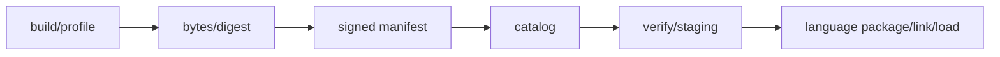
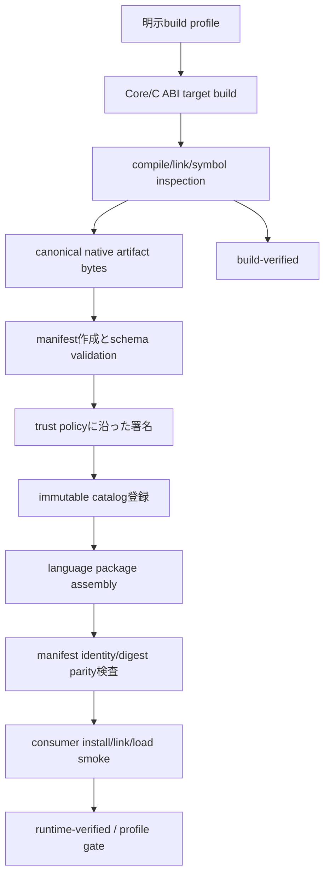
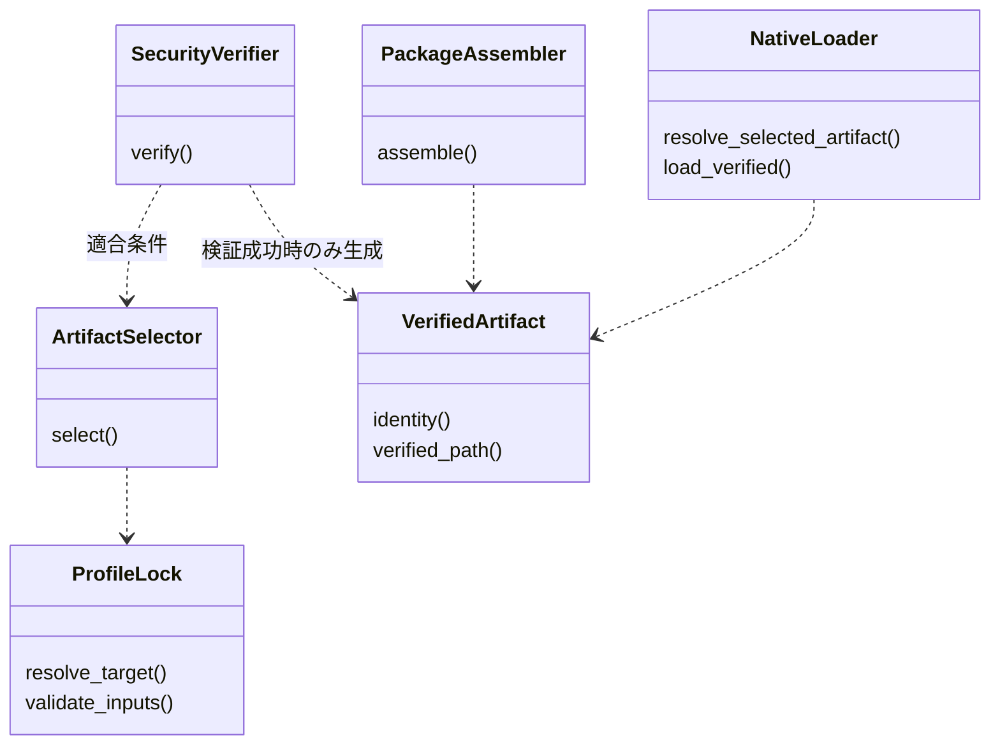

# ビルド・配布：toolchain・profile・package

- 文書版: 1.1
- 文書ロール: detailed-design
- 更新日: 2026-10-17
- 状態: 1.1全文承認済み（利用者、2026-10-17）。実装・試験状態は別管理

## 目的と上位根拠

本書を要求から実装へ具体化する詳細設計の正本とする。型・API・所有・呼出し手順・状態遷移を実装へ反映する。要求の外部保証はリンク先RQ、層の責務と主要flowは上位BDを根拠とする。設計宣言の記載は、配布済みheader・実装済みAPI・試験合格を意味しない。

基本設計: [プラットフォーム：抽象化・描画・text・OS接続](../../12_design/platform/abstraction.md)、[ビルド環境：toolchain・検証・support](../../12_design/build/toolchain-support.md)、[ビルド・配布：package・artifact・信頼境界](../../12_design/build/packages-artifacts.md)、[共通ABI：言語非依存境界と互換性](../../12_design/runtime-objects/abi.md)

## 要求と設計項目の対応

| 設計項目 | 要求根拠 |
| --- | --- |
| ビルドと配布の責務・artifact検証 | [RQ-11-001](../../11_requirements/RQ-11_platform.md#rq-11-001)、[RQ-11-002](../../11_requirements/RQ-11_platform.md#rq-11-002)、[RQ-11-020](../../11_requirements/RQ-11_platform.md#rq-11-020)、[RQ-11-021](../../11_requirements/RQ-11_platform.md#rq-11-021)、[RQ-12-001](../../11_requirements/RQ-12_build-distribution.md#rq-12-001)、[RQ-12-003](../../11_requirements/RQ-12_build-distribution.md#rq-12-003)、[RQ-12-004](../../11_requirements/RQ-12_build-distribution.md#rq-12-004)、[RQ-12-005](../../11_requirements/RQ-12_build-distribution.md#rq-12-005)、[RQ-12-006](../../11_requirements/RQ-12_build-distribution.md#rq-12-006)、[RQ-12-008](../../11_requirements/RQ-12_build-distribution.md#rq-12-008)、[RQ-12-010](../../11_requirements/RQ-12_build-distribution.md#rq-12-010)、[RQ-12-011](../../11_requirements/RQ-12_build-distribution.md#rq-12-011)、[RQ-12-012](../../11_requirements/RQ-12_build-distribution.md#rq-12-012)、[RQ-12-013](../../11_requirements/RQ-12_build-distribution.md#rq-12-013)、[RQ-12-014](../../11_requirements/RQ-12_build-distribution.md#rq-12-014)、[RQ-12-015](../../11_requirements/RQ-12_build-distribution.md#rq-12-015)、[RQ-12-016](../../11_requirements/RQ-12_build-distribution.md#rq-12-016)、[RQ-12-017](../../11_requirements/RQ-12_build-distribution.md#rq-12-017)、[RQ-12-018](../../11_requirements/RQ-12_build-distribution.md#rq-12-018)、[RQ-12-019](../../11_requirements/RQ-12_build-distribution.md#rq-12-019)、[RQ-12-020](../../11_requirements/RQ-12_build-distribution.md#rq-12-020)、[RQ-12-021](../../11_requirements/RQ-12_build-distribution.md#rq-12-021)、[RQ-13-001](../../11_requirements/RQ-13_nonfunctional-measurement.md#rq-13-001)、[RQ-13-011](../../11_requirements/RQ-13_nonfunctional-measurement.md#rq-13-011) |
| 最低版・target profile・toolchain lock | [RQ-03-014](../../11_requirements/RQ-03_language-support.md#rq-03-014)、[RQ-04-030](../../11_requirements/RQ-04_abi-boundary.md#rq-04-030)、[RQ-11-001](../../11_requirements/RQ-11_platform.md#rq-11-001)、[RQ-11-002](../../11_requirements/RQ-11_platform.md#rq-11-002)、[RQ-11-003](../../11_requirements/RQ-11_platform.md#rq-11-003)、[RQ-11-004](../../11_requirements/RQ-11_platform.md#rq-11-004)、[RQ-11-021](../../11_requirements/RQ-11_platform.md#rq-11-021)、[RQ-11-024](../../11_requirements/RQ-11_platform.md#rq-11-024)、[RQ-12-009](../../11_requirements/RQ-12_build-distribution.md#rq-12-009)、[RQ-12-010](../../11_requirements/RQ-12_build-distribution.md#rq-12-010)、[RQ-12-017](../../11_requirements/RQ-12_build-distribution.md#rq-12-017)、[RQ-12-018](../../11_requirements/RQ-12_build-distribution.md#rq-12-018)、[RQ-12-019](../../11_requirements/RQ-12_build-distribution.md#rq-12-019)、[RQ-12-020](../../11_requirements/RQ-12_build-distribution.md#rq-12-020)、[RQ-12-024](../../11_requirements/RQ-12_build-distribution.md#rq-12-024) |
| package・loader・artifact取得 | [RQ-12-004](../../11_requirements/RQ-12_build-distribution.md#rq-12-004)、[RQ-12-005](../../11_requirements/RQ-12_build-distribution.md#rq-12-005)、[RQ-12-006](../../11_requirements/RQ-12_build-distribution.md#rq-12-006)、[RQ-12-007](../../11_requirements/RQ-12_build-distribution.md#rq-12-007)、[RQ-12-008](../../11_requirements/RQ-12_build-distribution.md#rq-12-008)、[RQ-12-011](../../11_requirements/RQ-12_build-distribution.md#rq-12-011)、[RQ-12-012](../../11_requirements/RQ-12_build-distribution.md#rq-12-012)、[RQ-12-013](../../11_requirements/RQ-12_build-distribution.md#rq-12-013)、[RQ-12-025](../../11_requirements/RQ-12_build-distribution.md#rq-12-025) |

本書内の共通規則は上記の各要求を実現するために適用する。同一項目内で個別要求を参照する場合はその対象範囲を優先する。将来候補・未採用範囲は採用済みの動作と区別する。

## ビルドと配布の責務・artifact検証

### 実現のcall/data/ownership flow

build profileをnative artifact identityへ束縛し、4言語packageは同じ検証済みnative bytesを収録/参照する。consumerはraw manifestの曖昧性を拒否し、canonical payloadへの署名/trust、digest、target/profile、ABI、feature、schema互換を検証してからlink/loadへ渡す。cache/stagingはimmutable identityとdigestで分離する。検証状態とlicense/noticeの記録はrelease evidenceへ対応付ける。



### 責務と配布単位

| 層 | 責務 | source of truth |
|---|---|---|
| Build profile | host/target、sysroot/toolchain、target profile、ABI major、feature setを指定する | Build設定とprofile記録。 具体化はビルド・配布：toolchain・profile・package、ビルド・配布：toolchain・profile・packageを参照する|
| Native runtime artifact | Rust Core、versioned C ABI、target固有backendを一つのtarget向けbinaryとして生成する | artifact bytesと不変manifest |
| Language package | 各言語の既定package境界でwrapperとnative artifactを利用者へ接続する | package metadata。native assetを含む場合もcanonical digestを保つ |
| Canonical catalog | 公式manifestとimmutable identityの権威ある保管・取得点になる | 具体化はビルド・配布：toolchain・profile・package、ビルド・配布：toolchain・profile・packageを参照する|
| Verification state | build/runtime/hardware verificationの達成範囲を表す | release support matrix |

同一target/profileのnative C ABI runtimeは各language package向けに独自再build・再labelせず、同じcanonical artifact identity/digestを参照する。package archive自体のdigestと、中に含まれるnative runtime fileのdigestは別の対象として記録する。

### 実装規則

| 実装規則 | 根拠・境界 |
| --- | --- |
| native runtimeは`runtime version + ABI major + target profile + feature set`をbuild identity入力として一つのartifactにする。4言語用にCoreを再compileしない。packageへの収録・圧縮・配置変更は許せるが、native binary bytesを変更した再build・再labelは別artifact identityとして扱う。 | ADR-0001、MVVM UIライブラリ 初期Build／CI target matrixに関する上位判断案、MVVM UIライブラリ Native artifact provenanceに関する上位判断案。bit-for-bit reproducible buildの達成は本判断から保証せず、attestation/SBOM詳細は別項目で具体化する。 |
| build profileはbuild hostとtargetを独立して明示し、少なくともtarget OS/architecture/triple、board/toolchain profile ID、sysroot identity、ABI major、要求featureを持つ。ABI・linkに影響するcompiler/linker/sysroot/CPU featureの値はprofileに束縛し、host machineからtargetを推測しない。 | MVVM UIライブラリ 初期Build／CI target matrixに関する上位判断案、MVVM UIライブラリ Rust Cargo packageに関する上位判断、MVVM UIライブラリ Native artifact provenanceに関する上位判断案。 具体化はビルド・配布：toolchain・profile・package、ビルド・配布：toolchain・profile・packageを参照する。 |
| target状態は`build-verified`、`runtime-verified`、`hardware-profile-verified`の三段階で記録する。compile/link/ABI inspection通過だけでruntime supportと宣言しない。実機検証の結果は試験済みのboard・OS image・sysroot・driver profileの範囲に限定する。 | MVVM UIライブラリ 初期Build／CI target matrixに関する上位判断案、MVVM UIライブラリ サポート期間に関する上位判断案、release/version test方針。各状態の合格suiteと性能閾値はtest planningで具体化する。 |
| 初期target順はWindows x64 native build/smoke、Linux x64 native build/test、Linux x64 hostからARMv7/AArch64 cross-build、選定した一つのARM実機profile gate、その後にWindows ARM64/macOS等とする。未検証targetへのfallbackやsupport表示拡張をしない。 | MVVM UIライブラリ 初期描画方式と検証順序に関する上位判断案。 具体化はビルド・配布：toolchain・profile・package、ビルド・配布：toolchain・profile・packageを参照する。 |
| package境界は上位設計の言語別方式に合わせる。Pythonはpure-Python wrapperとOS/architecture別native runtime packageを分離し、初期binary wheelはWindows x64/Linux x64。C#はmanaged wrapperとnative fileをNuGet同梱し、初期RIDは`win-x64`/`linux-x64`。C++はpublic header/source、native library、CMake Config/export targetを持つrelocatable install tree。Rustは低レベル`-sys`とsafe crateを分け、native runtimeを別artifactとして使い、別environment importは明示feature/targetで選ぶ。 | MVVM UIライブラリ Python package/native distribution、言語ラッパー：C++。package ID、Python/.NET/C++/Rust最低version、crate registry、CMake target・構成、native loader実装は別項目で具体化する。 |
| 組み込みLinux ARMv7/AArch64 native artifactはcross-build対象にするが、libc・sysroot・GPU/input依存とprofile compatibilityを確かめるまでdesktop Linux向けmanylinux/musllinux wheelまたは一般NuGet RIDとして扱わない。互換性がないprofileはYocto/system packageまたはtarget-specific archiveなどの別導入経路とし、形式選定は後続判断とする。 | MVVM UIライブラリ 初期Build／CI target matrixに関する上位判断案。 具体化はビルド・配布：toolchain・profile・package、ビルド・配布：toolchain・profile・packageを参照する。 |
| native artifactのcanonical identityは一つの公式catalogをsource of truthにする。language packageへ同梱・参照するbinaryは同じmanifest identity/digestを保つ。selectorはbuild/runtime targetと明示profileから決め、host/target混同や推測fallbackを拒否する。 | MVVM UIライブラリ Native artifact provenanceに関する上位判断案。 具体化はビルド・配布：toolchain・profile・package、ビルド・配布：toolchain・profile・packageを参照する。 |
| manifestはruntime versionとは独立したschema versionを持つ。payloadにはruntime version、ABI major、OS/architecture/target triple、profile/compatibility、feature、filename、byte size、artifact SHA-256 digest、immutable release identity、schema version、signing key identityを含める。 | MVVM UIライブラリ ABI release version schemeに関する上位判断案。 具体化はビルド・配布：toolchain・profile・package、ビルド・配布：toolchain・profile・packageを参照する。 |
| manifest payloadはUTF-8 JSONのRFC 8785 JCS canonical formを候補とし、manifest payload内すべての意味情報（signature containerを除く）をEd25519 signatureで束縛する候補とする。artifact file digestにはSHA-256を候補とする。duplicate keys、不正Unicode、範囲外数値、曖昧なparseは拒否し、large integer-like valuesは文字列表現にする。algorithm/canonicalization/schema test vectorsは利用者承認前に確定しない。 | MVVM UIライブラリ Native artifact provenanceに関する上位判断案、RFC 8785、RFC 8032、NIST FIPS 180-4。RFC 8785はInformational RFC。 具体化はビルド・配布：toolchain・profile・package、ビルド・配布：toolchain・profile・packageを参照する。 |
| manifest readerは署名を検証した上でmanifest全体を一意にparseする。unknown schema major、duplicate/ambiguous field、unknown critical/required field/feature、署名対象の不一致はfail closed。same-majorのunknown optional fieldは署名検証後に限り無視可能とし、target/ABI/trust/security判定に影響する情報をoptionalにしない。 | MVVM UIライブラリ Native artifact provenanceに関する上位判断案。 具体化はビルド・配布：toolchain・profile・package、ビルド・配布：toolchain・profile・packageを参照する。 |
| artifact取得・import・package assemblyでは、runtime versionとdigestをlock可能な値として記録し、cache keyにもimmutable identityとdigestを含める。catalog fetchは明示操作とし、signature/trust/expiry/revocation、digest、target/profile、ABI major、required featureを検証してからlink/loadに渡す。署名・信頼がunknown/revoked/invalid、target mismatch、metadata解析不能ならfail closed。offline時は運用者が別経路から信頼したpublic trust bundleと失効情報を使う。 | MVVM UIライブラリ Native artifact provenanceに関する上位判断案。trust rootはcatalogと独立してprovisionする。 具体化はビルド・配布：toolchain・profile・package、ビルド・配布：toolchain・profile・packageを参照する。 |

### Targetとverification gate

| Build host | Target/profile | Gate | 表示できる状態 |
|---|---|---|---|
| Windows x64 | Windows x64 | native compile/link、Core/ABI test、4言語smokeの初期gate | build-verified。smoke結果のtarget範囲を別記 |
| Linux x64 | Linux x64 | native compile/link、Core/ABI test、renderer/backend smoke、wrapper parity | build-verified。Linux runtime suite通過分はruntime-verified |
| Linux x64 | ARMv7 target profile | cross-compile/link/import・artifact inspection | build-verifiedのみ |
| Linux x64 | AArch64 target profile | cross-compile/link/import・artifact inspection | build-verifiedのみ |
| 代表Linux ARM board | 選定済み一つのboard/sysroot/driver profile | Window/surface、描画、input/IME/accessibilityの指定smokeを実機実行 | 当該profileのみhardware-profile-verified |
| 後続target | Windows ARM64/macOS等 | 別途matrix追加とruntime試験 | 試験完了までsupport宣言なし |

CIはbuild hostとtargetの両方を各job結果に記録する。Cross-build resultにはtarget binaryのimport/symbol/metadata検査を付けるが、hardware-dependent動作の証拠とは扱わない。具体的なsuiteとgate実行頻度はtest implementation planningで定める。

### Language package接続

| 言語 | 上位で承認済みのpackage境界 | ビルド・配布：toolchain・profile・packageで守るartifact契約 |
|---|---|---|
| Python | pure-Python ctypes wrapper wheelとnative runtime binary wheel/artifactを別packageにする。初期native wheelはWindows/Linux x64。 | wrapper packageにPython ABI拡張を要求しない。native wheelのplatform tagは実binaryのOS/architecture/libc互換条件に適合する時だけ付ける。ARM profileは互換性確認前に標準wheelとしない。 |
| C# | managed wrapperとtarget native runtimeを一つのNuGet packageへ収録。native assetは`runtimes/{rid}/native/`。初期RIDは`win-x64`/`linux-x64`。 | NuGet assetは正しいRIDの同一canonical native artifactを運び、publish結果でABI/profile identityを照合する。 |
| C++ | C ABIを呼ぶthin wrapperをCMake install/exportでrelocatable package化し、config/exported targetsから利用。 | install tree内native runtimeは同じtarget artifactを参照し、relocation後も依存を解決する条件を持つ。vcpkg/Conanを必須にしない。 |
| Rust | raw FFI `-sys` crateとsafe wrapper crateを分け、Core native artifactを別配布。`--target`でtargetを明示し、named profile/artifact import featureを利用可能にする。 | featureは取得方式の指定でありtarget tripleの代用でない。build scriptはhost/targetを区別し、artifact metadata不一致を拒否する。 |

Python wheel compatibility tagsはinterpreter/ABI/platform条件を表し、NuGetはRID native assets、CMakeはConfig/exported targets、Cargoはtarget/feature機構を提供する。ここでのpackage shapeはMVVM UIライブラリ Python package/native distributionが決定しており、exact versions・paths・resolver APIsを本書で追加確定しない。

### Build/release artifact flow



catalog登録は不変identity単位で行い、同一identity/digestをlanguage packageへ接続する。署名、digest、target/profile、ABI、featureのいずれかを検証できないpackageをbuild/importに使わない。公開承認、credentials、catalog API、atomic upload procedureはrelease implementation designへ送る。

### Release・version testとの接続

| 確認 | 本書の境界 | 詳細 |
|---|---|---|
| 毎回releaseごとの利用目的に対するsystem全体の動作 | package assemble、native artifact identity、各宣言targetのverification stateをrelease recordへ渡す | [release test](../../30_release_test/release-test.md)のgateに入力する |
| version updateでの変更要求・影響範囲・回帰 | runtime ABI major/minor/patch、wrapper package version、manifest schema version、target profileの変更差分を独立に表示 | [version test](../../31_version_test/version-test.md)の影響分析に入力する |
| artifact verification | signature/digest/profile mismatchはfail closedし、成功時は検証済みidentityを記録 | 対応するpackage verification caseと実装testで検査する |

### 失敗・競合ケース

| ケース | 提案する結果 |
|---|---|
| build hostをtargetと誤認 | profile mismatchとして拒否。artifact metadataへhost/targetを個別記録 |
| cross-compileは成功、board runtimeは未試験 | `build-verified`まで。runtime/hardware supportと表示しない |
| ARM sysrootと一般 Linux wheel/RIDの互換性が証明されない | 標準tag/package収録を拒否し、profile別導入形態を後続判断へ送る |
| 同じruntime version表記のbinary bytes差し替え | digest不一致の新identityとして扱い、既存immutable entryを上書きしない |
| target/profile/ABI/feature mismatch | package assembly/link/load前に拒否し、異なるartifactへ自動fallbackしない |
| manifest signature不正、key unknown/revoked、trust chain不成立 | fail closed。unsigned/unknown keyでのwarning-only利用を認めない |
| unknown major、duplicate key、署名対象を一意化できないmanifest | parse/validation failureとして拒否 |
| unknown optional field | schema policyでoptionalと識別でき、署名検証後に限り無視候補。security-relevant fieldをoptional扱いしない |
| offlineでtrust/revocation metadataがない、またはstale | 具体化はビルド・配布：toolchain・profile・package、ビルド・配布：toolchain・profile・packageを参照する。未知keyや署名検証不能を自動受入れしない |
| package container hashだけ一致しnative file digestが異なる | native artifact identity mismatchとして拒否 |

### 参考資料

- [ビルド環境：toolchain・検証・support](../../12_design/build/toolchain-support.md)～[ビルド環境：toolchain・検証・support](../../12_design/build/toolchain-support.md)
- [共通ABI：言語非依存境界と互換性](../../12_design/runtime-objects/abi.md)～[ビルド・配布：package・artifact・信頼境界](../../12_design/build/packages-artifacts.md)
- [PyPA wheel binary distribution](https://packaging.python.org/en/latest/specifications/binary-distribution-format/) / [platform compatibility tags](https://packaging.python.org/en/latest/specifications/platform-compatibility-tags/)
- [NuGet native files](https://learn.microsoft.com/en-us/nuget/create-packages/native-files-in-net-packages) / [.NET RID catalog](https://learn.microsoft.com/en-us/dotnet/core/rid-catalog)
- [CMake importing/exporting packages](https://cmake.org/cmake/help/latest/guide/importing-exporting.html)
- [Cargo build scripts and cross-target environment](https://doc.rust-lang.org/cargo/reference/build-scripts.html) / [Cargo features](https://doc.rust-lang.org/cargo/reference/features.html)
- [RFC 8785 JSON Canonicalization Scheme](https://www.rfc-editor.org/rfc/rfc8785) / [RFC 8032 EdDSA](https://www.rfc-editor.org/rfc/rfc8032) / [NIST FIPS 180-4 Secure Hash Standard](https://csrc.nist.gov/pubs/fips/180-4/upd1/final)
- [Release test policy](../../30_release_test/release-test.md) / [Version test policy](../../31_version_test/version-test.md)

### Artifact検証interface

package selectorはraw manifest bytes、candidate native bytes、要求target/profile/ABI/features、既存trust bundleをSecurityVerifierへ渡す。成功出力はverified identity・digest・適合判定・trust generationを持つ不変recordとし、package loaderはそのrecordが指すstaging objectだけをlink/loadする。失敗は元の分類を返し、未検証bytesをcacheのverified領域へ公開しない。署名対象・trustの処理は [Artifact検証の処理設計](../../14_secure_design/03-artifact-verification.md) に定義する。

## 最低版・target profile・toolchain lock

### 実装規則

| 実現手段・責務 | 要求根拠 |
| --- | --- |
| 初期正式profile候補はWindows11 x64、Debian12 glibc x64。ARMv7/AArch64は両方cross-build、代表実機はRaspberry Pi4 ModelB 4GBのAArch64を選ぶ。 | [RQ-11-024](../../11_requirements/RQ-11_platform.md#rq-11-024) |
| Linux nativeはx86_64-unknown-linux-gnu、AArch64はaarch64-unknown-linux-gnu、ARMv7はarmv7-unknown-linux-gnueabihf。ARMv7 CPU=cortex-a7/NEON/VFPv4 hard-floatをprofileへ固定。 | 上記の根拠RQ |
| minimumはC++17/CMake3.28、Rust1.85 edition2024、C#14/net10.0、CPython3.13。release compiler/SDKはlockfileのexact値を使う。 | [RQ-03-014](../../11_requirements/RQ-03_language-support.md#rq-03-014) |
| release lockはtoolchain/config commit、compiler/linker/Rust/SDK、sysroot digest、CPU flags、libc、font/graphics依存、container image digestを必須にする。 | 上記の根拠RQ |
| 再現用候補はRust1.90.0、GCC12系/Debian12 SDK、MSVC v143/Windows SDK10.0.26100系。patch版はimageから採取しlock生成で固定、floating tagでreleaseしない。 | [RQ-11-024](../../11_requirements/RQ-11_platform.md#rq-11-024) |
| 新stable初版はruntime1.0.0/ABI1、pre-releaseは1.0.0-rc.N、wrapper versionは独立だがminimum Runtime/featureをmanifestに持つ。 | [RQ-04-030](../../11_requirements/RQ-04_abi-boundary.md#rq-04-030) |
| majorごとのnative filenameを分け、同process内はRuntime作成後に別majorへの暗黙switchを禁止。別majorの併存はloader handleを分離する。 | 上記の根拠RQ |
| support registryはmajor×profileのbuild/runtime/hardware/maintenanceを別columnにし、検証SHAと日付から公開表を生成する。 | 上記の根拠RQ |
| EOLの公開artifact・metadata・告知は継続保存。test logはEOL+24か月、security監査logは2年を初期運用候補とする。担当はReleaseMaintainer/SecurityMaintainerの役割で指定する。 | [RQ-12-024](../../11_requirements/RQ-12_build-distribution.md#rq-12-024) |

### 実現設計

#### Profileとgate

| profile ID案 | OS/architecture | 初期gate | 公開表示の条件 |
|---|---|---|---|
| win11-x64-abi1 | Windows11 x64、MSVC CRT | build/ABI/4wrapper/縦断/TSF/UIA | 当該OS image・SHAの実行成功後だけRuntime verified |
| linux-x64-glibc236 | Debian12 x64、glibc2.36 | build/ABI/4wrapper/WaylandまたはX11/IBus/AT-SPI | desktop dependencyを含むprofile単位で公表 |
| linux-armv7-a7-hf | Linux ARMv7 hard-float | cross-build/link/artifact inspection | 初期はBuild verified。実機未実施と明記 |
| rpi4-a64-drm | RPi4 4GB、AArch64、DRM/EGL/GLES、明示IME broker | hardware/描画/入力/IME/性能 | board image・kernel・Mesa・依存hashを固定した実測後 |

代表boardの選定は価格/購入の依頼ではなくtest profileの案。未保有・未接続の実機で合格を作らない。ARMv7の実機gateを後から追加してもAArch64結果を転記しない。

`profiles/<profile>.lock.json`のschemaは`profile_id, target_triple, host_image_digest, rustc_version, cc_version, linker_version, sdk_id, sysroot_sha256, cpu_flags, libc_abi, dependencies[{name,version,digest,license}], source_revision`。採取はrustc -Vv、compiler -v、SDK manifestとsysrootのfile inventory digestから行う。lock generatorは全fieldを埋めるまでrelease jobを起動しない。実デバイスimageやprivate SDKを取得しない今回の資料では、digest欄を有効なlockとして生成しない。

公式根拠: [Rust1.90.0](https://blog.rust-lang.org/2025/09/18/Rust-1.90.0/)、[.NET support](https://learn.microsoft.com/en-us/dotnet/core/releases-and-support)、[Debian12 release information](https://www.debian.org/releases/bookworm/index)、[Raspberry Pi4仕様](https://www.raspberrypi.com/products/raspberry-pi-4-model-b/)。これらは候補の存在・制約の根拠で、本ライブラリの実機support証拠ではない。


### Build baselineの補足

[CMake3.28 release notes](https://cmake.org/cmake/help/v3.28/release/3.28.html)をminimum候補の照合先とする。C#14はlibraryを構築するsource基準案で、consumerのcompilerを不要に拘束しないようpublic facadeにC#14専用の構文依存を持ち出さない。TFM/net10.0の利用条件とcompiler source基準は別fieldで管理する。

## package・loader・artifact取得

### 実装規則

| 実現手段・責務 | 要求根拠 |
| --- | --- |
| native filenameはfreemvvm_abi1.dll / libfreemvvm_abi1.so。package ID案はPython freemvvm、native freemvvm-runtime-<profile>、NuGet FreeMvvm、CMake FreeMvvm、crate freemvvm/freemvvm-sys。 | 上記の根拠RQ |
| CMake exportはFreeMvvm::cppとFreeMvvm::runtime、relocatable Config package。静的Core同梱variantは初期非提供。 | [RQ-12-025](../../11_requirements/RQ-12_build-distribution.md#rq-12-025) |
| Python pure wheelはpy3-none-any、native Windowsはpy3-none-win_amd64、Linux x64は検証済みmanylinux baseline候補。ARMはprofile archive/Yocto recipeを先に使う。 | 上記の根拠RQ |
| NuGetはruntimes/win-x64/nativeとlinux-x64/nativeにnative+manifestを同梱。single-file publishでも抽出後bytesを再検証する。 | 上記の根拠RQ |
| Cargoはnative-prebuilt featureで明示importを許可し、build.rsはnetwork禁止、artifact.lockとprefixを検査してlink metadataだけを出す。 | 上記の根拠RQ |
| freemvvm-tool fetch/import/verify/lockの4commandを作り、fetchはversion/profile指定必須、upgradeは別の明示lock更新操作。 | 上記の根拠RQ |
| canonical catalogは署名済み静的indexとcontent-addressed blobsのHTTPS/file backend。service URLは運用configに置き、consumerへの任意外部URLは初期無効。 | 上記の根拠RQ |
| cacheはOS user cache配下のfreemvvm/v1、credentialはOS storeまたはCI secret参照。manifest/lock/logへsecret値を保存しない。 | 上記の根拠RQ |

### 実現設計

#### Artifact tool protocol

```text
freemvvm-tool fetch --catalog <configured-origin> --version 1.0.0 --profile <id>
freemvvm-tool import --manifest <file> --artifact <file> --trust-bundle <file>
freemvvm-tool verify --lock artifact.lock.json
freemvvm-tool lock --manifest <verified-manifest> --output artifact.lock.json
```

以下は実装するcommandの設計であり、toolは未実装である。fetchはmetadata→trust→bytes→digest→private staging→atomic publish→lock候補の順。importは同じ検証器へlocal filesを渡す。lock更新は利用者が差分を確認しcommitする操作へ分ける。

| 配布 | wrapperとnativeの接続 | 誤適合時 |
|---|---|---|
| Python | import wrapper時にprototype登録、Runtime.createでselected artifactを検証/load | native未取得はMissingRuntimeError。ネット取得しない |
| C# | 専用interop assembly resolverへverified absolute pathを登録 | profile/RID mismatchを明示してloadしない |
| C++ | find_packageのimported targetがnative prefixを参照 | host pathをtarget libraryとしてlinkしない |
| Rust | build.rsがtarget/profile/ABI/features/lockを検証 | lock不足/不適合はcompile時error、fetchしない |

Linux wheelのbaselineはglibc2.36の候補profileと、auditwheel相当のdependency検査結果からtagを決定する。tagの文法は[PyPA公式仕様](https://packaging.python.org/en/latest/specifications/platform-compatibility-tags/)に照合し、単にdistribution OS名からmanylinux互換と判断しない。publisherはPython/C#/C++/Rust packageへ同じnative digestを収録し、圧縮やlayout変更以外の再compileを行わない。

Release assemblyはartifact manifest、license/notice inventory、wrapper minimum constraints、target profile、provenanceをbundleへ入れる。CLA/DCO・商標・docs/assets別license・public registryへのpublishの実行は今回の指示に含めず、必要なら要求変更案により扱う。

## クラス設計の補足（1.1承認済み）

既承認1.0の実現規則を支える型・関連・所有・主要操作を整理した。内部型名とメソッドの分担は本改訂で補足する内部設計であり、既存公開APIの署名や外部保証を追加・変更するものではない。この節のクラス構成と追加図は1.1版全文の承認対象であり、実装・試験完了の証明とは区別する。

要求根拠: [RQ-12-010](../../11_requirements/RQ-12_build-distribution.md#rq-12-010)、[RQ-12-014](../../11_requirements/RQ-12_build-distribution.md#rq-12-014)、[RQ-12-015](../../11_requirements/RQ-12_build-distribution.md#rq-12-015)、[RQ-11-021](../../11_requirements/RQ-11_platform.md#rq-11-021)。

build/profileの選択、artifact検証、package組立、native loadを別のtool内部責務として示す。CI job自体をCore Runtimeのclassへ組み込まない。

### 型の責務と所有

| 型 | 責務・保持データ | 主要メソッド・操作 | 所有・寿命 |
| --- | --- | --- | --- |
| ProfileLock | target/toolchain/sysroot/minimum/依存digestと検証gate条件 | resolve_target(); validate_inputs(); record_evidence() | build成功・runtime確認・実機確認を別の状態として記録 |
| ArtifactSelector | consumerのprofile/ABI/featuresとartifact identityの照合 | select(manifest, constraints) | host artifactをtarget用として選ばない。選択だけで検証成功にしない |
| SecurityVerifier | 署名・digest・schema・trust条件の検証interface | verify(manifest, bytes, trust_bundle) | SD所管の検証器。入力失敗からVerifiedArtifactを構築しない |
| VerifiedArtifact | 検証済みidentity/digest/profileとprivate stagingの束縛 | identity(); verified_path(); lock_record() | 検証済みbytesとpathの対応を保持し、未検証pathへ差し替えない |
| PackageAssembler | native artifactと4言語wrapper/notice/provenanceの組立 | assemble(verified_artifact, wrapper_profile) | 同じnative digestを使い、packageごとにCoreを再compileしない |
| NativeLoader | runtime consumerの適合確認とverified pathのload | resolve_selected_artifact(); load_verified(artifact) | import/load時にnetwork fetchしない。不足・不適合は明示失敗 |

### クラスの関連

`*--`は従属するstate/作業の合成、`o--`は共有を含む所有参照、`..>`は非所有の利用・識別・委譲を示す。関連名と本文で示した寿命を優先し、図の同名型は各instanceで別の状態を持つ。図は主要メソッド名を抜粋し、引数・所有・失敗条件は表と本文に従う。



### 主要な呼出しと失敗境界

fetch/import toolは適合metadata選択→trust/署名→bytes/digest→private staging→atomic publish→lock候補の順に処理する。PackageAssemblerとNativeLoaderは検証成功recordに束縛されたartifactだけを受け取り、公開承認やlock更新は別操作として扱う。

VerifiedArtifactは暗号検証とpath束縛を表す内部型で、単なるファイル存在確認ではない。図のSecurityVerifierの実装詳細はSDを正本とし、ここで新しい暗号方式・公開registry・tool実装を採用済みにしない。

## 文書の承認・改訂履歴

| 日付 | 対象版 | 内容・根拠 |
| --- | --- | --- |
| 2026-10-17 | 1.0 | 利用者の指示に基づき、既承認内容を責務別に再編集。設計項目IDによる承認・追跡は廃止し、以後は文書版全体で管理する。構成変更を新規の製品仕様採用としない |
| 2026-10-17 | 1.0全文 | 利用者の「全部承認します」により文書全体を承認。旧IDによる項目承認ではなく、現行文書版を対象とする。実装・試験合格を意味しない |
| 2026-10-17 | 1.1改訂案 | 利用者の補足指示によりクラス責務・所有・メソッド・関連図を追加。1.0承認を維持し、1.1全文は確認待ち |
| 2026-10-17 | 1.1全文 | 利用者の「OK,テスト文書作りましょうか」により、クラス設計補足と選択的な図の補強を含む全文を承認。既存履歴を維持し、実装・試験状態は別管理 |
