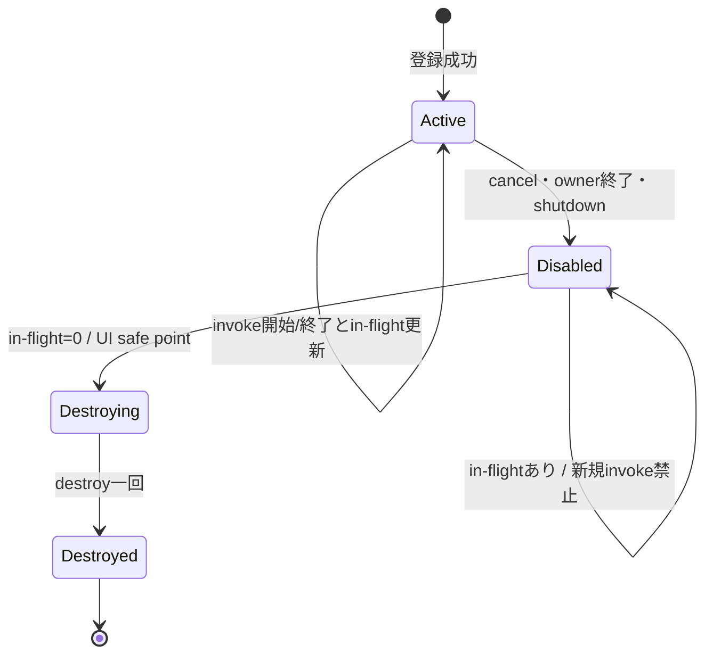
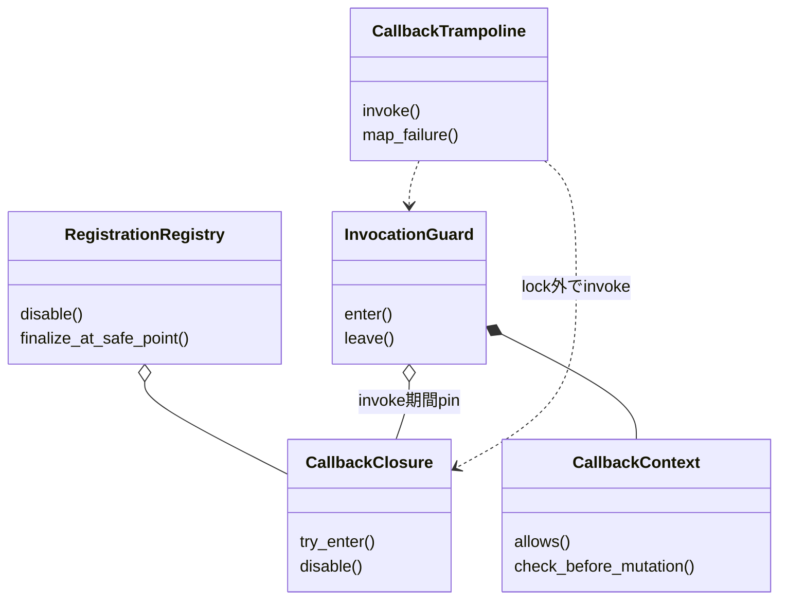

# イベントハンドリング：callbackと再入

- 文書版: 1.1
- 文書ロール: detailed-design
- 更新日: 2026-10-17
- 状態: 1.1全文承認済み（利用者、2026-10-17）。実装・試験状態は別管理

## 目的と上位根拠

本書を要求から実装へ具体化する詳細設計の正本とする。型・API・所有・呼出し手順・状態遷移を実装へ反映する。要求の外部保証はリンク先RQ、層の責務と主要flowは上位BDを根拠とする。設計宣言の記載は、配布済みheader・実装済みAPI・試験合格を意味しない。

基本設計: [イベントハンドリング：通知・入力・Command](../../12_design/events/notifications-commands.md)

## 要求と設計項目の対応

| 設計項目 | 要求根拠 |
| --- | --- |
| callback実行と登録のライフサイクル | [RQ-03-011](../../11_requirements/RQ-03_language-support.md#rq-03-011)、[RQ-03-012](../../11_requirements/RQ-03_language-support.md#rq-03-012)、[RQ-04-015](../../11_requirements/RQ-04_abi-boundary.md#rq-04-015)、[RQ-04-016](../../11_requirements/RQ-04_abi-boundary.md#rq-04-016)、[RQ-04-017](../../11_requirements/RQ-04_abi-boundary.md#rq-04-017)、[RQ-05-006](../../11_requirements/RQ-05_ownership-callbacks.md#rq-05-006)、[RQ-05-007](../../11_requirements/RQ-05_ownership-callbacks.md#rq-05-007)、[RQ-05-008](../../11_requirements/RQ-05_ownership-callbacks.md#rq-05-008)、[RQ-05-009](../../11_requirements/RQ-05_ownership-callbacks.md#rq-05-009)、[RQ-05-013](../../11_requirements/RQ-05_ownership-callbacks.md#rq-05-013)、[RQ-05-014](../../11_requirements/RQ-05_ownership-callbacks.md#rq-05-014)、[RQ-05-015](../../11_requirements/RQ-05_ownership-callbacks.md#rq-05-015)、[RQ-07-006](../../11_requirements/RQ-07_binding.md#rq-07-006)、[RQ-07-008](../../11_requirements/RQ-07_binding.md#rq-07-008)、[RQ-07-012](../../11_requirements/RQ-07_binding.md#rq-07-012)、[RQ-07-013](../../11_requirements/RQ-07_binding.md#rq-07-013)、[RQ-07-014](../../11_requirements/RQ-07_binding.md#rq-07-014)、[RQ-12-007](../../11_requirements/RQ-12_build-distribution.md#rq-12-007) |

本書内の共通規則は上記の各要求を実現するために適用する。同一項目内で個別要求を参照する場合はその対象範囲を優先する。将来候補・未採用範囲は採用済みの動作と区別する。

## callback実行と登録のライフサイクル

### 実現のcall/data/ownership flow

Core closureはActive→Disabled→Destroying→Destroyedへ進め、invoke開始時にActiveを確認してin-flightを加算する。解除はDisabledへ移し、実行中invokeが戻ったUI safe pointでdestroyを一度だけ行う。通常通知例外はtrampolineで捕捉し、種別固有の失敗を記録した後に残りの通知対象へ進む。戻り値callbackは定義済みfailureへ変換する。

### 範囲と前提

- `Callback closure`は関数ポインタ、`userdata`、`destroy`関数の組を指す。成功した登録で所有権をCoreへ移し、失敗時は呼出し側に残す（Runtime契約、公開ABI契約）。
- Coreが所有するclosureの`destroy(userdata)`はUI thread上でちょうど一度実行し、実行中callbackが戻る前にclosureを破棄しない（Runtime契約）。
- Runtime内のcallback実行はUI threadに集約し、同一Runtime内でcallbackを並列または再帰実行しない（Runtime契約、UI dispatcher）。callback内から許されるUI操作はcallback種別ごとの規則に従う。
- Property通知の非再帰配信、登録順、解除・追加時の対象範囲はProperty契約に従う。具体的な通知評価順とBinding動作はイベントハンドリング：通知とBinding伝播が所有する。
- `destroy`からUI APIを呼ばない。各wrapperはclosureが有効な期間に言語側callback参照を保持し、`destroy`で解放する（Runtime契約、言語境界契約）。

### 実装規則

| 実装規則 | 根拠・境界 |
| --- | --- |
| callback登録・postが成功した時点で、関数ポインタ・userdata・destroyを含むclosureの所有権をCoreへ移す。失敗時は所有権を移さず、Coreはcallbackもdestroyも呼ばない。 | Runtime契約、ABI 2.2、UI dispatcher。各登録APIの成功条件や出力handleは所有者の詳細設計に従う。 |
| Core所有closureは`Active → Disabled → Destroying → Destroyed`の一方向状態を持つ。所有者の解除・破棄・shutdownでDisabledにし、その後は新しいcallback invocationを開始しない。既に開始したcallbackは完了させる。 | Runtime契約、Property契約、Runtime所有と終了、UI dispatcherを共通の寿命規則にする。公開handleの有効性・releaseの効果はオブジェクト管理：handle・値・errorに従う。 |
| 購読callbackから自身を解除する操作は許可する。解除はclosureをその場で破棄せず、現在のcallbackを完了させてからdestroyを一度だけ実行する。解除後に同じ配信回でまだ開始していないcallbackは、実行開始前にActive状態を確認し、無効なら呼ばない。 | Runtime契約、公開ABI契約、Property契約。自己解除を許さないValidatorやTextBox入力callbackには個別の承認済み制約を適用する。 |
| Property通知callback内のProperty更新は許可するが、そこから発生する通知callbackを現在のcallbackへ再帰的に呼び出さず、次の配信回へ送る。同じPropertyの購読者はProperty契約の登録順で呼び、配信中の解除・追加はProperty契約の対象範囲に従う。 | Property契約。通知の重複排除、Binding伝播順、有限作業枠とyieldはMVVM UIライブラリ Runtime通知上限・診断の上位判断案およびイベントハンドリング：通知とBinding伝播が所有する。 |
| callbackの再入可否はcallback種別別に適用し、Runtime契約を一律の再入許可と解釈しない。通常のpost/event callbackは許されたUI APIを呼べるが、Validatorは同一RuntimeのUI状態変更や自己解除を行えず、TextBox入力callbackもUI状態変更・自己解除を行えない。Command start callback固有の禁止事項も維持する。 | Runtime契約、公開ABI契約、およびABI §15のCommand規則。各callback種別固有の戻り値・状態更新・エラー意味論はイベントハンドリング：通知とBinding伝播へ送る。 |
| 言語wrapperはcallbackからの言語例外をC ABIへ伝播させない。通知callbackの例外は診断経路へ記録して、そのcallbackの後始末を行い、他の通知対象の配信を続ける。戻り値を持つcallbackは各callback種別で定めた失敗値へ変換する。Rust panicも公開ABI境界を越えない。 | Runtime契約、ABI §4・§9・§13・§15・§17、Property契約。status、error object、診断payloadの具体形は後続設計で定める。 |
| closureをDisabledにした後、in-flight invocationがなくなったUI-thread safe pointでdestroyを一度だけ実行する。destroyの呼出し中は同じRuntimeのUI APIを禁止し、wrapperは言語側参照の解放に限定する。 | Runtime契約、言語境界契約、Runtime所有と終了。cleanupのSubsystem間順序はランタイム：実行基盤と終了の所有規則に従う。 |
| callback/event entry pointを識別する言語別markerを設け、診断ツールがそのメソッドと到達可能な処理を調べる案を検討する。共通化する場合も識別対象や診断分類の範囲にとどめ、解析・計測の実装能力は言語ごとに異なってよい。 | MVVM UIライブラリ Runtime通知上限・診断の上位判断案のevent callbackに対する静的警告を拡張する候補。 具体化は[ランタイム：実行基盤と終了](../runtime-objects/runtime.md)、[言語ラッパー：callback解析・lint・MCP](../wrappers/analyzer.md)を参照する。 |
| イベントメソッド内の検知候補を「仕様上禁止する違反」「誤動作リスクの警告」「追加調査が必要な候補」に分類し、ルール一覧と各言語での診断精度を後続設計で定める。 | callback型ごとの制約は公開ABI契約、ABI §15等に分散し、応答性・循環リスクまで含めると範囲が広い。イベントハンドリング：callbackと再入では候補の棚卸しと責務分離までを提案する。 |

### Closure状態遷移

| 現状態・事象 | 次状態 | callback / destroy / 所有権 |
|---|---|---|
| CallerOwnedで登録・postが失敗 | CallerOwned | Coreはcallback・destroyを呼ばない。呼出し側が後始末する |
| CallerOwnedで登録・postが成功 | Active | Coreがclosureの所有権を引き受ける |
| Activeで解除・owner破棄・shutdown | Disabled | 新規invocationを開始しない。保留中の通知・workは所有元の規則に従って破棄する |
| Disabledでcallbackが実行中 | Disabled | 実行中callbackはreturnまで完了する。自己解除は待ち合わせしない |
| Disabledかつin-flight invocationなし | Destroying → Destroyed | UI thread上でdestroyをちょうど一度呼ぶ。以後closureを参照しない |
| Destroyedのhandleを別途release | Destroyed | 公開handleの消費だけを行う。destroyを再実行しない |

#### 実行中に解除された場合

購読callbackが自分自身を解除すると、解除時点でSubscriptionをDisabledにする。解除APIは現在のcallback終了を待たずに戻る。Coreはcallbackから戻った後にin-flight状態を解き、同じ配信回に残る対象のうち既にDisabledとなったものは呼ばず、対象closureをUI thread上で破棄する。公開Subscription handleは別途releaseされるまで無効shellとして残す（公開ABI契約、Runtime所有と終了）。

### callback種別ごとの再入境界

| callback種別 | callback内で許されること | 禁止・留保すること |
|---|---|---|
| `runtime_post` / 通常UI event | Runtime契約とランタイム：実行基盤と終了の範囲でUI APIを呼べる。postは同じqueueへ入り、即時・再帰実行しない | shutdownはRuntime shutdownのcallback中dispatchに関する上位判断とランタイム：実行基盤と終了の優先control taskに従い、現在event終了後に実行。shutdownの戻りstatus詳細は共通C ABI：宣言・検査・互換性等へ送る |
| Property / Binding通知 | snapshot/getter等、通知契約で許されたUI APIを呼べる。Property更新は次の配信回へ送る | callback実行中の再帰通知、Property契約を超える通知順の追加決定 |
| Property Validator | 候補計算、許された読取専用参照、validation error生成 | 同一RuntimeのUI状態変更、登録解除、自己解除（公開ABI契約）。終了要求の受付は優先control taskへ分離する |
| Command start | Command start契約内でworkerを開始し、速やかに戻る | 同じCommandの再実行・close、callback内の完了報告（ABI §15、イベントハンドリング：非同期Commandへ） |
| TextBox input Validator | 候補の判定、許可済み理由の生成 | 同一RuntimeのUI状態変更と自己解除（公開ABI契約、UIクラス：TextBox・Validation・IME編集へ） |

この表は承認済みの種別別制約をまとめる提案である。個別callbackの成功・拒否、operation状態、診断状態の意味は各所有設計を変更しない。

### イベントメソッドで事前検知する候補

「イベントメソッド」は、Coreから呼ばれるevent handler/callbackのentry pointを指す。検知器は全候補をエラーとして扱わず、設計上禁止される操作と、許可されるが危険を知らせる警告を分ける。

| 分類 | 検知候補 | 根拠・扱い |
|---|---|---|
| 禁止違反として検出 | Validator callbackから同一RuntimeのUI状態を直接変更する、登録を解除する | 公開ABI契約で禁止。直接呼出しで確認できる違反はerror候補。間接呼出しを証明できない場合はunknownとして扱う |
| 禁止違反として検出 | TextBox入力callbackからUI状態を変更する、または自身を解除する | 公開ABI契約で禁止。callback型が分かる場合のerror候補 |
| 禁止違反として検出 | `destroy`からUI APIを呼ぶ | Runtime契約。直接検出できる呼出しをerror候補とする |
| 禁止違反として検出 | Command start callbackから同じCommandを再実行・closeする、callback内で完了報告する | ABI §15のcallback契約。イベントハンドリング：非同期Commandで検査ルールを具体化する |
| 強い警告 | event元と同じControlのPropertyへの書込み、特にイベントによって変化した同一Propertyへ書き戻す処理 | MVVM UIライブラリ Runtime通知上限・診断の上位判断案の静的警告方針。許可/禁止の断定ではなく、通知反復の可能性として示す |
| 警告 | event method内の長い同期処理、sleep、blocking wait/join、同期I/O、長い反復 | UI threadを占有・停止させる可能性。 具体化は[ランタイム：実行基盤と終了](../runtime-objects/runtime.md)、[言語ラッパー：callback解析・lint・MCP](../wrappers/analyzer.md)を参照する|
| 情報 | 解析器が解決できないdynamic dispatch、関数ポインタ、動的callableを通る経路 | 禁止違反を証明できないことを表示し、未知経路だけを理由にerrorとしない案 |
| 調査候補 | callbackから発生する間接的なevent/notification循環、callback呼出しグラフの再帰 | 静的解析だけで閉じたグラフを証明できない場合がある。MVVM UIライブラリ Runtime通知上限・診断の上位判断案のRuntime非収束検知は引き続き必要 |
| 調査候補 | closureがUI ownerを強参照captureすることによる参照循環・長期保持 | 言語ごとにcapture/GC/所有規則が異なる。必要性と誤検知リスクをwrapper設計で評価する |
| 調査候補 | 非同期関数・coroutineをevent methodへ直接登録すること | 戻り値、実行context、例外・キャンセルの意味が言語ごとに異なる。現時点で一律の禁止/対応は決めない |

具体化は[ランタイム：実行基盤と終了](../runtime-objects/runtime.md)、[言語ラッパー：callback解析・lint・MCP](../wrappers/analyzer.md)を参照する。エラーにする規則には承認済み根拠または新しい設計判断を付け、警告には危険の程度とfalse positiveの扱いを定める必要がある。特に長時間処理・blocking・captureの検査は言語ごとの構文・解析能力が異なる。

### callback対象メソッドの識別案

利用者は各言語でcallbackに設定するメソッドを検知するため、次のような言語機能を候補として挙げた。

| 言語 | 候補 | イベントハンドリング：callbackと再入での位置づけ |
|---|---|---|
| C++ | `[[...]]`または処理系attribute | event/callback entry pointと、禁止操作を解析器が識別できるかを検討する |
| C# | attribute（`[ ... ]`） | method metadataを解析・診断へ利用できるかを検討する |
| Rust | proc-macro | annotated itemを検証または解析用情報へ展開できるかを検討する |
| Python 3 | decorator。必要ならJITまたはwrapperでentry/exit計測を埋め込む案も候補 | callable markerの静的解析と、実行時計測のどちらが目的を満たすかを検討する |

この案では、再帰を検知したい範囲と計測位置を分けて扱う。

1. **静的解析・診断**: callback entry pointを明示し、禁止API呼出し、MVVM UIライブラリ Runtime通知上限・診断の上位判断案のProperty access、blocking処理候補などを調べる。markerを付けなくても既存コードが動作し、検査精度向上のための任意情報として扱う。
2. **callback境界の実行時計測**: wrapperが生成するcallback thunkのentry/exitでcallback IDや深さを計測する。これはCoreからの再呼出しや同じentry pointへの再帰的なdispatchを検知する補助になり得るが、callback method内部の通常のメソッド呼出し全体は見えない。Coreへ伝える方法、callback IDの寿命、ABI公開面の要否は共通C ABI：宣言・検査・互換性で検討する。
3. **メソッド本体の実行時instrumentation**: annotated methodのbody自体にentry/exit処理を埋め込む方法。直接メソッド呼出しも追える可能性がある一方、言語ごとに実現方式が大きく異なるため、イベントハンドリング：callbackと再入では共通の必須動作にしない。

したがって、marker単独で再帰を抑止・検知できるとは扱わない。MVVM UIライブラリ Runtime通知上限・診断の上位判断案のRuntime非収束通知検知はmarkerの有無に依存させず、marker利用による追加の静的/実行時診断を各言語toolingで検証する案とする。

具体化は[ランタイム：実行基盤と終了](../runtime-objects/runtime.md)、[言語ラッパー：callback解析・lint・MCP](../wrappers/analyzer.md)を参照する。C++ compiler attribute、C# attribute、Rust proc-macro、Python decorator/JITはそれぞれ異なるため、検知対象の分類は共有しつつ、各言語で実現可能な解析・計測の範囲を後続のwrapper/tooling設計で定める。

### 例外・destroyと所有権

- callbackを呼ぶwrapper thunkは、言語側の例外を捕捉してcallback種別ごとの規則に変換する。通知callbackの場合は診断記録後、他の対象購読者への配信を続ける。値の確定やcallback以前のアプリ副作用を巻き戻さない。
- Validator等の戻り値を持つcallbackは、例外をそのAPIの承認済み失敗表現へ変換する。候補値の確定可否や出力値の初期化は該当するABI契約に従う。
- Rust callback実装のpanicはABI境界で捕捉する。Coreの継続安全性が損なわれた場合にRuntimeを停止状態にするかは、既存のpanic方針およびRuntime設計に従い、ここでは追加しない。
- `destroy(userdata)`はcallback所有権を解放する一度限りの後始末である。destroy thunkもwrapperが言語例外をABI外へ出さない。destroyからUI APIを呼ばない。
- destroyをどのUI-thread safe pointで行うかは、現在のcallback終了後かつ所有元の解除処理と矛盾しない位置とする。独立したSubscription間のdestroy全順序はこの文書で保証しない。

## クラス設計の補足（1.1承認済み）

既承認1.0の実現規則を支える型・関連・所有・主要操作を整理した。内部型名とメソッドの分担は本改訂で補足する内部設計であり、既存公開APIの署名や外部保証を追加・変更するものではない。この節のクラス構成と追加図は1.1版全文の承認対象であり、実装・試験完了の証明とは区別する。

要求根拠: [RQ-05-006](../../11_requirements/RQ-05_ownership-callbacks.md#rq-05-006)、[RQ-05-007](../../11_requirements/RQ-05_ownership-callbacks.md#rq-05-007)、[RQ-05-008](../../11_requirements/RQ-05_ownership-callbacks.md#rq-05-008)、[RQ-05-009](../../11_requirements/RQ-05_ownership-callbacks.md#rq-05-009)。

callbackの登録寿命と一回のinvokeを別の型で表す。登録解除されない通知callbackはinvoke後もActiveで、同じ登録を繰り返し使える。単発postの終了条件はpost work側が持つ。

### 型の責務と所有

| 型 | 責務・保持データ | 主要メソッド・操作 | 所有・寿命 |
| --- | --- | --- | --- |
| CallbackClosure | function/userdata/destroy、種別、Active/Disabled/Destroyed状態 | try_enter(context); disable(); destroy_if_quiescent() | 登録成功後はCore所有。失敗時はcaller所有のまま |
| InvocationGuard | 実行対象のpinとin-flight加算/減算の対応 | enter(closure); leave() | 一invokeだけを保護。leaveは登録解除を意味しない |
| CallbackContext | Runtime identity、callback種別、許可/禁止する操作context | allows(operation); check_before_mutation(operation) | invoke中の非所有情報。workerへUI権限として渡さない |
| CallbackTrampoline | 言語callbackの呼出しと例外/panicの結果写像 | invoke(context, arguments); map_failure(exception) | native境界をunwindさせず、closureや言語rootの回収を勝手に重ねない |
| RegistrationRegistry | active登録と解除後のcleanup候補 | disable(registration); finalize_at_safe_point() | Runtime文書所管の型。callback終了前のuserdata破棄を防ぐ |

### クラスの関連

`*--`は従属するstate/作業の合成、`o--`は共有を含む所有参照、`..>`は非所有の利用・識別・委譲を示す。関連名と本文で示した寿命を優先し、図の同名型は各instanceで別の状態を持つ。図は主要メソッド名を抜粋し、引数・所有・失敗条件は表と本文に従う。

### 主要な呼出しと失敗境界

invoke開始時にActive/contextを確認してInvocationGuardを作り、内部同期を解いてtrampolineを呼ぶ。正常return・例外ともguardを解放する。自己解除はDisabledへ移してreturnし、最後のguard解放後のsafe pointでdestroyする。

同じRuntimeのuser callbackを並列・再帰に実行しない。guard取得/状態確認の同期中にuser codeを呼ばない。通常購読の例外と、Validator/InputValidatorの戻り値失敗は種別ごとの本文規則を維持する。

## 文書の承認・改訂履歴

| 日付 | 対象版 | 内容・根拠 |
| --- | --- | --- |
| 2026-10-17 | 1.0 | 利用者の指示に基づき、既承認内容を責務別に再編集。設計項目IDによる承認・追跡は廃止し、以後は文書版全体で管理する。構成変更を新規の製品仕様採用としない |
| 2026-10-17 | 1.0全文 | 利用者の「全部承認します」により文書全体を承認。旧IDによる項目承認ではなく、現行文書版を対象とする。実装・試験合格を意味しない |
| 2026-10-17 | 1.1改訂案 | 利用者の補足指示によりクラス責務・所有・メソッド・関連図を追加。1.0承認を維持し、1.1全文は確認待ち |
| 2026-10-17 | 1.1全文 | 利用者の「OK,テスト文書作りましょうか」により、クラス設計補足と選択的な図の補強を含む全文を承認。既存履歴を維持し、実装・試験状態は別管理 |
