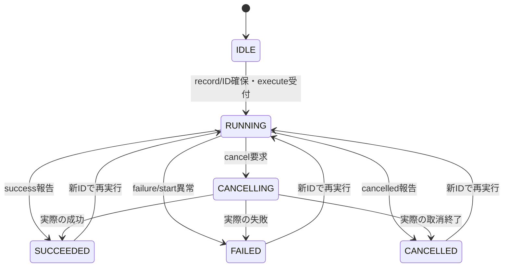
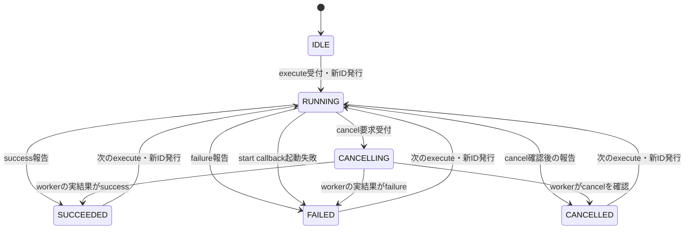
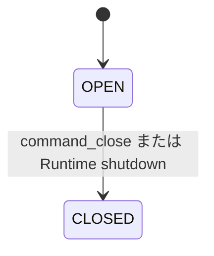
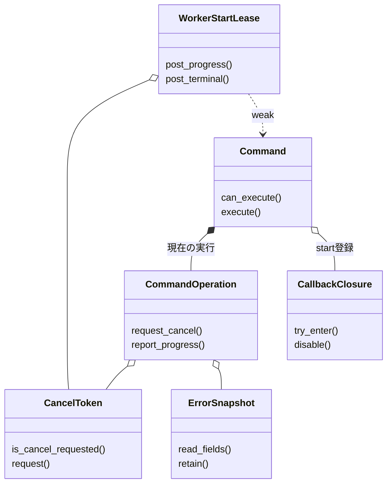
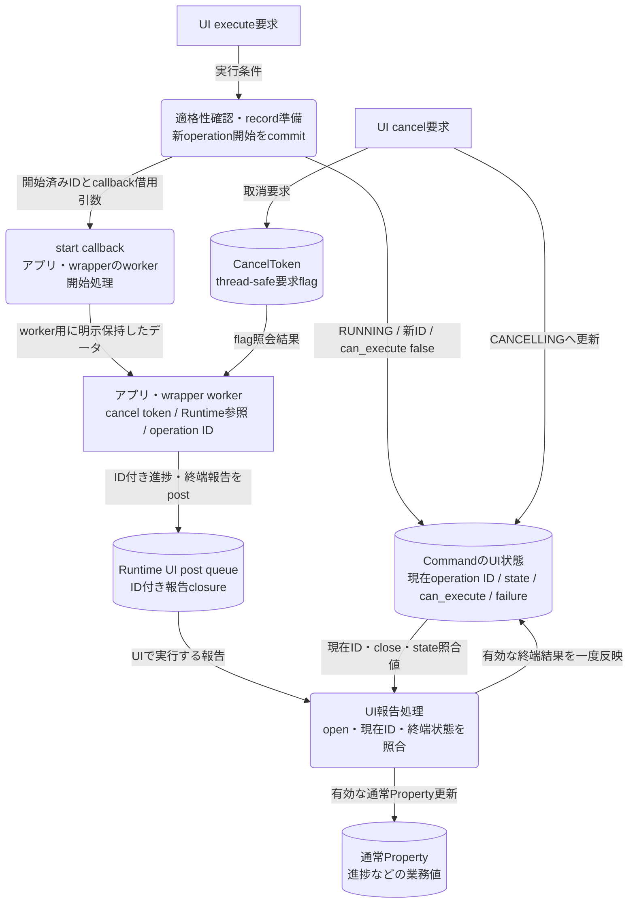

# イベントハンドリング：非同期Command

- 文書版: 1.1
- 文書ロール: detailed-design
- 更新日: 2026-10-17
- 状態: 1.1全文承認済み（利用者、2026-10-17）。実装・試験状態は別管理

## 目的と上位根拠

本書を要求から実装へ具体化する詳細設計の正本とする。型・API・所有・呼出し手順・状態遷移を実装へ反映する。要求の外部保証はリンク先RQ、層の責務と主要flowは上位BDを根拠とする。設計宣言の記載は、配布済みheader・実装済みAPI・試験合格を意味しない。

基本設計: [UIクラス：TextBox・編集・Validation](../../12_design/ui/text-editing-validation.md)、[イベントハンドリング：通知・入力・Command](../../12_design/events/notifications-commands.md)

## 要求と設計項目の対応

| 設計項目 | 要求根拠 |
| --- | --- |
| Command実行・完了・取消し | [RQ-02-004](../../11_requirements/RQ-02_core-features.md#rq-02-004)、[RQ-05-002](../../11_requirements/RQ-05_ownership-callbacks.md#rq-05-002)、[RQ-06-004](../../11_requirements/RQ-06_threading-dispatch.md#rq-06-004)、[RQ-06-008](../../11_requirements/RQ-06_threading-dispatch.md#rq-06-008)、[RQ-06-009](../../11_requirements/RQ-06_threading-dispatch.md#rq-06-009)、[RQ-06-010](../../11_requirements/RQ-06_threading-dispatch.md#rq-06-010)、[RQ-06-011](../../11_requirements/RQ-06_threading-dispatch.md#rq-06-011)、[RQ-09-006](../../11_requirements/RQ-09_ui-scope.md#rq-09-006) |

本書内の共通規則は上記の各要求を実現するために適用する。同一項目内で個別要求を参照する場合はその対象範囲を優先する。将来候補・未採用範囲は採用済みの動作と区別する。

## Command実行・完了・取消し

### 実現のcall/data/ownership flow

executeはcan-executeを確認してoperation IDとrecordを確保し、state=RUNNINGとcan-execute=falseを一つの内部遷移でcommitしてからstartを呼ぶ。cancelはthread-safe flagとCANCELLINGへ移し、completeは現在IDに対して一度だけ終端へcommitする。close/shutdownは受付を止め取消を要求し、worker所有参照とCore start closureを別々にcleanupする。

### 承認済み前提

- `execute`はUI threadで呼び、成功したoperationを`RUNNING`にしてからstart callbackを一度だけ呼ぶ。既定では`RUNNING`/`CANCELLING`中の再実行を拒否する（Command契約、公開ABI契約）。
- 状態値は`IDLE / RUNNING / CANCELLING / SUCCEEDED / FAILED / CANCELLED`。実行可否はCommandの条件Propertyと実行状態から導出する（公開ABI契約）。
- 実行ごとにRuntime内で再利用しない非zero operation IDを割り当てる。進捗・完了は`runtime_post`経由でUI threadへ反映し、ID一致の報告だけ一度適用する（Command契約、公開ABI契約）。
- キャンセル要求は協調的であり、要求しただけでは`CANCELLED`にならない。最終状態はworkerの実結果を表す（Command契約）。
- closeとshutdownは新規実行を止め、実行中workerへキャンセルを要求するが、UI threadでworker終了を待たない。閉じたCommand/Runtimeへ後着の結果を反映しない（Command契約）。
- Property通知・Binding・handle・callback closureのthread/lifetime規則はオブジェクト管理：handle・値・errorを適用する。Commandの状態Propertyおよび実行可否Propertyは読取専用である。
- Core管理のasync Validatorやpending validation stateは設けない。remote/long-running validationはViewModelのAsync Commandと状態Propertyで表現し、stale resultの識別はアプリ側で行う（MVVM UIライブラリ 非同期Validationの初版範囲に関する上位判断案）。

### 実装規則

| 判断 | 根拠・境界 |
| --- | --- |
| `command_create_async`はUI thread専用とし、RuntimeがRunningであること、必須のstart/destroy closure、実行条件Propertyが0または同RuntimeのBOOLであることを検査する。成功時に所有Command handleを返し、Coreはstart closureを所有する。失敗時はhandleを0にしclosureを呼び出し側に残す。実行条件0は常時true。 | 公開ABI契約、オブジェクト管理：handle・値・error、値・error境界。Property参照は活性Commandが保持する。 |
| `can_execute = command_open && eligibility_current && state not in {RUNNING, CANCELLING}`とする。条件引数0なら`eligibility_current=true`。実行可否Propertyは読取専用BOOL、state Propertyは読取専用I64とし、Command生成時に作成する。生成はProperty値変更通知を発生させない。 | Command契約、公開ABI契約、Property保存と通知。実行可否Propertyは条件Propertyが変わった後、最外側UI処理終了時までに同期的に値を更新し、通知はDD-PROPに従う。 |
| operation IDはRuntime内で単調に発行する非zero `uint64_t`とし、終端・過去operationを含め一度使ったIDを再利用しない。採番・operation record確保の失敗ではID出力を0、Command状態を変更せず、workerを起動しない。ID空間枯渇時は周回再利用せず新規実行を拒否する。 | 公開ABI契約、値・error境界。 具体化は[イベントハンドリング：通知とBinding伝播](notifications-binding.md)を参照する。 |
| `execute`可能なら新IDを確保し、失敗snapshotを消し、stateを`RUNNING`・can-executeをfalseへ切り替えた後にstart callbackを同期で一度呼ぶ。callbackはworker/async taskを開始して速やかに戻る。operation生成成功後は、start callbackが失敗statusや例外を返しても`execute`は`UI_OK`と発行済みIDを返し、該当operationを`FAILED`にする。 | Command契約/公開ABI契約、ABI §15.1、callback実行規則。失敗したstart callbackはworkerを有効に起動できていないことを前提とする。 |
| 起動不可（eligibility false、同じCommandが`RUNNING`/`CANCELLING`、closed）ではoperationを作らず、required operation IDを0にする。実行不可を`UI_COMMAND_EXECUTION_FAILED`で返さず、通常API statusとoptional errorで表す。statusはDD-ABI既定値を使い、Command独自numeric codeを本書で追加しない。 | Command契約、公開ABI契約、共通ABI。実行不可の共通status割当・error codeはerror catalogの後続判断と整合させる。 |
| operation状態は`IDLE → RUNNING → CANCELLING? → SUCCEEDED / FAILED / CANCELLED`とする。`CANCELLING`は要求受付済みでworker未終端を示す。直接の成功/失敗も許し、キャンセル要求後にworkerが成功/失敗を報告すれば実結果どおり`SUCCEEDED`/`FAILED`となる。終端後の再実行では新IDで`RUNNING`へ移り、前回failure snapshotを消す。 | Command契約、公開ABI契約。前IDの終端状態は次の実行まで保持する。 |
| 状態遷移とcan-execute値の相互依存更新は一つの内部遷移としてcommitし、外部通知を開始する前に両Propertyの値を整合させる。状態変更のProperty通知はProperty保存と通知に従い、Binding伝播はイベントハンドリング：通知とBinding伝播の順序で扱う。公開setterからの変更は`UI_UNSUPPORTED`とし、状態Propertyそのものを変更しない。 | 公開ABI契約、Property保存と通知～09、Binding graph。Property通知callbackは外側処理後に開始し、状態/実行可否getterでは更新済み組を観測できる。 |
| `command_cancel(command, id)`はUI thread専用とする。現在operationが`RUNNING`ならcancel token flagをthread-safeにtrueへし、stateを`CANCELLING`、can-executeをfalseにする。同じIDへの重複cancelおよび既に終端した同じIDへのcancelは冪等成功とし、古い/未知IDは状態を変えず失敗させる。cancelはworkerを待たない。 | Command契約、公開ABI契約、共通ABI、callback実行規則。具体statusはABI共通分類へ対応させる。 |
| cancel tokenはworkerから任意threadで要求状態だけを照会できる。UI操作やCommand状態の読み書きには使えない。cancel、Command close、Runtime shutdownはいずれも実行中operationのtokenを要求済みにする。workerがcancelを確認して中断した場合のみ`CANCELLED`を報告し、正常終了や実失敗ならその結果を報告できる。 | Command契約、公開ABI契約、ABI §15.2、UI dispatcher。workerは必要なhandleをcallback中にretainし、終了後にreleaseする。 |
| complete success/failure/cancelledはUI thread専用であり、workerから直接呼ばず`runtime_post`の短いcallback内で呼ぶ。報告は現在operation IDに一度だけ適用する。過去ID・重複・close後の報告は状態を変えず失敗し、Runtime shutdown後は`UI_CLOSED`。failure報告はdomain/code/messageをimmutable errorへcopyし、snapshotで新しい所有handleを返す。failure snapshotは次operation開始で消す。 | Command契約、公開ABI契約、UI dispatcher、値・error境界、共通ABI。failure報告の引数/確保失敗では終端にせず、worker側に再試行可能性を残す。 |
| `command_close`はUI threadで冪等に実行し、Commandをclosingにして新しいexecuteを拒否し、実行中ならcancelを要求する。closeはworkerを待たず、以後Command状態/条件Propertyの内部更新、failure snapshotの新規取得、UI向け完了適用を開始しない。start closureはin-flight start callback完了後に一度destroyする。公開handle releaseだけではcloseしない。 | Command契約、公開ABI契約、Runtime所有と終了、callback実行規則、ABI §15.2。状態/can-execute Property handleは独立した所有参照としてrelease可能だが、close後は値更新しない。 |
| Runtime shutdownは全Commandをclose相当にしてcancelを要求するが、worker終了・joinを待たない。shutdown後の完了postが拒否された場合、wrapper/workerが所有するclosureとretain済みhandleを自身のcleanupで解放する。受理済みpostがshutdownにより未実行cancelされた場合はUI dispatcherのdestroyを一度だけ実行する。Command start userdataのCore closure寿命とworkerが別途保持する言語参照を区別する。 | Command契約、公開ABI契約、Runtime所有と終了、UI dispatcher、callback実行規則。shutdown後にterminal stateをUIから観測できる保証はない。 |

### State / can-executeの観測

| 事象 | state | can-execute | operation ID / error |
|---|---|---|---|
| Command生成 | `IDLE` | 実行条件値（引数0ならtrue） | operationなし、failureなし |
| execute不可 | 変更なし | 変更なし | 新IDなし、出力ID 0、API失敗 |
| execute受付・operation確保後 | `RUNNING` | false | 新しい非zero ID、前failureをclear |
| start callback起動失敗 | `FAILED` | eligibilityに従い再計算 | 発行ID維持、Core生成failure snapshot |
| cancel要求 | `CANCELLING` | false | active ID維持、token requested=true |
| worker成功報告 | `SUCCEEDED` | eligibilityに従い再計算 | active IDを終端IDとして保持 |
| worker失敗報告 | `FAILED` | eligibilityに従い再計算 | error snapshotを保持 |
| workerがcancel確認後に中断 | `CANCELLED` | eligibilityに従い再計算 | errorなし |
| close / shutdown | 最後に確定した状態を保持 | false | 新規実行なし。後着報告を反映しない |
| 次operation開始 | `RUNNING` | false | 新ID、直前failureをclear |

`RUNNING`/`CANCELLING`の状態とcan-executeはCommandの内部遷移で整合させる。Property callbackやBinding callbackが実行される時点では、両方とも新しい値を返す。state/can-executeのnotification間のcallback順序や1操作でのcoalescingはDD-PROPの通知規則に従い、本書では別の同期flushを追加しない。

### 状態遷移図

#### Operation state

`CANCELLING`は要求済みでworkerがまだ結果を返していない状態である。キャンセル要求だけでは`CANCELLED`に遷移しない。終端状態は次のexecuteまで表示し、次のexecuteで新しいoperation IDとともに`RUNNING`へ移る。実行不可、古いID、重複完了、post失敗ではこの図のstate遷移は起こらない。

#### Command lifecycle

Commandのopen/closedは上のoperation stateとは別の軸である。Closedへの遷移は新規executeとUI上の完了反映を止め、実行中operationのcancelを要求する。workerの終了を待たず、最後に確定していたoperation stateを保持する。worker taskと言語側参照はworker自身の終了まで保持・解放する。

### 実行・完了・失敗経路

1. `execute`はUI threadでhandle・Runtime・close状態を確認する。
2. eligibility falseまたは現在operation実行中なら拒否し、operation IDを0に保ち、workerを起動しない。
3. Runtime非再利用IDとoperation recordを確保する。確保失敗は値・状態・failure snapshotを変えずに失敗する。
4. 新operation開始をcommitし、`RUNNING`/can-execute false/前failure消去を確定した後、start callbackを呼ぶ。
5. start callbackはworkerを開始して戻る。起動自体に失敗した場合Coreが同じIDの`FAILED`を確定するが、execute成功とoperation失敗を分け、execute呼出し自体には`UI_OK`とIDを返す。
6. Workerが終端結果を得たら、`runtime_post`でUI threadへ完了callbackを渡す。そのcallbackが現在IDを確認してcomplete関数を一度だけ適用する。
7. 完了callbackはstate、can-execute、failure snapshotを一貫して更新する。外部Property/Binding通知はイベントハンドリング：通知とBinding伝播のqueue順で後続処理する。

failure snapshotは実行失敗の結果情報であり、API呼出しエラーとは区別する。`UI_COMMAND_EXECUTION_FAILED`はsnapshot内のstatusであり、execute/complete関数の戻り値には使わない（共通ABI）。`domain/code/message`はmachine identifierと表示情報に分け、message文面を機械分岐に使わない。

### Cancellation / close / shutdown

- Cancel APIが`RUNNING`を`CANCELLING`に変え、token flagをtrueへする。Token flagはスレッド安全な読み取り値であり、強制終了やworker killは行わない。
- Workerがキャンセル要求を見ても処理を完了できる場合、成功・失敗を報告してよい。Requested flagだけから終端状態を推定しない。
- `command_close`はCommand単位で新規実行とUI反映を止める。画面を閉じた際にどのCommandへclose/cancelを行うか、誰がCommandを画面に所有させるかは別のlifetime/UI-tree APIの責務とする。
- Runtime shutdownは全Commandを止め、cancelを要求する。すでに開始済みworkerをUI threadで待たず、shutdown後にUI状態へ触らない。
- worker task、thread pool、language runtime taskの生成・join・スケジュール方式はアプリ/wrapperの責務であり、Coreがworkerを所有・実行する契約ではない。

### ProgressとProperties

- 専用progress APIやprogress値型は設けない。workerが通常Propertyを更新する場合は、保持したRuntime向け参照から`runtime_post`でUI threadへ送る。
- 長時間・remote validationはCoreの同期Validator callback内で待たず、Async Commandで実行し、結果をViewModelのPropertyへ反映する。古い結果を適用しないための業務上の世代判定はアプリ側の責務とする（MVVM UIライブラリ 非同期Validationの初版範囲に関する上位判断案）。
- 中間progress sampleは全件配信を保証しない（MVVM UIライブラリ Async Command進捗配信に関する上位判断案）。アプリ/wrapperはpost前に最新値へ集約してよいが、Coreはprogressと業務上必須のeventを区別できないため、汎用postを勝手に捨てない。
- 完了/失敗/cancelledはprogressとは別の終端結果として一度だけ保持する。終端後の同operation progressと、古いoperationのprogressは状態を変更しない。
- progressが必要なら通常のPropertyとBindingを利用できる。shutdown時に保留postが破棄されれば、その画面でprogress/terminal resultを観測できないことがある。

### Failure・handle・closure所有権

| 状況 | Command状態の変化 | closure / handleの扱い |
|---|---|---|
| create失敗 | Commandなし | start closureは呼出し側所有のまま |
| create成功 | `IDLE` | CoreがCommand start closureを所有 |
| execute不可 / operation確保失敗 | 変更なし | start closureはCommandが所有、workerなし |
| start callbackが実行中 | operationは`RUNNING` | borrowed handlesはcallback中のみ。worker用は明示retain |
| workerが完了をpost成功 | 具体化は[イベントハンドリング：通知とBinding伝播](notifications-binding.md)を参照する| Coreがpost callback closureを所有し、実行かshutdown cancel時にdestroy |
| postが受付前に失敗 | operationはworker report未反映 | worker側がpost closureとretain済み参照を後始末 |
| command close/shutdown | close後はUI更新停止 | Core start closureはin-flight start callback後にdestroy。workerが独自に保持したwrapper参照はworker終了まで維持 |

Command public handleの`release`だけでは明示`command_close`を代替しない。CommandがcloseされるまでCoreが保持する関係、および公開handle消費後もどの内部ownerがcloseを呼ぶかは画面/lifetime設計で確定する。workerはCommand本体を直接操作せず、cancel token照会とpost経由報告のみを行う。

## クラス設計の補足（1.1承認済み）

既承認1.0の実現規則を支える型・関連・所有・主要操作を整理した。内部型名とメソッドの分担は本改訂で補足する内部設計であり、既存公開APIの署名や外部保証を追加・変更するものではない。この節のクラス構成と追加図は1.1版全文の承認対象であり、実装・試験完了の証明とは区別する。

要求根拠: [RQ-06-008](../../11_requirements/RQ-06_threading-dispatch.md#rq-06-008)、[RQ-06-009](../../11_requirements/RQ-06_threading-dispatch.md#rq-06-009)、[RQ-06-010](../../11_requirements/RQ-06_threading-dispatch.md#rq-06-010)、[RQ-06-013](../../11_requirements/RQ-06_threading-dispatch.md#rq-06-013)。

再利用するCommandと、executeごとに識別される一回のoperationを分離する。IDLEは最初の実行前を表し、終端結果を次executeまで保持することと再実行可否を別に扱う。

### 型の責務と所有

| 型 | 責務・保持データ | 主要メソッド・操作 | 所有・寿命 |
| --- | --- | --- | --- |
| Command | open状態、eligibility Property、state/can-execute Property、start closure、現在operation | can_execute(); execute(); cancel(id); complete(id, result); close() | start closureと条件参照を保持。handle releaseだけではcloseしない |
| CommandOperation | Runtime内非再利用ID、RUNNING/終端、cancel token、progress slot、failure snapshot | request_cancel(); report_progress(value); commit_terminal(result) | 現在operationの更新はUIで一回だけ適用。過去IDの報告で現行stateを変更しない |
| CancelToken | workerが任意threadで読む取消要求flag | is_cancel_requested(); request() | Commandとworker leaseが必要期間保持。UI objectを操作する権限は持たない |
| WorkerStartLease | cancel token、Command弱参照、post可能Runtime shell | post_progress(value); post_terminal(result); release_worker_resources() | worker起動後の失敗でもworker終端まで保持。Closed時は言語側資源を回収 |
| CallbackClosure | start callable/userdataとin-flight寿命 | try_enter(); disable() | callback文書所管。各executeで同期startを一度呼び、業務終端とは区別 |
| ErrorSnapshot | 現在failureの不変詳細 | read_fields(); retain() | 取得済みsnapshotは次executeで現在failureを消しても不変 |

### クラスの関連

`*--`は従属するstate/作業の合成、`o--`は共有を含む所有参照、`..>`は非所有の利用・識別・委譲を示す。関連名と本文で示した寿命を優先し、図の同名型は各instanceで別の状態を持つ。図は主要メソッド名を抜粋し、引数・所有・失敗条件は表と本文に従う。

### データフロー図：operation報告のUI反映

状態遷移図とは別に、workerが保持するデータとUI反映の入口を示す。矢印はデータの受渡し、円筒は保持データを表す。

workerはCommandのUI状態を直接書き換えない。取消flagは終端結果ではなく、完了報告の照合後に成功・失敗・cancelledが確定する。古いID・終端後の進捗・close後の報告は反映しない。進捗の業務世代判定はアプリ側の責務である。post受付失敗ではclosureと保持参照をworker側で後始末し、shutdownで破棄されたpostの結果はUIに反映されない。

### 主要な呼出しと失敗境界

executeはeligibilityとopenを検査→operation ID/record準備→RUNNINGとcan_execute=falseを同時commit→start invokeの順。完了はpostを介してUI上でIDを照合し終端をcommitする。次executeは終端状態から新IDのRUNNINGへ移り、再登録を要求しない。

cancelはworker終端を待たず、CANCELLINGを完了扱いしない。Command.closeは新規実行を止めるがworkerをUIでjoinしない。図のoperationは内部record構成案で、新しい公開Operation classや公開所有規則を追加しない。

## 文書の承認・改訂履歴

| 日付 | 対象版 | 内容・根拠 |
| --- | --- | --- |
| 2026-10-17 | 1.0 | 利用者の指示に基づき、既承認内容を責務別に再編集。設計項目IDによる承認・追跡は廃止し、以後は文書版全体で管理する。構成変更を新規の製品仕様採用としない |
| 2026-10-17 | 1.0全文 | 利用者の「全部承認します」により文書全体を承認。旧IDによる項目承認ではなく、現行文書版を対象とする。実装・試験合格を意味しない |
| 2026-10-17 | 1.1改訂案 | 利用者の補足指示によりクラス責務・所有・メソッド・関連図を追加。1.0承認を維持し、1.1全文は確認待ち |
| 2026-10-17 | 1.1全文 | 利用者の「OK,テスト文書作りましょうか」により、クラス設計補足と選択的な図の補強を含む全文を承認。既存履歴を維持し、実装・試験状態は別管理 |
