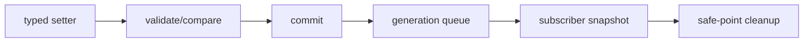
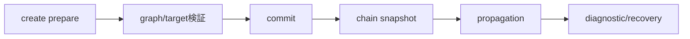
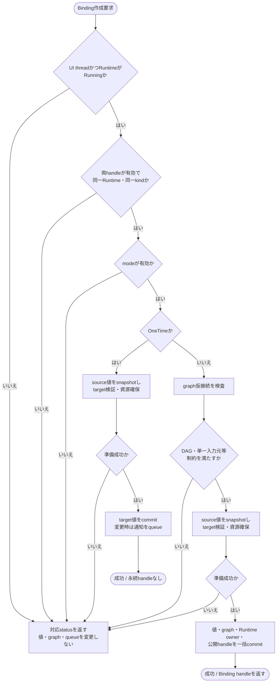
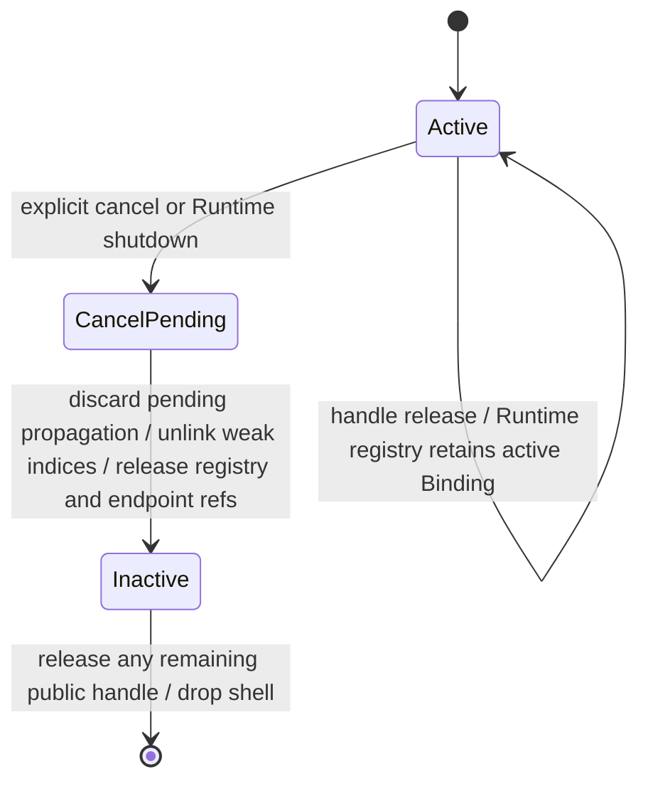
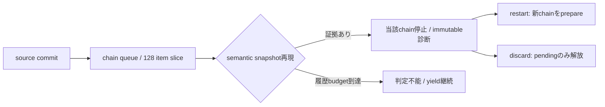
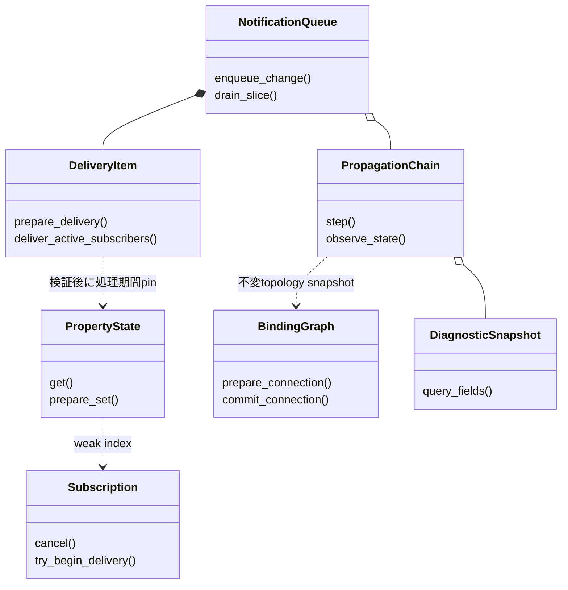

# イベントハンドリング：通知とBinding伝播

- 文書版: 1.1
- 文書ロール: detailed-design
- 更新日: 2026-10-17
- 状態: 1.1全文承認済み（利用者、2026-10-17）。実装・試験状態は別管理

## 目的と上位根拠

本書を要求から実装へ具体化する詳細設計の正本とする。型・API・所有・呼出し手順・状態遷移を実装へ反映する。要求の外部保証はリンク先RQ、層の責務と主要flowは上位BDを根拠とする。設計宣言の記載は、配布済みheader・実装済みAPI・試験合格を意味しない。

基本設計: [オブジェクト管理：値・モデル・更新整合性](../../12_design/runtime-objects/model-values.md)、[イベントハンドリング：通知・入力・Command](../../12_design/events/notifications-commands.md)

## 要求と設計項目の対応

| 設計項目 | 要求根拠 |
| --- | --- |
| Property更新と通知配信 | [RQ-02-002](../../11_requirements/RQ-02_core-features.md#rq-02-002)、[RQ-02-017](../../11_requirements/RQ-02_core-features.md#rq-02-017)、[RQ-02-018](../../11_requirements/RQ-02_core-features.md#rq-02-018)、[RQ-02-019](../../11_requirements/RQ-02_core-features.md#rq-02-019)、[RQ-02-020](../../11_requirements/RQ-02_core-features.md#rq-02-020)、[RQ-03-011](../../11_requirements/RQ-03_language-support.md#rq-03-011)、[RQ-04-002](../../11_requirements/RQ-04_abi-boundary.md#rq-04-002)、[RQ-05-002](../../11_requirements/RQ-05_ownership-callbacks.md#rq-05-002)、[RQ-05-006](../../11_requirements/RQ-05_ownership-callbacks.md#rq-05-006)、[RQ-07-005](../../11_requirements/RQ-07_binding.md#rq-07-005)、[RQ-07-006](../../11_requirements/RQ-07_binding.md#rq-07-006)、[RQ-07-008](../../11_requirements/RQ-07_binding.md#rq-07-008)、[RQ-07-012](../../11_requirements/RQ-07_binding.md#rq-07-012)、[RQ-07-013](../../11_requirements/RQ-07_binding.md#rq-07-013)、[RQ-07-014](../../11_requirements/RQ-07_binding.md#rq-07-014) |
| Binding graphと因果連鎖 | [RQ-03-011](../../11_requirements/RQ-03_language-support.md#rq-03-011)、[RQ-05-002](../../11_requirements/RQ-05_ownership-callbacks.md#rq-05-002)、[RQ-07-001](../../11_requirements/RQ-07_binding.md#rq-07-001)、[RQ-07-002](../../11_requirements/RQ-07_binding.md#rq-07-002)、[RQ-07-003](../../11_requirements/RQ-07_binding.md#rq-07-003)、[RQ-07-004](../../11_requirements/RQ-07_binding.md#rq-07-004)、[RQ-07-005](../../11_requirements/RQ-07_binding.md#rq-07-005)、[RQ-07-006](../../11_requirements/RQ-07_binding.md#rq-07-006)、[RQ-07-007](../../11_requirements/RQ-07_binding.md#rq-07-007)、[RQ-07-008](../../11_requirements/RQ-07_binding.md#rq-07-008)、[RQ-07-009](../../11_requirements/RQ-07_binding.md#rq-07-009)、[RQ-07-010](../../11_requirements/RQ-07_binding.md#rq-07-010)、[RQ-07-011](../../11_requirements/RQ-07_binding.md#rq-07-011)、[RQ-07-013](../../11_requirements/RQ-07_binding.md#rq-07-013)、[RQ-07-014](../../11_requirements/RQ-07_binding.md#rq-07-014)、[RQ-07-015](../../11_requirements/RQ-07_binding.md#rq-07-015) |
| 診断・回復とerror catalog | [RQ-04-023](../../11_requirements/RQ-04_abi-boundary.md#rq-04-023)、[RQ-04-027](../../11_requirements/RQ-04_abi-boundary.md#rq-04-027)、[RQ-06-008](../../11_requirements/RQ-06_threading-dispatch.md#rq-06-008)、[RQ-06-009](../../11_requirements/RQ-06_threading-dispatch.md#rq-06-009)、[RQ-06-011](../../11_requirements/RQ-06_threading-dispatch.md#rq-06-011)、[RQ-06-013](../../11_requirements/RQ-06_threading-dispatch.md#rq-06-013)、[RQ-07-013](../../11_requirements/RQ-07_binding.md#rq-07-013)、[RQ-07-014](../../11_requirements/RQ-07_binding.md#rq-07-014)、[RQ-07-017](../../11_requirements/RQ-07_binding.md#rq-07-017) |

本書内の共通規則は上記の各要求を実現するために適用する。同一項目内で個別要求を参照する場合はその対象範囲を優先する。将来候補・未採用範囲は採用済みの動作と区別する。

## Property更新と通知配信

### 実現のcall/data/ownership flow

Property setterはtyped candidateを検証し、同値なら格納表現を保持して戻る。差分なら値をcommitし、generation内で一Propertyのdelivery itemへ集約する。delivery開始時のsubscriber順序snapshotに従ってActive登録だけをinvokeする。active SubscriptionはRuntime registryが所有し、Property indexはweak。cancelは新規invokeを止め、in-flight後にclosure/index/registryを解放する。



### 範囲と責務

| 領域 | イベントハンドリング：通知とBinding伝播の責務 | 別設計の責務 |
|---|---|---|
| 値型 | 五種類のkind ID、Property生成と型別read/write表現 | カスタム値・一般null許容・OBJECT・Collectionの上位判断（MVVM UIライブラリ 初期公開値型の上位判断） |
| setter/getter | 型一致、等価判定、即時確定、失敗時不変、出力 | Property Validatorの全登録・差替え・検証意味論（UIクラス：TextBox・Validation・IME編集） |
| notification | 処理区間、coalescing、順序、購読callback、保留 | Binding propagationとgraph/cycle診断（イベントハンドリング：通知とBinding伝播） |
| lifetime | Subscription取消し、Property先行破棄、shutdownとの境界 | Core object/Control treeの所有関係（UIクラス：Tree・Layout・Geometry以降） |
| wrapper | 4言語で同じobservable behaviorを得る契約 | 具体的な言語型、例外・Result変換、closure管理（言語ラッパー：C++） |
| 値変換 | 今回は型別Propertyへの明示的な値渡し | 将来のライブラリ内蔵変換機能とparse/format規則 |

### 実装規則

| 判断 | 出典・範囲 |
| --- | --- |
| Property kind IDをBOOL=1、I64=2、UTF8=3、OBJECT=4（予約・生成不可）、F64=5、DECIMAL=6とする。追加kindは新IDを割当て、既存IDを再利用しない。 | 公開ABI契約、MVVM UIライブラリ 初期公開値型の上位判断、共通ABI。 |
| 既存公開ABI契約の初期値付き型別create、公開ABI契約の`property_kind`、型別getter/setterを維持し、F64/DECIMAL用の互換追加symbolを設ける。生成成功は所有Property handleを返し、失敗時は0。生成自体で通知を発生させない。 | 公開ABI契約、Property契約、値・error境界。 |
| F64はC ABIの`double`、DECIMALは`uint64_t`のcanonical bit layoutで受け渡す。DECIMAL bit 63はsign、bits 58–62はunsigned scale、bits 0–57はunsigned coefficientとする。F64/DECIMAL Validator callbackも`double`/`uint64_t`を受け取る型別signatureとする。 | 公開ABI契約、MVVM UIライブラリ 初期公開値型の上位判断、値・error境界。登録と評価規則はUIクラス：TextBox・Validation・IME編集。 |
| 値比較はBOOL/I64の値、UTF8のbyte列、F64のMVVM UIライブラリ 初期公開値型の上位判断比較、DECIMALのMVVM UIライブラリ 初期公開値型の上位判断数値比較を使う。同値setterはvalidatorがある場合はValidation契約に従い検証するが、既存値と格納表現を置き換えず、Property notificationを生成しない。 | Property契約、MVVM UIライブラリ 初期公開値型の上位判断、Validation契約、公開ABI契約、値・error境界。 |
| setterは入力検証・UTF8 copy・必要な値確保がすべて成功した後に値をcommitする。型不一致、wrong thread、invalid UTF8、validation rejection、allocation failureではProperty値・notification queueを変えない。required outputは値・error境界どおり初期化し、`ui_status`を一次結果、optional `out_error`を失敗詳細とする。 | 公開ABI契約、Property契約、Validation契約、値・error境界、共通ABI。 |
| getterは現在の確定値を返す。UTF8は値・error境界のcaller buffer規則を使う。F64/DECIMAL getterはstored value representationを返す。同一値set後も既存representationを保持する。 | 公開ABI契約、Property契約、MVVM UIライブラリ 初期公開値型の上位判断、値・error境界。 |
| notificationは最外側のUI処理終了後、通常UI event/postより先に処理を始める。Property単位のdelivery itemは、その時点のsubscriber順序snapshotへ登録順でcallbackする。処理中の変更は次のgenerationへenqueueし、同じPropertyをgeneration内で一件へcoalesceする。 | Property契約、MVVM UIライブラリ UI transactionの上位判断、callback実行規則。 |
| subscription登録はUI threadで開始・cancelする。dispatch itemは開始時にactive状態を確認し、cancelではactiveを先に落として以後のcallback開始を防ぐ。実行中callbackが戻った後、UI thread safe pointでclosureを一度だけdestroyする。Property teardownとshutdownはpending deliveryを止めて同じcleanup経路へ送る。CoreのRuntime registration registryはactive subscriptionをstrong ownerとして保持し、Property indexはweakとする。handle releaseの外部効果はRQ-05-002/006に従う。 | RQ-05-002/006～008、Property契約、公開ABI契約、承認済みRuntime所有と終了、callback実行規則。 |
| notification sliceは完了したProperty delivery itemを最大128件処理する。itemは一Propertyのsubscriber snapshot全員のcallback完了までを指し、callback途中で中断しない。128件後は通常UI event/postへyieldし、未配信itemを順序を保って保持する。shutdown control taskはこの残りより優先する。 | Property契約、MVVM UIライブラリ Runtime通知上限・診断の上位判断案、UI dispatcher、共通ABI。 |
| notification itemに内部因果連鎖識別を持たせる境界を設ける。Property層は同一Propertyのcoalescingとqueue順を保証する。Binding起点の連鎖停止・non-convergence判定・diagnostic recoveryの因果範囲はイベントハンドリング：通知とBinding伝播で定め、work budget到達だけを停止根拠にしない。 | MVVM UIライブラリ Runtime通知上限・診断の上位判断案、ランタイム：実行基盤と終了、イベントハンドリング：通知とBinding伝播への責務分割。 |

### 初期公開Property kindとABI表現

| kind ID | kind | create/read/write ABI値 | 等価判定 |
|---:|---|---|---|
| 1 | BOOL | `ui_bool`（0/1） | 0/1の一致。その他の値は拒否 |
| 2 | I64 | `int64_t` | 符号付き64-bit値の一致 |
| 3 | UTF8 | `(const uint8_t *, uint64_t byte_length)`、getterは`uint8_t *` caller buffer | 有効UTF-8のbyte列一致。NULを含め自動正規化しない |
| 4 | OBJECT | 予約値。Property生成不可 | 対象外 |
| 5 | F64 | C ABI `double`（IEEE 754 binary64） | `+0`/`-0`は等価、すべてのNaNは等価、無限大は同符号のみ等価 |
| 6 | DECIMAL | `uint64_t`のcanonical encoding | 数値比較。末尾ゼロ・zeroのsign/scaleを同一性に含めない |

DECIMAL encoding: `bit63=sign`（0 positive, 1 negative）、`bits58..62=scale (0..31)`、`bits0..57=coefficient (0..2^58-1)`。値は`(-1)^sign × coefficient / 10^scale`。全64-bit patternがMVVM UIライブラリ 初期公開値型の上位判断の範囲内である。例として`1.23`は`(2 << 58) | 123`。公開ABIは数値`uint64_t`であり、構造体packingやhost byte order依存のbyte arrayではない。wire/file serializationは本判断の対象外。

同値再設定では、MVVM UIライブラリ 初期公開値型の上位判断が明示するF64 stored bit representationを保つ。DECIMALでは同値の再設定で現stored representationを維持し、`1.00`設定で格納済み`1.0`をscale 2へ書き換えない。表示桁数・入力原文はPropertyの数値状態と分け、View/Input設計で扱う。

### 設計用C宣言

以下のC宣言は承認済み設計のsignatureを示すが、配布headerまたは実装済みAPIではない。ABI symbol major prefixは共通ABIに従う。

```c
enum {
  UI_VALUE_BOOL = 1,
  UI_VALUE_I64 = 2,
  UI_VALUE_UTF8 = 3,
  UI_VALUE_OBJECT = 4, /* reserved; create is not exposed */
  UI_VALUE_F64 = 5,
  UI_VALUE_DECIMAL = 6
};

ui_status ui_abi_1_property_kind(ui_handle property, uint32_t *out_kind);

ui_status ui_abi_1_property_create_bool(ui_handle runtime, ui_bool initial,
                                         ui_handle *out_property,
                                         ui_handle *out_error);
ui_status ui_abi_1_property_create_i64(ui_handle runtime, int64_t initial,
                                        ui_handle *out_property,
                                        ui_handle *out_error);
ui_status ui_abi_1_property_create_utf8(ui_handle runtime,
                                         const uint8_t *bytes,
                                         uint64_t byte_length,
                                         ui_handle *out_property,
                                         ui_handle *out_error);
ui_status ui_abi_1_property_create_f64(ui_handle runtime, double initial,
                                        ui_handle *out_property,
                                        ui_handle *out_error);
ui_status ui_abi_1_property_create_decimal(ui_handle runtime,
                                            uint64_t initial_bits,
                                            ui_handle *out_property,
                                            ui_handle *out_error);

ui_status ui_abi_1_property_get_bool(ui_handle property, ui_bool *out_value);
ui_status ui_abi_1_property_set_bool(ui_handle property, ui_bool value,
                                      ui_handle *out_error);
ui_status ui_abi_1_property_get_i64(ui_handle property, int64_t *out_value);
ui_status ui_abi_1_property_set_i64(ui_handle property, int64_t value,
                                     ui_handle *out_error);
ui_status ui_abi_1_property_get_utf8(ui_handle property, uint8_t *buffer,
                                      uint64_t capacity,
                                      uint64_t *out_byte_length);
ui_status ui_abi_1_property_set_utf8(ui_handle property,
                                      const uint8_t *bytes,
                                      uint64_t byte_length,
                                      ui_handle *out_error);
ui_status ui_abi_1_property_get_f64(ui_handle property, double *out_value);
ui_status ui_abi_1_property_set_f64(ui_handle property, double value,
                                     ui_handle *out_error);
ui_status ui_abi_1_property_get_decimal(ui_handle property,
                                         uint64_t *out_bits);
ui_status ui_abi_1_property_set_decimal(ui_handle property, uint64_t bits,
                                          ui_handle *out_error);

ui_status ui_abi_1_property_subscribe(ui_handle property,
                                       ui_callback callback,
                                       void *userdata,
                                       ui_destroy destroy,
                                       ui_handle *out_subscription,
                                       ui_handle *out_error);
ui_status ui_abi_1_subscription_cancel(ui_handle subscription,
                                        ui_handle *out_error);

typedef ui_status (*ui_validate_f64)(void *userdata, double candidate,
                                     ui_handle *out_owned_error);
typedef ui_status (*ui_validate_decimal)(void *userdata,
                                         uint64_t candidate_bits,
                                         ui_handle *out_owned_error);
ui_status ui_abi_1_property_validator_register_f64(
    ui_handle property, ui_validate_f64 callback, void *userdata,
    ui_destroy destroy, ui_handle *out_registration, ui_handle *out_error);
ui_status ui_abi_1_property_validator_register_decimal(
    ui_handle property, ui_validate_decimal callback, void *userdata,
    ui_destroy destroy, ui_handle *out_registration, ui_handle *out_error);
ui_status ui_abi_1_property_validator_cancel(ui_handle registration,
                                               ui_handle *out_error);
```

F64/DECIMAL validator callbackの型別signatureはProperty保存と通知で承認済みである。登録・評価・解除の意味論と完全な関数面はUIクラス：TextBox・Validation・IME編集で扱う。

### setter/getterと失敗時

- 全Property APIは所属RuntimeのUI thread専用。worker setterは`UI_WRONG_THREAD`で値もnotificationも変更せず、workerは`runtime_post`を利用する。
- getterのrequired outputは呼出し前に既定値へ初期化する。UTF8 getterは値・error境界どおり、`buffer == NULL && capacity == 0`で必要byte長を返し、容量不足時はbufferを変更しない。
- 型が異なるgetter/setterは`UI_WRONG_TYPE`、無効handle・wrong Runtime・closed Runtimeはオブジェクト管理：handle・値・errorのstatusを使う。boolが0/1以外なら`UI_INVALID_ARGUMENT`。UTF8は不正sequenceを拒否する。
- F64はMVVM UIライブラリ 初期公開値型の上位判断に従いNaNと±infinityを受理する。アプリ固有finite制約はValidatorの責務。DECIMALの全`uint64_t` patternはvalid encodingであり、範囲外は存在しない。
- setterはcandidateを検査し、必要なUTF8 copy等を完了し、Validatorを通過してからcommitする。失敗時にProperty値、notification queue、subscription状態を部分変更しない。既に同一処理区間で成功した別setterは巻き戻さない。
- successful changed setterは値を同期確定するが、notification callback完了を待たない。notificationを生成しない同値setterも`UI_OK`を返す。Validatorの同値candidate検証はValidation契約に従う。

### Notification queueと購読

1. notification処理区間はUI callback、`runtime_post` callback、または最外側UI API callの開始から復帰までとする。入れ子のAPI処理が戻っても、その最外側処理が戻るまでは配信を始めない。
2. setter成功で値が変わったPropertyを、その処理区間のpending generationへ初回変更順に一度だけ追加する。同じPropertyの再変更は同じgeneration内でcoalesceする。古い値・中間値の履歴は持たず、callbackは配信時点でgetterから現在値を得る。
3. generationの各delivery item開始時にそのPropertyの購読者集合をsnapshotする。購読者は登録順で実行する。配信途中のcancelは当該subscriberの以後の新規開始を抑止し、追加subscribeは現在のsnapshotに追加せず次のgeneration以降に対象とする。
4. delivery itemは、一Propertyのsnapshot購読者全員のcallbackを順に完了した単位とする。callbackがsetterを呼んで起こした変更はcurrent generationへ再帰せず、次generationに追加する。
5. queueが空ならdispatch sliceを終える。通常は最外側処理の復帰後、次の通常UI event/postより前に通知処理を行う。保留notificationと同時にshutdown control taskがある場合はcontrol taskを先に実行する。
6. 一つのsubscriber callbackの言語例外はwrapper境界で捕捉し、diagnostic経路へ記録して次のsubscriberを継続する。変更済みPropertyをrollbackせず、他subscriberの配信も取り消さない（Property契約/callback実行規則）。

### 有限作業枠と保留

Property保存と通知で承認された初版規則では、連続notification sliceあたり最大128個のcomplete delivery itemを実行する。128件目のsubscriber snapshotが完了したら、その処理区間を中断せずUI loopへyieldする。残りitemとgeneration順は維持し、未配信の変更を捨てない。保留通知の次のsliceは通常UI event/postより後に実行されてもよい。shutdown優先control taskはpending notificationより優先する。

一つのdelivery itemはcallbackが戻るまで割れない。単一の通知callback・Validator自体が長時間戻らない場合のpreempt/timeoutは提供しない。128という上限を変更する場合は、後続の設計判断で互換性と公平性を確認する。長い有限処理はUI loopを譲りつつ後続sliceで完了させる。

通知のwork budget到達は循環診断や停止理由ではない。non-convergent Binding chainの確定、影響範囲の切り分け、診断取得・再開・破棄APIはイベントハンドリング：通知とBinding伝播のBinding graph設計で決める。Property queueは保留とgeneration順をイベントハンドリング：通知とBinding伝播へ渡せる内部因果識別を持つが、その具体runtime representationは本書でABI化しない。

### 終了と所有権

- subscribe時は初期通知を生成しない。明示cancel後は新しいcallbackを開始しない。cancel対象callbackが実行中の場合、callback終了後にclosure destroyをUI thread上で一度だけ行う。
- ABIの`subscription_cancel`と`handle_release`は別操作としてCoreへ渡す。handle release後もRuntime registration registryのstrong ownerによりactive subscriptionは存続する（外部契約: [RQ-05-002](../../11_requirements/RQ-05_ownership-callbacks.md#rq-05-002)）。
- owner Property teardownではweak subscription indexを走査し、activeを落としてpending deliveryを除く。in-flight callbackの復帰後にregistry ownerとclosureを解放する。残った公開Subscription tokenはInactive shellとしてreleaseできる。
- Runtime shutdownはactive registration registryをUI threadでdrainし、未開始notificationを実行せず、各subscriptionを無効化する。in-flight callback終了後にclosureを一度だけdestroyし、最後にregistry ownerを外す。
- destroy callbackはUI操作を呼ばず、Runtime shutdownの既承認破棄順に従う。

## Binding graphと因果連鎖

### 実現のcall/data/ownership flow

Binding createはkind/Runtime/modeと仮topologyを検査し、初期target検証・資源準備後に接続と値をcommitする。chainごとにgraph generationの不変topologyを用い、OneWay item/TwoWay group/item配信を完了境界まで進める。循環候補hash一致ではkind別値snapshotの意味的同値を確認する。cancelはactive generationを無効化し、該当queue itemだけを除外する。WatchDog診断と循環停止を分ける。



### 範囲と承認済み前提

- Bindingは同一Runtime内の同型Propertyを接続する。初期公開kindはBOOL / I64 / UTF8 / F64 / DECIMAL。変換、異種型、異なるRuntime、OBJECT、言語側ViewModelの直接接続は対象外。
- OneTimeは初期コピー後にBinding object・handle・接続を残さない。OneWay / TwoWayのrelease・cancel結果は[RQ-05-002](../../11_requirements/RQ-05_ownership-callbacks.md#rq-05-002)と[RQ-07-011](../../11_requirements/RQ-07_binding.md#rq-07-011)を正本とする。CoreのRuntime active Binding registryがactive接続を強参照し、公開handle tokenとは別に保持する。
- TwoWayで連結されたPropertyは同期グループとなり、グループ内の最後に成功した直接設定を優先する。OneWayの接続先グループは入力元を一つだけ持てる。OneWayグラフの循環は禁止（Binding graph契約/Binding graph契約）。
- Binding伝播は最外側UI処理後、外部Property通知より先に行う。Property通知はProperty保存と通知の上限で完了item単位にyieldし、単なる上限到達では停止扱いにしない。
- Binding作成時はグラフ・値・通知を原子的に扱う。遅延伝播の失敗は先行setterを遡及失敗させず、Bindingエラーとして記録する（公開ABI契約）。

### 実装規則

| 判断 | 根拠・境界 |
| --- | --- |
| Binding作成はUI threadで、Runtime・kind・mode・グラフ制約を検査した後、初期同期先の値検証と必要資源確保を先に完了する。全て成功した時点で初期値と接続を一括commitし、Property変更通知はProperty保存と通知に従って一件だけqueueする。同値の初期同期は値も通知も変えない。OneTimeでは値commit後に永続接続を作らない。 | Binding契約、Binding graph契約、公開ABI契約、Property保存と通知。検証・確保・初期setterのどれかが失敗した場合、値、グラフ、通知queueを変更せず、Binding handleを0にする。 |
| グラフはTwoWay同期グループを頂点、OneWay接続を有向辺とする。新規OneWayは自己辺・既存経路を戻る辺・入力元が既にある行先を拒否する。TwoWayによるグループ結合は、結合後に自己辺、DAG循環、行先の複数入力元が生じない場合だけcommitする。同じsourceから同じtargetへの重複接続は拒否する。 | Binding graph契約/Binding graph契約、公開ABI契約。OneTimeはグラフに含めない。拒否statusの大分類は公開ABI契約、Binding domainの具体codeは共通error catalogの後続判断と整合させる。 |
| 各外側UI処理区間で、直接setterが成功したPropertyと順序を記録する。TwoWayグループは最後の成功した直接setterの値をグループ内へ伝播する。OneWayはDAGの上流から下流の順に評価し、同一区間で入力元・入力先の両方に直接変更があれば入力元の値を使う。伝播setterが作る変更は同じBindingを反射しないよう伝播元を識別し、同一配信中に無限往復させない。 | Binding契約、Binding graph契約/Binding graph契約、Property保存と通知、callback実行規則。直接setterで失敗した試行は勝者選択へ加えない。 |
| Binding propagation itemは開始時にBindingの活性状態、グラフ世代、入力Propertyの最新確定値を確認してから実行する。解除またはshutdown済みなら何も伝播しない。Binding作成後の保留変更は、作成時にsourceの最新値を使った初期同期で吸収し、同じ値の重複通知を作らない。解除後は保留itemを破棄し、両端の確定値を保つ。 | Binding契約、Binding graph契約、公開ABI契約、RQ-05-002、RQ-07-011、承認済みRuntime所有と終了、Property保存と通知。古い接続世代に属するqueue itemが新しい接続へ誤適用されないよう、内部世代を照合する。 |
| 初期同期時のValidation拒否はBinding作成失敗とし、返却できるエラー詳細を公開ABI契約に従って返す。作成後の伝播拒否・異常では入力元を保持し、拒否されたProperty・方向・不変error snapshotをBindingの現在エラーとして記録する。Binding error notificationはProperty notificationと同じ配信段階でBinding伝播の後に行い、同一配信区間の状態更新を一件にまとめる。新しい成功伝播で現在エラーをクリアし、取得済みsnapshotは不変のままとする。 | 公開ABI契約、ABI §11.2～11.3、共通C ABI：宣言・検査・互換性、Property保存と通知。setterの成功を遡及変更せず、Property値も巻き戻さない。 |
| Binding起点のProperty変更から外部callbackが起こした変更まで、同一の因果連鎖IDを引き継ぐ。PropertyはProperty保存と通知の境界で連鎖IDを保持する。識別可能な同一因果連鎖内で、同一グラフ世代のPropertyが意味的に異なる値を経て同じ値へ再到達し、先行状態が再現した場合は循環の証拠として当該連鎖だけを停止する。 | MVVM UIライブラリ Runtime通知上限・診断の上位判断案、Property保存と通知。値比較はProperty保存と通知のkind別等価規則を用いる。配信sliceの上限到達だけでは停止しない。他の連鎖・確定済み値へ影響させない。 |
| 循環の証拠が成立した連鎖の未実行Binding伝播と、その連鎖から発生した未実行Property通知だけを停止対象とし、すでに完了したProperty値・callbackを取り消さない。長時間保留だけで循環を立証できない連鎖は停止せず、UI loopへ譲る。Binding循環診断はProperty validation errorと分離したRuntime診断として扱い、診断記録に因果連鎖ID、観測したProperty/Binding識別子、停止理由を含める。 | MVVM UIライブラリ Runtime通知上限・診断の上位判断案、UI dispatcher、Property保存と通知。公開診断API、詳細payload、解除後の診断消去・再開操作はRuntime診断詳細の後続判断へ送る。 |
| Property保存と通知のslice上限128はBinding伝播とProperty delivery itemを合わせた完了通知作業単位の上限に適用する。同期グループ伝播と一つのProperty delivery itemのsubscriber snapshotは途中でyieldせず完了し、上限到達後は未処理作業と順序を保ってRuntime通知queueへ残す。shutdown control taskは残件より優先する。 | MVVM UIライブラリ Runtime通知上限・診断の上位判断案、UI dispatcher、Property保存と通知。個々の内部処理が何単位を消費するかの実装粒度は通知queue設計に従う。 |
| Binding作成失敗理由は既存status（wrong runtime / wrong type / invalid argument / validation failure / closed runtime / internal failure）で分類し、循環・入力元重複の差はBinding error domain/codeで識別する。後続伝播失敗はBinding error snapshotのみで報告し、元setter statusを書き換えない。 | 公開ABI契約、共通ABI、値・error境界。具体的な数値code割当は共通C ABI：宣言・検査・互換性の共通ABI status/error catalogとの重複を避けるため、本判断では意味分類に限定する。 |

### 具体化規則


| 詳細設計候補 | 候補と推奨案 |
| --- | --- |
| 循環証拠の状態記録 | hashを索引に使い、候補一致時にProperty状態snapshotの意味的同値を確認する。比較キーは因果連鎖ID・graph generation・完了済みdelivery境界・対象Propertyのkind別値snapshot。履歴上限超過は「判定不能」として記録し、循環停止の根拠にしない。 |
| 長期保留のWatchDog | Runtime利用者が閾値を設定でき、初期値と無効化を選べるようにする。WatchDogは長期保留を診断するだけでchainを停止・破棄しない。初期値は経過時間5秒、無効化はwrapperで`None`相当とする。時間は単調時計で測り、最古の保留itemがqueueに入った時点から、対象chainが完了または明示破棄されるまでを計る。同一chainにつき一度だけ診断する。slice数はcallback数ではなく通知作業枠の反復数であり、診断閾値には加えない。WatchDogは同期callback実行中のhangをpreemptしない。公開設定表現と適用時点はAPI具体化で定める。 |
| 診断観測と明示回復 | UI thread上で取得できる不変diagnostic snapshotを基本とする。snapshotにはchain ID、診断種別（循環証拠成立／長期保留／履歴上限による判定不能）、観測時刻、関連Property/Binding識別子、停止または継続状態を含める。回復は「保留更新の破棄」と「停止chainの再開」を別の明示操作とする。再開は最新確定値から新しいchainとして再評価する。既存のRuntime診断通知機構がある場合はイベント通知もそこへ載せる。 |
| sliceと128件計数単位 | sliceはRuntimeが通知作業を連続処理する一回のbounded passを指す。各passはBinding伝播itemとProperty delivery itemを完了境界まで処理し、累計128 itemでUI loopへyieldする。Property delivery itemは一Propertyのsubscriber snapshot内のcallback全員を完了する単位で、callbackごとに別itemとして数えない。OneWay edge伝播とTwoWay group全体の伝播も各1 itemとする。slice回数は購読callback数ではなく、chainが何回bounded passをまたいだかを数える。 |
| 配信中のgraph変更可視性 | chain開始時のgraph generationに対応する不変topology snapshotを使う。追加Bindingは初期同期commit後の次chainから対象とする。cancelはUI thread上で当該Bindingのactive generation/tokenを無効化し、そのBindingに属する既存queue itemだけを実行時照合で無効化する。現在chainの他のedgeやProperty deliveryは維持する。 |
| Binding domainのcode割当 | 共通C ABI：宣言・検査・互換性のBinding domain（3）へ `GRAPH_CYCLE=1`、`TARGET_ALREADY_HAS_INPUT=2`、`DUPLICATE_EDGE=3` を割当てる。同じsource/target edgeの再登録は複数入力元の検査より先に重複と判定し、code 3を返す。wrong runtime/type/argument、closed runtime、validation failureは既存common statusを使い、遅延失敗の詳細はBinding error snapshotへ置く。数値は公開後に再利用・変更しない。 |

WatchDog無効化は長期保留診断だけを抑止し、有限作業枠のyieldと証拠に基づく循環診断は無効にしない。WatchDogは同期callback実行中のhangをpreemptしない。

### 責務と処理の概略

#### Binding作成

1. handleを検証し、両Propertyが有効・同一Runtime・同kindであること、RuntimeがRunning、呼出しがUI threadであることを確認する。
2. modeを検証する。OneTimeは初期値の準備とsetter検証までを行い、永続グラフへ登録しない。
3. OneWay / TwoWayでは、現在グラフに仮接続を加えた結果がDAG・単一入力元の条件を満たすか検査する。
4. sourceの現在値を安定して読み、targetへのsetter検証・必要な領域確保を行う。Validation拒否なら値もグラフも変更しない。
5. 値変更・接続登録・Binding handle公開を一つのcommit境界で実行する。変更があったときだけ通常のProperty通知を作る。



#### 通知slice内の伝播

- 通知queueはProperty保存と通知の順序を保持する。各配信回では入力値のcoalescing後、Bindingによる更新を外部Property subscriber callbackより先に完了する。
- TwoWay同期グループでは直接設定の優先順を使い、同一グループ内の伝播書き込みを新しい直接変更として再解釈しない。
- OneWay edgeはDAG順に評価する。あるedgeの伝播でtarget groupが変われば、その値をさらに下流へ伝える。外部subscriberへのProperty notificationは該当するBinding伝播段階を終えてから実行する。
- Binding propagationが変えたtarget Propertyのnotificationは次の配信回へ進む。callbackがその配信回で作る直接setterも次回の入力となる（Binding契約）。
- 伝播先のsetterが失敗した場合、グラフ接続と入力元値は維持し、Binding error状態を更新する。後続に別の独立edge/連鎖があればMVVM UIライブラリ Runtime通知上限・診断の上位判断案の隔離規則に沿って処理する。

#### Binding registration lifecycle



active中はRuntime registryがBindingをstrong ownerとして保持し、Bindingは両端Propertyをstrong参照する。公開handle releaseは対応するtoken参照だけを消費し、Bindingの状態を変えない。RQ-07-011で定める明示cancelまたはRuntime shutdownをUI thread上で受けると、BindingをCancelPendingとして保留propagation itemを無効化する。UI thread上の処理順序により進行中propagation境界を完了した後、Propertyのweak index、Runtime registry owner、両端Property参照の順に解放してInactiveにする。公開handleが残っていればInactive shellとしてreleaseできる。外部結果はRQ-07-011、内部所有関係は承認済みRuntime所有と終了、本処理順は本案に従う。

## 診断・回復とerror catalog

### 実装規則

| 実現手段・責務 | 要求根拠 |
| --- | --- |
| 循環履歴はchainごと256 snapshot、全体8 MiBを初期内部budgetとする。到達時はUnknownへ移し、循環と断定しない。 | 上記の根拠RQ |
| WatchDogはUI setterで更新し、変更時に既存chainの最初の未配信時刻から新閾値を評価。0は無効、既定5秒を保持する。 | [RQ-07-017](../../11_requirements/RQ-07_binding.md#rq-07-017) |
| 診断snapshotにはchain ID、generation、開始/観測時刻、保留item数、判定種別、上限到達を持たせる。queryは任意thread。 | 上記の根拠RQ |
| 回復APIはdiscard_chain / restart_chain。再開は現確定値と新topology snapshotから別chain IDで作業をprepareする。 | 上記の根拠RQ |
| operation ID枯渇はUI_INTERNAL_ERROR/domain4 code1。IDはRuntime内u64、公開済みIDとterminalを再利用しない。 | 上記の根拠RQ |
| start trampolineはWorkerStartLeaseを渡し、worker部分起動後の失敗はcancelを要求しleaseをworker終端まで保持する。execute受付後なのでoperation Failedへ一度だけ遷移する。 | 上記の根拠RQ |
| 進捗はoptional F64単一channelの明示report/get APIを採用する。0～1を正規化値、unknownは別flag。UI時刻閾値でなく最新slotとwake coalescingを使う。 | [RQ-06-013](../../11_requirements/RQ-06_threading-dispatch.md#rq-06-013) |
| user errorはappend-only error-catalog.jsonを正本にし、4言語enumを生成する。autoは未使用codeへ一度割当しlockをcommitする。 | 上記の根拠RQ |
| causeは作成済み不変errorへのstrong参照を取得し、生成中のself/cycleを禁止。diagnosticとは別objectで保持する。 | 上記の根拠RQ |
| 標準domainは既存1～5を保持。UI機能はdomain1、artifact検証は別tool catalogで管理しABI statusへ埋め込まない。 | 上記の根拠RQ |

### 実現設計

#### 追加code（既存割当は変更しない）

| domain | code | 名前 | status/用途 |
|---|---|---|---|
| 1 | 1 | HANDLE_TOKEN_EXHAUSTED | 既承認値を保持 |
| 1 | 2 | INVALID_CONTEXT | UI_INVALID_ARGUMENT、禁止contextの拒否 |
| 1 | 3 | HOST_LOOP_STOPPED | UI_UNSUPPORTED、受付済み未完了requestの待機解除 |
| 1 | 4 | RESOURCE_PREPARATION_FAILED | UI_OUT_OF_MEMORY、commit前準備失敗 |
| 1 | 5 | LAYOUT_RANGE_OVERFLOW | UI_INVALID_ARGUMENT、有限geometry範囲外 |
| 1 | 6 | PEER_PREPARATION_FAILED | UI_INTERNAL_ERROR、tree所属前peer準備失敗 |
| 1 | 7 | REVISION_EXHAUSTED | UI_INTERNAL_ERROR、model/revision採番不可 |
| 2 | 1 | VALIDATOR_REJECTED | UI_VALIDATION_FAILED、利用者理由なしの拒否 |
| 2 | 2 | VALIDATOR_CALLBACK_FAILED | UI_INTERNAL_ERROR、判定処理異常 |
| 3 | 1～3 | 既存Binding catalog | GRAPH_CYCLE / TARGET_ALREADY_HAS_INPUT / DUPLICATE_EDGEを保持 |
| 3 | 4 | NONCONVERGENT_CHAIN | diagnostic分類。通常setter成功を事後失敗へ変えない |
| 4 | 1 | OPERATION_ID_EXHAUSTED | UI_INTERNAL_ERROR |
| 4 | 2 | STALE_OPERATION | UI_INVALID_ARGUMENT。過去IDのcomplete拒否 |
| 4 | 3 | START_CALLBACK_FAILED | operation failure snapshot内の分類 |
| 5 | 1 | INPUT_CALLBACK_FAILED | UI_INTERNAL_ERROR、通常Rejectとは区別 |
| 5 | 2 | COMMIT_CANDIDATE_UNAVAILABLE | UI_OUT_OF_MEMORY、IME回復不可の原因 |
| 5 | 3 | COMMITTED_PROPERTY_REJECTED | input reason内の原因。元Property拒否errorをcauseとして保持 |

資源不足でerror snapshotを生成できなければ元statusとout_error=0を返し、codeが得られたと偽らない。



`runtime_set_watchdog_seconds(f64)`はNaN/負数を拒否し、0をdisabledとして保存する。`runtime_chain_diagnostic_snapshot(chain_id)`、`runtime_chain_discard`、`runtime_chain_restart`はUI mutationと不変snapshot readを分ける。各公開操作の失敗で旧chain/診断recordを部分変更しない。

WorkerStartLeaseはcancel token・Command弱参照・Runtimeのpost可能shellを保持する。workerの終了がpostできないClosed時は業務資源を言語内で解放し、UI stateを更新しない。screen ownerは初期APIへ追加せず、明示Command.closeをアプリの画面寿命へ接続する。後続のstructured task groupは別範囲案とする。


### error catalog生成とdiagnosticの補足

error-catalog.json設計は `schema, namespace, domain, entries[{name,code}], tombstones[], next_code`。domainは利用者が明示的に選ぶuser-defined範囲のu32で、複数catalogの衝突はgeneratorが拒否する。autoはcode未記入の新entryにだけ割当て、既存のname/code変更・tombstone再利用を拒否する。生成物はC++ enum、C# enum、Rust repr(u32) enum、Python IntEnumの確定値を持つ。Python enum.auto()と同様の書き易さを提供しても、wire値は生成lockで安定化する。

diagnosticは最大64 KiB、cause traversal深さ8をlocal保存budgetの候補とし、超過はtruncated flagで明示する。元のerror snapshot/messageを変更しない。診断へ入力文字列・filepath全文・credentialを自動転記しない。callback例外はrule ID・種別・raw status・source locationを優先し、任意messageは明示opt-in policyで保存する。このbudgetは製品errorの許容長制限ではない。

## クラス設計の補足（1.1承認済み）

既承認1.0の実現規則を支える型・関連・所有・主要操作を整理した。内部型名とメソッドの分担は本改訂で補足する内部設計であり、既存公開APIの署名や外部保証を追加・変更するものではない。この節のクラス構成と追加図は1.1版全文の承認対象であり、実装・試験完了の証明とは区別する。

要求根拠: [RQ-07-005](../../11_requirements/RQ-07_binding.md#rq-07-005)、[RQ-07-008](../../11_requirements/RQ-07_binding.md#rq-07-008)、[RQ-07-013](../../11_requirements/RQ-07_binding.md#rq-07-013)、[RQ-07-014](../../11_requirements/RQ-07_binding.md#rq-07-014)、[RQ-07-017](../../11_requirements/RQ-07_binding.md#rq-07-017)。

Propertyの値保存、通知の作業queue、Binding topologyと因果連鎖の診断を別の責務として具体化する。同じ値/graphの正本を通知itemへ複製しない。

### 型の責務と所有

| 型 | 責務・保持データ | 主要メソッド・操作 | 所有・寿命 |
| --- | --- | --- | --- |
| PropertyState | kind、ValueStorage、validatorへの参照、subscriberの非所有index | get(); prepare_set(candidate); commit_value(prepared) | 値を所有。active登録のownerはRuntime registry |
| Subscription | callback closure、Active状態、登録順とgeneration | cancel(); try_begin_delivery() | Runtime registryが強保持し、Property側はweak index |
| NotificationQueue | generation別の作業順、coalescing index、因果chain識別 | enqueue_change(property_id, chain); drain_slice(); discard_chain(id) | 未処理itemを保持。完了item境界で128件の作業枠を数える |
| DeliveryItem | Property識別、generation、開始時subscriber snapshot | prepare_delivery(); deliver_active_subscribers() | 処理中に必要な対象をpin。解除済み登録は開始前に再確認 |
| BindingGraph | TwoWay group、OneWay DAG、活性generation、入力辺index | prepare_connection(...); commit_connection(...); cancel(binding) | topologyを所有。chainには不変世代snapshotを渡す |
| PropagationChain | 起点・graph generation、pending作業、意味snapshot履歴と診断状態 | step(item); observe_state(snapshot); restart_from_current_values() | 他chainを停止しない。履歴budget到達はUnknownで継続/yield |
| DiagnosticSnapshot | chain ID、観測時刻、判定種別、保留数と上限到達情報 | query_fields() | 不変copyを独立所有。queryでUI状態を変更しない |

### クラスの関連

`*--`は従属するstate/作業の合成、`o--`は共有を含む所有参照、`..>`は非所有の利用・識別・委譲を示す。関連名と本文で示した寿命を優先し、図の同名型は各instanceで別の状態を持つ。図は主要メソッド名を抜粋し、引数・所有・失敗条件は表と本文に従う。



### 主要な呼出しと失敗境界

Propertyはvalidate/compare/commit後に変更をqueueへ集約する。chainは不変topologyに基づいてBindingをprepare/commitし、外部subscriberを配信する。sliceはOneWay edge/TwoWay group/Property delivery各itemを完了させてからyieldし、shutdown優先taskを先に処理する。

hash一致だけで循環と判定しない。coalescingでsubscriber途中のcallbackを中断しない。query用snapshotと作業を継続するchain stateを分離し、回復は明示操作に限定する。

## 文書の承認・改訂履歴

| 日付 | 対象版 | 内容・根拠 |
| --- | --- | --- |
| 2026-10-17 | 1.0 | 利用者の指示に基づき、既承認内容を責務別に再編集。設計項目IDによる承認・追跡は廃止し、以後は文書版全体で管理する。構成変更を新規の製品仕様採用としない |
| 2026-10-17 | 1.0全文 | 利用者の「全部承認します」により文書全体を承認。旧IDによる項目承認ではなく、現行文書版を対象とする。実装・試験合格を意味しない |
| 2026-10-17 | 1.1改訂案 | 利用者の補足指示によりクラス責務・所有・メソッド・関連図を追加。1.0承認を維持し、1.1全文は確認待ち |
| 2026-10-17 | 1.1全文 | 利用者の「OK,テスト文書作りましょうか」により、クラス設計補足と選択的な図の補強を含む全文を承認。既存履歴を維持し、実装・試験状態は別管理 |
