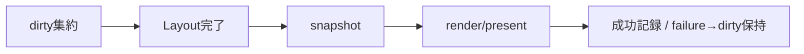
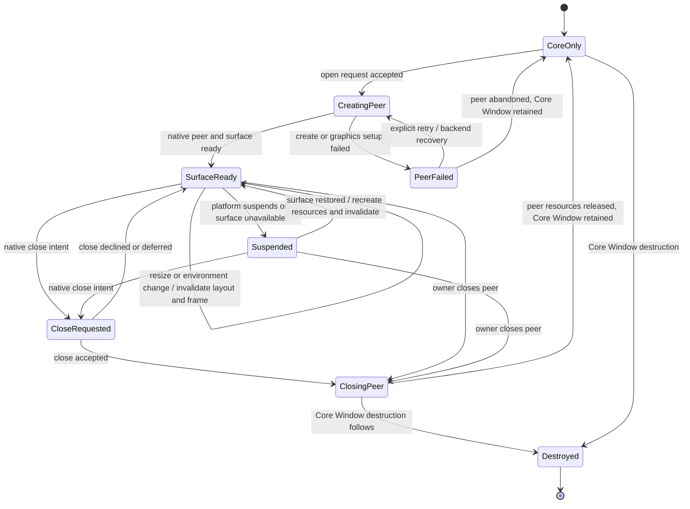
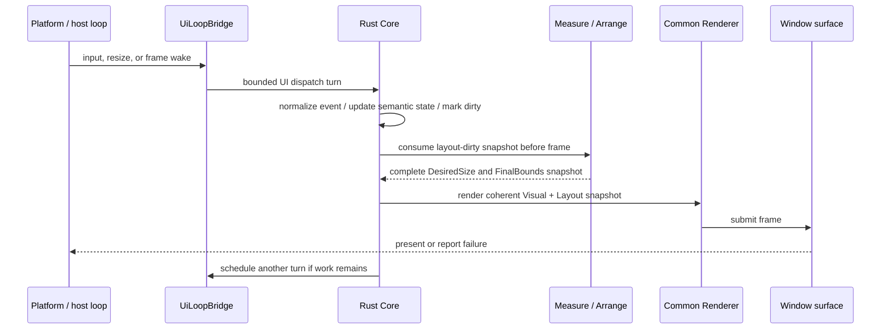
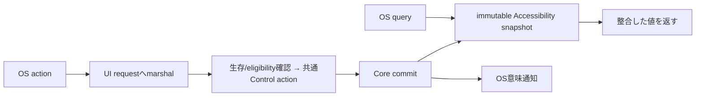
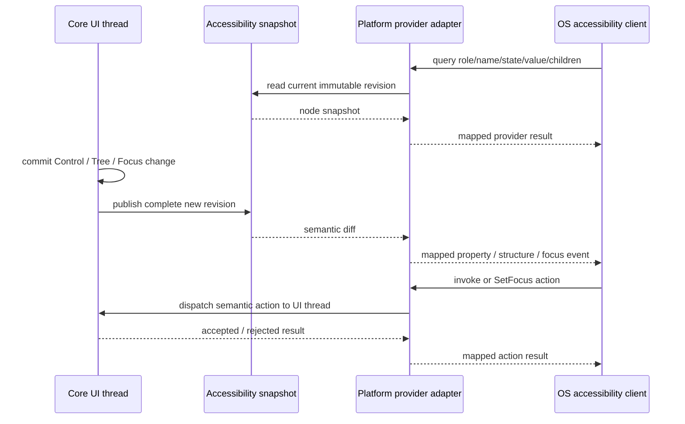
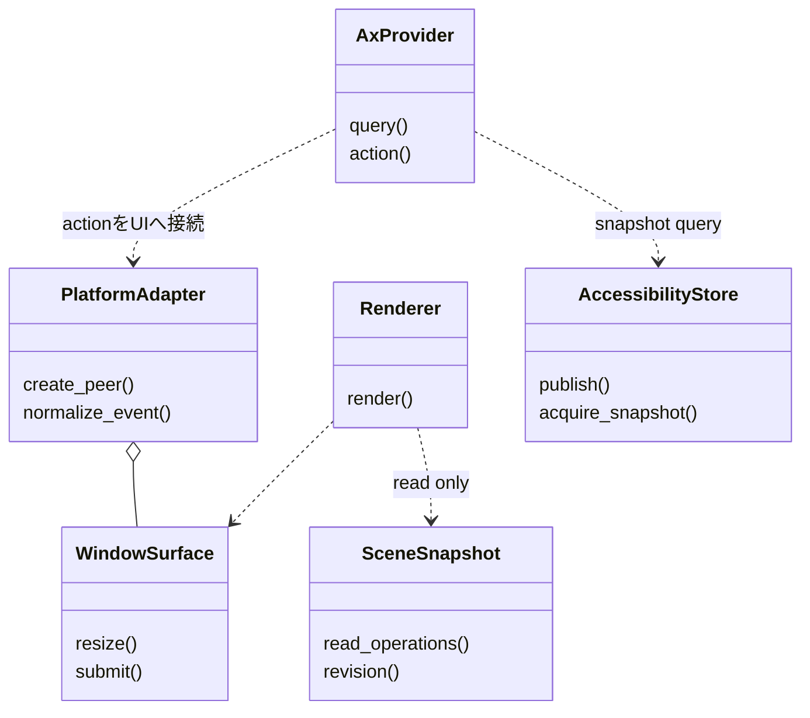
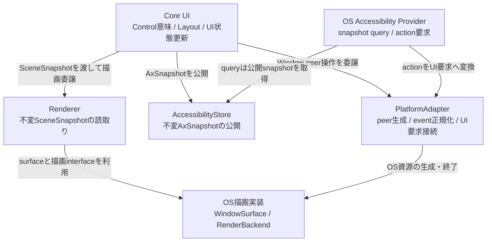

# プラットフォーム：抽象化と共通protocol

- 文書版: 1.1
- 文書ロール: detailed-design
- 更新日: 2026-10-17
- 状態: 1.1全文承認済み（利用者、2026-10-17）。実装・試験状態は別管理

## 目的と上位根拠

本書を要求から実装へ具体化する詳細設計の正本とする。型・API・所有・呼出し手順・状態遷移を実装へ反映する。要求の外部保証はリンク先RQ、層の責務と主要flowは上位BDを根拠とする。設計宣言の記載は、配布済みheader・実装済みAPI・試験合格を意味しない。

基本設計: [UIクラス：Tree・Layout・Focus・Control](../../12_design/ui/tree-layout-controls.md)、[イベントハンドリング：通知・入力・Command](../../12_design/events/notifications-commands.md)、[UIクラス：TextBox・編集・Validation](../../12_design/ui/text-editing-validation.md)、[プラットフォーム：抽象化・描画・text・OS接続](../../12_design/platform/abstraction.md)、[ランタイム：実行context・所有・終了](../../12_design/runtime-objects/runtime.md)

## 要求と設計項目の対応

| 設計項目 | 要求根拠 |
| --- | --- |
| Host・Window・Rendererの抽象化 | [RQ-01-002](../../11_requirements/RQ-01_purpose-architecture.md#rq-01-002)、[RQ-05-009](../../11_requirements/RQ-05_ownership-callbacks.md#rq-05-009)、[RQ-06-002](../../11_requirements/RQ-06_threading-dispatch.md#rq-06-002)、[RQ-06-005](../../11_requirements/RQ-06_threading-dispatch.md#rq-06-005)、[RQ-06-006](../../11_requirements/RQ-06_threading-dispatch.md#rq-06-006)、[RQ-06-007](../../11_requirements/RQ-06_threading-dispatch.md#rq-06-007)、[RQ-09-005](../../11_requirements/RQ-09_ui-scope.md#rq-09-005)、[RQ-09-038](../../11_requirements/RQ-09_ui-scope.md#rq-09-038)、[RQ-09-040](../../11_requirements/RQ-09_ui-scope.md#rq-09-040)、[RQ-09-041](../../11_requirements/RQ-09_ui-scope.md#rq-09-041)、[RQ-09-042](../../11_requirements/RQ-09_ui-scope.md#rq-09-042)、[RQ-09-055](../../11_requirements/RQ-09_ui-scope.md#rq-09-055)、[RQ-09-056](../../11_requirements/RQ-09_ui-scope.md#rq-09-056)、[RQ-11-001](../../11_requirements/RQ-11_platform.md#rq-11-001)、[RQ-11-002](../../11_requirements/RQ-11_platform.md#rq-11-002)、[RQ-11-008](../../11_requirements/RQ-11_platform.md#rq-11-008)、[RQ-11-009](../../11_requirements/RQ-11_platform.md#rq-11-009)、[RQ-11-010](../../11_requirements/RQ-11_platform.md#rq-11-010)、[RQ-11-011](../../11_requirements/RQ-11_platform.md#rq-11-011)、[RQ-11-012](../../11_requirements/RQ-11_platform.md#rq-11-012)、[RQ-11-013](../../11_requirements/RQ-11_platform.md#rq-11-013)、[RQ-11-020](../../11_requirements/RQ-11_platform.md#rq-11-020)、[RQ-11-021](../../11_requirements/RQ-11_platform.md#rq-11-021)、[RQ-12-010](../../11_requirements/RQ-12_build-distribution.md#rq-12-010) |
| Accessibilityの共通Treeとaction | [RQ-09-011](../../11_requirements/RQ-09_ui-scope.md#rq-09-011)、[RQ-10-001](../../11_requirements/RQ-10_accessibility.md#rq-10-001)、[RQ-10-002](../../11_requirements/RQ-10_accessibility.md#rq-10-002)、[RQ-10-003](../../11_requirements/RQ-10_accessibility.md#rq-10-003)、[RQ-10-004](../../11_requirements/RQ-10_accessibility.md#rq-10-004)、[RQ-10-005](../../11_requirements/RQ-10_accessibility.md#rq-10-005)、[RQ-10-006](../../11_requirements/RQ-10_accessibility.md#rq-10-006)、[RQ-10-007](../../11_requirements/RQ-10_accessibility.md#rq-10-007)、[RQ-10-008](../../11_requirements/RQ-10_accessibility.md#rq-10-008)、[RQ-10-009](../../11_requirements/RQ-10_accessibility.md#rq-10-009)、[RQ-10-011](../../11_requirements/RQ-10_accessibility.md#rq-10-011)、[RQ-10-012](../../11_requirements/RQ-10_accessibility.md#rq-10-012)、[RQ-10-013](../../11_requirements/RQ-10_accessibility.md#rq-10-013) |

本書内の共通規則は上記の各要求を実現するために適用する。同一項目内で個別要求を参照する場合はその対象範囲を優先する。将来候補・未採用範囲は採用済みの動作と区別する。

## Host・Window・Rendererの抽象化

### 実現のcall/data/ownership flow

Platform AdapterがWindow peer/surface/deviceを所有し、Core Windowの意味寿命と分離する。frame前にdirty Layoutを解決し、一貫したVisual snapshotをRendererへ渡す。failureではdirtyを維持し、peer喪失中のevent配送を止める。shutdownは新規event/frame受付停止→IME session終了→peer/graphics破棄→Core参照解放の順でUI thread上に集約する。

### 責務と境界

| 要素 | 責務案 | 所有しないもの |
|---|---|---|
| Rust Core | Logical/Visual Tree、Control状態、Focus/Input/IME semantic state、Measure/Arrange結果、render invalidation、frameに必要な一貫したCore snapshot | OS handle、native surface、graphics device/context、OS IME object、OS Accessibility peer |
| 共通Renderer | Visual snapshotと共通boundsからControlの描画内容を作る。Control意味論やLayoutを再計算しない | Platform window lifecycle、raw inputの意味解釈、OS native controlの状態 |
| Platform Adapter | OS event受信、Window/surfaceとgraphics接続、root領域・scale等の環境値通知、raw input/IMEの正規化、Rendererへの表示先提供 | Core Controlのsource-of-truth、Binding/Validation/Focus/IMEの意味論 |
| `UiLoopBridge` | ランタイム：実行基盤と終了に従いUI threadへ非同期wakeを依頼し、UI thread上のbounded dispatch turnを可能にする | host event loopの所有、nested loop、worker上でのCore UI操作 |

CoreとAdapterの間では、OS resourceをopaqueなAdapter内部resourceとして扱う。Backend固有callbackからCore/user callbackを直接呼ばず、ランタイム：実行基盤と終了のUI thread dispatch境界を通す。RendererはUIクラス：Tree・Layout・GeometryのFinalBoundsおよびUIクラス：Window・基本Control・次段階ControlのControl意味情報を使用し、Platform固有Control behaviorでそれらを上書きしない（MVVM UIライブラリ 初期Control契約に関する上位判断案）。

### 実装規則

| 実装規則 | 根拠・境界 |
| --- | --- |
| Core、共通Renderer、Platform Adapterを分離する。Coreが意味情報とLayout結果を確定し、RendererはCoreから与えられるVisual snapshotを描画し、AdapterはOS surface/device/eventとの接続を担う。OS native controlをControl状態のsource-of-truthにしない。 | 承認済みMVVM UIライブラリ 初期描画方式と検証順序に関する上位判断案、ADR-0001。個々のtrait/API/ABIは決めない。 |
| ひとつのRuntimeは初期構成で一つのPlatform Adapter/backendに接続する。開かれたCore Windowごとに0または1つのAdapter-owned Window peerを対応させ、peerがnative window/surfaceとgraphics resourceを保持する。Core Windowとpeerは別object/寿命とし、WindowのDetached状態だけではpeerを暗黙破棄しない。 | MVVM UIライブラリ UI treeの所有・寿命に関する上位判断案、UIクラス：Tree・Layout・Geometry。 具体化は[ランタイム：実行基盤と終了](../runtime-objects/runtime.md)、[プラットフォーム：OS・描画・text・IME内部レイヤー](internal-layers.md)、[プラットフォーム：OS・描画・text・IME内部レイヤー](internal-layers.md)を参照する。 |
| Visual/Property/Tree/Layout変更はCore dirty stateへ集約する。描画frameを作る直前に必要なMeasure/Arrangeを完了し、同じUI thread上の一貫したVisual/Layout/Control snapshotをRendererへ渡す。連続したdirty要求・resizeは未開始frameに集約し、部分更新に失敗した場合は前回のcomplete frame相当状態を保持する。 | ランタイム：実行基盤と終了、UIクラス：Tree・Layout・Geometry、UIクラス：Window・基本Control・次段階Control。damage region、partial redraw、snapshot格納形式、厳密なframe clockは決めない。 |
| Frame requestと通常post/input/notificationはランタイム：実行基盤と終了のbounded UI dispatch内で処理する。shutdown control taskは実行中callback/eventが戻った次の処理機会でframe/通常workより優先し、開始済みrender/host eventを途中で再入終了させない。描画要求が続いても同じdispatch turnを無制限に占有しない。 | UI dispatcher、Runtime shutdownのcallback中dispatchに関する上位判断。OS loopのpriority APIやrefresh synchronizationはbackend別後続。 |
| Window peerはCore Windowへ関連付けた状態でsurfaceを作成し、Platformから来る利用可能領域・scale等のenvironment変更をCoreへ通知する。Core Windowは意味状態を維持し、surface resize/device recreation時にLayout dirtyとframe dirtyを立てて再描画する。OS peer喪失時もCore Tree/Property/Binding/Focus意味状態をOS resourceと一緒に破棄しない。 | MVVM UIライブラリ Layoutの責務境界に関する上位判断案、UIクラス：Tree・Layout・Geometry。 具体化は[ランタイム：実行基盤と終了](../runtime-objects/runtime.md)、[プラットフォーム：OS・描画・text・IME内部レイヤー](internal-layers.md)、[プラットフォーム：OS・描画・text・IME内部レイヤー](internal-layers.md)を参照する。 |
| OSのclose intentはPlatform AdapterからCoreへのclose requestとして通知する。OS eventを受けたことだけでRuntime shutdownやCommand/screen ownerのcloseを実行しない。 具体化は[ランタイム：実行基盤と終了](../runtime-objects/runtime.md)、[プラットフォーム：OS・描画・text・IME内部レイヤー](internal-layers.md)、[プラットフォーム：OS・描画・text・IME内部レイヤー](internal-layers.md)を参照する。 | UIクラス：Window・基本Control・次段階Control §7、ランタイム：実行基盤と終了、MVVM UIライブラリ 初期描画方式と検証順序に関する上位判断案。close policyをこの案だけで決めない。 |
| Adapterはraw pointer/keyboard/window eventをMVVM UIライブラリ Input eventの責務境界に関する上位判断案/UIクラス：InputとFocusの共通Input eventへ正規化し、Core UI threadへ順序を保って渡す。AdapterはOS座標・device情報を保持し、Core Layout座標への変換点を一箇所に置く。Coreのroute/Focus/activationはUIクラス：InputとFocusに従い、backendごとに再実装しない。 | MVVM UIライブラリ Input eventの責務境界に関する上位判断案、UIクラス：Tree・Layout・Geometry、UIクラス：Window・基本Control・次段階Control。 具体化は[ランタイム：実行基盤と終了](../runtime-objects/runtime.md)、[プラットフォーム：OS・描画・text・IME内部レイヤー](internal-layers.md)、[プラットフォーム：OS・描画・text・IME内部レイヤー](internal-layers.md)を参照する。 |
| TextBoxにactive focusが移る時、Adapterは対応するOS IME sessionを開始し、preedit/commit/cancelをUIクラス：TextBox・Validation・IME編集が定める共通IME eventへ変換する。Core focus離脱、TextBox detach/destroy、外部確定値update、Runtime shutdownではsessionを終了し、session外・stale eventをCore編集状態へ反映しない。Candidate UI位置はCore text/layout情報をAdapterへ渡す接点まで定める。 | MVVM UIライブラリ Focus移動時のIME compositionに関する上位判断案、UIクラス：InputとFocus。OS API、内部caret単位、candidate window placement/render、OS event ordering差は確定しない。 |
| Surface/device/render failureはCore UI状態のcommitと分離して診断する。失敗したframeをCoreの成功済みsnapshotとして扱わず、dirtyを保持してAdapterがrecoverまたは明示failure状態を通知する。surface喪失中もInput/IME eventは無効surfaceへ配送しない。 | Layout、ランタイム：実行基盤と終了、MVVM UIライブラリ 初期描画方式と検証順序に関する上位判断案。status code、再試行回数、device fallback、software renderer切替は後続判断。 |
| Runtime shutdown開始時はAdapterの新規OS event受信とframe schedulingを停止し、ランタイム：実行基盤と終了に従いUI thread上で未開始のworkをcancelする。AdapterはIME sessionを閉じ、native peers/graphics resourcesを破棄してからCoreがそれらの参照を解放する。既に実行中のUI callback/render turnは戻るまで完了させ、nested dispatchを始めない。 | Runtime契約、Runtime shutdownのcallback中dispatchに関する上位判断、ランタイム：実行基盤と終了。shutdown worker待機はhost停止通知で未完了として解除する。 具体化は[ランタイム：実行基盤と終了](../runtime-objects/runtime.md)、[プラットフォーム：OS・描画・text・IME内部レイヤー](internal-layers.md)、[プラットフォーム：OS・描画・text・IME内部レイヤー](internal-layers.md)を参照する。 |

### Window peerとsurface状態

この案はCore Windowとnative peerの寿命を分ける。`CoreOnly`はCore objectが存在するがnative surfaceを持たない状態、`SurfaceReady`はOS表示面が利用可能な状態を表す。具体化は[ランタイム：実行基盤と終了](../runtime-objects/runtime.md)、[プラットフォーム：OS・描画・text・IME内部レイヤー](internal-layers.md)、[プラットフォーム：OS・描画・text・IME内部レイヤー](internal-layers.md)を参照する。Runtime shutdownは個々のclose requestとは別の全peer teardown経路とする。

### Frame生成・表示の処理

Frame境界ではCore snapshotの読取りとUI意味状態の更新を混ぜない。frame作成より後に到着した入力/Property変更は次のsnapshotへ反映する。Surface presentが非同期backend operationなら、その完了callbackはAdapter内で受けてからランタイム：実行基盤と終了 bridge経由でCoreに必要な状態だけ通知する。具体的なthread、fence、GPU resource synchronizationはbackend設計へ送る。

### Eventとlifecycleの順序

#### 起動・表示

1. Platform profileとAdapterをRuntime起動時に準備し、ランタイム：実行基盤と終了の`UiLoopBridge`接続を登録する。
2. Core WindowとControl Treeを構成する。Core object作成はnative OS windowを必ず生成するとは限らない。
3. open requestをAdapterへ渡し、UI thread上でpeer/surface/graphics接続を準備する。成功時にroot available region等をCoreへ通知する。
4. CoreはUIクラス：Tree・Layout・Geometry Measure/Arrangeを行い、complete snapshotをRendererへ渡す。RendererはUIクラス：Window・基本Control・次段階Control Control意味情報に基づくframeをsurfaceへ提出する。

#### Input / Focus / IME

1. AdapterがOS eventを取得し、timestamp/modifier/device/surface座標等の元情報を保つ。
2. Adapterがthread-safeなqueue/bridgeでUI threadへ届け、ひとつの共通Core Input eventへ正規化する。
3. CoreはUIクラス：InputとFocusのactive Window/Focus、route、Control activation規則を適用する。Platform peerのnative focus変化はCore focus request/resultと同期し、二重focus eventを抑止する必要がある。
4. TextBox active focusに連動してAdapterがIME sessionを管理する。preedit等はUIクラス：TextBox・Validation・IME編集の共通eventとしてCoreへ送り、OS candidate UIはAdapterが所有する。
5. Core state/Layout/render dirtyが生じたら既存event turn内のbounded処理を経て次のframeへ合流する。OS eventはCore callbackを直接呼び出さない。

Native focus changeとCore Focus changeの同期、event timestamp/order、座標・scaleの数値定義はレビュー案では境界まで示し、具体決定を保留する。

#### CloseとRuntime shutdown

- OS close intentはCore Windowへrequestとして通知する。Runtime/Command ownerのshutdownは暗黙に始めない。
- closeが受理された場合のpeer teardownとCore Window保持/破棄の関係はPlatform接続で利用者確認が必要。
- Runtime shutdownではRuntime shutdownのcallback中dispatchに関する上位判断/ランタイム：実行基盤と終了優先度に従う。実行中のcallback/eventを終えた次処理機会で、未開始post/frameをcancelし、IME session、peer、surface、graphics resourceをUI thread上で停止・破棄する。
- worker同期shutdownはランタイム：実行基盤と終了のhost停止通知で未完了と理由を返し、cleanup完了と区別する。具体化は[ランタイム：実行基盤と終了](../runtime-objects/runtime.md)、[プラットフォーム：OS・描画・text・IME内部レイヤー](internal-layers.md)、[プラットフォーム：OS・描画・text・IME内部レイヤー](internal-layers.md)を参照する。

## Accessibilityの共通Treeとaction

### 実現のcall/data/ownership flow

Core commit後のLogical stateからimmutable Accessibility snapshotを作り、OS providerのqueryはsnapshotを読む。actionはthread-safe request経路でUIへ渡して通常Control actionを一度実行する。node identityをWidget生存期間へ対応付け、detach/peer close/shutdownでproviderを切断する。OS proxyはCore ownerを強保持せず、stale query/actionを拒否する。

### 責務境界

| 要素 | 責務案 | 境界 |
|---|---|---|
| Core | WidgetのAccessibility role/name/state/value/focus/supported action、Logical Treeに基づく意味上の階層を保持する。UI state commit後に読み取り用snapshotを更新する。 | OS role名、provider interface、OS event/property IDを保持しない。 |
| Platform Accessibility Adapter | Core snapshot/treeをOS provider treeへ写像し、OS query/event/actionを対応づける。Windows/Linux等の差をこの層に閉じる。 | Core Control状態を独自に推測・変更しない。native control/pixelから意味を作らない。 |
| OS provider | OS accessibility clientからのqueryとsupported actionを受け、Platform Adapterへ渡す。Core state変更通知をOS event/property notificationへ変換する。 | Binding/Command/Input/Validationの意味論を実装しない。 |

Provider queryはCore objectを任意threadから直接読み書きしない。query用snapshotの公開方式とactionのUI thread dispatchはOS内部レイヤーのProvider protocolで定める。既存のCore Input/Focus/Command/TextBox経路がOS providerからも再利用される。

### 実装規則

| 実装規則 | 根拠・境界 |
| --- | --- |
| CoreはPlatform中立なAccessibility snapshotを提供し、OS providerはそのsnapshotから値を返す。snapshotはUI thread上のCore state commit後に整合した単位で更新し、複数property/tree変更の途中状態を公開しない。 | MVVM UIライブラリ Accessibility共通意味論に関する上位判断案、ランタイム：実行基盤と終了～16。snapshot ABI・保存形式は定めない。 |
| Accessibility hierarchyはLogical Treeの初期Controlを一nodeずつ対応づけ、子順はLogical child順に従う。Window peerに対応するWindowがtree root配下のOS nodeとなる。CoreはOS共通root（例: desktop/application root）を新しいWidgetとして作らない。Visual Tree/template部品は独立nodeにしない。 | MVVM UIライブラリ Logical Tree／Visual Treeの役割に関する上位判断案、UIクラス：Tree・Layout・Geometry。OSが必要とするroot/fragmentはAdapter側に置く。 |
| node identityはCore Widgetの生存中に安定し、Property更新や同一Logical parent内の並べ替えだけでは再生成しない。detach/破棄済みnodeへのquery/actionはstaleとして無効化し、新しいWidgetにidentityを再利用しない。reparent時のOS peer保持/再生成と通知順はAdapter profileで一貫させる。 | handle登録・検証、UI Tree、MVVM UIライブラリ Accessibility共通意味論に関する上位判断案。公開handleとの同一性は要求しない。 |
| Role/name/state/valueはCore snapshotを唯一の意味sourceとする。`AccessibleName`はOS nameへ直接写し、未設定/空欄をlabel、表示文字列、Text.Content、Button label、Window titleから合成しない。roleと共通Control stateは下表のOS mapping候補を使い、表に「要判断」とする点は決定済み扱いにしない。 | MVVM UIライブラリ Accessibility共通意味論に関する上位判断案、Controlの共通規則。UIクラス：Window・基本Control・次段階Control §7に残るproperty名・詳細意味論は変更しない。 |
| OS APIの`Focused` stateはCoreのactive Window/keyboard focused Controlから得る。ATの探索・読み上げ位置（accessibility/browse focus）はOS/AT側状態とし、単なるtree queryでCore keyboard focusを変更しない。OSから明示SetFocus actionを受けた場合だけUIクラス：InputとFocus Focus requestへ接続する。 | MVVM UIライブラリ Focusの管理単位に関する上位判断案、InputとFocus。OS固有focus eventとCore keyboard focusの同一性を仮定しない。 |
| OSのsupported actionはCoreがそのControlで実際に扱えるsemantic actionのみ公開する。Button invokeはControlの共通規則の同じactivation eligibility/Command経路へ接続し、Focus actionはUIクラス：InputとFocus requestへ接続する。TextBox edit/value/selection actionはUIクラス：TextBox・Validation・IME編集のediting transactionを通す。OS key eventを合成してshortcutとして実装しない。 | MVVM UIライブラリ Accessibility共通意味論に関する上位判断案、イベントハンドリング：非同期Command。 具体化は[プラットフォーム：OS・描画・text・IME内部レイヤー](internal-layers.md)を参照する。 |
| OS query threadからはimmutable/current Accessibility snapshotだけを読み、Core UI objectを直接参照しない。AT actionはPlatform Adapterのthread-safe request経路でUI threadへ渡し、Core actionを一度だけ実行する。同期応答が必要なOS operationのthreading・timeout・再入制約はOS profileごとに定め、nested event loopやCore callbackからの再帰queryを避ける。 | Runtime契約、ランタイム：実行基盤と終了。query/actionのOS-specific apartment/event-loop要件は公式provider契約で確認する。 |
| Core state commit後にname/value/focus/enabled/validation/tree changeをAdapterへ通知する。AdapterはOS API固有のproperty/structure/focus/action eventへ写像する。読取りproperty通知は同一node/propertyの未送信更新を最新値へ集約してよいが、focus遷移・invoke等のeventを状態通知と混同・破棄しない。 | MVVM UIライブラリ Accessibility共通意味論に関する上位判断案、ランタイム：実行基盤と終了。OS event ID・細かな同一turn順序はOS profileで定義する。 |
| OS provider tree nodeはWindow peer/Accessibility adapterの寿命内で有効とする。Logical detachでtreeから削除し、peer close/Runtime shutdownではproviderを切断し、残存OS proxy query/actionへstale/unavailableを返す。Core WidgetをOS clientのremote referenceが所有延長しない。 | ランタイム：実行基盤と終了、MVVM UIライブラリ Accessibility共通意味論に関する上位判断案。具体OS ref counting/weak reference処理はAPI仕様に従う。 |
| 初期mapping profile候補はWindows UI Automation server-side provider、Linux desktop profileはAT-SPI 2 Accessible/Action等のD-Bus providerとする。初期mappingは標準role/property/pattern/interfaceで表現し、独自role/event/patternは既存標準で意味を表せない場合に限り追加レビューする。 | MVVM UIライブラリ 初期描画方式と検証順序に関する上位判断案と公式API資料。 具体化は[プラットフォーム：OS・描画・text・IME内部レイヤー](internal-layers.md)を参照する。 |

### 初期Control mapping候補

| Core Control / meaning | Windows UI Automation候補 | Linux AT-SPI 2候補 | 保留・注意 |
|---|---|---|---|
| Window | Window control type、provider fragment root | Frame role、application accessible root配下 | Window titleはUIクラス：Window・基本Control・次段階ControlのAccessibleNameから独立。Window peerを閉じた後のCore Window寿命はプラットフォーム：抽象化と共通protocol §7。 |
| StackPanel | PaneまたはGroup control type | Panel role | どのOS roleが本Controlのgrouping意味に最も合うか、子順とcontrol/content view inclusionを確認する。 |
| Text | Text control type、read-only text information | Static role / Text interface candidate | `Content` valueと`AccessibleName`は別property。読み上げ単位・wrappingは決めない。 |
| TextBox | Edit control type、Text/Value patternの必要機能 | Entry role、Text/EditableText等の必要interface | 具体化は[プラットフォーム：OS・描画・text・IME内部レイヤー](internal-layers.md)を参照する。 |
| Button | Button control type + Invoke pattern | Push Button role + Action interface | `Invoke`をControlの共通規則 semantic activationへ送り、disabled/no-Command/can-executeを迂回しない。 |

上表の役割候補はOS APIの正式要件・supported pattern/interface一覧を照合するためのレビュー案である。MicrosoftはUI Automation providerにtree、properties、control patterns、eventsを公開する契約を持つ。GNOME AT-SPI 2はAccessibleを基礎objectとし、用途に応じAction、Component、Text等のinterfaceを公開する。role名を直接共通ABIへ漏らさない。

### State・value・actionの共通対応案

#### Nameとrole

- Coreのabstract roleはOS profileで標準role/typeへ写像する。OS標準の該当roleがない時は、任意の汎用roleへ黙って変換せず、profileのunsupported mappingと検証結果を明記する。
- `AccessibleName`はUTF-8 semantic nameとして取得し、各OSの文字列型へ変換する。空欄をvisible label等で補わない。UTF-8からOS文字列型への不正入力・変換不能規則は共通値契約/オブジェクト管理：handle・値・errorと整合させる。
- localization、description/help text、label-for relation、name composition/fallbackは本案で追加しない。

#### Stateとvalue

- `focused`はUIクラス：InputとFocus Core focus stateを写す。AT browse focusはCore focusに反映しない。SetFocus actionの成功時のみCore Focus request結果をOSへ反映する。
- `enabled/focusable`はControlのCore Accessibility stateを参照する。AdapterはLogical ancestor、native peer、OS defaultから独自に再計算しない。具体化は[プラットフォーム：OS・描画・text・IME内部レイヤー](internal-layers.md)を参照する。
- `validation state`はUIクラス：TextBox・Validation・IME編集のValidation/Input result由来とする。OSのinvalid/error indicationへの具体map、message公開は後続判断へ送る。
- TextのvalueはControlの共通規則 `Content`から読む。TextBoxはUIクラス：TextBox・Validation・IME編集のcommitted `Value`とediting textを区別する。Accessibility value/text interfaceにどちらを出すかは利用者判断が必要で、OS/ATごとの推奨を§8へ提示する。
- Visibility/hidden/offscreen semanticsはUIクラス：Window・基本Control・次段階Control §7の判断後に写す。OS providerが視覚boundsから独自にCore `IsVisible` stateを作らない。

#### Supported action

- Window: Core active/focus情報の取得。具体化は[プラットフォーム：OS・描画・text・IME内部レイヤー](internal-layers.md)を参照する。
- StackPanel: child tree navigationのみ。具体化は[プラットフォーム：OS・描画・text・IME内部レイヤー](internal-layers.md)を参照する。
- Text: 読取可能なvalue/text情報。独立invoke actionなし。
- TextBox: Coreが確定したtext/value/edit操作のみ。具体化は[プラットフォーム：OS・描画・text・IME内部レイヤー](internal-layers.md)を参照する。ATによる入力候補はUIクラス：TextBox・Validation・IME編集 Validator transactionへ通す。
- Button: Invoke action。Pointer activationと同じsemantic経路・CanExecute/IsEnabledの条件を使う。
- どのactionもアクセシビリティ層からViewModel/Commandを直接呼ばず、Core Control/Input/Commandへ戻す。Tab/Shift+Tab、Ctrl+Z等のkey bindingは登録しない。

### Tree更新と通知

1. UI thread上でCoreがTree/Property/Focus/Validation stateをcommitする。
2. commit後に新しいcomplete Accessibility snapshotを作り、revisionを一つ進める。
3. Platform Adapterが旧・新snapshotを比較し、node追加/削除/reparentとproperty差分をOS provider通知へ変換する。
4. Adapterは通知をOS APIの必要thread/順序へdispatchする。通知処理でCore stateを書き換えない。
5. AT actionはsnapshot revisionとnode identityを検証し、staleならactionを実行せずOS profileのelement-unavailable相当結果にする。

Snapshot publicationとOS event送信の競合時、provider queryは一つのrevision内で回答する。eventが遅れてもATが新しい値をqueryできるため、重複property updateは集約可能。ただし構造削除、focus transition、invoke-completedの順序は各OS profileで必要条件を満たす。

### Node状態と失敗

| 状況 | Provider動作案 |
|---|---|
| Core WidgetがAttached/active | 安定node identityと最新snapshotのpropertyを返す。 |
| Logical detach | nodeをaccessible childrenから外しstructure changeを通知。古いnode handle/actionを無効化。Core Widget自体はUIクラス：Tree・Layout・Geometry寿命規則に従う。 |
| Window peer suspend/lost | Core snapshotは保持。OS profileが表示されていないnodeをどう扱うかはprofile rulesに従い、stale visual boundsを有効な画面位置として返さない。 |
| node破棄 / peer close / Runtime shutdown | provider nodeを切断し、後続query/actionはelement unavailable/stale相当を返す。OS client参照でRuntime/Widgetを延命しない。 |
| OS queryが未知property/pattern/interfaceを要求 | profileの標準unsupported/not-implemented responseを返す。空文字や成功扱いへ偽装しない。 |
| actionの前提変化 | UI thread上で最新Core stateを再検証し、disabled/unfocused/detached/Command不可なら実行拒否。 |
| snapshot allocation / event delivery failure | Core UI stateはrollbackしない。最後のcomplete snapshotを保ち、Adapter diagnosticsにfailureを記録してretry可能なdiffを残す。 |

#### 公式資料で確認したOS providerの契約

- Microsoft UI Automation providerはclientが要素情報をqueryし操作するためにprovider tree、properties、control patterns、eventsを実装する。standard control patternはbutton invoke等の機能単位で提供される。[UI Automation Specification](https://learn.microsoft.com/en-us/windows/win32/winauto/ui-automation-specification)、[Providers Overview](https://learn.microsoft.com/en-us/windows/win32/winauto/uiauto-providersoverview)、[Control Patterns Overview](https://learn.microsoft.com/en-us/windows/win32/winauto/uiauto-controlpatternsoverview)。
- Windows UI Automationのprovider treeはparent/sibling/child navigationとproperty/structure eventを公開し、provider disconnectionも扱う。[Implement a Server-Side Provider](https://learn.microsoft.com/en-us/windows/win32/winauto/uiauto-serversideprovider)。
- Linux候補AT-SPI 2ではAccessibleがaccessible hierarchyのbase interfaceであり、Action/Component/Text等をrole・機能に応じて実装する。D-Bus Accessible contractはroot object、Name、Parent、children navigationを持つ。[AT-SPI Accessible interface](https://gnome.pages.gitlab.gnome.org/at-spi2-core/devel-docs/doc-org.a11y.atspi.Accessible.html)、[AT-SPI roles](https://gnome.pages.gitlab.gnome.org/at-spi2-core/libatspi/enum.Role.html)。
- Windows provider callbackのthreading/apartment制約はprovider実装方式とCOM optionに依存する。client-side threading guideをserver providerへそのまま転用しない。Windows profile作成時にprovider guide/API contractを直接確認する。[UI Automation provider options](https://learn.microsoft.com/en-us/dotnet/api/system.windows.automation.provider.provideroptions)、[Server-side provider guide](https://learn.microsoft.com/en-us/windows/win32/winauto/uiauto-serversideprovider)。

## クラス設計の補足（1.1承認済み）

既承認1.0の実現規則を支える型・関連・所有・主要操作を整理した。内部型名とメソッドの分担は本改訂で補足する内部設計であり、既存公開APIの署名や外部保証を追加・変更するものではない。この節のクラス構成と追加図は1.1版全文の承認対象であり、実装・試験完了の証明とは区別する。

要求根拠: [RQ-11-008](../../11_requirements/RQ-11_platform.md#rq-11-008)、[RQ-11-009](../../11_requirements/RQ-11_platform.md#rq-11-009)、[RQ-11-010](../../11_requirements/RQ-11_platform.md#rq-11-010)、[RQ-11-013](../../11_requirements/RQ-11_platform.md#rq-11-013)、[RQ-11-020](../../11_requirements/RQ-11_platform.md#rq-11-020)。

OS実装を持たない共通trait/interfaceと、Coreから渡すsnapshotを分ける。具象backendが変わってもCoreのControl意味と確定済み状態を正本に保つ。

### 型の責務と所有

| 型 | 責務・保持データ | 主要メソッド・操作 | 所有・寿命 |
| --- | --- | --- | --- |
| PlatformAdapter | host loop・Window peer・入力・IME/provider接続の共通interface | create_peer(window_descriptor); normalize_event(raw); stop_receiving(); teardown() | OS資源のowner。CoreへOS objectや再入可能なraw callbackを直接渡さない |
| WindowSurface | surface generation、寸法/scale、利用可能/喪失状態 | resize(environment); submit(frame); recreate(); close() | Core Window寿命と独立。失敗frameをPresentedとしない |
| Renderer | SceneSnapshotをbackend描画操作へ変換 | render(scene, surface) | Controlを直接変更しない。GPU資源管理は具象backendへ分担 |
| SceneSnapshot | 同revisionのDrawOp、layout情報、damage | read_operations(); revision(); damage() | Core UI値の不変copy。Controlを強保持しない |
| AccessibilityStore | Core意味から生成した最新AxSnapshotの公開 | publish(snapshot); acquire_snapshot() | 不変snapshotを共有。OS queryでUIを同期的に読み書きしない |
| AxProvider | node identityとsnapshotに基づくOS query/actionの共通接点 | query(node_id); action(node_id, request) | node/Controlへweakに関連付け、UI mutationは通常のUI requestへ渡す |

### クラスの関連

`*--`は従属するstate/作業の合成、`o--`は共有を含む所有参照、`..>`は非所有の利用・識別・委譲を示す。関連名と本文で示した寿命を優先し、図の同名型は各instanceで別の状態を持つ。図は主要メソッド名を抜粋し、引数・所有・失敗条件は表と本文に従う。

### コンポーネント図：CoreとOS実装の境界

既存のframe/action手順図に加え、描画とAccessibilityが利用する接点を示す。矢印は利用・委譲先を表し、Core値の所有移転や同期呼出しの保証を表さない。

OS入力とactionはAdapterからRuntime UI queueを経てCoreへ戻り、generationとeligibilityをCore側で検証する。Provider queryはこの更新経路へ同期往復せず、不変snapshotを読む。RendererもControlを直接変更せず、submitをPresentedと同一視しない。

### 主要な呼出しと失敗境界

Coreの意味更新→Layout確定→SceneSnapshot/AX snapshot構築→Renderer/Providerへ渡す。OS event/actionはAdapterが中立情報へcopy/変換してUIへ送り、Core側でgenerationとeligibilityを再検査する。

図は共通責務であり、全OSに同じclass実装を強制しない。interfaceの操作名は内部分担案で、未採用backendや新しいpublic APIを採用しない。

## 文書の承認・改訂履歴

| 日付 | 対象版 | 内容・根拠 |
| --- | --- | --- |
| 2026-10-17 | 1.0 | 利用者の指示に基づき、既承認内容を責務別に再編集。設計項目IDによる承認・追跡は廃止し、以後は文書版全体で管理する。構成変更を新規の製品仕様採用としない |
| 2026-10-17 | 1.0全文 | 利用者の「全部承認します」により文書全体を承認。旧IDによる項目承認ではなく、現行文書版を対象とする。実装・試験合格を意味しない |
| 2026-10-17 | 1.1改訂案 | 利用者の補足指示によりクラス責務・所有・メソッド・関連図を追加。1.0承認を維持し、1.1全文は確認待ち |
| 2026-10-17 | 1.1全文 | 利用者の「OK,テスト文書作りましょうか」により、クラス設計補足と選択的な図の補強を含む全文を承認。既存履歴を維持し、実装・試験状態は別管理 |
