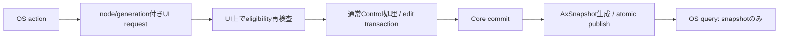
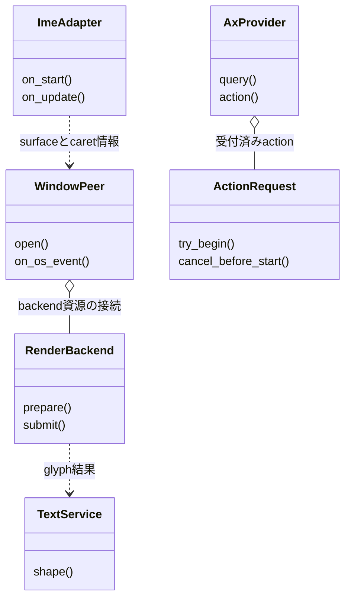
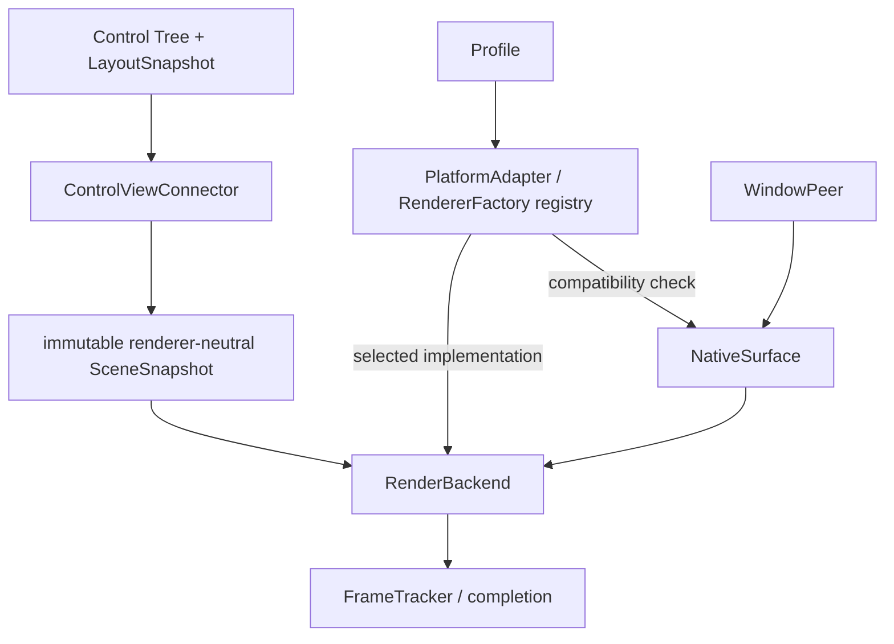

# プラットフォーム：OS・描画・text・IME内部レイヤー

- 文書版: 1.9
- 文書ロール: detailed-design
- 更新日: 2026-10-31
- 状態: 1.6全文承認済み（利用者、2026-10-30）。1.7 / 1.8 / 1.9全文承認済み（利用者、2026-10-31）。font source/resolution exact profile valuesと実装・試験状態は別管理

## 目的と上位根拠

本書を要求から実装へ具体化する詳細設計の正本とする。型・API・所有・呼出し手順・状態遷移を実装へ反映する。要求の外部保証はリンク先RQ、層の責務と主要flowは上位BDを根拠とする。設計宣言の記載は、配布済みheader・実装済みAPI・試験合格を意味しない。

基本設計: [プラットフォーム：抽象化・描画・text・OS接続](../../12_design/platform/abstraction.md)、[UIクラス：Tree・Layout・Focus・Control](../../12_design/ui/tree-layout-controls.md)、[UIクラス：TextBox・編集・Validation](../../12_design/ui/text-editing-validation.md)

## 要求と設計項目の対応

| 設計項目 | 要求根拠 |
| --- | --- |
| Control接続・Window peer・描画backend | [RQ-06-001](../../11_requirements/RQ-06_threading-dispatch.md#rq-06-001)、[RQ-06-002](../../11_requirements/RQ-06_threading-dispatch.md#rq-06-002)、[RQ-06-005](../../11_requirements/RQ-06_threading-dispatch.md#rq-06-005)、[RQ-09-001](../../11_requirements/RQ-09_ui-scope.md#rq-09-001)、[RQ-09-006](../../11_requirements/RQ-09_ui-scope.md#rq-09-006)、[RQ-09-048](../../11_requirements/RQ-09_ui-scope.md#rq-09-048)、[RQ-09-058](../../11_requirements/RQ-09_ui-scope.md#rq-09-058)、[RQ-09-071](../../11_requirements/RQ-09_ui-scope.md#rq-09-071)、[RQ-09-072](../../11_requirements/RQ-09_ui-scope.md#rq-09-072)、[RQ-11-008](../../11_requirements/RQ-11_platform.md#rq-11-008)、[RQ-11-009](../../11_requirements/RQ-11_platform.md#rq-11-009)、[RQ-11-020](../../11_requirements/RQ-11_platform.md#rq-11-020)、[RQ-11-022](../../11_requirements/RQ-11_platform.md#rq-11-022) |
| Text engine・IME・OS Accessibility | [RQ-09-053](../../11_requirements/RQ-09_ui-scope.md#rq-09-053)、[RQ-09-054](../../11_requirements/RQ-09_ui-scope.md#rq-09-054)、[RQ-10-001](../../11_requirements/RQ-10_accessibility.md#rq-10-001)、[RQ-10-005](../../11_requirements/RQ-10_accessibility.md#rq-10-005)、[RQ-10-007](../../11_requirements/RQ-10_accessibility.md#rq-10-007)、[RQ-10-011](../../11_requirements/RQ-10_accessibility.md#rq-10-011)、[RQ-10-013](../../11_requirements/RQ-10_accessibility.md#rq-10-013)、[RQ-10-014](../../11_requirements/RQ-10_accessibility.md#rq-10-014)、[RQ-11-023](../../11_requirements/RQ-11_platform.md#rq-11-023) |

本書内の共通規則は上記の各要求を実現するために適用する。同一項目内で個別要求を参照する場合はその対象範囲を優先する。将来候補・未採用範囲は採用済みの動作と区別する。

## Scene・Window peer・描画backend

Control APIとWindow close requestのCore処理は[UIクラス設計](../ui/controls.md)にまとめる。

### 実装規則

| 実現手段・責務 | 要求根拠 |
| --- | --- |
| 共通SceneSnapshotはClip/FillRect/GlyphRunを初期DrawOpとし、layout revision・damageを持つ。damageは矩形union、失敗時full-dirtyを保持。 | 上記の根拠RQ |
| WindowsはWin32 peer+Direct2D/DirectWrite、LinuxはDRM/KMS+GBM/EGL/OpenGL ES3を第1profile。Wayland/X11は同Sceneの別surface adapter。 | [RQ-11-022](../../11_requirements/RQ-11_platform.md#rq-11-022) |
| GPU/device lossはSurfaceLost→Recreating。自動software fallbackは初期しない。明示software profile選択時だけCPU rasterを使う候補。 | [RQ-11-022](../../11_requirements/RQ-11_platform.md#rq-11-022) |
| FrameStateはIdle→Preparing→Rendering→Presented。submitだけでPresentedにせず、backend completionでframe revisionを公開する。 | 上記の根拠RQ |

### 実現設計

SceneSnapshotはCore UI値の不変copyを所有しRendererからControlをstrong保持しない。GPU fenceはbackend ownerが保持し、surface再生成では旧generationのcompletionを無視する。Linuxのraw inputはlibinput+xkbcommonをAdapterに閉じ、TSF/IBus/fcitx等のIMEは別session adapterとして同じTextBox APIへ渡す。候補順の評価と正式profileへの採用を別に記録する。

### RuntimeからLinux DRM/KMS backendへの接続

この節はRQ-11-014、RQ-11-020、RQ-11-022と既承認1.1のLinux DRM/KMS+GBM/EGL/OpenGL ES 3選択を、現行Coreのprivate Window peer seamへ接続する。既承認のprofileやfallback方針は変更しない。

| 対象 | 実現仕様 | 境界 |
| --- | --- | --- |
| profile選択 | Linux target artifactがDRM/KMS+GBM/EGL/GLES3 profileを選ぶ。初期段階では既存`runtime_create`のABIを増やさず、Runtimeごとに一つのprofileを使う | profileはtarget artifact/manifestで識別し、別profileを同一artifact内で動的選択できるとは主張しない |
| crate構成 | `core-runtime`はPlatform SPIとCore-owned SceneSnapshotを保持し、backend実装`platform-linux`はCore SPIへ依存、`c-abi`がtarget別backendを組み合わせてRuntime生成時に注入する | `core-runtime`から`platform-linux`へ依存させず、依存循環を作らない。Windows/未対応targetは別backendが接続されるまで既存Unsupported境界を維持 |
| 初期化 | Runtime生成ではDRM deviceを開かず、最初のWindow open時にAdapter factoryがdevice/connector/GBM/EGL/GLES resourceを準備する | device unavailableやpermission failureはWindow open failureとして返し、Core Window/content/Propertyを保持。software rendererへfallbackしない |
| 責務境界 | `core-runtime::abi_support`内のRust internal `PlatformRuntimeFactory`がWindowごとの`WindowPeerAdapter`を作る。Adapterはpeer/renderer資源を所有し、Core側は意味状態とimmutable SceneSnapshotを正本にする | C ABI compositionがfactoryをRuntimeへ注入し、公開C ABIにraw DRM/EGL handlesやnew runtime optionsを追加しない。C ABIの公開signatureは変更しない案 |
| Window open | Window peer作成・surface準備が成功した後にだけCore lifecycleをopenへcommitする。generation付きpeerをWindowへ関連付け、失敗時はCoreOnlyのまま明示retry可能 | surface準備成功とframe Presentedは別状態。`window_open`成功だけからpixel presentationを推論しない |
| scene/frame | UI threadでlayout完了後にimmutable SceneSnapshotを作り、Rendererへ渡す。FrameStateのPresentedはbackend completionが同generation/revisionで確定した場合だけ公開する | submitはPresentedではない。stale completionは破棄し、描画failureでCore状態を巻き戻さない |
| event/UI thread | DRM/backend completion eventをcopyし、既存RuntimeのUI-thread dispatch queueへenqueueする。backend threadからCore/user callbackを直接実行しない。`runtime_dispatch_turn`はshutdown controlの既定優先を保ちながら、bounded turn内でcompletionを反映する | 初期Window/scene sliceはraw keyboard/pointer/IME routingを実装しない。page-flip/present completionは対象に含む |
| close/shutdown | 明示Window peer closeはUI thread上でsurface→EGL/GBM→DRM resourceを解放し、Core Window/Treeを維持する。Runtime shutdownは全peerを既定のsafe pointで停止・解放してからAdapterを破棄する | OS close intentとinputは後続unit。shutdown中の失敗は既存CleanupTicket/diagnostic契約に従い、worker破棄へ逃がさない |

v1.2ではLinux hardware profileの実画面・device accessをCore/CI fake結果と分離し、trait method signature、DRM connector/device選択、native dependency/link方式、既存ABI status/errorへのfailure mappingを後続検討事項として残した。以下はこれらを具体化したv1.3承認済み設計であり、1.2の承認範囲を維持する。

### v1.3: Core render submission / completion seam

以下はv1.3で承認された実現仕様であり、1.2承認済み本文へ遡及適用しない。

| 型 | 提案責務・操作 | thread/owner/failure境界 |
| --- | --- | --- |
| `PlatformRuntimeFactory` | RuntimeごとにWindow peerを生成し、生成時にCore-owned completion sinkを渡す | DRM deviceはfactory生成時に開かない。native resourceはWindow openまで作らない |
| `PlatformWindowPeer` | 既存`open/close`に`open() -> WindowOpenInfo { client_area_dip }`、generation付き`ClientAreaChanged`通知、`submit_frame(ticket, Arc<SceneSnapshot>)`を追加 | client areaは論理DIPのclient寸法。初期値受領前はsceneを作らない。`submit_frame`は受付を返すだけでPresentedにしない。同期submit errorはFrame失敗とする |
| `PlatformFrameCompletionSink` | backendから`FrameTicket`とcomplete/failureをCoreへ通知する | backend threadからRuntime/Core/user callbackを直接呼ばず、Core Dispatcherへcopy/enqueueする。受付後の処理はUI threadで行う |
| `PlatformWindowEnvironmentSink` | peer open時のclient areaと後続resize/environment変更をCoreへ通知する | backend callbackは値をcopyしてUI Dispatcherへenqueueする。CoreはUI thread上でfinite/nonnegative値とpeer generationを照合し、最新値をWindowへcommitしてroot Measure/Arrange dirtyを立てる。古いgenerationは無視 |
| Core `FrameTracker` / Window state | latest immutable scene、active ticket、surface generation、damageを保持しcompletionを照合する | exact generation/frame/revisionのみPresented。stale eventは破棄。描画失敗・resource loss後はCore UI stateを保ち次sceneをFull damageとして再試行可能にする |

提案call flow: UI threadがlayout revisionとimmutable sceneを確定→FrameTrackerがgeneration/frame/revision付きticketを発行→Window peerがsceneをGLESへsubmit→DRM page-flip completionをbackendがcopy→sinkがCore Dispatcherへenqueue→次のUI turnがticketを照合→一致時のみPresentedを公開する。shutdown開始後のsink postはDispatcherの既存Closed/error境界へ従い、backend resource close後に遅延completionがCore stateを変更しない。

このunitで提供するのはCore/Renderer接続SPIとfake boundaryまで。既存Layout/ControlからのVisual tree traversalやSceneSnapshot自動構築は含めず、scene producerは後続unitとする。新しいC ABI functionや公開headerは追加しない。

### v1.3: Linux device/surface policy

| 対象 | 提案policy | 未対応/失敗境界 |
| --- | --- | --- |
| DRM node | `/dev/dri/card*`をnumeric suffix順に列挙し、DRM/KMS resourceを取得できる最初のnodeを候補にする | permission failure等で使用できるnodeがなければWindow openを失敗し、暗黙fallbackなし |
| connector | 候補node内のconnected connectorからpreferred modeを持つ最小connector IDを選ぶ。preferred modeなしの場合は最大pixel area、tieは最小ID | connected/modeset可能なoutputがなければWindow open失敗 |
| 初期output数 | 初期DRM profileはsingle active output | 複数display/window routing、runtime configによる明示選択は対象外 |
| native crate候補 | `drm` 0.14系（`gbm` 0.18のoptional連携と揃える）、`gbm` 0.18、`khronos-egl` 6.0 dynamic、GLES entry point loader | exact crate/feature・native system packages・target sysrootはCargo.lockとUbuntu/Debian CI buildで確定し、profile依存へ記録 |
| failure mapping | 未接続factoryは既存`UI_UNSUPPORTED`。Linux factoryが接続済みでもdevice/library/surface operationが失敗した場合はWindow peer failureとして既存`UI_INTERNAL`へmap | backend内にfailure category/native diagnosticを保持。公開C ABI status/error signatureは増やさない |

候補bindingsの一次資料: [drm crate](https://docs.rs/drm/0.14.0/drm/)、[gbm crate](https://docs.rs/gbm/0.18.0/gbm/)、[khronos-egl crate](https://docs.rs/khronos-egl/6.0.0/khronos_egl/)。`gbm`のsystem/native link要件、GLES loader、ARM sysrootは実際のLinux CI buildで検証し、crate名からlink条件を推測しない。

### v1.3: DrawOp/GlyphRun renderer input

`GlyphRunSnapshot`の現実装はfont digest、size、bounds、glyph id/placementを保持するが、text colorとfont digestから参照するprofile font assetの解決契約を持たない。Clip/FillRect/GlyphRunをrendererが描画するための値として、GlyphRunへRGBA colorを付与し、digestをprofile lock内のfont asset identityに対応させ、glyph cacheをfont digest + size + scale + glyph idで索引する案とする。Text shapingはTextServiceが完了済みGlyphRunを生成する後続範囲とし、このbackend unitはshapingを再実行しない。

font assetをDRM profileへロードする場所、font package未配置時の明示失敗条件とGlyphRun colorのdefault/ownershipは1.3全文reviewで確定するまで実装test oracleにしない。renderer/present unitはapproved operation subsetを明示し、未描画operationを成功Presentedとして黙認しない。

### v1.3: implementation-unit split

| unit | proposed scope | proposed focused test |
| --- | --- | --- |
| `UNIT-CORE-075` | Core render submission、dispatcher経由のasynchronous completion、ticket/stale/failure/full-damage契約 | `UT-PLATFORM-RENDER-CORE-001` |
| `UNIT-PLATFORM-001` | Linux DRM node/connector/mode選択、GBM/EGL surface open/close/retry。factory injectionを含む | `UT-PLATFORM-DEVICE-001` |
| `UNIT-PLATFORM-002` | Clip/FillRectのGLES render、DRM present completion、generation/resource-loss処理。GlyphRun描画はfont asset/color契約確定後の後続範囲 | `UT-PLATFORM-PRESENT-001` と既存`UT-PLATFORM-LOSS-001` |

各unitをfake境界testとtarget buildで順に検証する。Debian 12 x64/RPi 4 AArch64の実画面確認は別system/profile evidenceとし、Linux CI buildやfake present testを実機passへ読み替えない。

### v1.4: Core scale and Clip rendering contract（実装提案）

利用者の2026-10-27指示を反映する提案。v1.3の既承認範囲は維持し、文書全体レビュー完了まではこの節を確定設計として扱わない。

| 項目 | 実現案 | 境界 |
| --- | --- | --- |
| DeviceScale | Coreが環境由来の`scale_x`/`scale_y`を有限正数として`SceneSnapshot`へ格納し、Linux rendererはDIPのedgeに各軸倍率を適用してpixel boundsへ変換する | rendererはscaleを独自推定しない。無効scaleはsnapshot作成時に拒否する |
| BackgroundColor | Coreが正規化RGB（各成分0.0～1.0）を`SceneSnapshot`へ格納し、Linux GLES rendererはDrawOp適用前にその色でsurface全体をclearする | rendererはOSやGPUから色を推定せず、未指定時の暗黙色を持たない。SceneSnapshot生成時に非有限値・範囲外値を拒否する |
| Clip | `Clip(Rect)`は以後のDrawOpに適用する現在のeffective clipを置換する。Scene生成側は子と祖先client clipの交差済み範囲を渡し、rendererはsurface viewportとの交差をscissorへ設定する | Clipは子のDesiredSize/FinalBounds/レイアウト入力を変えず、PAINTイベントの発火・寸法規則も追加しない。既存要求の描画・hit-test clipにのみ使う |
| 初期描画subset | GLES3はCore指定BackgroundColorでsurfaceをclearした後にClip/FillRectを実行し、未対応GlyphRunを含むsceneはPresented成功として扱わずsubmit failureにする | GlyphRunはfont asset/color契約の別決定後。fallbackなし |
| native thread/lifecycle | DRM/EGL/GLES resourceはWindow workerだけが所有する。初回frameでCRTCを設定し、以降はpage-flip event完了後にticketをCore sinkへ返す。closeはpending flip完了後に実行し、以前のCRTC stateを復元してreleaseする | 旧generation eventはCore trackerが拒否。native errorはresourceを破棄し、Coreにfailureを返す。software fallbackなし |

この提案はScene生成や公開PAINT eventを導入しない。要求[RQ-09-067](../../11_requirements/RQ-09_ui-scope.md#rq-09-067)の論理寸法/device scale分離と祖先clip、およびRQ-11-008/019/020/022のframe completion/loss契約を適用する。2026-10-27の利用者指示により、未描画領域はCore指定の正規化RGBで毎frame clearする案を反映した。文書全体レビュー前はv1.4 proposalとして扱う。

### v1.5改訂案: Window client areaからCore Layoutへの入力（文書全体レビュー待ち）

v1.4全文の承認範囲を維持し、既存の「Platformはroot領域をCoreへ通知する」という責務を、Layout実装が利用できるpeer protocolとして具体化する提案である。Hardware profileの選択・DRM mode policy・DeviceScale/Clipの意味は変更しない。

| 対象 | 1.5提案 | 失敗・境界 |
| --- | --- | --- |
| 初期領域 | Window peerのopen成功結果に、Window client領域の`width_dip`/`height_dip`を含める。値はfinite/nonnegative。初期領域とpeer generationはCore Windowのopen状態commitと一緒に記録する | native surface準備失敗または無効寸法ならWindow openをcommitせずCore Window/Tree/Propertyを維持。初期領域がないpeerからLayout/Sceneをsubmitしない |
| resize | peerはclient-area changeをgeneration付き値recordとしてCore環境sinkへ渡す。sinkはbackend threadでCoreへ入らず、既存Runtime Dispatcherへcopy/enqueueする | UI threadで現generationを照合。stale eventは破棄。短時間に複数更新が来たら未開始Layout/frameには最新値を使ってよい |
| Core適用 | Coreは値をWindow root入力として保持し、領域変更時にroot subtree Layoutとframeをdirtyにする。LayoutSnapshotとSceneSnapshotのclient-area/layout revisionを一致させる | device scaleをclient DIP値に再乗算しない。rendererはCore scaleをpixel変換に使う。invalid値で以前のcomplete layout/frame snapshotを成功扱いにしない |
| close/reopen | close成功でpeer generationとenvironment sinkを失効させる。Core semantic tree/Propertyは保持する。再open時に新peerが返す最新client areaを使いLayoutを作り直す | 旧peerからのresize/present completionはCore stateを更新できない |
| zero area | finite 0寸法は有効なempty client regionとしてLayoutへ渡す。祖先client clipはemptyとなる | native backendがzero extentでsurface operation不可ならSurface stateに従ってsubmitしない。Core geometryの不正値とは扱わない |

このprotocolはRust内部SPIであり公開C ABI signatureやlanguage wrapper surfaceを増やさない。論理client areaのOS/native pixelからの換算と値の由来は各Adapterが提供するが、Coreが受け取る表現はDIPに統一する。SceneSnapshotのDeviceScaleは別のCore値として従来どおりRendererへ渡す。

### v1.7改訂案: Window environmentからScene DeviceScaleへの供給（文書全体レビュー待ち）

v1.4の「Coreが環境由来DeviceScaleをSceneSnapshotへ格納する」とv1.5のDIP client-area入力を、実行時のWindow peer/Core間で接続する提案。v1.4/1.5の承認済み意味を変更せず、scaleの由来を曖昧なrenderer既定値に委ねない。

| 対象 | 1.7提案 | 失敗・境界 |
| --- | --- | --- |
| open環境値 | `WindowOpenInfo { client_area: WindowClientArea, device_scale: DeviceScale }`相当のRust内部recordをpeer open成功結果とする。client areaは論理DIP、scaleは各軸finite positiveの環境/profile値 | 欠落・invalid値ではopenをcommitしない。DIP寸法へscaleを乗算せず、どちらも同じWindow generationへ結び付ける |
| Core所有 | `WindowLifecycle`がgeneration単位でclient areaとDeviceScaleを保持し、CoreのScene producerへ値を渡す | renderer・Scene builderがOS/device情報からscaleを推定しない。無効値やstale generationで現行open状態を部分更新しない |
| scale更新 | 本提案の最小実装ではscaleはopen generation中に不変とする。将来profileがscale変更を通知する必要が出た場合は、generation付きenvironment updateとしてclient areaとscaleを一体で更新する別unitを設ける | dynamic DPI/display migrationの意味・Layout/Scene invalidationは本提案で暗黙に決めない。変更通知を実装する前にその規則を設計・承認する |
| Linux KMS profile | 現行adapterは選択modeのpixel extentを同じ数値のDIP extentとして返すため、本案ではprofile値`(1.0, 1.0)`を明示供給する。これはpixel-to-DIPを現profile内で1:1とする値であり、物理DPI測定・HiDPI対応・実機合格を表さない | 将来のprofile/UI scalingは別値を供給可能。実機のEDID/density確認やhotplugは本unitの外 |
| Scene接続 | Coreが所有するDeviceScaleをSceneSnapshotへ渡し、既存Linux GLES変換がそれをpixel boundsへ使用する | scaleをSceneSnapshot生成箇所以外で再乗算しない。invalid値を1.0へfallbackしない |

この提案はRust内部SPIのopen戻り値を具体化するものであり、公開C ABIやwrapper surfaceを増やさない。Linux KMSの現profile 1:1値は文書全体の承認後に限り確定設計として扱う。`RQ-09-067`はlogical sizeとdevice scaleの区別を要求するが、物理DPI推定・monitor migrationの振る舞いまでは定めない。

### v1.8: Linux初期profileのTextService/GlyphRun（文書全文承認済み、採用候補値は未決）

v1.3のDrawOp/GlyphRun未決事項を、Text/TextBox/Buttonの表示snapshot・Layout measurement・Linux GLESまで追跡する提案。RQ-09-004/006/072のTextとButton label、RQ-11-023のprofile別font識別へ範囲を限定し、soft-wrap/ellipsis/selection/copy、IME、Accessibility provider、Style/Themeは追加しない。Button labelとAccessibleNameは独立値を維持する。

| 対象 | 1.8提案 | 境界・failure |
| --- | --- | --- |
| Linux font profile | immutable profile lockがfont family/style、asset identity、file digest、version/notice、coverage corpus、HarfBuzz/FreeType build identityを識別する。初期weightはRegularのみを候補とする | hostのFontconfig nearest-matchだけで実際のfontを無記録に選ばない。font欠落・digest違い・未宣言coverageをprofile errorとする。system assetとbundled assetの配布方式はreview choice |
| 候補engine | HarfBuzzはUTF-8 text snapshotからscript shaping済みglyph id/positionを生成し、FreeTypeは同一font assetからmetricsとglyph maskを得る候補。Fontconfigはhost asset探索を選ぶprofileでのみ使い、resolved path/digestをlockと照合する | exact dependency/version/featureとassetの所有・更新方法は全文承認前に固定しない。soft-wrapなしの単一paragraphを維持し、widthはshaping/line-break条件へ使わずclient clipとして扱う案 |
| TextService出力 | 不変`TextDisplaySnapshot`とprofileから、`TextMetrics`およびfont asset identity付きGlyphRun候補を一括生成する。MeasureとSceneは同じsnapshot/profile revisionのmetricsとglyph結果を消費する | shaping・metrics・glyph realizationのいずれかが失敗したらLayout/Sceneをpartial publishせず、前のcomplete revisionを保持。Textを空DrawOpや仮寸法に置換しない |
| GlyphRun paint | Core-owned text paintにopaque normalized RGBA（`0.0..=1.0`）を保持し、GlyphRunへ同じ値を適用する案。font digestとprofile asset identityの対応を検証し、DIP sizeとDeviceScaleを区別する | current user-visible text color/font sizeに要求根拠がないため、初期値はreview choiceとする。rendererはtext color/font/scaleを暗黙defaultしない |
| Linux GLES | profileに沿うFreeType glyph maskをbackend-owned atlas/textureへ載せ、HarfBuzz位置とCore DeviceScale、既存Clip/viewportを用いて描画する候補 | missing glyph、atlas/upload/draw failure、unsupported operationはframe failure。silent fallback、欠落glyphの成功present、textを消したsuccessは認めない |
| Control接続 | TextはContent、TextBoxは同revision editing display snapshot、Buttonはlabelを入力とする。各Controlのappearance/profile結果からephemeral Visual descriptorを作り、同じTextDisplaySnapshotがLayout/Sceneで使われる | AccessibleNameを描画textから推測しない。Control固有色/Chrome、focus/hover/disabled chromeは要求・design差分がない限り本案へ追加しない |

#### Profile source / deployment候補

| 候補 | 特性 | 明示するreview項目 |
| --- | --- | --- |
| A: profile lockが指定する配布asset（候補: Noto Sans CJK JP Regular） | CI/Docker/実機で同じfont digestを使いやすい。現在のupstream release pageは2.004と日本語OTF assetを掲載し、表示された日本語OTFは133 MB。 | asset format/version、package/repository増分、license notice同梱、supported corpusを選ぶ。別のsubset化は文字coverageとlicense/versionを別途検証 |
| B: hostに導入済みの同profile asset | binary/repositoryは小さくできる。OS font packageはdeployment側でprovisionする | package名/versionとresolved file digestをprofile identityへ記録。無い/違う時は明示failure。一般的なFontconfig fallbackに流れない |
| C: generic `sans-serif`に対するhost Fontconfig match | provisioningは軽くできる | Fontconfigはrequested patternに対するnearest matchを返し、完全一致を保証しないため、固定再現性が必要なinitial profileには推奨しない |

#### 初期文字appearance候補

| 項目 | 推奨提案 | 可視影響・未決境界 |
| --- | --- | --- |
| Glyph color | Text/TextBox editing text/Button label共通でopaque black `#000000` | 現Window white defaultに対して黒文字を表示。Window background overrideが暗色の場合も自動補色/contrast変更はせず、style APIも追加しない |
| Typeface/weight | Linux profileが固定するNoto Sans CJK JP Regular候補 | 期待字形・CJK coverageがprofileに含まれる。version/file hashを固定。font欠落時fallbackしない |
| Em size | `14 DIP`をinitial profileの候補 | Layout metricsとGlyphRun raster sizeが同じ値を使う。OS DPI/DeviceScaleによる再乗算はしない |
| Button/TextBox chrome | 本proposalではGlyphRun/label/content文字まで | Button fill/border/hover/pressed/focusとTextBox border/caret/selectionは別の可視仕様として残り、このproposalの完了で完成Control appearanceと主張しない |

上記は利用者レビュー用候補であり、repoへassetを追加する許可やfont/color/sizeの確定を意味しない。公式資料ではHarfBuzzがtext shaping、FreeTypeがglyph metrics/bitmap生成を提供し、Noto CJK upstreamはSIL OFL 1.1と複数配布形式を示す。採用時はexact release/subsetのlicense/size/coverageをlock前に確認する。

一次資料: [Fontconfig font matching](https://fontconfig.pages.freedesktop.org/fontconfig/fontconfig-user.html)、[HarfBuzz shaping API](https://harfbuzz.github.io/getting-started.html)、[FreeType glyph metrics tutorial](https://freetype.org/freetype2/docs/tutorial/step2.html)、[Noto CJK license](https://github.com/notofonts/noto-cjk/blob/main/Sans/LICENSE)、[Noto Sans CJK formats/releases](https://github.com/notofonts/noto-cjk/releases)。この提案は候補比較であり、外部資料は本プロジェクトのfont/dependency採用を承認しない。

#### Review choice（実装前の採用条件）

1. Linux initial profileのfont sourceをA/B/Cから選び、採用family・release/file digest・coverage corpusを確定する。
2. HarfBuzz+FreeTypeのexact runtime/build dependencyと、Fontconfigを利用する場合のstrict resolution/lock検査を確定する。
3. Core-owned text color、font size単位/初期値、Text/Button/TextBoxで共有するpaint属性を確定する。これらを決めるまではUIに表示される色/サイズを実装都合で推測しない。
4. unsupported codepoint/font/missing packageは明示失敗し、fallbackを行わない初期profile境界を承認する。別fontへfallbackする将来要件はprofile変更・test corpusと合わせて別改訂する。

### v1.9: 未指定fontのPlatform default解決とCore接続（全文承認済み）

利用者の「未指定ならシステムのデフォルトフォント駆動で動かし、platform別の取得差をCoreへ接続する」という指示と[未指定fontの既定表示要求案](../../11_requirements/RQ-09_ui-scope.md#rq-09-075)を反映する。v1.8の「host fallbackをしない」「一つのassetへ固定する」案はこの範囲で置換する。font/color/sizeを利用者が明示指定する公開APIは追加しない。

| 責務 | 1.9提案 | 契約・境界 |
| --- | --- | --- |
| Core request | Controlのimmutable text snapshotはfont指定がない状態を中立な`PlatformDefault` requestとしてTextServiceへ渡す。CoreはOS font family名、file path、Fontconfig/DirectWrite型を保持しない | 現段階に公開Font APIは加えない。将来明示font指定が追加されても同じneutral request seamを通すが、そのAPI/semanticsは別設計 |
| Platform resolution | Platform TextServiceが当該profileのOS/system font機構から既定fontを解決し、shapingとglyph mask生成まで責務を持つ | Windows候補はDirectWrite system font collection/fallback。Linux DRM/KMS候補はFontconfig system configurationによるdefault generic matchとordered fallback。Linux KMSはdesktop UI toolkit/themeを持たないheadless環境なので、これはdesktop環境のUI font preferenceと同一とは主張しない |
| Core result | TextServiceが`ResolvedTextSnapshot`としてmetrics・glyph placement・font identity付きGlyphRunを返す。CoreはLayoutとSceneで同じimmutable resolved snapshot/revisionを再利用する | font identityにはresolver/profile identity、family/style、resolved asset digest、face indexを含める案。fallbackが複数faceにまたがる場合はGlyphRunごとにidentityを保持。Core measureと描画で別resolveしない |
| Fallback / failure | `PlatformDefault`ではOSが提供する通常の文字fallbackを許し、解決後の各font run identityをsnapshotに記録する | platformのfallback chainを試してもglyphを解決できない、font subsystemに接続できない、metrics/rasterizeできない場合はText/Layout/Scene/frame failure。欠落glyphを空描画成功にしない。明示font指定のfallback policyは将来API設計で別途決める |
| Profile/reproducibility | runtimeではsystem defaultに従い、profile record/diagnosticへ実際に解決したfont identitiesを記録する | 異なるOS/distribution/hostで同じfamily・metrics・pixelを要求しない。CI/Dockerでは検証用font package/configurationを固定し、実機は実機で解決されたidentityを記録する。機械間差をUI仕様の差と混同しない |
| Invalidation | 解決済みsnapshotはtext/property/layout revisionに結び付け、Layout/Sceneでは同じ結果を使用する | system font configが実行中に変化した際の自動再解決通知は今回の初期scopeに含めず、profile/Runtime再初期化の契約を別途決める |

**Core接続フロー案**: `Control text + PlatformDefault request` → Core内部`TextService` trait → platform実装がsystem default/fallbackを解決・shape・measure → `ResolvedTextSnapshot { metrics, glyph_runs[resolved_font_identity] }` → CoreがLayoutSnapshotとSceneSnapshotに同一revisionを適用 → Rendererは解決済GlyphRunだけを描画する。Coreはfontの取得APIやOSを知らず、PlatformはControl tree/Property ownershipを知らない。

SPIの形は概ね`TextService::resolve_and_shape(TextDisplaySnapshot, FontRequest::PlatformDefault, TextEnvironment) -> Result<ResolvedTextSnapshot, TextError>`とする案。`TextEnvironment`はPlatformAdapterが保持し、CoreからOS-specific resolverを選択させない。`ResolvedTextSnapshot`内の各shaped runはCore sceneの`GlyphRunSnapshot`へ同一font identityを保持し、fallback先が変わる境界でrunを分ける。現在のScene型には32-byte font digestがあるため、1.9ではこのdigestを実際に解決したfaceのresource identityへ結び付け、必要なfamily/style/face index/resolver情報は同じsnapshot revisionのPlatform profile diagnosticsとして保持する案。選択Rendererは同じPlatformRuntimeのfont resource/raster serviceを使い、独自にdefault fontを再選択しない。

Linux initial profileではFontconfigのsystem configurationを参照する案だが、headless DRM/KMSでは「システム既定」がdistribution設定のgeneric family/fallback chainを意味し、GNOME/KDE等のdesktop UI font settingを自動取得するものではない。exact resolution mode、process locale/language hint、fallback順、identityの診断・cache keyはimplementation/test planで具体化する。これらがRQ-11-023の「各profileのfont/文字対応識別」と一致することをレビューし、System defaultを一つのbundled font/hashへ置き換えない。

## Text engine・IME・OS Accessibility

### 実装規則

| 実現手段・責務 | 要求根拠 |
| --- | --- |
| Windows textはDirectWrite、LinuxはFontconfig+HarfBuzz+FreeType、配布fontはNoto Sans/Noto Sans CJK JPの許諾確認済みsubset候補。 | [RQ-11-023](../../11_requirements/RQ-11_platform.md#rq-11-023) |
| font family/version/hashとshaping engineをprofile lockへ含める。glyph cacheはfont digest+size+scale+glyph IDで索引する。 | 上記の根拠RQ |
| Windows IMEはTSF text store、Linux desktopはIBus D-Bus adapter。DRM単独は専用IME brokerを明示導入するprofile案。 | [RQ-11-023](../../11_requirements/RQ-11_platform.md#rq-11-023) |
| OS UTF16/Unicode scalar位置をTextIndexMapでbyte位置へ変換。surrounding text/caret rectは同revisionのsnapshotで取得する。 | 上記の根拠RQ |
| UIAはFragment+Invoke/Value/Textの対応部分、LinuxはAT-SPI Accessible/Action/Text/EditableText。TextBoxの公開valueはediting textを使う。 | 上記の根拠RQ |
| queryは不変snapshotを読んでUIを待たない。Invokeは受付後return、同期編集actionはUI request completionを待つprofile別protocol。 | 上記の根拠RQ |
| 同期OS actionの待機budgetは2秒をprofile既定候補とし、未開始requestだけcancelする。実行開始後timeoutは結果不明をdiagnosticで区別する。 | [RQ-10-014](../../11_requirements/RQ-10_accessibility.md#rq-10-014) |
| Linux desktopのAT-SPI busを必須profile条件、embeddedは有無を別profileとして宣言。bus不在でAccessibility verifiedとしない。 | [RQ-11-023](../../11_requirements/RQ-11_platform.md#rq-11-023) |
| OS target identityはRuntime ID+Widget ID+generation、providerはweak owner。更新通知はcommit後にrole/name/value/state/children/focusを差分生成する。 | 上記の根拠RQ |

### 実現設計

#### Provider / text service interface

```text
TextService.shape(text_snapshot, font_profile, width_constraint) -> GlyphRunSnapshot
ImeAdapter.on_start/update/commit/cancel(session_id, event_sequence, input)
AccessibilityStore.publish(Arc<AxSnapshot>)
AxProvider.query(node_id, snapshot_revision) -> immutable value
AxProvider.action(node_id, action, payload) -> ActionRequest
```

| OS接続 | 中立情報との対応 | 失敗・所有 |
|---|---|---|
| Windows TSF | UTF16 position→UTF8 byte、composition range、caret rect | snapshotをpinしOS lock要求の間にCoreを再入更新しない |
| Linux IBus | UTF8 text、surrounding text、preedit attributes | D-Bus messageをcopy、session generation照合後UIへ |
| UIA Value/Text | editing snapshot、UTF16 selection、readonly state | node staleはelement-not-available、無効操作は対応OS error |
| AT-SPI Text/EditableText | editing snapshot、Unicode scalar position | byte変換後edit_replace。bus threadからCoreを直接変更しない |
| Button Invoke | semantic activation | eligibilityをUIで再検査し一度だけexecute依頼 |



同期actionの状態はPending→Executing→Completed、Pending→CancelledBeforeStartのみをcancel可能とする。timeoutがExecutingと競合したら結果不明としてOSエラーを返し、後のcommit通知を正本にする。利用者callbackの停止不能を隠すためにUI threadを強制終了しない。OS providerからqueryだけでFocusを動かさず、UIA Invokeと実際のCommand終端を別に扱う。

公式根拠: [UIA threading](https://learn.microsoft.com/en-us/windows/win32/winauto/uiauto-threading)はOS接続のthread制約を確認する資料。[IInvokeProvider.Invoke](https://learn.microsoft.com/dotnet/api/system.windows.automation.provider.iinvokeprovider.invoke)ではInvokeは非同期で直ちに戻る契約である。本案の2秒等は本プロジェクトの提案値で、OS規格の値ではない。


### AT-SPI参照

API/interfaceの照合先は [GNOME libatspi公式API](https://gnome.pages.gitlab.gnome.org/at-spi2-core/libatspi/)。OS別の文字indexとquery/actionのthread処理を、共通TextSnapshotのbyte位置へ変換する。

## クラス設計の補足（1.1承認済み）

既承認1.0の実現規則を支える型・関連・所有・主要操作を整理した。内部型名とメソッドの分担は本改訂で補足する内部設計であり、既存公開APIの署名や外部保証を追加・変更するものではない。この節のクラス構成と追加図は1.1版全文の承認対象であり、実装・試験完了の証明とは区別する。

要求根拠: [RQ-11-022](../../11_requirements/RQ-11_platform.md#rq-11-022)、[RQ-11-023](../../11_requirements/RQ-11_platform.md#rq-11-023)、[RQ-10-014](../../11_requirements/RQ-10_accessibility.md#rq-10-014)、[RQ-09-053](../../11_requirements/RQ-09_ui-scope.md#rq-09-053)。

共通interfaceを実現するOS接続と、OS依存snapshot/資源のownerを明確にする。Windows/LinuxのAPI選択は既存本文を継承し、ここで新backendを追加しない。

### 型の責務と所有

| 型 | 責務・保持データ | 主要メソッド・操作 | 所有・寿命 |
| --- | --- | --- | --- |
| WindowPeer | native window/surface handle、generation、OS受信状態 | open(); on_os_event(event); recreate_surface(); close() | AdapterがUI側で所有し、stale generationの完了を捨てる |
| RenderBackend | device/context、frame状態、fence/完了とdamage | prepare(scene); submit(frame); on_completed(frame_revision); on_device_lost() | backendがGPU資源を保持。submitとPresentedを分離 |
| TextService | font profile/engine、glyph cacheとshaping処理 | shape(text_snapshot, font_profile, width_constraint) | GlyphRunSnapshotを生成。font digest・size・scale・glyph identityでcacheを分離 |
| ImeAdapter | TSF/IBus/broker接続、session identityとOS/Core位置変換 | on_start(...); on_update(...); on_commit(...); on_cancel(...) | OS callback入力をcopyし、同revisionのTextIndexMap/snapshotへ変換 |
| AxProvider | UIA/AT-SPI接続、node identity/generationとaction request | query(node, revision); action(node, payload) | queryはsnapshotのみ。同期actionの待機と非同期Invokeを混同しない |
| ActionRequest | Pending/Executing/Completed/CancelledBeforeStartと結果 | try_begin(); cancel_before_start(); complete(result) | 開始後timeoutを未実行取消へ読み替えず、結果不明を区別 |

### クラスの関連

`*--`は従属するstate/作業の合成、`o--`は共有を含む所有参照、`..>`は非所有の利用・識別・委譲を示す。関連名と本文で示した寿命を優先し、図の同名型は各instanceで別の状態を持つ。図は主要メソッド名を抜粋し、引数・所有・失敗条件は表と本文に従う。



### 主要な呼出しと失敗境界

WindowPeerがOS eventをcopyしてCoreへ渡し、確定SceneをRenderBackendがprepare/submitする。TextServiceは不変text/font条件からglyph結果を生成する。Provider actionはActionRequestをUIへ投入し、開始時にnode/generation/eligibilityを再検査して通常Control処理へ接続する。

IMEとAXはWindowを強保持するための関連にせず、OS接続の失効をgenerationで検出する。device loss時にsoftware rendererへ暗黙切替しない。queryがUI待ちでdeadlockする構成を避ける。

## Control-View connectorと複数renderer backend（1.6改訂案）

本節は既存の`RenderBackend` seamを活かし、Controlからrendererへ直接依存させず、複数backendを登録・選択できる接続案である。要求根拠はRQ-09-001/006/007/008/067、RQ-11-008/009/020/022。既存1.5のWindow peer・surface・frame lifecycle契約は維持し、公開C ABIは追加しない。

### 型の責務と所有案

| 型 | 責務・保持データ | 主要操作 | 所有・境界 |
|---|---|---|---|
| ControlViewConnector | Logical Controlと同revision LayoutSnapshotからrenderer-neutral visual/scene snapshotを作る | build_snapshot(tree, layout); invalidate(identity, reason) | Core UI、UI thread上。renderer interfaceへ依存しない |
| RendererDescriptor | backend identity/version、surface kind、supported operation/capability、profile情報 | supports(surface, profile, scene_requirements) | immutable metadata。Control/APIやnative handleを保持しない |
| RendererFactory | 候補backend実装の生成とsurface適合性検証 | describe(); create(surface, profile) | PlatformAdapterが登録済みfactoryを所有。未登録候補を自動ロードしない案 |
| WindowPeer / NativeSurface | OS window、native surface、generation、resize/close | open(); surface(); close() | WindowPeerがsurfaceを所有。rendererと寿命を別管理し、peer close前にbackendをdrain/close |
| RenderBackend | device/context、frame state、damage、completion | capabilities(); prepare(scene); submit(frame); on_device_lost(); close() | 選択されたfactoryが生成。immutable SceneSnapshotのみ消費しControl treeを参照しない |
| RendererSelection | 選んだdescriptorとbackend instance、selection reason/profile | select(candidates, config, surface); close() | Window generationに属し、frame全体で同じselectionを使う |

### 選択と失敗規則案

1. Platform profileまたは明示Runtime/Window configurationがrenderer policy/identityを指定する。既定値を作る場合はprofileで明示し、OSやGPUから暗黙選択しない。
2. WindowPeerがNativeSurfaceを準備し、PlatformAdapterが登録factoryのdescriptorを照合する。surface、profile、必須DrawOp/capabilityを満たす候補だけcreateを試みる。
3. 固定identity指定時はそのbackendを選ぶ。複数候補からのauto-selectionを導入する場合、順序/優先規則をprofileに固定し、選択結果を診断可能にする。自動選択・fallbackの可否は未決としてレビュー対象にする。
4. 初期化不能、surface不適合、Scene operation非対応、device lossは既存Platform failure/statusへ変換する。無断で別backendへ切替えず、present成功と報告しない。
5. WinAPI/native windowとWinAPI/GDI系・OpenGL・Vulkan等のrendererは異なる要素として扱う。名前は選択肢の例であり、組合せ互換性・依存・配布profileを確定しない。
6. renderer切替が必要な将来機能はWindow generation/frame revisionを更新し、旧backendのpending completionを排除する別設計を要する。1.6案では動作中Windowの暗黙hot-swapを提供しない。



登録方法（compile-time feature、platform crate、または明示factory injection）、descriptor schema、auto-selection policy、diagnostic formatはこの案で固定しない。現実装のLinux factoryを壊さず、新backend追加がControl/Scene producerを変更しないことを設計上の適合条件にする。

## 文書の承認・改訂履歴

| 日付 | 対象版 | 内容・根拠 |
| --- | --- | --- |
| 2026-10-17 | 1.0 | 利用者の指示に基づき、既承認内容を責務別に再編集。設計項目IDによる承認・追跡は廃止し、以後は文書版全体で管理する。構成変更を新規の製品仕様採用としない |
| 2026-10-17 | 1.0全文 | 利用者の「全部承認します」により文書全体を承認。旧IDによる項目承認ではなく、現行文書版を対象とする。実装・試験合格を意味しない |
| 2026-10-17 | 1.1改訂案 | 利用者の補足指示によりクラス責務・所有・メソッド・関連図を追加。1.0承認を維持し、1.1全文は確認待ち |
| 2026-10-17 | 1.1全文 | 利用者の「OK,テスト文書作りましょうか」により、クラス設計補足と選択的な図の補強を含む全文を承認。既存履歴を維持し、実装・試験状態は別管理 |
| 2026-10-26 | 1.2改訂案 | RQ-11 v0.5と現行Coreを照合し、Linux DRM/KMS first backendのRuntime/profile/Window peer/SceneSnapshot/frame completion/shutdown接続を具体化。全文レビュー待ち |
| 2026-10-26 | 1.2全文 | 利用者の「ok」によりRuntime/WindowからLinux backendへの接続契約を含む文書全体を承認。実装開始・試験合格は別管理 |
| 2026-10-26 | 1.3改訂案 | `UNIT-CORE-075` render/completion seam、Linux DRM output/native dependency/failure候補、GlyphRun renderer input、実装unit splitを提案。文書全体レビュー待ち。1.2承認範囲を維持 |
| 2026-10-26 | 1.3全文 | 利用者の「ok」によりCore render/completion seam、Linux device policy、GlyphRun境界、unit splitを含む文書全体を承認。実装開始・試験合格は別管理 |
| 2026-10-27 | 1.4改訂案 | CoreからDeviceScale/BackgroundColorを渡す利用者指示とClip可視範囲の確認を反映し、GLES座標変換・clear・Clip置換・worker page-flip completion/closeの提案を追加。文書全体レビュー待ち |
| 2026-10-27 | 1.4全文 | 利用者の「ok」によりDeviceScale・Core指定BackgroundColor・Clip可視範囲・DRM page-flip/lifecycleを含む文書全体を承認。実装・CI・実機確認は別管理 |
| 2026-10-29 | 1.5改訂案 | Window open時の初期client area、resizeのUI Dispatcher配送、generation検証、DIP/DeviceScale分離を提案。文書全体レビュー待ち。1.4承認範囲を維持 |
| 2026-10-29 | 1.5全文 | 利用者の「ok」によりclient-area通知・generation・DIP/DeviceScale契約を含む文書全体を承認。実装・試験・実機確認は別管理 |
| 2026-10-30 | 1.6改訂案 | ControlViewConnector、renderer descriptor/factory registry、surface互換性と複数backend選択・failure boundaryを提案。1.5承認範囲を維持し全文レビュー待ち |
| 2026-10-30 | 1.6全文 | 利用者の「ok」によりdescriptor/factory・Window surfaceとの互換性・複数backend選択案を含む全文を承認。実装・試験・実機確認は別管理 |
| 2026-10-31 | 1.7改訂案 | Window open環境値からCore-owned DeviceScaleをSceneへ接続する内部record、Linux KMS現profileの明示1:1案、dynamic scale変更の境界を提案。全文レビュー待ち。1.4/1.5承認範囲を維持 |
| 2026-10-31 | 1.7全文 | 利用者の「ok」によりWindow open environment、generation中scale固定、Linux KMS現profile 1:1案、物理DPI/動的切替の対象外を含む全文を承認。実装・試験・実機確認は別管理 |
| 2026-10-31 | 1.8改訂案 | Linux初期TextService/font profile/GlyphRunの候補とfailure境界、profile asset配布A/B/C、色/size/fontのreview choiceを提案。文書全体レビュー待ち。1.7承認範囲を維持 |
| 2026-10-31 | 1.8全文 | 利用者の「ok」により提案された実現契約・失敗境界・候補比較を含む文書全文を承認。font source/version/digest、color、size、coverage corpusの採用値は未選定であり、実装開始・依存追加を意味しない |
| 2026-10-31 | 1.9改訂案 | font未指定時はsystem/platform defaultを使う利用者指示を反映。Core-neutral request、Platform解決、ResolvedTextSnapshot、解決faceごとのidentity/fallback記録とheadless Linux境界を提案。全文レビュー待ち |
| 2026-10-31 | 1.9全文 | 利用者の「ok」によりPlatformDefault request、Platform TextService、font identity付きResolvedTextSnapshot、system fallback、headless Linux境界を含む全文を承認。exact Linux resolution mode・locale hint・package/fallback orderは別途unit設計で確定 |
