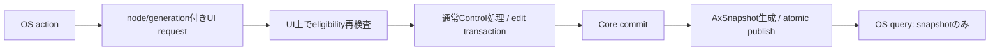
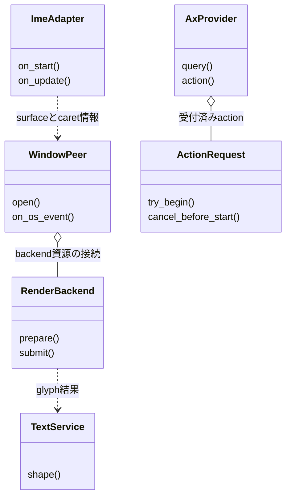

# プラットフォーム：OS・描画・text・IME内部レイヤー

- 文書版: 1.1
- 文書ロール: detailed-design
- 更新日: 2026-10-17
- 状態: 1.1全文承認済み（利用者、2026-10-17）。実装・試験状態は別管理

## 目的と上位根拠

本書を要求から実装へ具体化する詳細設計の正本とする。型・API・所有・呼出し手順・状態遷移を実装へ反映する。要求の外部保証はリンク先RQ、層の責務と主要flowは上位BDを根拠とする。設計宣言の記載は、配布済みheader・実装済みAPI・試験合格を意味しない。

基本設計: [プラットフォーム：抽象化・描画・text・OS接続](../../12_design/platform/abstraction.md)、[UIクラス：Tree・Layout・Focus・Control](../../12_design/ui/tree-layout-controls.md)、[UIクラス：TextBox・編集・Validation](../../12_design/ui/text-editing-validation.md)

## 要求と設計項目の対応

| 設計項目 | 要求根拠 |
| --- | --- |
| Control接続・Window peer・描画backend | [RQ-09-001](../../11_requirements/RQ-09_ui-scope.md#rq-09-001)、[RQ-09-006](../../11_requirements/RQ-09_ui-scope.md#rq-09-006)、[RQ-09-048](../../11_requirements/RQ-09_ui-scope.md#rq-09-048)、[RQ-09-058](../../11_requirements/RQ-09_ui-scope.md#rq-09-058)、[RQ-09-071](../../11_requirements/RQ-09_ui-scope.md#rq-09-071)、[RQ-09-072](../../11_requirements/RQ-09_ui-scope.md#rq-09-072)、[RQ-11-008](../../11_requirements/RQ-11_platform.md#rq-11-008)、[RQ-11-009](../../11_requirements/RQ-11_platform.md#rq-11-009)、[RQ-11-020](../../11_requirements/RQ-11_platform.md#rq-11-020)、[RQ-11-022](../../11_requirements/RQ-11_platform.md#rq-11-022) |
| Text engine・IME・OS Accessibility | [RQ-09-053](../../11_requirements/RQ-09_ui-scope.md#rq-09-053)、[RQ-09-054](../../11_requirements/RQ-09_ui-scope.md#rq-09-054)、[RQ-10-001](../../11_requirements/RQ-10_accessibility.md#rq-10-001)、[RQ-10-005](../../11_requirements/RQ-10_accessibility.md#rq-10-005)、[RQ-10-007](../../11_requirements/RQ-10_accessibility.md#rq-10-007)、[RQ-10-011](../../11_requirements/RQ-10_accessibility.md#rq-10-011)、[RQ-10-013](../../11_requirements/RQ-10_accessibility.md#rq-10-013)、[RQ-10-014](../../11_requirements/RQ-10_accessibility.md#rq-10-014)、[RQ-11-023](../../11_requirements/RQ-11_platform.md#rq-11-023) |

本書内の共通規則は上記の各要求を実現するために適用する。同一項目内で個別要求を参照する場合はその対象範囲を優先する。将来候補・未採用範囲は採用済みの動作と区別する。

## Scene・Window peer・描画backend

Control APIとWindow close requestのCore処理は[UIクラス設計](../ui/controls.md)にまとめる。

### 実装規則

| 実現手段・責務 | 要求根拠 |
| --- | --- |
| 共通SceneSnapshotはClip/FillRect/GlyphRunを初期DrawOpとし、layout revision・damageを持つ。damageは矩形union、失敗時full-dirtyを保持。 | 上記の根拠RQ |
| WindowsはWin32 peer+Direct2D/DirectWrite、LinuxはDRM/KMS+GBM/EGL/OpenGL ES3を第1profile。Wayland/X11は同Sceneの別surface adapter。 | [RQ-11-022](../../11_requirements/RQ-11_platform.md#rq-11-022) |
| GPU/device lossはSurfaceLost→Recreating。自動software fallbackは初期しない。明示software profile選択時だけCPU rasterを使う候補。 | [RQ-11-022](../../11_requirements/RQ-11_platform.md#rq-11-022) |
| FrameStateはIdle→Preparing→Rendering→Presented。submitだけでPresentedにせず、backend completionでframe revisionを公開する。 | 上記の根拠RQ |

### 実現設計

SceneSnapshotはCore UI値の不変copyを所有しRendererからControlをstrong保持しない。GPU fenceはbackend ownerが保持し、surface再生成では旧generationのcompletionを無視する。Linuxのraw inputはlibinput+xkbcommonをAdapterに閉じ、TSF/IBus/fcitx等のIMEは別session adapterとして同じTextBox APIへ渡す。候補順の評価と正式profileへの採用を別に記録する。

## Text engine・IME・OS Accessibility

### 実装規則

| 実現手段・責務 | 要求根拠 |
| --- | --- |
| Windows textはDirectWrite、LinuxはFontconfig+HarfBuzz+FreeType、配布fontはNoto Sans/Noto Sans CJK JPの許諾確認済みsubset候補。 | [RQ-11-023](../../11_requirements/RQ-11_platform.md#rq-11-023) |
| font family/version/hashとshaping engineをprofile lockへ含める。glyph cacheはfont digest+size+scale+glyph IDで索引する。 | 上記の根拠RQ |
| Windows IMEはTSF text store、Linux desktopはIBus D-Bus adapter。DRM単独は専用IME brokerを明示導入するprofile案。 | [RQ-11-023](../../11_requirements/RQ-11_platform.md#rq-11-023) |
| OS UTF16/Unicode scalar位置をTextIndexMapでbyte位置へ変換。surrounding text/caret rectは同revisionのsnapshotで取得する。 | 上記の根拠RQ |
| UIAはFragment+Invoke/Value/Textの対応部分、LinuxはAT-SPI Accessible/Action/Text/EditableText。TextBoxの公開valueはediting textを使う。 | 上記の根拠RQ |
| queryは不変snapshotを読んでUIを待たない。Invokeは受付後return、同期編集actionはUI request completionを待つprofile別protocol。 | 上記の根拠RQ |
| 同期OS actionの待機budgetは2秒をprofile既定候補とし、未開始requestだけcancelする。実行開始後timeoutは結果不明をdiagnosticで区別する。 | [RQ-10-014](../../11_requirements/RQ-10_accessibility.md#rq-10-014) |
| Linux desktopのAT-SPI busを必須profile条件、embeddedは有無を別profileとして宣言。bus不在でAccessibility verifiedとしない。 | [RQ-11-023](../../11_requirements/RQ-11_platform.md#rq-11-023) |
| OS target identityはRuntime ID+Widget ID+generation、providerはweak owner。更新通知はcommit後にrole/name/value/state/children/focusを差分生成する。 | 上記の根拠RQ |

### 実現設計

#### Provider / text service interface

```text
TextService.shape(text_snapshot, font_profile, width_constraint) -> GlyphRunSnapshot
ImeAdapter.on_start/update/commit/cancel(session_id, event_sequence, input)
AccessibilityStore.publish(Arc<AxSnapshot>)
AxProvider.query(node_id, snapshot_revision) -> immutable value
AxProvider.action(node_id, action, payload) -> ActionRequest
```

| OS接続 | 中立情報との対応 | 失敗・所有 |
|---|---|---|
| Windows TSF | UTF16 position→UTF8 byte、composition range、caret rect | snapshotをpinしOS lock要求の間にCoreを再入更新しない |
| Linux IBus | UTF8 text、surrounding text、preedit attributes | D-Bus messageをcopy、session generation照合後UIへ |
| UIA Value/Text | editing snapshot、UTF16 selection、readonly state | node staleはelement-not-available、無効操作は対応OS error |
| AT-SPI Text/EditableText | editing snapshot、Unicode scalar position | byte変換後edit_replace。bus threadからCoreを直接変更しない |
| Button Invoke | semantic activation | eligibilityをUIで再検査し一度だけexecute依頼 |



同期actionの状態はPending→Executing→Completed、Pending→CancelledBeforeStartのみをcancel可能とする。timeoutがExecutingと競合したら結果不明としてOSエラーを返し、後のcommit通知を正本にする。利用者callbackの停止不能を隠すためにUI threadを強制終了しない。OS providerからqueryだけでFocusを動かさず、UIA Invokeと実際のCommand終端を別に扱う。

公式根拠: [UIA threading](https://learn.microsoft.com/en-us/windows/win32/winauto/uiauto-threading)はOS接続のthread制約を確認する資料。[IInvokeProvider.Invoke](https://learn.microsoft.com/dotnet/api/system.windows.automation.provider.iinvokeprovider.invoke)ではInvokeは非同期で直ちに戻る契約である。本案の2秒等は本プロジェクトの提案値で、OS規格の値ではない。


### AT-SPI参照

API/interfaceの照合先は [GNOME libatspi公式API](https://gnome.pages.gitlab.gnome.org/at-spi2-core/libatspi/)。OS別の文字indexとquery/actionのthread処理を、共通TextSnapshotのbyte位置へ変換する。

## クラス設計の補足（1.1承認済み）

既承認1.0の実現規則を支える型・関連・所有・主要操作を整理した。内部型名とメソッドの分担は本改訂で補足する内部設計であり、既存公開APIの署名や外部保証を追加・変更するものではない。この節のクラス構成と追加図は1.1版全文の承認対象であり、実装・試験完了の証明とは区別する。

要求根拠: [RQ-11-022](../../11_requirements/RQ-11_platform.md#rq-11-022)、[RQ-11-023](../../11_requirements/RQ-11_platform.md#rq-11-023)、[RQ-10-014](../../11_requirements/RQ-10_accessibility.md#rq-10-014)、[RQ-09-053](../../11_requirements/RQ-09_ui-scope.md#rq-09-053)。

共通interfaceを実現するOS接続と、OS依存snapshot/資源のownerを明確にする。Windows/LinuxのAPI選択は既存本文を継承し、ここで新backendを追加しない。

### 型の責務と所有

| 型 | 責務・保持データ | 主要メソッド・操作 | 所有・寿命 |
| --- | --- | --- | --- |
| WindowPeer | native window/surface handle、generation、OS受信状態 | open(); on_os_event(event); recreate_surface(); close() | AdapterがUI側で所有し、stale generationの完了を捨てる |
| RenderBackend | device/context、frame状態、fence/完了とdamage | prepare(scene); submit(frame); on_completed(frame_revision); on_device_lost() | backendがGPU資源を保持。submitとPresentedを分離 |
| TextService | font profile/engine、glyph cacheとshaping処理 | shape(text_snapshot, font_profile, width_constraint) | GlyphRunSnapshotを生成。font digest・size・scale・glyph identityでcacheを分離 |
| ImeAdapter | TSF/IBus/broker接続、session identityとOS/Core位置変換 | on_start(...); on_update(...); on_commit(...); on_cancel(...) | OS callback入力をcopyし、同revisionのTextIndexMap/snapshotへ変換 |
| AxProvider | UIA/AT-SPI接続、node identity/generationとaction request | query(node, revision); action(node, payload) | queryはsnapshotのみ。同期actionの待機と非同期Invokeを混同しない |
| ActionRequest | Pending/Executing/Completed/CancelledBeforeStartと結果 | try_begin(); cancel_before_start(); complete(result) | 開始後timeoutを未実行取消へ読み替えず、結果不明を区別 |

### クラスの関連

`*--`は従属するstate/作業の合成、`o--`は共有を含む所有参照、`..>`は非所有の利用・識別・委譲を示す。関連名と本文で示した寿命を優先し、図の同名型は各instanceで別の状態を持つ。図は主要メソッド名を抜粋し、引数・所有・失敗条件は表と本文に従う。



### 主要な呼出しと失敗境界

WindowPeerがOS eventをcopyしてCoreへ渡し、確定SceneをRenderBackendがprepare/submitする。TextServiceは不変text/font条件からglyph結果を生成する。Provider actionはActionRequestをUIへ投入し、開始時にnode/generation/eligibilityを再検査して通常Control処理へ接続する。

IMEとAXはWindowを強保持するための関連にせず、OS接続の失効をgenerationで検出する。device loss時にsoftware rendererへ暗黙切替しない。queryがUI待ちでdeadlockする構成を避ける。

## 文書の承認・改訂履歴

| 日付 | 対象版 | 内容・根拠 |
| --- | --- | --- |
| 2026-10-17 | 1.0 | 利用者の指示に基づき、既承認内容を責務別に再編集。設計項目IDによる承認・追跡は廃止し、以後は文書版全体で管理する。構成変更を新規の製品仕様採用としない |
| 2026-10-17 | 1.0全文 | 利用者の「全部承認します」により文書全体を承認。旧IDによる項目承認ではなく、現行文書版を対象とする。実装・試験合格を意味しない |
| 2026-10-17 | 1.1改訂案 | 利用者の補足指示によりクラス責務・所有・メソッド・関連図を追加。1.0承認を維持し、1.1全文は確認待ち |
| 2026-10-17 | 1.1全文 | 利用者の「OK,テスト文書作りましょうか」により、クラス設計補足と選択的な図の補強を含む全文を承認。既存履歴を維持し、実装・試験状態は別管理 |
