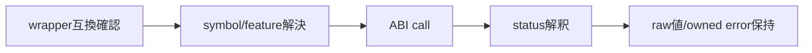
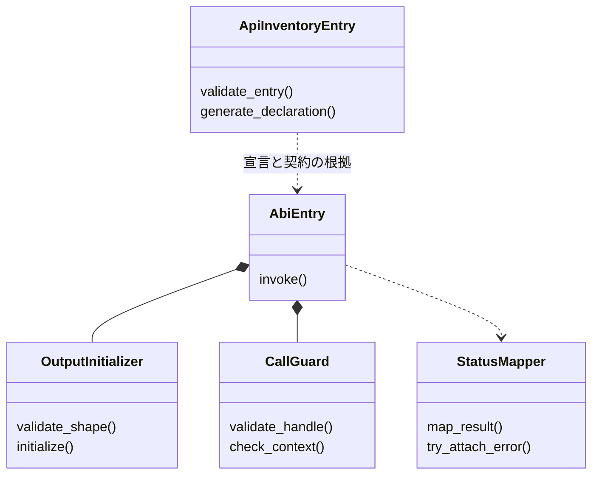

# 共通C ABI：宣言・検査・互換性

- 文書版: 1.1
- 文書ロール: detailed-design
- 更新日: 2026-10-17
- 状態: 1.1全文承認済み（利用者、2026-10-17）。実装・試験状態は別管理

## 目的と上位根拠

本書を要求から実装へ具体化する詳細設計の正本とする。型・API・所有・呼出し手順・状態遷移を実装へ反映する。要求の外部保証はリンク先RQ、層の責務と主要flowは上位BDを根拠とする。設計宣言の記載は、配布済みheader・実装済みAPI・試験合格を意味しない。

基本設計: [共通ABI：言語非依存境界と互換性](../../12_design/runtime-objects/abi.md)、[オブジェクト管理：値・モデル・更新整合性](../../12_design/runtime-objects/model-values.md)、[ランタイム：実行context・所有・終了](../../12_design/runtime-objects/runtime.md)

## 要求と設計項目の対応

| 設計項目 | 要求根拠 |
| --- | --- |
| 共通型と操作宣言 | [RQ-02-002](../../11_requirements/RQ-02_core-features.md#rq-02-002)、[RQ-02-013](../../11_requirements/RQ-02_core-features.md#rq-02-013)、[RQ-02-015](../../11_requirements/RQ-02_core-features.md#rq-02-015)、[RQ-02-021](../../11_requirements/RQ-02_core-features.md#rq-02-021)、[RQ-04-002](../../11_requirements/RQ-04_abi-boundary.md#rq-04-002)、[RQ-04-003](../../11_requirements/RQ-04_abi-boundary.md#rq-04-003)、[RQ-04-006](../../11_requirements/RQ-04_abi-boundary.md#rq-04-006)、[RQ-04-007](../../11_requirements/RQ-04_abi-boundary.md#rq-04-007)、[RQ-04-009](../../11_requirements/RQ-04_abi-boundary.md#rq-04-009)、[RQ-04-010](../../11_requirements/RQ-04_abi-boundary.md#rq-04-010)、[RQ-04-019](../../11_requirements/RQ-04_abi-boundary.md#rq-04-019)、[RQ-04-020](../../11_requirements/RQ-04_abi-boundary.md#rq-04-020)、[RQ-04-021](../../11_requirements/RQ-04_abi-boundary.md#rq-04-021)、[RQ-04-022](../../11_requirements/RQ-04_abi-boundary.md#rq-04-022)、[RQ-04-024](../../11_requirements/RQ-04_abi-boundary.md#rq-04-024)、[RQ-05-002](../../11_requirements/RQ-05_ownership-callbacks.md#rq-05-002)、[RQ-05-003](../../11_requirements/RQ-05_ownership-callbacks.md#rq-05-003)、[RQ-05-004](../../11_requirements/RQ-05_ownership-callbacks.md#rq-05-004)、[RQ-05-006](../../11_requirements/RQ-05_ownership-callbacks.md#rq-05-006)、[RQ-05-009](../../11_requirements/RQ-05_ownership-callbacks.md#rq-05-009)、[RQ-05-013](../../11_requirements/RQ-05_ownership-callbacks.md#rq-05-013)、[RQ-06-004](../../11_requirements/RQ-06_threading-dispatch.md#rq-06-004)、[RQ-06-008](../../11_requirements/RQ-06_threading-dispatch.md#rq-06-008)、[RQ-06-009](../../11_requirements/RQ-06_threading-dispatch.md#rq-06-009)、[RQ-06-010](../../11_requirements/RQ-06_threading-dispatch.md#rq-06-010)、[RQ-07-011](../../11_requirements/RQ-07_binding.md#rq-07-011)、[RQ-09-005](../../11_requirements/RQ-09_ui-scope.md#rq-09-005)、[RQ-09-038](../../11_requirements/RQ-09_ui-scope.md#rq-09-038)、[RQ-09-042](../../11_requirements/RQ-09_ui-scope.md#rq-09-042) |
| 共通status・UI loop・終了境界 | [RQ-04-006](../../11_requirements/RQ-04_abi-boundary.md#rq-04-006)、[RQ-04-007](../../11_requirements/RQ-04_abi-boundary.md#rq-04-007)、[RQ-04-009](../../11_requirements/RQ-04_abi-boundary.md#rq-04-009)、[RQ-04-010](../../11_requirements/RQ-04_abi-boundary.md#rq-04-010)、[RQ-04-019](../../11_requirements/RQ-04_abi-boundary.md#rq-04-019)、[RQ-04-022](../../11_requirements/RQ-04_abi-boundary.md#rq-04-022)、[RQ-04-023](../../11_requirements/RQ-04_abi-boundary.md#rq-04-023)、[RQ-04-024](../../11_requirements/RQ-04_abi-boundary.md#rq-04-024)、[RQ-04-027](../../11_requirements/RQ-04_abi-boundary.md#rq-04-027)、[RQ-04-028](../../11_requirements/RQ-04_abi-boundary.md#rq-04-028)、[RQ-06-002](../../11_requirements/RQ-06_threading-dispatch.md#rq-06-002)、[RQ-06-006](../../11_requirements/RQ-06_threading-dispatch.md#rq-06-006) |
| API表・feature・検査順・互換性 | [RQ-01-002](../../11_requirements/RQ-01_purpose-architecture.md#rq-01-002)、[RQ-04-006](../../11_requirements/RQ-04_abi-boundary.md#rq-04-006)、[RQ-04-021](../../11_requirements/RQ-04_abi-boundary.md#rq-04-021)、[RQ-04-024](../../11_requirements/RQ-04_abi-boundary.md#rq-04-024)、[RQ-04-028](../../11_requirements/RQ-04_abi-boundary.md#rq-04-028)、[RQ-05-001](../../11_requirements/RQ-05_ownership-callbacks.md#rq-05-001)、[RQ-16-004](../../11_requirements/RQ-16_document-governance.md#rq-16-004) |

本書内の共通規則は上記の各要求を実現するために適用する。同一項目内で個別要求を参照する場合はその対象範囲を優先する。将来候補・未採用範囲は採用済みの動作と区別する。

## 共通型と操作宣言

### 目的と適用範囲

Rust CoreをC++、C#、Rust、Python 3から呼ぶ共通境界の初期形を規定する。公開ABI契約の設計判断は承認済みである。公開ABI契約の初期公開値型は後続の承認済み上位判断MVVM UIライブラリ 初期公開値型の上位判断により拡張された（第22節）。第7節にProperty値の受け渡し、第9節にProperty生成・通知購読、第11節にBinding ABI、第13節にProperty Validator ABI、第15節に非同期Command ABI、第17節にView入力Validator ABI、第20節にTextBox生成・値接続を示す。ここに示すC宣言は実装前の仕様であり、配布用ヘッダではない。Controlの描画と論理ツリーは別仕様とする。

### 型とシンボル

- Cの呼出規約で公開する。公開構造体にRust/C++の実装型を含めない。
- 外部公開関数名には`ui_abi_1_`接頭辞を付け、major 1のシンボルとして固定する。
- `ui_handle`は`uint64_t`の不透明トークン。0は無効。handleをpointerへ変換しない。
- `ui_status`は`uint32_t`、`ui_bool`は`uint8_t`で0/1、長さと容量は`uint64_t`。ABIをまたぐ`size_t`やC `bool`は使わない。
- Cで公開するpointerはbyte列、caller buffer、callback、userdata、out引数に限る。pointerの幅と呼出規約は各targetのC ABIに従う。
- callbackとdestroyの関数ポインタには同じC calling conventionを使用する。Windowsを含むtarget別の指定をヘッダとwrapper生成設定で一致させる。

```c
/* 設計レビュー用の抜粋。配置・export macro・ヘッダガードは実装時に追加する。 */
#include <stdint.h>

typedef uint64_t ui_handle;
typedef uint32_t ui_status;
typedef uint8_t ui_bool;

enum {
  UI_OK = 0,
  UI_INVALID_ARGUMENT = 1,
  UI_INVALID_HANDLE = 2,
  UI_WRONG_TYPE = 3,
  UI_WRONG_RUNTIME = 4,
  UI_WRONG_THREAD = 5,
  UI_CLOSED = 6,
  UI_BUFFER_TOO_SMALL = 7,
  UI_OUT_OF_MEMORY = 8,
  UI_INTERNAL_ERROR = 9,
  UI_UNSUPPORTED = 10,
  UI_VALIDATION_FAILED = 11, /* Property setter拒否 */
  UI_COMMAND_EXECUTION_FAILED = 12, /* Command失敗snapshot */
  UI_INPUT_FEEDBACK = 13, /* View入力理由snapshot */
  UI_PENDING = 14 /* shutdown受付済み・未完了 */
};

/* callbackのreturnはABI外へ例外を投げない。 */
typedef void (*ui_callback)(void *userdata);
typedef void (*ui_destroy)(void *userdata);

ui_status ui_abi_1_get_version(uint32_t *out_major, uint32_t *out_minor,
                               uint32_t *out_patch);
ui_status ui_abi_1_has_feature(uint32_t feature_id, ui_bool *out_supported);

ui_status ui_abi_1_runtime_create(ui_handle *out_runtime, ui_handle *out_error);
ui_status ui_abi_1_runtime_shutdown(ui_handle runtime, ui_handle *out_error);
ui_status ui_abi_1_runtime_request_shutdown(ui_handle runtime, uint32_t mode,
                                             ui_handle *out_request, ui_handle *out_error);
ui_status ui_abi_1_shutdown_request_query(ui_handle request, uint32_t *out_state,
                                           uint32_t *out_reason, ui_handle *out_error);
ui_status ui_abi_1_runtime_host_begin_event(ui_handle runtime, uint64_t *out_scope_id);
ui_status ui_abi_1_runtime_host_end_event(ui_handle runtime, uint64_t scope_id);
ui_status ui_abi_1_runtime_host_stopped(ui_handle runtime, uint32_t reason,
                                         ui_handle *out_error);
ui_status ui_abi_1_runtime_is_ui_thread(ui_handle runtime, ui_bool *out_yes);
ui_status ui_abi_1_runtime_post(ui_handle runtime, ui_callback callback,
                                 void *userdata, ui_destroy destroy,
                                 ui_handle *out_error);

ui_status ui_abi_1_handle_retain(ui_handle borrowed, ui_handle *out_owned);
ui_status ui_abi_1_handle_release(ui_handle owned);

ui_status ui_abi_1_error_status(ui_handle error, ui_status *out_status);
ui_status ui_abi_1_error_code(ui_handle error, uint32_t *out_domain,
                               uint32_t *out_code);
ui_status ui_abi_1_error_message_utf8(ui_handle error, uint8_t *buffer,
                                       uint64_t capacity, uint64_t *out_length);
```

#### 出力とerror

- `out_error`は任意。nullなら詳細は捨てる。非nullなら各呼出しの開始時に0へ設定し、失敗して詳細を作れた場合に所有handleを返す。成功時は0のまま。
- その他の必須out pointerがnullなら`UI_INVALID_ARGUMENT`。失敗時にout handleは0、out scalarは0。`UI_BUFFER_TOO_SMALL`では`out_length`だけ必要byte数を返す。
- `ui_abi_1_get_version`はロード直後に利用でき、major/minorを返す。`has_feature`は未知IDをfalseとして返す。
- error handleも共通のretain/releaseで管理する。`error_message_utf8`はNULを追加せず、必要byte数を`out_length`に返す。`buffer == NULL && capacity == 0`の容量照会を許す（`UI_OK`、書き込みなし）。

#### 所有権を伴う関数

| 関数 | 入力handle | 成功時の出力 | 失敗時 |
|---|---|---|---|
| `runtime_create` | なし | Runtime所有参照1個 | `out_runtime = 0` |
| `runtime_shutdown` | 借用 | なし | 詳細があればerror所有参照 |
| `runtime_post` | Runtime借用 | closureの所有権をCoreに移す | closureの所有権は呼び出し側 |
| `handle_retain` | 借用 | 同一objectへの新しいトークンの所有参照1個 | `out_owned = 0` |
| `handle_release` | 所有参照を1個消費 | なし | 無効handleの場合は消費しない |
| `error_message_utf8` | Error借用 | caller bufferにコピー | buffer不足なら必要長を返す |

`post`のcallbackはUI threadで一回実行されるか、shutdown時に未実行のまま破棄される。成功した`post`に対応するdestroyはUI thread上で必ず一回呼ぶ。`callback == NULL`または`destroy == NULL`は無効。`userdata == NULL`は許す。

### ABI versionとfeature query（提案）

- 初版はmajor 1、minor 0とする。ここで示すmajor/minorは正式リリース番号ではなく設計上の初期値。
- major 1の既存シンボルについて、関数シグネチャ、呼出規約、列挙済み定数の意味、所有権、スレッド規則、失敗時の基本契約を変更しない。
- 新機能は新しい名前のシンボルまたはfeature IDで追加し、minorを上げる。既存クライアントが動作する互換変更に限る。
- 契約を破る変更は`ui_abi_2_...`の別シンボル集合として導入し、major 1の利用者とは区別する。major 1をいつまで同梱するかは配布方針で決める。
- wrapperは初期化時にversionと必要featureを検査する。未知featureはfalseとし、wrapperが明示的な未対応エラーへ変換する。
- enum/statusの未知値をwrapperは汎用エラーとして扱い、未定義動作にしない。

### 境界で防ぐもの

- Rust panicがC境界を越えることを防ぐ。公開関数の失敗はstatusへ変換し、panic時は原則`UI_INTERNAL_ERROR`とする。panic後にRuntime状態が健全でない場合は停止扱いとし、継続可否を実装時に検証する。
- C++ exception、C# exception、Python exceptionはwrapper内で止める。C# delegate、Python callableをCoreに直接渡さず、wrapperがuserdataの生存期間を保持する。
- wrapperのfinalizer任せでUI thread上の確定的解除を保証しない。Subscription解除・Runtime shutdownを明示APIとし、finalizerは最後の参照の掃除に限定する。
- コピーが必要なUTF-8入力をCoreが保持する際には、呼出しが戻る前にコピーする。

### 実装規則

| 実装規則 | 判断への影響 |
| --- | --- |
| `ui_handle`を64-bitトークンとし、共通retain/releaseを使う | 型別ポインタAPIやhandle表の実装方式を左右する |
| errorは返り値statusに加え、任意のout_error handleで返す | wrapperの例外・Result変換方式を左右する |
| majorを関数シンボル名へ含め、互換追加をminorで扱う | 長期のバイナリ互換維持方式を左右する |
| shutdownはUI threadで完了させ、未実行postのdestroyまで保証する | イベントループと終了順序を左右する |

### Property値のC ABI

本節は[オブジェクト管理：値・モデル・更新整合性](../../12_design/runtime-objects/model-values.md)のProperty契約、Validation契約と`language-bindings.md`の言語境界契約～言語境界契約に従う。Property handleの生成・定義とBindingの作成APIは対象外とし、既に取得したProperty handleの値を読み書きする境界だけを定める。

#### 型とAPIの形

- Propertyの値の種類は作成時に固定する。本節の関数宣言は公開ABI契約当初の`BOOL`、`I64`、`UTF8`を対象とする。初期公開値型の全体はMVVM UIライブラリ 初期公開値型の上位判断により`F64`と独自8バイト`DECIMAL`を加えた五種類へ拡張された（第22節）。追加型のkind数値・関数形は後続設計で補い、ここに未定義のシンボルを実装済みとみなさない。`OBJECT`は所有の循環防止規則が確定するまで予約型。getter/setterを種類ごとの別シンボルにし、公開C構造体のtagged unionは使わない。`property_kind`で種類を問い合わせ、未知の種類はwrapperが未対応として扱う。
- `BOOL`は`ui_bool`（0または1のみ受理）、`I64`は`int64_t`、`UTF8`はbyte列と`uint64_t`長、`OBJECT`は`ui_handle`で表す。C++/C#/Rust/Pythonの数値型から`I64`へ変換するwrapperは、範囲外の値を切り詰めず拒否する。
- `F64`のNaN・符号付きゼロ、`DECIMAL`の等価性と値域はMVVM UIライブラリ 初期公開値型の上位判断が上位規則を定める。追加型の具体ABI・Validator・演算は後続で定める。その他の整数幅、nullableな値型、配列・カスタム値は別設計。異なる種類へ暗黙変換しない。種類を増やす場合は新しいkindとシンボルを互換追加する。

```c
/* 追加シンボルのレビュー用抜粋。ui_handle / ui_status / ui_boolは第2節。 */
enum {
  UI_VALUE_BOOL = 1, UI_VALUE_I64 = 2,
  UI_VALUE_UTF8 = 3, UI_VALUE_OBJECT = 4 /* 予約値 */
};

ui_status ui_abi_1_property_kind(ui_handle property, uint32_t *out_kind);
ui_status ui_abi_1_property_get_bool(ui_handle property, ui_bool *out_value);
ui_status ui_abi_1_property_set_bool(ui_handle property, ui_bool value,
                                      ui_handle *out_error);
ui_status ui_abi_1_property_get_i64(ui_handle property, int64_t *out_value);
ui_status ui_abi_1_property_set_i64(ui_handle property, int64_t value,
                                     ui_handle *out_error);
ui_status ui_abi_1_property_get_utf8(ui_handle property, uint8_t *buffer,
                                      uint64_t capacity, uint64_t *out_length);
ui_status ui_abi_1_property_set_utf8(ui_handle property, const uint8_t *bytes,
                                      uint64_t byte_length, ui_handle *out_error);
ui_status ui_abi_1_property_get_object(ui_handle property, ui_handle *out_owned);
ui_status ui_abi_1_property_set_object(ui_handle property, ui_handle borrowed,
                                        ui_handle *out_error);
```

関数名・kind/status値は承認済み共通C ABI：宣言・検査・互換性の宣言へ対応する。配布用headerではない。OBJECTの関数形は将来公開する際の設計案で、初期実装の公開シンボルには含めない。getterには利用者へ返す値を、setterには検証失敗時の詳細を渡す。Propertyの作成APIやどのControlがどのkindを使うかは別途決める。

#### UTF-8とbuffer

- setterの入力は呼出し中だけ借用し、成功して値を保持する場合はCoreが関数から戻るまでにコピーする。`bytes == NULL && byte_length == 0`は空文字列を表す。長さが正でpointerがnullなら`UI_INVALID_ARGUMENT`。不正UTF-8は拒否し、値と通知を変えない。埋め込みNULはProperty値として許す。特定Controlが受け入れない文字はそのControlの検証で扱う。
- getterは第2節のerror文字列と同じcaller buffer方式。`buffer == NULL && capacity == 0`は必要byte数を`out_length`へ返す容量照会として成功する。容量不足なら`UI_BUFFER_TOO_SMALL`で現在の必要長を返し、bufferを変更しない。十分ならbyte列をコピーして実際の長さを返し、終端NULは付けない。
- 容量照会と次のコピーは別呼出しなので、途中で値が変われば必要長も変わり得る。wrapperは`UI_BUFFER_TOO_SMALL`を受けたら長さを取り直して再試行する。二呼出しの間にイベントループを回さないことを推奨するが、同一値のsnapshotを保証するAPIは別途検討する。

#### object handleと所有権

- `set_object`の入力は呼出し中だけ借用する。同じRuntimeに属する有効なCore objectだけを受け付ける。公開トークン番号の一致ではなくCore objectの同一性で変更判定する。値を保持する場合の内部参照はCoreが取得し、呼出し側の所有トークンは消費しない。
- `get_object`は非null値に対して新しい所有トークンを返し、呼出し側が`release`する。nullableとして宣言されたOBJECT Propertyに限り、入力のhandle 0と成功時の出力handle 0をnull値とする。非nullableなPropertyへの0は`UI_INVALID_ARGUMENT`。null値は無効なトークンとは区別して扱う。
- objectを強参照でPropertyに保持すると内部参照の循環が生じ得る。Runtime契約の「循環する内部参照を作らない」に従い、循環を防ぐ所有規則と対象object種別が確定するまではOBJECT Propertyの作成を公開しない。上の関数形とトークンの受渡し規則は将来の有効化に備えた提案である。

#### エラーとスレッド

- これらの関数はUI thread専用。workerから呼ぶと`UI_WRONG_THREAD`で値・通知は変わらない。workerは値をコピーして`runtime_post`へ渡し、UI threadでsetterを呼ぶ。
- 種類の違うgetter/setterには`UI_WRONG_TYPE`、不正な文字列や`ui_bool`値には`UI_INVALID_ARGUMENT`、検証規則に拒否された値には`UI_VALIDATION_FAILED`を返す。これらの失敗でProperty値と値の通知は変えない。検証失敗の`out_error`は既存のerror handle規則に従う。UI停止、所属Runtime不一致、無効handleも第2節のstatusを使う。
- getterの必須出力は失敗時に0へ初期化する。OBJECT getterでは0が有効なnull値にもなり得るため、呼出し側は必ず`ui_status`で成功を判定する。`property_kind`の未知値や追加のstatusはwrapperが汎用未対応/失敗として扱い、未定義動作にしない。
- setterの成功は値の即時確定を表す。Property通知、Binding先への伝播、Binding検証エラーは[オブジェクト管理：値・モデル・更新整合性](../../12_design/runtime-objects/model-values.md)の遅延配信規則に従い、setterの戻り時点で完了を保証しない。

### 実装規則

| 実装規則 | 主な影響 |
| --- | --- |
| BOOL / I64 / UTF8を種類別関数で読み書きし、OBJECTを予約とした。初期公開値の**種類数はMVVM UIライブラリ 初期公開値型の上位判断で改訂**し、F64とDECIMALを追加した（第22節） | wrapper実装と値型の拡張 |
| UTF-8は借用入力とcaller buffer出力にし、容量不足時は再試行できる | コピーと文字列の所有権 |
| object入力は借用、getter出力は新しい所有トークンとし、nullable OBJECTの0だけをnullにする | handle寿命とnull表現 |
| 値の種類違い・入力不正・Validation失敗・スレッド違反を区別し、setter成功と通知完了を分ける | 4言語のエラー処理と更新タイミング |

### Property生成と通知購読のC ABI

この節に記載した生成関数は、公開ABI契約の段階で定めたBOOL / I64 / UTF8だけを対象とする。MVVM UIライブラリ 初期公開値型の上位判断で初期公開範囲へ加わったF64 / DECIMALの生成関数はイベントハンドリング：通知とBinding伝播の宣言に定義する。Binding、検証規則の登録、OBJECT Propertyの生成は別設計とする。関数名・引数の形はレビュー用であり、正式ヘッダではない。

```c
ui_status ui_abi_1_property_create_bool(ui_handle runtime, ui_bool initial,
                                         ui_handle *out_property,
                                         ui_handle *out_error);
ui_status ui_abi_1_property_create_i64(ui_handle runtime, int64_t initial,
                                        ui_handle *out_property,
                                        ui_handle *out_error);
ui_status ui_abi_1_property_create_utf8(ui_handle runtime, const uint8_t *bytes,
                                         uint64_t byte_length,
                                         ui_handle *out_property,
                                         ui_handle *out_error);

ui_status ui_abi_1_property_subscribe(ui_handle property, ui_callback callback,
                                       void *userdata, ui_destroy destroy,
                                       ui_handle *out_subscription,
                                       ui_handle *out_error);
ui_status ui_abi_1_subscription_cancel(ui_handle subscription,
                                        ui_handle *out_error);
```

#### 生成と値

- `runtime`は呼出し中だけ借用する。成功時の`out_property`は所有トークン一個で、呼出し側が`release`する。失敗時は0。生成時の値は第7節と同じbool値・整数・UTF-8規則で検証し、UTF-8を保持する場合は戻るまでにコピーする。
- 生成はUI thread専用。初期値を確定してから成功を返す。生成だけでは変更通知を発生させない。検証規則の登録・初期化時の検証・PropertyをControlへ割り当てる方法は後続設計で定める。
- Property handleを`release`しても、Bindingなどが内部参照を持つ場合は生存する。最後の参照がなくなったときはRuntime契約に従いUI threadで破棄する。

#### 購読と解除

- `property_subscribe`はUI threadでのみ呼べる。callbackとdestroyはどちらも必須、userdataのnullは許す。成功時にCoreがclosureを引き受け、所有トークンの`out_subscription`を返す。失敗時は`out_subscription = 0`とし、closureは呼出し側の所有のままで`destroy`しない。
- callbackは引数を取らない。初期値を自動通知せず、変更が配信された時点でProperty getterから現在値を読む。登録順、通知のまとめ方、callback中の自己解除は[オブジェクト管理：値・モデル・更新整合性](../../12_design/runtime-objects/model-values.md)と[ランタイム：実行context・所有・終了](../../12_design/runtime-objects/runtime.md)に従う。
- `subscription_cancel`はUI thread上で購読を無効化する。有効なSubscription handleなら既に解除済みでも成功する。解除成功後は新しいcallbackを開始しない。現在実行中のcallbackから自身を解除した場合は、その終了後にclosureを一度だけdestroyする。Subscription handleそのものは解除後も有効で、呼出し側が別途`release`する。
- 公開Subscription handleを`release`するだけでは購読を解除しない。Runtimeが有効な購読を終了時まで管理する。Property本体が先に破棄された場合はその購読を自動解除し、保留通知を捨て、closureをUI threadでdestroyする。残存するSubscription handleは解除済みの状態として解放できる。
- Runtimeは有効なSubscriptionを管理し、SubscriptionからPropertyへの参照とPropertyの購読リストは弱参照にして内部の強参照循環を作らない。BindingがPropertyを保持する関係は別設計とする。shutdown時は購読を自動解除し、保留通知を実行せずclosureを破棄する。

#### スレッド、失敗、検証

- 生成、購読、解除はUI thread専用であり、違反時には`UI_WRONG_THREAD`で状態を変えない。停止済みRuntimeなら`UI_CLOSED`。無効・型違い・所属違いのhandleは第2節のstatusで拒否する。
- `out_property`、`out_subscription`は必須で、失敗時に0へ初期化する。`out_error`は任意で第2節の規則に従う。生成・登録は原子的に成功または失敗し、失敗時にPropertyや購読、通知を残さない。
- 4言語から初期値付きPropertyを作り、getter・setterと通知を呼び出す。等しい値の再設定と同じUI処理内の連続更新ではProperty契約・Property契約どおり通知数を確認する。購読失敗、自己解除、Property先行破棄、shutdownの各経路でdestroyがちょうど一回であることを確認する。

### 実装規則

| 実装規則 | 主な影響 |
| --- | --- |
| BOOL / I64 / UTF8を初期値付きの型別関数で生成し、所有Property handleを返す | 初期値の確定と4言語wrapper |
| callback引数なしの通知購読は初期通知を送らず、getterで現在値を読む | 通知の意味論とABIの単純さ |
| 解除はUI threadで明示し、handleの`release`だけでは解除しない | 外部契約の正本は[RQ-05-002/006](../../11_requirements/RQ-05_ownership-callbacks.md)。ABIはcancelとhandle releaseを別操作として提供する |
| Property先行破棄とshutdownで購読を自動解除し、closureを一度だけdestroyする | 所有権と参照循環の防止 |

### BindingのC ABI

同じRuntimeに属し、種類が一致するCore管理Propertyの接続を対象とする。型変換、他言語ViewModelへの直接参照、OBJECT Property、Bindingの検証規則の登録は対象外である。エラー状態の読み取りは、将来登録されるProperty Validatorによる伝播失敗も扱える形として定める。

```c
/* モード値と関数名はレビュー用。ui_handle / ui_statusなどは第2節。 */
enum { UI_BIND_ONCE = 1, UI_BIND_ONE_WAY = 2, UI_BIND_TWO_WAY = 3 };
enum { UI_BIND_DIRECTION_SOURCE_TO_TARGET = 1,
       UI_BIND_DIRECTION_TARGET_TO_SOURCE = 2 };

ui_status ui_abi_1_binding_create(ui_handle source_property,
                                   ui_handle target_property,
                                   uint32_t mode, ui_handle *out_binding,
                                   ui_handle *out_error);
ui_status ui_abi_1_binding_cancel(ui_handle binding, ui_handle *out_error);
ui_status ui_abi_1_binding_error_snapshot(ui_handle binding,
                                           ui_handle *out_owned_error,
                                           ui_handle *out_owned_rejected_property,
                                           uint32_t *out_direction);
ui_status ui_abi_1_binding_subscribe_error(ui_handle binding,
                                            ui_callback callback,
                                            void *userdata, ui_destroy destroy,
                                            ui_handle *out_subscription,
                                            ui_handle *out_error);
```

#### 作成と解除

- `source_property`と`target_property`は呼出し中だけ借用する。`mode`は上記の三値だけ受け付ける。UI thread上で種類・所属Runtime・Bindingグラフの制約を検証し、[オブジェクト管理：値・モデル・更新整合性](../../12_design/runtime-objects/model-values.md)のBinding契約・Binding graph契約に従って初期同期と接続を原子的に行う。
- `UI_BIND_ONCE`は初期コピーが成功しても接続を保持せず、成功時の`out_binding`を0にする。`UI_BIND_ONE_WAY`と`UI_BIND_TWO_WAY`は成功時に所有Binding handleを一個返す。失敗時は全モードで`out_binding = 0`とし、グラフ・値・通知を変えない。戻り値のstatusでOneTime成功時の0と失敗時の0を区別する。
- `binding_cancel`は有効なBinding handleなら既に解除済みでも成功する。解除後は保留していた伝播を含め以後の伝播を止め、値を巻き戻さない。handleは解除後も有効で、呼出し側が別途`release`する。`release`だけでは解除しない。
- Runtimeは有効なBindingを明示解除またはshutdownまで管理する。Bindingは接続したPropertyを内部的に保持し、Property側からBindingへの参照は弱参照として強参照循環を防ぐ。最後の公開Property handleが解放されても接続中はPropertyを保持する。shutdownでは接続と保留中の伝播を破棄し、残存するBinding handleは停止済みとして解放できる。

#### Bindingエラーの読み取りと通知

- `binding_error_snapshot`は、その時点の一件のBindingエラー状態をUI thread上で取得する。エラーなしなら`UI_OK`で三つの出力を0にする。エラーありなら不変のerror objectと拒否したPropertyへの**新しい所有トークン**を返し、伝播方向を返す。呼出し側は両方のhandleを`release`する。出力三つは必須で、失敗時はすべて0へ初期化する。
- error objectは既存の`error_status`、`error_code`、`error_message_utf8`で読む。Binding内部の現在のエラーが消えたり別のエラーへ変わったりしても、取得済みのerror handleは内容が変わらない。現在の状態を再取得するには`binding_error_snapshot`を呼び直す。
- `binding_subscribe_error`はBindingのエラー状態の変化を通知するSubscriptionを返す。初期通知は行わず、callbackは引数を持たない。callback中にsnapshotを取得する。状態が同じ配信区間で複数回変わった場合はProperty通知と同じくまとめる。通知とProperty伝播の順序は[オブジェクト管理：値・モデル・更新整合性](../../12_design/runtime-objects/model-values.md)に従う。
- Bindingを解除すると、そのBindingのエラー状態とエラー購読は終了する。既に実行中のcallbackの後始末、closureの`destroy`、Subscription handleの`release`は第9節とRuntime契約に従う。shutdown時も未実行のエラー通知を捨て、closureを一度だけ破棄する。

#### スレッドと失敗

- 全関数はUI thread専用とする。異なるRuntimeのPropertyなら`UI_WRONG_RUNTIME`、型違いなら`UI_WRONG_TYPE`、不正modeやグラフの循環・入力元の重複なら`UI_INVALID_ARGUMENT`を返す。グラフ制約の詳細は任意の`out_error`のdomain/codeで区別できるようにする。
- 初期同期先が値を拒否した場合は`UI_VALIDATION_FAILED`とerror handleを返し、Bindingを作らない。後続の遅延伝播で検証に失敗した場合は、元のsetterの成功を覆さず、Bindingエラー状態へ記録して通知する。
- `binding_subscribe_error`のcallbackとdestroyは必須、userdataのnullは許す。登録失敗時はclosureの所有権をCoreへ移さず、`destroy`を呼ばない。成功時はCoreが引き受け、解除またはshutdownで一度だけ破棄する。

### 実装規則

| 実装規則 | 主な影響 |
| --- | --- |
| OneTimeは初期コピーのみでhandle 0、OneWay/TwoWayは解除可能な所有Binding handleを返す | 作成結果と初期同期 |
| Binding handleの`release`では解除せず、明示解除またはshutdownまでRuntimeが保持する | 外部契約の正本は[RQ-05-002](../../11_requirements/RQ-05_ownership-callbacks.md)と[RQ-07-011](../../11_requirements/RQ-07_binding.md)。ABIはBinding cancelとhandle releaseを分ける |
| エラーは不変error handle・拒否Property handle・方向の一組で取得し、変化をSubscriptionで通知する | Validation表示と4言語wrapper |
| 作成は原子的に失敗し、後続伝播のValidation失敗はsetterへ遡及させずBindingエラーへ記録する | エラーの帰属とグラフの整合性 |

### Property ValidatorのC ABI

本節に記載した同期Validator関数はCore管理のBOOL / I64 / UTF8 Propertyだけを対象とする。MVVM UIライブラリ 初期公開値型の上位判断で初期公開範囲へ加わったF64 / DECIMALのValidator signatureはイベントハンドリング：通知とBinding伝播に定義する。View入力Validatorの`Accept / Incomplete / Reject`、非同期検証、複数Propertyをまたぐ検証、validatorの差し替えと値の再検証は別設計とする。

```c
/* 戻り値: UI_OK=受理、UI_VALIDATION_FAILED=拒否、UI_INTERNAL_ERROR=検証処理の異常。 */
typedef ui_status (*ui_validate_bool)(void *userdata, ui_bool candidate,
                                       ui_handle *out_owned_error);
typedef ui_status (*ui_validate_i64)(void *userdata, int64_t candidate,
                                      ui_handle *out_owned_error);
typedef ui_status (*ui_validate_utf8)(void *userdata, const uint8_t *bytes,
                                       uint64_t byte_length,
                                       ui_handle *out_owned_error);

ui_status ui_abi_1_validation_error_create(uint32_t domain, uint32_t code,
                                            const uint8_t *message,
                                            uint64_t message_byte_length,
                                            ui_handle *out_owned_error);
ui_status ui_abi_1_property_validator_register_bool(ui_handle property,
                                                      ui_validate_bool callback,
                                                      void *userdata,
                                                      ui_destroy destroy,
                                                      ui_handle *out_registration,
                                                      ui_handle *out_error);
ui_status ui_abi_1_property_validator_register_i64(ui_handle property,
                                                     ui_validate_i64 callback,
                                                     void *userdata,
                                                     ui_destroy destroy,
                                                     ui_handle *out_registration,
                                                     ui_handle *out_error);
ui_status ui_abi_1_property_validator_register_utf8(ui_handle property,
                                                      ui_validate_utf8 callback,
                                                      void *userdata,
                                                      ui_destroy destroy,
                                                      ui_handle *out_registration,
                                                      ui_handle *out_error);
ui_status ui_abi_1_property_validator_cancel(ui_handle registration,
                                              ui_handle *out_error);
```

#### 登録と値

- Propertyごとに同期Validatorを最大一つ登録できる。型の一致とUI threadを検証し、既に登録中なら`UI_INVALID_ARGUMENT`として失敗し既存の登録を保つ。成功時は所有registration handleを返し、Coreがcallback closureを保持する。失敗時はhandle 0、closureの所有権は呼出し側に残り`destroy`しない。
- 登録時には現在値を検証しない。以後のsetterとBinding伝播が候補値の検証を受ける。候補が現値と等しい場合も検証し、値の通知は増やさず既存のBindingエラーを消せる。別のValidatorへの差し替えと既存値の再検証は後続の設計事項である。
- Validatorを明示解除すると、以後のsetterは検証を受けない。解除は有効なregistration handleに対し冪等で、handleは別途`release`する。`release`だけでは解除しない。Property先行破棄またはshutdownでも登録を無効化し、closureをUI thread上で一度だけ`destroy`する。解除だけでは既存のBindingエラーを自動消去せず、次の伝播やBinding解除時に更新する。

#### callbackの結果とerror handle

- CoreはUI thread上で候補値を渡してcallbackを同期実行する。UTF8入力pointerはcallback中だけ借用可能で、長さはbyte数。Core側が必要ならcallback前に候補値を安定した領域へ保持する。callbackは候補値を保持する場合その場でコピーする。
- callbackの`out_owned_error`は必須の出力先で、Coreが呼出し前に0へ設定する。`UI_OK`なら0のまま受理し、値を確定する。`UI_VALIDATION_FAILED`なら値を変えず、`out_owned_error`の所有error handleをCoreへ移す。エラーobjectを作れない場合に限り0を許し、statusだけで拒否を識別する。
- 検証理由を付ける場合は、callback内で`validation_error_create`を呼ぶ。この関数は入力UTF8を呼出し中だけ借用し、Coreが戻る前にコピーして`UI_VALIDATION_FAILED` status、domain、code、messageを持つ不変error handleを一個返す。関数自体の失敗ではhandle 0を返す。言語wrapperは渡す文字列のメモリをこの呼出しの間だけ保持すればよい。
- callbackが`UI_INTERNAL_ERROR`を返した場合は検証処理の異常としてsetterまたはBinding伝播を失敗させる。wrapperは言語例外を捕捉してこの値に変換し、診断経路へ記録する。callbackが未知statusや不適切なerror handleを返した場合も`UI_INTERNAL_ERROR`とし、値を確定しない。Coreが受け取った有効な所有error handleは結果にかかわらず一回だけ消費または解放する。ABI境界へ例外を伝播させない。
- `validation_error_create`はUI threadから呼べる補助関数とし、これ自体はPropertyを変更しない。domain/codeの値体系と多言語の表示文言は後続で定める。任意のstatusを設定できる汎用error生成APIはこの段階では公開しない。

#### 再入と後始末

- Validator callback中は同じRuntimeのUI状態を直接変更するAPI（Property setter、Binding作成・解除、購読登録・解除など）を許さない。呼び出された場合はその操作を状態変更前に拒否する。callbackは候補値の計算、言語側の読取り専用状態の参照、`validation_error_create`を行う。shutdown要求はUI状態の直接変更と分け、現在callback終了後の優先taskへ登録する。検証失敗と異常は区別する。
- callback自身から登録を解除することも許さない。外側のsetterまたは伝播が戻った後にUI threadで解除できる。解除時またはshutdown時に実行中のcallbackがあれば、その終了後に`destroy`を一度だけ呼ぶ。`destroy`からUI操作をしないというRuntime契約を適用する。
- validator callbackに実行時間の上限を設けるか、診断とタイムアウトをどう扱うかはRuntime診断設計で定める。同期callback中に時間のかかる作業を行わない。

### 実装規則

| 実装規則 | 主な影響 |
| --- | --- |
| BOOL / I64 / UTF8別の同期callbackをPropertyに一つ登録し、登録時の再検証はしない | 4言語のcallback変換と初期値 |
| callbackはstatusと所有error handleを返し、error生成時にメッセージをCoreへコピーする | 検証理由の寿命と表示 |
| 明示解除とProperty破棄・shutdownでclosureを一度だけ破棄し、handleの`release`だけでは解除しない | 外部契約の正本は[RQ-05-002/006～008](../../11_requirements/RQ-05_ownership-callbacks.md)。ABIはValidator cancelとhandle releaseを分ける |
| 検証中の同一Runtime UI状態変更を禁止し、例外などの異常を通常の入力拒否と区別する | 再入と失敗時の原子性 |

### 非同期CommandのC ABI

本節は[オブジェクト管理：値・モデル・更新整合性](../../12_design/runtime-objects/model-values.md)のCommand契約に従い、workerの生成そのものはアプリまたは言語wrapperへ委ねる。実行開始、状態・実行可否、協調的キャンセル、完了報告の境界を定める。進捗の専用APIや結果値の型は後続設計とし、進捗表示はworkerから`runtime_post`して既存のPropertyへ設定できる。

```c
/* 値と関数名はレビュー用。状態値はCommandの読取専用I64 Propertyからも読める。 */
enum { UI_COMMAND_STATE_IDLE = 0, UI_COMMAND_STATE_RUNNING = 1,
       UI_COMMAND_STATE_CANCELLING = 2, UI_COMMAND_STATE_SUCCEEDED = 3,
       UI_COMMAND_STATE_FAILED = 4, UI_COMMAND_STATE_CANCELLED = 5 };

typedef ui_status (*ui_command_start)(void *userdata,
                                      ui_handle borrowed_command,
                                      uint64_t operation_id,
                                      ui_handle borrowed_cancel_token);

ui_status ui_abi_1_command_create_async(ui_handle runtime,
                                         ui_handle eligibility_bool_or_zero,
                                         ui_command_start start, void *userdata,
                                         ui_destroy destroy,
                                         ui_handle *out_command,
                                         ui_handle *out_error);
ui_status ui_abi_1_command_execute(ui_handle command,
                                    uint64_t *out_operation_id,
                                    ui_handle *out_error);
ui_status ui_abi_1_command_cancel(ui_handle command, uint64_t operation_id,
                                   ui_handle *out_error);
ui_status ui_abi_1_command_close(ui_handle command, ui_handle *out_error);
ui_status ui_abi_1_command_state_property(ui_handle command,
                                           ui_handle *out_owned_property);
ui_status ui_abi_1_command_can_execute_property(ui_handle command,
                                                 ui_handle *out_owned_property);
ui_status ui_abi_1_command_failure_snapshot(ui_handle command,
                                             ui_handle *out_owned_error);

ui_status ui_abi_1_command_cancel_token_requested(ui_handle token,
                                                   ui_bool *out_yes);
ui_status ui_abi_1_command_complete_success(ui_handle command,
                                             uint64_t operation_id);
ui_status ui_abi_1_command_complete_failure_utf8(ui_handle command,
                                                  uint64_t operation_id,
                                                  uint32_t domain, uint32_t code,
                                                  const uint8_t *message,
                                                  uint64_t message_byte_length);
ui_status ui_abi_1_command_complete_cancelled(ui_handle command,
                                               uint64_t operation_id);
```

#### 起動と状態

- `command_create_async`はUI threadで呼ぶ。`eligibility_bool_or_zero`が0ならアプリ側の実行条件はtrue、有効なBOOL Propertyならその現在値を条件とする。異なるRuntimeや種類違いは拒否する。Coreは条件Propertyを保持し、その変化を監視して実行可否を更新する。成功時は所有Command handleを返し、Coreが`start`・userdata・destroyのclosureを引き受ける。失敗時はhandle 0でclosureの所有権は呼出し側に残る。
- `command_execute`はUI threadで呼び、実行可否がfalseなら新しいoperationを作らず失敗を返し、出力IDを0にする。成功時はRuntime内で再利用しない非ゼロのoperation IDを発行し、`RUNNING`にしてから`start` callbackをUI thread上で一回呼ぶ。callbackはworkerを開始して速やかに`UI_OK`を返す。起動に失敗したら`UI_INTERNAL_ERROR`を返し、Coreがそのoperationを`FAILED`へ確定する。callback中の言語例外はwrapperが捕捉して`UI_INTERNAL_ERROR`へ変換し、ABI越しに伝播させない。`command_execute`自体はoperation生成に成功した場合、起動失敗でも`UI_OK`とIDを返し、失敗状態を状態Propertyから観測させる。
- `start`へ渡すCommandとcancel tokenのhandleはcallbackの間だけ借用できる。workerが使う場合はcallback中に`handle_retain`で別の所有トークンを取得し、worker終了時に`release`する。Command本体をUI thread外から操作せず、tokenの照会だけは任意スレッドでできる。`start` callback内で完了報告や同じCommandへの再実行・closeは行わない。
- 状態と実行可否はそれぞれCore管理の読取専用I64 / BOOL Propertyとして公開し、UI Bindingと通常のProperty通知を利用する。返されたProperty handleは所有トークンであり、呼出し側が解放する。公開setterでこれらを変更する操作は`UI_UNSUPPORTED`とする。既定では`RUNNING`と`CANCELLING`中に実行可否がfalseになる。終端状態の後も状態は読め、次の実行で新しいIDに移る。
- 状態は`start` callbackの呼出し前に`RUNNING`へ変わるため、同じUIイベントcallback内で`command_execute`を再び呼んでも、また別のControlから同じCommandを起動しても、workerが進行中なら2回目は拒否される。終端後は既定で実行可否がtrueへ戻り、次の実行を許す。状態値は`IDLE`へ自動で戻さず、直前の終端状態を次の実行まで保持する。

#### キャンセルと終了

- `command_cancel`はUI threadでoperation IDを指定する。現在のoperationが`RUNNING`なら`CANCELLING`にしてtokenの要求フラグを立てる。既に`CANCELLING`なら成功して状態を変えない。終端状態の同じIDへの要求も成功する。古いID・未知IDは状態を変えず失敗する。キャンセル要求はworkerの終了を待たない。
- workerは`command_cancel_token_requested`を任意スレッドから呼べる。tokenはRuntime停止後も保持中なら照会でき、停止時に要求フラグはtrueになる。tokenを照会する以外のUI操作はworkerに許さない。キャンセルを確認して中断したworkerは`CANCELLED`を報告し、正常完了なら要求後でも`SUCCEEDED`を報告する。
- `command_close`はUI threadで新規実行を止め、進行中ならキャンセルを要求する。有効なCommand handleへの重複closeは成功する。close後のCommand固有の状態取得と完了報告は`UI_CLOSED`となり、UI向け完了通知を開始せず、worker終了をUI threadで待たない。既に取得した状態Property handleはそれぞれの所有参照が解放されるまで残るが、close後は値の更新を止める。公開Command handleの`release`だけではcloseしない。Runtimeのshutdownも全Commandをclose相当に扱い、start closureを最後の`start` callback終了後に一度だけ`destroy`する。workerがuserdataを使う場合はその言語側参照を別に保持する。

#### 完了報告と失敗情報

- 完了報告の三関数はUI thread専用で、workerは`runtime_post`した短いcallbackから呼ぶ。現在のoperation IDに対して一度だけ終端状態へ遷移する。既に終端・close済み・過去のIDの遅延報告は状態を変えず、古いIDや二重報告は失敗として返す。Runtime停止後は`UI_CLOSED`を返す。
- `complete_failure_utf8`はdomain/codeとUTF-8メッセージを呼出し中だけ借用し、Coreが戻る前にコピーする。業務上の失敗を`FAILED`状態と`UI_COMMAND_EXECUTION_FAILED` statusを持つ不変のerror objectに保存し、`command_failure_snapshot`が所有error handleを返す。失敗がなければhandle 0。次の実行開始で前回の失敗情報を消す。呼出しが引数不正や割当失敗ならoperationの終端を確定せず、呼出し側が有効な失敗報告を再試行できる。`start` callback自体の起動失敗にはCoreが一般的な失敗情報を記録する。
- `complete_success`、`complete_cancelled`は失敗情報を持たない。実際のworker結果に応じて報告し、キャンセル要求があっただけで`CANCELLED`へ強制しない。取得済みのerror handleは後でCommand状態が変わっても不変のまま保持できる。
- `runtime_post`が停止のため受け付けられない場合、workerは投稿closureを自分で破棄し、保持するCommand/token handleを解放する。shutdown後のUIで終端状態が観測できることは保証しない。

### 実装規則

| 実装規則 | 主な影響 |
| --- | --- |
| Coreは状態と実行可否を読取専用Propertyで公開し、開始callbackはUI thread上でworkerを起動して戻る | Button BindingとUI応答性 |
| 実行ごとにIDとスレッド安全なキャンセルtokenを作り、協調的にキャンセルする | workerの寿命と古い通知 |
| workerの完了は`post`経由でUI threadへ報告し、ID一致時に一度だけ終端状態を確定する | 遅延報告・失敗情報 |
| closeとshutdownは新規実行を止めてキャンセルを要求するが、workerの終了をUI threadで待たない | 画面終了とリソース管理 |

### View入力ValidatorのC ABI

[オブジェクト管理：値・モデル・更新整合性](../../12_design/runtime-objects/model-values.md)のValidation契約に従い、最初はTextBoxに対するユーザー起点のテキスト編集だけを扱う。TextBox生成の最小境界は第20節で定め、layout・focus・IME状態遷移の全体はControl/Input仕様で定める。本節の関数名とTextBox handleの公開はその仕様と合わせて確定する。一覧など他のControlの候補選択は後続設計とする。

```c
/* 編集後の候補全文と編集後の選択範囲。位置はUTF-8 byte offset。 */
enum { UI_TEXT_INPUT_ACCEPT = 1, UI_TEXT_INPUT_INCOMPLETE = 2,
       UI_TEXT_INPUT_REJECT = 3 };
enum { UI_TEXT_ORIGIN_KEYBOARD = 1, UI_TEXT_ORIGIN_PASTE = 2,
       UI_TEXT_ORIGIN_DROP = 3, UI_TEXT_ORIGIN_ACCESSIBILITY = 4,
       UI_TEXT_ORIGIN_IME_COMMIT = 5 };

typedef ui_status (*ui_text_input_validate)(void *userdata,
                                             const uint8_t *candidate_utf8,
                                             uint64_t candidate_byte_length,
                                             uint64_t selection_start_byte,
                                             uint64_t selection_end_byte,
                                             uint32_t origin,
                                             uint32_t *out_decision,
                                             ui_handle *out_owned_reason);

ui_status ui_abi_1_text_input_reason_create(uint32_t domain, uint32_t code,
                                             const uint8_t *message,
                                             uint64_t message_byte_length,
                                             ui_handle *out_owned_reason);
ui_status ui_abi_1_text_box_input_validator_register(ui_handle text_box,
                                                      ui_text_input_validate callback,
                                                      void *userdata,
                                                      ui_destroy destroy,
                                                      ui_handle *out_registration,
                                                      ui_handle *out_error);
ui_status ui_abi_1_text_box_input_validator_cancel(ui_handle registration,
                                                    ui_handle *out_error);
ui_status ui_abi_1_text_box_input_state_property(ui_handle text_box,
                                                  ui_handle *out_owned_property);
ui_status ui_abi_1_text_box_input_reason_snapshot(ui_handle text_box,
                                                   ui_handle *out_owned_error);
ui_status ui_abi_1_text_box_editing_utf8(ui_handle text_box, uint8_t *buffer,
                                         uint64_t capacity, uint64_t *out_length);
ui_status ui_abi_1_text_box_input_subscribe(ui_handle text_box,
                                             ui_callback callback,
                                             void *userdata, ui_destroy destroy,
                                             ui_handle *out_subscription,
                                             ui_handle *out_error);
```

#### 候補と判定

- Coreはユーザー起点の編集操作から候補**全文**と編集後の選択範囲を作ってから、UI thread上でcallbackを一回呼ぶ。キーボード・貼り付け・ドロップ・アクセシビリティ操作は同じ候補規則を通る。候補は有効なUTF-8で、pointerはcallback中だけ借用可能。選択位置はbyte長以下かつUnicode文字の境界にある。caretのgrapheme単位の移動・Undo/Redoの詳細はControl/Input仕様へ送る。
- callbackの戻り値`UI_OK`は判定処理に成功したことを表し、判定そのものは`out_decision`の三値で返す。Coreは両出力を呼出し前に0へ初期化する。不正な判定値やcallbackの異常は`UI_INTERNAL_ERROR`として編集を確定しない。wrapperは言語例外をABI越しに伝播させない。
- `ACCEPT`はTextBoxの確定Property値と画面上の編集値を候補で更新し、通常のTwoWay Bindingへ流す。モデル側のProperty Validatorが後で拒否した場合はValidation契約・Validation契約に従い、View側の入力を保持する。`INCOMPLETE`は画面上の編集値と選択範囲だけを更新し、確定Property値とViewModel値を変えない。`REJECT`は通常、編集値・確定Property値・caret・選択範囲を編集前のまま保つ。
- IME変換中の未確定文字列はcallbackに渡さず、確定操作の候補だけを`UI_TEXT_ORIGIN_IME_COMMIT`として渡す。その候補が`REJECT`なら文字列を黙って捨てず、`INCOMPLETE`相当の編集値として画面に保持し、理由を表示できる状態にする。ViewModelへは流さない。ControlがプログラムからPropertyを設定する場合はこのView入力callbackを通さず、ViewModel側の検証は通常どおり適用する。

#### 理由・状態の読取り

- `INCOMPLETE`と`REJECT`では`out_owned_reason`に不変の理由handleを任意で返せる。callback内で`text_input_reason_create`を呼び、domain/codeとUTF-8メッセージをCoreへコピーして`UI_INPUT_FEEDBACK` statusのerror objectを生成する。入力途中は入力エラーとは限らないため、Property検証用の`UI_VALIDATION_FAILED`とは区別する。`ACCEPT`では0にする。有効な所有error handleはCoreが結果に応じ消費または解放し、種類違いはcallback異常とする。理由の生成に失敗した場合は0を許すが、IME確定候補の`REJECT`では少なくとも入力を保持し、診断上の理由がないことを識別できるようにする。
- `text_box_input_state_property`は読取専用I64 Propertyの所有トークンを返し、現在の`ACCEPT / INCOMPLETE / REJECT`を通知で観測できるようにする。通常の`REJECT`は編集値を変えずに直近の拒否状態・理由だけを更新する。IME確定の`REJECT`は画面の編集値を保持するが、状態値は`REJECT`のままとする。入力元はcallbackに通知され、直近の入力元を後から照会するAPIはControl仕様で検討する。`ACCEPT`では直近の入力理由を消す。
- `text_box_input_reason_snapshot`は現在の理由の所有error handleまたは0を返す。取得後に状態が変わってもerror objectは不変である。`text_box_editing_utf8`は画面上の編集中の文字列をcaller bufferへコピーし、第7節と同じ容量照会・不足時の再試行・NUL非終端の規則を使う。確定Property値は既存のProperty getterから読む。
- 状態値が同じまま理由や編集中の文字列だけ変わる場合がある。`text_box_input_subscribe`はこれらのいずれかが変わったとき、引数なしcallbackでまとめて通知する。初期通知は行わず、購読者は上記のgetterとsnapshotで現在値を読む。Subscriptionの明示解除、closure所有権、自己解除、TextBox破棄時の後始末は第9節に従う。

#### 登録・終了・再入

- TextBoxごとに一つ登録でき、成功時に所有registration handleを返す。callbackとdestroyは必須で、userdataのnullは許す。登録失敗時はclosureをCoreが引き受けず、呼出し側が後始末をする。既に登録中なら新しい登録を拒否する。Validatorがない場合は、有効なUTF-8のユーザー編集を`ACCEPT`する。
- 明示解除はUI threadで冪等に行い、公開registration handleの`release`だけでは解除しない。TextBox破棄またはRuntime shutdownでは自動解除し、最後のcallbackが戻った後にclosureをUI threadで一度だけ`destroy`する。登録・解除・callbackはUI thread専用とする。
- callback中は同じRuntimeのUI状態変更を許さない。候補の判定と`text_input_reason_create`は許す。callbackが自身を解除することはできず、戻った後に解除する。callbackの処理が長いとUIを占有するため、短時間で終える。
- 編集値・選択範囲の保存、状態Propertyの更新、理由の保持は一つの編集操作としてまとめて確定する。例外、不正な戻り値、確保失敗では、IME確定候補を失わないための退避が必要な場合を除き、編集前の状態を保つ。IMEでの退避失敗時の診断と復旧はInput仕様で扱う。

### 実装規則

| 実装規則 | 主な影響 |
| --- | --- |
| TextBoxの編集候補全文・選択範囲・入力元をcallbackへ渡し、三値で判定する | 4言語の入力規則 |
| `INCOMPLETE`は編集値にだけ保持し、IME確定候補の`REJECT`も入力を失わない形で保持する | TwoWayと多言語入力 |
| 編集値、入力状態、理由を確定Propertyとは別に読み取り、変化を購読できるようにする | エラー表示と途中入力の観測 |
| 登録は明示解除し、TextBox破棄・shutdownで自動解除してclosureを一度だけ破棄する | callback所有権とUI thread |

### TextBox生成と値Propertyの接続

第17節のTextBox handleを生成し、確定値を第7・9・11節のUTF8 Propertyに接続する最小境界を定める。論理ツリーへの取り付け、表示・layout、focus、IME・Undo/Redoの詳細は対象外。以下の関数名と引数はレビュー用であり、正式ヘッダではない。

```c
ui_status ui_abi_1_text_box_create(ui_handle runtime,
                                    const uint8_t *initial_utf8,
                                    uint64_t initial_byte_length,
                                    ui_handle *out_text_box,
                                    ui_handle *out_error);
ui_status ui_abi_1_text_box_value_property(ui_handle text_box,
                                            ui_handle *out_owned_property);
```

#### 生成と確定値

- `text_box_create`はUI thread上で、有効なRuntimeとUTF-8初期値を検証し、未接続のTextBoxとその確定値用UTF8 Propertyを一体で作る。空文字列はnull pointerと長さ0で指定でき、入力bytesは呼出しが戻る前にコピーする。長さが正なのにpointerがnull、不正UTF-8なら`UI_INVALID_ARGUMENT`。成功時は所有TextBox handle一個、失敗時は0を返し、Control・Property・通知を残さない。`out_error`は任意とする。
- 初期の確定値と編集値は同一で、入力状態は`ACCEPT`、入力理由はない。生成だけではPropertyの値通知や入力通知を発生させない。第17節のView入力Validatorは生成時の初期値には適用しない。
- `text_box_value_property`はTextBoxが所有する**同じ**UTF8 Propertyへの新しい所有トークンを毎回返す。`out_owned_property`は必須で失敗時0。これは確定値を表し、第17節の`text_box_editing_utf8`が返す編集中の値とは異なり得る。一般のUTF8 Property getter/setterとProperty通知を使い、通常のBindingのsourceまたはtargetにできる。別Runtime・種類違い・Bindingグラフの制約は第11節どおり。

#### 表示値とBinding更新

- ユーザー編集が第17節で`ACCEPT`になると、確定値Propertyが更新され、既存のBinding規則で伝播する。`INCOMPLETE`と入力の`REJECT`では確定値PropertyへのsetterとBinding伝播を行わない。ViewModel側のProperty Validatorで伝播が拒否されたときは入力表示とTextBoxの確定値を保ち、Bindingエラーとして報告する。
- 他の経路からTextBoxの確定値Propertyに有効な値が確定したら、編集中の値もその値に置き換え、入力状態を`ACCEPT`、入力理由を0にする。直前の編集値が`INCOMPLETE`やIME確定の`REJECT`として残っていても同様。View入力Validatorは呼ばない。Property setterで値が拒否された場合は編集値・入力状態・理由を変えない。外部更新の上書きは[オブジェクト管理：値・モデル・更新整合性](../../12_design/runtime-objects/model-values.md)の14.2に従う。
- プログラムから同じ確定値を設定したときに編集値が確定値と異なっていても、新しい値の確定は起きていないため編集値を上書きしない。入力途中の破棄を意図する場合の明示的なリセット操作と、View側Property Validatorの拒否は[UIクラス：TextBox・Validation・IME編集](../ui/text-editing.md)のcandidate保持・Reject reason更新へ分岐する。

#### 所有と終了

- TextBoxは確定値Propertyと入力状態を内部参照で保持する。公開TextBox handleの`release`はその参照を一つ減らすだけで、論理ツリーなどの内部所有があれば破棄しない。最後のTextBox参照がなくなった時点でUI thread上で破棄し、第17節のValidatorと入力購読を自動解除する。別途保持されたProperty handleやBindingによるProperty参照は有効なまま残り得るが、それらからTextBoxを強参照しない。破棄後の値変更は描画や入力状態の更新を発生させない。
- 画面閉鎖時のツリーからの取り外し、画面が作ったBindingの解除、アプリが保持したProperty handleの解放は後続のUI Tree/lifetime仕様で定める。Runtime shutdownは既存の停止契約に従う。

### 実装規則

| 実装規則 | 主な影響 |
| --- | --- |
| RuntimeとUTF-8初期値から未接続TextBoxを原子的に作る | 初期表示とControl生成ABI |
| 確定値を同一のCore管理UTF8 Propertyとして公開し、通常のBindingにつなぐ | ViewModel接続と4言語wrapper |
| 外部から異なる値が確定した場合は編集中の値も上書きし、入力状態・理由を初期化する | 入力途中とTwoWay更新の競合 |
| TextBox破棄時は入力用closureを解除し、別途保持されたPropertyにはTextBoxを保持させない | UI寿命と参照循環 |

### 上位判断MVVM UIライブラリ 初期公開値型の上位判断による公開ABI契約の改訂

[オブジェクト管理：値・モデル・更新整合性](../../12_design/runtime-objects/model-values.md)のMVVM UIライブラリ 初期公開値型の上位判断により、公開ABI契約の**初期公開値型の種類数**をBOOL / I64 / UTF8の三種類から、F64と独自8バイトDECIMALを加えた五種類へ改訂する。公開ABI契約が定めた元の三種類の値の受渡しとOBJECT予約、公開ABI契約等の既存の意味論は、変更を明記した範囲以外は維持する。既存の第7・9・13節のC宣言と検証項目は三種類を対象に作成された段階の仕様であり、この改訂だけでF64 / DECIMALの公開ABIが完成したことにはならない。

- F64の上位規則はMVVM UIライブラリ 初期公開値型の上位判断に従う。`+0`と`-0`は値として等価、すべてのNaNは互いに等価とし、等価な再設定では格納済みのbit表現を保持して値通知を出さない。無限大は許し、アプリ固有の有限値制限はValidatorで扱う。`double`を用いる具体ABIとcanonical DECIMAL表現は[イベントハンドリング：通知とBinding伝播](../events/notifications-binding.md)で具体化済み。target互換は実行証拠を別途記録する。
- DECIMALは符号1ビット、非負のscale 5ビット（0～31）、非負の係数58ビットとし、値は`±係数 ÷ 10^scale`。最大・最小値は`±288230376151711743`、最小の正の表現可能値は`10^-31`。最大・最小値をsentinelとして予約しない。数値上同じ`1.0`と`1.00`、符号・scaleの異なるゼロは等価とし、等価な再設定では値通知を出さない。値域外を黙って丸めず、入力原文と表示桁数はView側で扱う。内部符号化は[イベントハンドリング：通知とBinding伝播](../events/notifications-binding.md)に定義する。十進演算・内蔵変換は将来候補である。
- DECIMALを受け先に指定するView入力では、候補UTF8の途中入力は第17節の`INCOMPLETE`として保持でき、完成した数値候補をDECIMALへ正確に変換して表現範囲と欄の指定範囲を検査する。表現不能・指定範囲外は理由付きの`REJECT`とし、IME確定では公開ABI契約に従って入力を保持する。Viewを経由しないsetterについてもProperty自体が表現可能性を守り、アプリの不変条件はProperty Validatorで検査する。UTF8 TextBoxからDECIMAL Propertyへの双方向変換、Bindingエラーの統合、callbackの具体形は後続の上位・詳細設計が必要。
- F64 / DECIMALのkind、生成・getter/setter・Validatorの関数形、4言語wrapper、およびBindingとControlへ接続する具体APIは別途設計する。公開する際は第3節のABI互換性規則に従って追加する。詳細設計オブジェクト管理：handle・値・error以降や、独立したCollection/Gridの判断は本節の承認範囲ではない。

### 所有参照と解除契約

公開ABIは所有参照の取得・破棄と登録解除の操作境界を定める。利用者から見えるrelease/cancelの動作、解除契機および結果の正本はRQ-05-002/006とRQ-07-011である。この文書では各ABI関数・handle token・C境界がその契約をどう表すかを記す。

## 共通status・UI loop・終了境界

### 実現のcall/data/ownership flow

ABI major付きsymbol、version/feature query、status/domain/code catalogを宣言正本に集約する。wrapper loaderはminimum versionとsymbolの存在を確認して呼ぶ。利用者error auto採番は安定catalogの未使用領域へ割り当て、公開済みcodeを保持する。shutdownの受付未完了はUI_PENDINGとして言語結果へ渡し、cleanup完了のUI_OKと区別する。



### 範囲と責務

共通C ABI：宣言・検査・互換性は公開symbol群、version/feature discovery、共通status/error識別子、Runtimeとhost UI loopの接続口、およびshutdown要求の戻り値を扱う。機能別APIの操作意味論は、それを所有するDDの記載に従う。

| 領域 | 共通C ABI：宣言・検査・互換性の責務 | 別設計の責務 |
|---|---|---|
| symbol | major付きの外部名、stable symbolの互換規則 | 各機能APIの引数・操作意味論 |
| runtime version | MAJOR.MINOR.PATCHのABI queryとsymbol major対応 | pre-release、package version、配布とloader探索順 |
| feature | stable feature IDと未対応値の扱い | 各featureの内部動作とpackage制約表 |
| status/error | 共通statusの意味・数値安定性、domain namespace | Property/Binding/Validation/Command固有codeと結果意味論 |
| event loop | bridgeのRuntime接続・所有・wake callback | OSごとのevent loop実装とnative pump（プラットフォーム：抽象化と共通protocol） |
| shutdown | 受付と完了を区別する戻り値、同期/優先処理との整合 | UI loopが停止した場合のworker wait復旧・timeout（プラットフォーム：抽象化と共通protocol/wrapper） |

### 実装規則

| 判断 | 出典・判断範囲 |
| --- | --- |
| 外部C symbolは`ui_abi_<major>_<group>_<operation>`形式とする。既存設計の`ui_abi_1_*`をABI major 1とし、ABI majorをsymbol prefixで識別する。C calling convention、固定幅整数、opaque handleの型・意味はADR-0001と公開ABI契約を維持する。 | 公開ABI契約、ABI §2、MVVM UIライブラリ ABI release version schemeに関する上位判断案。 |
| `get_version`はnative runtimeの安定版MAJOR.MINOR.PATCHを返し、`major`は当該symbol prefixのmajorと一致させる。既存major/minor出力に`out_patch`を追加する。ABI 1導入前に署名を確定し、初回stable番号やpre-releaseは本判断に含めない。 | 公開ABI契約、MVVM UIライブラリ ABI release version schemeに関する上位判断案。3要素への拡張はMVVM UIライブラリ ABI release version schemeに関する上位判断案のruntime version query詳細化。 |
| 一度公開したmajor内では、既存symbolのsignature/calling convention、意味、所有権、thread制約、status値の意味を変更・再利用しない。互換追加は新symbolまたは新feature IDとしてMINORで行い、PATCHはABI互換のbug/security修正に限る。破壊変更は別major prefixとする。 | 公開ABI契約、MVVM UIライブラリ ABI release version schemeに関する上位判断案。新major併存と配布形態はビルド・配布：toolchain・profile・packageへ送る。 |
| `has_feature(id)`は、そのruntimeがfeatureの全公開契約を提供する場合だけtrueを返す。未登録・未知IDは`UI_OK`とfalseを返し、IDは一度割り当てた後に意味変更・再利用をしない。古いruntimeに新symbolが存在しない可能性はfeature queryだけで解決できないため、wrapperは動的symbol解決または宣言minimum versionを先に確認してから呼び出す。 | ABI §2/3、MVVM UIライブラリ ABI release version schemeに関する上位判断案。runtime loaderと探索順は言語ラッパー：C++。 |
| `ui_status`は32-bitの安定した数値分類とし、値と意味を一度公開した後は変更・再利用しない。追加statusは未使用値への追加だけとする。wrapperは未知statusをgeneric failureとして保持し、未定義動作にしない。 | 公開ABI契約、値・error境界、MVVM UIライブラリ Error objectの安定性境界に関する上位判断案。 |
| 初版のstatusを§3の表とする。`UI_COMMAND_EXECUTION_FAILED`と`UI_INPUT_FEEDBACK`はError snapshotが持つ結果分類であり、通常のAPI呼出し戻り値ではない。`UI_PENDING`はshutdown要求が受付済みだが未完了のとき返す非失敗statusとし、wrapperは通常のAPI failureとして扱わない。 | 公開ABI契約、Runtime shutdownのcallback中dispatchに関する上位判断、ランタイム：実行基盤と終了 §1/5/7、オブジェクト管理：handle・値・error。既存status値との対応を示す。 |
| 共通error domainの初版を§4の表とし、`domain`・`code`は32-bit安定値とする。domain 0とcode 0は「未分類／具体理由なし」、標準domainは1～`0x7fffffff`、利用者定義domainは`0x80000000`～`0xffffffff`を割り当てる。コードはdomain内で一意・不変とし、messageを識別子に使わない。 | MVVM UIライブラリ Error objectの安定性境界に関する上位判断案、公開ABI契約、値・error境界。`validation_error_create`で利用者がdomain/codeを渡す公開ABI契約と共存する。 |
| `runtime_set_ui_loop_bridge`をUI threadから一度登録できる公開hookとして設ける。Runtime生成自体はbridgeなしでも可能とし、登録成功後にCoreがwake closureを所有する。wake callbackは任意threadから呼ばれ、host loopに非同期scheduleを依頼するだけで、callback中にdispatch/cleanupを実行しない。 | UI dispatcher、公開ABI契約、Runtime契約。具体platform bridgeはプラットフォーム：抽象化と共通protocol。 |
| `runtime_shutdown`はRuntimeがClosedになる同期操作とする。UI thread callback/event内の呼出しは実行中処理を中断せず、優先control taskとして受付後に`UI_PENDING`で戻る。workerからの呼出しはランタイム：実行基盤と終了に従いUI threadの完了を待ち、完了後に`UI_OK`を返す。shutdown開始前のUI thread外の呼出しはbridgeへdispatchする。 | 公開ABI契約、Runtime shutdownのcallback中dispatchに関する上位判断、Runtime所有と終了、UI dispatcher。停止loopの同期waitはhost停止通知で未完了として解除する。 具体化は[オブジェクト管理：handle・値・error](objects-values.md)、[ランタイム：実行基盤と終了](runtime.md)、[イベントハンドリング：通知とBinding伝播](../events/notifications-binding.md)、共通C ABI：宣言・検査・互換性を参照する。 |
| 利用者定義の失敗理由は`ui_status`へ個別値を追加せず、利用者domain内の`code`として表す。利用者はwrapperでenum等の名前付き定義を作れ、`auto`相当の採番も許す。ただし採番はprocess実行時ではなく宣言/build時に行い、公開済み値の再採番・再利用を避ける。全言語で同じcodeを使う場合は共通catalog/生成manifest等で割当てを共有する。 | 公開ABI契約、MVVM UIライブラリ Error objectの安定性境界に関する上位判断案、共通ABI。enum構文とcode生成/manifestの具体形は言語ラッパー：C++へ送る。 |

### 共通status

下表を初版の共通statusとする。`UI_PENDING`とError snapshot用statusの位置づけを明確にする。数値1～13は現`abi-spec.md`の候補に合わせ、14を追加する。

| 数値 | 名称 | 意味 |
|---:|---|---|
| 0 | `UI_OK` | API操作の成功または同期完了 |
| 1 | `UI_INVALID_ARGUMENT` | pointer/length不整合、無効なscalar値、引数制約違反 |
| 2 | `UI_INVALID_HANDLE` | 0、未知、または既に無効なhandle |
| 3 | `UI_WRONG_TYPE` | 有効なhandleのkind不一致 |
| 4 | `UI_WRONG_RUNTIME` | kind一致だが別Runtime所属 |
| 5 | `UI_WRONG_THREAD` | UI thread限定APIへの誤thread呼出し |
| 6 | `UI_CLOSED` | shutdownで閉じたRuntimeへの新規操作 |
| 7 | `UI_BUFFER_TOO_SMALL` | caller buffer不足。値・error境界に従い必要byte数を返す |
| 8 | `UI_OUT_OF_MEMORY` | 操作に必要なmemory確保失敗 |
| 9 | `UI_INTERNAL_ERROR` | callback異常、panic等の内部・境界失敗 |
| 10 | `UI_UNSUPPORTED` | 未対応API/feature。未知feature query自体はfalseを返す |
| 11 | `UI_VALIDATION_FAILED` | 同期Property validationによる直接setter拒否 |
| 12 | `UI_COMMAND_EXECUTION_FAILED` | Async Command failure snapshot内のerror status。呼出し戻り値として使わない |
| 13 | `UI_INPUT_FEEDBACK` | TextBox input reason snapshot内のerror status。呼出し戻り値として使わない |
| 14 | `UI_PENDING` | shutdown requestを受け付けたが、callback/eventが戻ってからcleanupするため未完了 |

`UI_PENDING`はfailureではなく、呼出し側がshutdown完了済みとして扱ってはならない状態を示す。

### Error domain namespace

| 数値 | domain | 初版の所有範囲 |
|---:|---|---|
| 0 | unspecified | 詳細理由・domainを提供できないerror |
| 1 | API/Runtime | 引数、handle/runtime、thread/lifecycle、Core/ABI資源失敗 |
| 2 | Validation | Property validatorとbinding validationに属する理由 |
| 3 | Binding | graph、接続、伝播のBinding固有理由 |
| 4 | Async operation | Command実行・完了報告に属する理由 |
| 5 | Input | View入力拒否、途中入力、IME確定候補の理由 |
| `0x80000000`～`0xffffffff` | user-defined | application/利用者が独自に割り当てるdomain namespace |

domain 1～5の数値は安定識別子として予約し、domain名は表示文言に使わない。標準codeは機能APIを所有するDDが割り当て、コード値を再利用しない。現時点で具体名まで承認済みの`HANDLE_TOKEN_EXHAUSTED`（handle登録・検証）は、API/Runtime domain内のcode 1とする。Binding domain codeは2026-10-14の承認により次表のとおり追加する。その他の機能固有codeは各機能の詳細設計で追加し、未定義のcodeをこの表で作らない。

| domain | code | 名称 | 意味 | 出典・状態 |
|---:|---:|---|---|---|
| 3 (Binding) | 1 | `GRAPH_CYCLE` | 追加接続またはTwoWay group結合後にOneWay graphが循環する | 利用者承認済み（2026-10-14） |
| 3 (Binding) | 2 | `TARGET_ALREADY_HAS_INPUT` | OneWayのtarget groupがすでに別のsource groupを持つ | 利用者承認済み（2026-10-14） |
| 3 (Binding) | 3 | `DUPLICATE_EDGE` | 同じsource groupから同じtarget groupへのOneWay edgeがすでにある。同一edge再登録時は複数入力元検査より優先して返す | 利用者承認済み（2026-10-14） |

利用者定義domain内のcodeは、利用者が名前付き定義で管理できるようにする。`auto`形式はenum memberの宣言順から値を付けるsource-level convenienceとして扱い、ABIは確定済みの`uint32_t domain`と`uint32_t code`を受け渡す。Python `enum.auto()`のような宣言順採番を使う場合、既存メンバーの挿入・並べ替えで過去codeが変化しない運用（append-only、または生成manifestで値を固定）が必要となる。実行ごとの順序・同時registrationに依存する採番は、保存済みerrorや別言語間の同値性を壊すため採用しない。

### UI loop接続のABI宣言

次のC宣言は承認済み設計のsignatureを示し、配布用headerまたは実装済みAPIではない。

```c
typedef void (*ui_wake_callback)(void *userdata, uint32_t priority);

enum {
  UI_WAKE_NORMAL = 1,
  UI_WAKE_CONTROL = 2
};

ui_status ui_abi_1_runtime_set_ui_loop_bridge(
    ui_handle runtime,
    ui_wake_callback wake,
    void *userdata,
    ui_destroy destroy,
    ui_handle *out_error);

ui_status ui_abi_1_runtime_request_shutdown(ui_handle runtime, uint32_t mode,
                                             ui_handle *out_request, ui_handle *out_error);
ui_status ui_abi_1_shutdown_request_query(ui_handle request, uint32_t *out_state,
                                           uint32_t *out_reason, ui_handle *out_error);
ui_status ui_abi_1_runtime_host_begin_event(ui_handle runtime, uint64_t *out_scope_id);
ui_status ui_abi_1_runtime_host_end_event(ui_handle runtime, uint64_t scope_id);
ui_status ui_abi_1_runtime_host_stopped(ui_handle runtime, uint32_t reason,
                                         ui_handle *out_error);
```

- 登録はUI thread専用で一度だけとし、Runtimeに既にbridgeが登録済み、またはshutdown開始後なら失敗させる。成功時にwake/userdata/destroy一組の所有権をCoreへ移し、失敗時は呼出し側に残す。
- `UI_WAKE_NORMAL`は通常post/通知のdispatch機会、`UI_WAKE_CONTROL`はshutdown等の優先control taskをhost loopへscheduleする指示とする。callbackは任意threadから呼べるが、同期dispatchせず直ちに戻る。wake/destroy callbackはthread-safeなuserdataを使い、C ABI境界をunwindしてはならない。
- shutdown request receiptは`handle_release`で解放し、releaseは要求を取り消さない。`runtime_host_begin_event`は停止から復帰した同じUI hostの再開境界として扱い、続く`runtime_request_shutdown`がHostUnavailableの同一completionを明示retryする。
- CoreはRuntime APIやuser callbackをbridge callbackのstack上で実行しない。bridgeの`destroy`はRuntime close後にUI thread上で一度だけ呼ぶ。
- bridge未登録でもUI thread上の同期APIは使用可能とする。worker post・worker shutdownなどUI wakeが必要なAPIは、所有権移転前に`UI_UNSUPPORTED`で拒否する。
具体化は[オブジェクト管理：handle・値・error](objects-values.md)、[ランタイム：実行基盤と終了](runtime.md)、[イベントハンドリング：通知とBinding伝播](../events/notifications-binding.md)、共通C ABI：宣言・検査・互換性を参照する。

### 互換性・検証表

| 変更 | ABI version | 互換性条件 |
|---|---|---|
| 新function symbol/new feature | 同major、MINORを上げる | 既存symbolと動作を保持。新featureなしのruntimeでも旧wrapperが動く |
| ABI互換のbug/security修正 | PATCHを上げる | signature、status意味、所有権、thread契約を変えない |
| 既存signature/status意味/所有権/thread契約の破壊変更 | 新major prefix | 新major世代として分離。旧major support範囲はMVVM UIライブラリ サポート期間に関する上位判断案/ビルド・配布：toolchain・profile・packageで扱う |
| 既知status/domain/code/featureの追加 | 同majorで追加可能 | 数値と既存の意味を維持し、古いwrapperが未知値を安全に扱う |

## API表・feature・検査順・互換性

### 実装規則

| 実現手段・責務 | 要求根拠 |
| --- | --- |
| DD内API表を共通schemaで統合し、入力/出力、owned/borrowed、thread/context、commit、failure ownership、feature/versionを必須fieldにする。 | 上記の根拠RQ |
| 失敗優先順はrequired output妥当性→token→kind→Runtime→thread/context→lifecycle→値/容量→資源準備。API固有例外は表に列挙する。 | 上記の根拠RQ |
| feature IDは0 invalid、1 core.mvvm.v1、2 values.f64_decimal.v1、3 numeric.f32_bridge.v1、4 host.shutdown_receipt.v1、5 collection.v1、6 textbox.snapshot.v1。 | 上記の根拠RQ |
| has_featureは機能群の全symbolと外部契約が提供されるときだけtrue。build flagの存在だけで有効としない。 | 上記の根拠RQ |
| global snapshot getterはowned immutable値、UI object getterはUI専用。bufferの2-call readはlive getterなら同snapshot保証なし、snapshot getterなら固定。 | 上記の根拠RQ |
| borrowed callback引数の保存にはretain/copyが必要。新owned outを受け取るwrapperはticketを先に準備する。 | 上記の根拠RQ |
| 既存ABI1は追加symbolで拡張し、旧2出力get_version等の履歴と既承認3出力版を移行記録で区別する。初回公開前の宣言統合gateを設ける。 | 上記の根拠RQ |

### 実現設計

#### API inventoryの記録例

| 操作群 | 入力 / 出力 | thread/context | commit / 失敗時所有 |
|---|---|---|---|
| create/retain | Runtime/token borrow → owned token | createはUI、retainは任意 | registry公開が成功点。失敗で元token不変 |
| release | owned token | 任意 | 成功時消費。失敗はcaller/ticket保持 |
| Property get/set | Property borrow + typed scalar/UTF8 | UI、Validator中setter禁止 | copy/validate後commit、out初期化 |
| subscribe/cancel | closure borrow→成功時Coreへ移転 | UI | Active登録/停止が成功点、failed registerはcaller所有 |
| Binding/Validator | object borrow、callback closure | UI、判定callback再入制約 | prepare後登録、releaseとcancelを分離 |
| Command execute/complete | Command borrow、operation ID、error values | execute/completeはUI、report橋渡しは任意 | 受付と業務終端を別に記録 |
| snapshots | UI object borrow→owned immutable snapshot | UI取得、任意thread読取 | 失敗out=0、snapshotは元ownerを延命しない |
| shutdown request | Runtime borrow、mode→owned receipt | 任意、UI callbackは待機しない | 拡張APIは受付済みUI_PENDINGとreceiptを返す。失敗out=0、Closedだけ完了 |
| Tree/Layout/edit | typed UI対象と候補値 | UI | 全準備後state commit、禁止contextで無変更 |

`api-inventory.json`設計は`symbol, abi_major, since_minor, feature_id, owner_dd_id, rq_ids, inputs, outputs, thread, forbidden_contexts, commit_point, failure_outputs, ownership_transfer`。C header、ctypes prototype、Rust -sys、P/Invoke宣言をこのschemaから生成し、C++ facadeは型/例外ポリシーを別の生成adapterで結ぶ。実装generationを採用した場合も公開headerが正本設計の宣言と一致するgateを置く。

Callback matrixはPost/Notification/Validator/InputValidator/CommandStart/Destroy/BridgeWakeごとに書く。終了要求の受付はValidator禁止UI変更の例外として扱い、UI cleanupをそのcallback stack内で実行しない。BridgeWakeはscheduleだけ、Destroyはroot/ticket回収だけとし、通常UI APIへ再入しない。

必須out pointerが無効な場合はmemoryの妥当性を安全に検証できるとはせず、NULLの検査とcallerの有効領域契約を区別する。エラーを返す前に読み取ったout以外を部分初期化しないよう、出力shape検査後に規定値をまとめて書く。既存BD/DDのfeature query宣言を照合し、公開数値の先行割当がないことを確認した。0はinvalid、1～6を本書の正式割当とし、後続追加で再利用しない。

## クラス設計の補足（1.1承認済み）

既承認1.0の実現規則を支える型・関連・所有・主要操作を整理した。内部型名とメソッドの分担は本改訂で補足する内部設計であり、既存公開APIの署名や外部保証を追加・変更するものではない。この節のクラス構成と追加図は1.1版全文の承認対象であり、実装・試験完了の証明とは区別する。

要求根拠: [RQ-04-004](../../11_requirements/RQ-04_abi-boundary.md#rq-04-004)、[RQ-04-006](../../11_requirements/RQ-04_abi-boundary.md#rq-04-006)、[RQ-04-007](../../11_requirements/RQ-04_abi-boundary.md#rq-04-007)、[RQ-04-024](../../11_requirements/RQ-04_abi-boundary.md#rq-04-024)。

C ABIの関数群をclassとして公開せず、内部adapterの処理責務として分ける。本文の公開symbol・引数・status・feature割当をこの分担で変更しない。

### 型の責務と所有

| 型 | 責務・保持データ | 主要メソッド・操作 | 所有・寿命 |
| --- | --- | --- | --- |
| AbiEntry | 一公開操作の入出力shapeとtyped処理へのadapter | invoke(arguments, outputs) | call期間だけの処理。入力borrowを非同期保持しない |
| OutputInitializer | required outputのshape検査と規定値の設定 | validate_shape(outputs); initialize(outputs) | shape検査後に初期化。無効pointerの任意memory妥当性を保証する型ではない |
| CallGuard | validation pin、thread/context検査結果、call期間の内部参照 | validate_handle(...); check_context(...); borrow_typed_target() | 公開ownerとは別の一時pin。処理終了で確実に解放 |
| StatusMapper | 一次statusとoptional immutable error出力の変換 | map_result(result); try_attach_error(detail) | error確保失敗で一次statusを置換しない |
| ApiInventoryEntry | symbol/version/feature、RQ、thread/context、commit/所有仕様 | validate_entry(); generate_declaration() | 宣言生成と照合の入力。実行中のCore stateを保持しない |

### クラスの関連

`*--`は従属するstate/作業の合成、`o--`は共有を含む所有参照、`..>`は非所有の利用・識別・委譲を示す。関連名と本文で示した寿命を優先し、図の同名型は各instanceで別の状態を持つ。図は主要メソッド名を抜粋し、引数・所有・失敗条件は表と本文に従う。



### 主要な呼出しと失敗境界

AbiEntryは出力shape検査→規定out初期化→CallGuardによるhandle/context検査→typed入力copy/prepare→Core commit→StatusMapperによる結果の順に進む。実際の検査優先順は本文の共通規則を正本とする。

ApiInventoryEntryの所管は文書path/版/項目で示す案とし、既存schemaのowner_dd_idをowner_document/owner_sectionへ置き換える内部記録案を1.1で提示する。公開ABIの変更ではない。宣言生成が実装済みであるとは扱わない。

## 文書の承認・改訂履歴

| 日付 | 対象版 | 内容・根拠 |
| --- | --- | --- |
| 2026-10-17 | 1.0 | 利用者の指示に基づき、既承認内容を責務別に再編集。設計項目IDによる承認・追跡は廃止し、以後は文書版全体で管理する。構成変更を新規の製品仕様採用としない |
| 2026-10-17 | 1.0全文 | 利用者の「全部承認します」により文書全体を承認。旧IDによる項目承認ではなく、現行文書版を対象とする。実装・試験合格を意味しない |
| 2026-10-17 | 1.1改訂案 | 利用者の補足指示によりクラス責務・所有・メソッド・関連図を追加。1.0承認を維持し、1.1全文は確認待ち |
| 2026-10-17 | 1.1全文 | 利用者の「OK,テスト文書作りましょうか」により、クラス設計補足と選択的な図の補強を含む全文を承認。既存履歴を維持し、実装・試験状態は別管理 |
