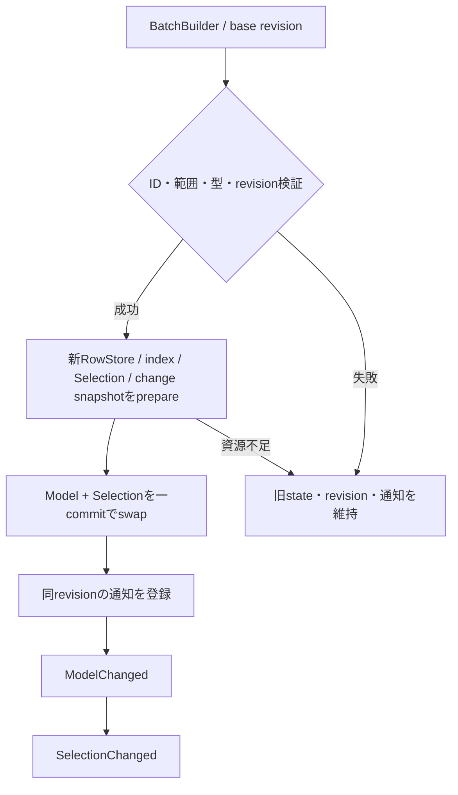
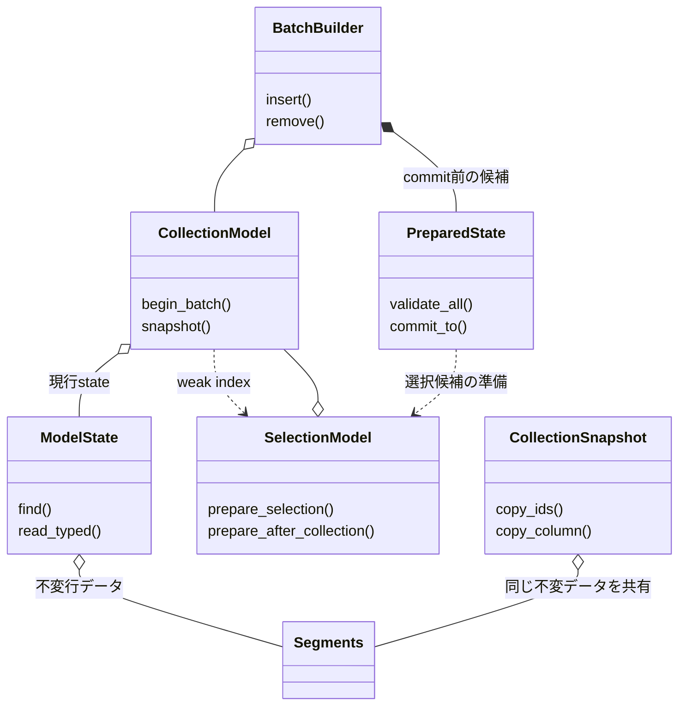
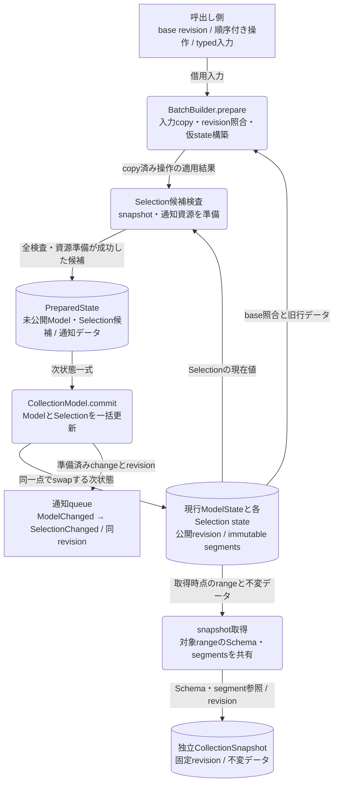

# オブジェクト管理：CollectionとSelection

- 文書版: 1.1
- 文書ロール: detailed-design
- 更新日: 2026-10-17
- 状態: 1.1全文承認済み（利用者、2026-10-17）。実装・試験状態は別管理

## 目的と上位根拠

本書を要求から実装へ具体化する詳細設計の正本とする。型・API・所有・呼出し手順・状態遷移を実装へ反映する。要求の外部保証はリンク先RQ、層の責務と主要flowは上位BDを根拠とする。設計宣言の記載は、配布済みheader・実装済みAPI・試験合格を意味しない。

基本設計: [オブジェクト管理：値・モデル・更新整合性](../../12_design/runtime-objects/model-values.md)

## 要求と設計項目の対応

| 設計項目 | 要求根拠 |
| --- | --- |
| Model・batch・snapshot・Selection | [RQ-02-005](../../11_requirements/RQ-02_core-features.md#rq-02-005)、[RQ-02-006](../../11_requirements/RQ-02_core-features.md#rq-02-006)、[RQ-09-019](../../11_requirements/RQ-09_ui-scope.md#rq-09-019)、[RQ-09-020](../../11_requirements/RQ-09_ui-scope.md#rq-09-020)、[RQ-09-050](../../11_requirements/RQ-09_ui-scope.md#rq-09-050)、[RQ-09-051](../../11_requirements/RQ-09_ui-scope.md#rq-09-051)、[RQ-09-052](../../11_requirements/RQ-09_ui-scope.md#rq-09-052)、[RQ-09-062](../../11_requirements/RQ-09_ui-scope.md#rq-09-062)、[RQ-09-063](../../11_requirements/RQ-09_ui-scope.md#rq-09-063)、[RQ-09-064](../../11_requirements/RQ-09_ui-scope.md#rq-09-064) |

本書内の共通規則は上記の各要求を実現するために適用する。同一項目内で個別要求を参照する場合はその対象範囲を優先する。将来候補・未採用範囲は採用済みの動作と区別する。

## Model・batch・snapshot・Selection

### 実装規則

| 実現手段・責務 | 要求根拠 |
| --- | --- |
| CollectionModelをschema+ordered RowStore+item index+revisionで構成。schemaは作成時固定で列ごとに既存五kindを指定する。 | [RQ-09-062](../../11_requirements/RQ-09_ui-scope.md#rq-09-062) |
| item IDはRuntime内の非再利用u64、column IDはschema内の固定u32、revisionはmodel単調u64。枯渇はcommit前に拒否する。 | 上記の根拠RQ |
| BatchBuilderはUI threadでinsert/remove/move/setを蓄積し、base revisionを照合して全件prepare後にCollectionとSelectionを一括commitする。 | 上記の根拠RQ |
| snapshotはschema/revision/ID/値を所有する不変object。範囲の行をcopy-on-write segmentで共有し、callback内でも寿命を独立させる。 | 上記の根拠RQ |
| 通知はcommit済みModelChanged→SelectionChangedの順で同revisionのsnapshotを渡す。callback中のbatchは同期拒否しpostで次turnへ送る。 | [RQ-09-063](../../11_requirements/RQ-09_ui-scope.md#rq-09-063) |
| SelectionValidatorがmode変更前にselected数とcurrent所属を検査し、RQ-09-064の拒否・削除後結果をcommit前に構築する。 | [RQ-09-064](../../11_requirements/RQ-09_ui-scope.md#rq-09-064) |
| Collection差替えは別SelectionModelを作る。既存Selectionの所属Collectionをその場で変更しない。 | [RQ-09-064](../../11_requirements/RQ-09_ui-scope.md#rq-09-064) |
| 可視range取得は一snapshotとtyped column bulk copyを提供。ListViewは可視範囲+上下1 viewportを初期の内部再利用範囲とする。 | 上記の根拠RQ |
| Collection→Selectionの参照はweak index、Selection→Collectionはstrong。Runtime registryはActive subscriptionを保持、snapshotはModelを保持しない。 | 上記の根拠RQ |

### 実現設計

#### 型・API

```text
CollectionModel { schema: Arc<Schema>, state: Arc<ModelState>, observers }
ModelState { revision, ordered_rows, item_index }
SelectionModel { collection: Strong, mode, selected_ids, current_id, revision }
CollectionSnapshot { Arc<Schema>, Arc<Segments>, range, revision }
BatchBuilder { collection: Strong, base_revision, operations, PreparedState? }
```

| 操作案 | 入力/出力と所有 | thread / commit点 / 失敗 |
|---|---|---|
| collection_create(schema) | schema入力borrow→copy、owned modelを返す | UI / schema検査と資源準備後登録 / 失敗out=0 |
| collection_begin_batch(model, revision) | model borrow、owned builder | UI / 値変更なし / stale revision拒否 |
| batch_insert/remove/move/set_* | scalar/UTF8入力をbuilderへcopy | UI / builderだけ変更 / OOMで当該operation追加なし |
| batch_commit(builder) | builder borrow、owned change snapshot | UI / PreparedStateをswapする一点 / invalid/stale/OOMはModel/Selection/通知不変 |
| collection_snapshot(model, start, count) | owned immutable snapshot | UI取得、取得後は任意thread読取 / range+revision固定 |
| snapshot_copy_ids / snapshot_copy_<kind> | caller buffer、required count | 任意thread / 容量照合後copy / 不足時部分書込みなし |
| selection_set(ids, current) | IDs borrow→copy | UI / cardinality・所属を検証後commit |

公開C ABIは`ui_abi_1_` prefixと上記snake_case名を使い、行の異種値は列ごとのtyped APIで渡す。schema builderにもadd_column_<kind>を用い、C++/Rustのunionや公開可変長structをABIへ持ち出さない。



insertは現在のbatch仮state上の位置、moveはitem IDと移動後のbefore-item ID（0なら末尾）を指定する。削除済みIDへのsetはbatch全体を拒否する。insertで予約したIDは失敗しても再利用しない。同じitemへの複数setはbatch順の最後の有効操作を最終stateへ適用し、重複removeは無効batchとする。ModelChangedのchange setは観測用で、snapshotの正本と差異がある場合に独立適用して状態を再構築させない。

## クラス設計の補足（1.1承認済み）

既承認1.0の実現規則を支える型・関連・所有・主要操作を整理した。内部型名とメソッドの分担は本改訂で補足する内部設計であり、既存公開APIの署名や外部保証を追加・変更するものではない。この節のクラス構成と追加図は1.1版全文の承認対象であり、実装・試験完了の証明とは区別する。

要求根拠: [RQ-02-005](../../11_requirements/RQ-02_core-features.md#rq-02-005)、[RQ-02-006](../../11_requirements/RQ-02_core-features.md#rq-02-006)、[RQ-09-062](../../11_requirements/RQ-09_ui-scope.md#rq-09-062)、[RQ-09-063](../../11_requirements/RQ-09_ui-scope.md#rq-09-063)、[RQ-09-064](../../11_requirements/RQ-09_ui-scope.md#rq-09-064)。

既存のCollectionModel/ModelState/SelectionModel/BatchBuilderを、更新可能なownerと不変snapshotに分けて具体化する。SchemaとRowStoreは公開classを増やすための型ではなく、Model内部のschema/segment構造として扱う。

### 型の責務と所有

| 型 | 責務・保持データ | 主要メソッド・操作 | 所有・寿命 |
| --- | --- | --- | --- |
| CollectionModel | 固定Schema、現行ModelState、Selectionのweak index、observer登録を保持 | begin_batch(base_revision); snapshot(start, count); commit(prepared) | ModelStateを強保持。Selectionを逆向きに強保持しない |
| ModelState | revision、ordered_rows、item_index。公開後は不変 | find(item_id); read_typed(row, column); project_range(start, count) | RowStore/segmentを共有所有。変更は旧instanceを書き換えず新stateを構築 |
| BatchBuilder | Collection強参照、base_revision、順序付きoperationsと準備状態 | insert(...); remove(id); move(...); set_typed(...); prepare(); commit() | 入力をcopyして保持。準備中はModel/Selection/通知へ書き込まない |
| PreparedState | 次ModelState、各Selectionの次状態、同revisionのchange/snapshotと通知準備 | validate_all(); commit_to(model) | commit前はbuilderが所有する未公開候補。commit後の再使用を許さない内部状態案 |
| SelectionModel | Collection強参照、mode、selected_ids、optional current_id、revision | prepare_selection(ids, current); prepare_after_collection(next); snapshot() | 所属Collectionを途中で付け替えない。削除後の選択状態をModel commit前に準備 |
| SelectionValidator | mode・cardinality・ID所属の検査を担当する内部処理 | validate(mode, ids, current, model_state) | 副作用のない検査。所有参照や通知を増減しない |
| CollectionSnapshot | Schema、対象range、revision、IDと値segmentを保持 | copy_ids(buffer); copy_column(kind, column, buffer) | 取得時点の不変データを独立所有。Model/Selectionを延命しない |

### クラスの関連

`*--`は従属するstate/作業の合成、`o--`は共有を含む所有参照、`..>`は非所有の利用・識別・委譲を示す。関連名と本文で示した寿命を優先し、図の同名型は各instanceで別の状態を持つ。図は主要メソッド名を抜粋し、引数・所有・失敗条件は表と本文に従う。



### データフロー図：候補・現行state・読取りsnapshot

既存のcommit手順図を補い、データの保持先を示す。丸角は処理、円筒は保持データ、矢印のラベルは渡すデータであり、強参照を意味しない。



prepare中に現行stateや通知queueを書き換えない。invalid/stale/OOMはcommitへ進まず、Model/Selection・revision・通知を保持する。Snapshotは不変segmentを共有して後から読めるが、Model本体を延命しない。失敗時も予約済みitem IDは再利用しない。

### 主要な呼出しと失敗境界

BatchBuilder.prepareはbase_revision照合→operation順の仮state構築→SelectionValidatorによる各Selection候補の検査→change snapshotと通知資源準備を行う。全成功後だけCollectionModel.commitでModelとSelectionを一括更新し、ModelChanged→SelectionChangedを同revisionで登録する。

図のSegmentsは既存snapshotの不変segment構造を表す。CollectionSnapshotはSchemaとsegmentを共有するが、ModelState本体やCollectionModelを必須ownerとして保持しない。ID発行器はRuntime所管とし、失敗batchでも予約済みIDを再利用しない。公開builderの再利用・成功後の戻り値等、本文で定めていない外部条件をこの内部Consumed状態案から追加しない。

## 文書の承認・改訂履歴

| 日付 | 対象版 | 内容・根拠 |
| --- | --- | --- |
| 2026-10-17 | 1.0 | 利用者の指示に基づき、既承認内容を責務別に再編集。設計項目IDによる承認・追跡は廃止し、以後は文書版全体で管理する。構成変更を新規の製品仕様採用としない |
| 2026-10-17 | 1.0全文 | 利用者の「全部承認します」により文書全体を承認。旧IDによる項目承認ではなく、現行文書版を対象とする。実装・試験合格を意味しない |
| 2026-10-17 | 1.1改訂案 | 利用者の補足指示によりクラス責務・所有・メソッド・関連図を追加。1.0承認を維持し、1.1全文は確認待ち |
| 2026-10-17 | 1.1全文 | 利用者の「OK,テスト文書作りましょうか」により、クラス設計補足と選択的な図の補強を含む全文を承認。既存履歴を維持し、実装・試験状態は別管理 |
