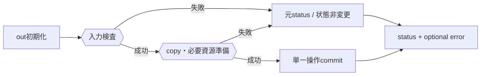
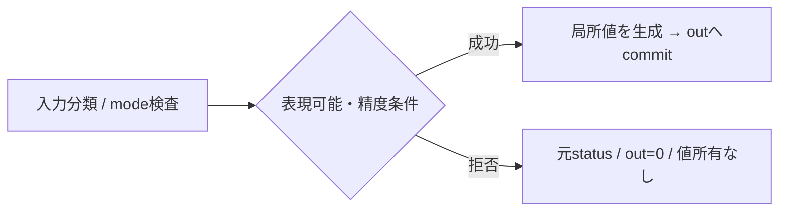
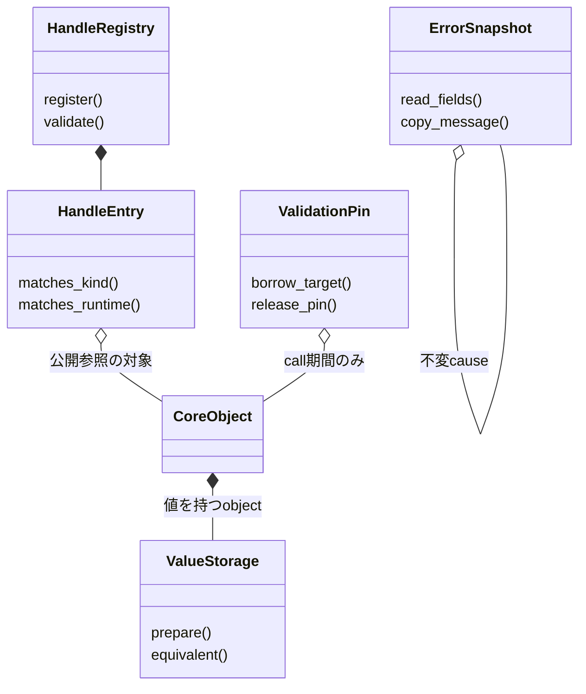

# オブジェクト管理：handle・値・error

- 文書版: 1.1
- 文書ロール: detailed-design
- 更新日: 2026-10-17
- 状態: 1.1全文承認済み（利用者、2026-10-17）。実装・試験状態は別管理

## 目的と上位根拠

本書を要求から実装へ具体化する詳細設計の正本とする。型・API・所有・呼出し手順・状態遷移を実装へ反映する。要求の外部保証はリンク先RQ、層の責務と主要flowは上位BDを根拠とする。設計宣言の記載は、配布済みheader・実装済みAPI・試験合格を意味しない。

基本設計: [共通ABI：言語非依存境界と互換性](../../12_design/runtime-objects/abi.md)、[オブジェクト管理：値・モデル・更新整合性](../../12_design/runtime-objects/model-values.md)、[ランタイム：実行context・所有・終了](../../12_design/runtime-objects/runtime.md)

## 要求と設計項目の対応

| 設計項目 | 要求根拠 |
| --- | --- |
| handle登録と検証 | [RQ-02-001](../../11_requirements/RQ-02_core-features.md#rq-02-001)、[RQ-04-004](../../11_requirements/RQ-04_abi-boundary.md#rq-04-004)、[RQ-04-005](../../11_requirements/RQ-04_abi-boundary.md#rq-04-005)、[RQ-04-006](../../11_requirements/RQ-04_abi-boundary.md#rq-04-006)、[RQ-04-007](../../11_requirements/RQ-04_abi-boundary.md#rq-04-007)、[RQ-04-018](../../11_requirements/RQ-04_abi-boundary.md#rq-04-018)、[RQ-04-019](../../11_requirements/RQ-04_abi-boundary.md#rq-04-019)、[RQ-05-001](../../11_requirements/RQ-05_ownership-callbacks.md#rq-05-001)、[RQ-05-002](../../11_requirements/RQ-05_ownership-callbacks.md#rq-05-002)、[RQ-05-003](../../11_requirements/RQ-05_ownership-callbacks.md#rq-05-003)、[RQ-05-010](../../11_requirements/RQ-05_ownership-callbacks.md#rq-05-010)、[RQ-05-011](../../11_requirements/RQ-05_ownership-callbacks.md#rq-05-011)、[RQ-06-003](../../11_requirements/RQ-06_threading-dispatch.md#rq-06-003) |
| 値とerrorの境界表現 | [RQ-04-001](../../11_requirements/RQ-04_abi-boundary.md#rq-04-001)、[RQ-04-003](../../11_requirements/RQ-04_abi-boundary.md#rq-04-003)、[RQ-04-006](../../11_requirements/RQ-04_abi-boundary.md#rq-04-006)、[RQ-04-007](../../11_requirements/RQ-04_abi-boundary.md#rq-04-007)、[RQ-04-020](../../11_requirements/RQ-04_abi-boundary.md#rq-04-020)、[RQ-04-021](../../11_requirements/RQ-04_abi-boundary.md#rq-04-021)、[RQ-04-022](../../11_requirements/RQ-04_abi-boundary.md#rq-04-022)、[RQ-04-023](../../11_requirements/RQ-04_abi-boundary.md#rq-04-023)、[RQ-04-025](../../11_requirements/RQ-04_abi-boundary.md#rq-04-025)、[RQ-04-026](../../11_requirements/RQ-04_abi-boundary.md#rq-04-026)、[RQ-04-027](../../11_requirements/RQ-04_abi-boundary.md#rq-04-027)、[RQ-05-004](../../11_requirements/RQ-05_ownership-callbacks.md#rq-05-004)、[RQ-05-005](../../11_requirements/RQ-05_ownership-callbacks.md#rq-05-005)、[RQ-07-009](../../11_requirements/RQ-07_binding.md#rq-07-009) |
| 数値変換とConverter | [RQ-02-017](../../11_requirements/RQ-02_core-features.md#rq-02-017)、[RQ-02-018](../../11_requirements/RQ-02_core-features.md#rq-02-018)、[RQ-02-019](../../11_requirements/RQ-02_core-features.md#rq-02-019)、[RQ-02-022](../../11_requirements/RQ-02_core-features.md#rq-02-022)、[RQ-04-002](../../11_requirements/RQ-04_abi-boundary.md#rq-04-002)、[RQ-04-025](../../11_requirements/RQ-04_abi-boundary.md#rq-04-025)、[RQ-04-029](../../11_requirements/RQ-04_abi-boundary.md#rq-04-029) |

本書内の共通規則は上記の各要求を実現するために適用する。同一項目内で個別要求を参照する場合はその対象範囲を優先する。将来候補・未採用範囲は採用済みの動作と区別する。

## handle登録と検証

### 範囲

オブジェクト管理：handle・値・errorでは、公開handle tokenがどのobjectと種類を指すかを登録し、API入口で検証する処理を定める。object本体の内部参照、Runtime終了時の破棄、UI threadへの破棄dispatchは本書の対象外とする。本書は[ランタイム：実行context・所有・終了](../../12_design/runtime-objects/runtime.md)と[共通ABI：言語非依存境界と互換性](../../12_design/runtime-objects/abi.md)を具体化する。

対象要求: [RQ-02-001](../../11_requirements/RQ-02_core-features.md#rq-02-001)、[RQ-04-004](../../11_requirements/RQ-04_abi-boundary.md#rq-04-004)、[RQ-04-005](../../11_requirements/RQ-04_abi-boundary.md#rq-04-005)、[RQ-05-001](../../11_requirements/RQ-05_ownership-callbacks.md#rq-05-001)、[RQ-05-002](../../11_requirements/RQ-05_ownership-callbacks.md#rq-05-002)、[RQ-05-003](../../11_requirements/RQ-05_ownership-callbacks.md#rq-05-003)、[RQ-06-003](../../11_requirements/RQ-06_threading-dispatch.md#rq-06-003)。

| 項目 | オブジェクト管理：handle・値・errorで扱うこと | 別項目の所管 |
|---|---|---|
| token | 発行の一意性、無効値、枯渇時 | ABI全体のversionや追加handle型 |
| 登録情報 | handleの種類、Runtime所属、object識別 | object内部参照の構造、破棄順序 |
| 検証 | 無効・異種・別Runtimeの判定 | `WRONG_THREAD` / `CLOSED`との全API共通優先順位 |
| retain/release | 公開tokenごとの独立性、同時呼出しの意味 | 最終参照後の実破棄とshutdown連携 |

### 実装規則


| 実装規則 | 根拠・補足 |
| --- | --- |
| 発行器はプロセス内で共有する単調増加の64-bit token番号を使う。0は発行しない。成功済みtokenはprocess終了まで再利用せず、カウンタを周回させない。 | [ランタイム：実行context・所有・終了](../../12_design/runtime-objects/runtime.md)の非ゼロ・非再利用・枯渇時失敗を具体化する。番号の内部表現はABIから観測できない。 |
| 登録表はtokenから、handle kind、Runtime identity（Runtimeを持たないError等はnone）、対象objectの内部identityおよび公開参照レコードを引けるようにする。C ABIへ内部pointerを露出しない。 | [RQ-04-004](../../11_requirements/RQ-04_abi-boundary.md#rq-04-004)のopaque handleと[ランタイム：実行context・所有・終了](../../12_design/runtime-objects/runtime.md)を登録表で具体化する。 |
| Runtimeを指定するAPIは、入力tokenの有効性を検証した後、期待kindを照合し、kind一致時にRuntime所属を照合する。Runtimeを引数に取らないAPIは所属照合を行わない。 | 検証はtokenの登録状態、kind、Runtime所属の順に行う。status/errorの外部分類と数値割当は本書では規定しない。関連要求は[RQ-04-006](../../11_requirements/RQ-04_abi-boundary.md#rq-04-006)と[RQ-04-007](../../11_requirements/RQ-04_abi-boundary.md#rq-04-007)。 |
| `retain`と`release`は登録表上で線形化できる操作とする。retainが先に成功した場合、新tokenは元tokenと独立して有効。releaseが先に成功した場合、そのtokenへの後続retainは失敗する。同一tokenの競合releaseは最大一回だけ成功し、別tokenを無効化しない。 | [ランタイム：実行context・所有・終了](../../12_design/runtime-objects/runtime.md)、[共通C ABI：宣言・検査・互換性](abi.md)、[RQ-05-002](../../11_requirements/RQ-05_ownership-callbacks.md#rq-05-002)の所有参照契約を同時呼出しにも具体化する。 |
| 表の同期区間ではtokenと登録レコードの整合だけを更新し、object破棄、callback、UI操作、ユーザーコードを実行しない。必要な内部参照を登録表外で確保してから同期を解く。 | [RQ-06-003](../../11_requirements/RQ-06_threading-dispatch.md#rq-06-003)に対応し、競合中の再入やlock保持中の破棄を避ける。 |
| token番号枯渇時はtokenを発行せず失敗する。登録表の割当失敗時は部分登録を残さない。 | [ランタイム：実行context・所有・終了](../../12_design/runtime-objects/runtime.md)の枯渇時失敗を発行処理に適用する。status/error codeの割当は本書では規定しない。 |

### 操作別契約

| 操作 | 成功時 | 失敗時・境界 |
|---|---|---|
| object登録 | 新しいtokenと登録レコードを一体で公開し、所有tokenを返す | tokenまたは表の割当失敗時に部分登録を残さない。出力handleは0 |
| handle検証 | live tokenのkindと必要ならRuntime identityを返す | 失敗時に対象objectの操作へ進まない |
| `handle_retain` | 同じobjectへの別tokenを登録し、入力tokenは引き続き有効 | 出力tokenは0。入力tokenを消費しない |
| `handle_release` | 入力tokenの公開参照レコードを一度だけ消費 | 無効・解放済みtokenは失敗する。別tokenや別objectの公開参照は変化しない |

ここでいう「公開」はABI呼び出しから観測可能になることを指す。object登録、retain、releaseに伴う内部参照の増減とobjectの実破棄は本書の対象外とする。

### 検証の不変条件

1. 0は常に無効であり、live tokenとして登録されない。
2. 同じprocess内で二つの所有参照に同じtoken値を割り当てない。`retain`は必ず異なるtokenを返す。
3. 解放済みtoken値を別objectまたは別Runtimeへ割り当て直さない。
4. handle値だけからkind、Runtime、object addressを推定できない。
5. 入力検証に失敗したAPIは、対象objectの状態を変更しない。
6. kind検証を必要とするAPIは、kind確認前に型固有のobjectを参照しない。

## 値とerrorの境界表現

### 実現のcall/data/ownership flow

C ABI入口でrequired outputを規定値へ初期化し、pointer/length・kind・UTF-8を検証する。保持が必要な入力はcall中にcopyし、資源確保が成功してからCore状態をcommitする。buffer getterは必要byte数と容量を先に照合してからcopyする。statusを確定した後のoptional error確保失敗で一次失敗を置換しない。



### 範囲と境界

このフェーズでは、言語間で共通となる値・byte列・errorの受渡しと、失敗した呼出しで観測される出力・副作用を扱う。値型の意味やAPI固有の成功・拒否規則は、その所有設計に従う。

| 対象 | オブジェクト管理：handle・値・errorの所管範囲 | 別項目の所管 |
|---|---|---|
| 固定幅scalar | C ABI型で値渡しし、暗黙の型変換を追加しない | Propertyごとの関数シンボルとF64/DECIMAL ABI詳細はイベントハンドリング：通知とBinding伝播、各wrapper |
| UTF-8 | byte長、入力借用とcopy、caller buffer出力、容量不足時の規則 | Property値・TextBox・Errorごとの具体APIはイベントハンドリング：通知とBinding伝播、UIクラス：TextBox・Validation・IME編集、共通C ABI：宣言・検査・互換性 |
| error | statusと任意error handleの関係、snapshot、不在時の動作 | 完全なdomain/code catalogと数値割当は共通C ABI：宣言・検査・互換性・各機能設計 |
| 失敗時出力 | required output初期化、optional error出力、部分状態変更の境界 | APIごとのtransaction/rollbackと個別結果意味論は各DD |
| buffer | 既存のbyte列に対するpointer/capacity/length | 配列・Collection・一貫snapshot ABIはCollection設計 |

### 実装規則

| 実装規則 | 出典・境界 |
| --- | --- |
| 固定幅scalarはC ABIで定めた型に値として渡す。wrapperは明示的な型対応を行い、範囲外整数の切り詰め、異なるProperty kind間の暗黙変換、言語オブジェクトの直接受渡しを行わない。 | ADR-0001、公開ABI契約、MVVM UIライブラリ 初期公開値型の上位判断、言語境界契約～言語境界契約。F64/DECIMALの具体署名・符号化・生成/read/writeはイベントハンドリング：通知とBinding伝播とwrapperへ送る。 |
| UTF-8入力はpointerとbyte lengthで受け、呼出し中のみ借用する。長さが正でpointerがnullなら`UI_INVALID_ARGUMENT`、nullと長さ0は空byte列を表す。有効なUTF-8だけ受理し、保持する場合は呼出しが戻る前にcopyする。埋め込みNULはbyte列中の値として許す。 | 公開ABI契約、MVVM UIライブラリ 初期公開値型の上位判断、ABI §2/7/9/20。callback候補など別契約で一時借用と明記する入力にはその寿命規則を適用する。 |
| byte列getterはcaller bufferへcopyし、byte数をlength/capacityで表す。`buffer == NULL && capacity == 0`は容量照会、NUL終端は付けない。容量不足なら`UI_BUFFER_TOO_SMALL`と必要byte数を返し、buffer本体は一部も書き換えない。 | 公開ABI契約、ABI §2.1/7.2。容量照会と後続copyの間で値が変わらないsnapshotは保証せず、同一snapshotが必要なAPIは所有設計で別途定める。 |
| `ui_status`を呼出し結果の一次判定とする。`out_error`は任意で、非nullの場合は呼出し開始時に0へ初期化し、失敗詳細を生成できたときだけ新しい所有error handleを返す。成功時は0。 | 公開ABI契約、オブジェクト管理：handle・値・error。失敗時のError handle所有権は呼出し側がretain/release規則に従って管理する。 |
| Error handleは失敗時点のimmutable snapshotとする。機械分岐はstatus/domain/codeを用い、message文面に依存しない。`out_error == NULL`、またはerror snapshotを作れない資源不足時も、元のAPI statusを返し、詳細なしで失敗を表す。 | 公開ABI契約、MVVM UIライブラリ Error objectの安定性境界に関する上位判断案。causeとdiagnosticは区別し、取得API・catalog詳細を本判断で追加しない。 |
| 各APIは処理を始める前に、存在するrequired out pointerを可能な範囲で初期化する。失敗時のhandle outputは0、scalar/bool/length outputは0を基本とし、必要容量を通知する`UI_BUFFER_TOO_SMALL`等、定義済みの個別例外だけ上書きする。required out pointer自体がnullの場合は`UI_INVALID_ARGUMENT`とし、その指す出力は書けない。 | Runtime §7、ABI §2.1、オブジェクト管理：handle・値・error。feature query等、既存APIで異なる出力例外はそれぞれの契約を明記する。 |
| 呼出しが入力検証・必要copy・出力確保に失敗した場合、その呼出しに属するCore状態と通知を部分更新しない。状態を変えるAPIは検証とcopyを済ませてからcommitする。これは全APIを跨ぐtransactionやcallback内のアプリ副作用rollbackを意味しない。 | 公開ABI契約、ABI §7.4/9.3、MVVM UIライブラリ Collection change batch原子性に関する上位判断。Collection batchの全件適用/全件拒否はMVVM UIライブラリ Collection change batch原子性に関する上位判断のCollection変更だけに適用する。post成功/失敗時のclosure所有権はイベントハンドリング：callbackと再入の規則に従う。 |

#### `out_error`と失敗出力の形（概念）

以下は上記判断の読みやすさのための概念表であり、APIごとの優先順位や公開署名を追加するものではない。

| 呼出し結果 | status | required outputs | optional `out_error` |
|---|---|---|---|
| 成功 | `UI_OK` | 成功値を設定 | 0 |
| API失敗・詳細生成成功 | 失敗理由に対応するstatus | 失敗規則に従い初期値。個別例外のみ明示 | 新しい所有Error handle |
| API失敗・詳細なし/生成不能 | 元の失敗status | 失敗規則に従い初期値 | 0 |
| buffer不足 | `UI_BUFFER_TOO_SMALL` | bufferは不変、必要byte数を設定 | 個別APIの契約に従う。通常の追加Errorは必須にしない案 |

statusの優先順位、domain/code値、出力が複数あるAPIの個別例外は共通C ABI：宣言・検査・互換性または対象API設計で固定する。

### UTF-8とbufferの使用規則

1. `length`と`capacity`はbyte単位であり、文字数・code point数・UTF-16 code unit数ではない。
2. 入力pointerは呼出し中のみ有効とする。Coreが値を保持するときは呼出しが戻るまでに所有copyを作る。copy前に入力が不正と分かった場合、状態を変更しない。
3. 空文字列はnull pointerと0 lengthで渡せる。正のlengthとnull pointerの組合せを拒否する。length 0で非null pointerの場合、pointer先を読み取らない。
4. 出力getterは保持値をcaller bufferへcopyする。埋め込みNULがある値はlengthで区別し、末尾NULを追加しない。
5. 容量照会のあとにcopyを呼ぶ場合、間に値が変わる可能性がある。`UI_BUFFER_TOO_SMALL`なら新しい必要lengthを使って再試行する。同じ時点のsnapshotが必要なら、API側で別の明示手段を設計する。
6. 未定義の配列・Collectionをこの規則で暗黙に設計しない。既存のbyte列以外の集約値は、個別に要素数・byte数・snapshot・所有権を定める。

### 型とerror意味論の境界

- BOOL、I64、UTF8、F64、DECIMALの値意味論は公開ABI契約/MVVM UIライブラリ 初期公開値型の上位判断の範囲を維持する。F64は承認済みのbinary64、NaN・無限大受理、NaN相互等価と±0等価の規則を変更しない。
- DECIMALはMVVM UIライブラリ 初期公開値型の上位判断の8-byte値域・scale・係数・範囲拒否を維持する。本書ではC ABI上の符号化方式、endian、型別関数、operator/parse/formatを確定しない。
具体化はオブジェクト管理：handle・値・error、[共通C ABI：宣言・検査・互換性](abi.md)を参照する。既存公開ABI契約のnullable OBJECT規則以外に一般null契約を追加しない。
- `UI_VALIDATION_FAILED`等の機能別statusは意味論を所有する設計に従う。statusをdomain/codeや説明messageで代用しない。
- Errorのcauseは原因の連鎖、diagnosticは任意の調査補助情報である。diagnosticの存在、完全性、安定性を通常エラー処理の条件にしない。

## 数値変換とConverter

### 実装規則

| 実現手段・責務 | 要求根拠 |
| --- | --- |
| F32は型別変換関数の入力/出力で提供し、初期Property kindを増やさない。float→doubleは全有限値を正確に拡張する。 | [RQ-04-029](../../11_requirements/RQ-04_abi-boundary.md#rq-04-029) |
| double→floatはExact/NearestEvenを明示する。Exactは復元値不一致を拒否、NearestEvenはIEEE binary32の最近接偶数丸め、有限値のoverflowは拒否。 | [RQ-04-029](../../11_requirements/RQ-04_abi-boundary.md#rq-04-029) |
| NaNはquiet NaNへ正規化しpayload保存を保証しない。符号付きzeroと同符号infinityは保持する。 | [RQ-04-029](../../11_requirements/RQ-04_abi-boundary.md#rq-04-029) |
| 内蔵UTF8→I64/DECIMALと逆formatを次段階の明示converterにする。初期Bindingの同kind制限を維持する。 | [RQ-02-022](../../11_requirements/RQ-02_core-features.md#rq-02-022) |
| I64 parserはASCII sign+digits、DECIMALはsign+digits+optional dot、locale/指数/桁区切りなし。完成値だけを解析し、途中入力判定はTextBox Validatorへ残す。 | [RQ-02-022](../../11_requirements/RQ-02_core-features.md#rq-02-022) |
| DECIMALは係数をchecked arithmeticで組み立て、末尾zeroを削れる場合だけscale/係数を正規化して値域へ収める。黙示丸めしない。 | 上記の根拠RQ |
| BOOL/I64/UTF8/F64/DECIMAL、OBJECT予約の既存kind IDを保持する。F32 conversionは独立featureとして追加する。 | 上記の根拠RQ |

### 実現設計

#### 公開C ABI案とwrapper対応

```c
/* 追加symbol。既存signatureは変更しない。 */
ui_status ui_abi_1_numeric_expand_f32(float value, double *out_value,
                                    ui_handle *out_error);
ui_status ui_abi_1_numeric_narrow_f64(double value, uint32_t mode,
                                    float *out_value, ui_handle *out_error);
/* mode: EXACT=0 / NEAREST_EVEN=1 */
```

Runtimeを持たない純粋変換なので任意thread。required outputは0、optional errorは0へ初期化する。`FloatCodec`がbinary64を分類し、整数mantissa/exponentとguard/round/sticky bitでbinary32へ丸める。ambient floating environmentに丸めを委ねない。targetのfloat/double幅・IEEE表現はABI build gateで確認し、未適合targetでfeatureをtrueにしない。

| 言語 | 入出力型 | 所有・失敗 |
|---|---|---|
| C++ | float / double、Result | 値所有なし、失敗は数値変換error |
| C# | float / double、UiResult | P/Invoke固定型、範囲外を例外またはTry結果へ |
| Rust | f32 / f64、Result | safe facade、所有token不要 |
| Python | floatとctypes.c_float/c_double | Python floatのdoubleからc_floatへ変換する前にABIで検査。大値を先にc_floatへ通して失わない |



converterは`NumericParser.parse_i64/parse_decimal`と`NumericFormatter.format_*`に分離する。DECIMALのformatはlocaleなしの最短の数値表記とし、TextBox原文の末尾zeroは編集領域で保持する。将来のnullable/custom/OBJECTは後述の範囲案に留める。

## クラス設計の補足（1.1承認済み）

既承認1.0の実現規則を支える型・関連・所有・主要操作を整理した。内部型名とメソッドの分担は本改訂で補足する内部設計であり、既存公開APIの署名や外部保証を追加・変更するものではない。この節のクラス構成と追加図は1.1版全文の承認対象であり、実装・試験完了の証明とは区別する。

要求根拠: [RQ-04-004](../../11_requirements/RQ-04_abi-boundary.md#rq-04-004)、[RQ-04-018](../../11_requirements/RQ-04_abi-boundary.md#rq-04-018)、[RQ-05-002](../../11_requirements/RQ-05_ownership-callbacks.md#rq-05-002)、[RQ-05-011](../../11_requirements/RQ-05_ownership-callbacks.md#rq-05-011)、[RQ-04-029](../../11_requirements/RQ-04_abi-boundary.md#rq-04-029)。

公開handleの数値、公開参照レコード、object実体、call期間のpinを別の型として表す。tokenからobject pointerを直接推定する実装は採らない。

### 型の責務と所有

| 型 | 責務・保持データ | 主要メソッド・操作 | 所有・寿命 |
| --- | --- | --- | --- |
| HandleRegistry | process内token発行器、token→HandleEntryの同期付き表 | register(kind, runtime_id, object); validate(token, expected); retain(token); release(token) | 同期区間で登録整合だけを更新。callback・object最終破棄をlock外へ渡す |
| HandleEntry | kind、optional Runtime identity、object identity、公開参照のlive状態 | matches_kind(kind); matches_runtime(id); consume_reference() | 一token一公開参照。別tokenのlive状態と独立 |
| ValidationPin | 検証済み対象のcall期間内部参照 | borrow_target(); release_pin() | API処理が戻るまで対象を保持。新しい公開owner tokenを発行するものではない |
| ValueStorage | BOOL/I64/UTF8/F64/DECIMALのtyped保存領域 | prepare(kind, input); equivalent(candidate); commit(candidate); read() | 借用入力の保持分はcopy。比較用正規化と保存表現を分離 |
| ErrorSnapshot | raw status/domain/code、message、optional immutable cause | read_fields(); copy_message(buffer); retain_cause() | 不変内部ownerでcauseを保持。生成中のself/cycleを作らない |
| FloatCodec | 有限/NaN/zero/infinity分類と表現可能性検査 | convert_f32_to_f64(value); convert_f64_to_f32(value, mode) | 純粋処理。Propertyや通知の状態を変更しない |

### クラスの関連

`*--`は従属するstate/作業の合成、`o--`は共有を含む所有参照、`..>`は非所有の利用・識別・委譲を示す。関連名と本文で示した寿命を優先し、図の同名型は各instanceで別の状態を持つ。図は主要メソッド名を抜粋し、引数・所有・失敗条件は表と本文に従う。



### 主要な呼出しと失敗境界

API入口はregistryでtoken/live→kind→必要なRuntime所属を検証してValidationPinを取得し、pinを保持したままtyped処理へ進む。releaseは対象tokenの公開参照だけを消費し、最後の参照に伴うUI cleanupをRuntimeへ渡す。数値変換は局所結果の構築成功後だけoutへ書く。

CoreObjectは共通所有対象を示す内部interface名の案で、C ABI公開classではない。release準備の失敗ではtokenを消費せず、pinによる一時保持と利用者の所有権取得を混同しない。NumericParser/NumericFormatterは文字列converterの別責務とし、FloatCodecへ暗黙parseを加えない。

## 文書の承認・改訂履歴

| 日付 | 対象版 | 内容・根拠 |
| --- | --- | --- |
| 2026-10-17 | 1.0 | 利用者の指示に基づき、既承認内容を責務別に再編集。設計項目IDによる承認・追跡は廃止し、以後は文書版全体で管理する。構成変更を新規の製品仕様採用としない |
| 2026-10-17 | 1.0全文 | 利用者の「全部承認します」により文書全体を承認。旧IDによる項目承認ではなく、現行文書版を対象とする。実装・試験合格を意味しない |
| 2026-10-17 | 1.1改訂案 | 利用者の補足指示によりクラス責務・所有・メソッド・関連図を追加。1.0承認を維持し、1.1全文は確認待ち |
| 2026-10-17 | 1.1全文 | 利用者の「OK,テスト文書作りましょうか」により、クラス設計補足と選択的な図の補強を含む全文を承認。既存履歴を維持し、実装・試験状態は別管理 |
