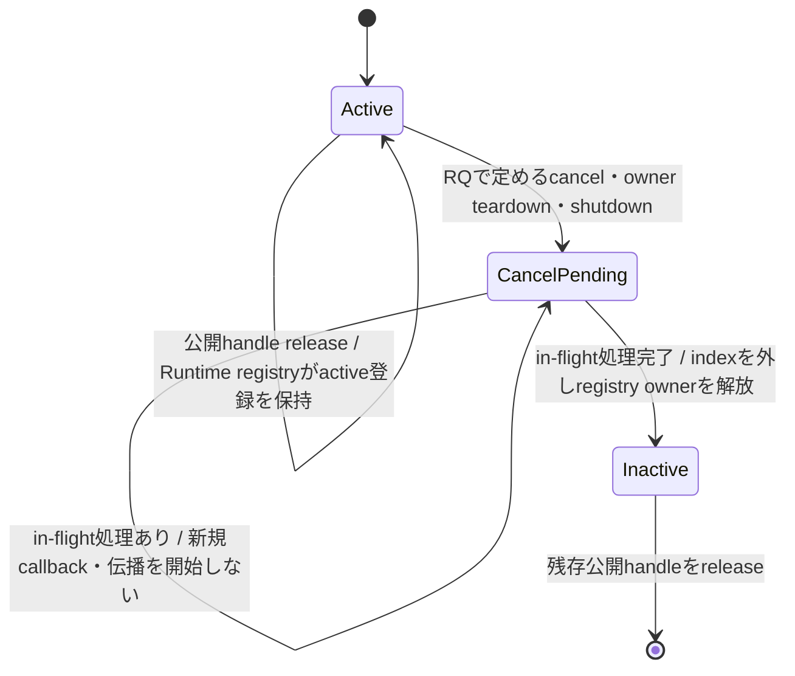
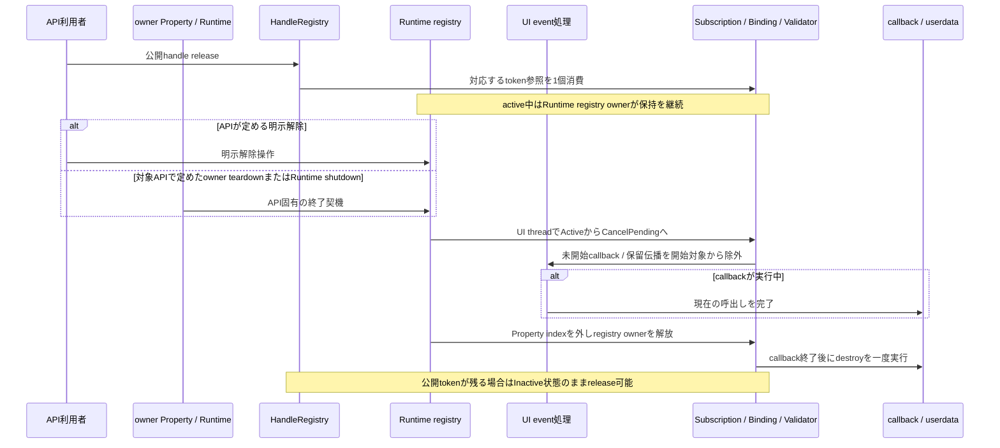
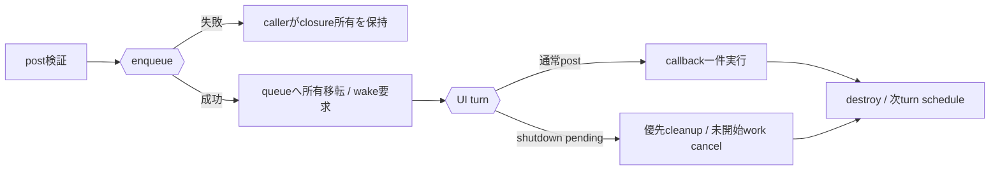
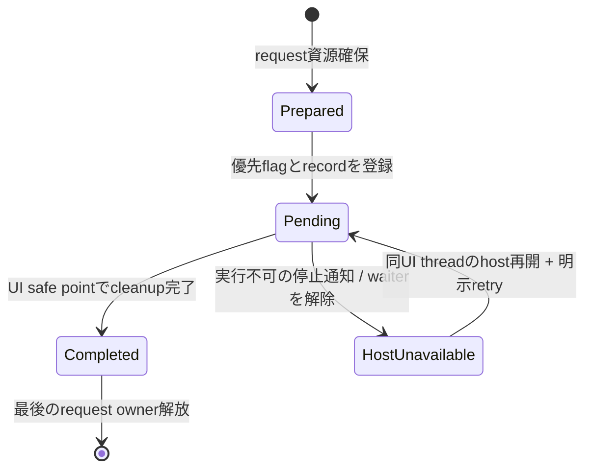
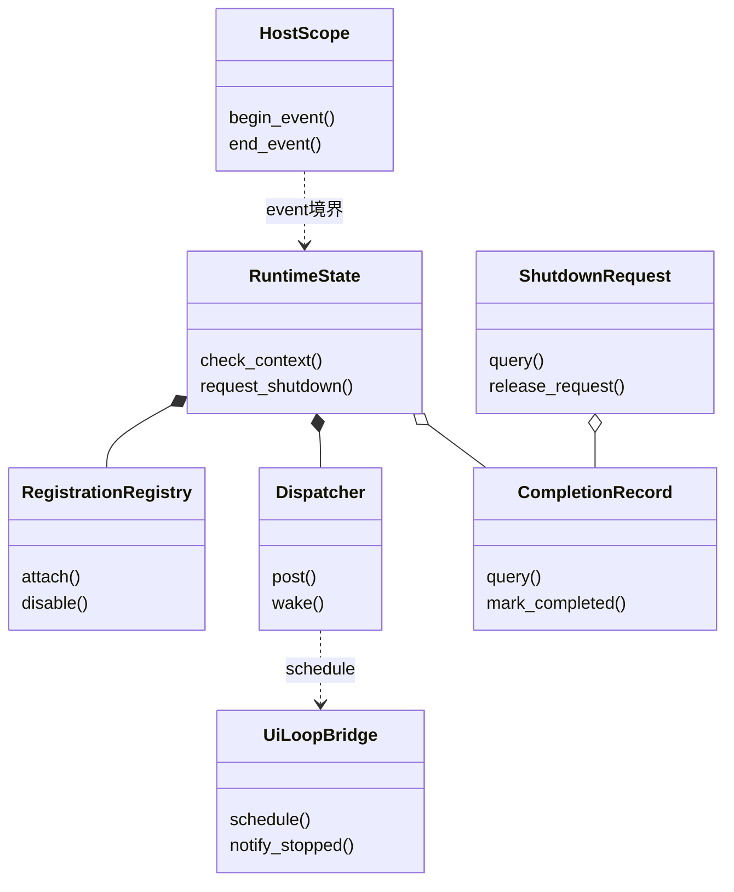

# ランタイム：実行基盤と終了

- 文書版: 1.2
- 文書ロール: detailed-design
- 更新日: 2026-10-19
- 状態: 1.2全文承認済み（利用者、2026-10-19。Runtime dispatch turn追加を選択）。実装・試験状態は別管理

## 目的と上位根拠

本書を要求から実装へ具体化する詳細設計の正本とする。型・API・所有・呼出し手順・状態遷移を実装へ反映する。要求の外部保証はリンク先RQ、層の責務と主要flowは上位BDを根拠とする。設計宣言の記載は、配布済みheader・実装済みAPI・試験合格を意味しない。

基本設計: [共通ABI：言語非依存境界と互換性](../../12_design/runtime-objects/abi.md)、[イベントハンドリング：通知・入力・Command](../../12_design/events/notifications-commands.md)、[UIクラス：Tree・Layout・Focus・Control](../../12_design/ui/tree-layout-controls.md)、[オブジェクト管理：値・モデル・更新整合性](../../12_design/runtime-objects/model-values.md)、[ランタイム：実行context・所有・終了](../../12_design/runtime-objects/runtime.md)、[言語ラッパー：共通facade・所有変換・解析](../../12_design/wrappers/language-wrappers.md)

## 要求と設計項目の対応

| 設計項目 | 要求根拠 |
| --- | --- |
| Runtimeと登録資源の所有 | [RQ-02-015](../../11_requirements/RQ-02_core-features.md#rq-02-015)、[RQ-02-016](../../11_requirements/RQ-02_core-features.md#rq-02-016)、[RQ-05-002](../../11_requirements/RQ-05_ownership-callbacks.md#rq-05-002)、[RQ-05-006](../../11_requirements/RQ-05_ownership-callbacks.md#rq-05-006)、[RQ-05-012](../../11_requirements/RQ-05_ownership-callbacks.md#rq-05-012)、[RQ-06-002](../../11_requirements/RQ-06_threading-dispatch.md#rq-06-002)、[RQ-06-005](../../11_requirements/RQ-06_threading-dispatch.md#rq-06-005)、[RQ-06-006](../../11_requirements/RQ-06_threading-dispatch.md#rq-06-006)、[RQ-06-007](../../11_requirements/RQ-06_threading-dispatch.md#rq-06-007)、[RQ-07-011](../../11_requirements/RQ-07_binding.md#rq-07-011) |
| UI dispatcherとhost loop | [RQ-02-013](../../11_requirements/RQ-02_core-features.md#rq-02-013)、[RQ-02-015](../../11_requirements/RQ-02_core-features.md#rq-02-015)、[RQ-03-011](../../11_requirements/RQ-03_language-support.md#rq-03-011)、[RQ-05-002](../../11_requirements/RQ-05_ownership-callbacks.md#rq-05-002)、[RQ-05-003](../../11_requirements/RQ-05_ownership-callbacks.md#rq-05-003)、[RQ-05-009](../../11_requirements/RQ-05_ownership-callbacks.md#rq-05-009)、[RQ-05-010](../../11_requirements/RQ-05_ownership-callbacks.md#rq-05-010)、[RQ-06-001](../../11_requirements/RQ-06_threading-dispatch.md#rq-06-001)、[RQ-06-002](../../11_requirements/RQ-06_threading-dispatch.md#rq-06-002)、[RQ-06-005](../../11_requirements/RQ-06_threading-dispatch.md#rq-06-005)、[RQ-06-006](../../11_requirements/RQ-06_threading-dispatch.md#rq-06-006)、[RQ-06-007](../../11_requirements/RQ-06_threading-dispatch.md#rq-06-007)、[RQ-07-008](../../11_requirements/RQ-07_binding.md#rq-07-008)、[RQ-07-013](../../11_requirements/RQ-07_binding.md#rq-07-013)、[RQ-07-014](../../11_requirements/RQ-07_binding.md#rq-07-014) |
| Host境界・終了要求・完了観測 | [RQ-02-015](../../11_requirements/RQ-02_core-features.md#rq-02-015)、[RQ-02-016](../../11_requirements/RQ-02_core-features.md#rq-02-016)、[RQ-03-013](../../11_requirements/RQ-03_language-support.md#rq-03-013)、[RQ-05-012](../../11_requirements/RQ-05_ownership-callbacks.md#rq-05-012)、[RQ-06-005](../../11_requirements/RQ-06_threading-dispatch.md#rq-06-005)、[RQ-06-006](../../11_requirements/RQ-06_threading-dispatch.md#rq-06-006)、[RQ-06-007](../../11_requirements/RQ-06_threading-dispatch.md#rq-06-007)、[RQ-06-012](../../11_requirements/RQ-06_threading-dispatch.md#rq-06-012) |

本書内の共通規則は上記の各要求を実現するために適用する。同一項目内で個別要求を参照する場合はその対象範囲を優先する。将来候補・未採用範囲は採用済みの動作と区別する。

## Runtimeと登録資源の所有

### 範囲と前提

Runtime契約は公開handleごとの強参照と内部所有参照を区別し、Runtime契約はRuntime/objectの生成をUI threadに限定、`retain` / `release`を任意threadに許可し、最後のUI状態破棄をUI threadへ集める。Runtimeの`shutdown`はUI threadで完了させ、停止後も残存handleのreleaseを許す。具体的な参照グラフ、購読・Bindingの所有方向、閉じたRuntime上の残存Core objectの扱いは本書の判断対象とする。

オブジェクト管理：handle・値・errorは、各tokenが独立した公開参照を表すこと、`retain` / `release`の線形化、登録表ロック内で破棄やcallbackを実行しないことを承認済みとした。本書はそのtoken規則を変えず、token参照とobject内部参照・Runtime寿命の関係を定める。

### 実装規則

| 実装規則 | 根拠・境界 |
| --- | --- |
| 各有効handle tokenは対象objectの公開強参照を1個持つ。親子所属、Binding、SubscriptionなどCore内の所有関係は別の内部強参照として数える。ABI呼び出しはborrowed handleを検証するときに呼出し中の一時参照を確保し、同時releaseでobject本体が先に破棄されないようにする。 | [ランタイム：実行context・所有・終了](../../12_design/runtime-objects/runtime.md) Runtime契約、[オブジェクト管理：handle・値・error](objects-values.md) handle登録・検証の補完。handle table上の検証・pinningはオブジェクト管理：handle・値・error、objectと内部参照の寿命は本書の対象。 |
| Runtimeに属する各Core objectはRuntime stateへの内部anchorを持つ。Runtime stateは生存中objectの弱い登録だけを持ち、通常objectを強参照しない。これにより残存handleはshutdown後もRuntime stateを保持する一方、Runtimeとobjectの登録関係で循環を作らない。 | [ランタイム：実行context・所有・終了](../../12_design/runtime-objects/runtime.md) Runtime契約のRuntime所属・停止後releaseを満たし、shutdown時にlive objectを走査する。Runtime stateの最終解放時点は最後のanchor解放後。 |
| tree親は子を内部強参照し、子の親所属は弱く保持する。Bindingはsource/target Propertyを強参照する。Property側のBinding indexはBindingへの弱参照とする。active Subscription/ValidatorはRuntimeの種別別registration registryから強参照し、Subscription/Validatorからowner Propertyへの参照およびProperty側indexは弱参照とする。Runtime registryは公開handle tokenとは別のCore内部所有者であり、object全体のweak live registryとは別管理にする。 | [UIクラス：Tree・Layout・Focus・Control](../../12_design/ui/tree-layout-controls.md)、[オブジェクト管理：値・モデル・更新整合性](../../12_design/runtime-objects/model-values.md) Binding契約/Property契約、[RQ-05-002/006](../../11_requirements/RQ-05_ownership-callbacks.md)、[RQ-07-011](../../11_requirements/RQ-07_binding.md)。Property teardownがregistrationを失効させられる所有方向を具体化する。 |
| Runtimeのactive Subscription registryはactive登録を強参照する。公開Subscription handleのreleaseは公開tokenだけを消費し、登録を解除しない。[RQ-05-006](../../11_requirements/RQ-05_ownership-callbacks.md)に定める明示cancel、owner Propertyのteardown、Runtime shutdownを受けると、UI thread上でActiveからCancelPendingへ遷移し、新規callback開始と未開始deliveryを止める。in-flight callbackの終了後に購読indexとRuntime registryから登録を外し、closureを一度だけdestroyする。公開handleが残る場合はInactive shellとしてreleaseできる。 | [RQ-05-002/006～008](../../11_requirements/RQ-05_ownership-callbacks.md)、[共通ABI：言語非依存境界と互換性](../../12_design/runtime-objects/abi.md) 公開ABI契約、[オブジェクト管理：値・モデル・更新整合性](../../12_design/runtime-objects/model-values.md) Property契約、[言語ラッパー：共通facade・所有変換・解析](../../12_design/wrappers/language-wrappers.md) 言語境界契約、[ランタイム：実行context・所有・終了](../../12_design/runtime-objects/runtime.md) Runtime契約。実際の解除契機・外部結果はRQを正本とし、本判断は所有・処理・cleanupの実現を定める。 |
| Runtimeのactive Binding registryはactive接続を強参照し、Bindingは両端Propertyを強参照する。公開Binding handleのreleaseは公開tokenだけを消費し、接続を解除しない。[RQ-07-011](../../11_requirements/RQ-07_binding.md)に定める明示cancelまたはRuntime shutdownを受けると、Bindingをinactiveとしてから保留伝播を破棄し、Property側のweak index、Runtime registry、両端Propertyへの内部参照を解放する。公開handleが残る場合はInactive shellとしてreleaseできる。OneTimeは初期同期後にRuntime登録や端点参照を残さない。 | [RQ-05-002](../../11_requirements/RQ-05_ownership-callbacks.md)、[RQ-07-011](../../11_requirements/RQ-07_binding.md)、[共通ABI：言語非依存境界と互換性](../../12_design/runtime-objects/abi.md) 公開ABI契約、[オブジェクト管理：値・モデル・更新整合性](../../12_design/runtime-objects/model-values.md) Property契約/Binding契約。解除条件はRQを正本とし、本判断はowner registry・index・cleanup順を具体化する。 |
| worker上のreleaseでUI-affineなobject stateの最後の参照がなくなる場合、release処理はfinalizer用内部参照を確保してからtokenを消費し、finalizerをRuntimeのUI-thread queueへ渡す。Running中だけでなくClosing中のreleaseもUI threadへ渡し、enqueueに失敗した場合はtokenを消費せず失敗を返す。UI thread上でfinalizerがUI stateを破棄してから内部参照を解放する。 | [ランタイム：実行context・所有・終了](../../12_design/runtime-objects/runtime.md) Runtime契約のworker release後の遅延破棄を具体化する。queueはRuntimeのUI-thread dispatch経路を使う。失敗時の利用者可視結果は[RQ-06-002](../../11_requirements/RQ-06_threading-dispatch.md)との適合を確認する候補として記録し、statusは[共通ABI：言語非依存境界と互換性](../../12_design/runtime-objects/abi.md) 公開ABI契約と[オブジェクト管理：値・モデル・更新整合性](../../12_design/runtime-objects/model-values.md)のerror catalogに整合させる。 |
| shutdownは`Running → Closing → Closed`の一方向遷移とし、UI threadで実行する。Closing開始後の新しいUI操作・投稿を受け付けない。保留postをcancelし、通知・Binding・Subscriptionを非活性化し、tree/PlatformのUI-affine stateとcallback closureをUI thread上で片付けた後にClosedとする。残存handleは有効なtokenとしてreleaseできるが、Error参照操作を除くRuntime UI操作は`UI_CLOSED`とする。 | [ランタイム：実行context・所有・終了](../../12_design/runtime-objects/runtime.md) Runtime契約、[オブジェクト管理：値・モデル・更新整合性](../../12_design/runtime-objects/model-values.md) Property契約、[イベントハンドリング：通知・入力・Command](../../12_design/events/notifications-commands.md)、[UIクラス：Tree・Layout・Focus・Control](../../12_design/ui/tree-layout-controls.md)を尊重する。callback/event中shutdownのdispatch境界は[ランタイム：実行context・所有・終了](../../12_design/runtime-objects/runtime.md)に従う。 |
| shutdown後は全Runtime objectからthread-affineなUI state、Platform peer、callbackとSubscription/Bindingの所有関係をUI thread上で取り除き、残存handleはrelease専用の閉じたCore shellを指す。Runtime state自体もUI-thread-affine資源を持たない状態にする。ClosingからClosedへの遷移はfinalizer登録と同期し、必要なUI-thread cleanupをすべて処理してから確定する。最後のshell/Runtime anchor解放は任意threadから安全に行える。`shutdown`の再呼出しは成功として扱い、追加副作用を起こさない案とする。 | [ランタイム：実行context・所有・終了](../../12_design/runtime-objects/runtime.md) Runtime契約のUI state最終破棄と停止後releaseを両立する。Detached objectの通常時の状態は[UIクラス：Tree・Layout・Focus・Control](../../12_design/ui/tree-layout-controls.md)に従う。 |

### 参照グラフ案

| 所有者 | 強く保持する対象 | 弱く保持する対象・解除条件 |
|---|---|---|
| handle token | 対象Core objectへの公開参照1個 | `handle_release`でtoken参照を消費（オブジェクト管理：handle・値・error） |
| Runtime-bound Core object | Runtime state anchor | Runtimeのlive-object registryはweak。shutdown時に各objectのUI stateを閉じる |
| Runtime active registration registry | 有効なSubscription / Binding / Validator登録 | handle tokenおよび各owner Property indexとは別の強所有。cancel、owner teardown、shutdown時に解除する |
| UI tree parent | 所属するchild object | childのparent所属情報はweak。detach時に親が保持するchildへの強参照を解放する（MVVM UIライブラリ UI treeの所有・寿命に関する上位判断案） |
| 活性Binding | Runtime registration registryとsource/target Property | PropertyのBinding indexはweak。明示cancelまたはshutdown時にindex・registryから除く。handle release単独では除かない（RQ-07-011） |
| 活性Subscription / Validator | Runtime registration registryとcallback closure。Subscription / Validatorはowner Propertyをweak参照 | Property indexはweak。明示解除、owner teardown、shutdown時にin-flight処理をdrainしregistryから除く。handle release単独では解除しない（RQ-05-002/006） |
| Runtimeの投稿/finalizer queue | 未実行workまたはUI-thread finalizer | work実行、cancel、shutdown cleanup後にqueueから外す。実行threadとshutdown境界はRuntime契約とRuntime shutdownのcallback中dispatchに関する上位判断に従う |

Core内の強参照は上表の所有関係だけを基本とし、object間の強参照循環を作らない。language wrapperのcallback userdataがアプリobjectを保持することによる言語側循環はCoreから解析できないため、wrapperがSubscription解除またはRuntime shutdown時に解放する（[言語ラッパー：共通facade・所有変換・解析](../../12_design/wrappers/language-wrappers.md)）。

### 状態遷移とregistration cleanup

#### Shutdown時の状態遷移

| 状態 | 許される操作 | 遷移 |
|---|---|---|
| Running | UI操作、投稿、retain/release | UI threadからshutdownを開始してClosingへ |
| Closing | release、shutdown cleanupのみ。新規UI仕事は受け付けない | post cancel、Subscription/Binding無効化、通知破棄、worker release由来finalizerとUI state cleanupの完了後にClosed |
| Closed | handle release、immutable Errorの参照操作 | Runtime UI APIは`UI_CLOSED`。再openなし |

最終公開Runtime handleをreleaseする前にshutdownを完了させるのは[ランタイム：実行context・所有・終了](../../12_design/runtime-objects/runtime.md)の前提である。[オブジェクト管理：handle・値・error](objects-values.md)の汎用`handle_release`は有効tokenを消費する規則なので、本書では暗黙shutdownやRuntime種類専用のrelease例外を追加しない。前提違反時に診断・拒否を追加する必要がある場合は別判断にする。

#### Registration lifecycle flow



Subscriptionのclosureは`CancelPending → Inactive`処理のUI-thread safe pointで一度だけdestroyする。Bindingの同遷移では保留伝播を破棄し、Property値を変更しない。Subscription / Validatorのowner Property参照はweak、active registrationの保持はRuntime registryが担当する。外部トリガーと保証は対応するRQを正本とする。

#### 公開handle releaseとregistration解除の内部flow

[RQ-05-002/006～008](../../11_requirements/RQ-05_ownership-callbacks.md)と[RQ-07-011](../../11_requirements/RQ-07_binding.md)が定める外部条件を入力として、内部参照は次の順で扱う。公開handle tokenとRuntime registry ownerは別の強参照であり、handle tokenの個数が0になってもactive registrationはRuntime registry ownerにより存続する。登録解除の条件が成立した場合だけ、UI thread上でregistration状態をInactiveへ進める。



owner teardownの条件はAPIごとに異なり、Bindingは[RQ-07-011](../../11_requirements/RQ-07_binding.md)に従って明示解除またはRuntime shutdownを契機とする。Subscription / Validatorは各APIの承認済み要求・ABI契約に定めるowner teardown条件を使う。

解除要求がcallback自身から発生した場合も、現在のcallback frameからそのframeのuserdataを破棄しない。解除処理はCancelPendingを記録し、callbackが戻った後のUI-thread cleanupでindex・Runtime owner・closureを順に解放する。自己解除時のAPI戻り時点と完了通知の外部契約は対応する要求に従い、本書は内部の遅延cleanupだけを定める。

| 処理段階 | 所有・参照の更新 | 対象 |
|---|---|---|
| 公開release | HandleRegistryが指定tokenの公開参照を一つ消費する。registration状態は変えない | Subscription / Binding / Validator |
| 解除開始 | UI threadでActiveをCancelPendingへ変更し、新規callback開始と未開始workの実行対象化を止める | Subscription / Validatorはcallback、Bindingは伝播 |
| in-flight完了 | 実行中callbackは保持中userdataを使って終了する。Binding処理は現在のUI event内で整合した境界まで進む | 該当する処理のみ |
| 内部owner解放 | Property側weak indexを除去し、Runtime registryの強参照を解放する | Subscription / Binding / Validator |
| cleanup | closure/userdataを最大一回destroyする。Bindingは両端Property参照と保留伝播を解放する | Subscription / Validator / Binding |
| shell解放 | 公開tokenが残る場合はInactive shellを保持し、最後のtoken解放後にobjectを破棄する | 各registration handle |

### Runtime shutdownのcallback中dispatchに関する上位判断に基づくshutdown境界

[ランタイム：実行context・所有・終了](../../12_design/runtime-objects/runtime.md)により、callback/event中のshutdown要求は現在の処理完了後に通常workより優先してdispatchされ、cleanup本体はUI thread上で実行される。非同期呼出しは完了を待たず、workerからの同期呼出しは通常contextでcleanup完了を待つ。callback/event実行中は同期指定でも要求受付後に戻る。本書ではこの方針を前提とし、Runtime objectとUI stateのcleanup順を定める。

具体化は[オブジェクト管理：CollectionとSelection](collections.md)、ランタイム：実行基盤と終了を参照する。Runtime所有と終了の承認済みshutdown状態遷移とcleanup内容は変更しない。

## UI dispatcherとhost loop

### 実現のcall/data/ownership flow

Runtimeのpost queueはenqueue直列化点を受付順とする。enqueue成功でclosureをqueue ownerへ移し、UiLoopBridgeへwakeを要求する。dispatchは優先shutdown control task、通常work、通知の区別を持ち、一通常turnでpostを最大一つ実行する。queue確認とwake状態の更新をenqueueと同期してlost wakeを防ぐ。Closingでは通常workをcancel/destroyし、finalizerと終了cleanupをUI上でdrainする。



### 範囲と前提

- Runtime作成時の呼出しthreadがUI threadであり、UI状態の参照・変更とcallback実行はそのthreadに限定する（Runtime契約）。利用者確認済み方針（Runtime shutdownのcallback中dispatchに関する上位判断）として、shutdown要求はcallback/event中も許可し、現在の処理完了後に通常workより優先して実行する。
- `runtime_post`は任意threadから受け付け、同一RuntimeのUI threadで順に実行する。UI threadからのpostも即時実行しない（Runtime契約）。
- 通知・Binding処理はMVVM UIライブラリ Runtime通知上限・診断の上位判断案の有限作業枠に従う。post callbackや通常のUI eventと通知を際限なく連続処理してhost event loopを占有しない。
- ランタイム：実行基盤と終了はshutdownを`Running → Closing → Closed`とし、shutdown後のUI操作を`UI_CLOSED`とした。callback/event中のshutdown要求は現在の処理を完了してから優先実行する。非同期呼出しは完了を待たず、同期worker呼出しはUI thread上の完了を待つ。ただしcallback/event中は同期指定でも要求受付後に戻る。具体化はランタイム：実行基盤と終了を参照する。
- ABI案には`runtime_is_ui_thread`と`runtime_post`があるが、host event loopへのwakeup/pump接続APIは定義されていない。ここでは抽象接続契約を提案し、具体的なABI関数・Platform別setupは共通C ABI：宣言・検査・互換性へ送る。

### 実装規則

| 実装規則 | 根拠・境界 |
| --- | --- |
| Runtime作成threadのidentityをRuntimeに記録し、以後のUI thread判定に使う。`runtime_is_ui_thread`は有効なRuntime handleがあれば任意threadから呼べ、呼出し元が異なれば`false`を返す。UI専用APIはhandle/token/Runtime検証（handle登録・検証）の後、RuntimeがClosedなら`UI_CLOSED`、Running中にUI thread以外から呼ばれたら`UI_WRONG_THREAD`を返す。 | Runtime契約を具体化する。Closed後のthread identity queryは状態変更をしない照会としてUI操作から区別する案。status優先順位はhandle登録・検証のhandle検証を維持する。 |
| 各RuntimeにFIFOのpost queueを1つ設ける。複数threadからの同時postはqueueへの追加が直列化された順を受付順とする。queue追加が成功した時点でcallback/userdata/destroyの所有権をCoreへ移し、それ以前の失敗では呼出し側に残す。 | Runtime契約、ABI 2.2、Runtime所有と終了と整合する。並行呼出しの順は呼出し開始時刻ではなくqueue追加の順で決まる。 |
| 同じRuntimeの投稿callbackはUI thread上で一度に一つだけ実行し、再帰実行しない。UI thread上のpostも通常queueの末尾へ追加する。host event loopの一回のdispatch turnでは投稿callbackを最大一件実行し、そのcallback終了後に次turnをscheduleする。shutdown要求がpendingの場合は通常callbackよりshutdown制御処理を先に実行する。 | Runtime契約の直列・非再帰実行を具体化し、hostの入力・描画eventへ制御を返す案。callback自身が長時間戻らない場合の応答性は保証しない。 |
| 外側のUI API、host event、またはpost callbackが戻った後、pending Property通知とBinding伝播をMVVM UIライブラリ Runtime通知上限・診断の上位判断案の規則で処理し、通常は次のpost callbackやnative UI eventより先に進める。通知の有限作業枠に達した場合は完了した配信回の境界でhost loopへ戻り、未配信通知を保持して後続turnで再開する。 | Property契約、MVVM UIライブラリ Runtime通知上限・診断の上位判断案の通常順序とyield例外を反映する。通知の詳細な評価順はイベントハンドリング：通知とBinding伝播が所有し、この文書では変更しない。 |
| post queue、pending notification、finalizer、shutdown control taskのいずれかに処理対象があるときRuntime wake-upを一つだけpendingにできるようにする。通常work用とshutdown優先work用の状態を区別し、shutdown要求があれば現在のdispatchが戻った後の次turnに優先taskをscheduleする。drain終了時のqueue確認とwake状態更新はenqueueと同期し、確認と競合して新しい仕事が入っても次turnが必ずscheduleされる。 | 余分なwake-upを抑えつつ、worker postやshutdown requestを取りこぼさない案。shutdown優先は実行中callbackを中断せず、未開始の通常workより前に処理する。 |
| CoreはOS/hostのevent loopを所有・実行せず、Runtimeに紐づく`UiLoopBridge`を介してUI threadへ非同期wakeを依頼する。bridgeは通常workのwakeとshutdown優先taskのwakeを区別でき、後者を現在のevent終了後の次処理機会へscheduleする。wakeは任意threadから安全に呼べ、呼出し中にRuntime/user callbackやcleanupを実行しない。 | 設計骨格のPlatform adapter分離とRuntime契約を反映する抽象契約。現ABIに接続hookがないため、bridgeの生成・登録方法とC ABIの追加有無は共通C ABI：宣言・検査・互換性で決める。 具体化はランタイム：実行基盤と終了を参照する。 |
| post queueに固定件数上限は設けず、資源確保に失敗したpostは`UI_OUT_OF_MEMORY`で拒否する。拒否時はcallback等の所有権を移さず、受理済みqueueを変えない。MVVM UIライブラリ Async Command進捗配信に関する上位判断案の中間進捗は別途最新値へ集約できるため、全progress sampleを個別postしない。 | 具体化はランタイム：実行基盤と終了を参照する。上限やbackpressure statusを導入せず、ABI既存statusで割当失敗を扱う提案。 |
| shutdown要求を通常postとは別の優先control taskとして扱う。callback/event中に要求された場合、現在実行中の処理は完了させ、その直後のdispatch機会でcleanupを開始する。非同期呼出しは要求受付後に戻り、完了を待たない。同期呼出しもcallback/event中はdeadlock防止のため受付後に戻る。workerからの同期呼出しはUI threadへdispatchし、cleanup完了まで待つ。cleanup開始時にRuntimeをClosingへ遷移させ、それ以前に受理された通常postのうち未開始のものはcancelし、callbackを実行せずdestroyをUI threadで一度だけ行う。Closing後のpostは`UI_CLOSED`で拒否し、closureの所有権を呼出し側に残す。 | Runtime shutdownのcallback中dispatchに関する上位判断で確認済みの方針をdispatcherへ反映する。優先制御は現在のeventを中断せず通常queueの待ち行列よりshutdownを先行させる。同期/非同期のABI・wrapper表現、statusと完了観測方法は共通C ABI：宣言・検査・互換性等で整合させる。 |

### Queueとwake-upの状態

| 条件 | Runtimeの扱い |
|---|---|
| Runningかつqueueと通知に処理対象なし | wake要求なし |
| worker/UI threadから最初のpostを受理 | FIFO末尾へ追加し、既にwake pendingでなければbridgeへ一度だけ非同期wakeを依頼 |
| wake pending中に追加post | FIFO末尾へ追加し、wakeを重ねて依頼しない |
| UI threadがdispatch turnを開始しshutdown control taskがpending | shutdown control taskを通常workに優先して実行。既に実行中のevent/callbackは中断しない |
| UI threadがdispatch turnを開始しshutdown control taskなし | 投稿callbackを最大一件実行し、その後通知/Binding処理をMVVM UIライブラリ Runtime通知上限・診断の上位判断案に従って進める |
| dispatch後も仕事が残る | queue/通知を保持し、次turnをschedule。継続して同一turn内を占有しない |
| 仕事がなくなった | enqueueと同期した状態確認のもとwake pendingを解除 |
| shutdown request受理 | 優先control taskをpendingにし、現在のcallback/event終了後の次処理機会をschedule |
| Closing/Closed | 新しいpostを拒否。Close規則はUI dispatcherとRuntime所有と終了に従う |

UI threadからpostされたcallbackもqueueに入るため、現在のcallback/API stackから再帰的に呼び出されない。FIFO順序は同一Runtime内の投稿callback間で保証し、別Runtimeやhost native eventとの全順序は保証しない。

### Host event loopとの接続境界

本案のbridgeは、(1) workerから安全に呼べる非同期wake、(2) UI thread上でのdispatch turn実行、(3) UI thread外からuser callbackを実行しない、の三条件を持つ。Coreはhost loopをpollingしたり、別threadからUI callbackを直接実行したりしない。

hostがwake callbackの後に次のUI turnを明示的に開始できるよう、共通C ABIは`runtime_dispatch_turn(runtime)`を提供する。これはhost event scopeを内部で開閉し、最大一件の通常callbackを実行する。既存の外側scope中はnested scopeとして扱い、shutdown優先要求があれば通常callbackを飛ばしてscope終了時にshutdown処理を行う。通常wakeが既にpendingでも、新規shutdown要求の成立時はControl wakeを追加して優先度をhostへ伝える。

### 失敗と所有権

| 状況 | status案 | callback/userdata/destroyの所有者 |
|---|---|---|
| callback/destroyがnull、必須Runtime handleが無効 | `UI_INVALID_ARGUMENT` / handle登録・検証に従うhandle status | 呼出し側 |
| RuntimeがClosing/Closed | `UI_CLOSED` | 呼出し側 |
| post queue用資源を確保できない | `UI_OUT_OF_MEMORY` | 呼出し側 |
| queue追加成功 | `UI_OK` | Core。実行完了またはshutdown cancel時にUI threadでdestroyを一度呼ぶ |
| callback内の言語例外 | ABI外へ伝播しない | wrapperが捕捉し、通常のdestroyを一度行う（Runtime契約） |

bridge wakeの失敗は受理後に表面化させない契約を提案する。bridgeがwakeを保証できない場合は、所有権移転前にpostを拒否できる接続仕様が必要であり、具体statusは共通C ABI：宣言・検査・互換性で整合させる。

### 停止通知と同期wait解除の実現

`UiLoopBridge.notify_stopped(reason)`（内部interface案）はqueue受付と同じ同期領域でbridge stateをPumpAvailable → Stopping → Stoppedへ進める。Stoppedでは新規同期requestを未完了で返し、登録済みcompletion recordの待機者へ理由を通知する。cleanupが既に完了していれば完了結果を優先し、停止通知でClosedを偽造しない。callback/event中はUI context depthによりwaitを抑止する。外部hostはevent処理境界・loop停止をlibraryへ通知する。通知されないhost停止の自動検出や任意timeout秒数は確定しない。

## Host境界・終了要求・完了観測

### 実装規則

| 実現手段・責務 | 要求根拠 |
| --- | --- |
| 既存runtime_shutdownは同期指定の互換入口として保持し、新symbol runtime_request_shutdown(mode,out_request)を追加する。 | 上記の根拠RQ |
| ShutdownRequestはRuntimeのUI objectを所有せずcompletion record/Closed shellを保持。不変終端結果とPendingを任意threadからqueryできる。 | [RQ-06-012](../../11_requirements/RQ-06_threading-dispatch.md#rq-06-012) |
| mode=ASYNC/SYNC。UI callback/event中は両方ともrequest登録後return。worker SYNCは完了またはhost停止の確定まで待つ。 | 上記の根拠RQ |
| HostRegistrationにbegin_event/end_event、before_stop/stoppedを設ける。outer host scopeをUI callback depthより外に置く。 | [RQ-06-012](../../11_requirements/RQ-06_threading-dispatch.md#rq-06-012) |
| end_eventの最外境界でpriority shutdownを直接選択し、通常queueを再取得する前にcleanupする。 | 上記の根拠RQ |
| completionはPending→CompletedまたはHostUnavailable。後者から同UI threadでhostが再開すればPendingへ戻し明示retryできる。 | [RQ-06-012](../../11_requirements/RQ-06_threading-dispatch.md#rq-06-012) |
| release failure ticketは事前確保intrusive node。managerはtoken/stateをmutexで交換し、native call/destroy/user callbackをlock外で実行する。 | 上記の根拠RQ |
| native libraryはprocess lifetimeで保持しhot unloadを提供しない。Runtime shellとticket registryがdrain完了後に言語anchorを外す。 | [RQ-03-013](../../11_requirements/RQ-03_language-support.md#rq-03-013) |
| queueは容量の公開上限を新設せずOOM分類を維持。host wake失敗はstopped/available stateと受付を同じ同期点で照合する。 | 上記の根拠RQ |

### 実現設計

#### 公開・内部interface案

```c
ui_status ui_abi_1_runtime_request_shutdown(ui_handle runtime, uint32_t mode,
    ui_handle *out_owned_request, ui_handle *out_error);
ui_status ui_abi_1_shutdown_request_query(ui_handle request,
    uint32_t *out_state, uint32_t *out_reason, ui_handle *out_error);
ui_status ui_abi_1_runtime_host_begin_event(ui_handle runtime, uint64_t *out_scope_id);
ui_status ui_abi_1_runtime_host_end_event(ui_handle runtime, uint64_t scope_id);
ui_status ui_abi_1_runtime_host_stopped(ui_handle runtime, uint32_t reason);
/* mode ASYNC=0 / SYNC=1; state Pending=0 / Completed=1 / HostUnavailable=2 */
```

request tokenのreleaseは待機取消やRuntime終了取消ではない。requestの作成資源を受付前に準備し、失敗時out=0・shutdown flag非変更。受付成功時はrequest handleを返し、未完了ならUI_PENDING、完了ならUI_OK。受付済みのrequestがhost停止で実行不能になった場合、拡張APIはUI_PENDINGとowned requestを返し、queryでHostUnavailableと理由を取得する。これはcleanup完了ではない。受付前からhostが停止済みならUI_UNSUPPORTED + domain1/HOST_LOOP_STOPPED、out_request=0とする。既存runtime_shutdownは内部requestを回収し、同期waitを停止通知で解除する場合はUI_UNSUPPORTEDとerrorを返す。失敗時out=0という既存規則を崩さない。

queryはUI_OKとstate/reasonを返し、Completedだけがcleanup完了を示す。通知callbackを新設せずpoll/言語Async wrapperをqueryへ接続する。worker waitはcondition variableでlockを解放し、Closed commitとhost-stoppedの競合ではcompletion recordを同じlockで判定しCompletedを優先する。UI threadからのrequest_waitは公開しない。

公開APIでは、同じUI hostの再開後に`runtime_host_begin_event`でhostをAvailableへ戻し、呼出し側が`runtime_request_shutdown`を明示的に再度呼ぶ。この再要求はHostUnavailableだった同一completion recordをretryし、そのrecordを観測する新しいowned request handleを返す。retry専用の追加symbolは設けない。



Win32独自loop、Linux poll loopは一eventを処理するRAII HostScopeのfinallyでend_eventを呼ぶ。外部Qt/wx等のhostは入口/出口と停止前通知をadapterで接続する。任意の未登録hostのすべてのeventを自動捕捉するとはしない。bridge destroyはUI cleanup完了後のsafe pointで一度だけ実行し、wake callbackのin-flightもdrainする。

manager stateはOwned→ReleaseInProgress→Released、失敗時はPendingRetry。永久失敗はticketとerrorを保持してdiagnosticを出す。UI thread以外でUI破棄を代行せず、host復旧またはprocess終了まで管理可能なtokenを残す。native libraryの早期unloadや参照循環でticketを失わない。


### Host/contextとcompletionの所有補足

begin_event/end_eventはUI thread専用で、対になるscope IDとdepthを検査する。end_eventの不一致はINVALID_CONTEXTでdepthを変えない。host_stoppedは任意threadから停止の確定を通知できる。before_stopはUI threadの最後の正常event境界でcleanupを先に実行し、stoppedは既に実行不能な状態のwait解除として区別する。

HostRegistrationの外部ownerはRuntime anchorを保持するが、Runtimeのwake userdataはHostRegistrationのweak stateだけを参照する。bridge closureからRuntime facadeを強く逆保持しない。CompletionRecord自体はRuntimeへの所有参照を持たず、公開ShutdownRequest objectがrecordとClosed shellを保持する。Runtime内部はrecordだけを保持し、request→Runtime→requestの循環を作らない。Closed後の再要求は同じ完了recordから新しいowned tokenを発行し、cleanupを再実行しない。

#### HostScopeの対応

begin_eventはthread-local scope stackへ非再利用IDをpushし、end_eventはそのIDがstack最上位と一致する場合だけpopする。出力は受付前に0へ初期化し、ID発行失敗ではdepthを変えない。before_stopはUI threadで外側scope終了後に優先cleanupをdrainしてからstoppedを通知する。これはbegin/endの対を検査する承認済み設計をsignatureへ反映したものである。

## クラス設計の補足（1.1承認済み）

既承認1.0の実現規則を支える型・関連・所有・主要操作を整理した。内部型名とメソッドの分担は本改訂で補足する内部設計であり、既存公開APIの署名や外部保証を追加・変更するものではない。この節のクラス構成と追加図は1.1版全文の承認対象であり、実装・試験完了の証明とは区別する。

要求根拠: [RQ-02-013](../../11_requirements/RQ-02_core-features.md#rq-02-013)、[RQ-05-006](../../11_requirements/RQ-05_ownership-callbacks.md#rq-05-006)、[RQ-06-005](../../11_requirements/RQ-06_threading-dispatch.md#rq-06-005)、[RQ-06-012](../../11_requirements/RQ-06_threading-dispatch.md#rq-06-012)。

Runtimeの実行可能なUI状態と、終了後もtoken/ticketが保持するshellを分ける。下記は既存registry・dispatcher・completionの保持主体を明確にする内部構成案である。

### 型の責務と所有

| 型 | 責務・保持データ | 主要メソッド・操作 | 所有・寿命 |
| --- | --- | --- | --- |
| RuntimeState | Running/Closing/Closed、UI thread identity、dispatch depth、終了優先flag | check_context(kind); request_shutdown(mode); commit_closed() | UI状態の更新を直列化。Closed後のshell保持をUI資源保持と同一視しない |
| RegistrationRegistry | ActiveなSubscription/Binding/Validator/Command登録 | attach(registration); disable(registration); drain_in_flight() | active登録の強owner。object側indexは非所有とし循環を避ける |
| Dispatcher | post・finalizer・通知作業のqueue、wake状態、優先control task | post(work); wake(); drain_turn(); run_shutdown_first() | 受付成功workを所有。未実行cancelと実行完了でclosureを一回回収 |
| UiLoopBridge | host wake/停止の接続、bridge closureとin-flight状態 | schedule(); notify_stopped(reason); destroy_at_safe_point() | wakeはscheduleのみ。UI更新やuser callbackへ再入しない |
| HostScope | Runtime参照、scope ID、event境界とnestingの対応 | begin_event(); end_event(scope_id) | 同UI threadの入口/出口を対にする。外側終了でsafe pointへ進む |
| ShutdownRequest | owned request、CompletionRecordへの参照、query用識別 | query(); release_request() | releaseは終了要求を取り消さない。待機者の寿命とcleanupの寿命を分離 |
| CompletionRecord | Pending/Completed/HostUnavailable、reason、同期待機の同期 | query(); mark_completed(); mark_host_stopped(reason) | 同じ同期下で競合を解決し、Closed commitによるCompletedを優先 |
| CleanupTicket | 再試行token、事前node、Runtime shell anchor、失敗情報 | try_release(); retain_for_retry() | 失敗時も管理主体が所有。UI破棄をworkerで代行しない |

### クラスの関連

`*--`は従属するstate/作業の合成、`o--`は共有を含む所有参照、`..>`は非所有の利用・識別・委譲を示す。関連名と本文で示した寿命を優先し、図の同名型は各instanceで別の状態を持つ。図は主要メソッド名を抜粋し、引数・所有・失敗条件は表と本文に従う。



### 主要な呼出しと失敗境界

request_shutdownはcontextを検査しrequest資源を準備してから優先flagとcompletionを登録する。callback内は受付後return、workerの同期指定だけがlockを解放して待つ。外側HostScope終了後にDispatcherが終了を優先し、登録停止→in-flight完了→UI資源cleanup→Closed commitへ進む。

HostUnavailableはcleanup完了ではない。bridgeと登録callbackのdestroyはin-flight終了後のUI safe pointに限定する。CleanupTicketの保持はUI資源解放済みを意味せず、host停止による待機解除後も再試行可能な所有を残す。

## 文書の承認・改訂履歴

| 日付 | 対象版 | 内容・根拠 |
| --- | --- | --- |
| 2026-10-17 | 1.0 | 利用者の指示に基づき、既承認内容を責務別に再編集。設計項目IDによる承認・追跡は廃止し、以後は文書版全体で管理する。構成変更を新規の製品仕様採用としない |
| 2026-10-17 | 1.0全文 | 利用者の「全部承認します」により文書全体を承認。旧IDによる項目承認ではなく、現行文書版を対象とする。実装・試験合格を意味しない |
| 2026-10-17 | 1.1改訂案 | 利用者の補足指示によりクラス責務・所有・メソッド・関連図を追加。1.0承認を維持し、1.1全文は確認待ち |
| 2026-10-17 | 1.1全文 | 利用者の「OK,テスト文書作りましょうか」により、クラス設計補足と選択的な図の補強を含む全文を承認。既存履歴を維持し、実装・試験状態は別管理 |
| 2026-10-19 | 1.2全文 | 利用者がhost turnごとのdispatch入口として`runtime_dispatch_turn(runtime)`を選択。既存1.1承認内容を維持してturnの進行境界を具体化。実装・試験状態は別管理 |
