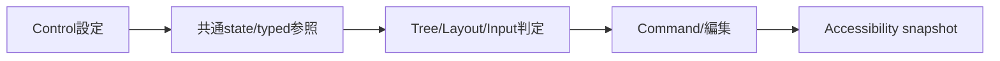
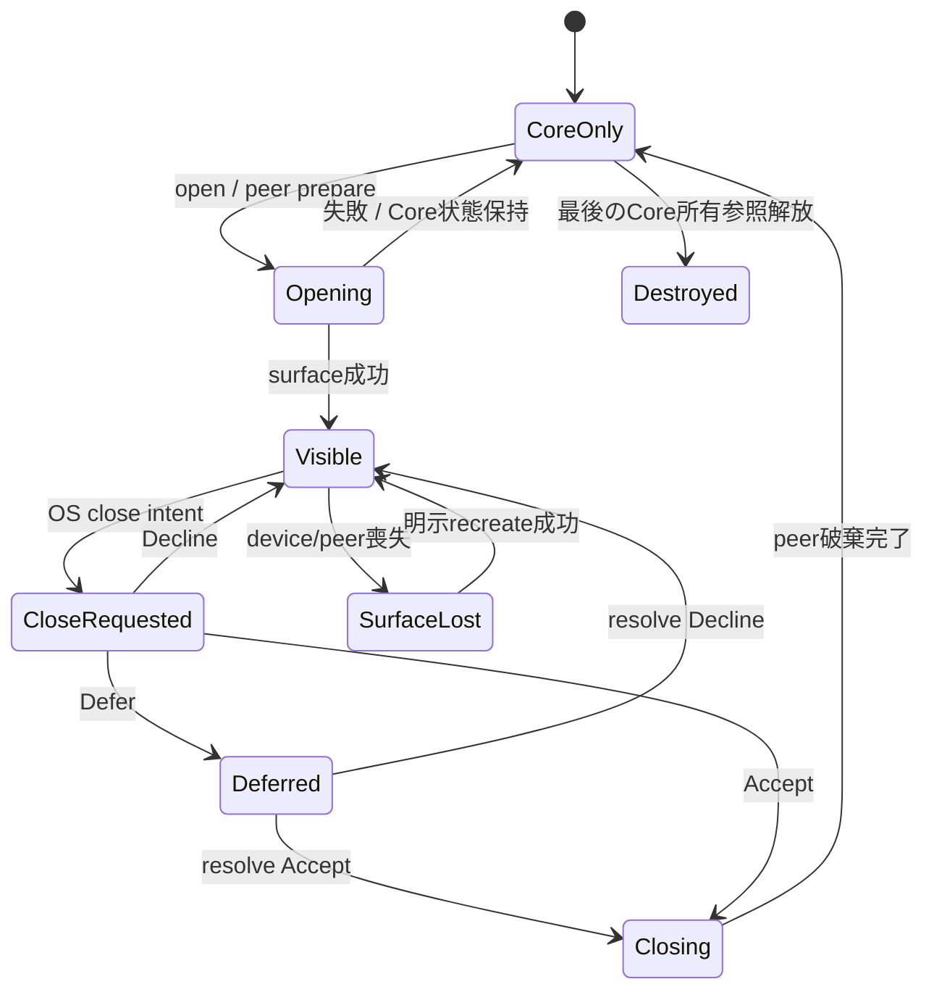
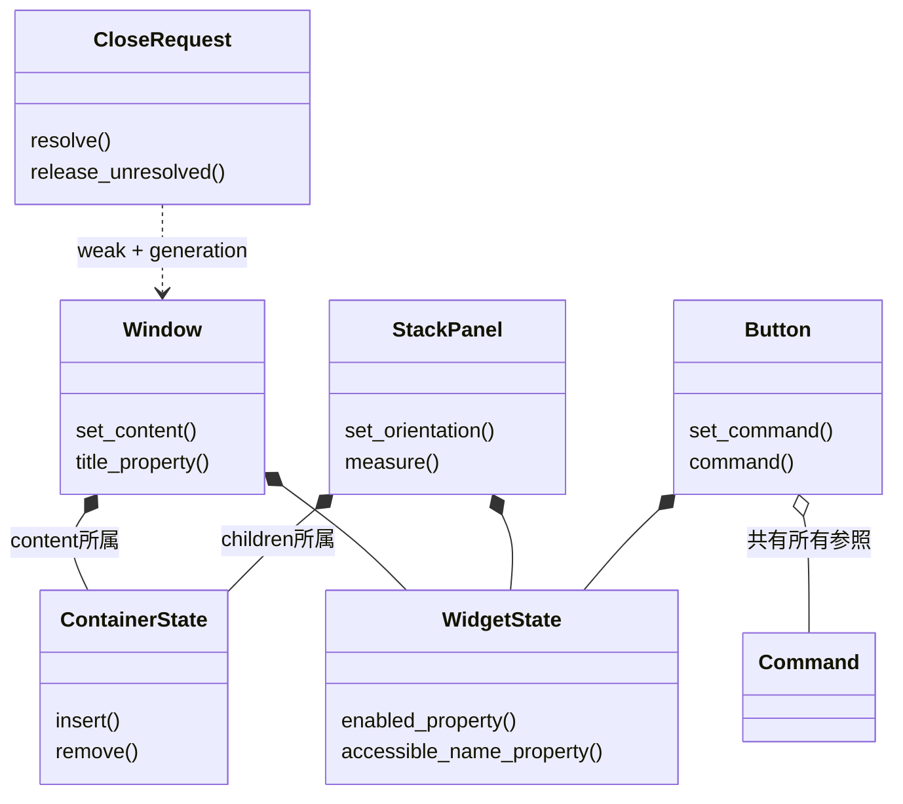
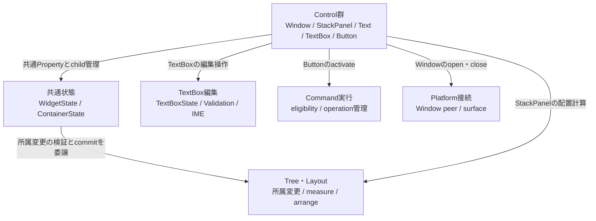

# UIクラス：Window・基本Control・次段階Control

- 文書版: 1.2
- 文書ロール: detailed-design
- 更新日: 2026-10-30
- 状態: 1.2全文承認済み（利用者、2026-10-30）。実装・試験状態は別管理

## 目的と上位根拠

本書を要求から実装へ具体化する詳細設計の正本とする。型・API・所有・呼出し手順・状態遷移を実装へ反映する。要求の外部保証はリンク先RQ、層の責務と主要flowは上位BDを根拠とする。設計宣言の記載は、配布済みheader・実装済みAPI・試験合格を意味しない。

基本設計: [UIクラス：Tree・Layout・Focus・Control](../../12_design/ui/tree-layout-controls.md)、[イベントハンドリング：通知・入力・Command](../../12_design/events/notifications-commands.md)、[プラットフォーム：抽象化・描画・text・OS接続](../../12_design/platform/abstraction.md)、[UIクラス：TextBox・編集・Validation](../../12_design/ui/text-editing-validation.md)、[オブジェクト管理：値・モデル・更新整合性](../../12_design/runtime-objects/model-values.md)

## 要求と設計項目の対応

| 設計項目 | 要求根拠 |
| --- | --- |
| 基本Controlの型と責務 | [RQ-09-001](../../11_requirements/RQ-09_ui-scope.md#rq-09-001)、[RQ-09-002](../../11_requirements/RQ-09_ui-scope.md#rq-09-002)、[RQ-09-003](../../11_requirements/RQ-09_ui-scope.md#rq-09-003)、[RQ-09-004](../../11_requirements/RQ-09_ui-scope.md#rq-09-004)、[RQ-09-005](../../11_requirements/RQ-09_ui-scope.md#rq-09-005)、[RQ-09-006](../../11_requirements/RQ-09_ui-scope.md#rq-09-006)、[RQ-09-007](../../11_requirements/RQ-09_ui-scope.md#rq-09-007)、[RQ-09-008](../../11_requirements/RQ-09_ui-scope.md#rq-09-008)、[RQ-09-009](../../11_requirements/RQ-09_ui-scope.md#rq-09-009)、[RQ-09-010](../../11_requirements/RQ-09_ui-scope.md#rq-09-010)、[RQ-09-011](../../11_requirements/RQ-09_ui-scope.md#rq-09-011)、[RQ-09-045](../../11_requirements/RQ-09_ui-scope.md#rq-09-045)、[RQ-09-046](../../11_requirements/RQ-09_ui-scope.md#rq-09-046)、[RQ-09-047](../../11_requirements/RQ-09_ui-scope.md#rq-09-047)、[RQ-09-048](../../11_requirements/RQ-09_ui-scope.md#rq-09-048)、[RQ-09-057](../../11_requirements/RQ-09_ui-scope.md#rq-09-057)、[RQ-09-058](../../11_requirements/RQ-09_ui-scope.md#rq-09-058)、[RQ-09-059](../../11_requirements/RQ-09_ui-scope.md#rq-09-059)、[RQ-09-060](../../11_requirements/RQ-09_ui-scope.md#rq-09-060)、[RQ-09-061](../../11_requirements/RQ-09_ui-scope.md#rq-09-061)、[RQ-10-003](../../11_requirements/RQ-10_accessibility.md#rq-10-003)、[RQ-10-008](../../11_requirements/RQ-10_accessibility.md#rq-10-008)、[RQ-10-012](../../11_requirements/RQ-10_accessibility.md#rq-10-012) |
| 次段階Controlと拡張範囲 | [RQ-09-012](../../11_requirements/RQ-09_ui-scope.md#rq-09-012)、[RQ-09-019](../../11_requirements/RQ-09_ui-scope.md#rq-09-019)、[RQ-09-021](../../11_requirements/RQ-09_ui-scope.md#rq-09-021)、[RQ-09-022](../../11_requirements/RQ-09_ui-scope.md#rq-09-022)、[RQ-09-023](../../11_requirements/RQ-09_ui-scope.md#rq-09-023)、[RQ-09-024](../../11_requirements/RQ-09_ui-scope.md#rq-09-024)、[RQ-09-025](../../11_requirements/RQ-09_ui-scope.md#rq-09-025)、[RQ-09-026](../../11_requirements/RQ-09_ui-scope.md#rq-09-026)、[RQ-09-047](../../11_requirements/RQ-09_ui-scope.md#rq-09-047)、[RQ-09-054](../../11_requirements/RQ-09_ui-scope.md#rq-09-054)、[RQ-09-073](../../11_requirements/RQ-09_ui-scope.md#rq-09-073) |

本書内の共通規則は上記の各要求を実現するために適用する。同一項目内で個別要求を参照する場合はその対象範囲を優先する。将来候補・未採用範囲は採用済みの動作と区別する。

## 基本Controlの型と責務

### 実現のcall/data/ownership flow

初期Controlは共通Widget状態と各機能へのtyped参照を持つ。Containerのchild操作はTree commitへ、StackPanel設定はLayoutへ、TextBox候補は編集transactionへ接続する。Buttonは同Runtimeのoptional Command参照を保持し、effective enabledとCommand.can_executeを評価して一つのsemantic activation経路からexecuteする。Accessibilityも同じ意味状態を読む。



### 責務境界

- MVVM UIライブラリ 初期Control契約に関する上位判断案のとおり`Widget`は共通抽象、`Container`は子を持ちうる分類、`Window`/`StackPanel`はContainer、`TextBox`/`Text`/`Button`は葉Widgetとする。
- Logical Treeはアプリが組み立てる意味上の所属と所有を持つ。Visual Tree/Layoutは描画・配置・hit-test情報を担い、重複所有しない（MVVM UIライブラリ UI treeの所有・寿命に関する上位判断案、UIクラス：Tree・Layout・Geometry）。
- PropertyとBindingはCoreの共通Property graphへ接続する。ButtonのCommandは公開ABI契約/イベントハンドリング：非同期CommandのCommand objectを起動する。Control固有状態を別のBinding semanticsにしない。
- CoreがControlとAccessibilityの意味上のsource of truthを持ち、共通RendererとPlatform Adapterが表示面・入力・IME・Accessibility OS接続を行う（MVVM UIライブラリ 初期描画方式と検証順序に関する上位判断案）。
- 特定key/modifierをControl操作またはCommandへ割り当てない。Buttonへのkeyboard shortcut、TextBox caret key mapping、Tab traversal、Ctrl+Z等は`.docs/20_todo/keyboard-actions-value-memo.md`の候補範囲。

### 実装規則

| 実装規則 | 根拠・境界 |
| --- | --- |
| 初期版は具象`Window`、`StackPanel`、`TextBox`、`Text`、`Button`を生成可能とし、`Widget`/`Container`は抽象分類で直接生成しない案。各Controlは同一Runtimeに属するCore objectとして作る。 | MVVM UIライブラリ 初期Control契約に関する上位判断案、オブジェクト管理：handle・値・error。言語wrapperのclass/trait/API名は言語ラッパー：C++へ送る。 |
| 初期Control共通の意味情報として`AccessibleName`（UTF-8、空欄可、既定空）を持たせ、表示文字列やWindow titleと独立させる。表示Text/Labelからのfallbackとlabel関係は加えない。 | 具体化は[プラットフォーム：OS・描画・text・IME内部レイヤー](../platform/internal-layers.md)、UIクラス：Window・基本Control・次段階Controlを参照する。OS-specific name propertyへの写像はプラットフォーム：抽象化と共通protocol。 |
| Widgetはown `IsEnabled` BOOL（既定true）を持ち、effective enabledは自分と全Logical ancestorのenabledの論理積とする案。親を無効化しても子のown値は変更しない。effective値はInput/Focus、Button execute可否、Accessibility stateで共有する。 | MVVM UIライブラリ Focusの管理単位に関する上位判断案、公開ABI契約、イベントハンドリング：非同期Command。親disabled時に子のProperty状態を変更せず操作だけ抑止する意味を確認する。 |
| `Focusable`はWidgetごとに扱い、初期既定をTextBox/Button=true、Text/StackPanel/Window=falseとする。Window active/focus状態は子Controlのkeyboard focusと区別する。明示FocusableをContainerに付けた場合の実挙動は後続scope設計へ送る。 | MVVM UIライブラリ Focusの管理単位に関する上位判断案、InputとFocus。既定値がControl役割に合うか確認する。 |
| 初期Controlには共通`IsVisible`/Hidden/Collapsed APIを追加せず、画面から外す操作はLogical Treeからのremoveで行う案。visibilityによるMeasure/Focus/Accessibility eligibilityを暗黙に作らない。 | 初期要件にvisibility機能は列挙されず、MVVM UIライブラリ Layoutの責務境界に関する上位判断案は詳細を別項目で具体化する。将来必要ならVisible/Hidden/Collapsedの意味を別判断する。 |
| Windowは一つのLogical content rootを受け持ち、rootの追加/除去と寿命はUIクラス：Tree・Layout・GeometryのTree操作に従う。Windowの開閉・surface生成はControlのLogical ownershipとは分け、Core意味論・Platform操作境界をプラットフォーム：抽象化と共通protocolで接続する。 | MVVM UIライブラリ UI treeの所有・寿命に関する上位判断案、UI Tree。titlebar、native decoration、close callback、Window titleのPlatform表示は確定しない。 |
| StackPanelはUIクラス：Tree・Layout・Geometryの順序付きchildrenとorientation/AlignをそのままControl意味論とし、独自のlayout Propertyや追加spacingを作らない。追加/削除/並び順変更はUIクラス：Tree・Layout・GeometryのUI-thread原子操作へ接続する。 | MVVM UIライブラリ Layoutの責務境界に関する上位判断案、UI Tree、Layout。公開collection facade/child API名は決めない。 |
| Textは`Content` UTF-8 Propertyを表示値として持ち、既定は空文字列、OneWay Bindingのtargetにできる読み取り専用Controlとする。Accessibility valueは同じ表示値を参照し、`AccessibleName`は別設定とする。 | MVVM UIライブラリ 初期Control契約に関する上位判断案、公開ABI契約、Binding契約。wrap/ellipsis/selection/copy/action、fallback name、line-break policyはここで決めない。 |
| TextBoxは公開ABI契約/UIクラス：TextBox・Validation・IME編集の確定`Value` PropertyをTwoWay Binding可能とし、editing text、selection/caret、input state/reasonはUIクラス：TextBox・Validation・IME編集の状態getter/subscriptionに接続する。Control levelに別のTextBox-only Binding semanticsを追加しない。 | 公開ABI契約、UIクラス：TextBox・Validation・IME編集。編集API、公開property handle一覧、symbolはABI/wrapper設計へ送る。 |
| Buttonは表示用UTF-8 `Text`/labelと`AccessibleName`を独立させ、optional Command associationからactivationを処理する案。Command associationはgeneric Value Propertyでなくtyped Command referenceとし、同Runtime Commandのみを設定可能にする案。 | MVVM UIライブラリ 初期Control契約に関する上位判断案、公開ABI契約、イベントハンドリング：非同期Command。label property名、Command associationの設定/binding面は確認対象。 |
| Buttonのeffective executable stateを`IsEnabled && assigned Command exists && Command.can_execute`とする案。disabled状態のactivationはCommand.executeへ進まず、実行中の二度押しもイベントハンドリング：非同期Commandの実行可否規則に従う。Commandなしでは生成・表示を許し、activationをno-opで終了する。 | 公開ABI契約、Command、MVVM UIライブラリ Accessibility共通意味論に関する上位判断案。Command由来のProperty notificationを同期flushしない。 |
| Pointer activationとAccessibility invokeは一つのsemantic Button activation経路を通し、同じCommand.execute eligibilityを適用する。Buttonの直接Click callback、OS別button semantics、keyboard key bindingは初期契約に追加しない案。 | MVVM UIライブラリ Input eventの責務境界に関する上位判断案、UIクラス：InputとFocus、イベントハンドリング：非同期Command。Pointer hit-test/input gestureはプラットフォーム：抽象化と共通protocol、AT操作のOS bridgeはプラットフォーム：抽象化と共通protocol。 |

### Control契約の一覧

| Control | Core meaning / value | Property/Command接続 | Focus / Accessibility |
|---|---|---|---|
| Window | top-level container、単一content root、active window state | Tree owner。root layout areaはUIクラス：Tree・Layout・Geometryから供給 | window role、AccessibleName、active/focus state。window surface lifecycleはプラットフォーム：抽象化と共通protocol |
| StackPanel | ordered child container、orientation既定Vertical | child collectionをUIクラス：Tree・Layout・Geometryへ接続、LayoutはUIクラス：Tree・Layout・Geometry | group/container role、children order、name/state。focusable既定は確認案 |
| Text | static text、UTF-8 Content | OneWay target | static text role、name、display value、actionなし |
| TextBox | editable text、確定ValueとUIクラス：TextBox・Validation・IME編集 editing state | TwoWay target/source、UIクラス：TextBox・Validation・IME編集 Validator | editable text role、name/value/state/focus/enabled/validation |
| Button | action leaf、display label | optional typed Command association、CanExecute連動 | button role、name/state/focus/enabled。invokeはsemantic activationへ |

## 次段階Controlと拡張範囲

### 実装規則

| 実現手段・責務 | 要求根拠 |
| --- | --- |
| 次段階Controlは既存採用リストを保持し、CheckBox/ToggleButtonはBOOL Property、ProgressBarは進捗値、ScrollViewerはviewportの独立modelへ接続する案。 | 上記の根拠RQ |
| ListView/仮想化ListはCollection/Selection snapshotを使い、可視item presenterを再利用。item templateはitem ID+snapshotからvisualを構成する。 | 上記の根拠RQ |
| Styleはtyped Property setter集合、Themeは共有ResourceMap、TemplateはControl-owned VisualFactoryとしLogical childを増やさない。 | [RQ-09-073](../../11_requirements/RQ-09_ui-scope.md#rq-09-073) |
| Resource lookupはlocal→Logical ancestor→Runtime themeの順、未定義は明示error。DataContext自動伝播/name scopeは別候補として初期追加しない。 | [RQ-09-073](../../11_requirements/RQ-09_ui-scope.md#rq-09-073) |
| keybinding/Tab traversal/Ctrl+Z/UndoRedo/multi-seatは将来メモを維持し、今回のmandatory APIにしない。拡張点はsemantic actionとFocus serviceへ置く。 | 上記の根拠RQ |
| custom値/nullable/OBJECTは未採用。将来はtype descriptor+version+copy/equal/destroyと循環防止の契約が揃ってから新kindを割り当てる。 | 上記の根拠RQ |
| Core-managed async Validationは初期非提供を維持。ViewModelのrevision付きAsyncCommand+結果Propertyを推奨構成として示す。 | 上記の根拠RQ |
| Grid/TableView/TreeView/ComboBox、RTL/emoji/他script、画像codec、template script等はfeature候補。共通model設計だけで個別Controlを採用しない。 | 上記の根拠RQ |

### 実現設計

#### 次段階の責務案

```text
Style { typed_setters, applicability }   // immutable
ResourceMap { key -> immutable value }   // generation付き
Theme { Arc<ResourceMap>, control_styles }
Template { VisualFactory, resource_scope } // owner Controlに従属
ItemPresenter { item_id, snapshot_revision, reusable_visual }
ViewportModel { offset, extent, viewport_size }
```

Style適用は全setterをprepareして成功時だけvisual/property stateへcommitし、入力/disabled/focus/Validation意味論をStyleが上書きしない。Theme切替はresource generationを進め参照中Visualをdirtyにする。Templateの旧Visualは新Visualのprepare成功後に切り替え、Core Logical ownership・Accessibility identityを維持する。

Resourceの見つからないkey、型不一致、lookup cycleは明示error。Template内部VisualからLogical parentを変えず、ItemPresenter再利用では旧item ID/sessionを失効させてから新snapshotへbindする。非可視itemのデータをCollectionから削除しない。

将来のCustomTypeDescriptor設計は`type_id, schema_version, immutable_payload, clone, equals, destroy`。登録成功でcopy/destroy code lifetimeをRuntimeと結び、言語objectの直接pointerはABIへ渡さない。現時点では採用せず、nullableのtag比較とOBJECT参照cycle判定も拡張featureに分ける。

Async Validation推奨例は、入力revisionを増加→AsyncCommandで検査→結果revision一致なら状態Property更新。古い結果を適用せず、キャンセル要求と実終端を区別する。これはアプリ構成例でありCore async Validator APIを新設する案ではない。

## Control APIとWindowの具体的な操作

要求根拠: [RQ-09-071](../../11_requirements/RQ-09_ui-scope.md#rq-09-071)、[RQ-09-072](../../11_requirements/RQ-09_ui-scope.md#rq-09-072)。

WindowのCore意味とControl APIは本節、Sceneの受渡し・frame completion・OS資源の接続はプラットフォーム設計の所管とする。

| 実装規則 | 要求根拠 |
| --- | --- |
| 公開名はWindow/StackPanel/Text/TextBox/Button、Widget/Containerは抽象view。名前は4言語で対応させC ABIはsnake_caseにする。 | 上記の根拠RQ |
| Window.openは明示操作、closeはpeerを閉じCore owner/Tree/Propertyを保持し再open可能とする。 | [RQ-09-071](../../11_requirements/RQ-09_ui-scope.md#rq-09-071) |
| close requestはAccept/Decline/Defer、既定Accept。Deferはowned CloseRequestで明示resolve、失効IDは拒否。 | [RQ-09-071](../../11_requirements/RQ-09_ui-scope.md#rq-09-071) |
| ButtonはLabel UTF8 Propertyとtyped Command strong参照。交換は同Runtime検査後commit。Button破棄だけで共有Commandをcloseしない。 | 上記の根拠RQ |
| Window titleと初期text描画は明示UTF8。Textは単一paragraph、soft-wrapなし、client clip、ellipsisなしを初期案とする。 | [RQ-09-072](../../11_requirements/RQ-09_ui-scope.md#rq-09-072) |

#### Control接続API

| 型 | 主要操作・Property | 所有・変更点 |
|---|---|---|
| Widget | enabled_property / accessible_name_property / request_focus | getterは独立owned Property。UI threadでcommit |
| Container | insert/remove/move、children_snapshot | parentのみがchildの所属ownerを保持 |
| Window | content、title_property、open/close、close_requested | closeはpeer終了、shutdownはRuntime全体終了 |
| StackPanel | orientation、child Align、constraints | 各入力の検査後Layout dirtyを立てる |
| Text | content_property | 表示のみ。アプリのsetter/Bindingで更新できる |
| TextBox | value_property、編集snapshotとedit API | 確定値と編集中の値を分離 |
| Button | label_property、set_command / command | typed Command参照をstrong保持、getterは新ownerを返す |



CloseRequestはWindow弱参照・peer generation・request IDを持つ。resolveはUI thread、成功後はConsumed。未解決requestをreleaseした場合はDeclineとしてWindowを表示維持する案で、source ownerが失われたためWindowを黙って閉じない。shutdownはveto/deferを経由せず全peerをUIでtear downする。


## クラス設計の補足（1.1承認済み）

既承認1.0の実現規則を支える型・関連・所有・主要操作を整理した。内部型名とメソッドの分担は本改訂で補足する内部設計であり、既存公開APIの署名や外部保証を追加・変更するものではない。この節のクラス構成と追加図は1.1版全文の承認対象であり、実装・試験完了の証明とは区別する。

要求根拠: [RQ-09-001](../../11_requirements/RQ-09_ui-scope.md#rq-09-001)、[RQ-09-003](../../11_requirements/RQ-09_ui-scope.md#rq-09-003)、[RQ-09-006](../../11_requirements/RQ-09_ui-scope.md#rq-09-006)、[RQ-09-071](../../11_requirements/RQ-09_ui-scope.md#rq-09-071)。

Widget/Containerは公開APIの抽象viewであり、Coreに基底classの継承を強制しない。Coreは具象structが共通WidgetState/ContainerStateを合成する案とし、C++/C#はclass、Rustは型/trait、Pythonはfacadeへ写像する。

### 型の責務と所有

| 型 | 責務・保持データ | 主要メソッド・操作 | 所有・寿命 |
| --- | --- | --- | --- |
| WidgetState | Runtime所属、enabled/accessible-name Property、Visualとの対応を保持 | enabled_property(); accessible_name_property(); request_focus() | 共通stateは具象Controlに従属。getterは独立owned Propertyを返す |
| ContainerState | 順序付きchild所属と子snapshotを管理 | insert(child, index); remove(child); move(child, index); children_snapshot() | childの所属ownerを保持。child→parentは非所有。変更はTree処理へ委譲 |
| Window | WidgetState、単一content所属、title Property、peer generation、open/close状態 | set_content(child); title_property(); open(); close(); resolve_close(request, decision) | content所属を所有。peer操作はPlatformへ委譲し、closeでCore content/Propertyを破棄しない |
| StackPanel | WidgetState/ContainerState、orientation、子のAlignとconstraint | set_orientation(value); measure(limit); arrange(bounds) | 子の所属はContainerState、配置計算はLayoutへ委譲。独自の子所有を重ねない |
| Text | WidgetStateとUTF8 content Property | content_property(); build_visual(text_snapshot) | 表示値はPropertyから取得。OSのtext objectをCoreの正本にしない |
| TextBox | WidgetStateと既存TextBoxStateを結合 | value_property(); edit_replace(input); snapshot() | 確定Property・編集snapshot・IME sessionはTextBoxStateの所管。別の値正本を作らない |
| Button | WidgetState、label Property、optional Command所有参照 | set_command(command); command(); activate(origin) | 共有Commandを強保持。交換成功後に旧参照を解放。Button破棄だけではCommandをcloseしない |
| CloseRequest | Window弱参照、peer generation、request ID、未解決/Consumed状態 | resolve(decision); release_unresolved() | 一回だけ解決するowned request。stale generationは拒否。未解決releaseのDecline規則は本文を維持 |

### クラスの関連

`*--`は従属するstate/作業の合成、`o--`は共有を含む所有参照、`..>`は非所有の利用・識別・委譲を示す。関連名と本文で示した寿命を優先し、図の同名型は各instanceで別の状態を持つ。図は主要メソッド名を抜粋し、引数・所有・失敗条件は表と本文に従う。



### コンポーネント図：Controlの機能委譲

クラス図の合成関係に加え、操作の実装先を示す。各箱は責務のまとまりであり、矢印は利用・委譲先を表す。所有や呼出し順はクラス図と本文に従う。



TextBoxは編集値を二重管理せずTextBoxStateへ渡す。Buttonは共有Commandを保持してexecuteを委譲し、workerの実行器にはならない。WindowのCore contentとOS peerは寿命が別であり、peerを閉じてもCoreの値を失わない。

### 主要な呼出しと失敗境界

Button.activateはUI contextとenabledを確認し、現在のCommandをcall期間pinしてcan_executeを再評価してからexecuteへ進む。Window.openはpeer準備成功後にopen状態をcommitし、失敗時はCoreOnlyとCore値を保つ。Container操作は親子検証→peer/Visual準備→Tree所属commitの順で、失敗時に旧所属を保つ。

抽象viewの取得で別のWidget objectを生成しない。WindowとStackPanelが同じContainerStateを共有する図ではなく、各instanceが自分のstateを持つ。Text/TextBoxは表に示し、図は共通stateと所有の主要部分に限定した。次段階Controlは既存採用範囲のまま維持する。

## Window background RGB API（1.2）

要求根拠: [RQ-09-074](../../11_requirements/RQ-09_ui-scope.md#rq-09-074)（改訂案）。Window背景色はWindow固有の表示設定であり、Control common `Property`/Binding値にはしない。初期版ではopaque normalized RGBの3成分（各`f32` 0.0～1.0）を使い、alphaは扱わない。

| 操作 | Core動作 | 失敗・副作用 |
|---|---|---|
| `background_rgb()` | overrideがあればその値、なければ`RgbColor(1,1,1)`を返す | UI thread/runtime/type validationに従う。getterはWindow stateを変更しない |
| `set_background_rgb(r,g,b)` | 全成分のfinite・0.0～1.0を先に検証し、Window overrideを一括更新 | invalid入力では状態不変。effective値が変わる場合だけpaint/scene dirty。Layoutはdirtyにしない |
| `reset_background_rgb()` | overrideをNoneへ戻し、規定値をeffective colorとする | 既に未指定ならno-op。effective colorが変わる場合だけpaint/scene dirty |

getterは未指定かexplicit defaultかを区別せずeffective colorを返す。resetの意味は規定値への復帰である。Window close/reopenではoverrideを保持し、Runtime shutdown時は通常のWindow state cleanupで破棄する。Text/Button/StackPanelの個別背景、general Style/Theme、C ABI Property handleは本変更に含めない。

### ABI / wrapper API案

```c
ui_status ui_abi_1_window_background_rgb(
    ui_handle window, float *out_red, float *out_green, float *out_blue,
    ui_handle *out_error);
ui_status ui_abi_1_window_set_background_rgb(
    ui_handle window, float red, float green, float blue, ui_handle *out_error);
ui_status ui_abi_1_window_reset_background_rgb(
    ui_handle window, ui_handle *out_error);
```

各言語wrapperは共通意味値`RgbColor`でgetter/setterを表現し、reset methodでdefaultへ戻す。詳細は各wrapper文書の改訂案へ記載する。signatureはレビュー案であり、配布header・実装済みAPIではない。

## 文書の承認・改訂履歴

| 日付 | 対象版 | 内容・根拠 |
| --- | --- | --- |
| 2026-10-17 | 1.0 | 利用者の指示に基づき、既承認内容を責務別に再編集。設計項目IDによる承認・追跡は廃止し、以後は文書版全体で管理する。構成変更を新規の製品仕様採用としない |
| 2026-10-17 | 1.0全文 | 利用者の「全部承認します」により文書全体を承認。旧IDによる項目承認ではなく、現行文書版を対象とする。実装・試験合格を意味しない |
| 2026-10-17 | 1.1改訂案 | 利用者の補足指示によりクラス責務・所有・メソッド・関連図を追加。1.0承認を維持し、1.1全文は確認待ち |
| 2026-10-17 | 1.1全文 | 利用者の「OK,テスト文書作りましょうか」により、クラス設計補足と選択的な図の補強を含む全文を承認。既存履歴を維持し、実装・試験状態は別管理 |
| 2026-10-30 | 1.2改訂案 | RQ-09-074に基づきWindow background RGBのdefault/get/set/reset、paint-only invalidation、ABI/wrapper案を追加。1.1承認範囲を維持し全文レビュー待ち |
| 2026-10-30 | 1.2全文 | 利用者の「ok」によりWindow背景色APIとCore状態・validation境界を含む全文を承認。実装・試験合格は別管理 |
