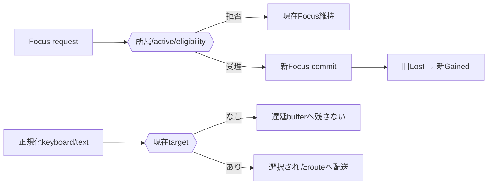
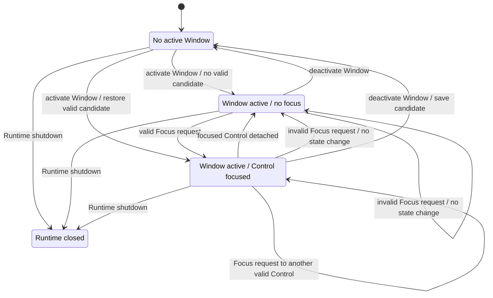
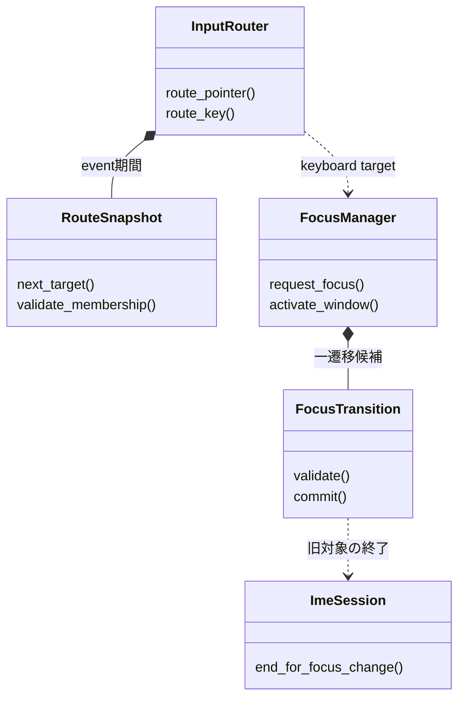
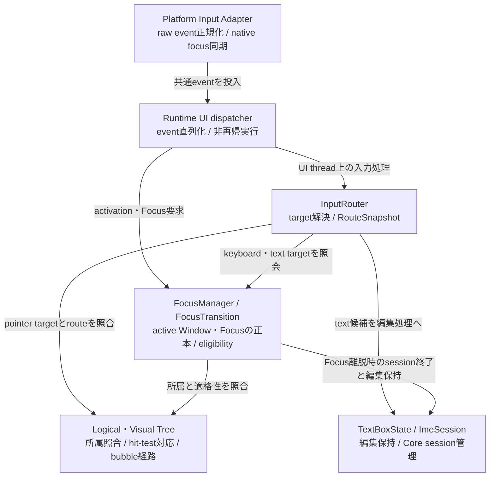

# UIクラス：InputとFocus

- 文書版: 1.1
- 文書ロール: detailed-design
- 更新日: 2026-10-17
- 状態: 1.1全文承認済み（利用者、2026-10-17）。実装・試験状態は別管理

## 目的と上位根拠

本書を要求から実装へ具体化する詳細設計の正本とする。型・API・所有・呼出し手順・状態遷移を実装へ反映する。要求の外部保証はリンク先RQ、層の責務と主要flowは上位BDを根拠とする。設計宣言の記載は、配布済みheader・実装済みAPI・試験合格を意味しない。

基本設計: [UIクラス：Tree・Layout・Focus・Control](../../12_design/ui/tree-layout-controls.md)、[イベントハンドリング：通知・入力・Command](../../12_design/events/notifications-commands.md)、[UIクラス：TextBox・編集・Validation](../../12_design/ui/text-editing-validation.md)

## 要求と設計項目の対応

| 設計項目 | 要求根拠 |
| --- | --- |
| 入力配送・Focus状態・IME接続 | [RQ-02-009](../../11_requirements/RQ-02_core-features.md#rq-02-009)、[RQ-02-010](../../11_requirements/RQ-02_core-features.md#rq-02-010)、[RQ-09-006](../../11_requirements/RQ-09_ui-scope.md#rq-09-006)、[RQ-09-009](../../11_requirements/RQ-09_ui-scope.md#rq-09-009)、[RQ-09-010](../../11_requirements/RQ-09_ui-scope.md#rq-09-010)、[RQ-09-046](../../11_requirements/RQ-09_ui-scope.md#rq-09-046)、[RQ-09-047](../../11_requirements/RQ-09_ui-scope.md#rq-09-047)、[RQ-09-048](../../11_requirements/RQ-09_ui-scope.md#rq-09-048)、[RQ-09-049](../../11_requirements/RQ-09_ui-scope.md#rq-09-049)、[RQ-10-008](../../11_requirements/RQ-10_accessibility.md#rq-10-008) |

本書内の共通規則は上記の各要求を実現するために適用する。同一項目内で個別要求を参照する場合はその対象範囲を優先する。将来候補・未採用範囲は採用済みの動作と区別する。

## 入力配送・Focus状態・IME接続

### 実現のcall/data/ownership flow

Runtime Focus stateはNone/WindowOnly/Focused(Control)を持つ。requestはAttached/active Window/focusable/enabledを検証し、新stateをcommitした後に旧FocusLost→新FocusGainedをdispatchする。Adapter入力はkeyboardとtext commitを分け、現在targetとLogical routeへ渡す。同一遷移のOS折返しを抑止し、callback起因の再入入力は後続処理へ送る。

### 前提と責務境界

- Runtimeは同時にactive Windowを最大一つ、active keyboard focusを0または1つ管理する。Focus対象はLogical Tree上のControlとする（MVVM UIライブラリ Focusの管理単位に関する上位判断案）。
- Platform Input AdapterはOS/device固有raw eventを共通eventへ変換し、Core Inputは共通eventの意味を処理する（MVVM UIライブラリ Input eventの責務境界に関する上位判断案）。
- Keyboardと確定textはactive focusへ送る。active Windowまたはactive focusがない場合はControlへ配送しない（MVVM UIライブラリ Focusの管理単位に関する上位判断案）。
- native focus/activationはAdapterと同期するが、OSとCoreに独立したsource of truthを置かない。
- Core UI状態変更とcallback実行はRuntime UI threadに集約する。callback中の通知再帰やevent queue順はランタイム：実行基盤と終了に従う。
- Focus離脱時の未commit IME preeditはCore TextBoxに保持し、commitやViewModel伝播を起こさない（MVVM UIライブラリ Focus移動時のIME compositionに関する上位判断案）。内部sessionの実装はUIクラス：TextBox・Validation・IME編集。

### 実装規則

| 実装規則 | 根拠・境界 |
| --- | --- |
| Platform AdapterはOSのraw keyboard/text/pointer eventを共通Input eventへ正規化し、Runtime UI thread上へ投入する。keyboard key down/upとtext commitを区別し、CoreはAdapterが渡す安定したkey identity・modifier・source metadataを扱う。event field layoutとABI表現は決めない。 | MVVM UIライブラリ Input eventの責務境界に関する上位判断案、Runtime契約、ランタイム：実行基盤と終了。Platform固有のpointer hit-test target算出はプラットフォーム：抽象化と共通protocol。 |
| RuntimeのFocus状態を「active Windowなし」「active Windowあり・active focusなし」「active Windowあり・active focusあり(Control)」に分ける。active Window外またはDetached Controlはactive focusになれない。Focus requestは同じControlならno-op、別Controlなら一つの状態遷移としてcommitする。 | MVVM UIライブラリ Focusの管理単位に関する上位判断案、UIクラス：Tree・Layout・Geometry。WindowのcloseとRuntime shutdownはUIクラス：Tree・Layout・Geometryに従う。 |
| 初期Focus取得条件は、要求元Controlがactive WindowのLogical TreeにAttachedであり、Controlがfocusableかつenabledであることとする。invalid/disabled/nonfocusable/nonactive-window/Detached targetへの要求は失敗し、現在のFocusを変えない。focusable/enabled Propertyの公開面はUIクラス：Window・基本Control・次段階Controlへ送る。 | MVVM UIライブラリ Focusの管理単位に関する上位判断案は移動条件を別項目で具体化する。Visibility eligibilityやControl別例外の最終規則はUIクラス：Window・基本Control・次段階Controlで照合する。 |
| Focus遷移ではRuntimeのactive focusを先に新状態へcommitする。その後、旧ControlのFocusLostを新ControlのFocusGainedより先に内部dispatchする。callback/eventは状態commit前のFocusを観測できない。Focus requestはUI thread専用で、callback中に発生する遷移は現在eventを中断せずランタイム：実行基盤と終了の非再帰順序で後続処理する。 | MVVM UIライブラリ Focusの管理単位に関する上位判断案、Runtime契約、ランタイム：実行基盤と終了。public focus event APIは確定しない。 |
| Active Windowがdeactivateされたらactive focusを解除して復帰候補として直前Controlを記録する。再activate時はcandidateが同WindowにAttachedでfocusable/enabledなら復帰し、そうでなければfocusなしとする。detachされたControlは復帰candidateにも残さない。 | MVVM UIライブラリ Focusの管理単位に関する上位判断案はcandidate保持を許し復帰条件/時期を別項目で具体化する。Platform activation順はプラットフォーム：抽象化と共通protocolと整合させる。 |
| Focus Controlまたはその祖先がactive WindowのLogical Treeからdetach/破棄された場合、active focusを解除し、detach ControlをFocus対象に残さない。detachだけを理由に別Controlへ自動Focusしない。FocusLostを一度dispatchし、TextBoxから離れる場合はMVVM UIライブラリ Focus移動時のIME compositionに関する上位判断案のpreedit保持を適用する。 | MVVM UIライブラリ Focusの管理単位に関する上位判断案、UI Tree、UIクラス：TextBox・Validation・IME編集。fallback targetの明示指定は後続Control設計に送る。 |
| 入力eventはtarget Controlを定めた後、そのControlへ届ける。初期route候補として、targetで処理した後にLogical parent方向へbubbleする方式を推奨し、tunnel phaseは追加しない。keyboard targetはactive focus、pointer targetはプラットフォーム：抽象化と共通protocolのVisual hit-test結果に対応するLogical Controlとする。focusなし等でtargetを得られないkeyboard/text eventはbufferせず破棄する。 | MVVM UIライブラリ Logical Tree／Visual Treeの役割に関する上位判断案、UIクラス：Tree・Layout・Geometry。routed-event subscription、handled/default action、公開ABIはUIクラス：Window・基本Control・次段階Controlへ送る。route方式自体は本レビューで確認する。 |
| Focus対象はLogical Tree上のControlとする。Containerであること自体はFocus対象であることを意味せず、focusabilityの公開条件はControl設計で定める。 | MVVM UIライブラリ Focusの管理単位に関する上位判断案。 |
| 本詳細設計では、特定のkey/modifierをFocus移動やUI機能へ割り当てない。Tab/Shift+TabによるFocus traversal、Ctrl+Z等のshortcut/action binding、利用者が割当を変更する仕組みは本書の契約から除外し、将来検討メモに分離する。 | MVVM UIライブラリ Focusの管理単位に関する上位判断案はkeyboard navigationを後続判断としている。候補メモ: `.docs/20_todo/keyboard-actions-value-memo.md`。 |
| Coreはkey eventをtargetおよび選択されたrouteに沿ってUI thread上で順に処理する。Focus changeは現eventの処理中にstate commitできるが、新しいInput callbackを再帰開始しない。Adapter由来native focus同期が同じ遷移を再通知しても重複FocusLost/Gainedを発生させない。 | Runtime契約、MVVM UIライブラリ Input eventの責務境界に関する上位判断案、ランタイム：実行基盤と終了。Platform feedback suppression/sequence IDの仕組みはプラットフォーム：抽象化と共通protocolへ送る。 |

### Focus状態と遷移

Runtime内のactive Window/active focusを次の状態で表す案である。Windowごとの復帰candidateはactive focusとは別に保持する。

| 現状態 | 事象 | 次状態 | 副作用 |
|---|---|---|---|
| No active Window | Platform activate(Window) | Window active / no focusまたはvalid candidate | candidateが有効ならFocusGained |
| Window active / no focus | 有効ControlへFocus要求 | Window active / Control focused | FocusGained |
| Window active / Control A focused | 有効Control BへFocus要求 | Window active / Control B focused | A.FocusLost後にB.FocusGained |
| Window active / focused | Window deactivate | No active focus / candidate A | A.FocusLost、candidate保持 |
| No active Window | 以前のWindowが再activate | active Window / valid candidateまたはno focus | valid candidateならFocusGained |
| Window active / focused | Aまたは祖先をdetach/破棄 | Window active / no focus | A.FocusLost、candidateからも除外 |
| 任意 | invalid target/wrong thread | 状態不変 | 失敗を返す。Focus eventなし |
| 任意 | Runtime shutdown | Closed runtime | ランタイム：実行基盤と終了のcleanup。新しいInputを受けない |

状態フロー図:

Focus stateはControlのLayout bounds、Platform native focus flag、TextBox IME sessionとは別軸である。入力eventの配送はactive focusのみ参照し、Platform peer状態からCore focusを直接上書きしない。

### Keyboard / text event配送

1. Platform Adapterはraw eventを共通keyboard key down/upまたはtext commitへ正規化する。
2. eventをRuntimeのUI thread queueへ渡す。worker threadやOS callback threadからControlを直接操作しない。
3. CoreはRuntimeがRunningでactive Window/focus Controlを持つことを検証する。
4. keyboard eventはactive focusをtargetとする。pointer eventはプラットフォーム：抽象化と共通protocolが得たVisual hit-test targetを対応するLogical Controlへ結び付ける。Coreはtarget eventから選択されたrouteを処理する。
5. key down/upはactive focus Controlをtargetとする。本書は特定key/modifierをFocus traversalやcommand/actionへ割り当てない。
6. Text commitはkey eventと別に扱う。TextBoxでは候補全文・selection・originを公開ABI契約の入力Validator規則へ渡す。
7. callbackでFocusが変わる場合、状態をcommit後にFocusLost/FocusGainedを順序付ける。event途中のshutdownはランタイム：実行基盤と終了の優先control taskに従い現在event完了後にcleanupする。
8. keyboard/text eventにFocusがなければqueueに保留せず破棄し、後のFocus取得時に古い入力を再送しない。

Key repeat、shortcut/accelerator、TextBoxの文字編集・selection/caret、IME composition内のevent処理は本書で決めない。

### FocusとTextBox/IME

- FocusLostはControl focus stateの遷移通知であり、TextBoxの入力候補を確定するAPIではない。
- FocusがTextBoxを離れる時点でIME preeditが未commitなら、Platform sessionを終了し、編集文字列と編集位置をCore TextBoxに保持する（MVVM UIライブラリ Focus移動時のIME compositionに関する上位判断案）。
- Focus移動だけではView input validatorを確定候補として呼ばず、確定値Property/Bindingを更新しない。
- IME commitがFocusLostより先にCoreへ届いた場合は通常の公開ABI契約入力commitとして処理する。Platform eventの順序保証・session実装はUIクラス：TextBox・Validation・IME編集に残す。
- TextBox内部のactive caret、selection、preedit range更新とFocus復帰後のIME再開はUIクラス：TextBox・Validation・IME編集に委ねる。

### callback・thread・失敗境界

- Focus request、active WindowのCore state更新、Core Input処理はUI thread専用。Platform raw eventはUI threadへ正規化dispatchされる。
- callbackから別ControlへFocus requestしても現在のcallbackを中断しない。同じfocusを再要求する操作は冪等。
- FocusLost/Gainedは状態変更後にdispatchするので、callbackがgetterを使う場合には新しいactive focus状態を観測する。eventの公開callback有無は決めない。
- invalid Handle、別Runtime、Detached Control、非active Window target、wrong threadでは状態変更・Focus event・IME操作を行わない。具体statusはABI共通規則とControl API設計に従う。
- Window deactivate、Focus detach、Runtime shutdown中のclosure cleanupはランタイム：実行基盤と終了と対象ownerの規則を維持し、callback/destroyを重複させない。

## クラス設計の補足（1.1承認済み）

既承認1.0の実現規則を支える型・関連・所有・主要操作を整理した。内部型名とメソッドの分担は本改訂で補足する内部設計であり、既存公開APIの署名や外部保証を追加・変更するものではない。この節のクラス構成と追加図は1.1版全文の承認対象であり、実装・試験完了の証明とは区別する。

要求根拠: [RQ-09-009](../../11_requirements/RQ-09_ui-scope.md#rq-09-009)、[RQ-09-046](../../11_requirements/RQ-09_ui-scope.md#rq-09-046)、[RQ-09-049](../../11_requirements/RQ-09_ui-scope.md#rq-09-049)、[RQ-09-068](../../11_requirements/RQ-09_ui-scope.md#rq-09-068)。

入力元event、配送route、Focusの正本を分け、Focus更新とcallback呼出しを同じ処理として混在させない。

### 型の責務と所有

| 型 | 責務・保持データ | 主要メソッド・操作 | 所有・寿命 |
| --- | --- | --- | --- |
| InputRouter | 中立eventのtarget選択とLogical route配送 | route_pointer(event); route_key(event); route_text(event) | UI threadで処理。focusなしtextを将来の対象へbufferしない |
| RouteSnapshot | event開始時の対象から親への経路と必要な内部pin | next_target(); validate_membership(target) | 一event期間保持し、途中detach/destroyは本文の再検査規則に従う |
| FocusManager | active Window、active Control、復帰候補の非所有識別 | request_focus(target); activate_window(window); deactivate_window(window) | Focusの唯一の正本。Detached対象を復帰候補に残さない |
| FocusTransition | 検証済みold/new targetとcommit後通知の作業 | validate(); commit(); enqueue_lost_then_gained() | 失敗時は旧Focus不変。state commit前にFocus callbackを呼ばない |
| ImeSession | TextBox編集のsession identityと状態 | end_for_focus_change(reason) | TextBox文書所管。Focus移動から必要な終了処理だけ依頼 |

### クラスの関連

`*--`は従属するstate/作業の合成、`o--`は共有を含む所有参照、`..>`は非所有の利用・識別・委譲を示す。関連名と本文で示した寿命を優先し、図の同名型は各instanceで別の状態を持つ。図は主要メソッド名を抜粋し、引数・所有・失敗条件は表と本文に従う。

### コンポーネント図：入力・Focus・IMEの接続

既存のFocus状態図に対し、配送先を決める責務と編集を扱う責務を区別する。矢印は利用・委譲先であり、状態の所有関係ではない。

Adapterのnative focusはCore Focusとの同期先であり、別の正本ではない。Core ImeSessionとAdapter所有のOS IME sessionも区別する。Focus離脱の委譲はpreeditの確定ではなく、保持とsession終了である。targetなしのkeyboard/textは後のFocus取得へ持ち越さない。

### 主要な呼出しと失敗境界

InputRouterはtargetを決めてRouteSnapshotをpinし、各配送前に活性/所属を確認する。FocusManagerはeligibilityを検査してnew stateをcommitした後、旧対象のFocusLost→新対象のFocusGainedを非再帰で配送し、TextBox/IME境界へ接続する。

OS native focusは同期先で、Core Focusの代替正本ではない。Tab/shortcut等の未採用key割当を追加しない。図のImeSessionは既存編集session責務を明示する内部型名案である。

## 文書の承認・改訂履歴

| 日付 | 対象版 | 内容・根拠 |
| --- | --- | --- |
| 2026-10-17 | 1.0 | 利用者の指示に基づき、既承認内容を責務別に再編集。設計項目IDによる承認・追跡は廃止し、以後は文書版全体で管理する。構成変更を新規の製品仕様採用としない |
| 2026-10-17 | 1.0全文 | 利用者の「全部承認します」により文書全体を承認。旧IDによる項目承認ではなく、現行文書版を対象とする。実装・試験合格を意味しない |
| 2026-10-17 | 1.1改訂案 | 利用者の補足指示によりクラス責務・所有・メソッド・関連図を追加。1.0承認を維持し、1.1全文は確認待ち |
| 2026-10-17 | 1.1全文 | 利用者の「OK,テスト文書作りましょうか」により、クラス設計補足と選択的な図の補強を含む全文を承認。既存履歴を維持し、実装・試験状態は別管理 |
