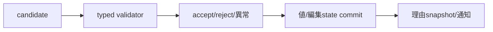
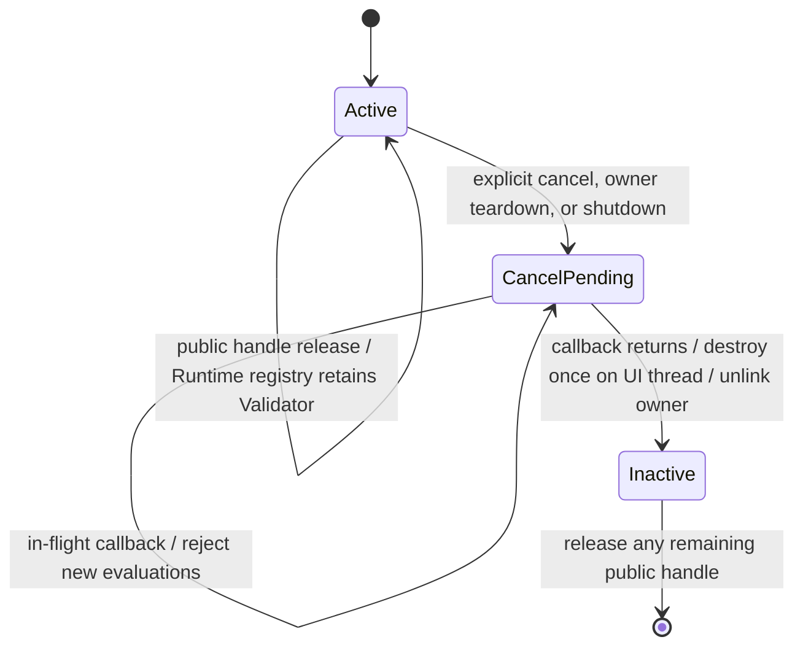
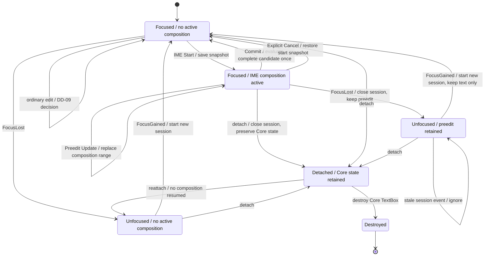
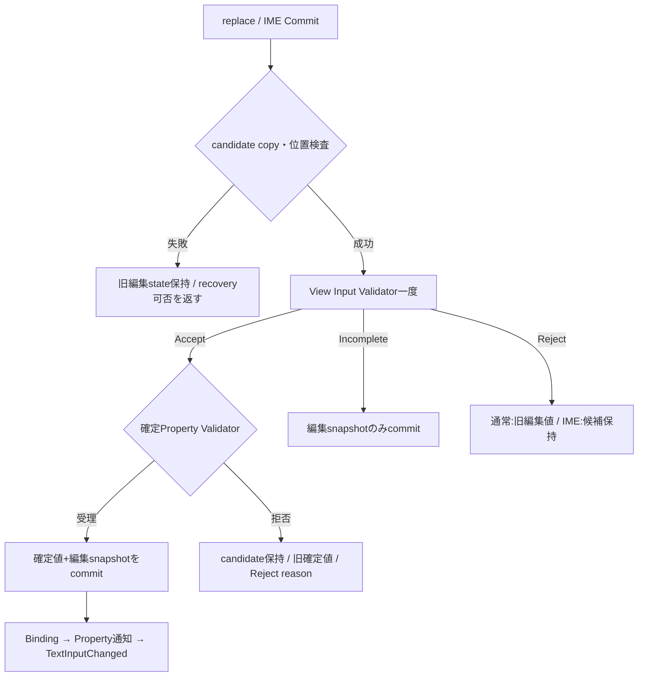
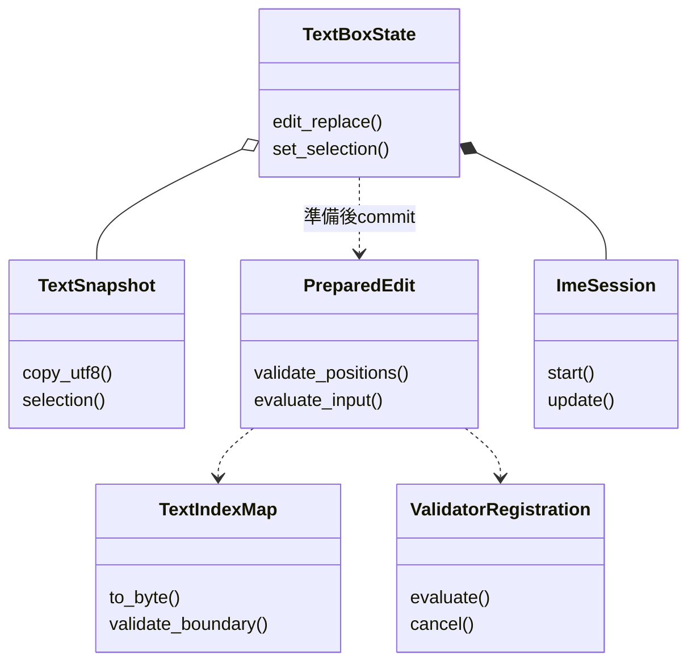
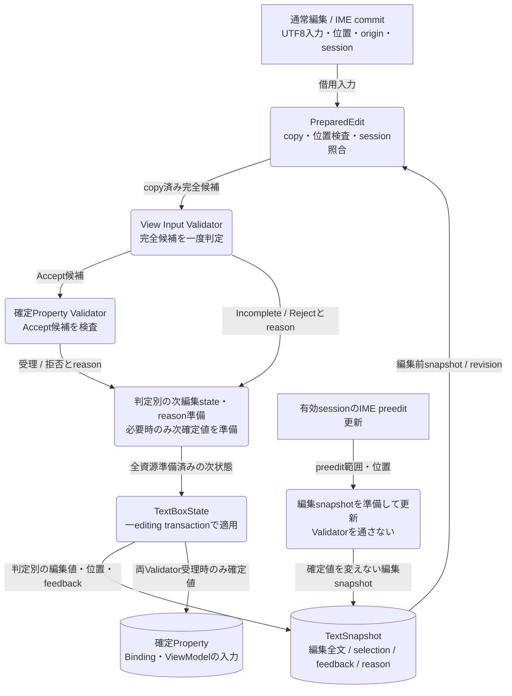

# UIクラス：TextBox・Validation・IME編集

- 文書版: 1.1
- 文書ロール: detailed-design
- 更新日: 2026-10-17
- 状態: 1.1全文承認済み（利用者、2026-10-17）。実装・試験状態は別管理

## 目的と上位根拠

本書を要求から実装へ具体化する詳細設計の正本とする。型・API・所有・呼出し手順・状態遷移を実装へ反映する。要求の外部保証はリンク先RQ、層の責務と主要flowは上位BDを根拠とする。設計宣言の記載は、配布済みheader・実装済みAPI・試験合格を意味しない。

基本設計: [オブジェクト管理：値・モデル・更新整合性](../../12_design/runtime-objects/model-values.md)、[UIクラス：TextBox・編集・Validation](../../12_design/ui/text-editing-validation.md)、[プラットフォーム：抽象化・描画・text・OS接続](../../12_design/platform/abstraction.md)

## 要求と設計項目の対応

| 設計項目 | 要求根拠 |
| --- | --- |
| PropertyとView入力のValidation | [RQ-02-002](../../11_requirements/RQ-02_core-features.md#rq-02-002)、[RQ-02-009](../../11_requirements/RQ-02_core-features.md#rq-02-009)、[RQ-02-011](../../11_requirements/RQ-02_core-features.md#rq-02-011)、[RQ-02-021](../../11_requirements/RQ-02_core-features.md#rq-02-021)、[RQ-05-002](../../11_requirements/RQ-05_ownership-callbacks.md#rq-05-002)、[RQ-05-006](../../11_requirements/RQ-05_ownership-callbacks.md#rq-05-006)、[RQ-05-009](../../11_requirements/RQ-05_ownership-callbacks.md#rq-05-009)、[RQ-05-013](../../11_requirements/RQ-05_ownership-callbacks.md#rq-05-013)、[RQ-07-010](../../11_requirements/RQ-07_binding.md#rq-07-010)、[RQ-07-016](../../11_requirements/RQ-07_binding.md#rq-07-016)、[RQ-09-005](../../11_requirements/RQ-09_ui-scope.md#rq-09-005)、[RQ-09-038](../../11_requirements/RQ-09_ui-scope.md#rq-09-038)、[RQ-09-039](../../11_requirements/RQ-09_ui-scope.md#rq-09-039)、[RQ-09-040](../../11_requirements/RQ-09_ui-scope.md#rq-09-040)、[RQ-09-042](../../11_requirements/RQ-09_ui-scope.md#rq-09-042)、[RQ-09-055](../../11_requirements/RQ-09_ui-scope.md#rq-09-055)、[RQ-09-056](../../11_requirements/RQ-09_ui-scope.md#rq-09-056) |
| TextBox編集とIME session | [RQ-09-005](../../11_requirements/RQ-09_ui-scope.md#rq-09-005)、[RQ-09-038](../../11_requirements/RQ-09_ui-scope.md#rq-09-038)、[RQ-09-039](../../11_requirements/RQ-09_ui-scope.md#rq-09-039)、[RQ-09-040](../../11_requirements/RQ-09_ui-scope.md#rq-09-040)、[RQ-09-041](../../11_requirements/RQ-09_ui-scope.md#rq-09-041)、[RQ-09-042](../../11_requirements/RQ-09_ui-scope.md#rq-09-042)、[RQ-09-053](../../11_requirements/RQ-09_ui-scope.md#rq-09-053)、[RQ-09-054](../../11_requirements/RQ-09_ui-scope.md#rq-09-054)、[RQ-09-055](../../11_requirements/RQ-09_ui-scope.md#rq-09-055)、[RQ-09-056](../../11_requirements/RQ-09_ui-scope.md#rq-09-056) |
| 編集API・文字位置・失敗回復 | [RQ-09-038](../../11_requirements/RQ-09_ui-scope.md#rq-09-038)、[RQ-09-039](../../11_requirements/RQ-09_ui-scope.md#rq-09-039)、[RQ-09-040](../../11_requirements/RQ-09_ui-scope.md#rq-09-040)、[RQ-09-041](../../11_requirements/RQ-09_ui-scope.md#rq-09-041)、[RQ-09-042](../../11_requirements/RQ-09_ui-scope.md#rq-09-042)、[RQ-09-055](../../11_requirements/RQ-09_ui-scope.md#rq-09-055)、[RQ-09-056](../../11_requirements/RQ-09_ui-scope.md#rq-09-056)、[RQ-09-065](../../11_requirements/RQ-09_ui-scope.md#rq-09-065)、[RQ-09-066](../../11_requirements/RQ-09_ui-scope.md#rq-09-066) |

本書内の共通規則は上記の各要求を実現するために適用する。同一項目内で個別要求を参照する場合はその対象範囲を優先する。将来候補・未採用範囲は採用済みの動作と区別する。

## PropertyとView入力のValidation

### 実現のcall/data/ownership flow

型別ValidatorはPropertyに対して最大一つのactive登録を管理し、setter commit前のcandidateを同期評価する。拒否とcallback異常を別statusへ変換し、owned理由handleは経路ごとに一度消費する。TextBox入力は候補全文・selection・originを判定callbackへ渡し、Accept/Incomplete/Rejectに応じて編集値と確定値のcommit対象を分ける。registration ownerとweak indexは承認済みランタイム：実行基盤と終了の方式へ合わせる。



### 範囲と境界

- Property Validatorは候補Property値に対する同期的なアプリ規則を扱う。プログラムからのsetterとBinding伝播の両方に適用する。
- View入力ValidatorはTextBoxに対するユーザー起点の編集候補だけを扱う。初期値やプログラムからのProperty設定には適用しない。
- ViewModel側のProperty ValidatorとView入力Validatorは別の防御層である。Viewを通らない設定もあるため、業務上の不変条件はViewModel側に置く（Validation契約）。
- 初期Property kind BOOL/I64/UTF8/F64/DECIMALのすべてについてValidatorを扱う。BOOL/I64/UTF8の既存callback規則を保ち、F64/DECIMALはProperty保存と通知の型別signatureに従う。
- 対象はTextBoxの基本的な候補・編集値・確定値・状態・理由までとする。IME composition内部状態、Undo/Redo、caret移動、selection操作、描画、エラー表示優先順位、他のControlの入力規則はInput/Control設計へ送る。

### 承認済み前提

- Property setterは検証に成功した後に値を同期確定する。同値candidateもValidatorへ渡すが、成功して同値なら値通知を増やさない（Property契約、Validation契約、Property保存と通知）。
- Property ValidatorはPropertyごとに最大一つ。登録時の現在値検証・差替え時の再検証は行わない。明示cancelで以後の検証を止め、handle releaseだけではcancelしない（公開ABI契約、abi-spec §13.1）。
- Binding伝播先のValidation失敗では入力元を巻き戻さず、Bindingが拒否先・方向・エラーsnapshotを保持する。TwoWayでは不一致を許し、次の有効更新で同期する（Validation契約、Binding graph）。
- TextBoxの確定値Propertyと編集中の文字列は別状態であり、確定値Propertyは通常Bindingへ接続できる（公開ABI契約）。外部から異なる値が確定すれば編集値・入力状態・理由を更新する（公開ABI契約）。
- `Accept / Incomplete / Reject`は判定処理結果ではなく入力判断である。callback自体はstatusを返し、判断値と任意の理由handleは出力する（公開ABI契約）。

### 実装規則

| 判断 | 根拠・境界 |
| --- | --- |
| Propertyごとに同期Validatorを最大一つ登録する。登録・cancelはUI thread専用。登録時には現在値を再検証しない。既存登録がある場合は新規登録を失敗させ、既存closureを維持する。BOOL/I64/UTF8/F64/DECIMALすべてを対象にする。 | 公開ABI契約、Property保存と通知、共通ABI。差替えや既存値の再検証は別APIとして後続判断へ送る。 |
| callbackには型に合うcandidateを同期で渡す。BOOL/I64/UTF8は公開ABI契約の型別callbackを維持し、F64/DECIMALは`double`/`uint64_t` signatureを使う。UTF8 bytesはcallback中だけ借用可能とし、保持が必要ならcallback内でcopyする。callbackの入力はsetterがcommitする前のcandidateである。 | 公開ABI契約、Property保存と通知、値・error境界。F64比較とDECIMAL値域・等価性はMVVM UIライブラリ 初期公開値型の上位判断/Property保存と通知に従う。 |
| Validator callbackは`UI_OK`なら受理、`UI_VALIDATION_FAILED`なら拒否、`UI_INTERNAL_ERROR`または不正status/outputなら検証処理の異常とする。拒否時はProperty値と値通知を変えず、statusを通常API引数失敗と区別する。直接setterでは拒否を呼出し側へ返す。 | Validation契約、公開ABI契約、値・error境界。Binding遅延伝播の失敗表示はBinding graphに従う。 |
| Property Validator中は同一RuntimeのUI状態を変更するAPIを禁止し、禁止APIは状態変更前に拒否する。callback内でcandidate判定、言語側の読取り専用状態参照、および`validation_error_create`を行う。shutdown要求はUI状態commitとは分けて優先control recordへ登録し、callback終了後に実行する。callback自身によるregistration cancelも禁止する。 | ABI §13.3、callback実行規則。callback例外・panicはwrapper/Core境界で捕捉し、ABIを越えない。 |
| 検証理由は任意の不変error handleとして返す。`validation_error_create`はmessage UTF8を呼出し中にcopyし、domain/code/messageを持つ`UI_VALIDATION_FAILED` errorを作る。statusが拒否理由の一次識別子で、理由handleを作れない場合はhandle 0でも拒否を表せる。callbackから渡された有効な所有handleは、受理・拒否・異常いずれでも一度だけ消費または解放する。 | 公開ABI契約、値・error境界、共通ABI。具体的なProperty Validator code catalogは後続error catalog設計へ送る。 |
| 成功登録したValidator closureはCoreが保持する。Runtimeのactive Validator registryが登録をstrong ownerとして保持し、Validatorとowner Property間はweak参照とする。明示cancelはactiveを先に落として以後の検証呼出しを止める。最後のin-flight callback後、UI thread safe pointでclosureを一度だけdestroyし、Property indexとregistry ownerを外す。 | RQ-05-002/006～008、公開ABI契約、承認済みRuntime所有と終了、callback実行規則、Property保存と通知。handle releaseの外部効果・Property破棄/shutdownの保証はRQ/ABIを正本とする。 |
| TextBox入力callbackには編集後候補全文、selection start/end、originをUTF8 byte offsetで渡し、callback判定は`ACCEPT / INCOMPLETE / REJECT`の三値とする。Keyboard・paste・drop・accessibilityの編集を同じ判定経路に通し、IME composition中は呼ばず、確定候補を`IME_COMMIT`として評価する。 | Validation契約、公開ABI契約、abi-spec §17.1。候補・selectionは有効UTF8と文字境界を満たす。IME中の内部state遷移は別設計。 |
| `ACCEPT`では候補をTextBoxの確定値Propertyへ設定し、既存Bindingへ伝播する。`INCOMPLETE`では編集値とselectionだけを更新し、確定Property・ViewModelへ送らない。通常`REJECT`では編集値・確定値・selectionを保ち、入力状態と任意理由だけを更新する。 | Validation契約、公開ABI契約、abi-spec §17.1。Property setterがViewModel側Validatorで拒否された場合の値保持・Binding errorはValidation契約・Binding graphに従う。 |
| IME確定candidateが`REJECT`された場合は通常Rejectと区別し、candidateを編集値として保持しつつ状態を`REJECT`にし、任意理由を観測可能にする。Validatorなしの場合は有効UTF8候補をAcceptする。プログラムsetterとTextBox生成初期値はView入力Validatorを通さない。 | Validation契約、公開ABI契約、abi-spec §17.1/17.3/20.1。 |
| TextBox入力状態は読取専用I64 Propertyとして公開し、状態値は既存enum `ACCEPT / INCOMPLETE / REJECT`を使う。reason snapshotは不変error handleまたは0を返し、editing UTF8は値・error境界のbuffer規則を使う。入力subscriptionは状態・理由・編集中文字列のいずれかが変わったとき通知し、初期通知をしない。 | 公開ABI契約、Property保存と通知～09、abi-spec §17.2。具体的な数値enum IDは既存ABI表と整合する。 |

#### Validator registration lifecycle



各評価開始時にactive stateを確認する。解除要求を受けた後は新規評価を開始せず、実行中評価の戻りを待ってclosureをdestroyする。外部解除契機はRQ-05-006、Runtime ownerとProperty参照はRuntime所有と終了に従う。

### Property Validatorの評価とエラー経路

1. setterはhandle/kind/thread/runtimeとscalar/UTF8の妥当性を検査し、必要なUTF8 copyとcandidate準備を行う。
2. 登録済みValidatorがあればUI threadで同期呼出しする。候補が現在値と等しくてもValidatorは実行する。
3. 受理時はProperty保存と通知のcommit境界で値を確定する。値が変わったときだけProperty notificationを作る。
4. 直接setterの拒否・異常ではProperty値・通知queueを変更しない。呼出し元へstatusと可能ならerror snapshotを返す。
5. Binding起点では入力元値を保ち、Binding graphに従ってBinding errorを更新する。Binding作成時の初期同期失敗はBinding graphの原子性を適用する。

Property Validator自体は値を変更せず、アプリの副作用や別Propertyのsetterも行わない。Property Validator解除後もProperty値および既存Binding errorを自動的に書き換えない。Binding errorの解消はイベントハンドリング：通知とBinding伝播の成功再伝播または解除規則に従う。

### TextBox入力状態の更新表

| 入力経路・判定 | 編集文字列 / selection | 確定値Property | 入力状態・理由 | Binding |
|---|---|---|---|---|
| ユーザー候補 `ACCEPT` | candidateへ更新 | candidateでsetter | `ACCEPT`、理由なし | setter成功後に通常伝播 |
| ユーザー候補 `INCOMPLETE` | candidateへ更新 | 変更なし | `INCOMPLETE`、任意理由 | 伝播しない |
| 通常の `REJECT` | 編集前を維持 | 変更なし | `REJECT`、任意理由 | 伝播しない |
| IME確定候補 `REJECT` | candidateを保持 | 変更なし | `REJECT`、任意理由 | 伝播しない |
| 外部経路が異なる値を確定 | 確定値へ置換 | 外部setterでcommit済み | `ACCEPT`、理由なし | Binding規則に従う |
| プログラムsetterが同値を再設定 | 現在の編集値を維持 | 同値のため既存表現を維持 | 状態・理由を変更しない | 新しい値伝播なし |

表の外部更新・同値規則は公開ABI契約およびABI §20.2に従う。ユーザー候補が`ACCEPT`後にViewModel側のProperty Validatorで拒否された場合は、入力表示とTextBox確定値を保ち、Binding errorを保持する（Validation契約、Binding graph）。

### 所有権・通知・失敗

- Property Validator登録とTextBox input Validator登録は、成功時にCoreがcallback/userdata/destroy closureを所有する。失敗時にCoreはcallbackまたはdestroyを呼ばない。
- TextBox input subscription callbackの所有・解除・自己解除・destroyはcallback実行規則と公開ABI契約に従う。TextBox破棄時とRuntime shutdown時にinput Validatorとinput subscriptionを無効化し、in-flight callbackの後にclosureをUI thread上で一度だけ破棄する。
- `INCOMPLETE`/`REJECT`のreason error handleはimmutable snapshotである。状態が更新しても外部が取得済みのhandleは変わらない。
- 入力候補の確定、編集値、selection、状態、reasonの更新は一つの編集操作として原子的にcommitする。callback異常・不正判定値・必要領域確保失敗ではpartial updateしない。ただしIME確定candidateの退避失敗処理はInput詳細設計へ送る。
- 状態値が同じでもreasonまたはediting textが変わる場合、input subscriptionは変化をまとめて通知できる。callbackは引数なしとし、利用者はstate/reason/editing getterから現在値を読み直す。
- Property notificationとBinding error notificationの順序はProperty保存と通知とBinding graphの順を保つ。TextBox input subscriptionと他callback群の相互順序、同一編集内の複数通知の統合単位は本案で明示的に保留する。

### 上位文書へ戻す境界

Validationは要求の入力・所有契約とイベントハンドリング：通知とBinding伝播の接点を具体化した。具体化はUIクラス：TextBox・Validation・IME編集を参照する。特にTextBox自身のProperty Validator拒否時の編集処理とIME退避失敗は、ABI §17/20およびInput/Control設計との接続確認を要する。

## TextBox編集とIME session

### 実現のcall/data/ownership flow

TextBoxは確定Property、編集全文、selection/caret、composition/session、入力state/reasonを分けて保持する。編集操作から候補全文をprepareし、判定結果に応じた組を一editing transactionでcommitする。Start snapshot、Update range置換、Commit候補評価、Cancel復元、FocusLost保持をsession IDで分岐し、外部確定値変更は旧sessionを無効化する。

```mermaid
flowchart TD
    E["編集/IME event"] --> S{{"session eventか"}}
    S -->|通常編集| P["候補全文prepare"]
    S -->|IME| I{{"active session照合"}}
    I -->|stale| X["適用しない"]
    I -->|Start/Update| U["snapshot保存 / preedit更新"]
    I -->|Commit| P
    I -->|Cancel| C["開始snapshot復元 / 理由はRQ案選択待ち"]
    I -->|FocusLost| F["編集値保持 / session終了"]
    P --> V["Accept/Incomplete/Reject評価"]
    V --> T["対応する編集/確定値のcommit"]
具体化は[DD-28](28-text-edit-api.md)、[DD-31](31-os-text-accessibility.md)、[DD-39](39-next-stage-ui.md)を参照する
```

### 前提と責務境界

- Core TextBoxは確定値Propertyと編集中の文字列・selection/caret・preedit編集状態を持つ。OS IME sessionと候補UIはPlatform Adapterが所有する（MVVM UIライブラリ IME Platform境界に関する上位判断案）。
- IME preeditは画面上の編集状態を変えるが、Validator、確定値Property、Binding/VMへ伝播しない。Commit時の完全候補だけをUIクラス：TextBox・Validation・IME編集のView Input Validatorへ渡す（MVVM UIライブラリ IME edit sessionに関する上位判断案、公開ABI契約）。
- FocusLostはcommit/cancelではない。preeditと位置を保持してIME sessionを閉じ、明示cancelはpreedit開始直前の編集状態へ復元する（MVVM UIライブラリ Focus移動時のIME compositionに関する上位判断案）。
- 公開ABI契約のcallback selection位置はUTF-8 byte offset。これだけではCore内部caret移動やselection操作のユーザー認識上の単位を決めない（MVVM UIライブラリ text shaping／Unicode対応の上位判断案）。
- TextBoxの編集候補はUI threadで更新する。Validatorおよびsubscriptionのclosure lifecycleはイベントハンドリング：callbackと再入に従う。

### 実装規則

| 実装規則 | 根拠・境界 |
| --- | --- |
| Core状態を (a) 確定値Property、(b) 編集全文、(c) selection/caret、(d) optional active composition/session、(e) UIクラス：TextBox・Validation・IME編集 input state/reasonに分ける。preeditは別の確定値ではなく編集全文中のcomposition rangeとして表す。 | 公開ABI契約、MVVM UIライブラリ IME Platform境界に関する上位判断案、UIクラス：TextBox・Validation・IME編集。内部structと公開getter/APIは確定しない。 |
| Text editは「編集前状態＋置換範囲＋挿入UTF-8＋編集後selection＋origin」から候補全文を作り、候補全体をUIクラス：TextBox・Validation・IME編集 Validatorへ渡す方式を提案する。key/paste/drop/accessibilityで同じ編集判定経路を使う。 | Validation契約、公開ABI契約、Validation。どのgesture/keyがこの操作を発行するかは本判断に含めない。 |
| 候補適用時はUIクラス：TextBox・Validation・IME編集に従い、Acceptは候補を編集全文と確定値へ反映してBindingへ進み、Incompleteは編集全文とselectionだけ反映し、通常Rejectは編集状態を維持して状態/reasonだけ更新する。IME commit RejectはMVVM UIライブラリ IME edit sessionに関する上位判断案に従い候補を編集全文へ保持する。 | Validation、MVVM UIライブラリ IME edit sessionに関する上位判断案。TextBox自身のProperty拒否はTextBox編集状態の保存領域へ分岐する。 |
| IME Startでsession identityと開始snapshotを保持し、Updateは対象rangeだけを最新preeditで置換する。各Updateは確定値、Validator、Bindingを変更しない。session IDとevent orderingはPlatform Adapterが供給し、Coreはcurrent session以外を適用しない。 | MVVM UIライブラリ IME edit sessionに関する上位判断案。IDの幅、ABI形状、OS event変換はプラットフォーム：抽象化と共通protocolへ送る。 |
| Commitはactive sessionのpreedit rangeをcommit文字列で置換した完全候補を一度だけUIクラス：TextBox・Validation・IME編集へ渡す。commit成功またはUIクラス：TextBox・Validation・IME編集の判定後にcomposition/sessionを終了し、二重commit・終了済みsessionのcommitは無視する。 | MVVM UIライブラリ IME edit sessionに関する上位判断案、Validation。Commit直後のcaret位置はselection post-state案を提示し、確認を求める。 |
| Startでediting text・caret・selectionに加えinput state/reasonのsnapshot参照を保存する。Cancelはこの組を一つのediting transactionで復元し、Validatorと確定Property setterを呼ばずsessionを終了する。 | [RQ-09-040](../../11_requirements/RQ-09_ui-scope.md#rq-09-040)を具体化。snapshotに入力状態・理由も含める。 |
| FocusLostはcurrent sessionを閉じるが、最後のpreedit編集全文・composition range・caret/selectionを保持し、commit・cancel・Validatorを実行しない。再Focusでは新sessionを作り、Core編集値から続ける。 | MVVM UIライブラリ Focus移動時のIME compositionに関する上位判断案、InputとFocus。OS候補windowと変換内部状態を復元しない。 |
| 外部経路で確定値Propertyに異なる値が確定したら公開ABI契約どおり編集全文を置換し、input state/reasonを初期化する。active compositionは無効化しsessionを終了した扱いとし、そのsession由来の遅延eventをstaleとして破棄する。 | 公開ABI契約、MVVM UIライブラリ IME edit sessionに関する上位判断案。Adapterへのsession close通知順はプラットフォーム：抽象化と共通protocolと整合させる。 |
| 入力ValidatorのAccept後に確定Property setterを試みる。Property Validatorが拒否したら候補全文・post-edit selectionを編集領域へ保持し、確定Property・ViewModelを変更せず、Rejectと当該Property拒否reasonをinput feedbackへcommitする（案B）。新しいinput state種別は追加しない。 | [RQ-09-039](../../11_requirements/RQ-09_ui-scope.md#rq-09-039)を具体化。ValidationとABI宣言分冊§20.2のsetter拒否へ接続する。 |
| Commit candidateをprepareしてからsessionを終端する。prepare失敗時は旧Core状態を維持し、候補の回復可否・再試行経路をdiagnostic/resultへ載せる。Core recovery保持とAdapter再送の選択はprofile別の実現設計課題とし、候補を保持できなかった失敗を成功へ置換しない。 | Validation、MVVM UIライブラリ IME edit sessionに関する上位判断案、UIクラス：TextBox・Validation・IME編集 §7。退避そのものが失敗した場合のstatus/diagnosticは要レビュー。 |
| 具体化はUIクラス：TextBox・Validation・IME編集、[プラットフォーム：OS・描画・text・IME内部レイヤー](../platform/internal-layers.md)、[UIクラス：Window・基本Control・次段階Control](controls.md)を参照する。全位置は少なくとも有効UTF-8境界を守り、公開ABI契約 callbackには承認済みUTF-8 byte offsetで変換して渡す。 | 公開ABI契約、MVVM UIライブラリ text shaping／Unicode対応の上位判断案はgrapheme単位移動・selection affinity・visual/logical policyを後続へ残す。内部単位は利用者確認を求める。 |
| 編集状態の一つのlogical transaction内で本文、selection/caret、composition、input state/reason、確定値Propertyを原子的に確定する。通知はUIクラス：TextBox・Validation・IME編集のProperty/Binding順を守る。 具体化はUIクラス：TextBox・Validation・IME編集、[プラットフォーム：OS・描画・text・IME内部レイヤー](../platform/internal-layers.md)、[UIクラス：Window・基本Control・次段階Control](controls.md)を参照する。 | Validation、DD-VALID §6、Property保存と通知、Binding graph。 |

### Core編集状態遷移



図はsemantic stateのレビュー案である。TextBox object破棄後の永続保持はせず、IME OS session状態はAdapterが所有する。外部確定値更新によるactive compositionの無効化、候補退避失敗経路は判断レビューで確認する。

### TextBox stateとediting transaction

通常のユーザー編集操作では、Coreはまず置換範囲と入力文字列から候補全文、post-edit selection、originを準備する。UIクラス：TextBox・Validation・IME編集の判定前にTextBox stateを一部だけ書き換えない。Accept/Incomplete/Rejectの値反映はValidationを維持し、input state/reasonと編集文字列の変化は一つの状態更新として読めるようにする。

初期モデル案:

| State | 内容 | Binding |
|---|---|---|
| Committed value | TextBoxの確定値Property。外部からも読書き・Binding可能 | Acceptと外部Property updateで更新 |
| Editing text | 表示・編集対象となるUTF-8全文。 具体化はUIクラス：TextBox・Validation・IME編集、[プラットフォーム：OS・描画・text・IME内部レイヤー](../platform/internal-layers.md)、[UIクラス：Window・基本Control・次段階Control](controls.md)を参照する| Incomplete/Reject-preeditでは更新しても伝播しない |
| Selection/caret | 編集全文上のselection rangeとcaret | edit/cancel/focus operationと一緒に更新 |
| Composition | active session ID、range、preedit、開始snapshot | Platform sessionの意味をCore側で追跡 |
| Input feedback | UIクラス：TextBox・Validation・IME編集のstate/reason snapshot | UIクラス：TextBox・Validation・IME編集のnotification契約に従う |

External Property updateは公開ABI契約に従う。同値setterが編集中の内容を上書きしないValidationの規則も維持する。どの状態をgetterから公開するか、callback ABI、編集操作APIは本レビューの確定範囲にしない。

## 編集API・文字位置・失敗回復

### 実装規則

| 実現手段・責務 | 要求根拠 |
| --- | --- |
| Core内部の正本位置はUTF8 byte offset、境界はUnicode scalar boundary。OS UTF16/codepoint位置はTextIndexMapで変換する。 | 上記の根拠RQ |
| anchor/caretを別に保持し、selectionはmin/maxから得る。TextSnapshotは本文・位置・composition・feedback・revisionを一体で所有する。 | 上記の根拠RQ |
| edit_replace(range,utf8,post_selection,origin)を基本操作にし、set_selection/reset_to_committed/ime_cancel/retry_commitを別操作へ分ける。 | [RQ-09-065](../../11_requirements/RQ-09_ui-scope.md#rq-09-065) |
| Start snapshotのinput state/reason復元と自身Property拒否後の候補保持は既承認を維持する。 | 上記の根拠RQ |
| IME CommitはCore copy成功を受付点とする。Adapterは可能なprofileだけ再送leaseを持つ。copy失敗はRecoveryAvailable/Unavailableを明示する。 | 上記の根拠RQ |
| retry_commitは未評価の所有候補だけ再評価する。既にValidatorへ渡したcommit IDは再実行しない。 | 上記の根拠RQ |
| 通知は同commitのBinding伝播→Property通知→TextInputChanged。snapshotはcommit時に固定し、callback中の変更は次generationへ送る。 | [RQ-09-066](../../11_requirements/RQ-09_ui-scope.md#rq-09-066) |
| grapheme navigationはUnicode 16.0 UAX29の導出indexを使う候補とし、文字入力のキー割当・Undo/Redoは初期非採用のまま。 | [RQ-09-065](../../11_requirements/RQ-09_ui-scope.md#rq-09-065) |
| session IDはRuntime単調u64、Startで発行しAdapterへ渡す。外部値変更/FocusLost/Cancel/終了で失効する。 | 上記の根拠RQ |

### 実現設計

#### Classとcall flow

```text
TextBoxState { committed_property, Arc<TextSnapshot>, session_counter }
TextSnapshot { utf8, anchor_byte, caret_byte, affinity, composition?, feedback,
               reason: ErrorSnapshot?, revision, recovery }
PreparedEdit { candidate: Arc<Utf8>, positions, origin, session_id, commit_id }
TextIndexMap { scalar_to_byte, utf16_to_byte, grapheme_to_byte }
```



| API | 入力・出力 | thread / 所有・失敗 |
|---|---|---|
| text_box_edit_replace | start/end byte、UTF8 borrow、anchor/caret、origin → edit result | UI、保持分をcopy、位置不正で旧state維持 |
| text_box_snapshot | owned TextSnapshot | UI取得、以後任意thread読取。snapshotにUI owner参照を残さない |
| text_snapshot_copy_utf8 / selection / feedback | caller buffer / scalar outputs / owned reason | 任意thread、buffer不足で部分書込みなし |
| text_box_set_selection | anchor/caret byteとaffinity | UI、UTF8 interiorを拒否。値確定やValidatorを呼ばない |
| text_box_reset_to_committed | TextBox borrow | UI、旧session失効後に編集値を確定値へcopyして一commit |
| text_box_retry_commit / discard_recovery | recovery handle | UI、未評価候補を一度だけ消費。失敗でowned recoveryを維持 |

TextInputChangedにはowned snapshotを明示取得できるborrowed snapshotを渡す。snapshot中のreasonは不変内部owner、getterで返す場合だけ独立所有tokenを発行する。Preedit Updateは編集通知だけをenqueueし、確定値のProperty/Binding通知を作らない。属性segmentはbyte range＋Underline/Selectedの中立値で保持し、OS候補UIのpagingはAdapterが処理する。

外部から異なる確定値がcommitされたら旧session/recoveryを失効させ、編集snapshotを差し替える。同値setterでは編集値を置き換えない。copy失敗後にOS側sessionが既に終わっている場合はCore sessionもEndedとして記録し、失われたcandidateを保存済みと表示しない。

位置単位の根拠は[Unicode UAX #29](https://www.unicode.org/reports/tr29/)で確認し、利用する版は[Unicode16.0.0](https://www.unicode.org/versions/Unicode16.0.0/)としてtableを固定する。Unicode規格の採用版と実際のfont対応範囲は別に管理する。

## クラス設計の補足（1.1承認済み）

既承認1.0の実現規則を支える型・関連・所有・主要操作を整理した。内部型名とメソッドの分担は本改訂で補足する内部設計であり、既存公開APIの署名や外部保証を追加・変更するものではない。この節のクラス構成と追加図は1.1版全文の承認対象であり、実装・試験完了の証明とは区別する。

要求根拠: [RQ-09-038](../../11_requirements/RQ-09_ui-scope.md#rq-09-038)、[RQ-09-042](../../11_requirements/RQ-09_ui-scope.md#rq-09-042)、[RQ-09-055](../../11_requirements/RQ-09_ui-scope.md#rq-09-055)、[RQ-09-065](../../11_requirements/RQ-09_ui-scope.md#rq-09-065)、[RQ-09-066](../../11_requirements/RQ-09_ui-scope.md#rq-09-066)。

確定Propertyと編集中snapshotを分け、候補構築・検証・commit・回復を独立した型の責務として説明する。既存TextBoxState/TextSnapshot/PreparedEdit/TextIndexMapの定義を拡張説明する。

### 型の責務と所有

| 型 | 責務・保持データ | 主要メソッド・操作 | 所有・寿命 |
| --- | --- | --- | --- |
| TextBoxState | committed_property、現在TextSnapshot、session counterとrecovery状態 | edit_replace(input); set_selection(pos); reset_to_committed(); retry_commit(recovery) | 確定値のownerと編集stateを保持。確定値をsnapshot側から無条件に上書きしない |
| TextSnapshot | UTF8、anchor/caret byte、affinity、composition、feedback/reason、revision | copy_utf8(buffer); selection(); feedback(); reason() | 不変。取得済みsnapshotは後の編集で変化せず、UI ownerを保持しない |
| PreparedEdit | copy済みcandidate、位置、origin/session/commit識別、準備資源 | validate_positions(index_map); evaluate_input(); prepare_commit() | commit前の未公開候補。生成失敗で旧編集stateを保持 |
| TextIndexMap | scalar/UTF16/graphemeからUTF8 byte境界への対応 | to_byte(position, unit); validate_boundary(byte_offset) | 対象text revisionに対応する不変変換情報。OS indexをCore位置と混同しない |
| ValidatorRegistration | PropertyまたはView入力判定のclosureと活性状態 | evaluate(candidate); cancel() | Runtime registryの登録寿命に従う。判定中の禁止操作を入口で拒否 |
| ImeSession | session ID、退避編集state、event sequenceと終了理由 | start(); update(preedit); commit(candidate); cancel(reason) | stale eventを拒否。OS session終了と候補保存成功を別に記録 |

### クラスの関連

`*--`は従属するstate/作業の合成、`o--`は共有を含む所有参照、`..>`は非所有の利用・識別・委譲を示す。関連名と本文で示した寿命を優先し、図の同名型は各instanceで別の状態を持つ。図は主要メソッド名を抜粋し、引数・所有・失敗条件は表と本文に従う。



### データフロー図：編集候補と確定値の分離

既存のsession手順図を補い、Validator結果がどの値へ反映されるかを示す。丸角は処理、円筒は保持データ、矢印は候補・判定・保存値の流れである。



Incompleteは編集値だけを更新する。通常Rejectでは旧編集全文・位置を保ちfeedback/reasonを更新し、IME commit RejectとProperty拒否では候補全文・位置を編集領域へ保持する。確定Propertyは両Validator受理時だけ更新する。必要領域の確保に失敗した候補はcommitせず、保存済みrecoveryとも扱わない。FocusLostはこの確定経路を通らず、preeditと位置を保持してsessionを閉じる。

### 主要な呼出しと失敗境界

edit_replaceは入力copyと位置検査→View Input Validator一度→Accept時のみ確定Property Validator→必要snapshot/reasonの準備→本文の結果別commitへ進む。Incompleteは編集だけ、通常Rejectは旧編集維持、IME RejectとProperty拒否は本文の候補保持規則へ分岐する。

選択変更だけでは値確定やValidatorを実行しない。PreeditはProperty/Bindingを通知しない。TextIndexMapを古いrevisionへ流用しない。copyできなかったcandidateを保存済みrecoveryとして返さない。

## 文書の承認・改訂履歴

| 日付 | 対象版 | 内容・根拠 |
| --- | --- | --- |
| 2026-10-17 | 1.0 | 利用者の指示に基づき、既承認内容を責務別に再編集。設計項目IDによる承認・追跡は廃止し、以後は文書版全体で管理する。構成変更を新規の製品仕様採用としない |
| 2026-10-17 | 1.0全文 | 利用者の「全部承認します」により文書全体を承認。旧IDによる項目承認ではなく、現行文書版を対象とする。実装・試験合格を意味しない |
| 2026-10-17 | 1.1改訂案 | 利用者の補足指示によりクラス責務・所有・メソッド・関連図を追加。1.0承認を維持し、1.1全文は確認待ち |
| 2026-10-17 | 1.1全文 | 利用者の「OK,テスト文書作りましょうか」により、クラス設計補足と選択的な図の補強を含む全文を承認。既存履歴を維持し、実装・試験状態は別管理 |
