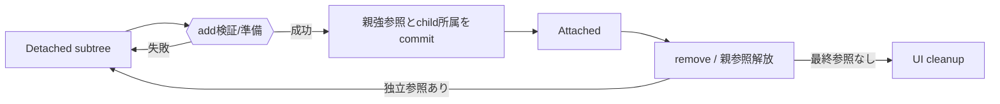
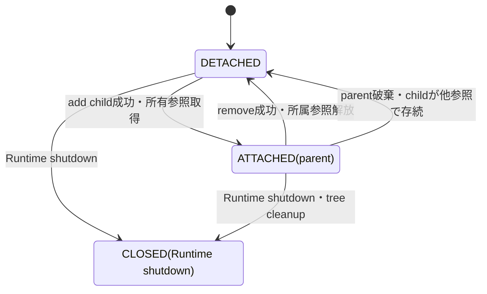
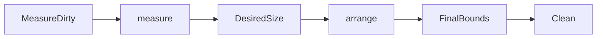
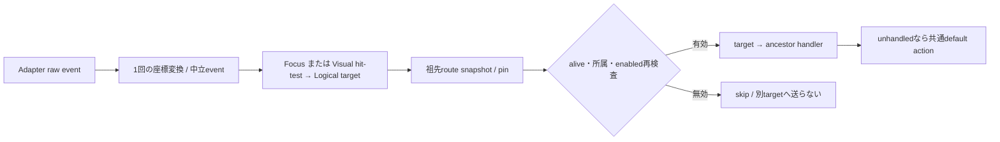
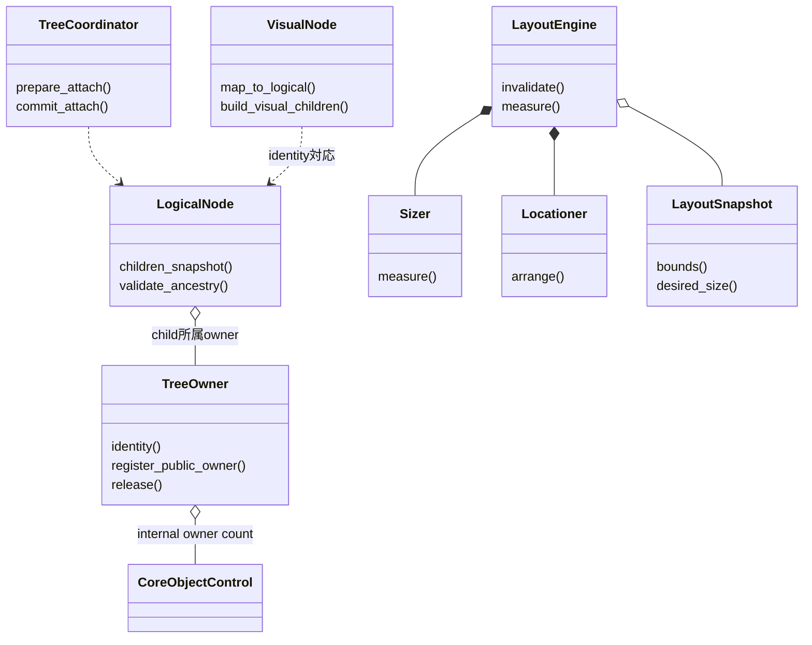
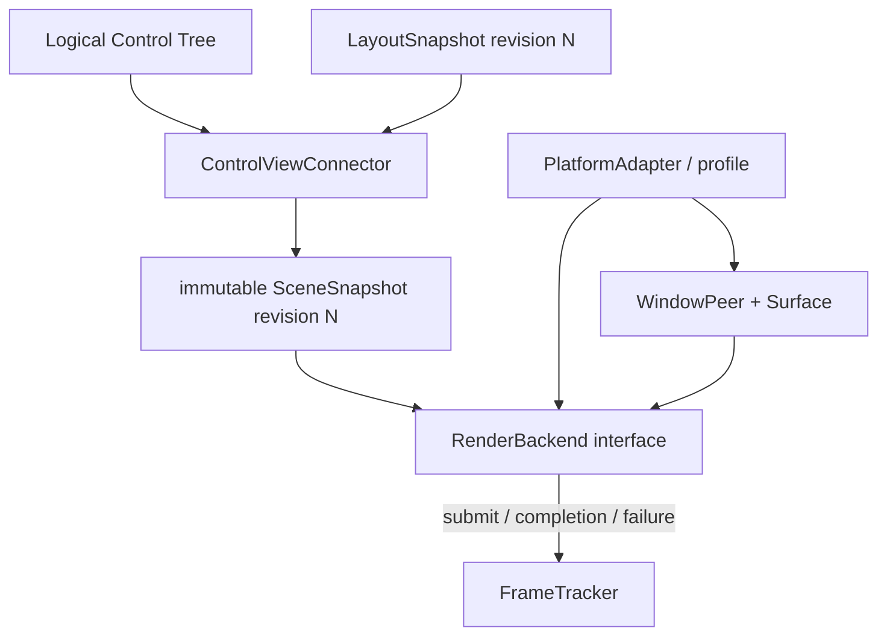
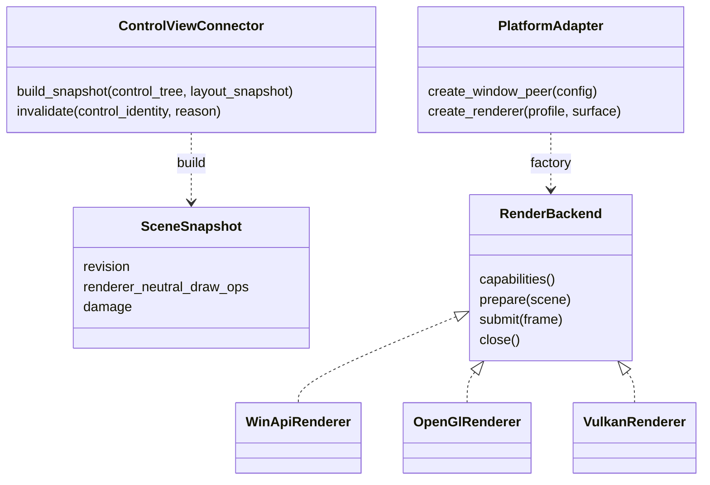

# UIクラス：Tree・Layout・Geometry

- 文書版: 1.4 改訂案
- 文書ロール: detailed-design
- 更新日: 2026-10-29
- 状態: 1.4全文承認済み（利用者、2026-10-30）。実装・試験状態は別管理

## 目的と上位根拠

本書を要求から実装へ具体化する詳細設計の正本とする。型・API・所有・呼出し手順・状態遷移を実装へ反映する。要求の外部保証はリンク先RQ、層の責務と主要flowは上位BDを根拠とする。設計宣言の記載は、配布済みheader・実装済みAPI・試験合格を意味しない。

基本設計: [UIクラス：Tree・Layout・Focus・Control](../../12_design/ui/tree-layout-controls.md)、[イベントハンドリング：通知・入力・Command](../../12_design/events/notifications-commands.md)

## 要求と設計項目の対応

| 設計項目 | 要求根拠 |
| --- | --- |
| UI要素の所属と寿命 | [RQ-02-007](../../11_requirements/RQ-02_core-features.md#rq-02-007)、[RQ-02-013](../../11_requirements/RQ-02_core-features.md#rq-02-013)、[RQ-05-003](../../11_requirements/RQ-05_ownership-callbacks.md#rq-05-003)、[RQ-09-001](../../11_requirements/RQ-09_ui-scope.md#rq-09-001)、[RQ-09-003](../../11_requirements/RQ-09_ui-scope.md#rq-09-003)、[RQ-09-043](../../11_requirements/RQ-09_ui-scope.md#rq-09-043)、[RQ-09-044](../../11_requirements/RQ-09_ui-scope.md#rq-09-044) |
| Measure・Arrange・dirty処理 | [RQ-02-008](../../11_requirements/RQ-02_core-features.md#rq-02-008)、[RQ-09-007](../../11_requirements/RQ-09_ui-scope.md#rq-09-007)、[RQ-09-008](../../11_requirements/RQ-09_ui-scope.md#rq-09-008)、[RQ-09-045](../../11_requirements/RQ-09_ui-scope.md#rq-09-045)、[RQ-09-057](../../11_requirements/RQ-09_ui-scope.md#rq-09-057)、[RQ-09-058](../../11_requirements/RQ-09_ui-scope.md#rq-09-058)、[RQ-09-059](../../11_requirements/RQ-09_ui-scope.md#rq-09-059)、[RQ-09-060](../../11_requirements/RQ-09_ui-scope.md#rq-09-060)、[RQ-09-061](../../11_requirements/RQ-09_ui-scope.md#rq-09-061) |
| 座標・Tree所属・操作API | [RQ-09-008](../../11_requirements/RQ-09_ui-scope.md#rq-09-008)、[RQ-09-043](../../11_requirements/RQ-09_ui-scope.md#rq-09-043)、[RQ-09-044](../../11_requirements/RQ-09_ui-scope.md#rq-09-044)、[RQ-09-046](../../11_requirements/RQ-09_ui-scope.md#rq-09-046)、[RQ-09-049](../../11_requirements/RQ-09_ui-scope.md#rq-09-049)、[RQ-09-057](../../11_requirements/RQ-09_ui-scope.md#rq-09-057)、[RQ-09-067](../../11_requirements/RQ-09_ui-scope.md#rq-09-067)、[RQ-09-068](../../11_requirements/RQ-09_ui-scope.md#rq-09-068)、[RQ-09-069](../../11_requirements/RQ-09_ui-scope.md#rq-09-069)、[RQ-09-070](../../11_requirements/RQ-09_ui-scope.md#rq-09-070) |

本書内の共通規則は上記の各要求を実現するために適用する。同一項目内で個別要求を参照する場合はその対象範囲を優先する。将来候補・未採用範囲は採用済みの動作と区別する。

## UI要素の所属と寿命

### 実現のcall/data/ownership flow

Logical parentのchild強参照とchildのweak parent情報を一commitで更新する。addは所属/Runtime/循環/必要資源を先に検査し、removeは所属参照を外してchildをDetached rootへする。subtree内部リンクは保持する。再addは検証後に新parent ownerを取得し、Platform接続更新へ渡す。shutdownでは所属・Visual/peer接続を閉じ、残存Core shellだけを残す。

### 範囲と前提

- MVVM UIライブラリ UI treeの所有・寿命に関する上位判断案: 親は所属中の子をCore内部強参照で保持し、子を親から外した後も公開handle等があれば子Core objectはDetachedとして存続する。複数親と循環は禁止される。
- MVVM UIライブラリ Logical Tree／Visual Treeの役割に関する上位判断案: Logical Treeはアプリが組み立てるControlの意味上の包含関係、Visual Treeは配置・描画・hit-test対象であり、Visual TreeはLogical Treeの子を二重所有しない。
- MVVM UIライブラリ 初期Control契約に関する上位判断案: 初期ControlはWidget/Container分類を使い、Windowは一つのcontent rootを持ち、StackPanelは順序付きLogical childを持つ。
- ランタイム：実行基盤と終了: 公開handle参照と内部所有参照は別であり、UI objectの最終破棄とUI-affine cleanupはUI threadで行う。Binding/Subscriptionはtreeとは別の所有関係を持つ。
- イベントハンドリング：通知とBinding伝播のProperty通知、Binding、Validation、Command契約を変更しない。

### 実装規則

| 判断 | 根拠・境界 |
| --- | --- |
| Coreが所有寿命を管理する親子所属はLogical Treeに限る。親Containerは各Logical childへの内部強参照を一つ持ち、childはparentを弱い所属情報として持つ。実装上の内部強参照は、オブジェクト管理：handle・値・error 1.3案の専用`TreeOwner`で表現し、public参照・call期間pinと別に数える。Visual Treeのnode/対応情報はLogical childの寿命を追加で保持せず、その所有者はControlまたはtemplate側の明示的な内部ownerとする。 | MVVM UIライブラリ UI treeの所有・寿命に関する上位判断案、Runtime所有と終了。template由来Visual要素の具体ownerはtemplate設計に残す。 |
| 一つのWidgetは同時に最大一つのLogical parentに所属する。親子は同一Runtimeで、parentはContainerでなければならず、self-parent・祖先を子にする操作・既所属childの追加を拒否する。Windowのcontent root一つ、StackPanelの順序付きchildrenを維持する。 | MVVM UIライブラリ UI treeの所有・寿命に関する上位判断案、MVVM UIライブラリ 初期Control契約に関する上位判断案。初期Control以外の子数/cardinalityはControl別設計へ送る。 |
| 親子構造の変更はUI thread専用とする。追加時は引数、Runtime、parent/child状態、循環を検証し、childの`ValidationPin`から専用TreeOwnerとcleanup reservationを準備し、全検証・peer/Visual候補準備の成功後にLogical Tree、parent所属情報、ownerを一つのcommitで更新する。準備または予約に失敗した場合は候補TreeOwnerを解放し、Tree・通知に部分変更を残さない。既所属childの直接移動APIは設けず、明示remove後に新parentへ追加する。 | Runtime契約、MVVM UIライブラリ UI treeの所有・寿命に関する上位判断案、公開ABI契約、ランタイム：実行基盤と終了。公開関数名・引数型とVisual/Platform更新失敗時の詳細statusはABI/Control設計へ送る。 |
| removeが成功するとparentがchildのTreeOwnerを解放し、childをDetached rootにする。child以下のLogical subtree内部リンクは維持する。外した子にpublic handleがあればsubtreeをCore上で利用可能に保ち、handleがなければTreeOwner解放時に予約済みcleanupを一度だけscheduleする。親がchildを列挙して返す場合はlive TreeOwnerを根拠に新しい独立public handleを発行できる。 | MVVM UIライブラリ UI treeの所有・寿命に関する上位判断案のDetached objectとsubtree切離しを具体化する。解放はUI threadのランタイム：実行基盤と終了 cleanup規則に従う。 |
| Detached WidgetとそのsubtreeはRuntimeがRunningの間、公開handleを通じてCore objectとして有効とする。Propertyの通常API、Binding、Subscriptionはそれぞれのhandle/所有契約に従い使用できる。Detachedであること自体はそれらを自動解除しない。Detached subtreeはWindow/Layout/描画/Input対象ではなく、Platform peerを参照しない。 | MVVM UIライブラリ UI treeの所有・寿命に関する上位判断案、Runtime所有と終了、イベントハンドリング：通知とBinding伝播。APIごとの「Detachedでは不可」となる操作はControl/API設計で列挙する。 |
| Detached subtreeの再所属は、追加検証を全て通過したときに新parentが所属参照を取得して行う。追加失敗時はDetached状態と既存のProperty値・Binding/Subscription状態を保つ。再所属時のPlatform資源再生成はVisual/Platform側の責務であり、その詳細と失敗復旧はUIクラス：Tree・Layout・Geometryへ送る。 | 具体化は[オブジェクト管理：CollectionとSelection](../runtime-objects/collections.md)、UIクラス：Tree・Layout・Geometry、[UIクラス：Window・基本Control・次段階Control](controls.md)を参照する。 |
| Parent破棄時は各childとの所属リンクを解除し、保持中のTreeOwnerを一度ずつ解放する。子にpublic/internal ownerがあればDetached rootとして残り、その配下のLogical subtreeを維持する。複合ownerが残らない子は予約済みcleanupへ進む。treeからのdetachだけを理由にProperty binding/subscriptionを解除せず、対象Property/ownerの通常破棄または明示解除に任せる。 | MVVM UIライブラリ UI treeの所有・寿命に関する上位判断案、Runtime所有と終了。TextBox固有の公開ABI契約契約を一般化しない。 |
| Runtime shutdownではランタイム：実行基盤と終了の順序に従い、UI thread上でtree所属ownerとVisual/Platform接続を解放し、その後UI stateを閉じてRuntimeをClosedにする。shutdown cleanupによる一括state破棄後のTreeOwner解放はcleanup ticketを再発行しない。残存handleは閉じたCore shellとなり、通常のUI APIはUI_CLOSED。shutdown後にDetached objectを再所属させない。 | Runtime所有と終了、MVVM UIライブラリ UI treeの所有・寿命に関する上位判断案。focus/IME/rendererの具体cleanup順はUIクラス：InputとFocusに委ねる。 |

### 所属状態と遷移図

Logical parentへの所属状態を、Windowの開閉、Runtime状態、Visual peerの有無とは別に扱う案である。

- AttachedはLogical parentが一つあり、parentがchildを強く保持する状態。
- DetachedはLogical parentを持たない状態。subtree内部の親子関係は維持可能とする。
- ClosedはRuntime shutdown後のshellであり、通常のtree操作はできない。
- add/remove失敗、Runtime不一致、循環、二重親、wrong threadでは遷移しない。
- Visual peer状態はこの図の状態と一対一にしない。Detachedは描画・入力対象外であり、必要なresource cleanup/regenerationはPlatform設計に委ねる。

### 操作ごとの失敗・副作用案

| 操作 | 成功時 | 失敗時 |
|---|---|---|
| child追加 | Logical順序、parent情報、所属強参照を一括commit。通知・Visual更新はcommit後の既定queueで処理 | 入力不正、wrong thread、Runtime不一致、既所属、循環、非Container parentなら状態不変 |
| child削除 | parentから外し、child rootをDetached化して所属強参照を解放 | 指定childが所属していない／別parentなら状態不変 |
| Detached child再所属 | 検証後に新parentが所属強参照を取得 | 失敗時はDetachedのまま。値やBinding/Subscriptionを変更しない |
| parent最終破棄 | child linksを解消し、存続childはDetached化。最後の参照となるchildはランタイム：実行基盤と終了のUI-thread cleanupへ | cleanup中の部分的な外部観測は許さない案。破棄順の細則は要レビュー |
| public handle解放中のAttached child保持 | TreeOwnerがchild stateを保持。child handleの列挙要求はTreeOwnerを根拠に新しいtokenを発行 | 新token発行失敗時はTreeとownerを維持 |
| Runtime shutdown | Attached/Detachedを問わずRuntime objectのUI状態・Platform接続を閉じる | ランタイム：実行基盤と終了のshutdown状態遷移を適用し、閉鎖後のUI操作はUI_CLOSED |

この案では、Logical Tree変更のcommitと、Property notification/Binding deliveryを同一のcallback再入処理として混在させない。外部通知の正確なタイミング・順序はイベントハンドリング：通知とBinding伝播の既承認規則に従う。具体化は[オブジェクト管理：CollectionとSelection](../runtime-objects/collections.md)、UIクラス：Tree・Layout・Geometry、[UIクラス：Window・基本Control・次段階Control](controls.md)を参照する。

### ランタイム：実行基盤と終了との所有境界

| 関係 | UIクラス：Tree・Layout・Geometryの扱い |
|---|---|
| Logical parent → child | 所属中だけ強い内部参照を一つ持つ |
| TreeOwner → CoreObjectControl | public ref・call期間pinと独立したinternal ownerを一つ数える。live ownerはchildから新public handleを発行する根拠になる |
| child → parent | parent identityへの弱い所属情報 |
| Visual node → Logical Widget | 非所有の対応関係を基本とし、template内部objectにはtemplate ownerを別途明記 |
| Binding → Property | Runtime所有と終了/イベントハンドリング：通知とBinding伝播どおり独立した強参照関係 |
| Subscription → Property/callback | Runtime所有と終了/イベントハンドリング：通知とBinding伝播どおり独立した所有・解除契約 |
| Widget → Property / Command | Widget固有の所有は公開ABI契約およびUIクラス：Window・基本Control・次段階Controlで定義。一般tree linkから推定しない |

TreeOwnerは`CoreObjectControl`の複合owner数に含まれる。internal ownerが存在する間は最後のpublic handleをreleaseしてもchild stateを破棄しない。internal ownerの最初の取得時にcleanup reservationを確保し、public/internal ownerとcall期間pinが全て0になったときだけ一度有効化する。Treeからchild handleを返す場合はlive TreeOwnerを根拠に新しいpublic referenceを発行する。詳細なcount・予約・lock契約は[オブジェクト管理：handle・値・error](../runtime-objects/objects-values.md) 1.3案に従う。

detach時にBinding/Subscriptionを自動解除しない案は、tree membershipをそれらの明示的なlifetime ownerとみなす判断を避けるためである。利用者側がWidgetのPropertyやSubscriptionを保持している間にdetach後も継続利用する場合は、その各公開handle/内部ownerの寿命契約に従う。

## Measure・Arrange・dirty処理

### 実現のcall/data/ownership flow

Sizer.measureは利用可能制約から子のDesiredSizeを集約し、Locationer.arrangeは親の割当矩形からFinalBoundsを確定する。StackPanelはaxisを選び、main軸合計/cross軸最大のmeasureとAlignによるarrangeを行う。dirty状態は祖先/必要部分へ伝播し、結果を消費する前に再計算する。候補結果は成功時だけ公開boundsへcommitする。

### 範囲と前提

- MVVM UIライブラリ UI treeの所有・寿命に関する上位判断案およびUIクラス：Tree・Layout・Geometryに従い、Logical Treeの所属・寿命とVisual Treeの配置構造を区別する。LayoutはVisual Tree上の表示要素を測定・配置する。
- Visual TreeはLogical Widgetの所有権を重複して持たない。各Visual要素のownerとLogical要素との対応はUIクラス：Tree・Layout・Geometry/Control/template設計に従う。
- MVVM UIライブラリ Layoutの責務境界に関する上位判断案に従い、Layout意味論はCoreに一元化し、Platformはroot利用可能領域とscale等の環境情報を提供し、Coreの確定boundsを描画・入力系へ渡す。
- ランタイム：実行基盤と終了に従い、Layout状態の変更はUI thread上で行い、workerからのUI状態操作を許さない。
具体化はUIクラス：Tree・Layout・Geometryを参照する。

### 実装規則

| 判断 | 根拠・境界 |
| --- | --- |
| LayoutはVisual Treeの各要素に対し、SizerによるMeasureとLocationerによるArrangeの二段階で行う。Measureは親から利用可能サイズ制約を受けてDesiredSizeを返し、Arrangeは親が割り当てた最終矩形を子へ配分し、各要素のFinalBoundsを確定する。DesiredSizeとFinalBoundsを別値として保持する。 | MVVM UIライブラリ Layoutの責務境界に関する上位判断案。計算主体をCoreに置き、Platformで再計算しない。 |
| Layout関連操作と測定結果のcommitはUI thread専用とする。各要素のサイズ制約は横・縦それぞれ最小値と最大値を持つ。寸法は非負でNaNを許さず、最大値には「上限なし」を表す意味値を許す。上下限が逆転する制約は無効入力として拒否し、既存制約・DesiredSize・FinalBoundsを変更しない。 具体化はUIクラス：Tree・Layout・Geometryを参照する。 | Runtime契約、公開ABI契約、MVVM UIライブラリ Layoutの責務境界に関する上位判断案。無限値のABI表現や具体statusはABI/単位設計へ送る。 |
| Measureは子から親へDesiredSizeを集約する。Arrangeはrootから子へfinal rectangleを割り当てる。最終boundsは親座標系の矩形とし、絶対座標変換は別レイヤで合成する。Measureは利用可能制約の変化時に再実行し、Arrangeは最終割当矩形の変化時に再実行する。 | MVVM UIライブラリ Layoutの責務境界に関する上位判断案とMeasure/Arrangeの役割。座標系の数値単位・変換行列は対象外。 |
| StackPanelはLogical childrenの順序を保ち、初期版のorientationはVertical/Horizontalを提供し既定値をVerticalとする。Verticalではmain axis=height、cross axis=width、Horizontalではmain axis=width、cross axis=heightとする。Measureではmain axisの利用可能上限を子へ「上限なし」として渡し、cross axisの利用可能制約を渡す。DesiredSizeはmain axisで子の合計、cross axisで子の最大値を基礎に制約内へ収める。 | MVVM UIライブラリ 初期Control契約に関する上位判断案の順序付きchildren、MVVM UIライブラリ Layoutの責務境界に関する上位判断案の組み込みSizer/Locationer。spacing/margin/paddingは初期動作に追加せずUIクラス：Window・基本Control・次段階Control/別項目で具体化する。 |
| StackPanelのArrangeではmain axis上にchildrenをDesiredSize順で連続配置し、cross axisは各childのAlignに従う。初期Align候補はStart、Center、End、Stretchとする。明示child AlignはContainer既定Alignに優先し、未指定時はcross-axis Stretch、main-axis Start相当とする。Stretchは割り当てたcross-axis領域へ広げるが、childのmaximum制約を超えない。 | MVVM UIライブラリ Layoutの責務境界に関する上位判断案はAlign等の設定可能性と優先順位を詳細化へ送っていた。本判断で候補値と初期既定を定める。 |
| 初期Sizer/LocationerはCore組み込み実装とし、利用者独自アルゴリズムをABI callbackとして登録する拡張点はUIクラス：Tree・Layout・Geometryで追加しない。初期StackPanel以外のControl固有DesiredSizeは各Control設計が定める。 | MVVM UIライブラリ Layoutの責務境界に関する上位判断案の推奨を採用する。拡張APIは別の基本設計判断を要する。 |
| Layout invalidationはVisual Tree/親子順の変更、root利用可能領域変更、測定結果に影響するProperty変更でdirty化する。Measure-dirtyは祖先へ伝播し、Arrange-dirtyは必要な配置部分へ伝播する。重複dirty通知は一処理区間でcoalesceし、Layout結果を次に消費する前に必要範囲を再計算する。 | ランタイム：実行基盤と終了、MVVM UIライブラリ Layoutの責務境界に関する上位判断案。layout schedulingとrender frameの正確な統合はプラットフォーム：抽象化と共通protocolへ送る。 |
| Measure/Arrangeは決定的かつ冪等とし、入力制約、Visual構造、配置Propertyが同一なら同じDesiredSize/FinalBoundsを返す。制約の不正、破棄済みVisual、Runtime shutdownでは既存の公開結果を部分更新せず失敗する。独自callbackを呼ばないためlayout pass中の利用者コード再入は発生させない。 | ランタイム：実行基盤と終了、MVVM UIライブラリ Layoutの責務境界に関する上位判断案。 具体化はUIクラス：Tree・Layout・Geometryを参照する。 |

### Measure / Arrange の処理

#### Measure

Measureは、親が子にどれだけの領域を使えるかを寸法制約として渡し、各子のDesiredSizeを得る処理である。

- 親は自身のSizerに沿ってchildrenを測定し、集約結果を自身のDesiredSizeとして返す。
- StackPanelは順序を保って各childをMeasureする。Verticalでは高さを、Horizontalでは幅を「上限なし」として測定させる。
- 子のDesiredSizeは寸法制約を満たし、上限なしの軸でも値は有限かつ非負とする。
- 初期版ではMeasure中にProperty通知やBindingを発生させず、Measure結果をViewModelへ自動反映しない。

#### Arrange

Arrangeは親が受け取ったFinalRectの内側へchildrenの位置とサイズを割り当てる処理である。

- 親のLocationerが各childの割当矩形を決める。childのLocationerは自身の矩形と子への配分を決める。
- StackPanelはmain axisでDesiredSizeを順に使い、cross axisはAlign・最小/最大制約からサイズとoffsetを決める。
- Main axisでchildrenのDesiredSize合計が割当領域より小さくても、未使用領域を自動配分しない。余白・spacing・均等割当は初期仕様に含めない。
- FinalBoundsはLayout完了後に一貫して参照できる。Platform/RendererがControl固有配置を再計算しない。

### 初期StackPanelの計算例（単位は抽象）

Vertical StackPanelに、順序通り A=(desired 80,20)、B=(desired 60,30) の二子があり、Panelへ(available width 100, height 100)が与えられる例を示す。dimensionsは抽象単位でありpixelを意味しない。

- Measure: AとBにcross width 100、main height上限なしを渡す。
- StackPanel DesiredSize: width=max(80,60)=80、height=20+30=50。
- Arrange: PanelのFinalRectが(100,100)なら、既定cross Align=StretchでAは幅100・高さ20、Bは幅100・高さ30となる。
- Vertical main axisの残り50は未使用であり、子へ比例配分しない。
- child Align=Centerなら、そのchildのDesiredSize幅を保ち、Panel内で中央に置く。Stretchでもchild maximum widthが70なら幅70とする。

Horizontalでは横幅合計・最大高さで対称に扱う。具体化はUIクラス：Tree・Layout・Geometryを参照する。

### Layout invalidation

| 変更 | Measure dirty | Arrange dirty |
|---|---|---|
| Visual child追加/削除/順序変更 | 変更されたContainerと祖先 | 変更されたContainerと関係する子孫 |
| root利用可能領域変更 | 制約依存のroot subtree | root subtree |
| child DesiredSizeに影響するProperty | 当該要素と祖先 | 当該要素を含む影響範囲 |
| Align/最終割当だけに影響するProperty | 原則なし | 当該要素と配置を再計算する祖先 |
| Platform peerの描画状態だけの変更 | なし | Layout外。プラットフォーム：抽象化と共通protocolで扱う |

各変更は処理区間で重複をまとめる。Measure-dirtyの要素は祖先にdirtyがあればその祖先から再Measureし、Arrangeは最新DesiredSizeとroot領域から再実行する。dirty伝播の内部データ構造、priority、時間sliceはここで固定しない。Layout結果を消費する前に未処理dirtyを反映する保証と、その消費点はプラットフォーム：抽象化と共通protocolと整合させる。

### 状態フロー

入力変更/root領域変更/Visual構造変更
→ Measure/Arrange dirty を記録
→ Visual Tree上でMeasure（childrenからparent）
→ candidate DesiredSizeを保持
→ Visual Tree上でArrange（rootからchildren）
→ candidate FinalBoundsを保持
→ revision検証後、LayoutSnapshot全体を一括commit
→ Renderer/Input側が同一snapshot revisionのboundsを参照

Measure/Arrange中に失敗した場合は今回の結果を部分commitせず、以前のcomplete layout snapshotを保持する。dirty状態は失敗診断または後続retryが可能なように残す。再試行方針と公開診断は後続設計で扱う。

### 1.3改訂案：Layout実行入力・出力契約（レビュー待ち）

以下は承認済み1.2のMeasure/Arrange意味論を実行可能な内部契約へ具体化する提案であり、1.3全文の承認前に確定仕様・実装済み機能として扱わない。

| 契約 | 1.3実現案 | 失敗・境界 |
| --- | --- | --- |
| Window root入力 | `WindowClientArea { width_dip, height_dip }`をWindow peerからCoreへ渡す。値はWindow client左上原点の論理DIP寸法で、各軸finite/nonnegative。open成功時に初期値を一度通知し、surface client area変更ごとにgeneration付き更新をenqueueする。DeviceScaleは別値として保持し、DIP寸法へ二重適用しない | 初期値確定前はLayout/Sceneを作らない。非有限/負寸法は拒否し、最後のcomplete snapshotを維持してdirtyを残す。古いpeer generationの更新は無視。0寸法は有効な空領域とし、Platform側のsurface停止・present条件はPlatform文書に従う |
| Root計算 | Window content rootを`Constraints(0..client_width, 0..client_height)`でMeasureし、Arrangeでは`Rect(0, 0, client_width, client_height)`を割当てる。root自体のDesiredSizeとFinalBoundsは別々にsnapshotへ保持する | content rootなしなら空LayoutSnapshotを確定可能。Window閉鎖中は新たなLayout/frameを提出せず、再open後に新generation/領域で再計算 |
| Widget constraint | 内部`LayoutConstraints`は各軸min/maxを持ち、初期値はmin=0/max=unbounded。組込みControlが内部条件を追加できる。初期公開C ABIに任意Widgetサイズ制約setter/getterは追加しない | RQ-09の初期公開保証にないAPIをDDだけで追加しない。明示サイズAPIが必要になった場合は要求差分とABI全体レビューを先行 |
| Leaf測定 | `IntrinsicMeasureProvider.measure(control_snapshot, constraints)`がControl表示内容に対応するDesiredSizeを返す。StackPanelは既承認アルゴリズムで子結果を集約。TextはContent、TextBoxは現在の表示用編集snapshot、ButtonはLabelをTextServiceへ渡し、同じfont profile/metricsが測定と描画で使われる | TextService未接続・font解決失敗・不正metricsはpass失敗。仮font、固定placeholder寸法、描画不能時の成功扱いを作らない。providerは初期内部境界であり利用者callback APIにしない |
| LayoutEngine | UI thread上で`run(window, client_area, visual_snapshot) -> LayoutSnapshot`を実行。candidateはtree/property revisionを開始時に固定し、DesiredSize・FinalBounds全件を計算後、入力revisionが同じ場合のみ一括commit | wrong thread、閉鎖Runtime、tree変更、invalid geometry、checked arithmetic overflow、provider errorではsnapshotを部分公開せず、旧complete snapshotとdirtyを保持 |
| LayoutSnapshot | window/peer generation、tree revision、layout revision、client area、各Visual identityのDesiredSize/FinalBoundsを不変値で所有。Renderer/Inputは同じsnapshot revisionを参照 | Logical/Visual対応が欠落・重複・staleなら作成失敗。ControlやPropertyをRendererへ強参照しない |
| Layout入力変更 | root領域変更はroot subtreeのMeasure/Arrangeをdirty化。Content/Label/edit snapshot変更など測定値に影響する場合は対象Controlから祖先Measureと配下Arrangeをdirty化。Orientation/Align/Tree変更は既存invalidation規則へ接続 | 同一dispatch turn内のresizeは最新値にcoalesceしてよいが、途中のCore値やrevisionを混在させない |

この契約でLayout計算自体はCoreのみが行い、Platformはclient areaと環境scaleを通知する。TextServiceの実装・font profile/package・GlyphRun描画は独立依存であり、本Layout unitの完了条件へ含めない。一方、実際のText/Button/TextBoxをsceneへ接続する前には、同じfont metricsを供給できるTextService経路が必須となる。

### 1.3改訂案：Layoutクラス責務

| 型 | 責務・主要操作案 | 所有・thread/failure境界 |
| --- | --- | --- |
| `LayoutConstraints` / `Size` / `Rect` | 検証済み内部寸法とfinite boundsを表す。maxのunboundedは内部意味値とする | 値型。ABIで直接公開しない |
| `IntrinsicMeasureProvider` | Control immutable snapshotとconstraintからleaf DesiredSizeを返す。Text familyはTextServiceへ委譲 | Core-owned service boundary。UI thread内同期計算、利用者callbackなし |
| `LayoutEngine` | `invalidate`; `run(root, client_area, tree_revision)`; candidate全体を検証しLayoutSnapshotを原子的に公開 | RuntimeごとにCoreが所有。UI thread専用。失敗では旧snapshot維持 |
| `Sizer` / `Locationer` | Control kind別Measure集約とArrange配分。StackPanel規則は承認済み表に従う | LayoutEngineの作業責務。単独公開しない |
| `LayoutSnapshot` | 一つのtree/layout revisionに属するDesiredSizeとFinalBoundsを保持 | immutable。Renderer/Inputは読取のみ |

Call flow: `Platform WindowPeer -> WindowClientArea update -> Runtime UI queue -> LayoutEngine.measure -> LayoutEngine.arrange -> revision検証 -> LayoutSnapshot commit -> Scene producer / Input`。本稿ではScene producerの描画変換・GlyphRun生成を追加しない。

## 座標・Tree所属・操作API

### 実装規則

| 実現手段・責務 | 要求根拠 |
| --- | --- |
| Layoutはf64 DIP、root client左上原点、x右/y下。1 DIP=1/96 inch相当の論理量とし、scale_x/yを環境値で保持する。 | [RQ-09-067](../../11_requirements/RQ-09_ui-scope.md#rq-09-067) |
| 上限なしはmax制約に限り+infinityを許す。公開FinalBoundsは有限値。checked sumでoverflowしたpassは旧boundsを維持して失敗する。 | [RQ-09-067](../../11_requirements/RQ-09_ui-scope.md#rq-09-067) |
| render境界で共有edgeを最近接偶数pixelへsnap。Inputはraw座標から逆変換して未snap論理boundsでhit-testする。 | 上記の根拠RQ |
| 子の描画/hit-testは祖先client clipの交差に限定。Styleのoverflow/scrolling採用は別範囲。 | [RQ-09-067](../../11_requirements/RQ-09_ui-scope.md#rq-09-067) |
| keyboardはFocus target→Logical祖先のbubble。tunnelなし。handledで既定動作と後続bubbleを止めるが既に実行したhandlerを巻き戻さない。 | [RQ-09-068](../../11_requirements/RQ-09_ui-scope.md#rq-09-068) |
| routeは開始時pinした祖先snapshot。detach済みnodeを再検査してskipし、別targetへretargetしない。再入Inputは次turnへ。 | 上記の根拠RQ |
| Focus eligibility検査はControl kindと要求上のfocusable範囲を照合し、許容外をstate変更前に拒否する。 | [RQ-09-069](../../11_requirements/RQ-09_ui-scope.md#rq-09-069) |
| Container明示Focusableは初期setterでfalse→trueを拒否する案。Window active状態と子Focusを別に扱う。 | [RQ-09-070](../../11_requirements/RQ-09_ui-scope.md#rq-09-070) |
| Pointerはmouse move/down/upとwheelの中立event、同一pointer captureを提供する候補。gesture/touch/multi-seatは機能採用を別にする。 | [RQ-09-068](../../11_requirements/RQ-09_ui-scope.md#rq-09-068) |

### 実現設計

#### 型・配置計算

`Size { width: f64, height: f64 }`、`Rect { x, y, width, height }`、`Constraints { min_w,min_h,max_w,max_h }`を内部型とする。C ABIは固定幅f64の個別入出力またはsize付きversioned input structのpointerを使い、struct値渡しはしない。minと実寸はfinite/nonnegative、maxだけ+infinityを認める。Affine2Dは将来render内部で使えるが、初期公開transform Propertyは追加しない。

Sizer.measure → DesiredSize候補 → Locationer.arrange → 全FinalBounds候補 → revision付snapshot swapの順にcommitする。Layout中のTree変更を許さず、dirtyは変更時に祖先へ伝播する。接触するedgeを同じ論理edge keyで一度だけroundし、Renderer側のPixelBoundsへ格納する。

#### Input routeとFocus

`input_subscribe(widget,event_mask,callback)`は既存closure lifecycleへ接続する。handler戻りはCONTINUE/HANDLEDのみで、未知値・例外はdiagnostic+CONTINUEとする。Focusは同じUI transactionで新targetをcommitしてから旧Lost→新Gainedをenqueueし、Focus callbackからのrequestは後続turnへ送る。OS折返しはorigin tokenとFocus revisionを照合して二重通知を抑止する。

Tree APIは`container_insert(parent,index,child)`、`container_remove(parent,child)`、`container_move(parent,child,index)`。跨parent移動は明示remove/addで、atomic reparentは初期非提供。child入力borrow、parent→child strong、child→parent weak。新規所属にはDetached subtreeをpinし、Visual/peer候補をprepareし、成功時にparent ownerを取得して一commitする。失敗で旧Focusや他親の構造を変更しない。

## クラス設計の補足（1.1承認済み・1.2改訂案）

既承認1.0の実現規則を支える型・関連・所有・主要操作を整理した。内部型名とメソッドの分担は本改訂で補足する内部設計であり、既存公開APIの署名や外部保証を追加・変更するものではない。TreeOwner追加部分は1.2全文のレビュー対象であり、承認済み1.1部分の改訂は提案範囲に限る。実装・試験完了の証明とは区別する。

要求根拠: [RQ-09-043](../../11_requirements/RQ-09_ui-scope.md#rq-09-043)、[RQ-09-044](../../11_requirements/RQ-09_ui-scope.md#rq-09-044)、[RQ-09-057](../../11_requirements/RQ-09_ui-scope.md#rq-09-057)、[RQ-09-067](../../11_requirements/RQ-09_ui-scope.md#rq-09-067)、[RQ-09-070](../../11_requirements/RQ-09_ui-scope.md#rq-09-070)。

Logical所属のowner、Visual表現、Measure/Arrangeの作業状態を分ける。共通Control stateはControl設計のWidgetState/ContainerStateを参照し、この文書に二つ目のControl階層を作らない。

### 型の責務と所有

| 型 | 責務・保持データ | 主要メソッド・操作 | 所有・寿命 |
| --- | --- | --- | --- |
| TreeCoordinator | 親子所属変更の検査とcommit手順 | prepare_attach(parent, child); commit_attach(prepared); detach(child) | 候補準備中は旧所属を変更しない。循環/別Runtime/複数親を拒否 |
| LogicalNode | object identity、parent非所有参照、child所属参照 | children_snapshot(); validate_ancestry(target) | parentがchildを所有。detach後も独立ownerがあればsubtreeを保持 |
| TreeOwner | child一件のLogical所属とCoreObjectControl internal ownerを結ぶ | identity(); register_public_owner(); release() | parent stateが保持し、所属commit後からdetach/parent破棄まで有効 |
| VisualNode | Logical Control識別、描画/layout/hit-test用のVisual構成 | map_to_logical(); build_visual_children() | template内部VisualをLogical childとして重複所有しない |
| LayoutEngine | dirty集合とMeasure/Arrangeの処理順 | invalidate(node, reason); measure(root, available); arrange(root, rect) | UI threadで作業。RendererとInputが別計算したboundsを正本にしない |
| Sizer | constraintからDesiredSizeを計算する組込み処理 | measure(node, available) | 子から親へ集約。独自利用者callbackの拡張APIをこの補足で設けない |
| Locationer | 親領域から子FinalBoundsを割り当てる組込み処理 | arrange(node, final_rect) | 親から子へ配置。f64 DIPとscale処理の本文規則に従う |
| LayoutSnapshot | 同revisionのDesiredSize/FinalBoundsと対応情報 | bounds(node_id); desired_size(node_id) | 描画とhit-testが整合した結果を読むための内部結果構造案 |

### クラスの関連

`*--`は従属するstate/作業の合成、`o--`は共有を含む所有参照、`..>`は非所有の利用・識別・委譲を示す。関連名と本文で示した寿命を優先し、図の同名型は各instanceで別の状態を持つ。図は主要メソッド名を抜粋し、引数・所有・失敗条件は表と本文に従う。

### 主要な呼出しと失敗境界

TreeCoordinatorは親子検査→TreeOwner/cleanup予約準備→peer/Visual候補準備→所属commitの順に処理し、成功後にLayoutをdirtyにする。途中失敗では未commitのTreeOwnerを解放して既存Treeを維持する。detach/parent破棄はchild linkの更新とTreeOwner解放をUI threadの一操作として行う。LayoutEngineはSizerの子→親集約とLocationerの親→子配置を完了して同revisionの結果を公開する。

LayoutSnapshotは内部の整合読取り用で、新しい公開snapshot APIや所有保証ではない。LogicalNodeの自己関連は非循環treeだけを許す。子側から親への関連は非所有とする。

## Control-View connectorとbackend-neutral Visual（1.4改訂案）

本節は、Logical Control/Layoutから描画engine固有APIへ直接結合せず、差し替え可能な複数View/renderer実装へ接続する提案である。1.3承認済みのTree ownership・Layout契約は維持し、公開C ABIやControlの外部動作を追加しない。要求根拠はRQ-09-001/006/007/008/067およびRQ-11-008/009/020/022とする。

### 責務境界

| 境界 | 責務 | 禁止する結合 |
|---|---|---|
| Logical Control + LayoutSnapshot | Coreが所有する意味・状態と同revisionの配置結果 | 描画API、OS view object、GPU資源を保持しない |
| ControlViewConnector | UI thread上でLogical ControlとLayoutSnapshotを読み、Window世代/revisionに対応するimmutable `SceneSnapshot`を構築する。Control更新からのdirtyをscene生成へ伝える | backend固有型・OS handleを返さず、Control treeの所有関係を変えない |
| SceneSnapshot（renderer-neutral View snapshot） | Control/Visualをflattenした描画命令。bounds、z-order、clip、background、DeviceScaleを同一revisionに束ねる | rendererの選択・GPU資源・OS callbackを保持しない |
| WindowPeer / Surface | native windowとsurfaceの生成・resize・close、surface generationとOS event | renderer実装を一意に固定しない。Surfaceとの互換性はAdapterが検証する |
| RenderBackend | immutable SceneSnapshotを選択されたsurfaceへprepare/submitし、failure/completionを返す | Control、LogicalNode、LayoutEngineへ逆参照しない |

既存SceneSnapshotをControlViewConnectorの生成する唯一のimmutable renderer-neutral View snapshotとし、LayoutSnapshotと同revisionで作成する案とする。Logical Control identityからViewへの対応はsnapshot build中のCore内部対応として扱い、描画API向けの別View treeを永続所有しない。全体成功時だけWindowのcomplete scene stateを置換する。

### Renderer選択・複数実装

- OS/window adapter（例: Windows native window / WinAPI）とrenderer API（例: WinAPI/GDI系、OpenGL、Vulkan）は別選択軸とする。各組合せが必ず可能とは仮定せず、Adapterがsurface/backend compatibilityを検証する。
- Platform profileまたは明示Runtime/Window configurationが要求するrenderer identityを選択し、factoryがbackendを生成する。選択時にbackend identity/version、対応surface、operation/capability set、profileを確定して記録する。
- capability不足、未対応DrawOp、surface/device初期化失敗は既存failure境界で明示する。暗黙のbackend切替・software fallback・GlyphRunの破棄で成功扱いしない。
- 複数backendの同時実装・登録を許容するが、一つのWindow/frameに対する選択・切替時点、device loss後の再選択可否はplatform designで明記する。Core UIは各backendの型や差を知らない。

### Class / call flow案

この図のbackend名は実装候補例であり、依存追加・Windows/Linux対応宣言・API採用を決定しない。具体trait名、factory registration方式、profile schemaと切替時点はPlatform文書と合わせて決める。

## 文書の承認・改訂履歴

| 日付 | 対象版 | 内容・根拠 |
| --- | --- | --- |
| 2026-10-17 | 1.0 | 利用者の指示に基づき、既承認内容を責務別に再編集。設計項目IDによる承認・追跡は廃止し、以後は文書版全体で管理する。構成変更を新規の製品仕様採用としない |
| 2026-10-17 | 1.0全文 | 利用者の「全部承認します」により文書全体を承認。旧IDによる項目承認ではなく、現行文書版を対象とする。実装・試験合格を意味しない |
| 2026-10-17 | 1.1改訂案 | 利用者の補足指示によりクラス責務・所有・メソッド・関連図を追加。1.0承認を維持し、1.1全文は確認待ち |
| 2026-10-17 | 1.1全文 | 利用者の「OK,テスト文書作りましょうか」により、クラス設計補足と選択的な図の補強を含む全文を承認。既存履歴を維持し、実装・試験状態は別管理 |
| 2026-10-24 | 1.2改訂案 | A案に基づきLogical childのTreeOwner、attach予約、detach/parent破棄、shutdown順序を明記。全文レビュー待ち |
| 2026-10-24 | 1.2全文 | 利用者の承認により、TreeOwnerを含む本版全文を承認。実装・試験合格とは区別 |
| 2026-10-29 | 1.3改訂案 | Core Layout pass、Window client area input、leaf measurement provider、revision付きatomic LayoutSnapshotを追記。文書全体レビュー待ち。1.2承認範囲を維持 |
| 2026-10-29 | 1.3全文 | 利用者の「ok」によりLayout実行入力/出力・クラス責務案を含む文書全体を承認。実装・試験合格とは別管理 |
| 2026-10-30 | 1.4改訂案 | backend-neutral Visual、ControlViewConnector、Window/surfaceとrenderer選択軸、複数RenderBackend実装の責務案を追加。1.3承認範囲を維持し全文レビュー待ち |
| 2026-10-30 | 1.4全文 | 利用者の「ok」によりControlViewConnectorとrenderer-neutral SceneSnapshot、複数RenderBackend接続案を含む全文を承認。実装・試験合格とは別管理 |
