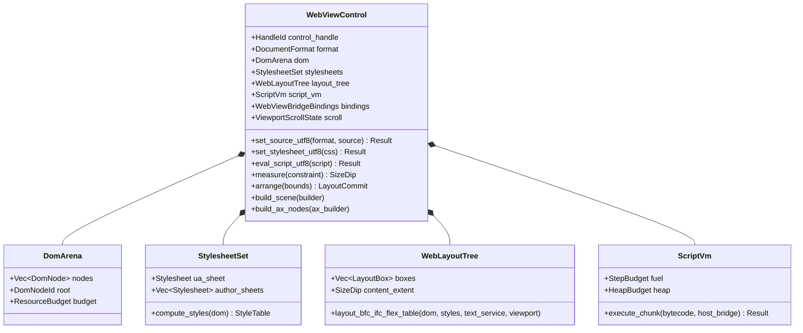

# UIクラス：WebViewエンジンプラグイン詳細設計

- 文書版: 1.0
- 文書ロール: detailed-design
- 更新日: 2026-10-24
- 状態: 1.0全文承認済み（利用者、2026-10-24）。実装・試験状態は別管理

## 目的と上位根拠

本書はWebViewエンジンプラグインの要求および基本設計を具体化する詳細設計のレビュー案である。Rust Core内部のモジュール構成、データ構造、レイアウト・描画変換、スクリプトVM、C ABI境界、および4言語ラッパー/View言語との接続契約を定める。設計宣言の記載は、配布済みヘッダ・実装済みAPI・試験合格を意味しない。

基本設計: [UIクラス：WebViewエンジンプラグイン](../../12_design/ui/webview-plugin.md)、[UIクラス：Tree・Layout・Focus・Control](../../12_design/ui/tree-layout-controls.md)、[プラットフォーム：抽象化・描画・text・OS接続](../../12_design/platform/abstraction.md)

## 要求と設計項目の対応

| 設計項目 | 要求根拠 |
| --- | --- |
| DOM ArenaとMarkdown / HTML / CSSパーサ | [RQ-17-001](../../11_requirements/RQ-17_webview-plugin.md#rq-17-001)、[RQ-17-002](../../11_requirements/RQ-17_webview-plugin.md#rq-17-002)、[RQ-17-003](../../11_requirements/RQ-17_webview-plugin.md#rq-17-003)、[RQ-17-004](../../11_requirements/RQ-17_webview-plugin.md#rq-17-004)、[RQ-17-009](../../11_requirements/RQ-17_webview-plugin.md#rq-17-009) |
| WebLayoutEngineとSceneSnapshot / AxSnapshot生成 | [RQ-17-005](../../11_requirements/RQ-17_webview-plugin.md#rq-17-005)、[RQ-17-012](../../11_requirements/RQ-17_webview-plugin.md#rq-17-012)、[RQ-09-008](../../11_requirements/RQ-09_ui-scope.md#rq-09-008)、[RQ-10-001](../../11_requirements/RQ-10_accessibility.md#rq-10-001) |
| 軽量Script VMとDOM / MVVM Bridge | [RQ-17-006](../../11_requirements/RQ-17_webview-plugin.md#rq-17-006)、[RQ-17-007](../../11_requirements/RQ-17_webview-plugin.md#rq-17-007)、[RQ-17-008](../../11_requirements/RQ-17_webview-plugin.md#rq-17-008)、[RQ-17-009](../../11_requirements/RQ-17_webview-plugin.md#rq-17-009)、[RQ-17-010](../../11_requirements/RQ-17_webview-plugin.md#rq-17-010) |
| C ABI宣言案と4言語ラッパー / View言語埋め込み境界 | [RQ-17-011](../../11_requirements/RQ-17_webview-plugin.md#rq-17-011)、[RQ-03-001](../../11_requirements/RQ-03_language-support.md#rq-03-001)、[RQ-04-001](../../11_requirements/RQ-04_abi-boundary.md#rq-04-001) |

## コア型の構成とクラス設計



## DOM ArenaとMarkdown / HTML / CSSパーサ

| コンポーネント | 保持データ・所有 | 主要メソッドと失敗契約 |
| --- | --- | --- |
| `DomArena` / `DomNode` | `NodeId(u32)` インデックスによるフラットVecアリーナ。親子・兄弟リンク、要素名、`AttrMap`、テキストスライスを所有する | `alloc_element`, `alloc_text`, `append_child`。ノード数・深さ上限超過時は `Err(WebViewError::ResourceLimitExceeded)` を返し、呼び出し元の既存公開アリーナを変更しない |
| `MarkdownParser` | 入力UTF-8スライスと `ResourceBudget` を借用し、新しい `DomArena` を構築する | `parse_markdown(input, budget) -> Result<DomArena, WebViewError>`。見出し（ATX `#`）、段落、リスト、GFM表、コードブロック、引用、インライン強調/リンク/コードを単一パス＋インライン解決で変換する |
| `HtmlParser` | トークナイザ状態とオープン要素スタックを保持し、`DomArena` と抽出 `<style>` / `<script>` リストを返す | `parse_html(input, budget) -> Result<ParsedHtmlDocument, WebViewError>`。void要素（`br`, `hr`, `img`, `input`）と暗黙閉じタグを正規化する |
| `CssParser` / `Cascade` | `CssRule`（セレクタ列＋宣言リスト＋詳細度 `Specificity(u16, u16, u16)`）を保持する | `parse_stylesheet`, `compute_style_table`。表示種別（`block`, `inline`, `inline-block`, `flex`, `table`, `none`）、ボックス寸法・余白・枠線、文字色・背景色・フォントサイズ・太さ・行高・整列を解決する |

## WebLayoutEngineとSceneSnapshot / AxSnapshot生成

1. **レイアウト計算**:
   - `Block` コンテナは垂直方向に子ボックスを積み上げ、隣接する垂直マージンの相殺（margin collapse）とパディング・ボーダー幅を適用する。
   - `Inline` コンテナはCoreの `TextService`（単体検証時は決定論的メトリクスプロバイダ）を用いて単語・文字境界で折り返し（soft-wrap）、各 `LineBox` と `InlineFragment` の配置座標を決定する。
   - `Flex` コンテナは主軸（`row` / `column`）に沿った `flex-grow` 配分と交差軸整列（`align-items`, `justify-content`）を計算する。
   - `Table`（GFM表およびHTML `<table>`）は列ごとの最大最小幅から列幅を配分し、行・セルの枠線と背景を配置する。
2. **SceneSnapshot への変換**:
   - WebViewの `FinalBounds` で `PushClip` を行い、内部スクロールオフセット `(scroll_x, scroll_y)` を平行移動として適用した上で、可視範囲と交差する各 `LayoutBox` の背景矩形（`FillRect`）、枠線（`StrokeRect`）、テキストラン（`GlyphRun`）、装飾線を出力し、最後に `PopClip` で閉じる。
3. **AxSnapshot への投影**:
   - `h1`～`h6` を Heading、`a[href]` を Link、`button` / `input[type=button|submit]` を Button、`input[type=text]` / `textarea` を EditableText、段落・表セルを StaticText として `AxSnapshot` にサブノード出力する。

## 軽量Script VMとDOM / MVVM Bridge

1. **言語サブセットとVM構造**:
   - レキサ → 再帰下降パーサ → バイトコードコンパイラ → スタックベースVM（純粋Rust、外部crate依存なし）。
   - 対応構文: `let` / `const`、算術・比較・論理演算、`if / else`、`while` / `for`、`function` 宣言・アロー関数、オブジェクトリテラル・配列、プロパティ参照・メソッド呼出し。
2. **ホストブリッジAPI**:
   - `document.getElementById(id)` / `document.querySelector(selector)`
   - `element.textContent` / `element.getAttribute(name)` / `element.setAttribute(name, value)` / `element.addEventListener(event, handler)`
   - `freemvvm.getProperty(name)` / `freemvvm.setProperty(name, value)` / `freemvvm.invokeCommand(name)`
3. **トランザクションと燃料制限**:
   - 各バイトコード命令のディスパッチ時に `fuel` を1減算し、`0` に達した場合は `WebViewError::ScriptStepLimitExceeded` で即座に中断する。中断時はイベント開始前のDOMスナップショットへロールバックし、不完全なDOM変更を公開しない。

## C ABI宣言（`UNIT-WEBVIEW-010`）

```c
enum {
  UI_WEBVIEW_FORMAT_HTML = 1,
  UI_WEBVIEW_FORMAT_MARKDOWN = 2
};

ui_status ui_abi_1_control_create_webview(ui_handle runtime,
                                          ui_handle *out_webview,
                                          ui_handle *out_error);
ui_status ui_abi_1_webview_set_source_utf8(ui_handle webview, uint32_t format,
                                           const uint8_t *bytes,
                                           uint64_t byte_length,
                                           ui_handle *out_error);
ui_status ui_abi_1_webview_set_stylesheet_utf8(ui_handle webview,
                                               const uint8_t *bytes,
                                               uint64_t byte_length,
                                               ui_handle *out_error);
ui_status ui_abi_1_webview_set_viewport(ui_handle webview, double width_dip,
                                        double height_dip,
                                        ui_handle *out_error);
ui_status ui_abi_1_webview_bind_source_property(ui_handle webview,
                                                uint32_t format,
                                                ui_handle utf8_property,
                                                ui_handle *out_binding,
                                                ui_handle *out_error);
ui_status ui_abi_1_webview_expose_property_utf8(ui_handle webview,
                                                const uint8_t *alias_bytes,
                                                uint64_t alias_byte_length,
                                                ui_handle property,
                                                ui_bool allow_write,
                                                ui_handle *out_error);
ui_status ui_abi_1_webview_expose_command_utf8(ui_handle webview,
                                               const uint8_t *alias_bytes,
                                               uint64_t alias_byte_length,
                                               ui_callback callback,
                                               void *userdata,
                                               ui_destroy_callback destroy,
                                               ui_handle *out_error);
ui_status ui_abi_1_webview_eval_script_utf8(ui_handle webview,
                                            const uint8_t *script_bytes,
                                            uint64_t byte_length,
                                            ui_handle *out_error);
ui_status ui_abi_1_webview_click_at(ui_handle webview, double x_dip,
                                    double y_dip, ui_handle *out_error);
ui_status ui_abi_1_webview_text_content_utf8(ui_handle webview, uint8_t *buffer,
                                             uint64_t capacity,
                                             uint64_t *out_length);
ui_status ui_abi_1_webview_render_rgba(ui_handle webview, uint32_t width_px,
                                       uint32_t height_px, uint8_t *buffer,
                                       uint64_t capacity,
                                       uint64_t *out_byte_length);
```

## 承認履歴

| 日付 | 対象版 | 承認者 | 結論・根拠 |
| --- | --- | --- | --- |
| — | 0.1 | — | レビュー待ち（未承認案） |
| 2026-10-24 | 1.0全文 | 利用者 | 「OK 専用ブランチを作って開始してください」により承認 |

## 改訂履歴

| 版 | 日付 | 変更内容 | 作成者 |
| --- | --- | --- | --- |
| 0.1 | 2026-10-24 | WebViewエンジンプラグインの詳細設計初版案を作成 | Antigravity |
| 1.0 | 2026-10-24 | 利用者承認を反映し正本化 | Antigravity |
