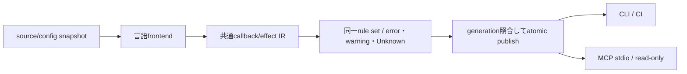
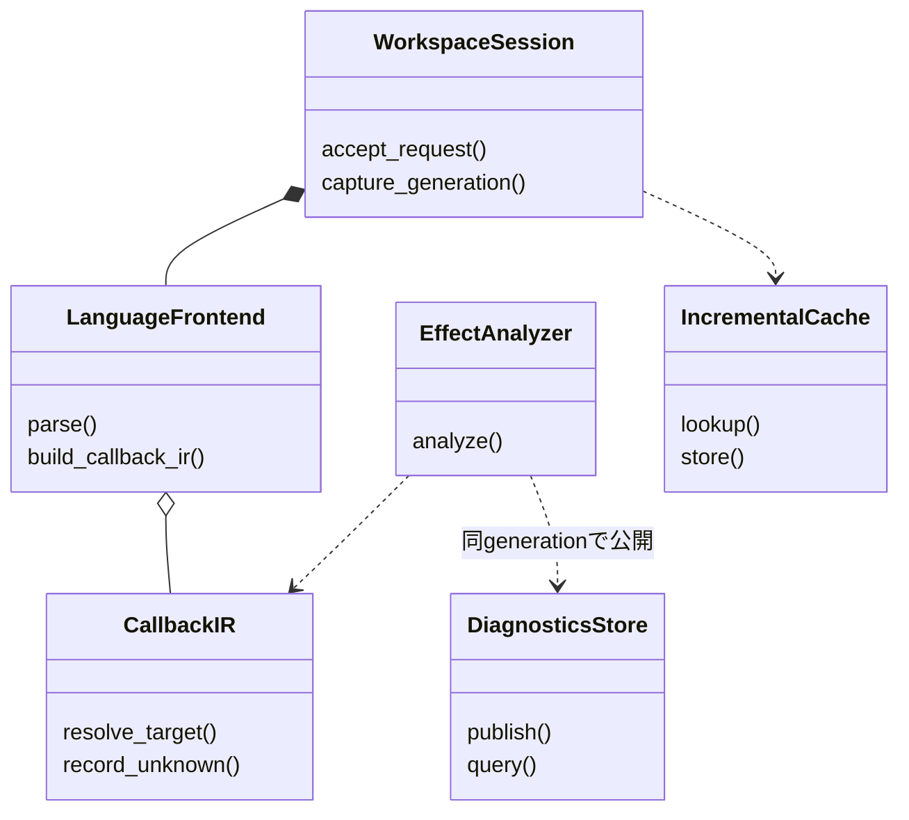

# 言語ラッパー：callback解析・lint・MCP

- 文書版: 1.1
- 文書ロール: detailed-design
- 更新日: 2026-10-17
- 状態: 1.1全文承認済み（利用者、2026-10-17）。実装・試験状態は別管理

## 目的と上位根拠

本書を要求から実装へ具体化する詳細設計の正本とする。型・API・所有・呼出し手順・状態遷移を実装へ反映する。要求の外部保証はリンク先RQ、層の責務と主要flowは上位BDを根拠とする。設計宣言の記載は、配布済みheader・実装済みAPI・試験合格を意味しない。

基本設計: [イベントハンドリング：通知・入力・Command](../../12_design/events/notifications-commands.md)、[言語ラッパー：共通facade・所有変換・解析](../../12_design/wrappers/language-wrappers.md)

## 要求と設計項目の対応

| 設計項目 | 要求根拠 |
| --- | --- |
| 解析IR・診断・workspace境界 | [RQ-03-011](../../11_requirements/RQ-03_language-support.md#rq-03-011)、[RQ-03-012](../../11_requirements/RQ-03_language-support.md#rq-03-012)、[RQ-03-016](../../11_requirements/RQ-03_language-support.md#rq-03-016)、[RQ-03-017](../../11_requirements/RQ-03_language-support.md#rq-03-017)、[RQ-05-013](../../11_requirements/RQ-05_ownership-callbacks.md#rq-05-013)、[RQ-07-008](../../11_requirements/RQ-07_binding.md#rq-07-008) |

本書内の共通規則は上記の各要求を実現するために適用する。同一項目内で個別要求を参照する場合はその対象範囲を優先する。将来候補・未採用範囲は採用済みの動作と区別する。

## 解析IR・診断・workspace境界

### 実装規則

| 実現手段・責務 | 要求根拠 |
| --- | --- |
| Analyzer IRはCallbackKind/CallTarget/RuntimeAlias/Effect/SourceSpanを持つ。禁止効果、警告効果、Unknownを分けてreportする。 | [RQ-03-017](../../11_requirements/RQ-03_language-support.md#rq-03-017) |
| C++は[[clang::annotate]]のportable macro、C#は[UiCallback]属性、Rustは#[ui_callback] proc-macro、Pythonは@ui_callback decoratorを採用する。 | [RQ-03-017](../../11_requirements/RQ-03_language-support.md#rq-03-017) |
| syntax/signature、async戻り不一致、禁止UI mutation/自己解除、destroy中UI entryを、効果を解決できた場合のerrorにする。終了要求受付は例外として許す。 | 上記の根拠RQ |
| 同Control Property書戻し、blocking wait/join/IO、強capture循環、間接再帰はwarning。dynamic dispatchはUnknownとして表示する。 | 上記の根拠RQ |
| Python JITは初期不採用。Python AST+型情報、C++ Clang AST、C# Roslyn、Rust macro入力+compiler diagnosticsのadapterへ分ける。 | 上記の根拠RQ |
| base-call検査はPython owner.__init__だけ必須とし、基底到達flagをruntime guardへ委譲する。演算子全体のsuper必須化は行わない。 | [RQ-03-016](../../11_requirements/RQ-03_language-support.md#rq-03-016) |
| 解析cacheはworkspace ID+content digest+config+analyzer version、結果はgeneration単位でatomic publish。 | 上記の根拠RQ |
| MCPはanalyze/get_diagnosticsのread-only入口、stdioを初期transport。URIは登録workspace内だけ、CLI/CIと同じJSON result schema。 | 上記の根拠RQ |

### 実現設計

#### Markerと診断schema案

```text
C++: UI_CALLBACK(property_validator)  // compiler別annotateへ展開
C#:  [UiCallback(UiCallbackKind.PropertyValidator)]
Rust: #[ui_callback(kind = "property_validator")]
Python: @ui_callback(kind="property_validator")
```

markerはcallback登録型との照合に使い、markerなしでも既知APIへ渡すcallableは解析対象になる。markerの有無でRuntime検査を外さない。Rust macroはtoken streamだけで任意call先の効果を判定できないため、証明不能をwarning/Unknownへ残し、コンパイル成功を純粋性の証明にしない。

| Rule候補 | 検知 | 位置・severity |
|---|---|---|
| CB001 | callback signature / owned-borrowed違反 | 定義/登録点、error |
| CB002 | 同Runtimeの禁止UI変更・自己解除 | call site、解決済みの場合error |
| CB003 | async/coroutineを同期callbackへ直接登録 | 戻り型解決時error |
| CB004 | destroy中UI操作 / C境界unwind | effect解決時error |
| CB101 | 同Control Propertyの書戻し/再帰可能性 | warning |
| CB102 | blocking wait/join/同期IO | warning、時間の閾値を推定しない |
| CB103 | owner captureによる参照循環 | warning |
| CB201 | 動的call先・alias未解決 | information/Unknown |

Diagnostic JSONは`schema_version, workspace_id, generation, input_digest, analyzer_version, rule_id, severity, file_uri, range, message, related_locations, certainty`。file URIはcanonicalizeしたworkspace relative pathから構成し、symlink脱出を拒否する。cacheは非秘密の解析結果だけを保存し、ソース全文を診断messageへ自動埋め込みしない。



MCPのtool入力は`workspace_id, relative_paths[], expected_generation?`、出力は同schemaのdiagnostics。世代不一致はstaleとして返し、旧結果を最新と表示しない。MCP toolの配布schema自体は本案の検証vectorへ含める。


### C++識別方式の根拠

[Clang attribute reference](https://clang.llvm.org/docs/AttributeReference.html#annotate)のannotateをcompiler adapterで使用する。MSVC/GCCの通常buildではmacroを空または利用可能なannotationへ展開し、解析はClang compilation databaseを入力に行う案。通常compilerが全marker効果を検証すると保証しない。

### 解析実行の信頼境界

Clang compilation databaseをshell commandとして実行せず、LibToolingへ検査済みargument vectorを渡す。plugin/load-pass-plugin等の動的code load optionを拒否し、includeのVFSを登録workspaceとreadonly SDK rootsへ限定する。解析processはnetworkなし、CPU/memory budget付きで分離し、budget到達はAnalysisIncomplete/Unknownとして返す。sourceの解析結果を安全確認済みへ変換しない。MCP schemaにはresult status Complete/Partial/Failedを持たせ、診断0件と未解析を区別する。

## クラス設計の補足（1.1承認済み）

既承認1.0の実現規則を支える型・関連・所有・主要操作を整理した。内部型名とメソッドの分担は本改訂で補足する内部設計であり、既存公開APIの署名や外部保証を追加・変更するものではない。この節のクラス構成と追加図は1.1版全文の承認対象であり、実装・試験完了の証明とは区別する。

要求根拠: [RQ-03-011](../../11_requirements/RQ-03_language-support.md#rq-03-011)、[RQ-03-012](../../11_requirements/RQ-03_language-support.md#rq-03-012)、[RQ-05-013](../../11_requirements/RQ-05_ownership-callbacks.md#rq-05-013)。

言語別解析frontendと共通IR/効果解析/診断公開を分け、CLI/CI/MCPで同じ解析結果を扱う。ここでの型は解析tool内部のクラス分担案である。

### 型の責務と所有

| 型 | 責務・保持データ | 主要メソッド・操作 | 所有・寿命 |
| --- | --- | --- | --- |
| WorkspaceSession | 登録workspace、readonly SDK、設定・入力fingerprint、request generation | accept_request(input); capture_generation(); cancel_stale() | workspace外や未登録入力へ範囲を拡大しない |
| LanguageFrontend | 言語のmarker/call target/runtime aliasの抽出 | parse(input); build_callback_ir() | user codeや任意build scriptを実行せず解析情報を生成 |
| CallbackIR | CallbackKind/CallTarget/RuntimeAlias/Effect/SourceSpan | resolve_target(); record_unknown() | 解決不能をUnknownとして残し、禁止確定へ偽装しない |
| EffectAnalyzer | callback種別と到達可能な効果の照合 | analyze(ir, rules) | 禁止・警告・Unknownを区別。Runtime側の入口保護を代替しない |
| DiagnosticsStore | 一解析generationの不変reportと公開状態 | publish(report, generation); query(generation) | 古い結果を最新generationとして公開しない |
| IncrementalCache | 入力/設定/解析器fingerprintに対応する再生成可能なcache | lookup(key); store(result); invalidate(dependencies) | cacheは正本ではない。workspaceと世代を越えて混用しない |

### クラスの関連

`*--`は従属するstate/作業の合成、`o--`は共有を含む所有参照、`..>`は非所有の利用・識別・委譲を示す。関連名と本文で示した寿命を優先し、図の同名型は各instanceで別の状態を持つ。図は主要メソッド名を抜粋し、引数・所有・失敗条件は表と本文に従う。



### 主要な呼出しと失敗境界

request受付→入力/設定generation固定→frontend IR構築→効果解析→generation照合→DiagnosticsStoreへ原子的に公開する。入力が途中で更新された場合は結果をstaleとして扱い、MCP応答やcache更新で最新へ昇格させない。

型名の追加は検出能力の保証追加ではない。動的target・aliasの未知を残し、承認済みworkspace隔離・networkなし解析・資源budgetを維持する。

## 文書の承認・改訂履歴

| 日付 | 対象版 | 内容・根拠 |
| --- | --- | --- |
| 2026-10-17 | 1.0 | 利用者の指示に基づき、既承認内容を責務別に再編集。設計項目IDによる承認・追跡は廃止し、以後は文書版全体で管理する。構成変更を新規の製品仕様採用としない |
| 2026-10-17 | 1.0全文 | 利用者の「全部承認します」により文書全体を承認。旧IDによる項目承認ではなく、現行文書版を対象とする。実装・試験合格を意味しない |
| 2026-10-17 | 1.1改訂案 | 利用者の補足指示によりクラス責務・所有・メソッド・関連図を追加。1.0承認を維持し、1.1全文は確認待ち |
| 2026-10-17 | 1.1全文 | 利用者の「OK,テスト文書作りましょうか」により、クラス設計補足と選択的な図の補強を含む全文を承認。既存履歴を維持し、実装・試験状態は別管理 |
