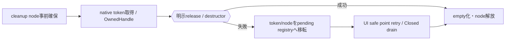
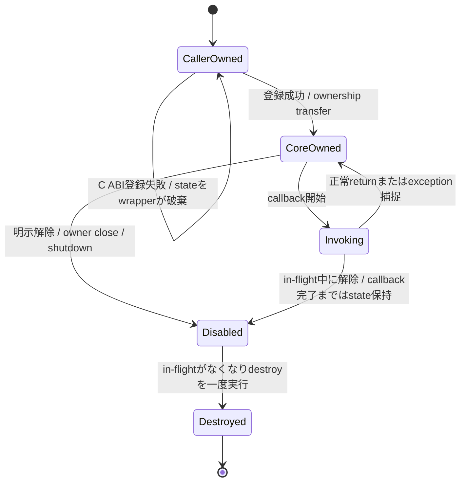
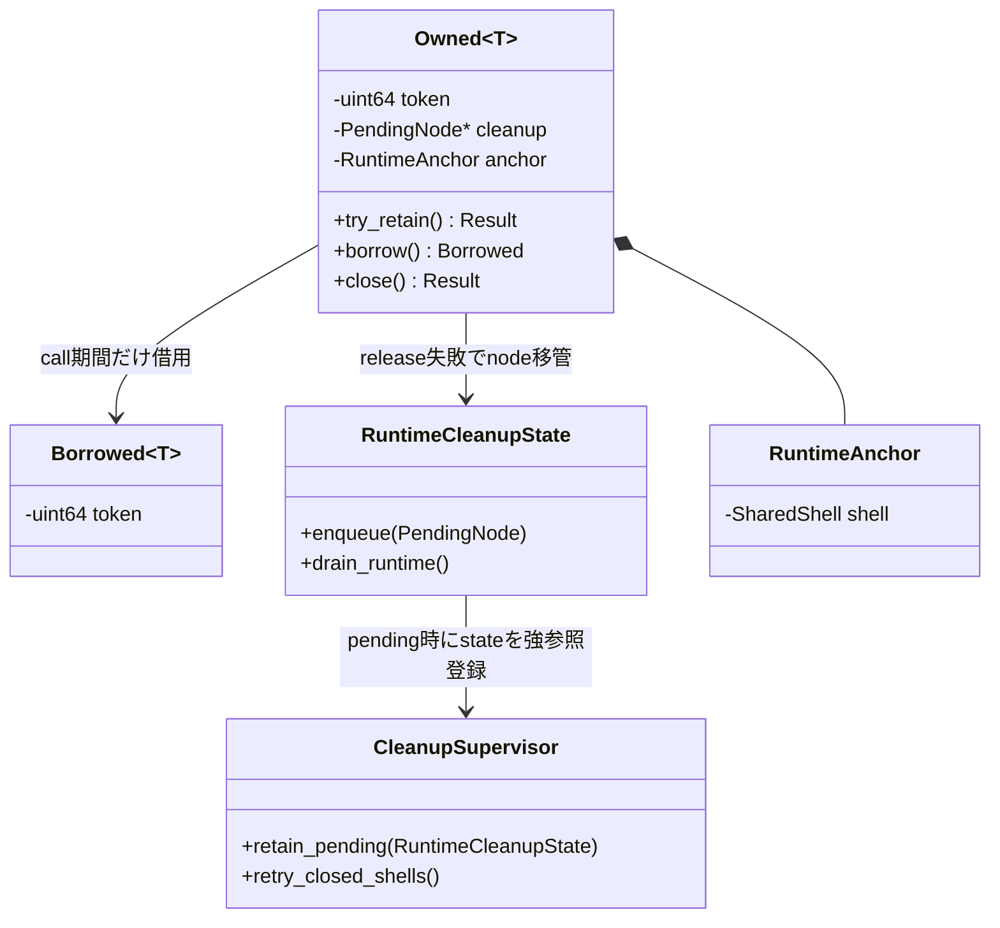
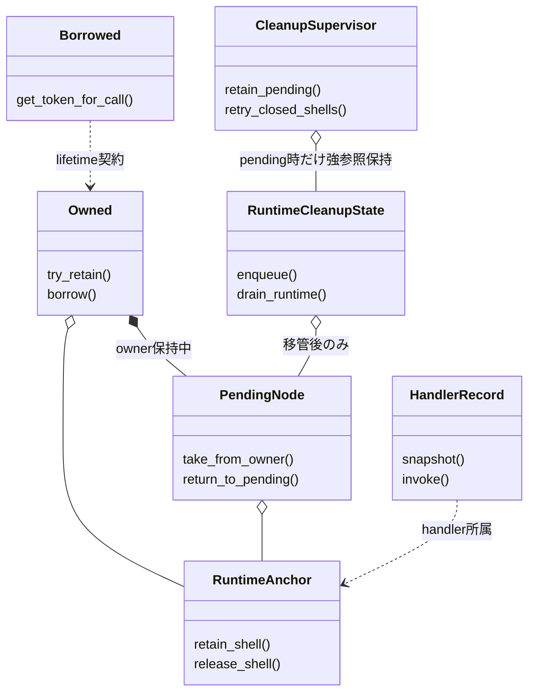
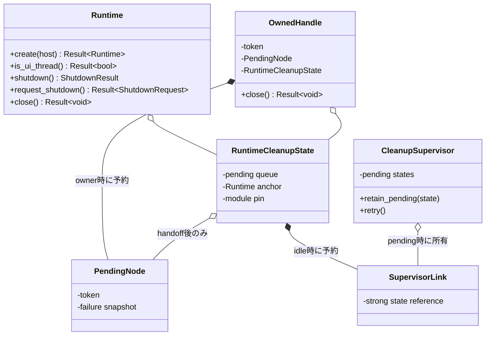
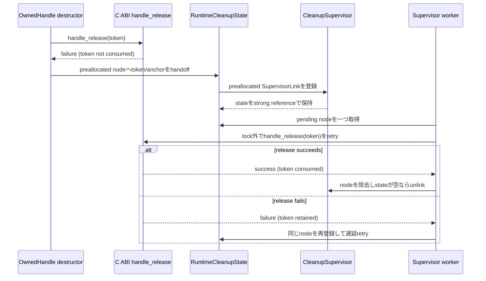

# 言語ラッパー：C++

- 文書版: 1.4 改訂案
- 文書ロール: detailed-design
- 更新日: 2026-10-30
- 状態: 1.2全文・1.3 Binding API補足承認済み。1.4全文承認済み（利用者、2026-10-30）。実装・試験状態は別管理

## 目的と上位根拠

本書を要求から実装へ具体化する詳細設計の正本とする。型・API・所有・呼出し手順・状態遷移を実装へ反映する。要求の外部保証はリンク先RQ、層の責務と主要flowは上位BDを根拠とする。設計宣言の記載は、配布済みheader・実装済みAPI・試験合格を意味しない。

基本設計: [オブジェクト管理：値・モデル・更新整合性](../../12_design/runtime-objects/model-values.md)、[ビルド・配布：package・artifact・信頼境界](../../12_design/build/packages-artifacts.md)、[ランタイム：実行context・所有・終了](../../12_design/runtime-objects/runtime.md)

## 要求と設計項目の対応

| 設計項目 | 要求根拠 |
| --- | --- |
| 所有型・callback・例外・thread | [RQ-03-001](../../11_requirements/RQ-03_language-support.md#rq-03-001)、[RQ-03-005](../../11_requirements/RQ-03_language-support.md#rq-03-005)、[RQ-04-006](../../11_requirements/RQ-04_abi-boundary.md#rq-04-006)、[RQ-04-007](../../11_requirements/RQ-04_abi-boundary.md#rq-04-007)、[RQ-04-016](../../11_requirements/RQ-04_abi-boundary.md#rq-04-016)、[RQ-04-022](../../11_requirements/RQ-04_abi-boundary.md#rq-04-022)、[RQ-04-023](../../11_requirements/RQ-04_abi-boundary.md#rq-04-023)、[RQ-05-003](../../11_requirements/RQ-05_ownership-callbacks.md#rq-05-003)、[RQ-05-009](../../11_requirements/RQ-05_ownership-callbacks.md#rq-05-009)、[RQ-05-012](../../11_requirements/RQ-05_ownership-callbacks.md#rq-05-012)、[RQ-06-002](../../11_requirements/RQ-06_threading-dispatch.md#rq-06-002)、[RQ-06-005](../../11_requirements/RQ-06_threading-dispatch.md#rq-06-005)、[RQ-06-006](../../11_requirements/RQ-06_threading-dispatch.md#rq-06-006) |
| 公開API・handler・cleanup同期 | [RQ-03-001](../../11_requirements/RQ-03_language-support.md#rq-03-001)、[RQ-03-005](../../11_requirements/RQ-03_language-support.md#rq-03-005)、[RQ-03-014](../../11_requirements/RQ-03_language-support.md#rq-03-014)、[RQ-04-022](../../11_requirements/RQ-04_abi-boundary.md#rq-04-022)、[RQ-05-012](../../11_requirements/RQ-05_ownership-callbacks.md#rq-05-012)、[RQ-05-014](../../11_requirements/RQ-05_ownership-callbacks.md#rq-05-014)、[RQ-12-004](../../11_requirements/RQ-12_build-distribution.md#rq-12-004) |
| Property Binding | [RQ-05-002](../../11_requirements/RQ-05_ownership-callbacks.md#rq-05-002)、[RQ-05-006](../../11_requirements/RQ-05_ownership-callbacks.md#rq-05-006)、[RQ-05-007](../../11_requirements/RQ-05_ownership-callbacks.md#rq-05-007)、[RQ-05-012](../../11_requirements/RQ-05_ownership-callbacks.md#rq-05-012)、[RQ-06-001](../../11_requirements/RQ-06_threading-dispatch.md#rq-06-001)、[RQ-07-001](../../11_requirements/RQ-07_binding.md#rq-07-001)、[RQ-07-002](../../11_requirements/RQ-07_binding.md#rq-07-002)、[RQ-07-003](../../11_requirements/RQ-07_binding.md#rq-07-003)、[RQ-07-004](../../11_requirements/RQ-07_binding.md#rq-07-004)、[RQ-07-005](../../11_requirements/RQ-07_binding.md#rq-07-005)、[RQ-07-006](../../11_requirements/RQ-07_binding.md#rq-07-006)、[RQ-07-007](../../11_requirements/RQ-07_binding.md#rq-07-007)、[RQ-07-008](../../11_requirements/RQ-07_binding.md#rq-07-008)、[RQ-07-009](../../11_requirements/RQ-07_binding.md#rq-07-009)、[RQ-07-010](../../11_requirements/RQ-07_binding.md#rq-07-010)、[RQ-07-011](../../11_requirements/RQ-07_binding.md#rq-07-011) |

本書内の共通規則は上記の各要求を実現するために適用する。同一項目内で個別要求を参照する場合はその対象範囲を優先する。将来候補・未採用範囲は採用済みの動作と区別する。

## 所有型・callback・例外・thread

### 実現のcall/data/ownership flow

OwnedHandleはnative token取得前にcleanup nodeを確保し、明示retain成功でだけ新ownerを作る。moveはtoken/nodeの所有を一度移し、borrow viewはcall期間だけ参照する。destructorのrelease失敗ではnode/tokenをRuntime専用pending queueへ移す。process-wide CleanupSupervisorはpending nodeを持つRuntimeCleanupStateを強参照で保持し、Runtimeごとのsafe pointまたはClosed shellから再試行する。全nodeが解決した後にRuntime anchorとnative module pinを解放する。noexcept trampolineは例外をhandlerと種別固有failureへ変換する。



### 範囲と責務

| 領域 | C++ wrapperの責務 | 本書で確定しないこと |
|---|---|---|
| handle | owned tokenとborrowed argumentを区別し、tokenのretain/releaseを包む | C ABIのsymbol追加、内部token表現 |
| callback | 言語側captureをuserdata内に保持し、例外をABI境界で止める | callback診断API、個別機能の戻り値意味論 |
| error | `ui_status`とimmutable Error snapshotをC++ error surfaceへ移す | 全domain/code catalog、message localization |
| thread | UI thread限定を維持し、worker更新をDispatcherへ導く | UI executor実装、Platform loop詳細 |
| lifecycle | 明示closeとRAII token解放を提供する | finalizer queue failure時のnative契約変更 |
| values | 5つのProperty kindを明示変換する | DECIMALのABI符号化、値型間の暗黙変換 |

本案は既存のC ABIを覆う薄いbindingとする。独立したC++側Property正本、C++ object pointerのABI受渡し、C++例外のABI越境を導入しない。

### 実装規則

| 実装規則 | 根拠・境界 |
| --- | --- |
| すべての公開handle wrapperは内部にopaque `ui_handle` tokenを持ち、token整数・native pointerへの暗黙変換を提供しない。wrapperは期待kindとRuntime関連を型/内部検証で守り、最終的な検証statusはCoreの結果を保持する。 | 公開ABI契約、handle登録・検証。ABI tokenをC++ object pointerとして再解釈しない。 |
| 所有tokenを持つ低層wrapperはmove-onlyとし、destructorで一token分の`handle_release`を試みる。所有tokenの複製は`handle_retain`を呼ぶ明示操作（例示名 `clone()`）だけで行う。借用handleは呼出し中のみ有効な非所有viewとして渡し、破棄時にreleaseしない。 | 公開ABI契約、handle登録・検証、Runtime所有と終了、値・error境界。C++ copyがABI retainを隠れて起こすと失敗可能性と参照数が不透明になる。 |
| `close()` / `reset()`等の明示終了操作はstatus/errorを呼出し側へ返せる形にし、成功時だけ所有tokenを空にする。RAII destructorは例外を投げず、release成功時にtokenを空にし、失敗時はC++ wrapperの言語内cleanup管理へ所有tokenを移す。 | 公開ABI契約、値・error境界、Runtime所有と終了、C++ wrapper。 |
| C++ callback captureは安定したheap stateに置き、C trampolineがそれを取り出して呼ぶ。C APIの登録/postが失敗した場合、所有権をCoreへ渡さずwrapperがstateを解放する。成功時はCoreのdestroy thunkがstateを一度だけ解放する。 | Runtime契約、公開ABI契約、言語境界契約、callback実行規則。登録中のcallback開始可否はowner API契約が明示する。 |
| callback trampolineとdestroy thunkは`noexcept`とし、ユーザーcallableからのC++ exceptionをC ABIへ出さない。例外有効buildではcallback例外を利用者設定のhandlerへ渡せる。handler自体もthrowしてはならず、callback種別の失敗意味論を置き換えない。 | Runtime契約、callback実行規則、C++ wrapper。handler未設定時の既定記録方法と診断payloadは後続で具体化する。 |
| C++ wrapper操作は、例外を使わずstatus/resultで失敗を返す基底経路を持つ。例外有効buildではその結果を`UiError`系例外へ変換する便宜APIを提供できる。Error snapshot取得時はowned error handleとraw status/domain/codeを保持し、詳細生成不能でも元statusを失わない。 | 公開ABI契約、共通ABI、値・error境界、C++ wrapper。型名と具体 overloadはAPI設計章まで確定しない。 |
| unknown status/domain/codeは捨てず、raw数値としてgeneric failureに保持する。messageは表示用情報とし、分岐や再現可能なcode識別に使わない。UTF-8 messageはlength付きbyte列として読み、NUL終端やlossy conversionを前提にしない。 | 共通ABI、値・error境界。C++標準string encodingとの変換規則は後続wrapper共通設計で確認する。 |
| Property kindごとに明示したC++型変換を行い、範囲外整数の切り詰め、型間の暗黙変換、`std::string`のNUL終端依存を避ける。UTF-8はdata pointer+byte lengthで渡す。 | 値・error境界、Property保存と通知、MVVM UIライブラリ 初期公開値型の上位判断。 具体化は言語ラッパー：C++、[ビルド・配布：toolchain・profile・package](../build/toolchain-packages.md)、[共通C ABI：宣言・検査・互換性](../runtime-objects/abi.md)を参照する。 |
| UI-affine objectのUI操作はUI thread上に限定する。workerからUI操作を直接呼ばず、承認済みDispatcher/post経路へ値またはtaskを渡す。`runtime_is_ui_thread`は明示的な確認用とし、誤thread操作をwrapper内で黙って同期dispatchしない。 | Runtime契約、言語境界契約、UI dispatcher。各操作のAPI固有thread契約は所有するDDに従う。 |
| Runtime shutdownは`shutdown()`等の明示操作とし、完了済みか要求受付済みかを戻り値で区別する。callback/event内の呼出しは`UI_PENDING`受付後に戻り、worker同期呼出しはUI-thread cleanup完了後に戻る。Runtime destructorがshutdownを暗黙実行する設計にはしない。 | Runtime shutdownのcallback中dispatchに関する上位判断、共通ABI、UI dispatcher、言語境界契約。host停止通知でworker waitを未完了として解除する。Runtime ownerの最終cleanup接続は具体化課題として追跡する。 |
| Runtimeを使うUI-affine wrapper、活性Subscription/Binding、callback stateの寿命関係をC++ object graphで見えるようにする。Runtime shutdownは最初に明示完了させ、その後に従属wrapperをclose/releaseし、Runtime handleを最後に解放する使用順を提示する。 | Runtime契約、言語境界契約、Runtime所有と終了、イベントハンドリング：通知とBinding伝播。各objectがRuntimeをC++ shared ownershipで延命するかは別途所有型の詳細判断が必要。 |
| Runtime所有と終了の「worker finalizer enqueue失敗時は公開tokenを消費しない」契約を維持し、C++ wrapper内でtokenの所有を保つ。destructorはrelease失敗を隠さずcleanup管理へ移管し、UI threadで再試行する。 | Runtime所有と終了、handle登録・検証、公開ABI契約、C++ wrapper。Core側release契約は変更しない。 |
| 例外無効buildでも全てのwrapper操作とcallback adapterを利用できるよう、status/resultによる非throw経路を基底とする。例外有効buildのthrowing APIは同じ基底結果から構成する薄い便宜層とする。 | 公開ABI契約、値・error境界。例外無効buildでC++例外を要求せず、callbackは明示結果または種別固有failureを返す。 |
| 例外有効buildで、callback内の捕捉した`std::exception_ptr`を利用者設定のexception handlerへ渡せるようにする。handlerは`noexcept`で、対象Runtime/callback種別に関連付ける。handler内の再throw・UI API呼出し可否は別途制約を定めるまで禁止候補とし、C ABIへ例外を漏らさない。 | Runtime契約、callback実行規則。公開登録API名・handler交換時の同期・既定handlerは後続API設計で具体化する。 |
| 各OwnedHandleはnative owned tokenを受け取る前にcleanup nodeを確保する。node確保に失敗する場合はcreate/retain等のnative callを開始しない。destructorでnative releaseが失敗した場合はtokenとnodeをRuntime専用intrusive queueへ移管する。process-wide supervisorがpending queueを持つRuntime stateを強参照で保持し、UI thread safe pointまたはClosed shellから再試行する。native moduleはpending tokenがある限りpinする。 | Runtime所有と終了、UI dispatcher、C++ wrapper。Core側release契約は変更せず、supervisorの同期・登録node・終了時処理は本改訂で具体化する。 |

### 所有wrapperとborrowed view

#### handle wrapper案

```cpp
// 擬似コード: 公開名・template構造・例外有無の確定宣言ではない。
class OwnedHandle {
public:
  OwnedHandle(const OwnedHandle&) = delete;
  OwnedHandle& operator=(const OwnedHandle&) = delete;
  OwnedHandle(OwnedHandle&&) noexcept;
  OwnedHandle& operator=(OwnedHandle&&) noexcept;
  ~OwnedHandle() noexcept;

  Result<void> close();       // 明示release。成功時にemptyとなる。
  Result<OwnedHandle> clone() const; // retainで別tokenを得る。
};

class BorrowedHandleView {
  // 呼出し中のみ有効。コピー可能でも所有tokenを増やさず、releaseしない。
};
```

`Result`は例外無効buildにも使える非throw基底経路を示す説明用の抽象名であり、`std::expected`採用やC++標準versionは決めない。例外有効buildの便宜APIは同じ失敗情報を例外へ変換する。明示closeはどちらのbuildでも失敗を観測できる。

| 対象 | owned wrapperの破棄 | 明示終了 | Runtimeとの関係 |
|---|---|---|---|
| Runtime | token releaseのみ。shutdownを暗黙開始しない | shutdown完了後にhandleをrelease | 具体化は言語ラッパー：C++、[ビルド・配布：toolchain・profile・package](../build/toolchain-packages.md)、[共通C ABI：宣言・検査・互換性](../runtime-objects/abi.md)を参照する|
| Property/Widget/Command | owned tokenを一つrelease | UI意味論上のcloseが定義される型だけ提供 | Runtime state anchorはCore側で管理（Runtime所有と終了） |
| Binding/Subscription | token releaseとCoreの承認済み解除規則に従う | 必要な型は明示deactivate/closeを持つ | closure破棄時にC++ captureを一度だけ解放 |
| Error | immutable snapshot tokenをrelease | 通常の明示closeは不要 | UI Runtime操作とは独立したread-only snapshot |

型別APIがreleaseとdeactivateを分離している場合、C++ destructorはそのAPI固有の契約に合わせる。ランタイム：実行基盤と終了等にない一律のclose副作用は付けない。

#### Scopeと寿命順

- Wrapperが内部にborrowed Runtime viewを保持する場合、そのviewが指すRuntime tokenの寿命を型やscopeで制約する。danglingなC++ referenceだけで安全性を主張しない。
- moveは一つのowned tokenの所在を移すだけで、Core retainを呼ばない。cloneは別tokenを発行し、元wrapperと独立してcloseできる。
- create/retain/out-errorなどowned tokenを受ける操作では、wrapperがcleanup nodeを先に確保してからnative callを行う。ticket確保失敗ならnative token生成を開始しない。native APIが複数owned outputを返す場合は必要数のnodeを先に確保する。
- wrapperが親Runtimeのshared pointerを保持する案は、Runtime object寿命を延ばす意味がRuntime所有と終了のCore anchorと一致しない可能性がある。具体化は言語ラッパー：C++、[ビルド・配布：toolchain・profile・package](../build/toolchain-packages.md)、[共通C ABI：宣言・検査・互換性](../runtime-objects/abi.md)を参照する。
- 正常終了の基本順は、UI上の使用停止、Runtime shutdown完了、子wrapperのtoken release、最後にRuntime token releaseとする。実際のshutdownでCoreがcleanupする参照を、利用者が先に全て手動解除する必要はない。

### Callback captureとexception境界



- wrapperはcallableと必要な参照を一つのcallback stateに格納する。Coreへ渡す`userdata`はこのstateへのstable pointerとし、C function pointerは静的なtrampolineとdestroy thunkを用いる。
- API呼出しが失敗した場合はstateをwrapperが解放し、Core側destroyを期待しない。成功時にはcallback実行規則に従いCoreが一度だけdestroyする。
- trampolineはcallback種別の契約を適用してからcallableを呼び、C++ exceptionを必ずcatchする。通知例外、Validator拒否、Command failure、TextBox input resultを同じgeneric statusへ潰さない。
- callback内の自己解除はcallback実行規則とowner API固有制約に従う。in-flight stateはcallback returnまで保持し、destroy中はUI APIを呼ばない。
- 登録APIの戻り前に初回callbackを同期実行するかは各owner ABI契約で確認する。同期実行があり得る場合、成功statusが返るまでuserdata所有権を決められない単純なunique ownership transferを避ける必要がある。

#### 利用者handlerと既定診断の境界

利用者設定handlerはcallback例外を受け取る拡張点として承認された。callback実行規則のnotification例外後も他の購読者への配信を続ける。既定handler、診断payload/API、handler自体のfailure reportingは未定義なので、後続API設計で具体化する。handlerはC ABIを越える例外伝播を行わず、callback種別の戻り値・failure意味論を変更しない。

### Errorと値変換

#### API error

通常のwrapper操作はstatus/resultによる非throw経路を必ず提供する。例外有効buildでは、同じ失敗を`UiError`相当へ変換する便宜APIを選べる。例外は少なくともraw `ui_status`を保持する。C APIが`out_error`を返した場合はC++ error objectがそのowned error handleをmove ownershipで保持し、必要な場合にstatus/domain/code/messageを取得する。Error取得中のallocation failureでも元statusを失わない。

```cpp
// 説明用概念。メンバーと名称はレビュー対象。
class UiError /* : public std::exception */ {
  ui_status status();
  std::optional<std::pair<uint32_t, uint32_t>> domain_code();
  std::string_view? message_utf8();
  // underlying immutable Error handleは所有し、破棄時releaseする。
};
```

例外無効buildでは非throw経路だけで完結する。例外有効buildではthrowing convenience層を提供できる。検証拒否・Command failure等、機能APIで通常の状態結果と定義済みのものはAPI固有設計に従い、全てを例外へ変換しない。

#### 値型

| ABI kind | C++対応案 | 変換境界 |
|---|---|---|
| BOOL | 明示bool変換 | 0/1以外を生成しない |
| I64 | 符号付き64-bit型 | より狭い整数への暗黙切り詰めなし |
| UTF8 | byte lengthを保つUTF-8 value | 入力はcall中借用、保持時Core copy。getterは容量照会/retry規則に従う |
| F64 | binary64対応型 | NaN/±0等価などMVVM UIライブラリ 初期公開値型の上位判断意味論をwrapperで変更しない |
| DECIMAL | 後続ABI表現に結びつく専用型trait候補 | `double`/stringへの暗黙変換やparse規則は追加しない |

C++の`std::string`は便宜上UTF-8 byte列を保持できるが、型だけでvalid UTF-8を保証しない。入力検証はCore contractに従い、wrapperが事前検査するかCoreへ委ねるかは失敗statusを保持する範囲で選ぶ。Embedded NULは長さで扱い、終端NULをABIへ含めない。

### ThreadとshutdownのC++ surface

| 呼出し状況 | C ABI契約 | C++ wrapper案 |
|---|---|---|
| UI-affine getter/setterをworkerから呼ぶ | `UI_WRONG_THREAD` | 直接操作は例外/statusにし、暗黙dispatchしない |
| workerから非同期post | 成功後Coreがclosureを所有 | task/captureを安定化してからpost。失敗時はwrapperが保持・破棄 |
| callback/event中にshutdown | 優先control taskを受付後`UI_PENDING` | 「要求受付済み」を同期完了と区別する結果にする |
| workerからshutdown、loop稼働 | UI threadのcleanup完了まで同期waitし`UI_OK` | 呼出し元が待つことをAPI名/戻り型で見えるようにする |
| worker同期wait中にUI loop停止 | 未完了結果・停止理由 | host停止通知でwaitを解除する。cleanup完了には換算しない |

非同期shutdownで完了待ちfutureを付加する根拠はないため、本案では追加しない。具体化は言語ラッパー：C++、[ビルド・配布：toolchain・profile・package](../build/toolchain-packages.md)、[共通C ABI：宣言・検査・互換性](../runtime-objects/abi.md)を参照する。

### 失敗・競合ケース

| ケース | C++ wrapperの期待動作案 |
|---|---|
| `handle_retain`失敗 | cloneは失敗を返し、元owned tokenを変更しない |
| 明示closeでrelease失敗 | wrapper内のtokenを保持し、callerが再試行できる |
| destructorでrelease失敗 | 事前確保済みnodeへtokenを移しRuntime専用queueへ登録する。process-wide supervisorがそのRuntime stateを強参照し、UI safe pointまたはClosed shellから再試行 |
| callback登録失敗 | callback stateはwrapperが解放し、destroyを二重実行しない |
| callback中のC++例外 | trampolineで捕捉し、ABIへ伝えない。owner固有のfailure/diagnosticへ変換 |
| callback自己解除 | in-flight callbackを終えた後にdestroyし、同一callbackを再度開始しない |
| unknown status | raw valueを保持しgeneric errorとして扱う |
| error snapshot生成不能 | 元のstatusを報告し、架空のdetail/error handleを作らない |
| UTF-8 getterでbuffer不足 | caller bufferを一部更新せず、必要長を使い再試行する |
| worker release時queue満杯/OOM | C ABIはtokenを消費しない。明示closeは失敗を返す。destructor経路のnodeとsupervisor登録枠はowned token取得前に確保し、破棄時の追加allocationを避ける |
| callback/event中shutdown | 現eventを中断せず、要求受付済みで戻る。完了済みと表示しない |

## 公開API・handler・cleanup同期

### 実装規則

| 実現手段・責務 | 要求根拠 |
| --- | --- |
| C++17をminimumとし、freemvvm namespaceのOwned<T>/Borrowed<T>/Result<T>/UiError/Decimal64を公開する。 | [RQ-03-014](../../11_requirements/RQ-03_language-support.md#rq-03-014) |
| Ownedはcopy禁止、move noexcept、try_retain()だけ新tokenを返す。close()はResult<void>で成功時だけemptyにする。 | 上記の根拠RQ |
| 通常APIはResultを基本、例外有効時のみvalue_or_throw()を補助提供。例外無効時にも同じ基本型を使う。 | 上記の根拠RQ |
| Runtime単位のhandlerは共有HandlerRecordをmutexでsnapshot取得し、lock外でinvoke。交換は以降のinvokeに適用し旧recordは最後のin-flight後destroy。 | 上記の根拠RQ |
| handler型はvoid(*)(const CallbackFailure&,void*)、destroy pointerを別保持。handler内例外は捕捉し既定diagnosticへ一度送る。 | 上記の根拠RQ |
| RuntimeCleanupStateはRuntimeごとにstd::mutex+intrusive PendingNode queueを持ち、node/token/anchorの所有移転を一同期点で行う。CleanupSupervisorはprocess-wideでpending stateを強参照する。native releaseはすべてのmanager lock外で実行し、失敗時は同nodeを再登録する。 | 上記の根拠RQ |
| UiThreadRefは非所有UI affinity marker、RuntimeAnchorはshellを保持する共有内部owner。Runtime destructorから暗黙shutdownしない。 | 上記の根拠RQ |

### 実現設計

#### Class/所有



`Result<T>`はsuccess値または`UiError { raw_status, ErrorSnapshot? }`を持つ。success判定をstatus==0だけにせず、shutdownのUI_PENDINGは`ShutdownReceipt`のAcceptedとして表す。unknown status/domain/codeは数値を保持する。UTF8 decode失敗はライブラリ内部不整合としてraw bytesを保持し、置換文字へ黙って変換しない。

| API | 呼出し・戻り | 失敗時所有 |
|---|---|---|
| Runtime::create(HostRegistration) | Result<Runtime>、UI thread | nodeを先に確保。native失敗でtokenなし |
| Property<T>::get/set | Result<T>/Result<void>、UI | borrow pin、失敗commitなし |
| Runtime::shutdown() | ShutdownResult | 完了と`UI_PENDING`受付を識別し、C ABIの同期shutdown結果を保持 |
| Runtime::request_shutdown() | Result<ShutdownRequest> | request handleを所有し、完了/pending/host unavailableをqueryできる |
| Runtime::set_callback_handler | Result<HandlerRegistration> | 新record prepare失敗なら旧handler維持 |
| Decimal64::try_from_parts | Result<Decimal64>、任意thread | scalarのみ。丸めなし |

handler recordは関数+userdata+destroyを共有所有する。例外有効時のCallbackFailureはstd::exception_ptrをoptionalに含み、例外無効時は空でnative分類を提供する。CallbackFailureはinvoke中borrow、保存には利用者が明示copyする。Runtimeのhandler交換もUI mutationとは分けた同期操作だが、handler userdataのdestroyは最後のinvoke終了後のsafe pointで行う。

moveでは元をemptyにしnode/anchorを一度だけ渡す。destructorはtry_release→失敗node enqueueで戻り、nativeを呼ぶ間Runtime queue/supervisor lockを保持しない。handlerやfinalizerからRuntime facadeへの強い逆参照をcleanup managerに保存しない。

## クラス設計の補足（1.1承認済み）

既承認1.0の実現規則を支える型・関連・所有・主要操作を整理した。内部型名とメソッドの分担は本改訂で補足する内部設計であり、既存公開APIの署名や外部保証を追加・変更するものではない。この節のクラス構成と追加図は1.1版全文の承認対象であり、実装・試験完了の証明とは区別する。

要求根拠: [RQ-03-014](../../11_requirements/RQ-03_language-support.md#rq-03-014)、[RQ-05-012](../../11_requirements/RQ-05_ownership-callbacks.md#rq-05-012)、[RQ-05-014](../../11_requirements/RQ-05_ownership-callbacks.md#rq-05-014)。

既存Owned<T>/Borrowed<T>/RuntimeCleanupState/CleanupSupervisor/HandlerRecordを、正常API呼出しとnoexceptな後始末経路に分けて補足する。図は型引数を省略している。

### 型の責務と所有

| 型 | 責務・保持データ | 主要メソッド・操作 | 所有・寿命 |
| --- | --- | --- | --- |
| Owned | token、事前PendingNode、共有RuntimeAnchor | try_retain(); borrow(); close() | copy禁止・move可能。明示close失敗ではowner内にtokenを残す |
| Borrowed | 非所有token viewと有効期間の契約 | get_token_for_call() | 元owner/callbackの寿命内のみ使用。destructorはreleaseしない |
| PendingNode | 再試行token、anchorとcleanup状態 | take_from_owner(); return_to_pending() | destructor失敗時にownerからmanagerへ同nodeを移し二重解放を避ける |
| RuntimeCleanupState | Runtime単位のmutexとintrusive pending node集合 | enqueue(node); drain_runtime() | Runtimeごとにqueueを分離し、node/token/anchorを同期下で移す。native releaseはlock外で実行 |
| CleanupSupervisor | process-wide mutexとpending RuntimeCleanupStateの強参照集合 | retain_pending(state); retry_closed_shells() | pending nodeがあるstateだけ保持する。Runtime間のcleanup状態・順序を統合しない |
| RuntimeAnchor | 終了後もreleaseに必要なRuntime shell保持 | retain_shell(); release_shell() | ticket/nodeより先に失われない。Runtime destructorで暗黙shutdownしない |
| HandlerRecord | handler/userdata/destroyとin-flight共有寿命 | snapshot(); invoke(failure) | Runtime単位でmutex下snapshot取得、user handlerはlock外 |

### クラスの関連

`*--`は従属するstate/作業の合成、`o--`は共有を含む所有参照、`..>`は非所有の利用・識別・委譲を示す。関連名と本文で示した寿命を優先し、図の同名型は各instanceで別の状態を持つ。図は主要メソッド名を抜粋し、引数・所有・失敗条件は表と本文に従う。



### 主要な呼出しと失敗境界

通常closeはnative release成功後にtokenをemptyにする。destructor経路で失敗した場合は事前nodeへtoken/anchorを移し、RuntimeCleanupStateがlock外で再試行する。pending中はCleanupSupervisorがstateを強参照し、native moduleをpinする。callback例外はtrampolineで捕捉しHandlerRecord snapshotへ配送する。

OwnedとRuntimeCleanupStateが同じPendingNode/tokenを同時所有する図ではなく、移管前後を示す。Borrowedの寿命規則をnative retainの実行と混同しない。handler自身の例外は既定診断へ一度だけ送る。

## Runtime最小公開APIとcleanup supervisor（1.2レビュー案）

この節は1.1全文承認後に追加する最小Runtime surfaceとrelease失敗時の寿命設計案であり、未承認である。1.1の他のwrapper型・callback・Property APIはこの変更では削除・再設計せず、最初のC++実装範囲をRuntime操作に限定する。

### 公開型と操作

| 型・操作案 | 契約とC ABI接続 |
| --- | --- |
| `freemvvm::Result<T>` / `Result<void>` | C++17のnon-throw基底結果。`Result<T>`はtagged storageでsuccess valueか`UiError`の一方を保持し、`Result<void>`はvoid用にspecializeする。例外有効/無効で同じsurfaceを使い、throwing convenienceは後続とする。 |
| `freemvvm::UiError` | 元の`ui_status`数値を必ず保持し、C ABIがerror handleを返した場合だけowned immutable `ErrorSnapshot`を保持する。詳細生成失敗や未知statusでも元statusを失わない。 |
| `freemvvm::Runtime` | move-only。Runtime token、共有`RuntimeCleanupState`、library pinを保持する。copyは公開しない。 |
| `Runtime::create(HostRegistration)` | C ABI Runtime作成とhost bridge登録を行い、全owned output用のcleanup nodeとsupervisor registration slotをnative call前に確保する。失敗時はtokenを残さない。 |
| `Runtime::is_ui_thread()` | 状態変更・dispatchをせず、C ABIのthread照会結果を返す。暗黙dispatchしない。 |
| `Runtime::shutdown()` | C ABI同期shutdownを呼ぶ。完了と`UI_PENDING`受付を区別する`ShutdownResult`を返し、pendingを完了扱いにしない。worker同期呼出しとhost停止時の結果は承認済みRuntime契約を保持する。 |
| `Runtime::request_shutdown()` | C ABIのrequest APIを呼び、owned `ShutdownRequest`を持つ`Result<ShutdownRequest>`を返す。受付後のqueryは完了・pending・host unavailableを区別する。 |
| `Runtime::close()` | Runtimeのowned tokenだけをreleaseする明示操作。成功時だけtokenをemptyにする。shutdownを開始・完了したことにはならない。 |
| `Runtime::~Runtime()` | shutdownを開始しない。通常releaseを試し、失敗時は事前準備済みPendingNodeへtoken/state anchorを移し、例外を投げずsupervisorへhandoffする。 |

`ShutdownResult`は`completed`、`accepted_pending`、`error`を識別するtagged resultとし、`UI_PENDING`を通常のAPI failureに変換しない。`request_shutdown()`はquery可能なowned requestを返すため、非同期の完了観測はこの経路に限る。`Runtime::close()`はshutdownとは別操作であり、決定的な終了を望む利用者はshutdown完了後にcloseする。

### cleanupの寿命・同期境界

| 型 | 責務と所有 |
| --- | --- |
| `RuntimeCleanupState` | Runtime一つに専属するmutex、pending intrusive queue、Runtime shell anchor、native module pinを保持する。異なるRuntimeのqueueを共有しない。 |
| `PendingNode` | 受取前に確保し、owned token・最後のrelease失敗・Runtime anchorを保持する。nodeの所有者はOwnedHandleかRuntimeCleanupStateの一方だけ。 |
| `CleanupSupervisor` | process-wideな同期点とpending Runtime stateのintrusive listを管理する。pending中だけstateを強参照し、Runtime専用queueの内容・順序は混ぜない。 |
| `SupervisorLink` | state生成時に別領域へ一度確保し、idle時はRuntimeCleanupStateが所有する。pending移行時にsupervisorへ所有権を移し、その間だけstrong state referenceを持つ。pending解除時にreferenceを外してstateへ戻し、destructor handoffに追加allocationを要求しない。 |

native releaseはsupervisor lockとRuntime queue lockのどちらも保持せずに呼ぶ。各nodeをRuntime queue mutex下で一つのdrainerだけがclaimし、成功時はtoken/nodeを空にする。queueが空ならsupervisorからstateをunlinkしてmodule pinとRuntime anchorを解放する。失敗時は元のRuntime queueへ同じnodeを戻し、最後のfailureを診断用に保持する。supervisorはtokenを消費する判断をせず、C ABI成功だけを解放完了とみなす。





`handle_release`は承認済みC ABIで任意threadから呼べる。supervisor workerはrelease以外のUI操作を行わず、必要なUI状態の最終破棄はCoreのRuntime finalizer契約へ委ねる。retryは即時busy loopにせず、Runtime safe point/wakeと遅延retryを併用する。C ABI成功前のtoken・module pin解放、Runtime間queue混在、global lock保持中のnative callは禁止する。

### 未決境界

- process exit時の未解決tokenは、in-process cleanup完了を保証できない。module pinを保ったままprocess終了に委ねる扱いを候補とし、終了hookからUI cleanupを強制しない。明示診断の公開方法は別判断とする。
- dynamic libraryのpin/unpinはOSごとに実装を選ぶ。C ABI関数pointerを呼出し可能な間、対応するmoduleをunloadしないことを必須条件とする。
- supervisor workerの起動・停止・retry backoff・診断出力は内部実装詳細として本設計の推奨を示したが、shutdown中にworker joinを待つことはしない。正確なスケジュール定数とlogging sinkは実装準備時に決める。
- 専用workerがprocess全体で一つであるため、C++ wrapperが独立Runtime間にcleanup順序保証を加えない。各Runtimeの順序はそのRuntime専用queue内のみ保持する。

この1.2案は公開C ABIを追加せず、既承認要求の外部保証も変更しない。cleanup workerが受け持つのは言語wrapperが保持するowned tokenのrelease再試行であり、Core UI状態のfinalizer実行主体はRuntimeの承認済み設計から移さない。

## Property Binding API

### 公開型と呼出し

`Property<T>`間のBindingは同じ値型`T`に限定し、暗黙変換やconverterを追加しない。公開面は次のとおりとする。

```cpp
enum class BindingMode : std::uint32_t {
  kOnce = 1,
  kOneWay = 2,
  kTwoWay = 3,
};

enum class BindingDirection : std::uint32_t {
  kSourceToTarget = 1,
  kTargetToSource = 2,
};

template <typename T>
Result<std::optional<Binding<T>>> Property<T>::bind_to(
    Property<T>& target, BindingMode mode);

template <typename T>
class Binding final {
 public:
  Result<void> cancel() noexcept;
  Result<void> close() noexcept;
  Result<std::optional<BindingError<T>>> error_snapshot() const;
  Result<Subscription> subscribe_error(std::function<void()> callback);
};
```

`Binding<T>`と`BindingError<T>`はmove-onlyとする。source/target Property tokenはcreate call中だけ借用し、Binding tokenはnative call成功後にwrapperが所有する。`UI_BIND_ONCE`成功はstatusが`UI_OK`でBinding tokenが0の結果なので、空`optional`を含む`Result`でOneTime成功と失敗を区別する。OneWay/TwoWay成功ではtokenを持つ`Binding<T>`を返す。型・Runtime・thread・graph制約と初期同期の成否はC ABI status/errorを保持し、wrapper側で値を修正しない。

`Binding<T>::cancel()`はC ABI `binding_cancel`を呼んで接続を解除する。`close()`とdestructorはBinding tokenをreleaseするだけであり、接続を解除しない。cancel成功後もhandleは有効で、別途closeする。明示操作失敗時はtokenを保持して再試行でき、destructorのrelease失敗は既存cleanup supervisorへtoken/nodeを移管する。

### 遅延エラーと通知

`Binding<T>::error_snapshot()`は`Result<std::optional<BindingError<T>>>`を返す。エラーなしの`UI_OK`/zero outputsは空optional、エラーありは不変error token、拒否Propertyの新しいowned token、方向を保持する。wrapperはC ABI呼出し前に両owned token分のcleanup nodeを確保し、結果tokenをそれぞれ`UiError`の`ErrorSnapshot`と`Property<T>`へ移す。取得済みsnapshotはBindingの後続状態変化で変更しない。

`BindingError<T>`は`const UiError& error() const`、`const Property<T>& rejected_property() const`、`BindingDirection direction() const`で内容を参照できる。Property handleはsnapshotごとに独立したowned referenceであり、snapshot破棄時に通常のcleanup規則でreleaseする。

`subscribe_error()`はC ABI `binding_subscribe_error`を使い、既存Property subscriptionと同じnoexcept trampoline、callback handler、例外診断、in-flight destroy規則を再利用する。`CallbackFailure::kind`は`kBindingErrorNotification`とする。登録時の初回callbackはなく、利用者はcallback内で`error_snapshot()`を呼ぶ。Subscription handleのreleaseとerror通知のcancelは分離する。通知順・coalescing・Binding解除/Runtime shutdown時のCore所有権は共通ABI/DDを正とし、wrapperから変更しない。

## Window background RGB wrapper API（1.4）

共通のnormalized RGB値を`RgbColor { float red, green, blue; }`として表す。`Window::background_rgb()`はCoreからeffective valueを取得し、`Window::set_background_rgb(RgbColor)`はC ABI setterを一度呼ぶ。`Window::reset_background_rgb()`はoverrideを解除する。値型はABI越しに渡さず、3つのfloatへ展開する。wrapperはcolor validityをCoreと重複して保持せず、C ABI errorを`Result`へ変換する。

```cpp
struct RgbColor { float red; float green; float blue; };
Result<RgbColor> Window::background_rgb() const;
Result<void> Window::set_background_rgb(RgbColor color);
Result<void> Window::reset_background_rgb();
```

## 文書の承認・改訂履歴

| 日付 | 対象版 | 内容・根拠 |
| --- | --- | --- |
| 2026-10-17 | 1.0 | 利用者の指示に基づき、既承認内容を責務別に再編集。設計項目IDによる承認・追跡は廃止し、以後は文書版全体で管理する。構成変更を新規の製品仕様採用としない |
| 2026-10-17 | 1.0全文 | 利用者の「全部承認します」により文書全体を承認。旧IDによる項目承認ではなく、現行文書版を対象とする。実装・試験合格を意味しない |
| 2026-10-17 | 1.1改訂案 | 利用者の補足指示によりクラス責務・所有・メソッド・関連図を追加。1.0承認を維持し、1.1全文は確認待ち |
| 2026-10-17 | 1.1全文 | 利用者の「OK,テスト文書作りましょうか」により、クラス設計補足と選択的な図の補強を含む全文を承認。既存履歴を維持し、実装・試験状態は別管理 |
| 2026-10-22 | 1.2改訂案 | 最初のC++ Runtime API、C++17 non-throw Result、Runtime専用cleanup queueとprocess-wide supervisorの所有・retry・module pin境界を追加。1.1承認内容を維持し、全文レビュー待ち |
| 2026-10-22 | 1.2全文 | 利用者が全文を承認。既承認要求とC ABI契約の範囲でAPI・cleanup寿命を具体化。実装・試験状態は別管理 |
| 2026-10-24 | 1.3 Binding API補足 | 利用者が承認済み計画/API案を承認。`Property<T>::bind_to`、OneTime optional、cancel/release分離、error snapshotとSubscriptionを具体化。実装・試験状態は別管理 |
| 2026-10-30 | 1.4改訂案 | RQ-09-074に対応する`RgbColor`とWindow background get/set/reset APIを追加提案。全文レビュー待ち |
| 2026-10-30 | 1.4全文 | 利用者の「ok」により`Result`ベースのWindow background get/set/reset APIを含む全文を承認。実装・試験合格は別管理 |
