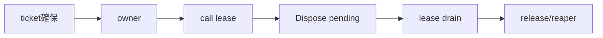
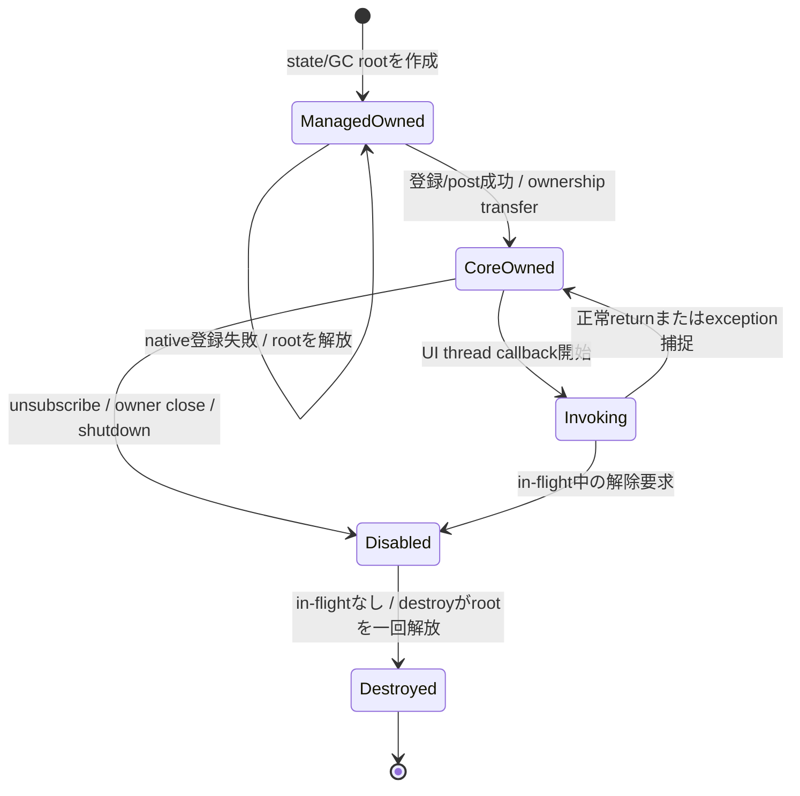
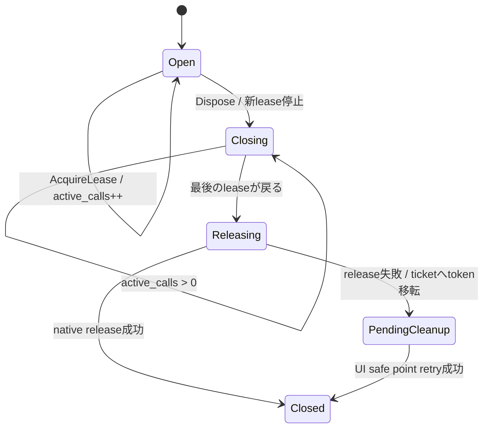
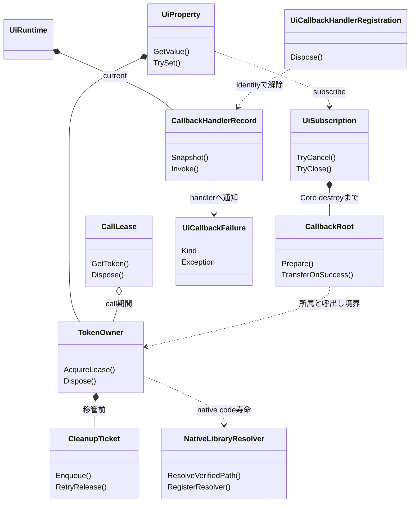

# 言語ラッパー：C#

- 文書版: 1.2
- 文書ロール: detailed-design
- 更新日: 2026-10-24
- 状態: 1.2全文承認済み（利用者、2026-10-24）。1.1全文の承認履歴を維持。実装・試験状態は別管理

## 目的と上位根拠

本書を要求から実装へ具体化する詳細設計の正本とする。型・API・所有・呼出し手順・状態遷移を実装へ反映する。要求の外部保証はリンク先RQ、層の責務と主要flowは上位BDを根拠とする。設計宣言の記載は、配布済みheader・実装済みAPI・試験合格を意味しない。

基本設計: [オブジェクト管理：値・モデル・更新整合性](../../12_design/runtime-objects/model-values.md)、[ビルド環境：toolchain・検証・support](../../12_design/build/toolchain-support.md)、[ビルド・配布：package・artifact・信頼境界](../../12_design/build/packages-artifacts.md)、[ランタイム：実行context・所有・終了](../../12_design/runtime-objects/runtime.md)

## 要求と設計項目の対応

| 設計項目 | 要求根拠 |
| --- | --- |
| interop・所有参照・Dispose | [RQ-03-002](../../11_requirements/RQ-03_language-support.md#rq-03-002)、[RQ-03-006](../../11_requirements/RQ-03_language-support.md#rq-03-006)、[RQ-04-006](../../11_requirements/RQ-04_abi-boundary.md#rq-04-006)、[RQ-04-007](../../11_requirements/RQ-04_abi-boundary.md#rq-04-007)、[RQ-04-022](../../11_requirements/RQ-04_abi-boundary.md#rq-04-022)、[RQ-04-023](../../11_requirements/RQ-04_abi-boundary.md#rq-04-023)、[RQ-05-003](../../11_requirements/RQ-05_ownership-callbacks.md#rq-05-003)、[RQ-05-009](../../11_requirements/RQ-05_ownership-callbacks.md#rq-05-009)、[RQ-05-012](../../11_requirements/RQ-05_ownership-callbacks.md#rq-05-012)、[RQ-06-002](../../11_requirements/RQ-06_threading-dispatch.md#rq-06-002)、[RQ-06-005](../../11_requirements/RQ-06_threading-dispatch.md#rq-06-005)、[RQ-06-006](../../11_requirements/RQ-06_threading-dispatch.md#rq-06-006)、[RQ-12-006](../../11_requirements/RQ-12_build-distribution.md#rq-12-006) |
| 公開API・call lease・native load | [RQ-03-002](../../11_requirements/RQ-03_language-support.md#rq-03-002)、[RQ-03-006](../../11_requirements/RQ-03_language-support.md#rq-03-006)、[RQ-03-013](../../11_requirements/RQ-03_language-support.md#rq-03-013)、[RQ-03-014](../../11_requirements/RQ-03_language-support.md#rq-03-014)、[RQ-05-010](../../11_requirements/RQ-05_ownership-callbacks.md#rq-05-010)、[RQ-05-012](../../11_requirements/RQ-05_ownership-callbacks.md#rq-05-012)、[RQ-12-006](../../11_requirements/RQ-12_build-distribution.md#rq-12-006) |
| Property notification Subscription・callback failure handler | [RQ-02-002](../../11_requirements/RQ-02_core-features.md#rq-02-002)、[RQ-05-002](../../11_requirements/RQ-05_ownership-callbacks.md#rq-05-002)、[RQ-05-006](../../11_requirements/RQ-05_ownership-callbacks.md#rq-05-006)、[RQ-05-007](../../11_requirements/RQ-05_ownership-callbacks.md#rq-05-007)、[RQ-05-008](../../11_requirements/RQ-05_ownership-callbacks.md#rq-05-008)、[RQ-05-009](../../11_requirements/RQ-05_ownership-callbacks.md#rq-05-009)、[RQ-05-012](../../11_requirements/RQ-05_ownership-callbacks.md#rq-05-012)、[RQ-06-001](../../11_requirements/RQ-06_threading-dispatch.md#rq-06-001) |

本書内の共通規則は上記の各要求を実現するために適用する。同一項目内で個別要求を参照する場合はその対象範囲を優先する。将来候補・未採用範囲は採用済みの動作と区別する。

## interop・所有参照・Dispose

### 実現のcall/data/ownership flow

managed ownerはtokenと事前確保cleanup ticketを保持し、P/Invoke開始時にleaseを取得する。Disposeは新規leaseを止め、既存call終了後にreleaseする。失敗時はticketがtokenを保持してreaperへ移る。static trampolineとGCHandle相当rootは登録成功後のCore closure寿命に対応付け、最後のinvoke後のdestroyで回収する。



### 前提と責務境界

| 領域 | C# wrapperの責務 | 別設計へ残す事項 |
|---|---|---|
| P/Invoke | C ABIの固定幅型・calling convention・statusをmanaged型へ正確に写す | generator/style、最終TFM、API symbol一覧 |
| Handle | owned/borrowedを識別し、retain/releaseと同時Disposeを安全にする | Core token表現、release failure意味論の変更 |
| Callback | managed stateをGCからrootし、C ABIのdestroyまで保持する。例外情報はRuntime handlerへ渡し、ABI境界から遮断する | 機能別callback結果、他言語wrapper共通の診断API |
| Error | status/error snapshotをC#の明示失敗へ変換する | 全code catalog、message localization |
| Package | MVVM UIライブラリ C# NuGet native assetのRID native asset同梱を前提として参照する | NuGet ID/feed、TFM、load resolver、ARM profile（ビルド・配布：toolchain・profile・package）|

### 実装規則

| 実装規則 | 根拠・境界 |
| --- | --- |
| Native interop declarationはC ABIと同じfixed-width typesを使う。`ui_handle`は`ulong`として値を保ち、`IntPtr`をC ABI handle表現やnative object pointerとして扱わない。C callback/userdataのpointer引数だけを`IntPtr`等のpointer-sized表現にする。 | 公開ABI契約、値・error境界。initial C# RIDはMVVM UIライブラリ C# NuGet native assetの64-bit `win-x64`/`linux-x64`。将来32-bit targetも必要なら`ulong`とP/Invoke declarationのmarshal互換を個別検証する。 |
| 公開managed wrapperは`IDisposable`を実装し、明示`Dispose`/`Close`でtoken releaseまたはAPI固有deactivateを行う。Disposeは冪等とし、成功したrelease後だけtokenをemptyにする。finalizerは明示cleanupの代用にしない。 | 言語境界契約、Runtime所有と終了、C++ wrapper。 |
| P/Invoke中のowner Dispose/release競合を避けるため、各native callはhandle lifetime leaseを取得し、call return後に解放する。leaseを持つcallが終了するまで最後のtoken releaseを開始しない。callbackからの再入Disposeもdeadlockさせない実装にする。 | Runtime所有と終了、handle登録・検証、C++ wrapper。`SafeHandle`をそのまま`uint64_t`引数へmarshalするか、明示lease付き`ulong`を渡すかは最終interop styleで検証する。 |
| `SafeHandle`は候補として調べるが、`ReleaseHandle`をCore releaseの単純な一回呼出しにしない。release失敗可能性に対して、事前確保済みcleanup ticketをC#側registryへ移管できる場合に限り利用する。代替ownerでも同じno-loss・retry契約を満たす。 | Runtime所有と終了、C++ wrapper。Microsoft契約は`ReleaseHandle`実装が失敗してはならないとしている。今回のC ABI release failureと無条件に一致するとは限らない。 |
| Persistent callbackは、長期native callback pointerにmanaged delegateの個別instanceを渡してGC任せにしない。固定rootされたstatic trampoline delegate（または将来検証済みのstatic function pointer）を用い、各subscription userdataはmanaged callback stateを指す`GCHandle`相当のstrong rootとする。 | Runtime契約、公開ABI契約、言語境界契約、callback実行規則。Microsoft docsはcall return後もcallbackされるdelegateをcallback終了までrootするよう要求する。 |
| callback stateのrootを作成後、C API登録/postが成功すればCoreへ所有権を移し、失敗すればC#側でrootを一度だけ解放する。成功closureのCore destroy callbackがin-flight invocation終了後にstateを解放する。 | callback実行規則、UI dispatcher。API登録中に同期callbackが始まる可能性はowner ABI契約を確認する。 |
| managed callback trampolineはmanaged exceptionをcatchしてABI境界へ伝播させない。C# wrapperでは利用者が設定したRuntime/callback別handlerへ情報を渡せるようにする。handler自身のthrowも境界外へ出さず、callback種別のfailure意味論を変更しない。既定診断はProperty notification callbackについて本書のcallback failure handler節に定める。 | Runtime契約、callback実行規則、C++ wrapper。 |
| Property notification callbackは初期通知なしの`Action`とし、利用者はcallback中にPropertyの`TryGet()`で最新値を読む。callback登録・cancelはRQ-06-001どおりUI threadから呼ぶ。通知順、coalescing、cancelとin-flight callbackの境界、destroy時機は共通notification DDに委譲する。 | RQ-02-002、RQ-05-002/006/007/008/009、RQ-06-001、共通ABI、イベントハンドリング：通知とBinding伝播。 |
| `UiSubscription.TryCancel()`はC ABI cancelを呼び、成功後はinactive状態を返す。inactive tokenへの再cancelも成功する。`TryClose()`/`Dispose()`はowned handle referenceだけをreleaseし、subscriptionをcancelしない。release失敗時はtoken ownerが参照を保持して再試行可能にする。 | RQ-05-002/007/012、共通ABI、イベントハンドリング：通知とBinding伝播。 |
| Statusによる非throw result/try経路を持ち、詳細失敗にはimmutable Error snapshotを保持するtyped C# exceptionを併設できる。unknown `ui_status`/domain/codeはraw数値を保ったgeneric failureとし、message文面で分岐しない。 | 公開ABI契約、共通ABI、値・error境界、C++ wrapper。検証reject等の通常結果は機能API契約に従う。 |
| Error messageとUTF-8 Property値はlength付きbyte列として扱う。末尾NUL、埋め込みNULの切捨て、変換不能byte列の暗黙replacementを前提にしない。 | 値・error境界、共通ABI。C# `string`との厳密変換/invalid sequence policyは後続API designで決める。 |
| UI-affine object APIはUI thread専用とし、workerから直接呼ばない。非同期worker更新は`runtime_post`/dispatcherへ値copyとclosure ownershipを渡し、UI threadでsetterを行う。C# wrapperは誤threadを自動dispatchしない。 | Runtime契約、言語境界契約、UI dispatcher。 |
| Runtime shutdownは明示APIとし、`UI_PENDING`による受付と`UI_OK`によるUI-thread完了を別の結果として表す。callback/event内のshutdownで同期待ちしない。worker同期shutdownはloop稼働時のみnative契約どおり完了を待つ。 | Runtime shutdownのcallback中dispatchに関する上位判断、共通ABI、UI dispatcher、C++ wrapper。 具体化は言語ラッパー：C#、[ビルド・配布：toolchain・profile・package](../build/toolchain-packages.md)、[共通C ABI：宣言・検査・互換性](../runtime-objects/abi.md)を参照する。 |
| C# cleanup managerは各owned tokenに対応するpreallocated cleanup ticketを持つ。Ticket確保後にだけcreate/retain/out-handle ownershipを取得する。明示DisposeまたはGC cleanupでnative releaseが失敗したとき、token所有をticketへ移し、UI thread safe pointでretryする。Runtime shutdownはUI-affine cleanup後に残存ticketをClosed shell releaseとしてdrainする。 | Runtime所有と終了、C++ wrapper。 具体化は言語ラッパー：C#、[ビルド・配布：toolchain・profile・package](../build/toolchain-packages.md)、[共通C ABI：宣言・検査・互換性](../runtime-objects/abi.md)を参照する。 |
| C# API surfaceはCore Propertyを値の正本とし、既存C# ViewModelは明示adapter経由で接続する。任意property/fieldのreflection discoveryと自動通知同期を初期契約に含めない。 | 言語境界契約/言語境界契約、C++ wrapper。 |
| MVVM UIライブラリ C# NuGet native assetどおりmanaged assemblyとtarget native runtimeは一つのNuGet packageに含め、initial RIDは`win-x64`と`linux-x64`とする。C# wrapper内にRID catalogやARM board support promiseを重複定義しない。 | MVVM UIライブラリ C# NuGet native asset、要求仕様§9、ビルド・配布：toolchain・profile・package。package name/TFM/loading detailsは本判断に含まない。 |

### P/Invokeとhandle lifetime

#### ABI type mapping案

| C ABI | C# interop表現案 | wrapper上の注意 |
|---|---|---|
| `uint64_t ui_handle` | `ulong` | 0はinvalid、native pointer castなし |
| `uint32_t ui_status` | `uint`またはraw enum裏付け値 | unknown値を保持 |
| `uint8_t ui_bool` | `byte` | managed `bool`へのmarshal契約を明示し、0/1以外を成功扱いしない |
| UTF-8 pointer + `uint64_t length` | `IntPtr` + `ulong`（入力） | call中だけborrow。Coreが保持する場合native sideがreturn前にcopy |
| callback + userdata + destroy | static callback entry points + `IntPtr userdata` | capture/objectはmanaged state rootへ保持 |
| optional `out_error` | `ulong` out tokenまたは0 | Error wrapperへownership transfer |

P/Invoke signatureはC headerをsource-of-truthにしてABI testsで照合する。C# `bool`, `nint`, struct layoutをfixed-width C typesの代替とするかは個別のmarshal testなしに決めない。

#### P/Invoke中のDispose

各ownerはnative callへ入る前にleaseを取得する。leaseはtokenのreleaseを一時禁止し、呼出しが戻った後にreleaseを許す。C# lockをnative callの間保持する単純案は、native callbackからDisposeが再入するとdeadlockし得るため避ける。`SafeHandle.DangerousAddRef`相当かowner-local in-flight counterかは最終interop/TMF/API設計時に選ぶ。

SafeHandleはP/Invokeのresource ownerとして有用だが、UI Runtime tokenのcleanupを単純な`ReleaseHandle`へ直接書くとRuntime所有と終了の再試行契約に合わない可能性がある。Microsoft guidanceは`ReleaseHandle`が失敗しない実装を求める。利用する場合、ReleaseHandleがtokenを事前確保済みreaper ticketへ移し、移管完了を解放成功として扱う設計を検証する必要がある。[SafeHandle.ReleaseHandle](https://learn.microsoft.com/dotnet/api/system.runtime.interopservices.safehandle.releasehandle)、[SafeHandle class](https://learn.microsoft.com/dotnet/api/system.runtime.interopservices.safehandle)

### Callback rootと所有状態



- C ABI callback pointerは、subscriptionごとに一時delegateを作って渡す方式としない。固定static trampolineを使う案とする。delegate/function pointerの形式・calling conventionはABI targetと.NET versionを合わせて検証する。
- userdataはcallback state objectをrootした`GCHandle`等で表現する。pinningはmanaged objectのアドレスをC ABIへ直接渡す用途でない限り不要とする。
- Registration失敗時にはC# wrapperがGC rootを解放し、Core destroyを期待しない。成功時はC ABI closure destroyがcallback stateを一度だけunrootする。
- UI thread上のdestroy callbackはmanaged callback/delegate参照の解放だけを行い、UI APIを呼ばない。finalizerやdelegate target finalizationから追加UI操作を起こさない。
- 長期native callbackのためdelegateを保持しなければならないこと、およびcall return後もcallbackが続くときの管理が必要なことはMicrosoft P/Invoke callback guidanceと整合する。[Implement callback functions](https://learn.microsoft.com/en-us/dotnet/standard/native-interop/how-to-implement-callback-functions)、[P/Invoke callbacks](https://learn.microsoft.com/en-us/dotnet/standard/native-interop/pinvoke)

### Property notification Subscription（1.2）

以下はC#公開surfaceとwrapper内部処理を定める。C ABIは既存のProperty subscription/cancelを使用し、callback payload、Coreのnotification順序・coalescing・cancel完了条件を変更しない。

```csharp
// API signature sketch; implementation is in the C# wrapper source.
UiResult<UiSubscription> UiProperty<T>.TrySubscribe(Action callback);
UiResult<bool> UiSubscription.TryCancel();
UiResult<UiCloseDisposition> UiSubscription.TryClose();
void UiSubscription.Dispose();

UiResult<UiCallbackHandlerRegistration>
    UiRuntime.TrySetCallbackFailureHandler(Action<UiCallbackFailure> handler);
void UiCallbackHandlerRegistration.Dispose();

enum UiCallbackFailureKind { PropertyNotification }
sealed class UiCallbackFailure
{
    UiCallbackFailureKind Kind { get; }
    Exception Exception { get; }
}
```

- `TrySubscribe`はPropertyと同じRuntime owner/APIを使い、登録成功時にsubscription handleを返す。通知時に値をpushせず、callbackはProperty facadeをcaptureして`TryGet()`を呼ぶ。登録時の初期callbackは発生しない。
- callback rootはcallback delegateとProperty facade等のcaptureを保持する。C ABI登録が失敗した場合はmanaged側がrootを解放し、成功した場合はCore destroy callbackがin-flight callback終了後にrootを一度だけ解放する。登録中の同期callback可能性は共通ABIの契約を適用する。
- `TryCancel`はC ABIのvalid subscription tokenに対するcancelを行い、成功した`UiResult<bool>`の値`true`はsubscriptionがinactiveであることを表す（すでにinactiveでも成功し`true`）。成功後もhandle tokenは保持され、別途`TryClose`または`Dispose`でreleaseする。失敗時はtokenと再試行可能性を保つ。
- `TryClose`/`Dispose`はhandleのowned referenceだけをreleaseし、cancelを暗黙実行しない。release後もRuntime registration registryがactive subscriptionを所有するため通知は継続する。明示cancelが必要な利用者は`TryCancel`成功後にcloseする。`Dispose`の失敗時cleanupは共通TokenOwner/CleanupTicket契約を使う。
- callback trampolineは通知例外を捕捉し、Runtimeに現在登録されているfailure handlerのrecordを一度snapshotして通知する。通知例外後の次subscriber継続、Property値の非rollbackは共通notification DDに従う。例外は捕捉したcallback呼出し中だけfailure payloadから参照可能とする。

### C# callback failure handler（1.2）

| 型 | 責務・保持データ | 主要操作 | 所有・寿命 |
| --- | --- | --- | --- |
| `UiCallbackFailure` | callback種別と捕捉例外 | `Kind`, `Exception` | handler呼出しの間だけ渡すimmutable snapshot |
| `CallbackHandlerRecord` | handler delegateと一意なrecord identity | snapshot/invoke | Runtimeごとに現在値を一件保持し、invoke中はsnapshotが強参照 |
| `UiCallbackHandlerRegistration` | handler設定のregistration identity | `Dispose()` | managed-only owner。disposeは同じrecordがまだactiveの場合だけ解除し、後から設定されたhandlerを消さない |

- `TrySetCallbackFailureHandler`はUI threadに限定しないthread-safeなmanaged設定操作とし、non-null handler用recordを準備してからRuntimeのcurrent recordとatomic交換する。record準備に失敗した場合は以前のhandlerを維持する。null handlerによる解除は公開しない。解除は返されたregistrationをdisposeして行う。
- handlerをreplaceまたはregistrationをdisposeした時点で、以後に始まるtrampolineは新current recordを参照する。すでにrecordをsnapshotしたhandler invocationは完了まで旧delegateを保持し、継続する。旧registrationのdisposeは旧recordとのidentity比較交換を使い、後任recordがactiveならそれを変更しない。
- callback例外が起きた時点でhandlerが未登録なら`System.Diagnostics.Trace.TraceError`へ一度記録する。handler自体が例外をthrowした場合も同じ既定診断へ一度記録し、callback種別のfailure意味論やC ABI returnを変更しない。Trace listenerが例外をthrowした場合はその例外もC ABIへ越境させず抑止する。
- handlerはcallback実行中に同期呼出しされる。callback種別ごとの許可API、thread affinity、再入可能性はRQおよび共通callback実行規則に従う。wrapperはhandler呼出しを別threadへdispatchせず、追加の例外伝播もしない。

### C# exception/error surface

```csharp
// 擬似コード。公開型名・signature・TFMの確定宣言ではない。
Result<T> TryGetValue<T>(Property<T> property); // exception-free result path
T GetValue<T>(Property<T> property);            // convenience path may throw UiException
```

- Result surfaceはstatusとoptional Error snapshotを保持する。例外convenience surfaceは同じraw status/domain/code/native Error snapshotを持つ`UiException`へ変換する。
- error detail handleがない場合も、C ABI statusを維持する。unknown statusやfuture domain/codeをgeneric managed exceptionへ正規化してraw numeric dataを消さない。
- Validation rejectionやCommand state/failure snapshot等、機能APIが通常の結果として定義する値をすべてexceptionへ変換しない。
- callback内exceptionはP/Invoke境界へ伝播しない。Runtimeごとの`UiCallbackFailure` handlerへcallback種別と例外を渡す。handler未登録またはhandler例外時の既定診断は`Trace.TraceError`一回とし、その呼出し自体の例外もABI境界で捕捉する。
- delegate callback stateのdestroy中やfinalizer中にユーザーhandlerを呼ばない。

### Runtime・Dispose・thread規則

| 操作 | C# wrapper案 |
|---|---|
| Runtime作成 | returned owned tokenからRuntime ownerを作成 |
| UI API | UI threadでのみ呼ぶ。workerからの直接呼出しはstatus/resultまたはexceptionで誤threadを示す |
| worker更新 | value snapshotを渡すpost APIへ送る。成功時にcallback state所有権移転、失敗時C#側でcleanup |
| Subscription/Binding Dispose | Coreのイベントハンドリング：通知とBinding伝播解除・release意味論に従い明示解放 |
| Property Subscription cancel | `TryCancel`で通知を解除し、成功後に新しいcallbackを開始しない。handle releaseは別に行う |
| Callback failure handler | Runtime単位のrecordを設定。registration `Dispose`はそのrecordがcurrentの場合だけ解除 |
| Runtime Shutdown | 明示呼出し。callback中はaccepted/pending、worker同期はloop稼働時に完了待ち |
| Runtime Dispose | shutdownを暗黙に開始しない。 具体化は言語ラッパー：C#、[ビルド・配布：toolchain・profile・package](../build/toolchain-packages.md)、[共通C ABI：宣言・検査・互換性](../runtime-objects/abi.md)を参照する|
| finalization | fallback cleanup managerへのownership transferだけを行い、UI-affine Core処理を直接実行しない |
| shutdown後の残存token | Closed shell releaseをcleanup managerがdrainし、最後にRuntime native ownerを解放 |

C# wrapperが各child managed wrapperからRuntime managed ownerを参照保持するかは、C ABI Runtime anchor（Runtime所有と終了）と矛盾しないよう決める。managed referenceでRuntimeを延命しても、native `runtime_shutdown`を省略できることにはならない。

### Native library loading境界

MVVM UIライブラリ C# NuGet native assetはRID別native assetを`runtimes/{rid}/native/`へ格納し、最初は`win-x64`と`linux-x64`を採用する。NuGet/.NET SDKのpublish asset配置を利用する方針である。P/Invokeはruntimeがplatform別library name/extensionを探索し、より複雑な選択ではassemblyごとの`NativeLibrary.SetDllImportResolver`等を使える。一つのassemblyへ設定できるresolverは一つなので、wrapper package同士の連携やconsumer側resolverとの競合を確認する必要がある。[Native library loading](https://learn.microsoft.com/en-us/dotnet/standard/native-interop/native-library-loading)、[SetDllImportResolver](https://learn.microsoft.com/en-us/dotnet/api/system.runtime.interopservices.nativelibrary.setdllimportresolver)

言語ラッパー：C#ではloader implementation、resolver導入、NuGet package filenameを決定しない。具体化は言語ラッパー：C#、[ビルド・配布：toolchain・profile・package](../build/toolchain-packages.md)、[共通C ABI：宣言・検査・互換性](../runtime-objects/abi.md)を参照する。

### 失敗・競合ケース

| ケース | C# wrapperの期待動作案 |
|---|---|
| P/Invoke call中にDispose | in-flight leaseが終わるまでnative tokenをreleaseしない |
| callback登録失敗 | `GCHandle` rootをC#側が解放。Core destroyを呼ばない |
| callback登録成功 | state/delegate targetをCore destroyまでroot |
| callback内exception | catchし、Runtime handlerへ通知。未登録なら`Trace.TraceError`へ一度記録し、P/Invokeへ越境しない |
| handlerがthrow | handler例外をcatchして`Trace.TraceError`へ一度記録。C ABIへ越境させず、callback種別のCore stateを変更しない |
| Subscription handle releaseのみ | active registrationはCore Runtime ownerにより維持。通知は継続しcancelしない |
| 旧handler registrationをclose | 同じrecordがcurrentの場合だけ解除。後から設定されたrecordを保持 |
| Dispose/native releaseがUI finalizer queue OOMで失敗 | Dispose結果で失敗を返しtoken ownerを保つ。finalizer経路では事前確保ticketへ移管 |
| cleanup ticketをUI threadで処理 | release再試行。成功時だけticket/tokenを解放 |
| Runtime shutdown後にpending ticketあり | Runtime所有と終了 Closed shell releaseでdrain後、Runtime ownerを終了 |
| workerからUI-only API | 自動dispatchせずwrong-thread結果 |
| callback中shutdown | `UI_PENDING`をshutdown完了と誤認しない |
| unknown status/domain/code | raw数値とError snapshotを保持したgeneric failure |
| RID assetが存在しない/ロード失敗 | wrapper初期化時にnative load/version/feature failureを識別。詳細loader messageはpackage/runtime診断へ保持 |

## 公開API・call lease・native load

### 実装規則

| 実現手段・責務 | 要求根拠 |
| --- | --- |
| minimum TFMはnet10.0、language C#14、core facadeはunsafeを内部へ隠す案。C#利用者向けminimumを要求変更として明記する。 | [RQ-03-014](../../11_requirements/RQ-03_language-support.md#rq-03-014) |
| ulong TokenOwnerを採用しSafeHandleをnative tokenの正本にしない。CallLeaseがactive_callsを増減しDisposeと競合するcallを保護。 | 上記の根拠RQ |
| LibraryImportのsource generation、UnmanagedCallersOnly static trampoline、GCHandle rootを使う。native boolはbyte、長さはulong。 | 上記の根拠RQ |
| UiResult<T>/UiException/UiErrorSnapshotを提供しTry系とthrow系を同じ内部resultへ接続。Disposeは冪等nonthrowing、TryCloseで失敗を取得可能にする。 | 上記の根拠RQ |
| callback failure handlerはRuntimeごとのimmutable delegate record。Interlocked交換しinvoke前snapshotを強保持。登録未設定・handler例外・Trace listener例外を処理し、ABI越境を防ぐ。 | RQ-05-009、callback実行規則 |
| native loadは専用interop assemblyのresolverでverified absolute pathだけを解決し、process lifetime保持。single-file publishではassembly locationに依存しない。 | 上記の根拠RQ |
| interop assemblyとnative libraryをprocess-lifetime rootへ置く。unloadの提供範囲はRQ-03-013を参照する。 | [RQ-03-013](../../11_requirements/RQ-03_language-support.md#rq-03-013) |

### 実現設計

#### Dispose/CallLeaseの線形化

```text
TokenOwner { ulong token; OwnerState state; int active_calls;
             CleanupTicket ticket; RuntimeAnchor anchor; lock sync; }
```



AcquireLeaseはlockでOpen確認→count++→token snapshot、lock外でnativeを呼ぶ。DisposeはClosingへ移して戻り、最後のleaseがreleaseまたはticket enqueueを実施する。再入Disposeでもnative call中にtokenを消費しない。CleanupTicketにはfinalizerを持たせ、native release失敗時はstatic managerがticketを保持する。GCHandle callback rootとowner facadeの寿命は同一視しない。

`UiRuntime.RequestShutdown(ShutdownMode)`→`ShutdownReceipt`、`UiProperty<T>.TrySet/Get`、`UiBinding.Cancel`、`UiCommand.Execute`→`OperationId`、`UiTextBox.GetSnapshot/EditReplace`を公開名とする。DecimalValueはulong bitsを持ち、System.Decimalとの変換はTryFromDecimal/TryToDecimalで正確な範囲だけ受け付ける。scale31の値を.NET decimalへ黙って丸めない。

resolverはassembly登録時に一度だけ設定し、package assetのselected profile/digestを検証後ロードする。appが独自配置する場合はRuntimeOptions.NativeArtifactPathからverified候補を明示する。ARM assetをdesktop linux-x64のRIDに偽装しない。

minimumの選定根拠は[.NET releases/support](https://learn.microsoft.com/en-us/dotnet/core/releases-and-support)と[.NET 10 supported OS](https://github.com/dotnet/core/blob/main/release-notes/10.0/supported-os.md)。.NET側のsupportと本ライブラリの検証済みprofileを分ける。

## クラス設計の補足（1.2）

既承認1.0/1.1の実現規則を支える型・関連・所有・主要操作を整理する。1.2でProperty Subscriptionとcallback failure handlerの型・操作を追加し、文書全体の承認を得た。実装・試験状態は別管理する。

要求根拠: [RQ-03-014](../../11_requirements/RQ-03_language-support.md#rq-03-014)、[RQ-05-012](../../11_requirements/RQ-05_ownership-callbacks.md#rq-05-012)、[RQ-05-014](../../11_requirements/RQ-05_ownership-callbacks.md#rq-05-014)。

64-bit tokenをpointer扱いせず、TokenOwnerとCallLeaseでnative call中のDispose競合を表す。公開UiProperty等のfacadeはこの共通ownerを合成する。

### 型の責務と所有

| 型 | 責務・保持データ | 主要メソッド・操作 | 所有・寿命 |
| --- | --- | --- | --- |
| TokenOwner | ulong token、OwnerState、in-flight lease数、cleanup ticket、anchor | AcquireLease(); Dispose(); TryClose() | Disposeで新leaseを止め、既存lease完了までtokenを解放しない |
| CallLease | call期間のtokenとTokenOwnerへの内部保持 | GetToken(); Dispose() | try/finallyで一回返却。native callの例外経路でもleaseを残さない |
| CleanupTicket | 未消費tokenと再試行状態 | Enqueue(); RetryRelease() | finalizer失敗でticketへ移管。tokenをIntPtrの実pointerへ変換しない |
| CallbackRoot | delegate/GCHandle、native userdataとの対応、in-flight寿命 | Prepare(); TransferOnSuccess(); ReleaseAfterDestroy() | 登録失敗はmanaged側回収。成功後はnative destroyの規則でrootを解放 |
| UiProperty | typed facadeとTokenOwner | GetValue(); TrySet(value) | UI context検査はCore契約に従う。公開facadeがunsafe pointerを露出しない |
| UiSubscription | subscription token ownerとProperty notification callback registration | TryCancel(); TryClose(); Dispose() | cancel状態とowned handle寿命を分離。closeだけではnotificationを解除しない |
| CallbackHandlerRecord | Runtime単位のhandler delegateとrecord identity | Snapshot(); Invoke(failure) | Runtime current recordとin-flight snapshotが別々に強参照する |
| UiCallbackHandlerRegistration | 設定したhandler record identity | Dispose() | current recordとの一致時のみ解除。別handlerへの置換を消さない |
| UiCallbackFailure | callback kindとException | Kind; Exception | handler invocationに渡すimmutable payload |
| NativeLibraryResolver | verified absolute pathと専用interop assemblyへの登録 | ResolveVerifiedPath(); RegisterResolver() | profile/version照合後だけload。呼出し中の早期unloadを許さない |

### クラスの関連

`*--`は従属するstate/作業の合成、`o--`は共有を含む所有参照、`..>`は非所有の利用・識別・委譲を示す。関連名と本文で示した寿命を優先し、図の同名型は各instanceで別の状態を持つ。図は主要メソッド名を抜粋し、引数・所有・失敗条件は表と本文に従う。



### 主要な呼出しと失敗境界

facadeはAcquireLease→native call→finallyでlease返却の順。DisposeはOwnerStateをclosingへ線形化し、最後のlease完了後にreleaseへ進む。release失敗は本文の明示操作/finalizer別規則に従いtokenを保持またはticketへ移管する。

CallLeaseはUI thread権限を付与しない。GCHandleの保持と公開handle tokenの所有は別に数える。SafeHandleのpointer前提の既定処理へ64-bit token寿命を委ねない。

## 文書の承認・改訂履歴

| 日付 | 対象版 | 内容・根拠 |
| --- | --- | --- |
| 2026-10-17 | 1.0 | 利用者の指示に基づき、既承認内容を責務別に再編集。設計項目IDによる承認・追跡は廃止し、以後は文書版全体で管理する。構成変更を新規の製品仕様採用としない |
| 2026-10-17 | 1.0全文 | 利用者の「全部承認します」により文書全体を承認。旧IDによる項目承認ではなく、現行文書版を対象とする。実装・試験合格を意味しない |
| 2026-10-17 | 1.1改訂案 | 利用者の補足指示によりクラス責務・所有・メソッド・関連図を追加。1.0承認を維持し、1.1全文は確認待ち |
| 2026-10-17 | 1.1全文 | 利用者の「OK,テスト文書作りましょうか」により、クラス設計補足と選択的な図の補強を含む全文を承認。既存履歴を維持し、実装・試験状態は別管理 |
| 2026-10-24 | 1.2全文 | Property notification SubscriptionとRuntime callback failure handlerの公開surface、cancel/close分離、callback root・handler例外診断を追加。計画 `.docs/20_todo/csharp-property-subscription.md` に基づく。利用者が「ok」と回答し文書全体を承認。実装・試験状態は別管理 |
