# 言語ラッパー：Python

- 文書版: 2.1
- 文書ロール: detailed-design
- 更新日: 2026-10-31
- 状態: 2.1全文承認済み（利用者、「ok」、2026-10-31）。実装・試験状態は別管理

## 目的と上位根拠

本書を要求から実装へ具体化する詳細設計の正本とする。型・API・所有・呼出し手順・状態遷移を実装へ反映する。要求の外部保証はリンク先RQ、層の責務と主要flowは上位BDを根拠とする。設計宣言の記載は、配布済みheader・実装済みAPI・試験合格を意味しない。

基本設計: [オブジェクト管理：値・モデル・更新整合性](../../12_design/runtime-objects/model-values.md)、[言語ラッパー：共通facade・所有変換・解析](../../12_design/wrappers/language-wrappers.md)、[ビルド環境：toolchain・検証・support](../../12_design/build/toolchain-support.md)、[ビルド・配布：package・artifact・信頼境界](../../12_design/build/packages-artifacts.md)、[ランタイム：実行context・所有・終了](../../12_design/runtime-objects/runtime.md)

## 要求と設計項目の対応

| 設計項目 | 要求根拠 |
| --- | --- |
| 所有参照・callback root・通常終了 | [RQ-02-013](../../11_requirements/RQ-02_core-features.md#rq-02-013)、[RQ-03-004](../../11_requirements/RQ-03_language-support.md#rq-03-004)、[RQ-03-008](../../11_requirements/RQ-03_language-support.md#rq-03-008)、[RQ-03-009](../../11_requirements/RQ-03_language-support.md#rq-03-009)、[RQ-03-010](../../11_requirements/RQ-03_language-support.md#rq-03-010)、[RQ-03-011](../../11_requirements/RQ-03_language-support.md#rq-03-011)、[RQ-03-012](../../11_requirements/RQ-03_language-support.md#rq-03-012)、[RQ-04-006](../../11_requirements/RQ-04_abi-boundary.md#rq-04-006)、[RQ-04-007](../../11_requirements/RQ-04_abi-boundary.md#rq-04-007)、[RQ-04-017](../../11_requirements/RQ-04_abi-boundary.md#rq-04-017)、[RQ-04-022](../../11_requirements/RQ-04_abi-boundary.md#rq-04-022)、[RQ-04-023](../../11_requirements/RQ-04_abi-boundary.md#rq-04-023)、[RQ-05-003](../../11_requirements/RQ-05_ownership-callbacks.md#rq-05-003)、[RQ-05-009](../../11_requirements/RQ-05_ownership-callbacks.md#rq-05-009)、[RQ-05-012](../../11_requirements/RQ-05_ownership-callbacks.md#rq-05-012)、[RQ-06-002](../../11_requirements/RQ-06_threading-dispatch.md#rq-06-002)、[RQ-06-003](../../11_requirements/RQ-06_threading-dispatch.md#rq-06-003)、[RQ-06-005](../../11_requirements/RQ-06_threading-dispatch.md#rq-06-005)、[RQ-06-006](../../11_requirements/RQ-06_threading-dispatch.md#rq-06-006)、[RQ-07-008](../../11_requirements/RQ-07_binding.md#rq-07-008)、[RQ-07-013](../../11_requirements/RQ-07_binding.md#rq-07-013)、[RQ-07-014](../../11_requirements/RQ-07_binding.md#rq-07-014)、[RQ-12-007](../../11_requirements/RQ-12_build-distribution.md#rq-12-007) |
| 公開API・cleanup・handler寿命 | [RQ-03-004](../../11_requirements/RQ-03_language-support.md#rq-03-004)、[RQ-03-008](../../11_requirements/RQ-03_language-support.md#rq-03-008)、[RQ-03-009](../../11_requirements/RQ-03_language-support.md#rq-03-009)、[RQ-03-010](../../11_requirements/RQ-03_language-support.md#rq-03-010)、[RQ-03-014](../../11_requirements/RQ-03_language-support.md#rq-03-014)、[RQ-03-015](../../11_requirements/RQ-03_language-support.md#rq-03-015)、[RQ-03-016](../../11_requirements/RQ-03_language-support.md#rq-03-016)、[RQ-05-012](../../11_requirements/RQ-05_ownership-callbacks.md#rq-05-012)、[RQ-05-014](../../11_requirements/RQ-05_ownership-callbacks.md#rq-05-014)、[RQ-06-003](../../11_requirements/RQ-06_threading-dispatch.md#rq-06-003) |
| Window background RGB facade | [RQ-09-001](../../11_requirements/RQ-09_ui-scope.md#rq-09-001)、[RQ-09-074](../../11_requirements/RQ-09_ui-scope.md#rq-09-074) |
| BOOL/I64 Property facade | [RQ-02-001](../../11_requirements/RQ-02_core-features.md#rq-02-001)、[RQ-02-002](../../11_requirements/RQ-02_core-features.md#rq-02-002)、[RQ-02-017](../../11_requirements/RQ-02_core-features.md#rq-02-017)、[RQ-05-012](../../11_requirements/RQ-05_ownership-callbacks.md#rq-05-012)、[RQ-06-001](../../11_requirements/RQ-06_threading-dispatch.md#rq-06-001) |
| F64 Property facade | [RQ-02-001](../../11_requirements/RQ-02_core-features.md#rq-02-001)、[RQ-02-002](../../11_requirements/RQ-02_core-features.md#rq-02-002)、[RQ-02-017](../../11_requirements/RQ-02_core-features.md#rq-02-017)、[RQ-02-018](../../11_requirements/RQ-02_core-features.md#rq-02-018)、[RQ-05-012](../../11_requirements/RQ-05_ownership-callbacks.md#rq-05-012)、[RQ-06-001](../../11_requirements/RQ-06_threading-dispatch.md#rq-06-001) |
| DECIMAL Property facade | [RQ-02-001](../../11_requirements/RQ-02_core-features.md#rq-02-001)、[RQ-02-002](../../11_requirements/RQ-02_core-features.md#rq-02-002)、[RQ-02-017](../../11_requirements/RQ-02_core-features.md#rq-02-017)、[RQ-02-019](../../11_requirements/RQ-02_core-features.md#rq-02-019)、[RQ-02-020](../../11_requirements/RQ-02_core-features.md#rq-02-020)、[RQ-05-012](../../11_requirements/RQ-05_ownership-callbacks.md#rq-05-012)、[RQ-06-001](../../11_requirements/RQ-06_threading-dispatch.md#rq-06-001) |
| UTF-8 Property facade | [RQ-02-001](../../11_requirements/RQ-02_core-features.md#rq-02-001)、[RQ-02-002](../../11_requirements/RQ-02_core-features.md#rq-02-002)、[RQ-02-017](../../11_requirements/RQ-02_core-features.md#rq-02-017)、[RQ-04-003](../../11_requirements/RQ-04_abi-boundary.md#rq-04-003)、[RQ-04-020](../../11_requirements/RQ-04_abi-boundary.md#rq-04-020)、[RQ-04-021](../../11_requirements/RQ-04_abi-boundary.md#rq-04-021)、[RQ-05-012](../../11_requirements/RQ-05_ownership-callbacks.md#rq-05-012)、[RQ-06-001](../../11_requirements/RQ-06_threading-dispatch.md#rq-06-001) |
| Property間Binding facade（OneTime/OneWay/TwoWay、cancel/release、遅延error snapshot） | [RQ-05-002](../../11_requirements/RQ-05_ownership-callbacks.md#rq-05-002)、[RQ-06-001](../../11_requirements/RQ-06_threading-dispatch.md#rq-06-001)、[RQ-07-001](../../11_requirements/RQ-07_binding.md#rq-07-001)、[RQ-07-002](../../11_requirements/RQ-07_binding.md#rq-07-002)、[RQ-07-003](../../11_requirements/RQ-07_binding.md#rq-07-003)、[RQ-07-004](../../11_requirements/RQ-07_binding.md#rq-07-004)、[RQ-07-005](../../11_requirements/RQ-07_binding.md#rq-07-005)、[RQ-07-006](../../11_requirements/RQ-07_binding.md#rq-07-006)、[RQ-07-007](../../11_requirements/RQ-07_binding.md#rq-07-007)、[RQ-07-008](../../11_requirements/RQ-07_binding.md#rq-07-008)、[RQ-07-009](../../11_requirements/RQ-07_binding.md#rq-07-009)、[RQ-07-010](../../11_requirements/RQ-07_binding.md#rq-07-010)、[RQ-07-011](../../11_requirements/RQ-07_binding.md#rq-07-011)、[RQ-07-015](../../11_requirements/RQ-07_binding.md#rq-07-015) |
| Python AsyncCommand facade | [RQ-02-004](../../11_requirements/RQ-02_core-features.md#rq-02-004)、[RQ-03-004](../../11_requirements/RQ-03_language-support.md#rq-03-004)、[RQ-05-002](../../11_requirements/RQ-05_ownership-callbacks.md#rq-05-002)、[RQ-05-006](../../11_requirements/RQ-05_ownership-callbacks.md#rq-05-006)、[RQ-05-007](../../11_requirements/RQ-05_ownership-callbacks.md#rq-05-007)、[RQ-05-008](../../11_requirements/RQ-05_ownership-callbacks.md#rq-05-008)、[RQ-05-009](../../11_requirements/RQ-05_ownership-callbacks.md#rq-05-009)、[RQ-05-012](../../11_requirements/RQ-05_ownership-callbacks.md#rq-05-012)、[RQ-06-001](../../11_requirements/RQ-06_threading-dispatch.md#rq-06-001)、[RQ-06-002](../../11_requirements/RQ-06_threading-dispatch.md#rq-06-002)、[RQ-06-003](../../11_requirements/RQ-06_threading-dispatch.md#rq-06-003)、[RQ-06-004](../../11_requirements/RQ-06_threading-dispatch.md#rq-06-004)、[RQ-06-008](../../11_requirements/RQ-06_threading-dispatch.md#rq-06-008)、[RQ-06-009](../../11_requirements/RQ-06_threading-dispatch.md#rq-06-009)、[RQ-06-010](../../11_requirements/RQ-06_threading-dispatch.md#rq-06-010)、[RQ-06-011](../../11_requirements/RQ-06_threading-dispatch.md#rq-06-011)、[RQ-06-013](../../11_requirements/RQ-06_threading-dispatch.md#rq-06-013) |

本書内の共通規則は上記の各要求を実現するために適用する。同一項目内で個別要求を参照する場合はその対象範囲を優先する。将来候補・未採用範囲は採用済みの動作と区別する。

## 所有参照・callback root・通常終了

### 実現のcall/data/ownership flow

Python ownerのtoken/ticket状態とroot registryは明示lockで遷移させ、native callや利用者callback中はlockを保持しない。owner finalizerはmanagerへ短い非block handoffを行う。C destroyはroot recordをsafe-point release queueへ渡し、Python値の最終dropをC destroy stackから分離する。lifecycle coordinatorは明示終了・登録済みmain/host境界・loop終了通知等を集約し、新callback entry停止→UI wake/cleanup→root drainへ進める。

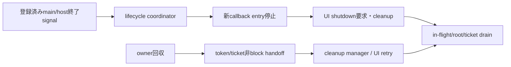

### 責務と境界

| 層 | Python wrapperの責務案 | この文書で決めないこと |
|---|---|---|
| ctypes ABI adapter | versioned C ABI functionを固定幅prototypeで宣言し、status/outputを検査する | 全symbol生成方式、prototype generator、header parity tool |
| Python object wrapper | opaque tokenの所有・Runtime関連・close・callback rootingを管理する | 最終公開型/API名、package名、Python version |
| Runtime/Core | handle、UI thread、callback、dispatcher、shutdownの意味論を所有する | Core契約やC ABIの変更 |
| distribution | MVVM UIライブラリ Python package/native distributionのpure-Python wrapperとnative runtime別配布を前提にする | index、wheel tag、loader、target matrix（ビルド・配布：toolchain・profile・package） |

ctypes declarationをアプリへ露出しないことは、Python wrapperがC ABIを別の意味へ変換してよいことを意味しない。公開ABI契約とオブジェクト管理：handle・値・errorの固定幅、handle、status/error、byte lengthを正確に写す。

### 実装規則

| 実装規則 | 根拠・境界 |
| --- | --- |
| 初期Python wrapperはMVVM UIライブラリ Python wrapper方式に関する上位判断案どおり標準`ctypes`からversioned C ABIを動的ロードし、compiled Python extension/cffiへ置き換えない。raw ctypes objectをアプリ公開APIにしない。 | MVVM UIライブラリ Python wrapper方式に関する上位判断案、ADR-0001。loader・package配置はMVVM UIライブラリ Python package/native distribution/ビルド・配布：toolchain・profile・package。 |
| ctypes functionごとに`argtypes`と`restype`を明示し、ABI fixed-width scalarに一致する`ctypes`型を使う。`c_long`、暗黙のC `int` return、`c_size_t`をABI固定幅型の代わりに使わない。 | 公開ABI契約、共通ABI、値・error境界。具体宣言はABI headerのsource of truthに照合する。 |
| Python owner objectはopaque token整数を内部に保持し、`int`/native pointerへの暗黙変換を提供しない。Python objectはCore Propertyの値の正本やC ABI userdata pointerそのものにしない。 | 言語境界契約/言語境界契約、handle登録・検証、C++ wrapper、C# wrapper、Rust wrapper。 |
| owned handle objectは一tokenだけを所有し、複製は明示retain操作に限る。borrowed handle/引数は一回のwrapper呼出し中だけ利用し、retainしない。wrapper objectのPython reference増加とC ABI token retainを混同しない。 | handle登録・検証、Runtime所有と終了、C++ wrapper、Rust wrapper。 |
| UI-affine ownerには明示`close()`相当と`with` context-manager利用を用意し、close成功後にだけtokenをemptyにする。失敗時はownerがtoken/ticket/Runtime anchorを保持し、再試行できる。closeは冪等にできるが、二度目のcloseで新たなreleaseを発行しない。 | 言語境界契約、Runtime所有と終了、C++ wrapper、C# wrapper、Rust wrapper。名前・例外型はAPI設計章へ送る。 |
| Python ownerが回収されるときは、`__del__`または同等のfinalizerから所有tokenのcleanup要求を必ず引き渡す設計を候補とする。finalizerは事前確保ticket/token/Runtime anchorを非同期・非blockでcleanup managerへ移すだけとし、GC/finalizer threadからUI-affine native releaseを直接呼ばない。明示`close()`とcontext managerは早く確実な解放経路として併用する。 | 言語境界契約、Runtime所有と終了、C++ wrapper、C# wrapper、Rust wrapper。Pythonは回収時期やinterpreter終了時の全object finalizationを保証しないため、Runtime全体の終了経路はPython wrapperで別に扱う。 |
| cleanup ticket確保ができないときはRuntime/object create、retain、owned out-tokenを返すnative callを始めない。release failure時はtokenを捨てず、事前確保ticketでpending registryへ移してUI safe pointでretryする。成功後はticket、Runtime anchorの順で解放する。 | Runtime所有と終了、値・error境界、C++ wrapper、C# wrapper、Rust wrapper。 具体化は言語ラッパー：Python、[言語ラッパー：callback解析・lint・MCP](analyzer.md)、[ビルド・配布：toolchain・profile・package](../build/toolchain-packages.md)、[共通C ABI：宣言・検査・互換性](../runtime-objects/abi.md)を参照する。 |
| Coreがclosureを所有する期間、wrapperはPython callable、callback state、`ctypes` callback objectを強参照する。callback registration/post成功時にだけCoreへ所有権を移し、失敗時はwrapperが回収する。CFUNCTYPE callback objectへの参照を落としてGCに任せない。 | MVVM UIライブラリ Python wrapper方式に関する上位判断案、Runtime契約/言語境界契約、callback実行規則、C++ wrapper、C# wrapper、Rust wrapper。 |
| callback trampolineはsignature/calling conventionごとにABIと一致させる。userdataはprivate root registryへ結び、Python objectの生アドレスをCoreがdereferenceする前提を置かない。destroyでは新規callbackを無効化し、root recordを一度だけ切り離す。 | 公開ABI契約、callback実行規則、MVVM UIライブラリ Python wrapper方式に関する上位判断案。userdata key/cellの具体表現は実装検証と後続API設計へ送る。 |
| destroy thunk内でPython callable/stateの最後のreferenceをregistry lock中にdropしない。root recordはC destroy stackからsafe-point release queueへ移し、任意のPython finalizerがlock内・Core destroy呼出し中に起動する可能性を避ける。destroy thunk自体はUI APIを呼ばない。 | Runtime契約、callback実行規則、C++ wrapper、C# wrapper。Python `__del__`等の任意コードは参照数減少時に動き得る。safe point接続はプラットフォーム：抽象化と共通protocolとの整合が必要。 |
| `ctypes` callback trampoline内でPython callback由来の例外をC ABI境界へ伝播させない。`Exception`/`BaseException`の捕捉範囲を明示し、callback種別に沿って診断/失敗処理へ渡す。`KeyboardInterrupt`/`SystemExit`もC callbackからPython callerへそのままunwindできない。 | Runtime契約、callback実行規則、MVVM UIライブラリ Python wrapper方式に関する上位判断案。 具体化は言語ラッパー：Python、[言語ラッパー：callback解析・lint・MCP](analyzer.md)、[ビルド・配布：toolchain・profile・package](../build/toolchain-packages.md)、[共通C ABI：宣言・検査・互換性](../runtime-objects/abi.md)を参照する。 |
| callback例外情報を受ける利用者差し替えhandlerを設けられる設計とする。handler自身のPython例外もABI外へ出さず、callback ownerのfailure意味論や通知順を変更しない。handler登録scope・既定動作・handler失敗の報告先は後続API設計へ送る。 | C++ wrapper、C# wrapper、callback実行規則。全言語共通APIをこのDDで定義しない。 |
| worker threadから変更を許すPython wrapper state（owner状態、token/ticket所有移転、callback/Runtime registry等）は、GILの有無にかかわらず明示lockで保護する。workerから変更させないstateはread-only viewまたは値snapshotとして渡し、UI-affine stateの変更はUI threadへdispatchする。 | Python free-threading official docs、Runtime契約、UI dispatcher。GILはPython code実行の実装/性能特性であり、本判断は全objectを自由なthreadから変更可能にする意図ではない。 |
| wrapperはRuntime作成時のPython UI thread identityを記録し、UI-only operationを呼ぶ前にPython thread identityを検査する。Coreの`runtime_is_ui_thread`/wrong-thread statusも最終防御として残し、GIL取得だけで正しいthreadとみなさない。 | Runtime契約、言語境界契約、UI dispatcher、C++ wrapper、C# wrapper、Rust wrapper。foreign-created callback threadでは`threading.local`がcallback間で保たれると仮定しない。 |
| workerからCore UI stateを直接変更せず、コピー済み値とPython callableをdispatcherへpostする。post成功後はCoreがcallback stateを所有し、失敗時はPython callerがstrong referencesを保持/解放する。非同期shutdownは完了を待たず、worker同期shutdownはUI loop稼働時にnative契約どおり完了を待つ。 | 言語境界契約/言語境界契約、UI dispatcher、callback実行規則、Runtime shutdownのcallback中dispatchに関する上位判断、C++ wrapper、C# wrapper、Rust wrapper。 |
| `ui_status`を一次判定にし、Error snapshotを保持するPython exception/resultへ写す。unknown status/domain/codeのraw値を失わず、message文面で分岐しない。MVVM UIライブラリ Python lint/type check とMCP連携に関する上位判断案のtype stubはPython wrapper surfaceを解析可能にするが、checker/MCP実装判断を本書に含めない。 | 値・error境界、共通ABI、MVVM UIライブラリ Python lint/type check とMCP連携に関する上位判断案。Python用公開error型名、`str` decode、stub生成はAPI設計章へ送る。 |
| Python special method overrideを一律のoperator overloading規則として扱わず、framework/base契約がbase implementationへのchain-upを必須とするmethodだけをmethod別metadataで識別する。wrapper制御下で検出可能なoverrideは実行時guard、静的に解決できるoverrideはMVVM UIライブラリ Python lint/type check とMCP連携に関する上位判断案 analyzerで検査する案とする。`__del__`をbase-call enforcementの仕組みに流用しない。resource cleanupのための`__del__`はPython wrapperの最小cleanup handoff候補として扱う。 | Python Data Model、MVVM UIライブラリ Python wrapper方式に関する上位判断案、言語境界契約。GObject系virtual method等では個別methodの親実装呼出しが要求される場合がある。一律`super()` text searchは採用しない。 |
| Python wrapperの正しさをGILによる暗黙直列性に依存させない。FFI呼出し、callback、finalizer、複数threadからの明示closeを同じ明示同期規則で扱い、wrapper lockをnative call/user callback中に保持しない。このthread access policyはfree-threaded Python対応そのものを要求せず、正式support/version matrixは別途判断する。free-threaded buildをsupport対象に選ぶ場合は同じpolicyで検証する。 | Python free-threading official docs、Python wrapper、C++ wrapper/C# wrapper/Rust wrapperのcleanup ownership。 |
| `__del__`等のobject finalizerはownerのopaque tokenを失わずcleanup managerへ移す最小handoffに利用できる。finalizerはblocking lock、UI call、完了待ち、利用者callbackを実行せず、例外を外へ伝える経路ともみなさない。managerはPython owner本体を強参照せず、token/ticket単位の記録を保持する。 | Python Data Model、`weakref.finalize`、Python wrapper、Runtime所有と終了。循環参照、遅延GC、回収されないままのinterpreter終了にはfinalizerだけで対処できない。 |
| RuntimeはPython main/host threadの終了を検知してRuntime単位のlifecycle coordinatorへ通知し、全Runtimeへshutdown要求を送り、Python側callbackへの新規entryを止めたうえでnative UI loopを起床・終了させる経路を持つ案とする。`atexit`は通常interpreter終了時の補助signalとし、残存non-daemon UI threadがinterpreter shutdown開始を妨げる場合にも対応できるよう、それだけに依存しない。coordinator/finalizerはUI completionを同期待ちせず、shutdown taskはRuntime shutdownのcallback中dispatchに関する上位判断どおりactive event終了後に優先処理する。 | Runtime shutdownのcallback中dispatchに関する上位判断、UI dispatcher、callback実行規則、Runtime所有と終了、Python `atexit`/threading lifecycle。 具体化は言語ラッパー：Python、[言語ラッパー：callback解析・lint・MCP](analyzer.md)、[ビルド・配布：toolchain・profile・package](../build/toolchain-packages.md)、[共通C ABI：宣言・検査・互換性](../runtime-objects/abi.md)を参照する。 |
| Runtime lifecycle coordinatorは通常の終了経路を複数の通知点から受け付ける。host UI loopが終了する直前の通知（Qtの`aboutToQuit()`相当）、Python main threadの未捕捉例外（`SystemExit`を除き`sys.excepthook`から終了要求を出して既存hookの例外報告を維持）、wrapper所有workerの未捕捉例外、通常interpreter shutdownの`atexit`補助通知、明示shutdownを対象にする。host loop終了直前hookはUI thread上でloop停止前にcleanupを完了できる形で接続し、実行されない通常queueへのpostだけに依存しない。例外hookからのshutdown dispatchはRuntime shutdownのcallback中dispatchに関する上位判断/ランタイム：実行基盤と終了に従い、UI threadの通常contextなら同期cleanup、callback/event中なら現処理後の優先処理、worker等からならUI threadへのsignalとする。コールバック例外はtrampoline内で捕捉し、handler/機能別方針に渡す。捕捉済みの任意例外は自動終了理由にしない。`SystemExit`/`sys.exit()`はエラーではなく通常終了経路として扱う。`os._exit()`、fatal error、未処理の致命的signal/killではin-process cleanup完遂を保証しない。 | Qt `QCoreApplication.aboutToQuit()`、Python `sys.excepthook`/`threading.excepthook`/`atexit`、Python wrapper、Runtime shutdownのcallback中dispatchに関する上位判断。hookの導入・既存hookとの合成、host loop adapter接続、worker例外のRuntime関連付け、callback例外から終了へ進む条件は後続API/implementation設計へ送る。 |

### owned tokenとPython objectの寿命

例示名のみの概念である。Python object reference countとC ABI owned tokenは独立し、同じwrapper objectを複数変数から参照してもnative retainは増えない。

```text
create/retain前: Python owner factory --reserve--> CleanupTicket
        │ native create/retain success
        ▼
Python owner [token + CleanupTicket + Runtime anchor]
        ├── borrowed call argument: 呼出し中だけ一時利用、追加tokenなし
        ├── explicit close success: token消費 → ticket release → anchor release
        ├── explicit close failure: tupleをownerに保持 → 失敗を呼出し側へ返す
        ├── owner回収時: token/ticket/anchorをcleanup managerへ非block移管 → UI safe pointでrelease
        └── release failure: tupleをpending managerへ移管 → UI safe point retry
```

| 経路 | Python ownerの動作案 | token/ticketの最終所有者 |
|---|---|---|
| create成功 | native out tokenを一つだけ受け取る | 新owner |
| create失敗 | tokenは無効値のまま、ticketを戻す | tokenなし、ticket解放 |
| retain成功 | 元tokenを残し、別tokenを受領する | 元ownerと新ownerに一組ずつ |
| retain失敗 | 元ownerを変更しない | 元ownerのみ |
| borrowed call | private token値をC callへ一時的に渡す | 元owner。borrowed wrapperはreleaseしない |
| close成功 | ownerをclosedへ移行する | native token消費後にticket/anchorを順に解放 |
| close失敗 | ownerをopenのまま保つ | 同ownerがtoken/ticket/anchorを保持 |
| owner回収 | finalizerはownerをcaptureせずtoken/ticket/anchorをcleanup managerへ非block移管 | cleanup manager |
| fallback cleanup failure | managerは再tryできるticketを保持し、UI safe pointへpost | pending manager |

PythonではborrowのscopeをRust lifetimeほど静的に制約できない。そのためprivate helper/call leaseを使い、temporary borrowed handle objectを返す場合も外へ保持できない形を検討する。APIの具体signatureは後続API設計章に残す。

### Explicit close、context manager、owner finalization

明示closeはUI threadで決定的に実行し、正常な利用例では`with`終了時にresourceをreleaseする。`close()`が失敗した場合はownerをclosed扱いにせず、tokenの再試行/診断が可能な状態を保つ。bodyのPython exceptionとclose失敗が同時に起きた場合のprimary/secondary exception保持はPython API designで定義する。

明示`close()`/`with`は呼出し側がcleanup時点と失敗を扱える経路である。同時に、管理owner objectが回収されるときにnative tokenを取り残さないため、`__del__`または`weakref.finalize`等からcleanup要求を自動で引き渡す経路も設ける案とする。`__del__`自体を避ける方針ではなく、その責務を最小のhandoffに限定する。

- finalizerはowner object自身をcaptureして回収を妨げない。token/ticket/anchorはownerから独立したcleanup recordとして移管する。
- finalizerは短い非blockのhandoffだけを行う。Runtime/UI operation、native UI-affine release、完了待ち、利用者callback、blocking lock取得は行わない。
- ticketはowner/token発行前に確保する。handoff queueが満杯・停止中でもtokenを捨てないよう、事前確保recordをmanager registryへ移すno-allocation経路を設ける候補とする。
- PythonのGCは回収時期を保証せず、循環参照等で回収が遅れる場合がある。また`__del__`は任意threadで実行され、例外は呼出し側へ伝播せず、interpreter終了時には依存globalが利用不能になり得る。したがってobject finalizerだけをRuntime全体shutdownの唯一経路にはしない。
具体化は言語ラッパー：Python、[言語ラッパー：callback解析・lint・MCP](analyzer.md)、[ビルド・配布：toolchain・profile・package](../build/toolchain-packages.md)、[共通C ABI：宣言・検査・互換性](../runtime-objects/abi.md)を参照する。callback失敗をstderr出力だけで報告しない。

finalizerはcleanup要求を出したこととnative cleanupが完了したことを同一視しない。成功確認可能な経路は明示closeまたはRuntime shutdown completionとし、finalizer経由の失敗はpending cleanup registryと診断状態で追跡する案である。

公式資料は、Pythonがobjectの回収時期を保証せず、`__del__`が任意threadで実行され、例外が無視され、interpreter shutdown中にも呼ばれ得ることを示す。[Python Data Model: object finalization](https://docs.python.org/3/reference/datamodel.html#object.__del__)。`weakref.finalize`のcallback例外も呼出し元へ伝播しない。[Python `threading`](https://docs.python.org/3/library/threading.html)ではaliveなnon-daemon threadがなくなるまでprogramが終了せず、[`atexit`](https://docs.python.org/3/library/atexit.html)はnormal interpreter termination時のhandlerである。これらのため、object finalizerはowner tokenのhandoff、main/host thread終了通知はRuntime全体停止として別経路にする案である。

#### Python終了時のRuntime shutdown経路

owner finalizerは個々のopaque tokenを回収する経路、lifecycle coordinatorはRuntime全体を閉じる経路として分ける。後者はRuntime一覧とnative shutdown signalを管理し、Python main threadの終了後もUI loopへ到達する独立したwake-up経路を持つ。host UI loop adapterはloop終了直前に通知する。Qtでは`QCoreApplication.aboutToQuit()`がこの用途の例であり、`exec()`の後だけにcleanupを置くと、OSのログオフ時などに`exec()`が戻らずcleanupが実行されない場合がある。adapterはUI thread上でloop停止前にshutdown cleanupを実行できるよう接続し、about-to-quit hookから通常queueへ積むだけで処理済みとみなさない。これはloop終了通知であって、任意のprocess terminationを検知するものではない。

参照: [Qt `QCoreApplication`](https://doc.qt.io/qt-6/qcoreapplication.html)、Python [`sys.excepthook`](https://docs.python.org/3/library/sys.html#sys.excepthook)、[`threading.excepthook`](https://docs.python.org/3/library/threading.html#threading.excepthook)、[`atexit`](https://docs.python.org/3/library/atexit.html)、[`os._exit`](https://docs.python.org/3/library/os.html#os._exit)。

Python main threadで`SystemExit`以外の例外が未捕捉になる場合は、`sys.excepthook`からcoordinatorへshutdown要求を送り、その後に既存hookへ委譲してtraceback報告を維持する。`sys.excepthook`は通常Python programが終了する直前に呼ばれるため、終了処理はRuntime shutdownのcallback中dispatchに関する上位判断/ランタイム：実行基盤と終了のthread/context dispatchに従う。UI threadの通常contextでは同期cleanup、callback/event中では現処理後の優先処理、worker等の別threadからはUI threadへのsignalとし、callback deadlockを作らない。`SystemExit`/`sys.exit()`はこのhookの対象外なので、main/host thread終了通知と`atexit`補助通知で扱う。wrapperが所有するworker threadの未捕捉例外はworker entry境界で観測・記録し、通常のthread exception報告も維持する。host所有thread全体の`threading.excepthook`差し替えを必須にせず、導入する場合は既存hookを保存・呼び出す方式を後続設計で定める。

いずれかの終了通知を受けた時点でcoordinatorはcallback受付を閉じ、新規Python callback entryを禁止してから各Runtimeへ優先shutdownを要求する。UI threadはactive event完了後にshutdownを処理し、UI stateとcallback registrationを無効化し、UI loopを停止する。finalizerや別threadからのcoordinator通知はUI threadの応答を同期waitしない。UI threadの通常contextではRuntime shutdownのcallback中dispatchに関する上位判断に従いcleanupを同期実行し、callback/event中は現処理後に優先実行する。明示shutdown、host loop終了通知、main thread終了/例外、通常`atexit`から同じ要求を冪等に送れるようにする。

具体化は言語ラッパー：Python、[言語ラッパー：callback解析・lint・MCP](analyzer.md)、[ビルド・配布：toolchain・profile・package](../build/toolchain-packages.md)、[共通C ABI：宣言・検査・互換性](../runtime-objects/abi.md)を参照する。Python側rootを解放するsafe pointとnative側callback gate/barrierを協調させる必要がある。user callbackがmain thread上の処理を同期待ちする場合など、終了hookからの単純なjoin/waitはdeadlockし得るため、完了待ち方式を本案では決めない。`atexit`は通常終了時の補助signal候補であり、fatal error、未処理signalによるkill、`os._exit()`等までのcleanup保証を意味しない。

### Callback callableのrootと所有移転

`CFUNCTYPE` object、Python callable、callback state/registry entryを一つのroot recordとして扱う。Coreが保持するABI callback pointerが有効な間、recordへのstrong referenceを維持する。

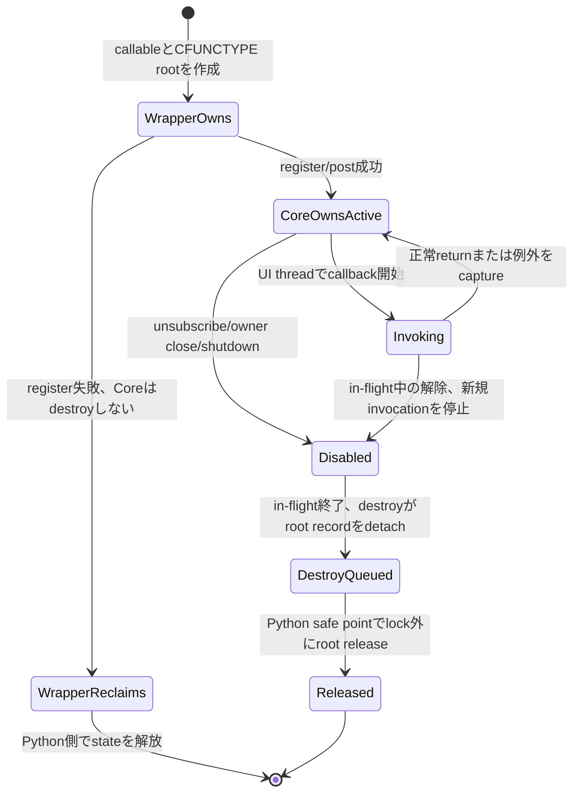

destroy thunkはuserdata keyをregistryからatomicにdetachし、新しいcallback invocationを拒む。その後、Python callable/CFUNCTYPEへの最終参照をC destroy stackやregistry lockの中で落とさず、wrapper safe-point queueへ渡す。任意Python objectの`__del__`やweakref callbackがreference dropに伴って実行され得るため、Core destroy thunk内のPython object destructionを避ける。具体化は言語ラッパー：Python、[言語ラッパー：callback解析・lint・MCP](analyzer.md)、[ビルド・配布：toolchain・profile・package](../build/toolchain-packages.md)、[共通C ABI：宣言・検査・互換性](../runtime-objects/abi.md)を参照する。

登録関数のreturn前にcallback invocationを許すowner APIでは、登録呼出し中はwrapperがrootを維持したまま一時invocationを処理し、成功statusを確認した一点でCore ownershipへ移す。登録結果確定前にCore destroyが呼ばれないこと、失敗return時はCoreがcallback/destroyを呼ばないことをowner API contractに要求する。

### ctypes、GIL、UI thread

| 境界 | 提案 |
|---|---|
| Native call | C ABI functionを呼ぶ前にprototypeとUI thread条件を確認する。FFI call中にregistry lockを保持しない |
| GIL | GIL-enabled buildでも`ctypes.CDLL` call中にGILが解放され、他threadがwrapper stateを変更し得るため、許可した共有mutable stateは専用lockで同期する。GILはデータ保護の代用にしない |
| Callback | CFUNCTYPE callbackは保持済みroot recordからcallableを取得し、Coreが要求するUI thread上で動作することを検証する |
| foreign-created thread | ctypesのcallbackでPython dummy thread stateが使われ得る。`threading.local`を異なるinvocation間のcallback state保存先にしない |
| workerが変更可能なwrapper state | ownerのopen/closed/token/ticket状態、cleanup registry、callback root registry等はlockで保護し、状態遷移全体をatomicに扱う。builtin container個々の操作保証に依存しない |
| workerが変更してはならないstate | UI-affine Runtime/UI stateはUI threadだけが変更する。workerへはimmutable/read-only snapshotまたは値copyを渡し、更新要求はdispatcherへpostする |
| UI-only wrapper call | native Runtime thread checkを正とし、Python thread identity checkを早期診断に使う。誤threadを暗黙dispatchしない |
| worker update | 値copyとclosureをpost queueへ渡す。workerからUI-affine Property getter/setterを直接呼ばない |

言語ラッパー：PythonはGILを共有状態保護の仕組みとして前提にしない。これは任意threadから全状態を変更可能にする設計ではない。変更を許すwrapper-owned mutable stateはlockで保護し、変更を許さないUI-affine stateはread-only/snapshot/value copyで他threadへ渡す。明示lockは状態確認・更新の短い区間に限り、FFI中やuser callback中には保持せず、finalizerではblocking lockを取らない。処理系別supportはRQ-03-014および言語ラッパー：Pythonのprofileを参照し、この同期契約だけで検証済みと扱わない。

公式資料: [Python ctypes — callback functions](https://docs.python.org/3/library/ctypes.html#callback-functions)は、C利用中の`CFUNCTYPE` object参照をPython側で保持する必要、foreign-created thread callbackでdummy threadが使われ得ることを説明する。同じ資料は`CDLL` callがGILを解放することも記す。[Python weakref.finalize](https://docs.python.org/3/library/weakref.html#weakref.finalize)はGC finalizerからの例外が呼出し元へ伝播しないことを記す。[Python free-threading guide](https://docs.python.org/3/howto/free-threading-python.html)は、containerに内部lockがあっても、その実装上の挙動へ依存せず`threading.Lock`等を使うことを勧める。

#### Special method overrideとbase chain-up

Pythonのspecial methodは算術operatorだけではない。暗黙演算子dispatch、属性設定、初期化、context manager、iterator、比較、finalizationなどがtype上のmethod overrideで振る舞いを置き換える。暗黙special-method lookupはinstance attribute経由の通常lookupと異なるため、instanceへの監視method追加だけではoverrideを安定して捕捉できない。

GObject系virtual methodやGUI frameworkのlifecycle hookのように、親実装を呼んで基底のnative動作を維持する必要があるmethodは、methodごとの契約として記録する。検査対象は文字列`super()`の存在ではなく、要求されたparent implementationへ実際にchain-upしたかとする。MRO上の適切な`super().method()`、明示的なancestor callなど、契約上有効な呼出し形を識別する。`super()`をすべてのoperatorやspecial methodへ要求しない。

| method契約 | 検出方針案 |
|---|---|
| parent implementation必須、wrapperがoverrideをdispatchする | base methodが呼ばれたことを記録するruntime guardを置き、dispatch終了時に未呼出しなら分かりやすい例外にする |
| parent implementation必須、ユーザー定義overrideを静的解析できる | MVVM UIライブラリ Python lint/type check とMCP連携に関する上位判断案 Python analyzerが対象methodと解決可能なMROを使ってerror/warningを出す |
| chain-up任意または独自実装が置換する | metadataで不要と明示し、警告しない |
| dynamic dispatch/MRO/monkey patchで検査不能 | 診断を`unknown`として扱い、安全と断定しない。Runtime保護は維持 |
| `__del__`等のfinalizer | resource cleanup用の最小token handoffに利用できる（Python wrapper）。base-class chain-up検査とは分け、外部base classのchain-up不足は実行時例外では検査せず、静的検出できる場合のdiagnostic候補とする |

実行時guardは、method metadataで指定されたoverrideだけをclass creation時のhook/metaclass/decorator候補で包み、guard状態を呼出しごとに持つ構成が考えられる。要求された親実装側がそのguardへchain-up到達を記録し、override終了時に未到達なら分かりやすい例外を出す。検査対象は`super()`という構文文字列ではなく、契約上の親実装呼出しである。Python演算子構文が直接special methodを呼ぶ場合も、class creation時に対象methodをwrapperで包めれば実行時に検査できる。dynamic class変更や検査外の継承ではruntime検査を保証せず、MVVM UIライブラリ Python lint/type check とMCP連携に関する上位判断案 analyzerのdiagnosticまたはunknownへ送る。具体化は言語ラッパー：Python、[言語ラッパー：callback解析・lint・MCP](analyzer.md)、[ビルド・配布：toolchain・profile・package](../build/toolchain-packages.md)、[共通C ABI：宣言・検査・互換性](../runtime-objects/abi.md)を参照する。

guard状態をGILだけで保護せず、同じPython objectに複数threadからoperator methodが同時呼出しされてもcall間で誤って混ざらないper-invocation stateにする。user overrideが例外で終了した場合は元の例外を保ち、chain-up不足の例外で上書きしない。

参考: [Python Data Model: special method lookup](https://docs.python.org/3/reference/datamodel.html#special-method-lookup)、[Python Data Model: `__del__`](https://docs.python.org/3/reference/datamodel.html#object.__del__)。GObject base virtual callのmethod-specificな例は[PyGObject subclassing](https://pygobject.gnome.org/tutorials/gobject/subclassing.html)、wxPythonでoverride methodの基底呼出しを指示する例は[`wx.App.OnPreInit`](https://docs.wxpython.org/wx.App.html)を参照した。

### Callback例外とerror surface

callback trampolineはPython callbackの例外がctypes callback boundaryからC/Rustへ伝播する経路を作らない。Python runtimeはPython function実行中に生成される`BaseException`全体を扱うため、trampoline catch対象を`Exception`に限るか`BaseException`とするか、`KeyboardInterrupt`/`SystemExit`をどう利用者へ再通知するかを明示する必要がある。いずれの選択でも、その例外をC stack越しにthrowしない。

利用者設定exception handlerをcallback exceptionの報告先候補にする。handler自身が例外を送出した場合もtrampoline内で封じ、callback種別の成功/拒否/通知継続意味論を変更しない。handler record、既定診断、exception/tracebackの保持は言語ラッパー：Pythonのhandler/root queueへ接続する。

通常のC ABI失敗は`ui_status`を一次情報としてPython error surfaceへ変換し、任意Error handleがある場合はimmutable snapshotを所有する。unknown status/domain/codeもraw数値を保持する。`str(error)`等のmessageは表示に使えても、分岐や再試行判定に使わない。検証rejectやCommand stateなどAPI固有の通常結果は、個別設計に従い全てをPython exceptionにしない。

### Shutdownとcleanup順

| 状況 | Python wrapper案 |
|---|---|
| async shutdown | 要求受付後に戻り、完了待ちをwrapper独自に追加しない |
| callback/event内shutdown | 現在のcallback/event完了後に優先処理される受付結果を返す |
| workerからsync shutdown | UI loop稼働時にUI cleanup完了まで待つ。loop停止通知で未完了結果と理由を返しwaitを解除する |
| UI Runtime owner close | shutdownは明示実行済みであることを要求/診断し、closeが暗黙shutdownを始めない案 |
| owner finalization中のowned child | `__del__`または同等finalizerがtoken/ticketをcleanup managerへ非block移管し、UI thread上でcleanupする |
| Runtime Closed後 | Closed shell releaseをdrainし、最後のRuntime anchorを解放 |
| host UI loop終了直前 | Qt `aboutToQuit()`相当のUI-thread adapter通知からloop停止前にshutdown cleanupを実行する。通常queueにpostするだけの接続は完了保証にならない |
| Python main threadの未捕捉例外 | `sys.excepthook`からRuntime shutdownのcallback中dispatchに関する上位判断/ランタイム：実行基盤と終了のthread/context dispatchでshutdownを要求し、既存hookへ委譲してtraceback報告を維持する。`SystemExit`は通常終了経路へ送る |
| wrapper所有workerの未捕捉例外 | worker entry境界で例外を捕捉・記録し、通常のthread exception報告を維持した上でRuntime lifecycle policyに従ってshutdownを要求する |
| callback/event内の例外 | trampoline内で捕捉して設定handlerとcallback固有failureへ渡す。自動shutdownはcallback/API固有方針で明示された場合だけ要求する |
| 通常interpreter shutdown開始 | `atexit`から同じlifecycle要求を補助的・冪等に送る |
| abrupt process termination | `os._exit()`、fatal error、致命的signal/kill等でPython hookが動かない場合を含み、process終了を越えたcleanup完遂は保証対象外 |

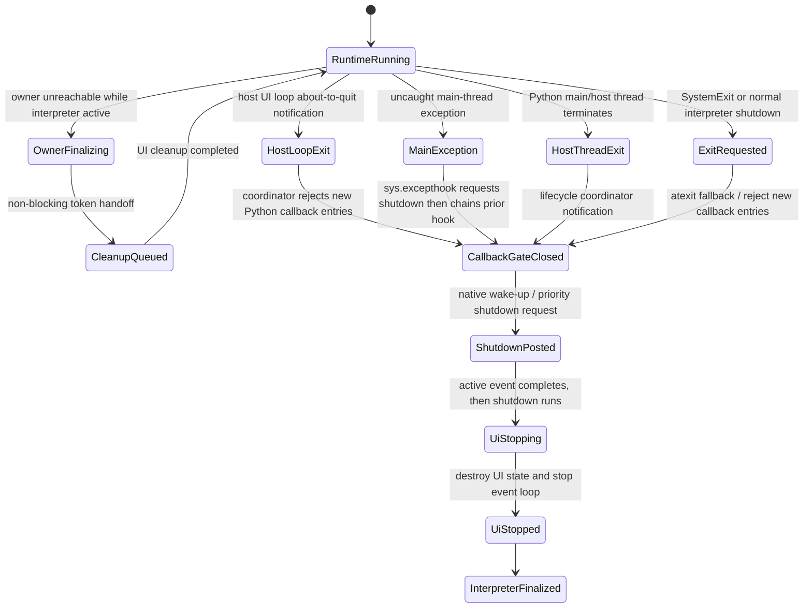

具体化は言語ラッパー：Python、[言語ラッパー：callback解析・lint・MCP](analyzer.md)、[ビルド・配布：toolchain・profile・package](../build/toolchain-packages.md)、[共通C ABI：宣言・検査・互換性](../runtime-objects/abi.md)を参照する。終了時のmain/UI間の協調条件はRQ-03-015と言語ラッパー：Pythonに従う。

### 失敗・競合ケース

| ケース | 提案する観測結果 |
|---|---|
| ctypes prototypeの欠落/wrong width | header parity/interoperability checkで検出。実行時の暗黙C `int`に依存しない |
| callback登録失敗 | Coreはcallback/destroyを呼ばず、wrapperがroot recordを回収 |
| callback登録成功 | Core destroyまでcallableとCFUNCTYPE objectを強参照 |
| callback例外 | C ABIへ出さず、callback固有failureと設定handlerへ送る |
| destroy中のPython finalizer | lock/C destroy stackから切り離し、safe-point release queueで参照を落とす |
| ownerがGC対象になった | finalizerがtoken/ticketを非block移管し、UI safe pointでrelease。finalizerを実行できない異常状態はRuntime lifecycle shutdown経路で回収 |
| UI ownerのwrong-thread call | wrapper checkまたはCore `UI_WRONG_THREAD`として明示する |
| CDLL call中に別Python threadが動く | GIL解放を前提に短い同期区間で状態を保護する |
| explicit close失敗 | wrapper ownerがtoken/ticket/anchorを保持し、失敗をcallerに返す |
| finalizer fallbackのrelease失敗 | tokenをmanagerに保ちretry。stderr例外だけで失敗を捨てない |
| worker同期shutdown中にUI loop停止 | host停止通知で未完了waitを解除し、cleanup完了と区別する |
| Python main/host thread終了時にUI threadが生存 | lifecycle coordinatorがcallback gateを閉じてnative priority shutdownをsignalし、UI loopを停止する。 具体化は言語ラッパー：Python、[言語ラッパー：callback解析・lint・MCP](analyzer.md)、[ビルド・配布：toolchain・profile・package](../build/toolchain-packages.md)、[共通C ABI：宣言・検査・互換性](../runtime-objects/abi.md)を参照する|
| Qt `aboutToQuit()`相当通知後の通常queue停止 | adapterがUI thread上でloop停止前にcleanupを行い、配送されないままのqueued shutdownを完了扱いにしない |
| host UI loopの通常終了 | loop終了直前のadapter通知（Qt `aboutToQuit()`相当）からloop停止前にRuntime shutdown cleanupを実行し、通常queueに依存せず、`exec()`後だけのcleanupにもしない |
| Python main threadの未捕捉例外 | `sys.excepthook`からRuntime shutdownのcallback中dispatchに関する上位判断/ランタイム：実行基盤と終了のthread/context dispatchでshutdownを要求し、保存した既存hookでtracebackを報告する。 具体化は言語ラッパー：Python、[言語ラッパー：callback解析・lint・MCP](analyzer.md)、[ビルド・配布：toolchain・profile・package](../build/toolchain-packages.md)、[共通C ABI：宣言・検査・互換性](../runtime-objects/abi.md)を参照する|
| wrapper所有workerの未捕捉例外 | worker境界で捕捉して診断し、Runtimeとの関連付けとshutdown policyを適用する。host全体の`threading.excepthook`差し替えは必須にしない |
| callback内の一般例外 | trampoline内で捕捉して設定handlerへ渡す。callback固有policyでfatal shutdownと定められた場合だけRuntimeを終了する |
| `SystemExit`/`sys.exit()` | error hook対象外の通常終了としてmain/host thread終了と`atexit`経路へ流す |
| アプリケーションが捕捉した例外 | 明示的にshutdownを要求しない限りRuntimeを自動終了しない |
| `os._exit()`/fatal error/致命的signal | Python cleanup hookが呼ばれない経路はprocess内保証外 |
| unknown status/domain/code | raw numeric valuesとError snapshotを保持 |

### 管理境界の登録と回収

外部hostのentry/exitとloop停止通知をlifecycle coordinatorへ登録する。entry wrapperはtry/finallyで正常return・例外・SystemExitを終了要求へ集約する。owner managerは個別token/ticketのcleanupを担当し、個別ownerの回収をRuntime全体のshutdownへ直結させない。coordinatorのみがhost終了・明示終了をRuntime shutdownへ集約する。登録外hostの自動検知は保証経路に数えない。

## 公開API・cleanup・handler寿命

### 実装規則

| 実現手段・責務 | 要求根拠 |
| --- | --- |
| ctypes frontendをCPython profileに結び、通常版とfree-threaded版を独立した検証gateで扱う。対応範囲はRQ-03-014を参照する。 | [RQ-03-014](../../11_requirements/RQ-03_language-support.md#rq-03-014) |
| ResourceOwnerはweakref.finalize+NativeOwnerCellで回収する。finalizerへbound methodやowner自身を渡さず、事前ticketをmanagerへ移す。 | 上記の根拠RQ |
| 公開名はRuntime/Property/Binding/Command/TextBox/ErrorSnapshot/DecimalValue、close/try_close/withを提供する。 | 上記の根拠RQ |
| 内部owner cell・root registryを明示Lockで保護し、native callとuser callbackはlock外。snapshot型はimmutable dataclass/readonly facade。 | 上記の根拠RQ |
| managed_main(entry)とHostRegistrationを終了通知の入口にする。標準構成はPython main threadをUI threadとし、外部専用UI threadは登録scopeで運用する。 | 上記の根拠RQ |
| 終了はnative callback gate閉鎖→実行中callback return→UI cleanup/destroy→root safe-point drain→host exitの順。mainのCondition waitはGILとregistry lockを解放する。 | [RQ-03-015](../../11_requirements/RQ-03_language-support.md#rq-03-015) |
| LifecycleCoordinatorはHostRegistrationの停止前通知とin-flight計数を使う。協調条件・完遂保証の範囲はRQ-03-015を参照する。 | [RQ-03-015](../../11_requirements/RQ-03_language-support.md#rq-03-015) |
| sys.excepthook/threading.excepthookは保存hookへ委譲する合成器。管理workerだけRuntimeへ関連付け、復元は現在hookが自分の合成器の場合のみ。 | 上記の根拠RQ |
| BaseExceptionをC trampolineで捕捉。SystemExit/KeyboardInterruptはentry coordinatorへpending control signalとして渡し、C境界をunwindさせない。 | 上記の根拠RQ |
| 基底__init__を一度実行するguard、close/__enter__/__exit__/native entryのoverride禁止を採用する。__repr__/__eq__/__hash__はbase-call不要、__del__はcleanup正本にしない。 | [RQ-03-016](../../11_requirements/RQ-03_language-support.md#rq-03-016) |

### 実現設計

#### Root / owner / coordinator

```text
NativeOwnerCell { lock, token, ticket, state, anchor }  // Python ownerを逆保持しない
CallbackRoot { callable, CFUNCTYPE, context, state, in_flight }
LifecycleCoordinator { host_registration, native_gate, owner_manager, root_queue }
```

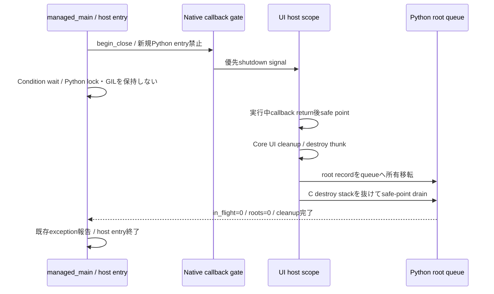

gate検査はRust/native側でCFUNCTYPE呼出し前に行う。CallbackRootは登録成功前にRootPrepared、登録完了後Active。登録処理中の同期invokeはCore側で行わず、失敗ではPython managerがrootを回収する。destroy thunkはrootをregistryから切り離してqueueへ移すだけで、最後のPython参照dropをそのC stackから分離する。

managed_mainはtry/finallyで成功・一般例外・SystemExitを集約し、既存の例外をcleanup例外で置き換えない。`with RuntimeSession`は終了要求とdrainをhostの通常終了境界に結び、個別ownerのwith終了はそのtokenだけをcloseする。scopeの終了がUI callback内なら待たずreceiptを返し、outer host scopeのexitで全体drainする。

協調条件を満たさないin-flight callbackの永久停止、登録外host、UI threadをcleanup前に破棄したhostについては完遂保証の条件はRQ-03-015を適用する。host停止確定時はwaitを未完了として解除し、ticketを管理下に残す。daemon thread化だけでcleanup済みとはしない。

override guardは内部metaclassの生成/呼出し処理で、__init__正常return時にowner cellの基底初期化済みflagを確認し、未達ならUninitializedOwnerError。初期化途中例外では既に取得したticketをmanagerへ戻す。readonly Property facadeのsetter追加等は別の通常Python操作であり、UI affinityを回避できる特権にしない。

公式根拠: [ctypes](https://docs.python.org/3.14/library/ctypes.html)、[weakref.finalize](https://docs.python.org/3.14/library/weakref.html)、[free threading](https://docs.python.org/3.14/howto/free-threading-python.html)。weakref.finalizeの存在は全回収時刻や任意process終了時の完遂保証ではない。本設計は明示同期と管理entry境界を追加する方式である。


### cleanup entryとinterpreter終了の補足

通常callback gateと内部cleanup entry gateを分ける。通常gate閉鎖後もinterpreterがRunningの間だけ内部destroy/root-drain trampolineを許可し、Core destroy stackを抜けたhost safe pointでrootをdropする。roots=0かつ内部entry in-flight=0を確認してcleanup gateも閉じ、その後に管理entryを終了する。finalization開始後のPython C API再attachで回収を試みない。root dropから走る利用者__del__/weakref callbackも有限に戻るという協調条件の対象である。

Runtime作成時にowner cellとweakref.finalizeを用意し、__weakref__ slotを公開ownerへ持たせる。finalize callbackの引数はowner cellのみでowner本体をcaptureしない。未実行finalizeをatexitで順に実行するだけの手順へ依存せず、coordinatorが登録owner cellとrootをdrainする。readonly snapshotへworkerが書込みできるfacadeを返さない。

### Python handlerと診断recordの寿命

Runtime.set_exception_handler(handler)はimmutable HandlerRecordをprepareし、registry lock下でcurrent recordだけを交換する。trampolineはentry時にrecordをpinしてlock外で呼び、交換前のrecordは最後のinvoke終了後にroot safe-point queueへ送る。handlerからの再帰報告は抑止し、handler自身の失敗は既定診断へ一度だけ渡す。

未設定時はイベントハンドリング：通知とBinding伝播の上限付きdiagnostic queueへ種別・raw status・source locationを記録する。入力値や任意exception messageは自動保存しない。exception/tracebackはhandler invoke中だけ内部rootで保持し、保存を明示した利用者copy以外はinvoke後にsafe-point queueへ移してdropする。元callbackの失敗結果とpending control signalはhandler交換やhandler内例外で上書きしない。一般例外の記録から自動的に全Runtime終了を開始しない。

## クラス設計の補足（1.1承認済み）

既承認1.0の実現規則を支える型・関連・所有・主要操作を整理した。内部型名とメソッドの分担は本改訂で補足する内部設計であり、既存公開APIの署名や外部保証を追加・変更するものではない。この節のクラス構成と追加図は1.1版全文の承認対象であり、実装・試験完了の証明とは区別する。

要求根拠: [RQ-03-013](../../11_requirements/RQ-03_language-support.md#rq-03-013)、[RQ-03-014](../../11_requirements/RQ-03_language-support.md#rq-03-014)、[RQ-03-015](../../11_requirements/RQ-03_language-support.md#rq-03-015)、[RQ-03-016](../../11_requirements/RQ-03_language-support.md#rq-03-016)。

Python facade、native tokenのcell、callback root、Runtime終了coordinatorを分ける。GILの有無に依存する所有の正当化はせず、既存の明示Lockと管理entry境界を使う。

### 型の責務と所有

| 型 | 責務・保持データ | 主要メソッド・操作 | 所有・寿命 |
| --- | --- | --- | --- |
| ResourceOwner | 公開facadeとNativeOwnerCellの対応、基底初期化guard | close(); try_close(); __enter__(); __exit__() | 個別ownerの回収でRuntime全体をshutdownしない |
| NativeOwnerCell | lock、token、ticket、状態、Runtime anchor | begin_call(); finish_call(); transfer_cleanup() | Python ownerを逆保持しない。native call/user callbackはlock外 |
| CallbackRoot | callable/CFUNCTYPE/context、Active状態とin-flight | prepare(); enter(); disable(); enqueue_drop() | native登録の寿命を保つ。最後のPython参照dropをC destroy stackから分離 |
| OwnerManager | 個別token/ticketの回収と再試行 | adopt(ticket); retry_pending() | weakref.finalizeはownerをcaptureせずcell/ticketを渡す |
| LifecycleCoordinator | HostRegistration、native gate、owner manager、root queue | request_exit(reason); begin_close(); drain_at_safe_point() | host終了・明示終了をRuntime shutdownへ集約する唯一の管理主体 |
| HostRegistration | 管理main/外部hostのentry/exit/停止前通知 | enter(); leave(); notify_stopping() | 登録scope内で協調条件を確認。未登録hostの自動検知を保証しない |

### クラスの関連

`*--`は従属するstate/作業の合成、`o--`は共有を含む所有参照、`..>`は非所有の利用・識別・委譲を示す。関連名と本文で示した寿命を優先し、図の同名型は各instanceで別の状態を持つ。図は主要メソッド名を抜粋し、引数・所有・失敗条件は表と本文に従う。

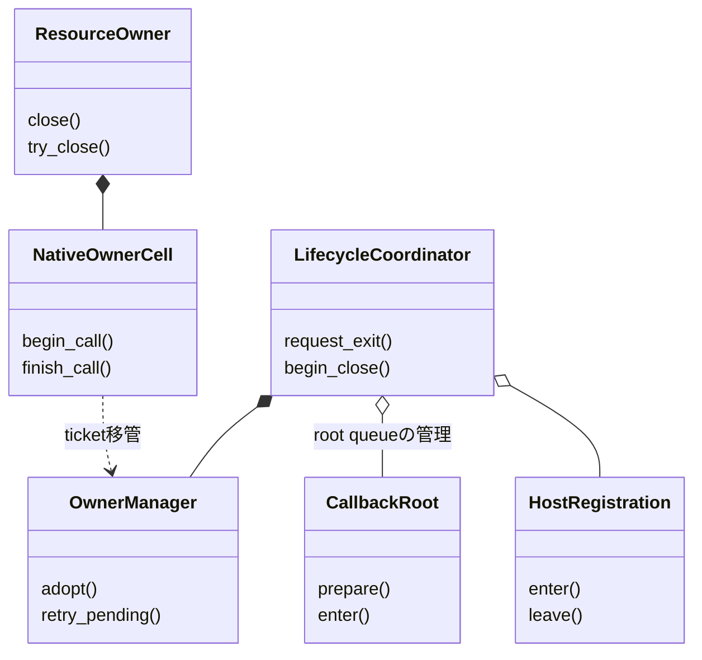

### 主要な呼出しと失敗境界

managed_main/登録hostのfinallyがcoordinatorへ終了を依頼し、native gate閉鎖→in-flight return→UI cleanup/destroy→root safe-point drain→host exitの順に進む。通常callとcallbackはcell/registry lockを解いてnative/利用者コードを呼ぶ。

図のroot queue所有は登録中rootの管理と回収待ちへの移管を表し、coordinatorが常に利用者ownerを強保持する構成ではない。Condition waitではGILとregistry lockを保持しない。停止不能callback等の完遂条件はRQ-03-015のまま維持する。

## Runtime公開API（1.2承認済み）

本節はPython consumer向けRuntime基礎facadeの公開形を定める。1.1で承認済みの所有・cleanup・thread・shutdown契約を変更せず、実装済みAPIを宣言するものでもない。Runtime以外のProperty/UI API、distribution/loaderの変更は含めない。

### 公開型と操作案

| 型/API | 提案する責務・契約 |
|---|---|
| `Runtime.create()` | ABI versionを確認してRuntimeを生成する。ABI majorが非対応、または生成失敗なら`UiError`を送出する。成功時のRuntime tokenは唯一のowner cellが保有する。 |
| `Runtime.is_ui_thread()` | `runtime_is_ui_thread`を呼び、ABIの0/1のみをPython `bool`へ写す。その他の値は内部ABI不整合として失敗させる。 |
| `Runtime.ui_context()` / `UiContext.check()` | factoryは現在threadが当該RuntimeのUI threadであることをnative queryでも確認し、Runtime identityとowner cellを保持する`UiContext`を返す。`check()`は使用時にもRuntimeのopen状態・threadを再確認する。contextはRuntimeをshutdownせず、強参照によりowner cellの早期解放を防ぐ。 |
| `Runtime.shutdown()` | `runtime_shutdown`のthread/context依存意味論をそのまま適用する。UI callback/event内は受付後に`ACCEPTED_PENDING`、完了した場合は`COMPLETED`を返す。worker同期呼出しの待機や停止host時の未完了はCore/ABI契約に委ね、Python側で一律UI-thread限定にしない。 |
| `Runtime.request_shutdown(mode)` | `ShutdownMode.ASYNC`または`SYNC`で要求し、`ShutdownRequest`を返す。受付済み`UI_PENDING`は成功結果として扱い、failure statusとは区別する。 |
| `ShutdownRequest.query()` | thread-independentなsnapshotとしてraw state/reasonを返す。既知stateはenum相当の便宜表示を提供してよいが、未知state/reasonを捨てない。 |
| `Runtime.close()` / `try_close()` | Runtime所有参照だけをreleaseする。closeは暗黙shutdown・shutdown待機・要求取消を行わない。release失敗時はowner tokenを維持し、明示再試行を可能にする。`try_close`は既存ResourceOwner規則に沿った非送出cleanup入口とする。 |
| `Runtime` context manager | `with Runtime.create() as runtime:`のexitは`close()`相当とし、Runtime shutdownを暗黙実行しない。managed host/mainの協調終了は`RuntimeSession` / `managed_main`の別責務であり、このRuntime facade unitに混ぜない。 |
| `ShutdownRequest.close()` / context manager | receiptのowned handleを解放する。要求・完了処理は取り消さない。 |

`UiContext`の用途は後続のUI wrapper向けcontext capabilityであり、このRuntime-only unitでは生成・同Runtime identity・thread/open検査までを実装対象とする。別Runtimeへcontextを渡すAPIは本unitに追加しない。今後contextを受け取るUI APIではRuntime identity不一致を`WRONG_RUNTIME`へ写す。

### error・ownership・ABI adapter

- Public exceptionはPython DDのErrorSnapshot契約を持つ`UiError`案とし、raw status/domain/code/messageを保持する。statusやmessage文字列の部分一致を分岐根拠にせず、未知の値を保持する。
- `Runtime.create()`ではnative owned outputが不正に返った場合もtokenを破棄またはcleanup管理へ移管し、部分初期化を外へ漏らさない。owner/call/ticket確保とrelease失敗時の保全は本書1.1の`NativeOwnerCell` / `OwnerManager`規則に従う。
- private `NativeApi` protocol相当を設け、ABI関数の呼出しをfakeで差し替えられるようにする。これはテスト seamであり、consumer APIや配布library選択機能ではない。
- 実loaderは既存のbuild/package設計に従う。missing native artifact時のnetwork取得や新しい環境変数/path overrideは加えない。artifact packaging/relocationは今回の範囲外。
- `Runtime.close()`とshutdownの分離を維持する。RuntimeをcloseしただけではCore runtimeがshutdownしたとはみなさず、反対にshutdown後もowned Runtime tokenは明示close/finalizer cleanupまで保持する。

### 呼出し・状態の要約

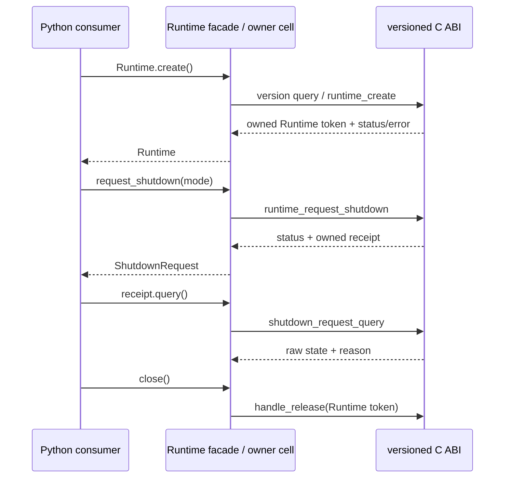

図は一つの代表経路を示す。shutdownとcloseの順番は固定せず、shutdown要求receipt releaseは要求取消を意味しない。blocking native waitは対応ABIがGILを解放できる呼出しとして実装し、GILやwrapper lockを保持したまま利用者callback/host progressを待たない。具体的なctypes GIL解放可否とcallback再入はfake/consumer検証および実装前確認対象とし、C ABI意味論をPython wrapper独自に変更しない。

## BOOL/I64 Property公開API（1.3承認済み）

本節は承認済みRQと共通C ABIのProperty作成・読取・設定・release契約をPythonから利用する最初の値型facadeを定める。1.2全文承認済みのRuntime・owner・call lease・cleanup契約は維持する。本節のsignature、built-in型の受入規則、Python例外写像は設計仕様として承認済みだが、実装済みAPIや試験合格を意味しない。

### 公開API案

| 型/API | 責務・契約 |
|---|---|
| `Property.create(runtime, initial)` | Runtime上に値種別固定のPropertyを作成し、成功時にProperty ownerを返す。第1単位の値種別はBOOLとI64のみとする。Property作成はUI thread上で行う。 |
| `property.get()` | native Property値を取得してPython値へ変換する。値をPython側でcacheせずCore Propertyを正本とする。 |
| `property.set(value)` | 初期値と同じ値種別に対応するsetterを呼ぶ。型違いを暗黙変換しない。Coreのsetter status/errorを呼出側へ伝える。 |
| `property.close()` / `try_close()` | Property tokenの明示release。Runtimeをshutdownせず、Runtime ownerのcloseとも分離する。release失敗時はtokenをowner cellで保持し、明示retryを可能にする。 |
| `Property` context manager | `with Property.create(runtime, initial) as prop:`のexitはProperty close相当とする。 |

`type(initial) is bool`ならBOOL、`type(initial) is int`ならsigned I64として扱い、I64の範囲を超える整数はnative call前に拒否する。boolがintの派生型であるため、bool判定を先に行う。Pythonのその他の型とint/bool subclassは暗黙にbool/intへ変換しない。誤型は`TypeError`、I64範囲外は`OverflowError`とする。将来のUTF8/F64/DECIMAL対応では、受理型と変換規則を各値型設計で追加する。

各PropertyはRuntimeの強参照anchorとNativeOwnerCellを持つ。native call開始時にRuntime/Propertyのopen状態を検査し、call leaseでtokenを保護する。native call中にwrapper lockを保持せず、call leaseが戻るまでcloseからtoken releaseへ進まない。create/get/setはC ABIに従いUI threadでのみ行い、worker呼出しを暗黙dispatchしない。Runtime context checkを早期診断に利用しても、native statusを最終境界とする。

### ABI mapping・失敗境界

| Python側 | C ABI側 | 失敗時の扱い |
|---|---|---|
| `bool` | `ui_bool`の0または1 | native getterが0/1以外を返す場合は不正ABI結果として扱い、値へ変換しない |
| 範囲内のbuilt-in `int` | `int64_t` | signed 64-bit範囲外はnative call前に拒否し、切り詰めない |
| Property create | `property_create_bool` / `property_create_i64` | statusとowned error tokenからRuntime DDのimmutable `ErrorSnapshot` / `UiError`契約へ写す。部分生成のowned tokenはowner manager規則で回収する |
| Property get | `property_get_bool` / `property_get_i64` | 失敗statusを保持し、成功時だけout valueを返す。未知statusを既知failureへ偽装しない |
| Property set | `property_set_bool` / `property_set_i64` | statusとowned error tokenを呼出側へ写す。wrapperにshadow valueを置かず、Coreの失敗時値・通知意味論を変更しない |
| Property close | `handle_release` | release成功時のみtokenを消費。失敗時はowner tokenを保持し明示再試行可能にする |

status値とErrorSnapshot形式の正本は[共通C ABI設計](../runtime-objects/abi.md)、値保持・検証・通知の外部意味論の正本は[RQ-02 Property](../../11_requirements/RQ-02_core-features.md#rq-02-002)および[上位値モデル設計](../../12_design/runtime-objects/model-values.md)とする。本Python facadeはBinding、Subscription、変更通知、validator callback、一般transactionを追加しない。レビュー用C宣言を配布headerや実装済みABIの根拠として扱わない。

### クラス関係とcall flow

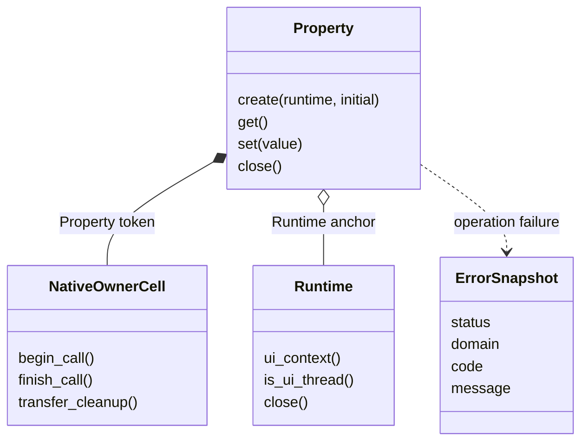

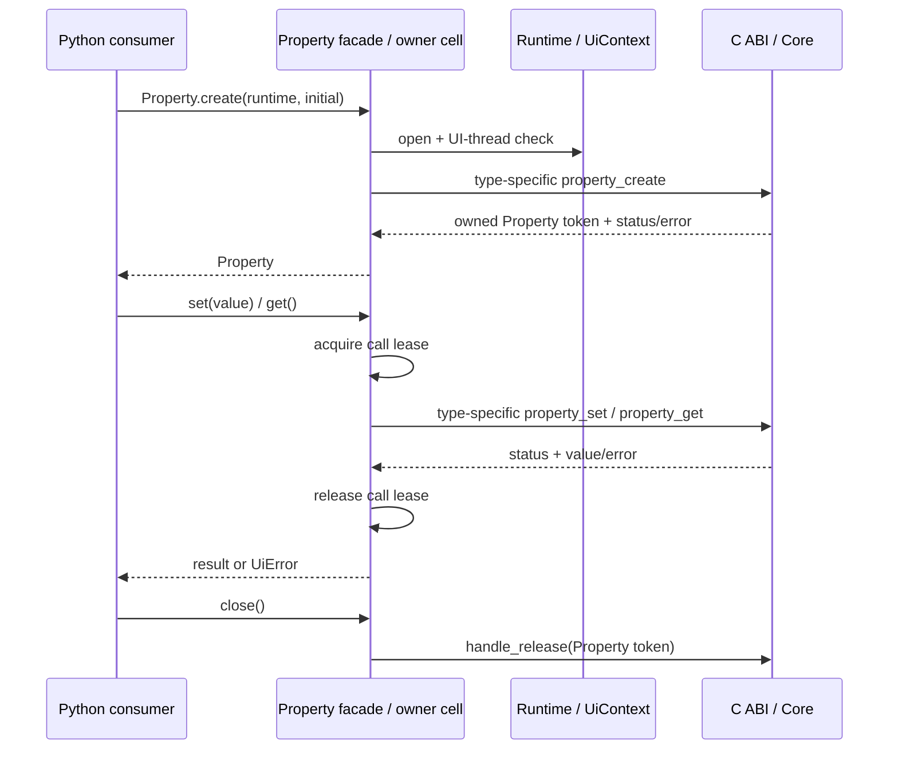

Runtime anchorはPropertyが生存中にRuntime owner cellの早期回収を防ぐが、Property closeはRuntime shutdownを開始せず、Runtime closeと連鎖させない。最後のProperty handle releaseとRuntime shutdownの詳細は既存Runtime/ABI設計に従う。

## F64 Property公開API（1.5承認済み）

本節は承認済みRQ-02-017/018と共通C ABIのF64 Property契約をPython `float`から利用する設計である。BOOL/I64/UTF-8 Propertyの公開API・owner/call lease・error snapshot・明示close契約を維持し、Core/C ABIに新しい意味論を追加しない。本節を含む1.5文書全体は利用者承認済み（2026-10-25）。この承認は実装・試験合格を意味しない。

### 公開APIと型mapping

| 型/API | 1.5設計の責務・契約 |
|---|---|
| `Property.create(runtime, initial)` | `type(initial) is float`の場合、F64 Propertyを作成する。built-in `float`だけを受け付け、bool/int/float subclass等からの暗黙変換は行わない。createはUI threadで実行する。 |
| `property.get()` | CoreからF64を取得し、C ABIの`double`をPython `float`として返す。wrapper値cacheを置かず、getter失敗statusは既存のraw `UiError`契約に従う。 |
| `property.set(value)` | F64 Propertyには`type(value) is float`だけを受け付け、値を`double`としてC ABIへ直接渡す。finite-only制限や数値変換を追加しない。 |
| `property.close()` / `try_close()`、context manager | 既存Propertyのtoken release・retry・Runtime非shutdown契約を適用する。 |

F64の公開値型はPython built-in `float`とし、値の受け渡しに`ctypes.c_double`を使う。整数・BOOL・DECIMALからのconverter、丸め、finite-only検証、NaN/infinity正規化、Property種類間の暗黙変換をwrapperに設けない。Python/ctypes境界でfloat subclassや非floatを受け入れる追加規則も設けない。

### ABI mapping・等価性と表現

| Python側 | C ABI側 | 1.5設計の失敗扱い |
|---|---|---|
| `float`のcreate | `property_create_f64(runtime, initial, out_property, out_error)` | Python `float`を`double`で値渡しする。status/error snapshotと部分生成token cleanupは既存Property契約を使う。 |
| `float`のget | `property_get_f64(property, out_value)` | 成功値をPython `float`として返す。失敗時はerror tokenのないraw statusを`UiError`へ保持する。 |
| `float`のset | `property_set_f64(property, value, out_error)` | `double`で値渡しする。失敗時はnative error snapshotを保持し、wrapper側でshadow valueや暗黙rollbackを行わない。 |
| F64 value equality | CoreのRQ-02-018契約 | NaN同士、同符号infinity、正負zeroはCoreで同値。受理された同値setは既存stored representationを維持し通知しない。wrapperはPythonの`==`や独自bit比較で同値判定しない。 |

NaNと正負infinityは有効なF64値として渡し、アプリ固有の有限値制約をwrapperへ持ち込まない。値の比較、同値set時の既存stored representation維持、notification抑制はCoreの責務である。wrapperは演算やcastを挟まずC ABIへ直接写す。NaN payloadの厳密な保持はC ABIとPython/ctypesの実測可能な境界を確認し、RQ以上の利用者保証として主張しない。

### owner、thread、errorの継承

F64 Propertyは既存と同じRuntime anchorとProperty owner cellを持つ。create/get/setはUI thread専用でworkerから自動dispatchしない。native callではRuntimeとProperty双方のcall leaseでtoken寿命を保ち、wrapper lockをnative call中に保持しない。explicit close失敗時のtoken保持/retry、finalizer cleanup ticket、未知statusとnative error snapshotのraw情報保持を既存契約から変更しない。

入力型違いはnative call前に`TypeError`とする。F64 native create/set失敗はnative error snapshotを持つ`UiError`、get失敗はraw statusを持つ`UiError`とする。F64の値・同値・通知・Binding意味論はRQ/Coreの正本へ委譲し、wrapper固有の通知・converterを追加しない。

### sequence flow

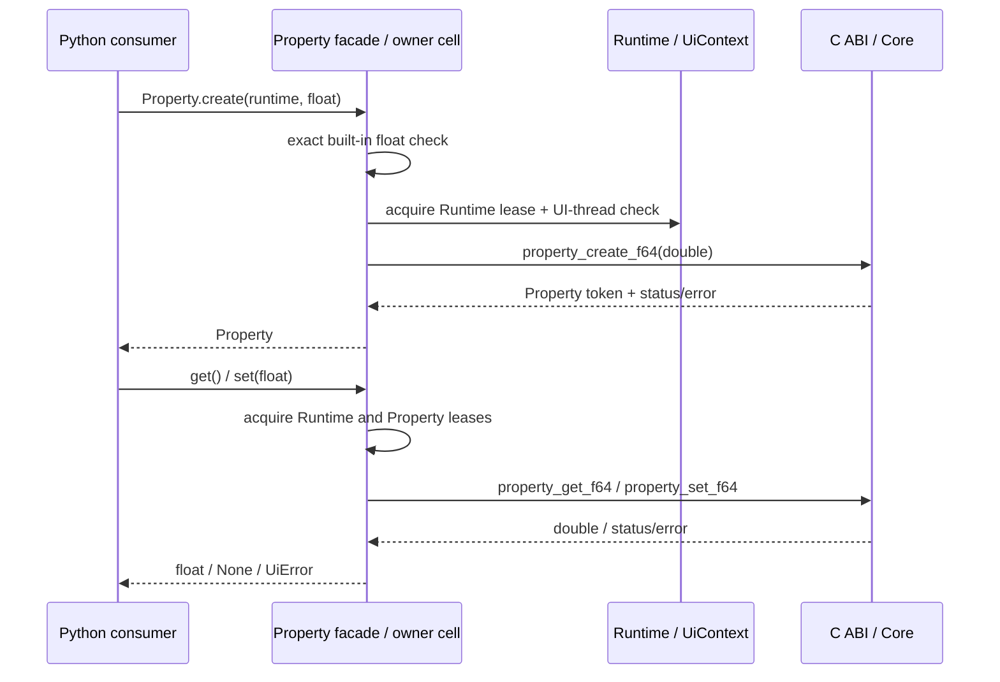

本改訂はPython F64 Property facadeに限定する。DECIMAL、Subscription、Binding、Validator、TextBox編集・表示format、package loader/配布経路は別設計・別unitとする。

## UTF-8 Property公開API（1.4承認済み）

本節は承認済みRQと共通C ABIのUTF-8 Property契約をPython `str`から利用する拡張である。BOOL/I64 Propertyの公開API・owner/call lease・error snapshot・明示close契約を維持する。本節は1.4全文承認済み（2026-10-25）であり、1.5へ継承されている。

### 公開APIと型mapping

| 型/API | UTF-8 Propertyの責務・契約 |
|---|---|
| `Property.create(runtime, initial)` | `type(initial) is str`の場合はUTF-8 Propertyを作成する。createはUI threadで実行する。 |
| `property.get()` | CoreからUTF-8 byte列を取得し、妥当なUTF-8だけをPython `str`へstrict decodeする。wrapper側に値cacheを置かない。 |
| `property.set(value)` | UTF-8 Propertyにはbuilt-in `str`だけを受け付け、strict encodeしたbyte列とbyte lengthをC ABIへ渡す。値型違いはnative call前に拒否する。 |
| `property.close()` / `try_close()`、context manager | 既存Propertyのtoken release・retry・Runtime非shutdown契約をそのまま適用する。 |

UTF-8 Propertyの入力・出力はC ABIのbyte lengthを正とし、NUL終端文字列へ変換しない。Python `str`をstrict UTF-8 encodeし、Unicode normalizationや置換を行わない。空文字列はbyte length 0として渡し、埋め込みNULは通常のUTF-8 byte列として保持する。`str`以外および`str` subclassは`TypeError`、isolated surrogate等strict UTF-8へ変換できない内容はnative call前に`UnicodeEncodeError`で拒否する案とする。

### ABI mapping・buffer read flow

| Python側 | C ABI側 | UTF-8 Propertyの失敗扱い |
|---|---|---|
| `str`のcreate | `property_create_utf8(runtime, bytes, byte_length, out_property, out_error)` | 空byte列はnull pointer・長さ0で表し、有効byte列はCoreがcall中にcopyする。status/error snapshotと部分生成token回収は既存Property/owner契約に従う。 |
| `str`のset | `property_set_utf8(property, bytes, byte_length, out_error)` | strict encode後にbyte pointer/lengthをcall中だけborrowさせる。失敗status/errorを`UiError`へ写し、wrapper値cacheや暗黙rollbackを追加しない。 |
| `str`のget | `property_get_utf8(property, buffer, capacity, out_length)` | capacity照会後にbytearrayを確保し、`UI_BUFFER_TOO_SMALL`なら必要長を取り直して再試行する。部分byte列をPython値として公開しない。 |
| native UTF-8結果 | caller-owned bytearray → `str` | `errors="strict"`相当でdecodeし、invalid UTF-8はreplacementせず`UiError(INTERNAL_ERROR)`として報告する案とする。 |

getterはCore/UI thread上の同期call内で容量照会とcopyを行い、その間にevent loopを回さない。ABIが`UI_BUFFER_TOO_SMALL`を返した場合は再照会・再確保し、成功した長さ分だけをdecodeする。capacityと返却長の矛盾、またはstrict decode失敗は不正ABI出力として扱い、文字列値を返さない。queryとcopyを跨いだ同一snapshot保証は新設しない。

### owner、thread、errorの継承

UTF-8 PropertyもRuntime anchorとNativeOwnerCellを持つ。create/get/setはUI thread専用であり、workerからの自動dispatchは行わない。native callではRuntimeとProperty双方のcall leaseでtoken寿命を保護し、wrapper lockをnative call中に保持しない。explicit close失敗時のtoken保持/retry、finalizer cleanup ticket、未知status/error snapshotのraw情報保持はBOOL/I64 Propertyと同一の契約を適用する。

UTF-8値に関する入力型違いは`TypeError`、Python文字列のstrict encode不能はnative call前の`UnicodeEncodeError`、native側のinvalid UTF-8やABI長矛盾は`UiError(INTERNAL_ERROR)`とする提案である。Coreから返る既知status、例えばwrong-thread、closed、validation failureはstatusを一次情報として既存`UiError`契約へ写す。Property値・通知・validation・Binding意味論はRQ/Coreの正本に従い、本wrapperは通知・Binding・normalization・converterを追加しない。

### sequence flow

```mermaid
sequenceDiagram
    participant App as Python consumer
    participant P as Property facade / owner cell
    participant R as Runtime / UiContext
    participant ABI as C ABI / Core
    App->>P: Property.create(runtime, str)
    P->>P: strict UTF-8 encode
    P->>R: acquire Runtime lease + UI-thread check
    P->>ABI: property_create_utf8(bytes, byte_length)
    ABI-->>P: Property token + status/error
    P-->>App: Property
    App->>P: get()
    P->>P: acquire Runtime/Property call leases
    P->>ABI: property_get_utf8(NULL, 0, out_length)
    ABI-->>P: required byte length
    P->>ABI: property_get_utf8(buffer, capacity, out_length)
    ABI-->>P: bytes/status
    P->>P: strict UTF-8 decode; release call leases
    P-->>App: str or UiError
    App->>P: set(str)
    P->>P: strict UTF-8 encode
    P->>ABI: property_set_utf8(bytes, byte_length)
    ABI-->>P: status/error
    P-->>App: None or UiError
```

1.4時点のUTF-8改訂はPython wrapper単体のUTF-8 Property facadeに限る。Unicode normalization、locale conversion、F64/DECIMAL、Subscription、Binding、TextBox表示編集、package loader/配布経路はそれぞれの設計・unitで扱う。

## DECIMAL Property公開API（1.6全文承認済み）

本節は承認済みRQ-02-017/019/020と共通C ABIのDECIMAL PropertyをPythonから利用する実現案である。BOOL/I64/F64/UTF-8 Propertyの公開API、owner/call lease、error snapshot、明示close契約を維持する。Core/C ABIの数値範囲・数値同値判定・同値時の格納表現維持・通知抑制をwrapperへ複製しない。本節を含む1.6文書全体は利用者承認済み（2026-10-25）。Python境界規則の承認は実装・試験合格を意味しない。

### 公開APIと型mapping

| 型/API | 1.6提案の責務・契約 |
|---|---|
| `Property.create(runtime, initial)` | `type(initial) is decimal.Decimal`の場合にDECIMAL Propertyを作成する。built-in `decimal.Decimal`の正確な型だけを受け付け、`bool`/`int`/`float`/`str`、Decimal subclass等からの暗黙変換は行わない。createは既存Property契約どおりUI threadで実行する。 |
| `property.get()` | C ABIの`uint64_t` bitsを取得し、sign/scale/coefficientをPython `decimal.Decimal` tuple constructorへ直接写す。decimal context依存演算をせず、格納scaleと負のzero signを保持して返す。 |
| `property.set(value)` | built-in `decimal.Decimal`だけを受け付ける。有限値を丸めずbitsへ変換し、正確に表現できなければnative call前に拒否する。成功時もwrapper value cacheを更新しない。 |
| `property.close()` / `try_close()`、context manager | 既存Propertyのtoken release・retry・Runtime非shutdown契約を適用する。 |

公開値型は標準ライブラリの`decimal.Decimal`とし、専用wrapper型を追加しない。`Decimal.as_tuple()`のsign/digits/exponentを使い、global/local decimal context、算術演算、`quantize`、文字列parse、binary float経由の変換を使わない。NaN/InfinityはDECIMAL finite rangeに含まれないため拒否する。型違いは`TypeError`、非有限値は`ValueError`、有限でも正確に範囲内へ写せない値は`OverflowError`とする案である。

### Exact bits mappingと範囲変換

DECIMAL bitsはC ABIの`uint64_t`値として扱い、byte order依存のpack/unpackはしない。encodingはbit 63をsign、bits 58..62をscale、bits 0..57をcoefficientとする。getterは`sign = (bits >> 63) & 1`、`scale = (bits >> 58) & 0x1f`、`coefficient = bits & ((1 << 58) - 1)`で分解する。coefficientの十進digitsを作り、`Decimal((sign, digits, -scale))`で構築する。decimal contextや算術には依存しない。

setter/createは有限Decimal tupleを次の規則で正確に写す。

1. 先頭zero digitsを除く（全digitsがzeroなら係数0として扱い、exponentに関係なく`10**exponent`を構築しない）。exponentが非負ならscale 0の係数候補とする。digits長とexponentから候補桁数を先に計算し、18桁超または18桁で`288230376151711743`より大きい候補を拒否する。上限内と確認した後にだけ係数整数と`10**exponent`を構築する。
2. exponentが負ならscale候補を`-exponent`とする。
3. 係数0はsignを保つ。scaleが0..31内ならそのscaleを保ち、範囲外ならscale 0で表す。
4. 非zero係数は、scaleと係数がそれぞれ`0..31`、`0..2^58−1`内なら元の表現を保つ。
5. そのまま範囲外の場合に限り、scaleが正で係数末尾に10がある間、それを取り除いて係数を10で割りscaleを1減らす。範囲内に入れば同じ数値を厳密に表現できる。丸め・切捨て・量子化はしない。縮約後も範囲外なら拒否する。

上限判定はDecimal tuple digitsの長さ・lexicographic比較を使い、範囲内と分かるまで巨大なPython整数を生成しない。`_decimal_to_bits(value: Decimal) -> int`と`_decimal_from_bits(bits: int) -> Decimal`をprivate conversion helperとして分離する。入力Decimalのscaleを可能な限り保存し、ABI範囲に入らない場合に限って10の因子を厳密に縮約する。例: `Decimal("1.00")`はscale 2を保つ。`Decimal("1E-32")`は拒否し、`Decimal("10E-32")`は`1E-31`へ厳密縮約する。sign/scaleの異なるzeroはCore上数値同値だが、getterは現在格納されているbitsのsign/scaleをそのままPython値へ写す。この入力表現変換案は1.6全文レビュー対象である。

### ABI mapping・失敗境界

| Python側 | C ABI側 | 1.6提案の失敗扱い |
|---|---|---|
| Decimal create | `property_create_decimal(runtime, uint64_t initial_bits, out_property, out_error)` | Python側でtype/finite/rangeを検査し、canonical `uint64_t`を渡す。native create failureは既存Property error snapshotと部分token cleanupを使う。 |
| Decimal get | `property_get_decimal(property, uint64_t *out_bits)` | 成功bitsを分解して`Decimal`へ変換する。native failureはraw statusを既存`UiError`へ写す。 |
| Decimal set | `property_set_decimal(property, uint64_t bits, out_error)` | bits変換後に呼び出し、native failureは既存error snapshotを保持する。failed set時もwrapperにshadow valueやrollbackを追加しない。 |
| DECIMAL equality | CoreのRQ-02-019/020契約 | wrapperは`Decimal.__eq__`やbits比較で短絡しない。全setter callをCoreへ渡し、Validator適用、同値時のstored representation維持、通知抑制はCoreに委譲する。 |

private ctypes adapterはcreate/set引数とget出力を`ctypes.c_uint64`で宣言する。private `NativeApi` protocolにはcreate `(status, token, error)`、get `(status, bits)`、set `(status, error)`を追加する。公開facadeはraw ctypes objectやbitsを露出しない。既存C ABI関数が未実装/未配布ならその事実を別途記録し、本DD記載だけで利用可能と扱わない。

### owner、thread、errorの継承

DECIMAL Propertyは既存Propertyと同じRuntime anchor、Property owner cell、call lease、UI-thread check、明示close/retryを使用する。Decimal to bits変換はnative call前に完了させ、native call/user callback中にwrapper lockを保持しない。Property値をwrapperへcacheせず、Core getterを正本とする。setterはRQ-02-020に基づき同値でもnative setterを呼び、Python側ではValidatorや通知状態を推測しない。

入力の型・有限性・正確な範囲変換に失敗した場合はnative callを行わない。create/setのnative failureは既存Property契約の`UiError`とerror snapshot、getter failureはraw status保持の`UiError`を使う。DECIMAL固有の新たなCore error codeや通知・Binding・TextBox・parse/format APIは追加しない。

### sequence flow

```mermaid
sequenceDiagram
    participant App as Python consumer
    participant P as Property facade / owner cell
    participant R as Runtime / UiContext
    participant ABI as C ABI / Core
    App->>P: Property.create(runtime, Decimal)
    P->>P: exact type / finite / exact range mapping
    P->>R: Runtime lease + UI-thread check
    P->>ABI: property_create_decimal(uint64 bits)
    ABI-->>P: Property token + status/error
    P-->>App: Property
    App->>P: get() / set(Decimal)
    P->>P: acquire Runtime/Property leases; map bits
    P->>ABI: property_get_decimal / property_set_decimal
    ABI-->>P: uint64 bits / status/error
    P->>P: construct Decimal tuple without context arithmetic
    P-->>App: Decimal / None / UiError
```

1.6で追加したPython DECIMAL Property mappingは当該APIに限定する。DECIMAL arithmetic API、任意precision、文字列parse/format、locale、TextBox edit/display precision、Binding converter、Subscription、Validator登録、C ABI/Core変更、package loader/配布変更はv1.6の対象外とした。後続版で扱う範囲は各改訂案で別途示す。

## Property間Binding公開API（1.7改訂案）

本節は承認済みRQ-07とBinding ABIを、Python Property facadeから呼び出すための案である。Binding伝播の値・方向・時点・検証・cycle・通知意味論はCore/RQの正本に委譲し、Python wrapper独自の値cache、converter、dispatch、伝播は追加しない。以下はPython公開APIの提案であり、本書v1.7全文の承認前に確定仕様・実装済みAPIとして扱わない。

### 公開型と作成結果

| Python API | 1.7提案の責務・契約 |
|---|---|
| `BindingMode(IntEnum)` | `ONE_TIME=1`、`ONE_WAY=2`、`TWO_WAY=3`をC ABI mode値へ対応させる。 |
| `BindingDirection(IntEnum)` | `SOURCE_TO_TARGET=1`、`TARGET_TO_SOURCE=2`を遅延伝播エラーsnapshotの方向へ対応させる。未知値はABI出力異常として扱う。 |
| `Binding.create(source, target, mode)` | 既存`Property`間を接続するclass method。引数のPython型/mode、Runtime同一性、Property kindを検査してからC ABIへ委譲する。成功結果はmodeに応じて下記のとおり。 |
| `BindingErrorSnapshot` | 遅延伝播の不変`ErrorSnapshot`、拒否されたPropertyの新しい所有wrapper、伝播方向をまとめる読み取り結果。拒否Propertyは通常の`Property`と同じく独立して`close()`できる。 |

`Binding.create`はC ABIの`binding_create`を一度呼ぶ。OneTime成功は`None`を返す。OneWay/TwoWay成功は`Binding` ownerを返す。mode違いを曖昧な空ownerで表現しない。非`BindingMode`引数は`TypeError`、異Runtimeは`UiError(WRONG_RUNTIME)`、kind不一致は`UiError(WRONG_TYPE)`とし、UI thread要件はProperty APIと同様にnative call前に検査する。C ABIも同じ制約を検証するため、wrapper検査は境界の早期エラー化でありCore契約の代替ではない。

create時はsource/target両方のowner leaseと共通Runtime leaseを取得し、Runtime同一性とUI threadを確認してからnative callを行う。leaseはnative call復帰まで保持する。wrapper lockはnative call中に保持しない。C ABIが失敗statusとerror tokenを返した場合は既存`_snapshot_error`経路で不変`UiError`へ変換する。成功status時の出力規則はOneTimeならbinding token 0、OneWay/TwoWayなら非0 tokenである。status/error/tokenの組み合わせが契約外なら`INTERNAL_ERROR`とし、予期しないbinding tokenがあれば解除を試みた後releaseし、active接続を孤児化しない。予期しないerror tokenも既存cleanup ticket経路で解放する。

### 所有・解除・遅延エラー

`Binding`は`_OwnerCell`、Runtime owner anchor、finalizer ticketを持つ。明示`cancel()`だけが`binding_cancel`を呼び、保留中を含む以後の伝播を停止する。`close()`、`try_close()`、finalizerはBinding handleの`handle_release`のみを行い、接続をcancelしない。これはRuntime/Coreがactive Bindingを明示cancelまたはshutdownまで保持するABI契約に対応する。接続停止が目的ならhandle releaseに頼らず`cancel()`を呼ぶ。cancel失敗ではowner tokenを消費せず、同じBindingで再試行可能とする。close成功後の操作は`UiError(CLOSED)`、close失敗時のtoken保持/retryは既存owner契約に従う。Bindingには暗黙cancelするcontext managerを設けない。

`error_snapshot()`はUI thread上で現在の遅延伝播エラー状態をpollし、なしなら`None`、ありなら`BindingErrorSnapshot`を返す。error handleと拒否Property handleはABIが返す独立所有tokenとして受け取り、error tokenは直ちに`_snapshot_error`でimmutable `ErrorSnapshot`へ写してreleaseする。拒否Property tokenはsource/targetと同じRuntime anchorおよびProperty kindを持つ通常の`Property` ownerへ変換し、利用者がその値を読む/closeする。取得済みsnapshotのErrorSnapshot内容は後続更新によって変化しない。現在のBinding状態は再度snapshot取得して読む。

| ABI結果 | Python処理案 |
|---|---|
| `status != OK` | 出力handleがあればすべて解放し、raw statusを保持する`UiError`を送出する。 |
| `status == OK`かつerror/property/directionが全て0 | `None`。 |
| `status == OK`かつerror/propertyが両方非0、directionが既知値 | errorをimmutable化し、Propertyを新ownerへ移してsnapshotを返す。 |
| 出力の一部欠落、direction未知、成功時にerror tokenがある等の不整合 | 取得した全tokenを解放し、`UiError(INTERNAL_ERROR)`を送出する。 |

### クラス関係と呼出しflow

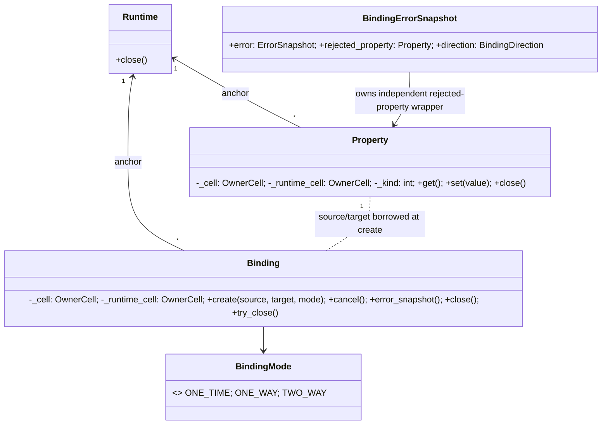

```mermaid
sequenceDiagram
    participant App as Python consumer
    participant B as Binding facade
    participant P as source/target Property owners
    participant R as Runtime owner
    participant ABI as C ABI / Core
    App->>B: Binding.create(source, target, mode)
    B->>R: Runtime lease + UI-thread check
    B->>P: acquire both Property leases
    B->>ABI: binding_create(source token, target token, mode)
    ABI-->>B: status / binding token / error token
    B-->>App: None for OneTime; Binding for OneWay/TwoWay
    App->>B: error_snapshot()
    B->>R: Runtime lease + UI-thread check
    B->>ABI: binding_error_snapshot(binding token)
    ABI-->>B: owned error / owned rejected Property / direction
    B->>B: freeze ErrorSnapshot; adopt Property token
    B-->>App: BindingErrorSnapshot or None
    App->>B: cancel() or close()
    B->>ABI: binding_cancel or handle_release (distinct effects)
```

### 1.7範囲外

`binding_subscribe_error`、Property `Subscription` facade、callback/root registry、通知購読、converter、Binding from/to non-Property UI control、Bindingの暗黙cancel、C ABI/Core変更は本改訂に含めない。エラー状態は明示的な`error_snapshot()` pollingで読む。callback購読はPython Subscriptionの所有・解除設計と同じ段階で別途提案する。OneTime/OneWay/TwoWayの値伝播、初期同期、遅延validation失敗、cancel後の保証は承認済みRQ-07と既存Binding ABI設計を変更しない。

## Python AsyncCommand公開API（1.8）

本節は承認済み[RQ-06](../../11_requirements/RQ-06_threading-dispatch.md)と[非同期Command設計](../events/commands.md)、[共通C ABI](../runtime-objects/abi.md)をPython wrapperへ写す。Command状態・operation ID・cancel/close・worker完了の意味は共通設計に委譲し、Core/C ABIを変更しない。1.8全文承認はPython公開仕様の採用であり、実装済みAPI・試験合格を意味しない。

### 公開型と操作案

| Python API | 責務案 |
|---|---|
| `CommandState(IntEnum)` | 共通C ABIの`IDLE/RUNNING/CANCELLING/SUCCEEDED/FAILED/CANCELLED`値を名前で提供する。state Property自体は既存の`Property[int]`で返し、未知の将来値を整数のまま保持する。 |
| `AsyncCommand.create(runtime, start, eligibility=None)` | 同一Runtimeに属するoptional BOOL PropertyとPython start callableを登録する。成功時は`AsyncCommand` owner、失敗時は`UiError`。`eligibility=None`はC ABIのnull eligibility tokenへ写す。 |
| `AsyncCommand.execute()` | UI threadで一回のoperationを受け付け、成功時に非zero operation IDを返す。受付前の拒否は`UiError`であり、業務処理の成功を表さない。 |
| `AsyncCommand.cancel(operation_id)` | 指定operationへの協調的cancel要求をUI threadで行う。要求の受付とworkerの`CANCELLED`報告を同一視しない。 |
| `state_property()` / `can_execute_property()` | C ABIが返す独立owned Property tokenを通常の`Property` ownerとして返す。setter制限とstate更新はCoreに委譲する。 |
| `failure_snapshot()` | 現在のimmutable `ErrorSnapshot`を取得し、snapshotがなければ`None`を返す。取得error tokenは読み取り後に解放する。 |
| `CommandOperation` | 一回のexecuteに対応するworker lease。`operation_id`、`is_cancel_requested()`、`report_success()`、`report_failure(domain, code, message)`、`report_cancelled()`、`post(callback, *args)`、`close()`を提供する。 |

`start(operation)`はC callback経由でUI thread上に呼ばれる短いPython callableであり、workerを起動・登録して戻る。wrapperはexecutor/thread poolを内蔵せず、アプリが選択するworker方式へ`CommandOperation`を渡す。開始callableが例外を送出した場合はtrampolineで`BaseException`をC境界から捕捉し、既存Runtime callback failure handlerへ`CommandStart`種別として報告して`UI_INTERNAL_ERROR`を返す。Coreが受付済みoperationをFAILEDとして確定し、`execute()`の受付成功自体は取り消さない。worker内例外をwrapper独自のdomain/codeへ自動変換せず、アプリが捕捉して`report_failure`を明示する。

`execute`、`cancel`、Property handle取得、failure snapshot取得、`close`は作成RuntimeのUI thread専用とし、Python側thread identityとC ABIのthread/status検査を併用する。`CommandOperation.is_cancel_requested`、終端report、`post`はworker threadから利用できる。`post(callback, *args)`はcallable/argsへのstrong referenceを保持したrootを作り、`runtime_post`でUI threadへ一度dispatchする。argsはdeep copyせず同じPython object参照を保持するため、呼出し側はdispatchまで不変・同期済みのデータだけを共有する。post受付成功時だけCoreへroot所有を移し、拒否時は呼出し側に所有を残す。callback例外はC ABIへ出さず、既存handlerの`Post`種別へ送る。これによりworkerからProperty setterを直接呼ばず、必要な進捗値を通常Propertyへ反映できる。専用progress API・Progress objectは追加しない。

### worker lease、終端report、所有

start trampolineはcallback中にCommand、cancel token、Runtimeのowned tokenをretainしてから`CommandOperation`を生成し、callableへ渡す。retain/owner準備が失敗した場合はworkerを起動せず、start callback失敗として返す。worker leaseはCommand ownerのclose/公開handle release/Runtime ownerのPython wrapper回収と独立して、workerが終了または明示closeするまで必要tokenとRuntime anchorを保持する。UI-affine Command操作をworker leaseから公開しない。

`report_success`、`report_failure`、`report_cancelled`はworker上でterminal payload/rootを用意し、`runtime_post`でUI threadへ送る。受理されたcallbackだけが対応するC ABI `command_complete_*`を一度呼び、現在のoperation IDに一度だけ終端結果を適用する。Python methodの成功はpost受付を意味し、Core上のstate変更完了はPropertyから観測する。post拒否時はterminal rootとpayloadの所有をworker側に残し、失敗statusを`UiError`に写して、同じ結果を再試行できる。受付成功後の二重reportはwrapperで拒否する。Runtime shutdown後にpostが拒否/破棄されても終端結果をUI上で観測できる保証は追加しない。

`report_failure`はbuilt-in `int`でuint32範囲のdomain/codeとbuilt-in `str` messageを受け、messageをstrict UTF-8へ変換する。C ABIが借用するbytesはnative call中保持する。成功したfailure reportはCoreがerrorをcopyし、`failure_snapshot()`は独立error tokenから不変Python `ErrorSnapshot`を作る。次operation開始後にCoreが現在failureを消しても取得済snapshotは変化しない。

`AsyncCommand.close()`はUI threadで`command_close`を行って新規executeを止め、現在workerへ協調cancelを要求した後に公開Command tokenをreleaseする。`close`はworker終了を待たない。native close失敗ではowner tokenを維持し再試行する。close成功後にreleaseだけが失敗した場合はclosed状態とtokenを保持し、再試行時にclose semanticsを再適用してからtoken解放を完了する。単なる`handle_release`、`CommandOperation.close()`、finalizerは`command_close`やcancelの代替にならない。公開handle release/finalizerだけではCore登録とstart rootを解除せず、明示closeまたはRuntime shutdownまで登録を維持する。Callback rootはcreate成功時だけCoreへ移し、C destroyとin-flight start callbackの完了後に一度だけsafe-point queueへ回収を委譲する。

### クラス関係と主要flow

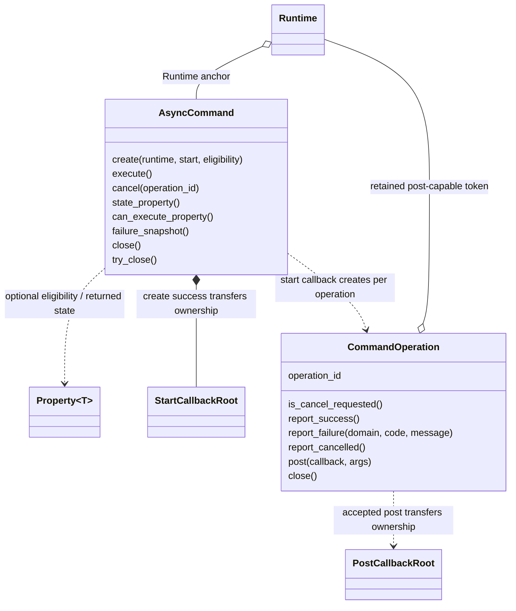

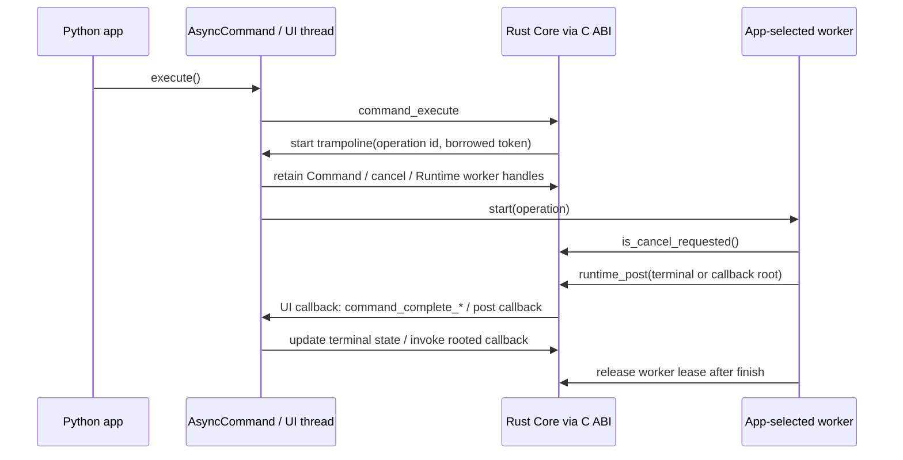

### 1.8範囲外・確認待ち

Core/C ABIの変更、内蔵executor/thread pool、`asyncio` Task統合、専用progress値/Property、worker例外からdomain/codeを自動生成するpolicy、Property/Binding/Control以外のMVVM facade、Command completion callback/Subscriptionは含めない。`post(callback, *args)`をAsyncCommandOperationの最小UI dispatch surfaceに限定し、callback例外を既存Runtime handlerの`Post`種別へ分類する。

## Python UI Controls / Tree / Focus公開API（1.10改訂案）

本改訂は承認済みRQ-09とUI Controls/Tree/Focus DDをPython facadeへ写す。Core/C ABI変更、Window peer open/close・close-request、OS rendering/input、TextBox editing/selection/caret APIは含めない。WindowはCore Controlとして生成しcontent/titleを扱えるが、現在のC ABI `window_open` は`UI_UNSUPPORTED`であり、このunitで表示可能とは扱わない。Focus要求は既存C ABIへ委譲し、active Windowに属する有効Controlでない等の拒否を`UiError`として伝える。

要求根拠: [RQ-09-001](../../11_requirements/RQ-09_ui-scope.md#rq-09-001)、[RQ-09-002](../../11_requirements/RQ-09_ui-scope.md#rq-09-002)、[RQ-09-003](../../11_requirements/RQ-09_ui-scope.md#rq-09-003)、[RQ-09-004](../../11_requirements/RQ-09_ui-scope.md#rq-09-004)、[RQ-09-005](../../11_requirements/RQ-09_ui-scope.md#rq-09-005)、[RQ-09-006](../../11_requirements/RQ-09_ui-scope.md#rq-09-006)、[RQ-09-007](../../11_requirements/RQ-09_ui-scope.md#rq-09-007)、[RQ-09-009](../../11_requirements/RQ-09_ui-scope.md#rq-09-009)、[RQ-09-043](../../11_requirements/RQ-09_ui-scope.md#rq-09-043)、[RQ-09-044](../../11_requirements/RQ-09_ui-scope.md#rq-09-044)、[RQ-09-045](../../11_requirements/RQ-09_ui-scope.md#rq-09-045)、[RQ-09-046](../../11_requirements/RQ-09_ui-scope.md#rq-09-046)、[RQ-09-047](../../11_requirements/RQ-09_ui-scope.md#rq-09-047)、[RQ-09-048](../../11_requirements/RQ-09_ui-scope.md#rq-09-048)、[RQ-09-049](../../11_requirements/RQ-09_ui-scope.md#rq-09-049)、[RQ-09-059](../../11_requirements/RQ-09_ui-scope.md#rq-09-059)、[RQ-09-067](../../11_requirements/RQ-09_ui-scope.md#rq-09-067)、[RQ-09-070](../../11_requirements/RQ-09_ui-scope.md#rq-09-070)。

### 公開型と操作案

| 型 | 生成・操作 | C ABI対応 | 所有・thread |
| --- | --- | --- | --- |
| `Widget` | 共通抽象view。`is_enabled`、`accessible_name`はBOOL/UTF-8 `Property`を返す。`request_focus()`を提供 | `widget_is_enabled_property`、`widget_accessible_name_property`、`widget_request_focus` | 各Widgetは一owned tokenとRuntime anchorを持つ。Propertyごとに独立owned token。操作はRuntime UI thread専用 |
| `Container` | 複数子Treeを持つ抽象facade。`child_count`、`child_at(index)`、`insert(child, index)`、`remove(child)`、`move(from_index, to_index)` | `container_child_count/child_at/insert/remove/move` | 現行C ABIの複数子操作はStackPanel向け。child getterは独立owned tokenを返し、親子操作でPython ownerのtokenは消費しない |
| `Window` | `Widget`の具象facade。`create(runtime)`、`content` getter、`set_content(widget)`、`clear_content()`、`title` Property | `window_create/content/set_content/clear_content/title_property` | Windowは単一content APIであり複数子Container APIを継承しない。空contentは`None`。open/close/close-requestは別のWindow unit |
| `StackPanel` | `create(runtime)`、`orientation` getter/setter、`set_child_align(child, alignment)`とContainer操作 | `stack_panel_create/orientation/set_orientation/set_child_align` | `Orientation.VERTICAL/HORIZONTAL`、`Alignment.START/CENTER/END/STRETCH`をABI定数へ写像 |
| `Text` | `create(runtime, content="")`、`content` UTF-8 Property | `text_create`、`text_content_property` | Propertyの既存型検査・所有規則に従う |
| `TextBox` | `create(runtime, value="")`、`value` UTF-8 Property | `text_box_create`、`text_box_value_property` | selection/caret/editing snapshot/IMEはABI入口がないため本改訂では公開しない |
| `Button` | `create(runtime, label="")`、`label` UTF-8 Property、`set_command(command_or_none)`、`command` getter | `button_create/label_property/set_command/command` | `AsyncCommand`または`None`のみ。同Runtime確認をnative call前に行う。getterは独立owned tokenからAsyncCommandを構成 |

具象型constructorは隠し、`create`が既存Runtime/Property/AsyncCommandと同じcleanup ticket・owner cell・Runtime anchor規則でownerを構築する。`Widget`/`Container`は直接生成しない。`close()`は当該wrapper tokenだけをreleaseし、Runtime shutdownやButton Command closeを代行しない。失敗時はtoken/ticket/anchorを保持し再試行可能とする。

### C ABI mapping・型判定・エラー境界

現行ABIにはWidget concrete kind queryがない。このため`Window.content`と`Container.child_at()`は型固有操作を持たない共通`Widget` viewを返し、Text等へ推測castしない。型固有Property/Commandを利用するアプリは作成時の具象ownerを保持する。Tree snapshotから型付きfacadeを再構成する機能はABI kind queryなしに実装しない。Core要求上Windowは子を一つ持つContainer分類だが、Python class inheritanceは操作可能なC ABI surfaceを誤認させないようWindowを`Widget`として、StackPanelを複数子`Container`として表す。Windowのsingle-content操作は同じTree ownership contractの専用APIで行い、複数子用`container_*`に偽装しない。

入力ownerは同Runtime cellであることを検査後、borrowed tokenとして渡す。`set_command(None)`だけがゼロhandleを渡す。out-owned tokenが異常なstatus/zeroの組合せで返った場合、既存ownerと同じunexpected-token cleanupを行う。status/error変換とUI thread検査は共通helperを使う。

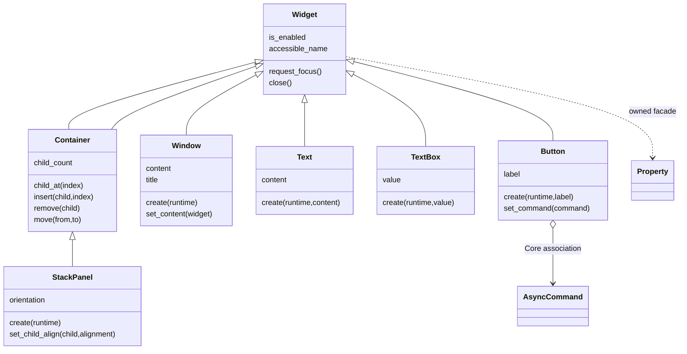

### 主要call flowと制約

作成はRuntime UI thread確認→cleanup ticket/Runtime anchor準備→C ABI create→owned token検査→typed wrapper構築の順。Tree変更はRuntime同一性・facade種別・indexを検査後borrowed handleでABIを一度呼ぶ。content/child getterはC ABIのowned tokenを共通Widget viewへ移し、zero tokenは`None`とする。Button Command setterはAsyncCommandをcall期間pinし、native成功後にCore associationを更新する。

`request_focus()`はwrapper独自Focus状態を持たずABIへ委譲する。Attached・active Window・focusable・enabled条件等を満たさない要求はABIの拒否を`UiError`で表す。Tab traversal/keybindingは提供しない。layout・表示・hit-testはCore/Platform所管でありPython側で計算しない。

### 1.9範囲外・実装前提

Window peer open/close・close-request、成功するFocus遷移のPlatform統合確認、TextBox editing/selection/caret/IME、Widget concrete kind query、visibility、直接Click callback、keybinding、rendering、OS peer、Core/C ABI変更は含めない。fake ABI試験では入力検査・owner cleanup・status mappingを検査し、real C ABI consumerではControl creation/property/tree/StackPanel/Button associationを確認する。Platform実装なしにFocus成功を証明したと扱わない。

## Python Window peer / close-request公開API（2.0）

本改訂は承認済みRQ-09-071と既存Window/close-request C ABIをPython facadeへ写す提案である。Core/Rust/C ABI、Platform peer、OS close intentの生成機構は変更しない。現在のhost C ABIでは`window_open()`が`UI_UNSUPPORTED`となり、公開C ABIにもOS close intentを発生させるAPIがないため、実画面表示やclose callbackの実発火を実装済み・consumer確認済みとは扱わない。

要求根拠: [RQ-03-004](../../11_requirements/RQ-03_language-support.md#rq-03-004)、[RQ-05-002](../../11_requirements/RQ-05_ownership-callbacks.md#rq-05-002)、[RQ-05-006](../../11_requirements/RQ-05_ownership-callbacks.md#rq-05-006)、[RQ-05-007](../../11_requirements/RQ-05_ownership-callbacks.md#rq-05-007)、[RQ-05-008](../../11_requirements/RQ-05_ownership-callbacks.md#rq-05-008)、[RQ-05-009](../../11_requirements/RQ-05_ownership-callbacks.md#rq-05-009)、[RQ-05-012](../../11_requirements/RQ-05_ownership-callbacks.md#rq-05-012)、[RQ-06-001](../../11_requirements/RQ-06_threading-dispatch.md#rq-06-001)、[RQ-09-001](../../11_requirements/RQ-09_ui-scope.md#rq-09-001)、[RQ-09-003](../../11_requirements/RQ-09_ui-scope.md#rq-09-003)、[RQ-09-071](../../11_requirements/RQ-09_ui-scope.md#rq-09-071)。上位根拠: [共通C ABI Window peer / close request](../runtime-objects/abi.md)、[UI Controls](../ui/controls.md)、[Python wrapper DD](python.md)。

### 公開型・操作案

| 型 | 操作 | C ABI対応 | 所有・thread |
| --- | --- | --- | --- |
| `Window` | `open()`、`close_peer()`、`on_close_request(callback)` | `window_open/close`、`window_close_request_subscribe` | UI thread。`open/close_peer`はOS peerだけを操作し、Core stateとowned Window tokenを保持。継承済み`close()`はWindow token releaseのまま |
| `WindowCloseSubscription` | `cancel()`、`close()`、context manager | 共通`subscription_cancel`とowned Subscription tokenのrelease | cancelとtoken releaseを分離。成功登録がcallback rootを所有し、明示終了・finalizer cleanupは既存owner cleanup規則へ接続 |
| `CloseRequest` | callback引数。`accept()`、`decline()`、`defer()` | `window_close_request_resolve/defer` | callback中だけ有効なborrowed view。`defer()`成功でowned `DeferredCloseRequest`へ移し、元viewは無効化 |
| `DeferredCloseRequest` | `accept()`、`decline()`、`close()` | owned deferred requestのresolveと通常handle release | resolveはtokenを消費しない。未解決のままownerをclose/破棄した場合はCore ABI契約どおりDecline |

close subscriberはWindowごとに同時一つとし、重複登録は既存C ABI statusを例外へ写して拒否する。callbackが判断せず戻った場合とcallback例外が起きた場合は、例外を既存`_report_callback_exception`へ報告してtrampolineから漏らさず、判断未実施としてABI既定Acceptに任せる。これは要求の既定動作を変えない。`accept/decline`はcallback内で同期resolveし、`defer`だけが後刻resolveするためのowned tokenを作る。deferred request resolveではgeneration/stale statusをそのまま例外へ写す。

`Window.open()`と`Window.close_peer()`は`_ui_call()`と同じRuntime/UI-thread/owner lease/error mappingを使う。`close_peer()`の失敗はWindow ownerを維持し再試行可能とし、成功してもWindow・content・Propertyを解放しない。`Window.close()`およびcontext manager exitはpeer closeを暗黙に呼ばず、owned Control tokenの既存release semanticsを維持する。

callback登録はclosure、CFUNCTYPE trampoline、Runtime/Window anchorを一つのprivate root recordへ束ねる。native登録が成功した場合のみrootをABI destroyへ移管し、失敗時はPython側が回収する。destroy callbackはrootを一度だけsafe-point cleanupへ移し、Python user codeのdropをC destroy stackで行わない。cancelは以降のcallback entryを止めるが、in-flight callback/rootの破棄完了と同義ではない。Subscription token releaseはcancelを代行しない。callback trampolineとexception reporterは既存共通規則に従いPython例外をC境界へ出さない。

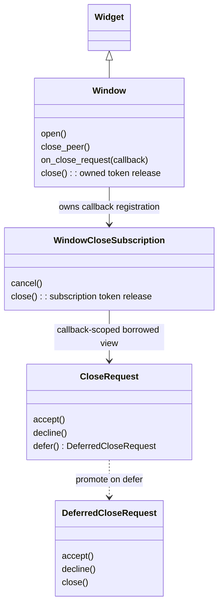

### 2.0範囲外・実装前提

複数subscriber/decision aggregation、Core/C ABI変更、OS Window peer、close intent injection API、rendering/input、Runtime shutdown vetoは含めない。fake ABI試験でcallback invocation/lifecycleを制御し、実C ABI consumerはsubscription register/cancelと`window_open()`の現行status伝達までを確認する。public C ABIにintent triggerがないことを理由にclose decision machineをconsumerが検証したとは主張しない。

## Window background RGB wrapper API（2.1）

Pythonは`Window.background_rgb`を3つのnormalized floatのtupleとして公開する。getterはeffective RGBを返し、assignmentはC ABI setterへ転送する。`Window.reset_background_rgb()`は規定値へ戻す。未指定時はgetterもopaque white `(1.0, 1.0, 1.0)`を返す。wrapperはWindow stateを別途cacheせず、既存status/errorを既存Python error mappingへ変換する。

```python
background: tuple[float, float, float] = window.background_rgb
window.background_rgb = (0.2, 0.4, 0.8)
window.reset_background_rgb()
```

## 文書の承認・改訂履歴

| 日付 | 対象版 | 内容・根拠 |
| --- | --- | --- |
| 2026-10-17 | 1.0 | 利用者の指示に基づき、既承認内容を責務別に再編集。設計項目IDによる承認・追跡は廃止し、以後は文書版全体で管理する。構成変更を新規の製品仕様採用としない |
| 2026-10-17 | 1.0全文 | 利用者の「全部承認します」により文書全体を承認。旧IDによる項目承認ではなく、現行文書版を対象とする。実装・試験合格を意味しない |
| 2026-10-17 | 1.1改訂案 | 利用者の補足指示によりクラス責務・所有・メソッド・関連図を追加。1.0承認を維持し、1.1全文は確認待ち |
| 2026-10-17 | 1.1全文 | 利用者の「OK,テスト文書作りましょうか」により、クラス設計補足と選択的な図の補強を含む全文を承認。既存履歴を維持し、実装・試験状態は別管理 |
| 2026-10-25 | 1.2改訂案 | Python Runtime facadeの公開型/API、error・ownership境界、shutdown/close分離を提案 |
| 2026-10-25 | 1.2全文 | 利用者の「ok」により、Runtime公開APIとshutdown/close・ownership境界、異Runtime context検査を後続UI APIへ送る範囲変更を含む全文を承認。実装・試験合格を意味しない |
| 2026-10-25 | 1.3改訂案 | Python BOOL/I64 Property facadeの公開API、型mapping、owner/call lease、ABI failure境界を文書全体の改訂案として追加 |
| 2026-10-25 | 1.3全文 | 利用者の「ok」によりBOOL/I64 Property API、型変換・例外・ownership・call flowを含む文書全体を承認。実装・試験合格は別管理 |
| 2026-10-25 | 1.4改訂案 | Python UTF-8 Property API、strict str/byte mapping、getter buffer retry、invalid sequenceの失敗案を追加。文書全体レビュー待ち |
| 2026-10-25 | 1.4全文 | 利用者の「ok」によりUTF-8 Property API、strict conversion、buffer retry、failure mappingを含む文書全体を承認。試験設計・実装・試験合格は別管理 |
| 2026-10-25 | 1.5改訂案 | Python built-in `float`からF64 C ABIへ直接写すAPI、型境界、RQ-02-018のCore委譲、error/ownership flowを追加。文書全体レビュー待ち |
| 2026-10-25 | 1.5全文 | 利用者の「ok」によりF64 Property API・型境界・Core委譲・error/ownership flowを含む文書全体を承認。実装・試験結果は別管理 |
| 2026-10-25 | 1.5全文 | 利用者の「ok」によりPython F64 Property API、型境界、RQ-02-018のCore委譲、error/ownership flowを含む全文を承認。試験設計・実装・試験合格は別管理 |
| 2026-10-25 | 1.6全文 | 利用者の「ok」によりPython `decimal.Decimal`からDECIMAL C ABIへの厳密bits mapping、scale/係数範囲変換、error/ownership flowを含む全文を承認。実装・試験設計・試験合格は別管理 |
| 2026-10-26 | 1.7改訂案 | Python Binding mode/create result、owner/releaseとcancelの分離、遅延error snapshot pollingと所有、ABI異常出力処理を追加。文書全体レビュー待ち。Subscription callbackと実装・試験設計は対象外 |
| 2026-10-26 | 1.7全文 | 利用者の「ok」により、Binding公開型/API、OneTime結果、owner/releaseとcancelの分離、error snapshot polling/所有、ABI失敗境界を含む文書全体を承認。実装・試験設計・試験合格は別管理 |
| 2026-10-26 | 1.8改訂案 | Python AsyncCommand/CommandOperationの公開API、worker lease、runtime_post、callback root、例外・close境界を提案。文書全体レビュー待ち |
| 2026-10-26 | 1.8全文 | 利用者の「ok」によりAsyncCommand/CommandOperationの公開API、worker lease、post/終端報告、callback root、例外・close境界を含む文書全体を承認。試験設計・実装開始は別承認 |
| 2026-10-26 | 1.9改訂案 | 承認済みRQ-09とUI DD・現行C ABIに基づくPython Controls/Tree/Focus facade案を追加。Window peerとTextBox edit API等の未提供ABI範囲を明示。文書全体レビュー待ち |
| 2026-10-26 | 1.9全文 | 利用者の「ok」によりPython UI Controls/Tree/Focus facade案と未提供ABI範囲を含む文書全体を承認。試験設計・実装・試験合格は別管理 |
| 2026-10-26 | 1.10改訂案 | 現行C ABIの複数子`container_*`操作がStackPanel向けでWindowは単一content APIである点に合わせ、Python facadeのContainer inheritanceを修正。文書全体レビュー待ち |
| 2026-10-26 | 1.10全文 | 利用者の「ok」によりWindowをWidget facade、StackPanelを複数子Container facadeとするPython mappingを含む文書全体を承認。RQ上のContainer分類とWindowのsingle-content意味は維持。試験・実装結果は別管理 |
| 2026-10-26 | 2.0改訂案 | 承認済みRQ-09-071と既存C ABIに基づくWindow peer open/close、close-request callback/defer/resolve facadeとowner lifecycleを追加提案。実C ABIにOS intent triggerがない制約を明記 |
| 2026-10-26 | 2.0全文 | 利用者の「ok」によりWindow peerとclose-request facade、handle/peer close分離、callback/deferred owner lifecycleを含む全文を承認。実装・試験結果は別管理 |
| 2026-10-31 | 2.1改訂案 | RQ-09-074のWindow background RGB tuple APIを統合。文書全体レビュー待ち |
| 2026-10-31 | 2.1全文 | 利用者の「ok」により、Window background RGB tuple APIとCore/C ABIへの委譲、既存error mappingを含む文書全体を承認。実装・試験結果は別管理 |
