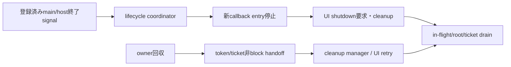
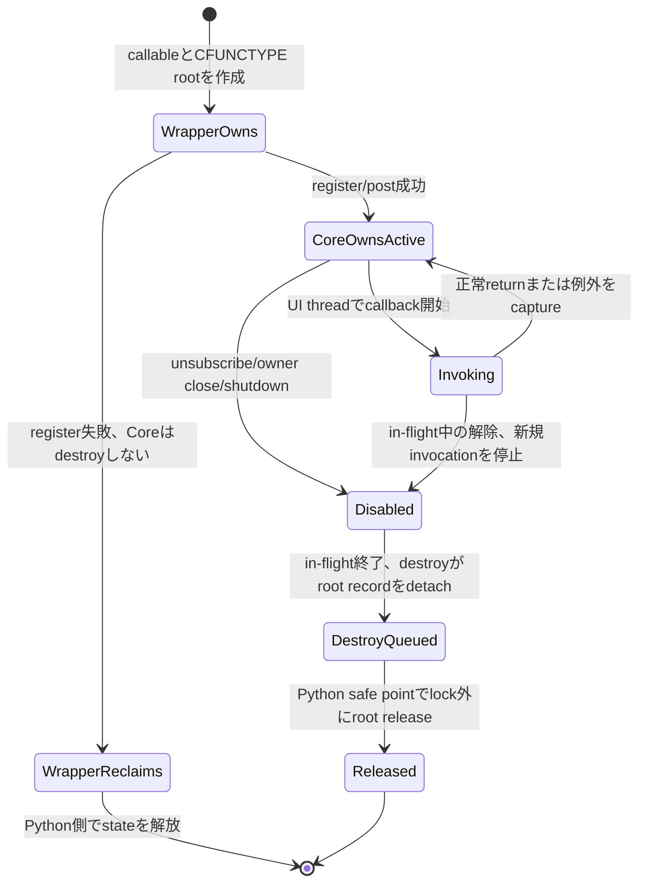
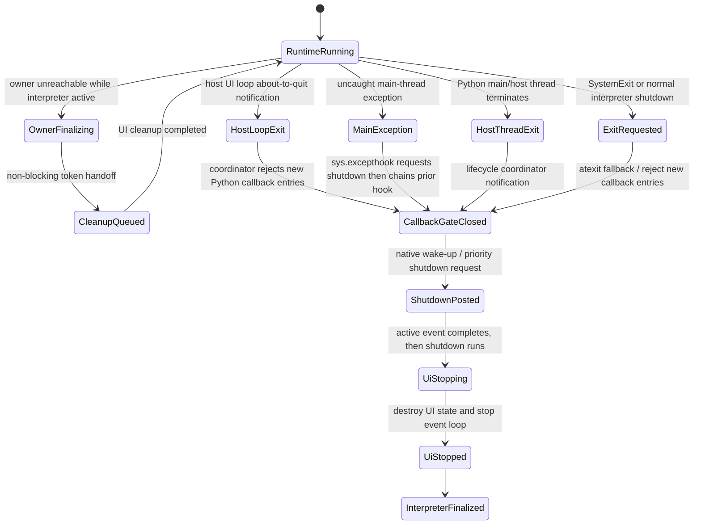
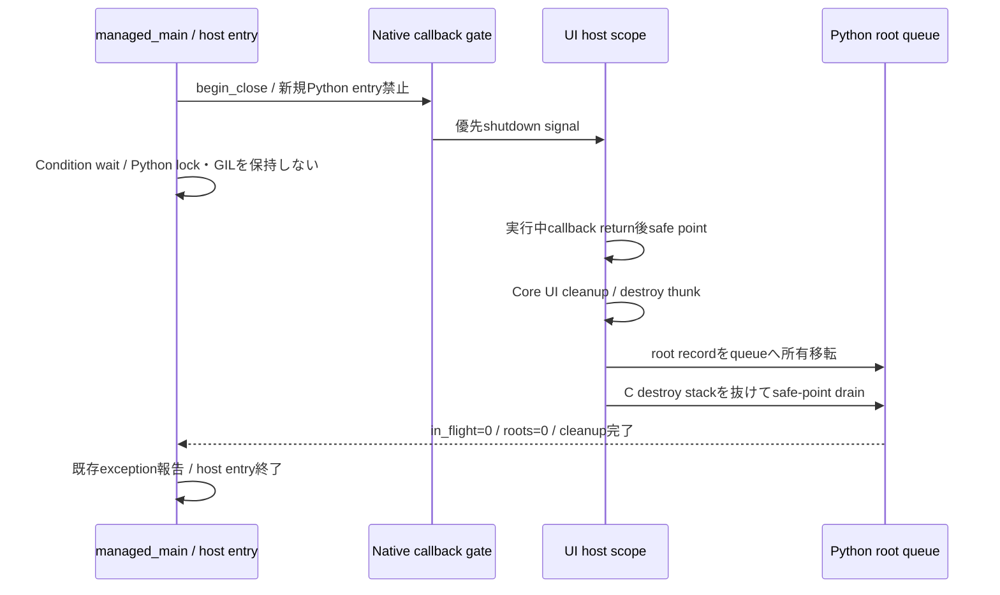
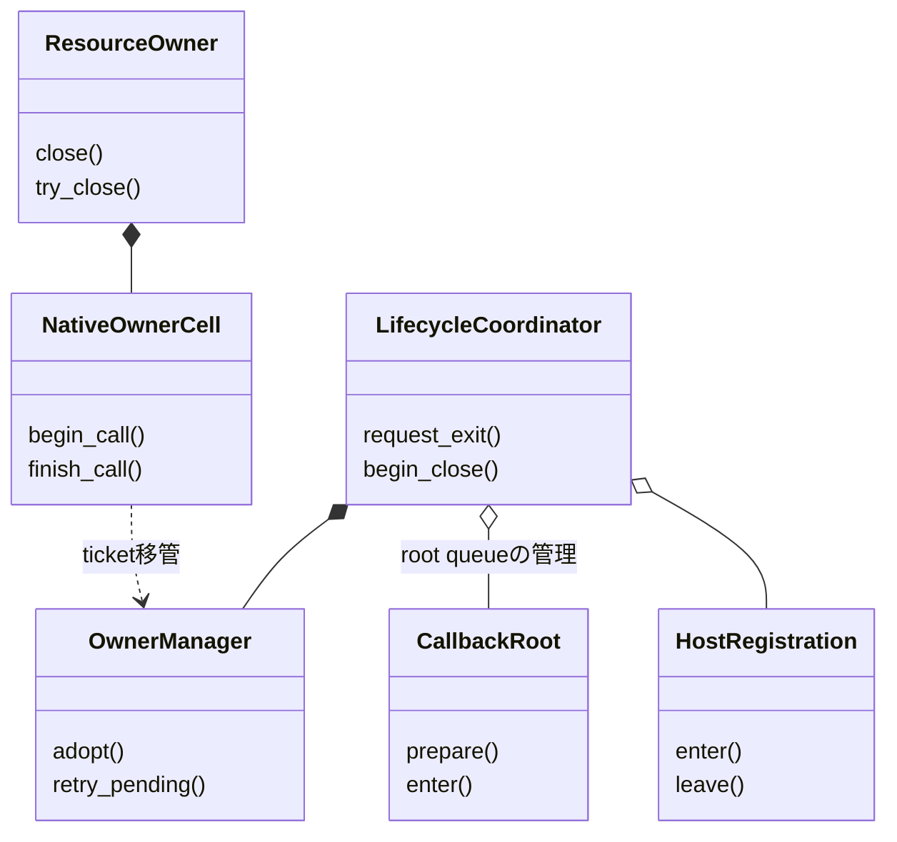

# 言語ラッパー：Python

- 文書版: 1.2
- 文書ロール: detailed-design
- 更新日: 2026-10-30
- 状態: 1.1全文承認済み（利用者、2026-10-17）。1.2全文承認済み（利用者、2026-10-30）。実装・試験状態は別管理

## 目的と上位根拠

本書を要求から実装へ具体化する詳細設計の正本とする。型・API・所有・呼出し手順・状態遷移を実装へ反映する。要求の外部保証はリンク先RQ、層の責務と主要flowは上位BDを根拠とする。設計宣言の記載は、配布済みheader・実装済みAPI・試験合格を意味しない。

基本設計: [オブジェクト管理：値・モデル・更新整合性](../../12_design/runtime-objects/model-values.md)、[言語ラッパー：共通facade・所有変換・解析](../../12_design/wrappers/language-wrappers.md)、[ビルド環境：toolchain・検証・support](../../12_design/build/toolchain-support.md)、[ビルド・配布：package・artifact・信頼境界](../../12_design/build/packages-artifacts.md)、[ランタイム：実行context・所有・終了](../../12_design/runtime-objects/runtime.md)

## 要求と設計項目の対応

| 設計項目 | 要求根拠 |
| --- | --- |
| 所有参照・callback root・通常終了 | [RQ-02-013](../../11_requirements/RQ-02_core-features.md#rq-02-013)、[RQ-03-004](../../11_requirements/RQ-03_language-support.md#rq-03-004)、[RQ-03-008](../../11_requirements/RQ-03_language-support.md#rq-03-008)、[RQ-03-009](../../11_requirements/RQ-03_language-support.md#rq-03-009)、[RQ-03-010](../../11_requirements/RQ-03_language-support.md#rq-03-010)、[RQ-03-011](../../11_requirements/RQ-03_language-support.md#rq-03-011)、[RQ-03-012](../../11_requirements/RQ-03_language-support.md#rq-03-012)、[RQ-04-006](../../11_requirements/RQ-04_abi-boundary.md#rq-04-006)、[RQ-04-007](../../11_requirements/RQ-04_abi-boundary.md#rq-04-007)、[RQ-04-017](../../11_requirements/RQ-04_abi-boundary.md#rq-04-017)、[RQ-04-022](../../11_requirements/RQ-04_abi-boundary.md#rq-04-022)、[RQ-04-023](../../11_requirements/RQ-04_abi-boundary.md#rq-04-023)、[RQ-05-003](../../11_requirements/RQ-05_ownership-callbacks.md#rq-05-003)、[RQ-05-009](../../11_requirements/RQ-05_ownership-callbacks.md#rq-05-009)、[RQ-05-012](../../11_requirements/RQ-05_ownership-callbacks.md#rq-05-012)、[RQ-06-002](../../11_requirements/RQ-06_threading-dispatch.md#rq-06-002)、[RQ-06-003](../../11_requirements/RQ-06_threading-dispatch.md#rq-06-003)、[RQ-06-005](../../11_requirements/RQ-06_threading-dispatch.md#rq-06-005)、[RQ-06-006](../../11_requirements/RQ-06_threading-dispatch.md#rq-06-006)、[RQ-07-008](../../11_requirements/RQ-07_binding.md#rq-07-008)、[RQ-07-013](../../11_requirements/RQ-07_binding.md#rq-07-013)、[RQ-07-014](../../11_requirements/RQ-07_binding.md#rq-07-014)、[RQ-12-007](../../11_requirements/RQ-12_build-distribution.md#rq-12-007) |
| 公開API・cleanup・handler寿命 | [RQ-03-004](../../11_requirements/RQ-03_language-support.md#rq-03-004)、[RQ-03-008](../../11_requirements/RQ-03_language-support.md#rq-03-008)、[RQ-03-009](../../11_requirements/RQ-03_language-support.md#rq-03-009)、[RQ-03-010](../../11_requirements/RQ-03_language-support.md#rq-03-010)、[RQ-03-014](../../11_requirements/RQ-03_language-support.md#rq-03-014)、[RQ-03-015](../../11_requirements/RQ-03_language-support.md#rq-03-015)、[RQ-03-016](../../11_requirements/RQ-03_language-support.md#rq-03-016)、[RQ-05-012](../../11_requirements/RQ-05_ownership-callbacks.md#rq-05-012)、[RQ-05-014](../../11_requirements/RQ-05_ownership-callbacks.md#rq-05-014)、[RQ-06-003](../../11_requirements/RQ-06_threading-dispatch.md#rq-06-003) |

本書内の共通規則は上記の各要求を実現するために適用する。同一項目内で個別要求を参照する場合はその対象範囲を優先する。将来候補・未採用範囲は採用済みの動作と区別する。

## 所有参照・callback root・通常終了

### 実現のcall/data/ownership flow

Python ownerのtoken/ticket状態とroot registryは明示lockで遷移させ、native callや利用者callback中はlockを保持しない。owner finalizerはmanagerへ短い非block handoffを行う。C destroyはroot recordをsafe-point release queueへ渡し、Python値の最終dropをC destroy stackから分離する。lifecycle coordinatorは明示終了・登録済みmain/host境界・loop終了通知等を集約し、新callback entry停止→UI wake/cleanup→root drainへ進める。



### 責務と境界

| 層 | Python wrapperの責務案 | この文書で決めないこと |
|---|---|---|
| ctypes ABI adapter | versioned C ABI functionを固定幅prototypeで宣言し、status/outputを検査する | 全symbol生成方式、prototype generator、header parity tool |
| Python object wrapper | opaque tokenの所有・Runtime関連・close・callback rootingを管理する | 最終公開型/API名、package名、Python version |
| Runtime/Core | handle、UI thread、callback、dispatcher、shutdownの意味論を所有する | Core契約やC ABIの変更 |
| distribution | MVVM UIライブラリ Python package/native distributionのpure-Python wrapperとnative runtime別配布を前提にする | index、wheel tag、loader、target matrix（ビルド・配布：toolchain・profile・package） |

ctypes declarationをアプリへ露出しないことは、Python wrapperがC ABIを別の意味へ変換してよいことを意味しない。公開ABI契約とオブジェクト管理：handle・値・errorの固定幅、handle、status/error、byte lengthを正確に写す。

### 実装規則

| 実装規則 | 根拠・境界 |
| --- | --- |
| 初期Python wrapperはMVVM UIライブラリ Python wrapper方式に関する上位判断案どおり標準`ctypes`からversioned C ABIを動的ロードし、compiled Python extension/cffiへ置き換えない。raw ctypes objectをアプリ公開APIにしない。 | MVVM UIライブラリ Python wrapper方式に関する上位判断案、ADR-0001。loader・package配置はMVVM UIライブラリ Python package/native distribution/ビルド・配布：toolchain・profile・package。 |
| ctypes functionごとに`argtypes`と`restype`を明示し、ABI fixed-width scalarに一致する`ctypes`型を使う。`c_long`、暗黙のC `int` return、`c_size_t`をABI固定幅型の代わりに使わない。 | 公開ABI契約、共通ABI、値・error境界。具体宣言はABI headerのsource of truthに照合する。 |
| Python owner objectはopaque token整数を内部に保持し、`int`/native pointerへの暗黙変換を提供しない。Python objectはCore Propertyの値の正本やC ABI userdata pointerそのものにしない。 | 言語境界契約/言語境界契約、handle登録・検証、C++ wrapper、C# wrapper、Rust wrapper。 |
| owned handle objectは一tokenだけを所有し、複製は明示retain操作に限る。borrowed handle/引数は一回のwrapper呼出し中だけ利用し、retainしない。wrapper objectのPython reference増加とC ABI token retainを混同しない。 | handle登録・検証、Runtime所有と終了、C++ wrapper、Rust wrapper。 |
| UI-affine ownerには明示`close()`相当と`with` context-manager利用を用意し、close成功後にだけtokenをemptyにする。失敗時はownerがtoken/ticket/Runtime anchorを保持し、再試行できる。closeは冪等にできるが、二度目のcloseで新たなreleaseを発行しない。 | 言語境界契約、Runtime所有と終了、C++ wrapper、C# wrapper、Rust wrapper。名前・例外型はAPI設計章へ送る。 |
| Python ownerが回収されるときは、`__del__`または同等のfinalizerから所有tokenのcleanup要求を必ず引き渡す設計を候補とする。finalizerは事前確保ticket/token/Runtime anchorを非同期・非blockでcleanup managerへ移すだけとし、GC/finalizer threadからUI-affine native releaseを直接呼ばない。明示`close()`とcontext managerは早く確実な解放経路として併用する。 | 言語境界契約、Runtime所有と終了、C++ wrapper、C# wrapper、Rust wrapper。Pythonは回収時期やinterpreter終了時の全object finalizationを保証しないため、Runtime全体の終了経路はPython wrapperで別に扱う。 |
| cleanup ticket確保ができないときはRuntime/object create、retain、owned out-tokenを返すnative callを始めない。release failure時はtokenを捨てず、事前確保ticketでpending registryへ移してUI safe pointでretryする。成功後はticket、Runtime anchorの順で解放する。 | Runtime所有と終了、値・error境界、C++ wrapper、C# wrapper、Rust wrapper。 具体化は言語ラッパー：Python、[言語ラッパー：callback解析・lint・MCP](analyzer.md)、[ビルド・配布：toolchain・profile・package](../build/toolchain-packages.md)、[共通C ABI：宣言・検査・互換性](../runtime-objects/abi.md)を参照する。 |
| Coreがclosureを所有する期間、wrapperはPython callable、callback state、`ctypes` callback objectを強参照する。callback registration/post成功時にだけCoreへ所有権を移し、失敗時はwrapperが回収する。CFUNCTYPE callback objectへの参照を落としてGCに任せない。 | MVVM UIライブラリ Python wrapper方式に関する上位判断案、Runtime契約/言語境界契約、callback実行規則、C++ wrapper、C# wrapper、Rust wrapper。 |
| callback trampolineはsignature/calling conventionごとにABIと一致させる。userdataはprivate root registryへ結び、Python objectの生アドレスをCoreがdereferenceする前提を置かない。destroyでは新規callbackを無効化し、root recordを一度だけ切り離す。 | 公開ABI契約、callback実行規則、MVVM UIライブラリ Python wrapper方式に関する上位判断案。userdata key/cellの具体表現は実装検証と後続API設計へ送る。 |
| destroy thunk内でPython callable/stateの最後のreferenceをregistry lock中にdropしない。root recordはC destroy stackからsafe-point release queueへ移し、任意のPython finalizerがlock内・Core destroy呼出し中に起動する可能性を避ける。destroy thunk自体はUI APIを呼ばない。 | Runtime契約、callback実行規則、C++ wrapper、C# wrapper。Python `__del__`等の任意コードは参照数減少時に動き得る。safe point接続はプラットフォーム：抽象化と共通protocolとの整合が必要。 |
| `ctypes` callback trampoline内でPython callback由来の例外をC ABI境界へ伝播させない。`Exception`/`BaseException`の捕捉範囲を明示し、callback種別に沿って診断/失敗処理へ渡す。`KeyboardInterrupt`/`SystemExit`もC callbackからPython callerへそのままunwindできない。 | Runtime契約、callback実行規則、MVVM UIライブラリ Python wrapper方式に関する上位判断案。 具体化は言語ラッパー：Python、[言語ラッパー：callback解析・lint・MCP](analyzer.md)、[ビルド・配布：toolchain・profile・package](../build/toolchain-packages.md)、[共通C ABI：宣言・検査・互換性](../runtime-objects/abi.md)を参照する。 |
| callback例外情報を受ける利用者差し替えhandlerを設けられる設計とする。handler自身のPython例外もABI外へ出さず、callback ownerのfailure意味論や通知順を変更しない。handler登録scope・既定動作・handler失敗の報告先は後続API設計へ送る。 | C++ wrapper、C# wrapper、callback実行規則。全言語共通APIをこのDDで定義しない。 |
| worker threadから変更を許すPython wrapper state（owner状態、token/ticket所有移転、callback/Runtime registry等）は、GILの有無にかかわらず明示lockで保護する。workerから変更させないstateはread-only viewまたは値snapshotとして渡し、UI-affine stateの変更はUI threadへdispatchする。 | Python free-threading official docs、Runtime契約、UI dispatcher。GILはPython code実行の実装/性能特性であり、本判断は全objectを自由なthreadから変更可能にする意図ではない。 |
| wrapperはRuntime作成時のPython UI thread identityを記録し、UI-only operationを呼ぶ前にPython thread identityを検査する。Coreの`runtime_is_ui_thread`/wrong-thread statusも最終防御として残し、GIL取得だけで正しいthreadとみなさない。 | Runtime契約、言語境界契約、UI dispatcher、C++ wrapper、C# wrapper、Rust wrapper。foreign-created callback threadでは`threading.local`がcallback間で保たれると仮定しない。 |
| workerからCore UI stateを直接変更せず、コピー済み値とPython callableをdispatcherへpostする。post成功後はCoreがcallback stateを所有し、失敗時はPython callerがstrong referencesを保持/解放する。非同期shutdownは完了を待たず、worker同期shutdownはUI loop稼働時にnative契約どおり完了を待つ。 | 言語境界契約/言語境界契約、UI dispatcher、callback実行規則、Runtime shutdownのcallback中dispatchに関する上位判断、C++ wrapper、C# wrapper、Rust wrapper。 |
| `ui_status`を一次判定にし、Error snapshotを保持するPython exception/resultへ写す。unknown status/domain/codeのraw値を失わず、message文面で分岐しない。MVVM UIライブラリ Python lint/type check とMCP連携に関する上位判断案のtype stubはPython wrapper surfaceを解析可能にするが、checker/MCP実装判断を本書に含めない。 | 値・error境界、共通ABI、MVVM UIライブラリ Python lint/type check とMCP連携に関する上位判断案。Python用公開error型名、`str` decode、stub生成はAPI設計章へ送る。 |
| Python special method overrideを一律のoperator overloading規則として扱わず、framework/base契約がbase implementationへのchain-upを必須とするmethodだけをmethod別metadataで識別する。wrapper制御下で検出可能なoverrideは実行時guard、静的に解決できるoverrideはMVVM UIライブラリ Python lint/type check とMCP連携に関する上位判断案 analyzerで検査する案とする。`__del__`をbase-call enforcementの仕組みに流用しない。resource cleanupのための`__del__`はPython wrapperの最小cleanup handoff候補として扱う。 | Python Data Model、MVVM UIライブラリ Python wrapper方式に関する上位判断案、言語境界契約。GObject系virtual method等では個別methodの親実装呼出しが要求される場合がある。一律`super()` text searchは採用しない。 |
| Python wrapperの正しさをGILによる暗黙直列性に依存させない。FFI呼出し、callback、finalizer、複数threadからの明示closeを同じ明示同期規則で扱い、wrapper lockをnative call/user callback中に保持しない。このthread access policyはfree-threaded Python対応そのものを要求せず、正式support/version matrixは別途判断する。free-threaded buildをsupport対象に選ぶ場合は同じpolicyで検証する。 | Python free-threading official docs、Python wrapper、C++ wrapper/C# wrapper/Rust wrapperのcleanup ownership。 |
| `__del__`等のobject finalizerはownerのopaque tokenを失わずcleanup managerへ移す最小handoffに利用できる。finalizerはblocking lock、UI call、完了待ち、利用者callbackを実行せず、例外を外へ伝える経路ともみなさない。managerはPython owner本体を強参照せず、token/ticket単位の記録を保持する。 | Python Data Model、`weakref.finalize`、Python wrapper、Runtime所有と終了。循環参照、遅延GC、回収されないままのinterpreter終了にはfinalizerだけで対処できない。 |
| RuntimeはPython main/host threadの終了を検知してRuntime単位のlifecycle coordinatorへ通知し、全Runtimeへshutdown要求を送り、Python側callbackへの新規entryを止めたうえでnative UI loopを起床・終了させる経路を持つ案とする。`atexit`は通常interpreter終了時の補助signalとし、残存non-daemon UI threadがinterpreter shutdown開始を妨げる場合にも対応できるよう、それだけに依存しない。coordinator/finalizerはUI completionを同期待ちせず、shutdown taskはRuntime shutdownのcallback中dispatchに関する上位判断どおりactive event終了後に優先処理する。 | Runtime shutdownのcallback中dispatchに関する上位判断、UI dispatcher、callback実行規則、Runtime所有と終了、Python `atexit`/threading lifecycle。 具体化は言語ラッパー：Python、[言語ラッパー：callback解析・lint・MCP](analyzer.md)、[ビルド・配布：toolchain・profile・package](../build/toolchain-packages.md)、[共通C ABI：宣言・検査・互換性](../runtime-objects/abi.md)を参照する。 |
| Runtime lifecycle coordinatorは通常の終了経路を複数の通知点から受け付ける。host UI loopが終了する直前の通知（Qtの`aboutToQuit()`相当）、Python main threadの未捕捉例外（`SystemExit`を除き`sys.excepthook`から終了要求を出して既存hookの例外報告を維持）、wrapper所有workerの未捕捉例外、通常interpreter shutdownの`atexit`補助通知、明示shutdownを対象にする。host loop終了直前hookはUI thread上でloop停止前にcleanupを完了できる形で接続し、実行されない通常queueへのpostだけに依存しない。例外hookからのshutdown dispatchはRuntime shutdownのcallback中dispatchに関する上位判断/ランタイム：実行基盤と終了に従い、UI threadの通常contextなら同期cleanup、callback/event中なら現処理後の優先処理、worker等からならUI threadへのsignalとする。コールバック例外はtrampoline内で捕捉し、handler/機能別方針に渡す。捕捉済みの任意例外は自動終了理由にしない。`SystemExit`/`sys.exit()`はエラーではなく通常終了経路として扱う。`os._exit()`、fatal error、未処理の致命的signal/killではin-process cleanup完遂を保証しない。 | Qt `QCoreApplication.aboutToQuit()`、Python `sys.excepthook`/`threading.excepthook`/`atexit`、Python wrapper、Runtime shutdownのcallback中dispatchに関する上位判断。hookの導入・既存hookとの合成、host loop adapter接続、worker例外のRuntime関連付け、callback例外から終了へ進む条件は後続API/implementation設計へ送る。 |

### owned tokenとPython objectの寿命

例示名のみの概念である。Python object reference countとC ABI owned tokenは独立し、同じwrapper objectを複数変数から参照してもnative retainは増えない。

```text
create/retain前: Python owner factory --reserve--> CleanupTicket
        │ native create/retain success
        ▼
Python owner [token + CleanupTicket + Runtime anchor]
        ├── borrowed call argument: 呼出し中だけ一時利用、追加tokenなし
        ├── explicit close success: token消費 → ticket release → anchor release
        ├── explicit close failure: tupleをownerに保持 → 失敗を呼出し側へ返す
        ├── owner回収時: token/ticket/anchorをcleanup managerへ非block移管 → UI safe pointでrelease
        └── release failure: tupleをpending managerへ移管 → UI safe point retry
```

| 経路 | Python ownerの動作案 | token/ticketの最終所有者 |
|---|---|---|
| create成功 | native out tokenを一つだけ受け取る | 新owner |
| create失敗 | tokenは無効値のまま、ticketを戻す | tokenなし、ticket解放 |
| retain成功 | 元tokenを残し、別tokenを受領する | 元ownerと新ownerに一組ずつ |
| retain失敗 | 元ownerを変更しない | 元ownerのみ |
| borrowed call | private token値をC callへ一時的に渡す | 元owner。borrowed wrapperはreleaseしない |
| close成功 | ownerをclosedへ移行する | native token消費後にticket/anchorを順に解放 |
| close失敗 | ownerをopenのまま保つ | 同ownerがtoken/ticket/anchorを保持 |
| owner回収 | finalizerはownerをcaptureせずtoken/ticket/anchorをcleanup managerへ非block移管 | cleanup manager |
| fallback cleanup failure | managerは再tryできるticketを保持し、UI safe pointへpost | pending manager |

PythonではborrowのscopeをRust lifetimeほど静的に制約できない。そのためprivate helper/call leaseを使い、temporary borrowed handle objectを返す場合も外へ保持できない形を検討する。APIの具体signatureは後続API設計章に残す。

### Explicit close、context manager、owner finalization

明示closeはUI threadで決定的に実行し、正常な利用例では`with`終了時にresourceをreleaseする。`close()`が失敗した場合はownerをclosed扱いにせず、tokenの再試行/診断が可能な状態を保つ。bodyのPython exceptionとclose失敗が同時に起きた場合のprimary/secondary exception保持はPython API designで定義する。

明示`close()`/`with`は呼出し側がcleanup時点と失敗を扱える経路である。同時に、管理owner objectが回収されるときにnative tokenを取り残さないため、`__del__`または`weakref.finalize`等からcleanup要求を自動で引き渡す経路も設ける案とする。`__del__`自体を避ける方針ではなく、その責務を最小のhandoffに限定する。

- finalizerはowner object自身をcaptureして回収を妨げない。token/ticket/anchorはownerから独立したcleanup recordとして移管する。
- finalizerは短い非blockのhandoffだけを行う。Runtime/UI operation、native UI-affine release、完了待ち、利用者callback、blocking lock取得は行わない。
- ticketはowner/token発行前に確保する。handoff queueが満杯・停止中でもtokenを捨てないよう、事前確保recordをmanager registryへ移すno-allocation経路を設ける候補とする。
- PythonのGCは回収時期を保証せず、循環参照等で回収が遅れる場合がある。また`__del__`は任意threadで実行され、例外は呼出し側へ伝播せず、interpreter終了時には依存globalが利用不能になり得る。したがってobject finalizerだけをRuntime全体shutdownの唯一経路にはしない。
具体化は言語ラッパー：Python、[言語ラッパー：callback解析・lint・MCP](analyzer.md)、[ビルド・配布：toolchain・profile・package](../build/toolchain-packages.md)、[共通C ABI：宣言・検査・互換性](../runtime-objects/abi.md)を参照する。callback失敗をstderr出力だけで報告しない。

finalizerはcleanup要求を出したこととnative cleanupが完了したことを同一視しない。成功確認可能な経路は明示closeまたはRuntime shutdown completionとし、finalizer経由の失敗はpending cleanup registryと診断状態で追跡する案である。

公式資料は、Pythonがobjectの回収時期を保証せず、`__del__`が任意threadで実行され、例外が無視され、interpreter shutdown中にも呼ばれ得ることを示す。[Python Data Model: object finalization](https://docs.python.org/3/reference/datamodel.html#object.__del__)。`weakref.finalize`のcallback例外も呼出し元へ伝播しない。[Python `threading`](https://docs.python.org/3/library/threading.html)ではaliveなnon-daemon threadがなくなるまでprogramが終了せず、[`atexit`](https://docs.python.org/3/library/atexit.html)はnormal interpreter termination時のhandlerである。これらのため、object finalizerはowner tokenのhandoff、main/host thread終了通知はRuntime全体停止として別経路にする案である。

#### Python終了時のRuntime shutdown経路

owner finalizerは個々のopaque tokenを回収する経路、lifecycle coordinatorはRuntime全体を閉じる経路として分ける。後者はRuntime一覧とnative shutdown signalを管理し、Python main threadの終了後もUI loopへ到達する独立したwake-up経路を持つ。host UI loop adapterはloop終了直前に通知する。Qtでは`QCoreApplication.aboutToQuit()`がこの用途の例であり、`exec()`の後だけにcleanupを置くと、OSのログオフ時などに`exec()`が戻らずcleanupが実行されない場合がある。adapterはUI thread上でloop停止前にshutdown cleanupを実行できるよう接続し、about-to-quit hookから通常queueへ積むだけで処理済みとみなさない。これはloop終了通知であって、任意のprocess terminationを検知するものではない。

参照: [Qt `QCoreApplication`](https://doc.qt.io/qt-6/qcoreapplication.html)、Python [`sys.excepthook`](https://docs.python.org/3/library/sys.html#sys.excepthook)、[`threading.excepthook`](https://docs.python.org/3/library/threading.html#threading.excepthook)、[`atexit`](https://docs.python.org/3/library/atexit.html)、[`os._exit`](https://docs.python.org/3/library/os.html#os._exit)。

Python main threadで`SystemExit`以外の例外が未捕捉になる場合は、`sys.excepthook`からcoordinatorへshutdown要求を送り、その後に既存hookへ委譲してtraceback報告を維持する。`sys.excepthook`は通常Python programが終了する直前に呼ばれるため、終了処理はRuntime shutdownのcallback中dispatchに関する上位判断/ランタイム：実行基盤と終了のthread/context dispatchに従う。UI threadの通常contextでは同期cleanup、callback/event中では現処理後の優先処理、worker等の別threadからはUI threadへのsignalとし、callback deadlockを作らない。`SystemExit`/`sys.exit()`はこのhookの対象外なので、main/host thread終了通知と`atexit`補助通知で扱う。wrapperが所有するworker threadの未捕捉例外はworker entry境界で観測・記録し、通常のthread exception報告も維持する。host所有thread全体の`threading.excepthook`差し替えを必須にせず、導入する場合は既存hookを保存・呼び出す方式を後続設計で定める。

いずれかの終了通知を受けた時点でcoordinatorはcallback受付を閉じ、新規Python callback entryを禁止してから各Runtimeへ優先shutdownを要求する。UI threadはactive event完了後にshutdownを処理し、UI stateとcallback registrationを無効化し、UI loopを停止する。finalizerや別threadからのcoordinator通知はUI threadの応答を同期waitしない。UI threadの通常contextではRuntime shutdownのcallback中dispatchに関する上位判断に従いcleanupを同期実行し、callback/event中は現処理後に優先実行する。明示shutdown、host loop終了通知、main thread終了/例外、通常`atexit`から同じ要求を冪等に送れるようにする。

具体化は言語ラッパー：Python、[言語ラッパー：callback解析・lint・MCP](analyzer.md)、[ビルド・配布：toolchain・profile・package](../build/toolchain-packages.md)、[共通C ABI：宣言・検査・互換性](../runtime-objects/abi.md)を参照する。Python側rootを解放するsafe pointとnative側callback gate/barrierを協調させる必要がある。user callbackがmain thread上の処理を同期待ちする場合など、終了hookからの単純なjoin/waitはdeadlockし得るため、完了待ち方式を本案では決めない。`atexit`は通常終了時の補助signal候補であり、fatal error、未処理signalによるkill、`os._exit()`等までのcleanup保証を意味しない。

### Callback callableのrootと所有移転

`CFUNCTYPE` object、Python callable、callback state/registry entryを一つのroot recordとして扱う。Coreが保持するABI callback pointerが有効な間、recordへのstrong referenceを維持する。



destroy thunkはuserdata keyをregistryからatomicにdetachし、新しいcallback invocationを拒む。その後、Python callable/CFUNCTYPEへの最終参照をC destroy stackやregistry lockの中で落とさず、wrapper safe-point queueへ渡す。任意Python objectの`__del__`やweakref callbackがreference dropに伴って実行され得るため、Core destroy thunk内のPython object destructionを避ける。具体化は言語ラッパー：Python、[言語ラッパー：callback解析・lint・MCP](analyzer.md)、[ビルド・配布：toolchain・profile・package](../build/toolchain-packages.md)、[共通C ABI：宣言・検査・互換性](../runtime-objects/abi.md)を参照する。

登録関数のreturn前にcallback invocationを許すowner APIでは、登録呼出し中はwrapperがrootを維持したまま一時invocationを処理し、成功statusを確認した一点でCore ownershipへ移す。登録結果確定前にCore destroyが呼ばれないこと、失敗return時はCoreがcallback/destroyを呼ばないことをowner API contractに要求する。

### ctypes、GIL、UI thread

| 境界 | 提案 |
|---|---|
| Native call | C ABI functionを呼ぶ前にprototypeとUI thread条件を確認する。FFI call中にregistry lockを保持しない |
| GIL | GIL-enabled buildでも`ctypes.CDLL` call中にGILが解放され、他threadがwrapper stateを変更し得るため、許可した共有mutable stateは専用lockで同期する。GILはデータ保護の代用にしない |
| Callback | CFUNCTYPE callbackは保持済みroot recordからcallableを取得し、Coreが要求するUI thread上で動作することを検証する |
| foreign-created thread | ctypesのcallbackでPython dummy thread stateが使われ得る。`threading.local`を異なるinvocation間のcallback state保存先にしない |
| workerが変更可能なwrapper state | ownerのopen/closed/token/ticket状態、cleanup registry、callback root registry等はlockで保護し、状態遷移全体をatomicに扱う。builtin container個々の操作保証に依存しない |
| workerが変更してはならないstate | UI-affine Runtime/UI stateはUI threadだけが変更する。workerへはimmutable/read-only snapshotまたは値copyを渡し、更新要求はdispatcherへpostする |
| UI-only wrapper call | native Runtime thread checkを正とし、Python thread identity checkを早期診断に使う。誤threadを暗黙dispatchしない |
| worker update | 値copyとclosureをpost queueへ渡す。workerからUI-affine Property getter/setterを直接呼ばない |

言語ラッパー：PythonはGILを共有状態保護の仕組みとして前提にしない。これは任意threadから全状態を変更可能にする設計ではない。変更を許すwrapper-owned mutable stateはlockで保護し、変更を許さないUI-affine stateはread-only/snapshot/value copyで他threadへ渡す。明示lockは状態確認・更新の短い区間に限り、FFI中やuser callback中には保持せず、finalizerではblocking lockを取らない。処理系別supportはRQ-03-014および言語ラッパー：Pythonのprofileを参照し、この同期契約だけで検証済みと扱わない。

公式資料: [Python ctypes — callback functions](https://docs.python.org/3/library/ctypes.html#callback-functions)は、C利用中の`CFUNCTYPE` object参照をPython側で保持する必要、foreign-created thread callbackでdummy threadが使われ得ることを説明する。同じ資料は`CDLL` callがGILを解放することも記す。[Python weakref.finalize](https://docs.python.org/3/library/weakref.html#weakref.finalize)はGC finalizerからの例外が呼出し元へ伝播しないことを記す。[Python free-threading guide](https://docs.python.org/3/howto/free-threading-python.html)は、containerに内部lockがあっても、その実装上の挙動へ依存せず`threading.Lock`等を使うことを勧める。

#### Special method overrideとbase chain-up

Pythonのspecial methodは算術operatorだけではない。暗黙演算子dispatch、属性設定、初期化、context manager、iterator、比較、finalizationなどがtype上のmethod overrideで振る舞いを置き換える。暗黙special-method lookupはinstance attribute経由の通常lookupと異なるため、instanceへの監視method追加だけではoverrideを安定して捕捉できない。

GObject系virtual methodやGUI frameworkのlifecycle hookのように、親実装を呼んで基底のnative動作を維持する必要があるmethodは、methodごとの契約として記録する。検査対象は文字列`super()`の存在ではなく、要求されたparent implementationへ実際にchain-upしたかとする。MRO上の適切な`super().method()`、明示的なancestor callなど、契約上有効な呼出し形を識別する。`super()`をすべてのoperatorやspecial methodへ要求しない。

| method契約 | 検出方針案 |
|---|---|
| parent implementation必須、wrapperがoverrideをdispatchする | base methodが呼ばれたことを記録するruntime guardを置き、dispatch終了時に未呼出しなら分かりやすい例外にする |
| parent implementation必須、ユーザー定義overrideを静的解析できる | MVVM UIライブラリ Python lint/type check とMCP連携に関する上位判断案 Python analyzerが対象methodと解決可能なMROを使ってerror/warningを出す |
| chain-up任意または独自実装が置換する | metadataで不要と明示し、警告しない |
| dynamic dispatch/MRO/monkey patchで検査不能 | 診断を`unknown`として扱い、安全と断定しない。Runtime保護は維持 |
| `__del__`等のfinalizer | resource cleanup用の最小token handoffに利用できる（Python wrapper）。base-class chain-up検査とは分け、外部base classのchain-up不足は実行時例外では検査せず、静的検出できる場合のdiagnostic候補とする |

実行時guardは、method metadataで指定されたoverrideだけをclass creation時のhook/metaclass/decorator候補で包み、guard状態を呼出しごとに持つ構成が考えられる。要求された親実装側がそのguardへchain-up到達を記録し、override終了時に未到達なら分かりやすい例外を出す。検査対象は`super()`という構文文字列ではなく、契約上の親実装呼出しである。Python演算子構文が直接special methodを呼ぶ場合も、class creation時に対象methodをwrapperで包めれば実行時に検査できる。dynamic class変更や検査外の継承ではruntime検査を保証せず、MVVM UIライブラリ Python lint/type check とMCP連携に関する上位判断案 analyzerのdiagnosticまたはunknownへ送る。具体化は言語ラッパー：Python、[言語ラッパー：callback解析・lint・MCP](analyzer.md)、[ビルド・配布：toolchain・profile・package](../build/toolchain-packages.md)、[共通C ABI：宣言・検査・互換性](../runtime-objects/abi.md)を参照する。

guard状態をGILだけで保護せず、同じPython objectに複数threadからoperator methodが同時呼出しされてもcall間で誤って混ざらないper-invocation stateにする。user overrideが例外で終了した場合は元の例外を保ち、chain-up不足の例外で上書きしない。

参考: [Python Data Model: special method lookup](https://docs.python.org/3/reference/datamodel.html#special-method-lookup)、[Python Data Model: `__del__`](https://docs.python.org/3/reference/datamodel.html#object.__del__)。GObject base virtual callのmethod-specificな例は[PyGObject subclassing](https://pygobject.gnome.org/tutorials/gobject/subclassing.html)、wxPythonでoverride methodの基底呼出しを指示する例は[`wx.App.OnPreInit`](https://docs.wxpython.org/wx.App.html)を参照した。

### Callback例外とerror surface

callback trampolineはPython callbackの例外がctypes callback boundaryからC/Rustへ伝播する経路を作らない。Python runtimeはPython function実行中に生成される`BaseException`全体を扱うため、trampoline catch対象を`Exception`に限るか`BaseException`とするか、`KeyboardInterrupt`/`SystemExit`をどう利用者へ再通知するかを明示する必要がある。いずれの選択でも、その例外をC stack越しにthrowしない。

利用者設定exception handlerをcallback exceptionの報告先候補にする。handler自身が例外を送出した場合もtrampoline内で封じ、callback種別の成功/拒否/通知継続意味論を変更しない。handler record、既定診断、exception/tracebackの保持は言語ラッパー：Pythonのhandler/root queueへ接続する。

通常のC ABI失敗は`ui_status`を一次情報としてPython error surfaceへ変換し、任意Error handleがある場合はimmutable snapshotを所有する。unknown status/domain/codeもraw数値を保持する。`str(error)`等のmessageは表示に使えても、分岐や再試行判定に使わない。検証rejectやCommand stateなどAPI固有の通常結果は、個別設計に従い全てをPython exceptionにしない。

### Shutdownとcleanup順

| 状況 | Python wrapper案 |
|---|---|
| async shutdown | 要求受付後に戻り、完了待ちをwrapper独自に追加しない |
| callback/event内shutdown | 現在のcallback/event完了後に優先処理される受付結果を返す |
| workerからsync shutdown | UI loop稼働時にUI cleanup完了まで待つ。loop停止通知で未完了結果と理由を返しwaitを解除する |
| UI Runtime owner close | shutdownは明示実行済みであることを要求/診断し、closeが暗黙shutdownを始めない案 |
| owner finalization中のowned child | `__del__`または同等finalizerがtoken/ticketをcleanup managerへ非block移管し、UI thread上でcleanupする |
| Runtime Closed後 | Closed shell releaseをdrainし、最後のRuntime anchorを解放 |
| host UI loop終了直前 | Qt `aboutToQuit()`相当のUI-thread adapter通知からloop停止前にshutdown cleanupを実行する。通常queueにpostするだけの接続は完了保証にならない |
| Python main threadの未捕捉例外 | `sys.excepthook`からRuntime shutdownのcallback中dispatchに関する上位判断/ランタイム：実行基盤と終了のthread/context dispatchでshutdownを要求し、既存hookへ委譲してtraceback報告を維持する。`SystemExit`は通常終了経路へ送る |
| wrapper所有workerの未捕捉例外 | worker entry境界で例外を捕捉・記録し、通常のthread exception報告を維持した上でRuntime lifecycle policyに従ってshutdownを要求する |
| callback/event内の例外 | trampoline内で捕捉して設定handlerとcallback固有failureへ渡す。自動shutdownはcallback/API固有方針で明示された場合だけ要求する |
| 通常interpreter shutdown開始 | `atexit`から同じlifecycle要求を補助的・冪等に送る |
| abrupt process termination | `os._exit()`、fatal error、致命的signal/kill等でPython hookが動かない場合を含み、process終了を越えたcleanup完遂は保証対象外 |



具体化は言語ラッパー：Python、[言語ラッパー：callback解析・lint・MCP](analyzer.md)、[ビルド・配布：toolchain・profile・package](../build/toolchain-packages.md)、[共通C ABI：宣言・検査・互換性](../runtime-objects/abi.md)を参照する。終了時のmain/UI間の協調条件はRQ-03-015と言語ラッパー：Pythonに従う。

### 失敗・競合ケース

| ケース | 提案する観測結果 |
|---|---|
| ctypes prototypeの欠落/wrong width | header parity/interoperability checkで検出。実行時の暗黙C `int`に依存しない |
| callback登録失敗 | Coreはcallback/destroyを呼ばず、wrapperがroot recordを回収 |
| callback登録成功 | Core destroyまでcallableとCFUNCTYPE objectを強参照 |
| callback例外 | C ABIへ出さず、callback固有failureと設定handlerへ送る |
| destroy中のPython finalizer | lock/C destroy stackから切り離し、safe-point release queueで参照を落とす |
| ownerがGC対象になった | finalizerがtoken/ticketを非block移管し、UI safe pointでrelease。finalizerを実行できない異常状態はRuntime lifecycle shutdown経路で回収 |
| UI ownerのwrong-thread call | wrapper checkまたはCore `UI_WRONG_THREAD`として明示する |
| CDLL call中に別Python threadが動く | GIL解放を前提に短い同期区間で状態を保護する |
| explicit close失敗 | wrapper ownerがtoken/ticket/anchorを保持し、失敗をcallerに返す |
| finalizer fallbackのrelease失敗 | tokenをmanagerに保ちretry。stderr例外だけで失敗を捨てない |
| worker同期shutdown中にUI loop停止 | host停止通知で未完了waitを解除し、cleanup完了と区別する |
| Python main/host thread終了時にUI threadが生存 | lifecycle coordinatorがcallback gateを閉じてnative priority shutdownをsignalし、UI loopを停止する。 具体化は言語ラッパー：Python、[言語ラッパー：callback解析・lint・MCP](analyzer.md)、[ビルド・配布：toolchain・profile・package](../build/toolchain-packages.md)、[共通C ABI：宣言・検査・互換性](../runtime-objects/abi.md)を参照する|
| Qt `aboutToQuit()`相当通知後の通常queue停止 | adapterがUI thread上でloop停止前にcleanupを行い、配送されないままのqueued shutdownを完了扱いにしない |
| host UI loopの通常終了 | loop終了直前のadapter通知（Qt `aboutToQuit()`相当）からloop停止前にRuntime shutdown cleanupを実行し、通常queueに依存せず、`exec()`後だけのcleanupにもしない |
| Python main threadの未捕捉例外 | `sys.excepthook`からRuntime shutdownのcallback中dispatchに関する上位判断/ランタイム：実行基盤と終了のthread/context dispatchでshutdownを要求し、保存した既存hookでtracebackを報告する。 具体化は言語ラッパー：Python、[言語ラッパー：callback解析・lint・MCP](analyzer.md)、[ビルド・配布：toolchain・profile・package](../build/toolchain-packages.md)、[共通C ABI：宣言・検査・互換性](../runtime-objects/abi.md)を参照する|
| wrapper所有workerの未捕捉例外 | worker境界で捕捉して診断し、Runtimeとの関連付けとshutdown policyを適用する。host全体の`threading.excepthook`差し替えは必須にしない |
| callback内の一般例外 | trampoline内で捕捉して設定handlerへ渡す。callback固有policyでfatal shutdownと定められた場合だけRuntimeを終了する |
| `SystemExit`/`sys.exit()` | error hook対象外の通常終了としてmain/host thread終了と`atexit`経路へ流す |
| アプリケーションが捕捉した例外 | 明示的にshutdownを要求しない限りRuntimeを自動終了しない |
| `os._exit()`/fatal error/致命的signal | Python cleanup hookが呼ばれない経路はprocess内保証外 |
| unknown status/domain/code | raw numeric valuesとError snapshotを保持 |

### 管理境界の登録と回収

外部hostのentry/exitとloop停止通知をlifecycle coordinatorへ登録する。entry wrapperはtry/finallyで正常return・例外・SystemExitを終了要求へ集約する。owner managerは個別token/ticketのcleanupを担当し、個別ownerの回収をRuntime全体のshutdownへ直結させない。coordinatorのみがhost終了・明示終了をRuntime shutdownへ集約する。登録外hostの自動検知は保証経路に数えない。

## 公開API・cleanup・handler寿命

### 実装規則

| 実現手段・責務 | 要求根拠 |
| --- | --- |
| ctypes frontendをCPython profileに結び、通常版とfree-threaded版を独立した検証gateで扱う。対応範囲はRQ-03-014を参照する。 | [RQ-03-014](../../11_requirements/RQ-03_language-support.md#rq-03-014) |
| ResourceOwnerはweakref.finalize+NativeOwnerCellで回収する。finalizerへbound methodやowner自身を渡さず、事前ticketをmanagerへ移す。 | 上記の根拠RQ |
| 公開名はRuntime/Property/Binding/Command/TextBox/ErrorSnapshot/DecimalValue、close/try_close/withを提供する。 | 上記の根拠RQ |
| 内部owner cell・root registryを明示Lockで保護し、native callとuser callbackはlock外。snapshot型はimmutable dataclass/readonly facade。 | 上記の根拠RQ |
| managed_main(entry)とHostRegistrationを終了通知の入口にする。標準構成はPython main threadをUI threadとし、外部専用UI threadは登録scopeで運用する。 | 上記の根拠RQ |
| 終了はnative callback gate閉鎖→実行中callback return→UI cleanup/destroy→root safe-point drain→host exitの順。mainのCondition waitはGILとregistry lockを解放する。 | [RQ-03-015](../../11_requirements/RQ-03_language-support.md#rq-03-015) |
| LifecycleCoordinatorはHostRegistrationの停止前通知とin-flight計数を使う。協調条件・完遂保証の範囲はRQ-03-015を参照する。 | [RQ-03-015](../../11_requirements/RQ-03_language-support.md#rq-03-015) |
| sys.excepthook/threading.excepthookは保存hookへ委譲する合成器。管理workerだけRuntimeへ関連付け、復元は現在hookが自分の合成器の場合のみ。 | 上記の根拠RQ |
| BaseExceptionをC trampolineで捕捉。SystemExit/KeyboardInterruptはentry coordinatorへpending control signalとして渡し、C境界をunwindさせない。 | 上記の根拠RQ |
| 基底__init__を一度実行するguard、close/__enter__/__exit__/native entryのoverride禁止を採用する。__repr__/__eq__/__hash__はbase-call不要、__del__はcleanup正本にしない。 | [RQ-03-016](../../11_requirements/RQ-03_language-support.md#rq-03-016) |

### 実現設計

#### Root / owner / coordinator

```text
NativeOwnerCell { lock, token, ticket, state, anchor }  // Python ownerを逆保持しない
CallbackRoot { callable, CFUNCTYPE, context, state, in_flight }
LifecycleCoordinator { host_registration, native_gate, owner_manager, root_queue }
```



gate検査はRust/native側でCFUNCTYPE呼出し前に行う。CallbackRootは登録成功前にRootPrepared、登録完了後Active。登録処理中の同期invokeはCore側で行わず、失敗ではPython managerがrootを回収する。destroy thunkはrootをregistryから切り離してqueueへ移すだけで、最後のPython参照dropをそのC stackから分離する。

managed_mainはtry/finallyで成功・一般例外・SystemExitを集約し、既存の例外をcleanup例外で置き換えない。`with RuntimeSession`は終了要求とdrainをhostの通常終了境界に結び、個別ownerのwith終了はそのtokenだけをcloseする。scopeの終了がUI callback内なら待たずreceiptを返し、outer host scopeのexitで全体drainする。

協調条件を満たさないin-flight callbackの永久停止、登録外host、UI threadをcleanup前に破棄したhostについては完遂保証の条件はRQ-03-015を適用する。host停止確定時はwaitを未完了として解除し、ticketを管理下に残す。daemon thread化だけでcleanup済みとはしない。

override guardは内部metaclassの生成/呼出し処理で、__init__正常return時にowner cellの基底初期化済みflagを確認し、未達ならUninitializedOwnerError。初期化途中例外では既に取得したticketをmanagerへ戻す。readonly Property facadeのsetter追加等は別の通常Python操作であり、UI affinityを回避できる特権にしない。

公式根拠: [ctypes](https://docs.python.org/3.14/library/ctypes.html)、[weakref.finalize](https://docs.python.org/3.14/library/weakref.html)、[free threading](https://docs.python.org/3.14/howto/free-threading-python.html)。weakref.finalizeの存在は全回収時刻や任意process終了時の完遂保証ではない。本設計は明示同期と管理entry境界を追加する方式である。


### cleanup entryとinterpreter終了の補足

通常callback gateと内部cleanup entry gateを分ける。通常gate閉鎖後もinterpreterがRunningの間だけ内部destroy/root-drain trampolineを許可し、Core destroy stackを抜けたhost safe pointでrootをdropする。roots=0かつ内部entry in-flight=0を確認してcleanup gateも閉じ、その後に管理entryを終了する。finalization開始後のPython C API再attachで回収を試みない。root dropから走る利用者__del__/weakref callbackも有限に戻るという協調条件の対象である。

Runtime作成時にowner cellとweakref.finalizeを用意し、__weakref__ slotを公開ownerへ持たせる。finalize callbackの引数はowner cellのみでowner本体をcaptureしない。未実行finalizeをatexitで順に実行するだけの手順へ依存せず、coordinatorが登録owner cellとrootをdrainする。readonly snapshotへworkerが書込みできるfacadeを返さない。

### Python handlerと診断recordの寿命

Runtime.set_exception_handler(handler)はimmutable HandlerRecordをprepareし、registry lock下でcurrent recordだけを交換する。trampolineはentry時にrecordをpinしてlock外で呼び、交換前のrecordは最後のinvoke終了後にroot safe-point queueへ送る。handlerからの再帰報告は抑止し、handler自身の失敗は既定診断へ一度だけ渡す。

未設定時はイベントハンドリング：通知とBinding伝播の上限付きdiagnostic queueへ種別・raw status・source locationを記録する。入力値や任意exception messageは自動保存しない。exception/tracebackはhandler invoke中だけ内部rootで保持し、保存を明示した利用者copy以外はinvoke後にsafe-point queueへ移してdropする。元callbackの失敗結果とpending control signalはhandler交換やhandler内例外で上書きしない。一般例外の記録から自動的に全Runtime終了を開始しない。

## クラス設計の補足（1.1承認済み）

既承認1.0の実現規則を支える型・関連・所有・主要操作を整理した。内部型名とメソッドの分担は本改訂で補足する内部設計であり、既存公開APIの署名や外部保証を追加・変更するものではない。この節のクラス構成と追加図は1.1版全文の承認対象であり、実装・試験完了の証明とは区別する。

要求根拠: [RQ-03-013](../../11_requirements/RQ-03_language-support.md#rq-03-013)、[RQ-03-014](../../11_requirements/RQ-03_language-support.md#rq-03-014)、[RQ-03-015](../../11_requirements/RQ-03_language-support.md#rq-03-015)、[RQ-03-016](../../11_requirements/RQ-03_language-support.md#rq-03-016)。

Python facade、native tokenのcell、callback root、Runtime終了coordinatorを分ける。GILの有無に依存する所有の正当化はせず、既存の明示Lockと管理entry境界を使う。

### 型の責務と所有

| 型 | 責務・保持データ | 主要メソッド・操作 | 所有・寿命 |
| --- | --- | --- | --- |
| ResourceOwner | 公開facadeとNativeOwnerCellの対応、基底初期化guard | close(); try_close(); __enter__(); __exit__() | 個別ownerの回収でRuntime全体をshutdownしない |
| NativeOwnerCell | lock、token、ticket、状態、Runtime anchor | begin_call(); finish_call(); transfer_cleanup() | Python ownerを逆保持しない。native call/user callbackはlock外 |
| CallbackRoot | callable/CFUNCTYPE/context、Active状態とin-flight | prepare(); enter(); disable(); enqueue_drop() | native登録の寿命を保つ。最後のPython参照dropをC destroy stackから分離 |
| OwnerManager | 個別token/ticketの回収と再試行 | adopt(ticket); retry_pending() | weakref.finalizeはownerをcaptureせずcell/ticketを渡す |
| LifecycleCoordinator | HostRegistration、native gate、owner manager、root queue | request_exit(reason); begin_close(); drain_at_safe_point() | host終了・明示終了をRuntime shutdownへ集約する唯一の管理主体 |
| HostRegistration | 管理main/外部hostのentry/exit/停止前通知 | enter(); leave(); notify_stopping() | 登録scope内で協調条件を確認。未登録hostの自動検知を保証しない |

### クラスの関連

`*--`は従属するstate/作業の合成、`o--`は共有を含む所有参照、`..>`は非所有の利用・識別・委譲を示す。関連名と本文で示した寿命を優先し、図の同名型は各instanceで別の状態を持つ。図は主要メソッド名を抜粋し、引数・所有・失敗条件は表と本文に従う。



### 主要な呼出しと失敗境界

managed_main/登録hostのfinallyがcoordinatorへ終了を依頼し、native gate閉鎖→in-flight return→UI cleanup/destroy→root safe-point drain→host exitの順に進む。通常callとcallbackはcell/registry lockを解いてnative/利用者コードを呼ぶ。

図のroot queue所有は登録中rootの管理と回収待ちへの移管を表し、coordinatorが常に利用者ownerを強保持する構成ではない。Condition waitではGILとregistry lockを保持しない。停止不能callback等の完遂条件はRQ-03-015のまま維持する。

## Window background RGB wrapper API（1.2）

Pythonは`Window.background_rgb`を3つのnormalized floatのtupleとして公開する。getterはeffective RGBを返し、assignmentはC ABI setterへ転送する。`Window.reset_background_rgb()`は規定値へ戻す。未指定時はgetterもopaque white `(1.0, 1.0, 1.0)`を返す。wrapperはWindow stateを別途cacheせず、既存status/errorを既存Python error mappingへ変換する。

```python
background: tuple[float, float, float] = window.background_rgb
window.background_rgb = (0.2, 0.4, 0.8)
window.reset_background_rgb()
```

## 文書の承認・改訂履歴

| 日付 | 対象版 | 内容・根拠 |
| --- | --- | --- |
| 2026-10-17 | 1.0 | 利用者の指示に基づき、既承認内容を責務別に再編集。設計項目IDによる承認・追跡は廃止し、以後は文書版全体で管理する。構成変更を新規の製品仕様採用としない |
| 2026-10-17 | 1.0全文 | 利用者の「全部承認します」により文書全体を承認。旧IDによる項目承認ではなく、現行文書版を対象とする。実装・試験合格を意味しない |
| 2026-10-17 | 1.1改訂案 | 利用者の補足指示によりクラス責務・所有・メソッド・関連図を追加。1.0承認を維持し、1.1全文は確認待ち |
| 2026-10-17 | 1.1全文 | 利用者の「OK,テスト文書作りましょうか」により、クラス設計補足と選択的な図の補強を含む全文を承認。既存履歴を維持し、実装・試験状態は別管理 |
| 2026-10-30 | 1.2改訂案 | RQ-09-074に対応するWindow background RGB tuple property/set/reset APIを提案。全文レビュー待ち |
| 2026-10-30 | 1.2全文 | 利用者の「ok」によりPython Window background RGB tuple property/set/reset APIを含む全文を承認。実装・試験合格は別管理 |
