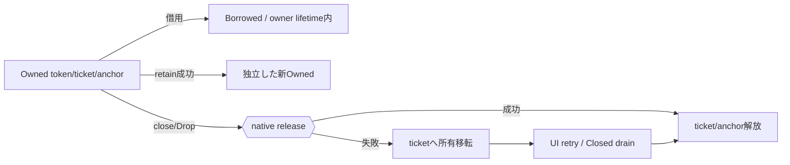
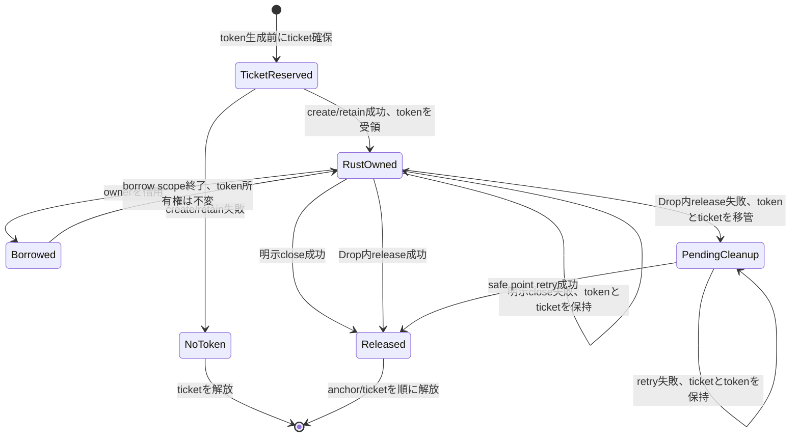
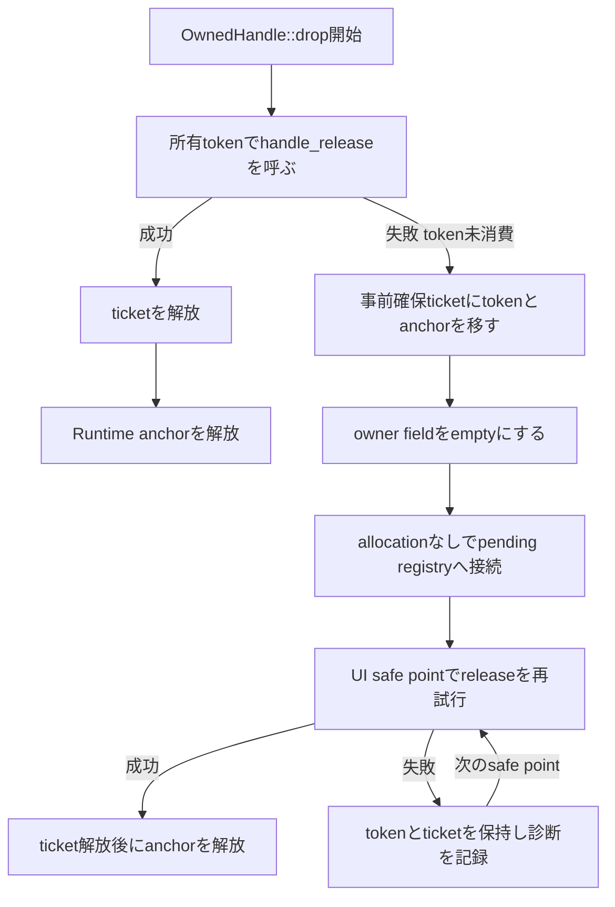
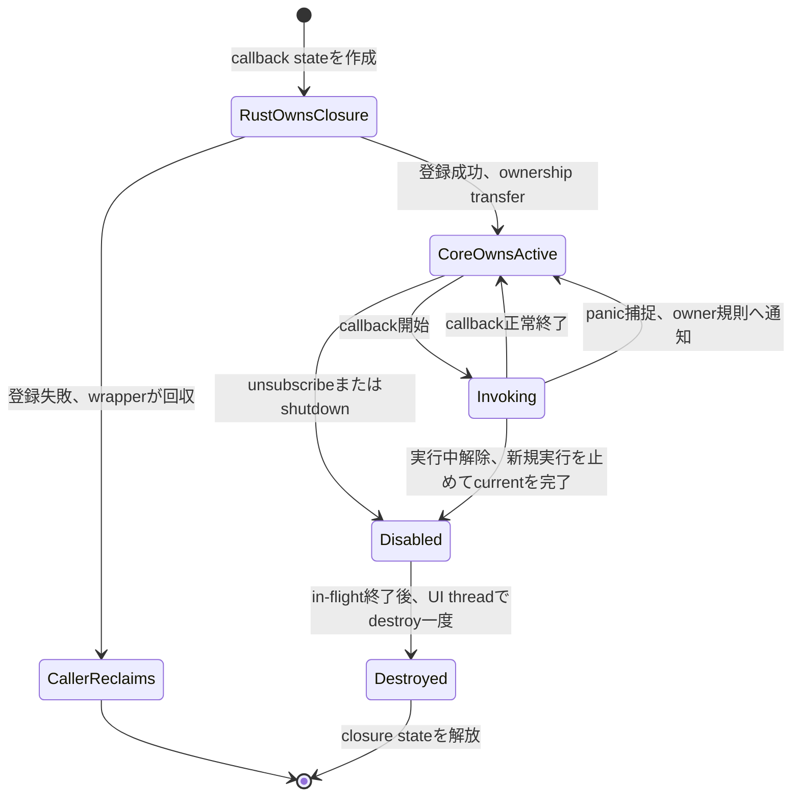
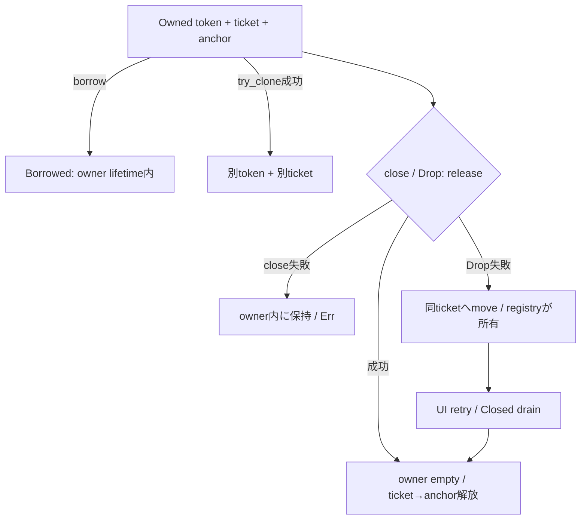
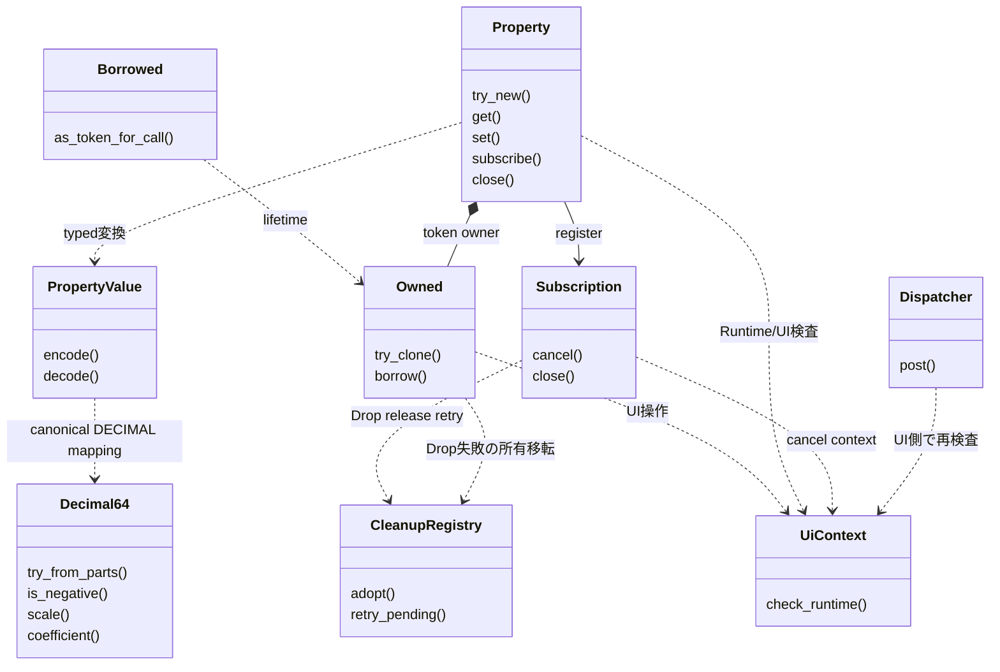
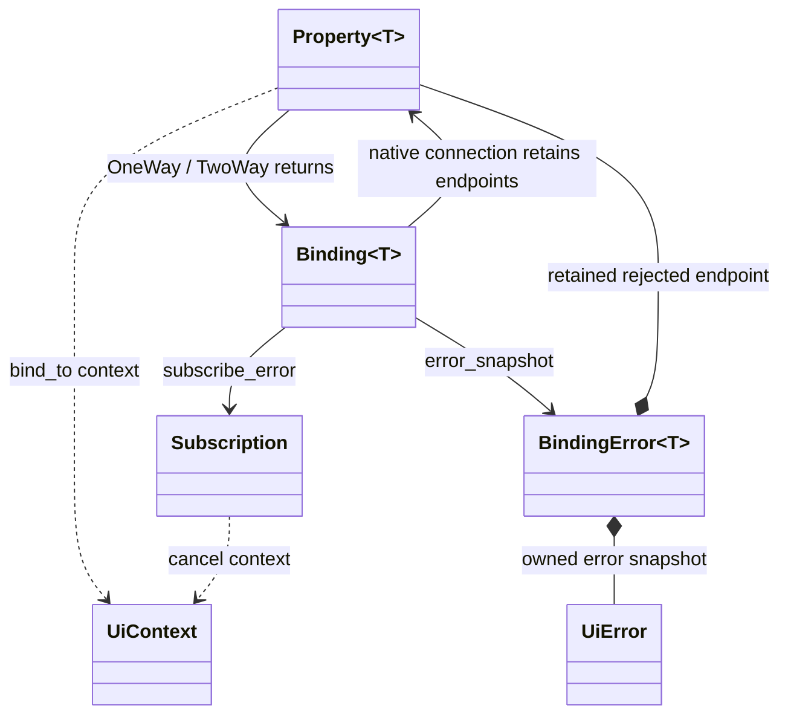
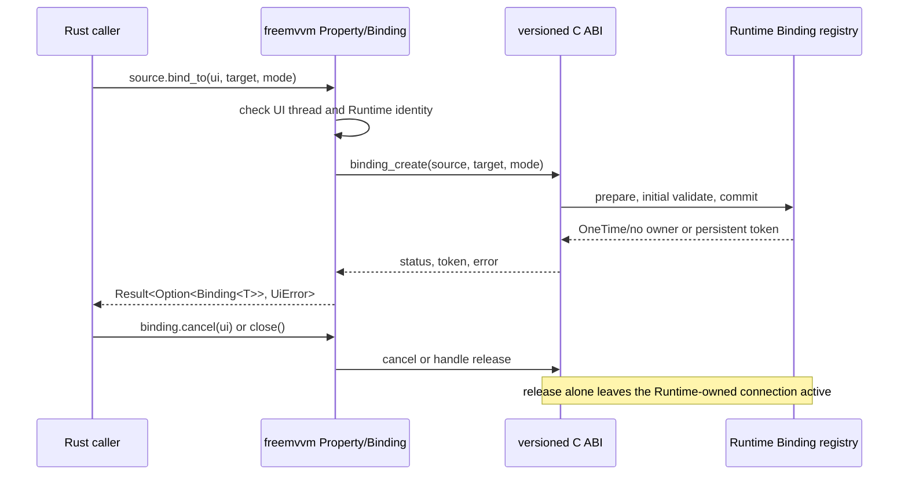

# 言語ラッパー：Rust

- 文書版: 1.5
- 文書ロール: detailed-design
- 更新日: 2026-10-24
- 状態: 1.4全文承認済み（利用者、2026-10-24）。1.5全文承認済み（利用者、2026-10-24）。実装・試験状態は別管理

## 目的と上位根拠

本書を要求から実装へ具体化する詳細設計の正本とする。型・API・所有・呼出し手順・状態遷移を実装へ反映する。要求の外部保証はリンク先RQ、層の責務と主要flowは上位BDを根拠とする。設計宣言の記載は、配布済みheader・実装済みAPI・試験合格を意味しない。

基本設計: [オブジェクト管理：値・モデル・更新整合性](../../12_design/runtime-objects/model-values.md)、[ビルド環境：toolchain・検証・support](../../12_design/build/toolchain-support.md)、[ビルド・配布：package・artifact・信頼境界](../../12_design/build/packages-artifacts.md)、[ランタイム：実行context・所有・終了](../../12_design/runtime-objects/runtime.md)

## 要求と設計項目の対応

| 設計項目 | 要求根拠 |
| --- | --- |
| 所有型・借用・Drop・panic境界 | [RQ-03-003](../../11_requirements/RQ-03_language-support.md#rq-03-003)、[RQ-03-007](../../11_requirements/RQ-03_language-support.md#rq-03-007)、[RQ-04-006](../../11_requirements/RQ-04_abi-boundary.md#rq-04-006)、[RQ-04-007](../../11_requirements/RQ-04_abi-boundary.md#rq-04-007)、[RQ-04-015](../../11_requirements/RQ-04_abi-boundary.md#rq-04-015)、[RQ-04-022](../../11_requirements/RQ-04_abi-boundary.md#rq-04-022)、[RQ-04-023](../../11_requirements/RQ-04_abi-boundary.md#rq-04-023)、[RQ-05-003](../../11_requirements/RQ-05_ownership-callbacks.md#rq-05-003)、[RQ-05-009](../../11_requirements/RQ-05_ownership-callbacks.md#rq-05-009)、[RQ-05-012](../../11_requirements/RQ-05_ownership-callbacks.md#rq-05-012)、[RQ-06-002](../../11_requirements/RQ-06_threading-dispatch.md#rq-06-002)、[RQ-06-005](../../11_requirements/RQ-06_threading-dispatch.md#rq-06-005)、[RQ-06-006](../../11_requirements/RQ-06_threading-dispatch.md#rq-06-006)、[RQ-12-005](../../11_requirements/RQ-12_build-distribution.md#rq-12-005) |
| 公開API・registry・Future | [RQ-03-003](../../11_requirements/RQ-03_language-support.md#rq-03-003)、[RQ-03-007](../../11_requirements/RQ-03_language-support.md#rq-03-007)、[RQ-03-014](../../11_requirements/RQ-03_language-support.md#rq-03-014)、[RQ-05-012](../../11_requirements/RQ-05_ownership-callbacks.md#rq-05-012)、[RQ-06-003](../../11_requirements/RQ-06_threading-dispatch.md#rq-06-003)、[RQ-06-012](../../11_requirements/RQ-06_threading-dispatch.md#rq-06-012)、[RQ-12-005](../../11_requirements/RQ-12_build-distribution.md#rq-12-005) |
| typed Property生成・利用・終了 | [RQ-02-002](../../11_requirements/RQ-02_core-features.md#rq-02-002)、[RQ-03-003](../../11_requirements/RQ-03_language-support.md#rq-03-003)、[RQ-03-007](../../11_requirements/RQ-03_language-support.md#rq-03-007)、[RQ-04-006](../../11_requirements/RQ-04_abi-boundary.md#rq-04-006)、[RQ-04-007](../../11_requirements/RQ-04_abi-boundary.md#rq-04-007)、[RQ-05-012](../../11_requirements/RQ-05_ownership-callbacks.md#rq-05-012)、[RQ-06-001](../../11_requirements/RQ-06_threading-dispatch.md#rq-06-001) |
| Decimal64 valueとProperty mapping | [RQ-02-017](../../11_requirements/RQ-02_core-features.md#rq-02-017)、[RQ-02-019](../../11_requirements/RQ-02_core-features.md#rq-02-019)、[RQ-03-003](../../11_requirements/RQ-03_language-support.md#rq-03-003)、[RQ-04-006](../../11_requirements/RQ-04_abi-boundary.md#rq-04-006)、[RQ-04-007](../../11_requirements/RQ-04_abi-boundary.md#rq-04-007) |
| Property Subscription登録・cancel・owner lifetime | [RQ-03-003](../../11_requirements/RQ-03_language-support.md#rq-03-003)、[RQ-03-007](../../11_requirements/RQ-03_language-support.md#rq-03-007)、[RQ-04-006](../../11_requirements/RQ-04_abi-boundary.md#rq-04-006)、[RQ-04-007](../../11_requirements/RQ-04_abi-boundary.md#rq-04-007)、[RQ-05-002](../../11_requirements/RQ-05_ownership-callbacks.md#rq-05-002)、[RQ-05-006](../../11_requirements/RQ-05_ownership-callbacks.md#rq-05-006)、[RQ-05-007](../../11_requirements/RQ-05_ownership-callbacks.md#rq-05-007)、[RQ-05-008](../../11_requirements/RQ-05_ownership-callbacks.md#rq-05-008)、[RQ-05-012](../../11_requirements/RQ-05_ownership-callbacks.md#rq-05-012)、[RQ-06-001](../../11_requirements/RQ-06_threading-dispatch.md#rq-06-001) |

本書内の共通規則は上記の各要求を実現するために適用する。同一項目内で個別要求を参照する場合はその対象範囲を優先する。将来候補・未採用範囲は採用済みの動作と区別する。

## 所有型・借用・Drop・panic境界

### 実現のcall/data/ownership flow

safe Owned型はtoken/ticket/Runtime anchorを所有し、Borrowed型はowner lifetimeに束縛する。明示retainは失敗可能な新owner取得とし、Dropはrelease失敗時に事前ticketへ所有を移してUI retryへ渡す。UI-affine ownerはSend/Syncを抑止し、worker用Dispatcherの同期済み経路でSendなclosureだけを移送する。登録成功時のuserdata所有とdestroy回収をFFI unsafe内部に閉じる。



### 責務と境界

| 層 | Rust側の責務案 | この文書で決めないこと |
|---|---|---|
| raw `-sys` crate | C ABIのfixed-width型、symbol、callback ABIをunsafeな低層宣言として提供 | 宣言生成方法、header配布、crate名、link方式 |
| safe wrapper crate | opaque handleの所有権・Runtime関連・thread制約を型で包み、raw pointerを通常の利用者APIから隠す | 最終公開型/関数名、crate名、MSRV/edition |
| native runtime | 他言語と同じtarget別C ABI artifactを利用 | artifact取得、Cargo feature名、library loading/package構成（MVVM UIライブラリ Rust Cargo packageに関する上位判断/ビルド・配布：toolchain・profile・package） |

Safe wrapper crateからRust Coreを再リンクして重複させない。unsafe codeはsafe境界の内側に局所化し、公開safe methodはその不変条件を保つ。`-sys`宣言自体はunsafeな操作面として扱い、Rust利用者がraw handleやuserdata pointerを通常APIへ持ち込む必要をなくす。

### 実装規則

| 実装規則 | 根拠・境界 |
| --- | --- |
| Rust wrapperをraw FFI `-sys` crateとsafe wrapper crateに分ける。Safe crateは通常利用時にraw pointer、userdata、C ABI関数呼出しを露出しない。 | MVVM UIライブラリ Rust Cargo packageに関する上位判断、ADR-0001。unsafe区間をsafe層の内部に限定する。 |
| safe wrapperが所有するC ABI tokenはmove-only相当のowner型で包む。ownerの暗黙`Copy`/`Clone`を認めず、明示的なretain操作が成功したときだけ独立した新tokenを持つownerを返す。 | handle登録・検証、Runtime所有と終了。`retain`は別tokenを発行し、元tokenを消費しない。 |
| 借用handleはownerからの借用として表し、呼出しスコープを越えて保存・releaseできない。異なるRuntimeに属するhandleの組合せはsafe wrapper内でも検証し、最終的なkind/Runtime検証はCoreのstatusを保持する。 | handle登録・検証、Runtime所有と終了。内部token整数を利用者へ直接公開しない。 |
| owned wrapperの明示終了操作は失敗を`Result`相当で返し、release成功時のみownerをemptyにする。失敗時はtoken ownershipをowner側へ残し再試行可能とする。 | Runtime所有と終了、値・error境界。最終method名やreceiver形はAPI設計章へ送る。 |
| `Drop`はpanicせず、native releaseの失敗を無視してtokenを失わない。token受領前にcleanup ticketを確保し、Dropでreleaseできない場合はtokenとticketをRust内pending-cleanup registryへ移管する。registryはUI safe pointで再試行し、shutdown完了後はClosed shell releaseとしてdrainする。 | Runtime所有と終了、C++ wrapper、C# wrapper。UI enqueue failureでnative tokenが消費されない契約を維持する。 |
| cleanup ticket確保に失敗する可能性がある場合、Runtime create、retain、またはowned out-tokenを受領するnative呼出しを開始しない。Drop中のregistry移管は新規heap allocationに依存しない。 | handle登録・検証、Runtime所有と終了、C++ wrapper、C# wrapperのcleanup前提をRustへ対応付ける。registry同期・poison recovery・wake詳細は後続設計へ送る。 |
| UI-affine Runtime objectとその子handleを通常は`Send`/`Sync`にしない。wrapper内の型marker等で別threadへの移動・共有をコンパイル時に抑止し、Coreのwrong-thread checkも最終防御として維持する。raw crateで根拠のないunsafe `Send`/`Sync`実装をしない。 | 言語境界契約、UI dispatcher、C++ wrapper/ C# wrapper。Rust `Send`はthread間move、`Sync`は共有参照を複数threadから使う安全性のtrait。 |
| UI dispatcher/post handleはRuntimeのUI-affine object handleと分ける。複数threadから使う型を`Send`/`Sync`にできるのは、内部同期とnative契約が安全性を満たす場合に限る。post closureはworkerからUIへownership移送するため`Send + 'static`相当を要求し、成功後UI threadで一度だけ実行またはcancel/destroyする。 | UI dispatcher、callback実行規則。trait boundと実型は例示に留める。 |
| UI thread上だけで登録・実行されるcallback closureへ一律に`Send`を要求しない。callback owner APIがworkerからclosureを移送する契約を持つ場合に限り、そのAPI固有で`Send`要件を課す。callbackの並列・再帰実行は禁止済み契約に従い、closureの可変状態はその直列実行条件の範囲で扱う。 | 言語境界契約/言語境界契約、UI dispatcher、callback実行規則。機能ごとのcallback制約はイベントハンドリング：通知とBinding伝播に従う。 |
| callback登録/post成功時だけclosure stateの所有権をCoreへ移す。失敗時はRust側がstateを保持して破棄する。safe closureからC trampolineへ渡すuserdata pointerの生成・復元はunsafe内部に閉じ、成功後はcallback実行規則のin-flight条件を守り、destroy thunkで一度だけ回収する。 | callback実行規則、UI dispatcher。userdataを`Box`等で表すコードは方式の確定ではなく説明例に限る。 |
| C ABI callback trampolineおよびdestroy thunkからRust unwindを外へ出さない。`panic=unwind`時はユーザーcallbackのpanicをABI境界内で捕捉して閉じ込め、callback固有のfailure/診断規則に渡す。panic handler自身も境界を越えてpanicしないようにする。 | Runtime契約、callback実行規則、C++ wrapper、C# wrapper。callbackごとの状態遷移・通知継続等はowner設計に従う。 |
| `panic=abort`ではpanicを捕捉して継続できないことを前提として明示する。safe wrapperはpanic=abort buildでもunwindがC ABIを越える設計を作らないが、abort panic後の継続・cleanup完遂は保証しない。 | Rust Referenceのpanic strategyとFFI unwind規則。`catch_unwind`はabort strategyを回復可能に変えるものではない。 |
| callback userdata内のRust値をdropするdestroy thunkもABIを越えるpanicを出さない。panic=unwind時のdrop panicは境界内で捕捉して診断側へ送る案とする。二重panicやpanic=abortによるprocess abortを、Rust wrapperが回復する契約にはしない。 | callback実行規則、Runtime所有と終了、Rust Drop/panic contract。destructorがUI APIを呼ばない既承認規則を維持する。 |
| native status/error snapshotをRustの`Result<T, E>`相当へ変換する。unknown status/domain/codeのraw数値を保持し、message文字列で分岐しない。Error handleがある場合はimmutable snapshotの所有権をRust側で保持する。 | 値・error境界、共通ABI、MVVM UIライブラリ Error objectの安定性境界に関する上位判断案、共通C ABI：宣言・検査・互換性。型名、文字列decode policy、公開Error surfaceはAPI設計章へ送る。 |
| UI-affine操作はUI threadでのみ呼ぶ。workerからの変更は値snapshotとpost closureをdispatcherへ渡す。非同期shutdownは完了を待たず受付結果で戻り、callback中要求もevent終了後に実行する。worker同期shutdownはUI loop稼働時にUI cleanup完了を待つ。 | 言語境界契約/言語境界契約、Runtime shutdownのcallback中dispatchに関する上位判断、UI dispatcher、共通ABI、C++ wrapper/ C# wrapper。loop停止通知でwaitを未完了として解除する。 具体化は言語ラッパー：Rust、[ビルド・配布：toolchain・profile・package](../build/toolchain-packages.md)、[共通C ABI：宣言・検査・互換性](../runtime-objects/abi.md)を参照する。 |

### 所有型・借用型の概念

以下は責務を説明する擬似例であり、公開宣言ではない。

```rust
// 説明用。具体化は[DD-34](34-rust-api-ownership.md)、[DD-38](38-package-loader-tool.md)、[DD-40](40-api-inventory.md)を参照する。
struct OwnedHandle<T> { /* opaque token + Runtime anchor + cleanup ticket */ }
struct BorrowedHandle<'a, T> { /* 呼出し中だけ有効な借用 */ }

impl<T> OwnedHandle<T> {
    fn try_retain(&self) -> Result<OwnedHandle<T>, UiError>;
    fn try_close(&mut self) -> Result<(), UiError>;
}
```

OwnerのDropは暗黙retain/release回数を増やさず、一つの公開tokenを一度だけreleaseする。`try_close`相当でreleaseに失敗したときはownerを有効なまま保つ。Drop経路でreleaseが失敗したときはRust wrapperのticketへtoken所有権を移す。Borrowed viewはownerより長く存続できず、独立したretainが必要な場合は明示操作を使う。

#### owned tokenの所有権移動

safe wrapper内では、各owned tokenに対し、`(token, cleanup ticket, Runtime anchor)`の組を一つだけ所有者が持つ案とする。cleanup ticketはnative APIが新しいowned tokenを返す前に予約する。予約の割当てに失敗したらnative callを始めない。native callが失敗してtokenを返さなければticketを戻す。成功したときはtokenとticketを一つのRust ownerへ同時に渡す。



状態の意味は次のとおり。

- **TicketReserved**: wrapperだけがticketを持つ。native tokenはまだ存在せず、create/retainが失敗してもtokenの後始末は発生しない。
- **RustOwned**: Rust ownerだけが公開tokenを所有する。`BorrowedHandle<'a, T>`はこのownerから借りた参照であり、ABI tokenの追加retainやreleaseを行わない。
- **明示close失敗**: native契約がtokenを消費していない失敗なので、ownerはtoken/ticket/anchorを保持する。呼出し側が原因に応じて再試行またはownerを生存させられる。
- **PendingCleanup**: `Drop`が失敗した後の唯一の所有場所。Drop対象のfieldを空にしてから事前確保ticketをregistryへ移すので、Rustの自動dropによる二重releaseを防ぐ。registry移管自体は割当失敗しない操作として設計する。
- **Released**: native tokenの消費成功後にticketを解放し、Runtime anchorを最後に解放する。anchorを先に落とさない。

#### create・retain・borrow・closeの所有権表

| 操作 | 呼出し前の所有者 | 成功時 | 失敗時 |
|---|---|---|---|
| Runtime/object create | Rust側がticket予約済み、tokenなし | C ABIから返るtokenとticketを新ownerが受領 | token出力は値・error境界に従い無効値。ticketを解放 |
| `retain` | 元ownerがtoken/ticketを所有、新token用ticketを別途予約 | C ABIが別tokenを返す。元ownerは変化せず、新ownerが新token/ticketを受領 | 元ownerは有効のまま。予約ticketだけを解放 |
| method call | ownerがtoken/ticket/anchorを所有 | scoped borrow/call leaseで呼出し中のnative object寿命を保護。所有権はownerに残る | borrowとcall leaseを終了。ownerのtokenは変化しない |
| borrowed child/view | 親ownerがtokenを所有 | Rust lifetimeで親ownerの借用期間内だけ利用可能 | 追加tokenを作らず、releaseもしない |
| explicit close | mutable owner borrowがtoken/ticket/anchorを保持 | release成功後にownerをemptyにし、ticket、anchorの順に解放 | token/ticket/anchorをownerに残して失敗結果を返す |
| Drop | ownerが最後のtoken/ticket/anchorを保持 | release成功後、ticketを解放しanchorを解放 | ticketを付けたtokenをpending registryへ移す |

RustのmoveはRust owner値の場所を移し、C ABI tokenのretainや数値変更を伴わない。所有ownerがmoveされた後、元の場所から同じtokenを使えない。逆に、`BorrowedHandle`の生成はnative retainを伴わず、borrow終了時にもreleaseしない。独立して保存できる所有者が必要なときだけ明示retainを行う。これらは図示用であり、実際のfield順・generic設計・メソッドsignatureを確定するものではない。

`PhantomData<Rc<()>>`等を使った`!Send`/`!Sync` markerは実現候補の説明であり、MSRV/edition・公開型レイアウトを確定しない。markerで静的に防げないnative runtime identity、UI thread判定、shutdown後の状態は、C ABIのstatus検証を保つ。

### `Send`/`Sync`とdispatcher境界

| 対象 | Rust側の提案 | 実行・検証境界 |
|---|---|---|
| Runtime、Window、Property等のUI-affine owner | `Send`/`Sync`を実装しない | UI thread外のnative呼出しはCoreも拒否する |
| scope付きborrow | ownerのthread制約を継承 | lifetimeでowner/借用の順序を表すが、thread検証を置換しない |
| worker-safe post入口 | 内部状態が同期化される場合に限り`Send`/`Sync`候補 | enqueue成功後だけclosure ownershipが移る |
| workerからpostするclosure | `Send + 'static`相当 | UI threadで一度実行、またはcancel後にdestroy |
| UI thread登録callback | `Send`を一律に課さない | callbackは直列・非再帰でUI thread実行 |

marker traitを満たすためにunsafe実装を足す場合、その根拠はC ABIだけでは足りず、wrapper内の全参照・同期・destroy threadを含めて示す必要がある。本案はUI-affine wrapperを非Send/nonSyncにする方向を提案し、dispatcherを無条件にSend/Syncとすることは提案しない。

### Dropと失敗可能release

Rustの`Drop::drop`は通常の`Result`を返せず、そこでnative release失敗を無視するとRuntime所有と終了のtoken未消費契約をwrapper側で失う。そのため、所有tokenの取得前にcleanup ticketを用意し、通常drop時に失敗したtokenを追加割当なしでwrapper内registryへ移す案を提案する。

| 経路 | 提案する扱い |
|---|---|
| 明示closeでrelease成功 | tokenを消費しownerをemptyにする |
| 明示closeでrelease失敗 | ownerはtokenを保持し、呼出し側へstatus/errorを返す |
| Dropのrelease成功 | tokenを消費しticketを解放する |
| Dropのrelease失敗 | tokenとticketをRust内cleanup registryへ移し、UI safe pointで再試行する |
| Runtime shutdown完了後の残存token | Closed shell releaseとしてdrainしてからRuntime anchorを解放する |
| cleanup ticket確保失敗 | owned tokenを作るnative callを始めず、callerへfailureを返す |

具体化は言語ラッパー：Rust、[ビルド・配布：toolchain・profile・package](../build/toolchain-packages.md)、[共通C ABI：宣言・検査・互換性](../runtime-objects/abi.md)を参照する。解放失敗tokenを捨てるfallback、Drop中にpanicするfallback、確保不能なnodeへ後から登録する実装は本案に含めない。

#### Drop失敗後のticket移管と再試行

`Drop`は通常の失敗値を返せないため、失敗を黙殺しない経路を型の生成時点から確保する。Drop内ではtokenをregistryへ移した後にowner fieldから除き、registryがticket/anchorを保持する。registryの再試行が失敗した場合もtokenを消さず、後続safe pointまで保持して失敗statusを診断へ記録する案とする。恒久的なnative corruptionなど再試行で解消しないfailureを無限に高速再試行するか、終了時にどう報告するかはAPI/実装設計へ残す。



### Callbackとpanic境界

```text
Rust closure state
      │ successful registration/post only
      ▼
opaque userdata owned by Core ── callback trampoline ── Rust closure
      │ callback解除/shutdown、in-flight完了後
      ▼
destroy thunk ── exactly once ── state dropped in UI thread
```

登録/post失敗時は所有権がRust側に残り、wrapperがstateを破棄する。成功後はCoreのdestroy thunkが所有権を回収する。raw userdata pointerのcast/reconstructionと`unsafe extern "C"` trampolineはprivate moduleに閉じ、成功・失敗双方の所有権経路を一致させる。

#### callback closureの移転

callback closureはnative handleとは別のowned resourceとして追跡する。登録関数の呼出し中はRust側がstateを保ち、成功statusを確認した一点でのみCoreへ所有権が移る。登録失敗ならCoreはcallbackもdestroyも呼ばないため、Rust側が自分のstateを回収する。登録成功なら解除/shutdownで新規invocationを止め、実行中callbackが戻った後にUI thread上のdestroy thunkがstateを一度だけ回収する。



登録中からreturnまでcallback stateのallocation addressを安定させ、所有権はRust側に保持する。native登録APIがreturn前にcallbackを開始できるか、その最中のunsubscribe/shutdownでdestroyを呼べるかは各owner APIの契約が必要である。pre-return invocationを許すAPIでは、呼出し中の一時参照と成功後の所有権移転を明確に分け、失敗return後にCore側destroyが走らないことを保証しなければならない。契約が明確になるまでは、safe wrapperの実装条件として「登録結果が確定する前にCoreがuserdataをdestroyしない」ことを要求する案とする。

dispatcher post closureも同じ成功時移転を使うが、所有者はcallback登録APIではなくqueueであり、実行またはcancel後にdestroyする。post失敗時はclosure stateをRust callerへ戻し、成功後のdropをcaller側で重ねて行わない。

Rustの`extern "C"`はunwindを許可するABIではないため、Rust panicをそのままcallback trampolineから返さない。`panic=unwind` buildではユーザーclosure呼出しとRust値の破棄を適切なABI内境界で捕捉する案とする。捕捉したpanicの後に通知を継続するか、操作を失敗扱いにするかはcallback ownerが持つ既存/後続意味論に従い、共通動作をこのDDで追加しない。`panic=abort`時はprocess abortとなり得るため、回復やpending cleanup完遂を保証しない。

参考: [Rust Reference: Panic](https://doc.rust-lang.org/stable/reference/panic.html)、[Rustonomicon: FFI and unwinding](https://doc.rust-lang.org/stable/nomicon/ffi.html)、[Rustonomicon: Send and Sync](https://doc.rust-lang.org/nomicon/send-and-sync.html)、[Rust Reference: Destructors](https://doc.rust-lang.org/reference/destructors.html)。Rustonomiconは、non-unwind ABIからのpanicはprocess abortになること、`panic=abort`ではABI種類にかかわらずpanic時にabortすること、FFI callback contextは対象Rust objectが破棄された後に再利用されない寿命管理が必要なことを説明している。`Send`/`Sync`の誤ったunsafe実装はsafe Rust利用者に未定義動作を許し得るため、thread markerは契約と内部同期を証明した型に限る。

### Error・thread・shutdown表現

| C ABI/Runtime結果 | Rust wrapper案 |
|---|---|
| `ui_status`成功 | 成功値を返す |
| 既知/未知statusとoptional Error handle | statusを一次情報として保持するerror valueへ変換。unknown raw値も保持する |
| UI-affine APIのworker呼出し | 型制約で多くを防ぎ、native wrong-thread statusも保存する |
| workerからの非同期post | enqueue受付後に戻り、完了futureを独自追加しない |
| callback内shutdown | shutdown受付済みと完了済みを区別し、現callbackの完了後に優先実行する |
| worker同期shutdown | UI loop稼働時はUI cleanup完了まで待つ。host停止通知で未完了結果と理由を返す |

例示の`UiError`等は型名を確定するものではない。APIの通常結果として定義されるvalidation reject/Command stateを例外相当のerrorへ機械的に変換しない。

### 失敗・競合ケース

| ケース | 提案する観測結果 |
|---|---|
| retain失敗 | 新ownerを作らず、元ownerは有効 |
| ownerをmove | 移動元にtokenが残らず、releaseは一token分だけ |
| 明示close失敗 | ownerにtokenを保持し、再試行可能 |
| Drop release失敗 | cleanup ticketへ移管し、native tokenを失わない |
| workerからUI ownerをmove/share | Rust型検査で拒否。raw/sys経路の誤用はunsafe caller責務とCore statusで防御 |
| post登録失敗 | closure ownershipはRust側に残る |
| post成功 | Coreがclosure stateを所有し、実行/cancel後のdestroyはUI threadで一度 |
| callback panic (`panic=unwind`) | C ABIへunwindせず捕捉。callback個別のfailure規則へ渡す |
| callback panic (`panic=abort`) | process abortからの継続を保証しない |
| unknown native status/code | raw値を保持し、message parseで意味を推定しない |
| worker同期shutdown中にUI loop停止 | host停止通知でwaitを未完了として解除する。timeout値や独自cancelを追加しない |

## 公開API・registry・Future

### 実装規則

| 実現手段・責務 | 要求根拠 |
| --- | --- |
| crate名はfreemvvm-sys / freemvvm、edition2024、MSRV1.85.0。最低版testと固定release toolchainを別jobで持つ。 | [RQ-03-014](../../11_requirements/RQ-03_language-support.md#rq-03-014) |
| Owned<T>は非Clone、try_clone(&self)->Result<Self>、close(&mut self)->Result<()>、borrow(&self)->Borrowed<T>。 | 上記の根拠RQ |
| UI型にPhantomData<Rc<()>>、BorrowedにPhantomData<&Owned<T>>。worker用DispatcherだけSend+Sync。 | 上記の根拠RQ |
| UiContextはUI thread tokenとdispatch scopeを表し、UI-affine methodは&UiContextを受ける。実call直前にもnative thread検査。 | 上記の根拠RQ |
| CleanupRegistryのmutex内はticket linkageだけを更新し、callback/panic可能処理を置かない。poison時はinto_inner後に構造検査し不整合なら保持+診断する。 | 上記の根拠RQ |
| catch_unwindをtrampoline境界に置き、notification panicはdiagnostic+他購読継続、Validator panicはUI_INTERNAL_ERRORへ変換する。 | 上記の根拠RQ |
| async facadeは初期optional featureとしてrequest queryをpollするFutureだけ。executor/scheduler/JoinHandleをCoreへ組み込まない。 | [RQ-06-012](../../11_requirements/RQ-06_threading-dispatch.md#rq-06-012) |

### 実現設計

```rust
// 設計signature。配布ヘッダ・実装ではない。
pub struct Owned<T> { /* token, ticket, anchor, !Send/!Sync marker */ }
pub struct Borrowed<'a, T> { /* borrowed token, PhantomData<&'a Owned<T>> */ }
pub struct Decimal64 { /* canonical uint64 bits */ }
pub struct Subscription { /* token owner + Runtime anchor + !Send/!Sync marker */ }
impl Decimal64 {
    pub fn try_from_parts(negative: bool, scale: u8, coefficient: u64) -> Result<Self, UiError>;
    pub const fn is_negative(self) -> bool;
    pub const fn scale(self) -> u8;
    pub const fn coefficient(self) -> u64;
}
impl<T> Owned<T> {
    pub fn try_clone(&self) -> Result<Self, UiError>;
    pub fn borrow(&self) -> Borrowed<'_, T>;
    pub fn close(&mut self) -> Result<(), UiError>;
}
impl<T: PropertyValue> Property<T> {
    pub fn try_new(ui: &UiContext<'_>, initial: T) -> Result<Self, UiError>;
    pub fn get(&self, ui: &UiContext<'_>) -> Result<T, UiError>;
    pub fn set(&self, ui: &UiContext<'_>, value: T) -> Result<(), UiError>;
    pub fn subscribe<F>(&self, ui: &UiContext<'_>, callback: F) -> Result<Subscription, UiError>
    where F: FnMut() + 'static;
    pub fn close(&mut self) -> Result<(), UiError>;
}
impl Subscription {
    pub fn cancel(&mut self, ui: &UiContext<'_>) -> Result<(), UiError>;
    pub fn close(&mut self) -> Result<(), UiError>;
}
```

`Decimal64`はcanonical `uint64_t` representationをprivateに保持するcopyable scalarとする。`try_from_parts`はscaleが0～31、coefficientが0～2^58−1のときだけ成功し、範囲外を`INVALID_ARGUMENT`相当の`UiError`で返す。sign/scale/coefficient accessorを提供し、十進演算・parse/formatは追加しない。異なるscaleや符号付きzeroの数値比較をraw bits比較へ誤って置き換えないため、Rust標準`PartialEq`/`Eq`は本案では実装しない。

PropertyValueは初期五型のsealed traitで、五型は`bool`、`i64`、`String`、`f64`、`Decimal64`とする。DECIMALは`Decimal64`のcanonical bitsをC ABI `uint64_t`へ直接渡す。利用者の任意structでunsafe FFI変換を実装させない。`UiError`はraw status/domain/codeとoptional owned immutable ErrorSnapshotを持つ。cloneがnative retainを伴う型はtry_cloneとし、std::error::Error/sourceは取得済みsnapshotへのborrowで返す。

`Property::subscribe`はUI thread/contextを検証し、初期通知を発生させない。callbackはUI thread上で直列に実行するため`Send`を要求しない。subscribe成功時だけclosure stateをCoreへ移し、失敗時はRust側で回収する。通知中のpanicはC ABI境界で捕捉し、panic hookの診断後も次のsubscriberへ配信を継続する（`panic=abort`ではprocess継続を保証しない）。`Subscription::cancel`はcallback登録を停止し、in-flight callback終了後にclosureを一度だけdestroyする。`Subscription::close`/Dropは公開tokenだけをreleaseし、cancelの代わりにはならない。owner Property teardownとRuntime shutdownのcleanupは通知とBinding伝播DDに従う。



所有table:

| 処理 | token | ticket | anchor |
|---|---|---|---|
| create前 | なし | 先に確保 | Runtime shellを保持 |
| create成功 | Ownedが一個保持 | 同Owned | 同Owned |
| retain失敗 | 元Owned不変 | 新ticketだけ回収 | 新anchorだけ回収 |
| move | 移動先のみ | 移動先のみ | 移動先のみ |
| Drop失敗 | registry ticketへ移転 | registry保持 | ticketが保持 |
| release成功 | 消費済み | 解放 | 最後に解放 |

Callback登録のclosureはBox<CallbackState>でprepareし、成功時にinto_rawの所有をCore destroyへ移す。失敗はBoxへ戻す。UI-only callbackはSendを強制せず、worker→UI postだけFnOnce+Send+'static。公開UI methodの&selfは内部Core値をUI Contextで直列操作するためで、Rust内のmutable aliasを利用者へ返さない。

[Rust Edition Guide](https://doc.rust-lang.org/stable/edition-guide/rust-2024/)に2024 editionのrelease基準1.85.0が記載されている。これはMSRV選定の根拠で、同版が最新であるという主張ではない。


### Optional Futureの起床と破棄

Futureはqueryが未完了なら言語側のPollDriverへWakerを登録してPendingを返す。PollDriverは利用側executor/timer adapterから次回queryをscheduleし、Coreにexecutorを保持させない。Futureは登録解除ticketを所有し、dropでtimer/waker登録だけを解除する。receiptのreleaseは終了取消ではなく、別のreceiptからも完了を観測できる。driver未接続の構成ではFuture featureを提供せず、明示queryだけを公開する。

## クラス設計の補足（1.1承認済み）

既承認1.0の実現規則を支える型・関連・所有・主要操作を整理した。内部型名とメソッドの分担は本改訂で補足する内部設計であり、既存公開APIの署名や外部保証を追加・変更するものではない。この節のクラス構成と追加図は1.1版全文の承認対象であり、実装・試験完了の証明とは区別する。

要求根拠: [RQ-03-014](../../11_requirements/RQ-03_language-support.md#rq-03-014)、[RQ-05-012](../../11_requirements/RQ-05_ownership-callbacks.md#rq-05-012)、[RQ-06-012](../../11_requirements/RQ-06_threading-dispatch.md#rq-06-012)。

Rustのstruct/trait/lifetimeとして表し、class図の合成は継承を意味しない。既存Owned<T>/Borrowed<'a,T>/UiContext/PropertyValueの公開方針は維持する。

### 型の責務と所有

| 型 | 責務・保持データ | 主要メソッド・操作 | 所有・寿命 |
| --- | --- | --- | --- |
| Owned | token、事前CleanupTicket、RuntimeAnchor、UI affinity marker | try_clone(&self); borrow(&self); close(&mut self) | try_cloneだけが新しい独立tokenを取得。Drop失敗はticketへ移管 |
| Borrowed | borrowed token、PhantomDataでowner lifetimeを表現 | as_token_for_call(&self) | 所有権を増やさずreleaseしない。'aを越えて保持しない |
| UiContext | Runtime identityとUI呼出しcontext | check_runtime(&self, target) | UI APIの権限を示す。任意threadで作成できる単なるID wrapperにしない |
| Property<T> | typed property token、Runtime anchor、Runtime identity | try_new(ui, initial); get(ui); set(ui, value); close() | UI-affine owner。close/DropまでRuntimeをanchorし、別RuntimeのUiContextを拒否 |
| Decimal64 | canonical DECIMAL uint64 bits | try_from_parts(negative, scale, coefficient); is_negative(); scale(); coefficient() | copyable scalar。丸め・演算・parse/formatなし |
| Subscription | registration token、Runtime anchor、Runtime identity | cancel(ui); close() | UI-affine owner。cancelは登録解除、close/Dropはtoken releaseのみ |
| PropertyValue | 初期五型のsealedなFFI変換trait | encode(value); decode(native) | 利用者の任意structへunsafe境界の実装を開放しない |
| CleanupRegistry | Dropから移管されたticket集合と再試行同期 | adopt(ticket); retry_pending() | ticketとanchorを一所有移転で保持。panic中もtokenを失わない |
| Dispatcher | worker向けpost可能なRuntime shell入口 | post(work) | UI-affine OwnedをSend/Syncへ変更するための型ではない |

### クラスの関連

`*--`は従属するstate/作業の合成、`o--`は共有を含む所有参照、`..>`は非所有の利用・識別・委譲を示す。関連名と本文で示した寿命を優先し、図の同名型は各instanceで別の状態を持つ。図は主要メソッド名を抜粋し、引数・所有・失敗条件は表と本文に従う。



### 主要な呼出しと失敗境界

Property get/setはUiContextとRuntime所属を検査してtyped FFIへ進む。明示close失敗はowner内tokenを維持し、Drop失敗だけが事前ticketをCleanupRegistryへmoveする。callback trampolineはcatch_unwindで種別固有の失敗へ写像する。

図のOwned→CleanupRegistryは常時二重所有ではない。UI型の!Send/!Sync制約とDispatcherの移送可能性を分ける。optional Futureは既存request queryの観測だけで、Runtime/executorの新しいschedulerを追加しない。

## Property Binding API案（1.5・レビュー待ち）

本節は承認済みBinding要求とイベントハンドリング設計をRust safe wrapperへ写すAPI案である。レビュー承認までは確定仕様・実装済みAPIとして扱わない。Bindingの方向、初期同期、伝播、循環・重複接続拒否、遅延検証errorと回復は[RQ-07](../../11_requirements/RQ-07_binding.md)および[通知とBinding伝播](../events/notifications-binding.md)を正本とする。

### 公開API案

```rust
pub enum BindingMode { OneTime, OneWay, TwoWay }
pub enum BindingDirection { SourceToTarget, TargetToSource }

impl<T: PropertyValue> Property<T> {
    pub fn bind_to(&self, ui: &UiContext<'_>, target: &Property<T>, mode: BindingMode)
        -> Result<Option<Binding<T>>, UiError>;
}
impl<T: PropertyValue> Binding<T> {
    pub fn cancel(&mut self, ui: &UiContext<'_>) -> Result<(), UiError>;
    pub fn error_snapshot(&self, ui: &UiContext<'_>) -> Result<Option<BindingError<T>>, UiError>;
    pub fn subscribe_error<F>(&self, ui: &UiContext<'_>, callback: F)
        -> Result<Subscription, UiError> where F: FnMut() + 'static;
    pub fn close(&mut self) -> Result<(), UiError>;
}
impl<T: PropertyValue> BindingError<T> {
    pub fn error(&self) -> &UiError;
    pub fn rejected_property(&self) -> &Property<T>;
    pub fn direction(&self) -> BindingDirection;
}
```

`OneTime`は初期コピーだけを行い、成功時は`Ok(None)`を返す。`OneWay`と`TwoWay`は初期同期と接続をatomicに成立させて`Some(Binding<T>)`を返す。失敗時は`Err(UiError)`とし、native error ownershipを通常の`UiError`規則で引き取る。modeの整数値はsafe APIへ露出せず、private mappingでC ABIへ渡す。

`Binding<T>`はmove-onlyのUI-affine ownerとする。`cancel`はUI contextのRuntime identity/threadを検査し接続を明示解除する。`close`/Dropは公開handle参照をreleaseするだけで、接続解除とはしない。release失敗時のtoken保持・Drop cleanup ticket移管は既存`Owned`規則に従う。OneTimeではowner自体を作らない。

`error_snapshot`は現在のBinding固有errorを不変のowned snapshotへ複製する。`BindingError<T>`はnative error ownerと独立retainedされた拒否Property owner、伝播方向を保持し、snapshot破棄は各ownerを独立にreleaseする。`subscribe_error`は既存`Subscription`所有・callback trampolineを再利用し、callback引数にはsnapshotを載せず、callback内で必要に応じて`error_snapshot`を再取得する。登録成功時だけclosure ownershipをCoreへ移す。

### 所有関係と呼出し境界



`bind_to`は両PropertyのRuntime identityを先に比較し、同一RuntimeのUI contextでのみC ABIを呼ぶ。API成功形はmodeと整合するか検査し、想定外のstatus/token/errorの組み合わせでは公開ownerを作らず、予期しないtokenを既存の安全なcleanup経路で処理する。初期同期・graph prepare/commit・遅延伝播の責務をRust側で再実装しない。



遅延伝播失敗は元Property setterの成功を取り消さず、Binding error snapshotでのみ観測する。次の有効な伝播によるerror解消とerror subscriber通知の順序はイベントハンドリング設計に従う。Runtime shutdown時のactive connection teardownも同設計へ委譲する。

## 文書の承認・改訂履歴

| 日付 | 対象版 | 内容・根拠 |
| --- | --- | --- |
| 2026-10-17 | 1.0 | 利用者の指示に基づき、既承認内容を責務別に再編集。設計項目IDによる承認・追跡は廃止し、以後は文書版全体で管理する。構成変更を新規の製品仕様採用としない |
| 2026-10-17 | 1.0全文 | 利用者の「全部承認します」により文書全体を承認。旧IDによる項目承認ではなく、現行文書版を対象とする。実装・試験合格を意味しない |
| 2026-10-17 | 1.1改訂案 | 利用者の補足指示によりクラス責務・所有・メソッド・関連図を追加。1.0承認を維持し、1.1全文は確認待ち |
| 2026-10-17 | 1.1全文 | 利用者の「OK,テスト文書作りましょうか」により、クラス設計補足と選択的な図の補強を含む全文を承認。既存履歴を維持し、実装・試験状態は別管理 |
| 2026-10-24 | 1.2改訂案 | Rust Propertyの公開生成・取得・設定・終了APIとRuntime ownership/identityを具体化。1.1の承認状態は維持し、1.2全文は利用者確認待ち。BOOL/I64実装・試験は独立した実装状態として管理 |
| 2026-10-24 | 1.2全文 | 利用者の「OK」によりPropertyの生成・取得・設定・終了APIとRuntime ownership/identityを含む文書全体を承認。実装・試験状態は別管理 |
| 2026-10-24 | 1.3改訂案 | Rust `Decimal64`のcanonical representation、`try_from_parts`、accessor、PropertyValue mappingを追加提案。1.2全文承認状態を維持し、1.3全文は利用者確認待ち |
| 2026-10-24 | 1.3全文 | 利用者の「OK」によりRust `Decimal64`の値型/APIとPropertyValue mappingを含む全文を承認。実装・試験状態は別管理 |
| 2026-10-24 | 1.4改訂案 | Property notification closure、Subscription token ownership、cancel/close分離、callback panic境界を追加提案。1.3全文承認状態を維持し、1.4全文は利用者確認待ち |
| 2026-10-24 | 1.4全文 | 利用者の「OK」によりRust `Property::subscribe`と`Subscription::cancel/close`、callback ownership/lifetimeを含む文書全体を承認。実装・試験状態は別管理 |
| 2026-10-24 | 1.5全文 | 利用者の「OK」によりRust Property Bindingの3 mode、所有型、明示cancel、遅延error snapshot/subscription APIを含む全文を承認。実装・試験状態は別管理 |
