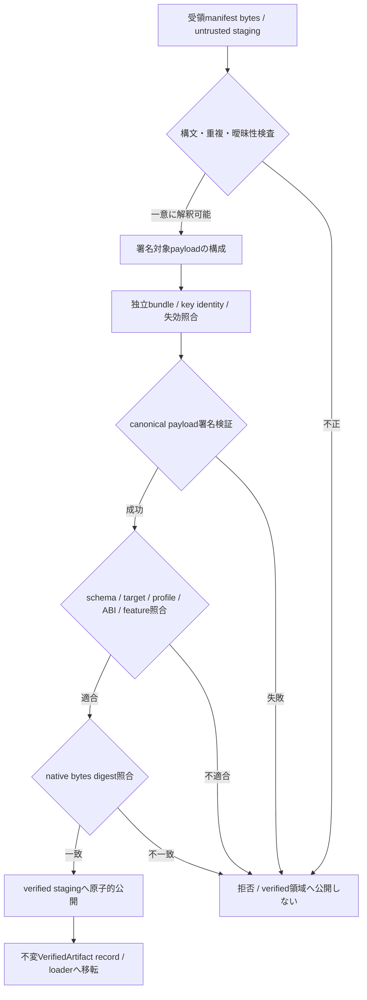

# SD-03 Artifact検証の処理設計

- 文書版: 0.2
- 状態: 責務分離・防御範囲承認済み（2026-10-17）。詳細parametersはSD-06/07へ適用済み、実環境値は未取得
- 上位根拠: [RQ-12-014](../11_requirements/RQ-12_build-distribution.md#rq-12-014)、[RQ-12-015](../11_requirements/RQ-12_build-distribution.md#rq-12-015)、[RQ-04-006](../11_requirements/RQ-04_abi-boundary.md#rq-04-006)、[RQ-05-006](../11_requirements/RQ-05_ownership-callbacks.md#rq-05-006)、[RQ-06-003](../11_requirements/RQ-06_threading-dispatch.md#rq-06-003)、[RQ-16-004](../11_requirements/RQ-16_document-governance.md#rq-16-004)
- 基本設計: [ビルド・配布：package・artifact・信頼境界](../12_design/build/packages-artifacts.md)

SecurityVerifierはraw manifest bytes、candidate native bytes、consumerのtarget/profile/ABI/feature、provision済みtrust bundleを受け取る。戻り値はVerifiedArtifact recordまたは元の失敗分類である。

## 検証のcall/data flow

構文をparseして一意payloadを作る工程は署名前にも必要となる。parse成功だけでmanifestの意味を信頼しない。未知optional項目も署名対象から除去せず、署名検証後のschema意味処理でのみ無視できる。未知major/critical、重複・曖昧な表現は拒否する。

## 暗号方式とtrust

JCS/RFC 8785 canonicalization、Ed25519署名、SHA-256 digestの既承認提案範囲（2026-10-12）を維持する。signature envelope、key ID、署名対象schema、Unicode/number検査、parser上限をSD-06で具体化した。ここで独自暗号や無条件の安全保証を追加しない。

TrustResolverは配布物または運用者がprovisionしたbundleを入力とし、認証済み更新でkeyset generationを進める。artifact/catalogと同時に取得した鍵だけで信頼を開始しない。未知・失効・検証不能は失敗とする。offlineでは明示bundleを使う。expiry/失効/鍵保管はSD-07に従い、offline情報だけで未知の失効を検知できるとは記さない。

## Stagingの所有と公開

fetcherが未検証bytesを所有し、verifierは読取りsnapshotで検査する。検証後は検査したdigest/identityに束縛したstaging objectを原子的にverified領域へ移す。loaderは同じobject/bytesを開き、検証後に別path内容へ差し替えられるTOCTOUを防ぐ。OS file ownerとatomic publishはSD-07のprivate stagingを使う。

VerifiedArtifactはidentity、digest、consumer適合結果、trust generationを不変値として持つ。失敗時は未検証recordを成功型へ変換しない。

## 承認履歴（今回）

| 日付 | 版・対象 | 承認者 | 結果 |
| --- | --- | --- | --- |
| 2026-10-17 | 0.1 / SD-03の責務・防御範囲 | 利用者 | 全案反映指示により承認。実装・実行証跡のない項目は未実装・未実行を維持 |

## 改訂履歴（今回）

| 版 | 日付 | 内容 | 作成者 |
| --- | --- | --- | --- |
| 0.1 | 2026-10-17 | SD-03の責務・防御範囲 | Codex |

## 具体化したセキュア実現

[署名envelope・schema・parser](06-manifest-wire-verifier.md)、[鍵管理・失効・offline・staging](07-trust-key-staging.md)を個別方式の正本とする。解析器のMCP/Clang入力境界は、登録workspace/readonly SDKの限定・動的plugin拒否・networkなし解析process・資源budgetで実現する。実鍵、KMS環境、digest、監査/試験結果は未取得として運用台帳へ記録する。

## 承認履歴（具体化適用）

| 日付 | 対象版・範囲 | 承認者 | 結果・根拠 |
| --- | --- | --- | --- |
| 2026-10-17 | 0.2 / SD-06/07への個別方式と解析入力境界の具体化 | 利用者 | 全件反映を指示。設計採用・本文適用を承認。実装・公開・試験合格を意味しない |

## 改訂履歴（具体化適用）

| 版 | 日付 | 変更内容 | 作成者 |
| --- | --- | --- | --- |
| 0.2 | 2026-10-17 | SD-06/07への個別方式と解析入力境界の具体化を正本へ適用し、旧判断との対応を保持 | Codex |
