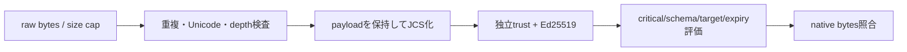

# SD-06: 署名envelope・schema・parser

- 文書版: 1.0
- 状態: 設計承認済み・正本適用済み（2026-10-17）。実装・実行検証は未完了
- 文書種別: secure-design
- 根拠RQ: [RQ-12-011](../11_requirements/RQ-12_build-distribution.md#rq-12-011)、[RQ-12-012](../11_requirements/RQ-12_build-distribution.md#rq-12-012)、[RQ-12-014](../11_requirements/RQ-12_build-distribution.md#rq-12-014)、[RQ-12-015](../11_requirements/RQ-12_build-distribution.md#rq-12-015)、[RQ-12-022](../11_requirements/RQ-12_build-distribution.md#rq-12-022)
- 基本設計: [ビルド・配布：package・artifact・信頼境界](../12_design/build/packages-artifacts.md)

本書は承認された具体化の正本である。宣言・型・command・planned pathは設計情報で、配布済みヘッダ・実装済みAPI・試験合格の証拠ではない。将来候補・optional featureは本文で区別し、初期必須へ読み替えない。

## 実現判断

| 設計ID | 実現手段・責務 | 要求根拠 |
| --- | --- | --- |
| <a id="sd-man-01"></a>SD-MAN-01 | schema major1のUTF8 JSON envelope {payload,signatures}。payloadをJCS化しdomain separatorを先頭に付けPure Ed25519で署名する。 | 上記の根拠RQ |
| <a id="sd-man-02"></a>SD-MAN-02 | signatureはkey_id/algorithm/signatureの3field、key_idはraw公開鍵32byteのSHA256 lowercase hex。signatureはraw64byteのbase64url-no-padding。 | 上記の根拠RQ |
| <a id="sd-man-03"></a>SD-MAN-03 | payloadにschema_major/minor、kind、release_id、runtime_version、abi_major、target、profile、features、artifact、signing_key_id、issued_at/expires_atを必須定義する。 | 上記の根拠RQ |
| <a id="sd-man-04"></a>SD-MAN-04 | byte_size、revision/sequence等u64はleading-zeroなし十進文字列。小さいschema/ABI majorだけsafe整数JSON number。 | 上記の根拠RQ |
| <a id="sd-man-05"></a>SD-MAN-05 | critはpayload内の必須理解field名配列。unknown optionalは署名検証後に意味処理で無視し、raw payloadからは削除しない。 | 上記の根拠RQ |
| <a id="sd-man-06"></a>SD-MAN-06 | parserは重複key、lone surrogate、不正UTF8、非finite number、trailing dataを拒否し、Unicode正規化をしない。 | 上記の根拠RQ |
| <a id="sd-man-07"></a>SD-MAN-07 | 初期local policyはmanifest1 MiB、depth32、object member4096、string64 KiB、signature8を上限候補とし構成可能にする。 | [RQ-12-022](../11_requirements/RQ-12_build-distribution.md#rq-12-022) |
| <a id="sd-man-08"></a>SD-MAN-08 | readerはschema major1だけを初期対応。minorはunknown optional追加のみ、破壊変更はmajor更新。 | 上記の根拠RQ |
| <a id="sd-man-09"></a>SD-MAN-09 | 公式RFC test vectorsと本schemaのnegative vectorsを併用。test-vector digest/expected classificationをrelease evidenceへ保存する。 | 上記の根拠RQ |

## 実現設計

### Envelope例（署名値は説明用で、有効な署名ではない）

```json
{
  "payload": {
    "schema_major": 1,
    "schema_minor": 0,
    "kind": "freemvvm.native-artifact",
    "release_id": "runtime-1.0.0-linux-x64-glibc236",
    "runtime_version": "1.0.0",
    "abi_major": 1,
    "target": {"os":"linux","arch":"x86_64","triple":"x86_64-unknown-linux-gnu"},
    "profile": "linux-x64-glibc236",
    "features": ["core.mvvm.v1"],
    "dependencies": [],
    "artifact": {"filename":"libfreemvvm_abi1.so","byte_size":"12345","sha256":"<64 lowercase hex>"},
    "signing_key_id": "<64 lowercase hex>",
    "issued_at": "2026-10-17T00:00:00Z",
    "expires_at": "2026-11-16T00:00:00Z",
    "crit": ["kind","abi_major","target","profile","features","dependencies","artifact","signing_key_id","expires_at"]
  },
  "signatures": [{"key_id":"<64 lowercase hex>","algorithm":"Ed25519","signature":"<base64url raw64>"}]
}
```

署名messageはASCII `freemvvm.artifact-manifest.v1` + NUL一個 + JCS(payload)のUTF8 bytes。key_idはpayloadのsigning_key_idと一致させる。envelope自体の署名配列の順は認証結果へ影響させず、同keyの重複signatureを拒否する。key roles/thresholdは独立trust bundleで評価する。

| field | 型・条件 | 意味利用前の検査 |
|---|---|---|
| schema_major/minor / abi_major | 0以上のsafe整数。major1のみ | 署名済みpayloadのschema reader選択 |
| target | os/arch/triple固定語彙 | consumer profileと完全照合 |
| profile / release_id | ASCII識別子、最大128byte | pathとして解釈せずcatalog keyにする |
| features | unique UTF8識別子配列 | 必要featureすべてがRuntime/manifest双方で対応 |
| artifact.filename | basenameのみ、区切り/..禁止 | fetch先や展開pathへ無検査結合しない |
| artifact.byte_size / sha256 | 十進u64 string / 64 hex | 実bytes長・digest照合 |
| issued_at/expires_at | UTC秒精度RFC3339、issued<expires | trust clockと期間policyで評価 |



方式の根拠は[RFC 8785](https://www.rfc-editor.org/rfc/rfc8785)と[RFC 8032](https://www.rfc-editor.org/rfc/rfc8032)。RFCの採用は本schemaのfieldやpolicy値を規格が定めているという意味ではない。JCSとEd25519のライブラリは既存の適合実装をpinして利用し、暗号を独自実装しない。exact依存版/hashはprofile lock生成手順で実値を固定する。


## 検証実装の候補と互換vector

Rust verifierの初期依存候補は [ed25519-dalek 2.2.0](https://docs.rs/ed25519-dalek/2.2.0/ed25519_dalek/)、[serde_jcs 0.1.0](https://docs.rs/serde_jcs/0.1.0/serde_jcs/)、[sha2 0.10.9](https://docs.rs/sha2/0.10.9/sha2/)。これらを現在の最新版・監査済みとして扱わず、RFC vector/Unicode key sort/number roundtrip/negative key vectorとminimum compilerでのbuildを採用gateにする。pin版の依存脆弱性検査で失敗すれば更新案を作り、wire schemeを変えずに代替適合実装へ交換する。

Ed25519はcanonical公開鍵と非weak keyをprovision条件にし、verify_strict相当の検査を候補とする。strict実装はRFCの許容表現すべてと同一の受入集合とは限らないため、公式publisherのkey/署名profileで互換vectorを固定し、RFC完全受入互換と無条件に表示しない。受入方針はschema/key profileのレビュー範囲として記録する。

dependenciesは必須配列（依存なしなら空）で、各native dependencyにbasename/byte_size/sha256を持たせる。Core artifactだけを検証して未検証の同名DLL/.soへ依存解決しない。配布archiveを使用する場合は署名済みentry inventoryを別payloadに含め、相対path、type、size、digestを各entryに束縛する。absolute/..、symlink/hardlink、未列挙entryは拒否する。

## 承認履歴（具体化適用）

| 日付 | 対象版・範囲 | 承認者 | 結果・根拠 |
| --- | --- | --- | --- |
| 2026-10-17 | 1.0 / SD-06 / 9判断とinterface・所有・状態遷移 | 利用者 | 全件反映を指示。設計採用・本文適用を承認。実装・公開・試験合格を意味しない |

## 改訂履歴（具体化適用）

| 版 | 日付 | 変更内容 | 作成者 |
| --- | --- | --- | --- |
| 1.0 | 2026-10-17 | SD-06 / 9判断とinterface・所有・状態遷移を正本へ適用し、旧判断との対応を保持 | Codex |
