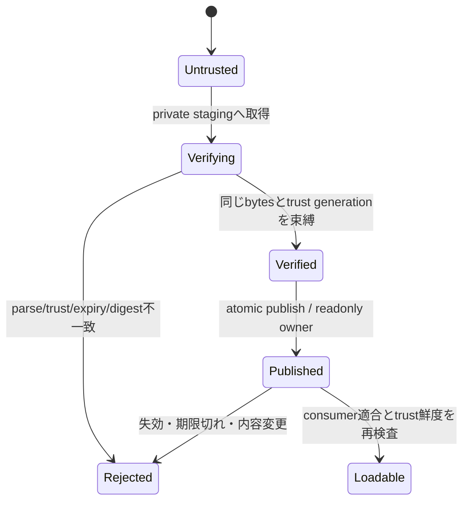

# SD-07: 鍵管理・失効・offline・staging

- 文書版: 1.0
- 状態: 設計承認済み・正本適用済み（2026-10-17）。実装・実行検証は未完了
- 文書種別: secure-design
- 根拠RQ: [RQ-12-013](../11_requirements/RQ-12_build-distribution.md#rq-12-013)、[RQ-12-014](../11_requirements/RQ-12_build-distribution.md#rq-12-014)、[RQ-12-015](../11_requirements/RQ-12_build-distribution.md#rq-12-015)、[RQ-12-020](../11_requirements/RQ-12_build-distribution.md#rq-12-020)、[RQ-12-023](../11_requirements/RQ-12_build-distribution.md#rq-12-023)
- 基本設計: [ビルド・配布：package・artifact・信頼境界](../12_design/build/packages-artifacts.md)

本書は承認された具体化の正本である。宣言・型・command・planned pathは設計情報で、配布済みヘッダ・実装済みAPI・試験合格の証拠ではない。将来候補・optional featureは本文で区別し、初期必須へ読み替えない。

## 実現判断

| 設計ID | 実現手段・責務 | 要求根拠 |
| --- | --- | --- |
| <a id="sd-trust-01"></a>SD-TRUST-01 | root/targets/revocationの役割を分ける。rootは2-of-3 offline鍵、targetsは1-of-2 release鍵をKMS/HSM、失効metadataはroot認証roleで発行する。 | 上記の根拠RQ |
| <a id="sd-trust-02"></a>SD-TRUST-02 | rotationはroot version単調増加、旧root閾値と新root閾値の両方で次rootを署名して逐次更新する。 | 上記の根拠RQ |
| <a id="sd-trust-03"></a>SD-TRUST-03 | trust bundleはroot/keyset/revocation/sequence/issued/expiresを所有し、provision経路はwrapper配布物か運用者の明示ファイル導入。 | 上記の根拠RQ |
| <a id="sd-trust-04"></a>SD-TRUST-04 | 提案既定期間はroot365日、release manifest30日、revocation7日。期限切れはonline/offlineとも拒否し明示bundle更新を求める。 | [RQ-12-023](../11_requirements/RQ-12_build-distribution.md#rq-12-023) |
| <a id="sd-trust-05"></a>SD-TRUST-05 | rollback対策は最大root/revocation sequenceと確認時刻を保存。time rollback/保存破損は不明としてfail closed。 | [RQ-12-023](../11_requirements/RQ-12_build-distribution.md#rq-12-023) |
| <a id="sd-trust-06"></a>SD-TRUST-06 | artifact cacheはidentity+digestの不変object、検証は同一open objectをpin。stagingからverifiedへの公開は同一filesystemのatomic rename。 | 上記の根拠RQ |
| <a id="sd-trust-07"></a>SD-TRUST-07 | Windowsはowner ACLのprivate dirと書込/削除共有を許さないopen handle、Linuxは0700 dir+openat/O_NOFOLLOW+fstatで候補を固定する。 | 上記の根拠RQ |
| <a id="sd-trust-08"></a>SD-TRUST-08 | 秘密鍵は配布物に含めずrelease roleから署名serviceを呼ぶ。緊急失効は新metadata公開・影響一覧・再署名releaseを運用recordへ残す。 | [RQ-12-023](../11_requirements/RQ-12_build-distribution.md#rq-12-023) |
| <a id="sd-trust-09"></a>SD-TRUST-09 | cache失効/改ざんはpurge候補を報告し、既存固定版を別versionへ自動差替えしない。 | 上記の根拠RQ |

## 実現設計

### 型・状態と所有

```text
TrustBundle { root_version, roles, keysets, revocations, sequence, issued, expires }
VerifiedArtifact { identity, digest, target_profile, trust_generation,
                   pinned_object, validated_at }
StagingObject { private_dir_owner, writable_fd, expected_size }
```



Linuxでは検証済みcacheを別private stagingへcopyし、そのcopyのfdからhashを計算してpublishする。loaderはその同じprivate directoryの不変objectを使い、同digestの再公開は既存内容照合後にreuseする。Windowsでは検証時からloadまで書込/削除共有を抑止したhandleを保持する。hardlink/symlink/archiveのpath traversalを拒否し、依存native libraryもprofileのallowlistとdigestで解決する。cache directoryの所有者/権限が不適切なら利用しない。

networkは明示fetch時のみHTTPS、redirectは同originまたは署名済みcatalogで列挙したoriginだけ。digest検査はtransportの認証と別に必須。signature/envelopeとtrust bundleのroleは別domain separatorで署名し、artifactのsignatureをroot metadataへ転用できないようにする。

時計・sequenceの保存はOSのユーザー専用config領域へatomic更新する。初回offline導入はbundle fingerprintと時刻の明示provisionを要求する。verified cacheの既過去合格を現在の未失効証明に使わない。期限数値は利用者可視のoffline利用条件なのでRQ-12-023の承認済み条件を適用する。


## 時刻とmetadata期間の具体化

時刻はUTC epochを内部値とし、wireは秒精度のZ表記のみを受理する。issued_atが確認clockより5分超未来なら拒否する。clockと保存済みlast-verified時刻が逆転したら自動的に期限を延長せず、明示clock再provisionを要求する。root更新は365日以内、revocationの通常再発行は日次、鍵侵害時はSecurityMaintainerが失効recordを作成しrelease停止→新bundle公開→影響release一覧公開の順で処理する。利用者が取得するまでの遅延は消せないため、7日既定と長期airgap profileの採否を要求案と一緒に審査する。

## 承認履歴（具体化適用）

| 日付 | 対象版・範囲 | 承認者 | 結果・根拠 |
| --- | --- | --- | --- |
| 2026-10-17 | 1.0 / SD-07 / 9判断とinterface・所有・状態遷移 | 利用者 | 全件反映を指示。設計採用・本文適用を承認。実装・公開・試験合格を意味しない |

## 改訂履歴（具体化適用）

| 版 | 日付 | 変更内容 | 作成者 |
| --- | --- | --- | --- |
| 1.0 | 2026-10-17 | SD-07 / 9判断とinterface・所有・状態遷移を正本へ適用し、旧判断との対応を保持 | Codex |
