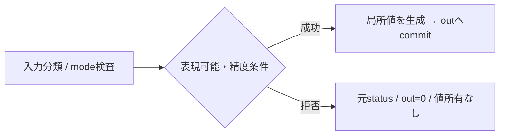

# 未設計レビュー / F32の提供経路・数値変換

- 文書版: 0.2
- 状態: 全判断承認済み・正本適用済み（2026-10-17）
- 判断ID: REM-VALUE-01～07
- 入口: [全件索引](index.md)
- 根拠RQ: [RQ-04-002](../../11_requirements/RQ-04_abi-boundary.md#rq-04-002)、[RQ-02-017](../../11_requirements/RQ-02_core-features.md#rq-02-017)、[RQ-02-018](../../11_requirements/RQ-02_core-features.md#rq-02-018)、[RQ-02-019](../../11_requirements/RQ-02_core-features.md#rq-02-019)、[RQ-04-025](../../11_requirements/RQ-04_abi-boundary.md#rq-04-025)
- 具体化するBD: [BD-01](../../12_design/BD-01_value-types-upper-design.md)
- 適用対象DD/SD: [DD-05](../../13_detail_design/05-boundary-values-errors.md)、[DD-06](../../13_detail_design/06-abi-surface.md)、[DD-07](../../13_detail_design/07-property-notification.md)

本書は承認したレビュー記録である。推奨案と代替理由は提案時点の比較として保持する。現行の方式・正式判断IDは[DD-24: F32の提供経路・数値変換](../../13_detail_design/24-numeric-conversion.md)を正本とする。採用済みでも本文に将来候補と記した範囲は初期必須へ昇格しない。

## 判断案

| 判断ID | 推奨案・具体的な選択 | 代替と選択理由 | 承認区分 |
| --- | --- | --- | --- |
| REM-VALUE-01 | F32は型別変換関数の入力/出力で提供し、初期Property kindを増やさない。float→doubleは全有限値を正確に拡張する。 | F32 Property追加は初期五型要求を変更する。F32を宣言だけ置く案は要求を満たさない。 | DD・REM-RQ-01 |
| REM-VALUE-02 | double→floatはExact/NearestEvenを明示する。Exactは復元値不一致を拒否、NearestEvenはIEEE binary32の最近接偶数丸め、有限値のoverflowは拒否。 | C castだけに依存すると環境rounding/overflowの説明が不足する。 | DD・REM-RQ-01 |
| REM-VALUE-03 | NaNはquiet NaNへ正規化しpayload保存を保証しない。符号付きzeroと同符号infinityは保持する。 | bit payloadまで保証する場合は別のbits APIが必要。既存F64 Propertyの同値時表現保持とは区別する。 | DD・REM-RQ-01 |
| REM-VALUE-04 | 内蔵UTF8→I64/DECIMALと逆formatを次段階の明示converter候補にする。初期Bindingの同kind制限を維持する。 | Binding自動変換の追加はValidationと伝播errorの意味を変える。 | 範囲・REM-RQ-02 |
| REM-VALUE-05 | I64 parserはASCII sign+digits、DECIMALはsign+digits+optional dot、locale/指数/桁区切りなし。完成値だけを解析し、途中入力判定はTextBox Validatorへ残す。 | locale依存parserは4言語間の再現性を下げる。指数記法等は拡張featureにする。 | DD・REM-RQ-02 |
| REM-VALUE-06 | DECIMALは係数をchecked arithmeticで組み立て、末尾zeroを削れる場合だけscale/係数を正規化して値域へ収める。黙示丸めしない。 | 任意precisionの言語DecimalをそのままCoreへ保持しない。 | DD |
| REM-VALUE-07 | BOOL/I64/UTF8/F64/DECIMAL、OBJECT予約の既存kind IDを保持する。F32 conversionは独立featureとして追加する。 | enum穴詰め・OBJECT再利用は互換性を破る。 | DD |

<a id="rem-value-01"></a>

<a id="rem-value-02"></a>

<a id="rem-value-03"></a>

<a id="rem-value-04"></a>

<a id="rem-value-05"></a>

<a id="rem-value-06"></a>

<a id="rem-value-07"></a>

## 実現設計案

### 公開C ABI案とwrapper対応

```c
/* 新規symbol案。既存signatureは変更しない。 */
ui_status ui_abi_1_numeric_expand_f32(float value, double *out_value,
                                    ui_handle *out_error);
ui_status ui_abi_1_numeric_narrow_f64(double value, uint32_t mode,
                                    float *out_value, ui_handle *out_error);
/* mode: EXACT=0 / NEAREST_EVEN=1 */
```

Runtimeを持たない純粋変換なので任意thread。required outputは0、optional errorは0へ初期化する。`FloatCodec`がbinary64を分類し、整数mantissa/exponentとguard/round/sticky bitでbinary32へ丸める。ambient floating environmentに丸めを委ねない。targetのfloat/double幅・IEEE表現はABI build gateで確認し、未適合targetでfeatureをtrueにしない。

| 言語 | 入出力型 | 所有・失敗 |
|---|---|---|
| C++ | float / double、Result | 値所有なし、失敗は数値変換error |
| C# | float / double、UiResult | P/Invoke固定型、範囲外を例外またはTry結果へ |
| Rust | f32 / f64、Result | safe facade、所有token不要 |
| Python | floatとctypes.c_float/c_double | Python floatのdoubleからc_floatへ変換する前にABIで検査。大値を先にc_floatへ通して失わない |



converter候補は`NumericParser.parse_i64/parse_decimal`と`NumericFormatter.format_*`に分離する。DECIMALのformatはlocaleなしの最短の数値表記とし、TextBox原文の末尾zeroは編集領域で保持する。将来のnullable/custom/OBJECTは後述の範囲案に留める。

## 適用結果

全判断を[DD-24](../../13_detail_design/24-numeric-conversion.md)へ正式IDで適用した。関連要求の変更もRQ本文へ反映した。実装・試験実行は未完了。[全200件の適用表](../remaining-design-application-result.md)で旧新対応を確認できる。

## 承認履歴

| 日付 | 範囲 | 承認者 | 結果 |
| --- | --- | --- | --- |
| 2026-10-17 | 本書の案作成 | 利用者 | 一括生成指示。方式採用・正本適用は未承認 |

## 改訂履歴

| 版 | 日付 | 内容 | 作成者 |
| --- | --- | --- | --- |
| 0.1 | 2026-10-17 | 現行の未設計箇所を実現案・代替・interfaceへ具体化 | Codex |

## 承認履歴（具体化適用）

| 日付 | 対象版・範囲 | 承認者 | 結果・根拠 |
| --- | --- | --- | --- |
| 2026-10-17 | 0.2 / 本書の全推奨案と補足の採用・正本適用 | 利用者 | 全件反映を指示。設計採用・本文適用を承認。実装・公開・試験合格を意味しない |

## 改訂履歴（具体化適用）

| 版 | 日付 | 変更内容 | 作成者 |
| --- | --- | --- | --- |
| 0.2 | 2026-10-17 | 本書の全推奨案と補足の採用・正本適用を正本へ適用し、旧判断との対応を保持 | Codex |
