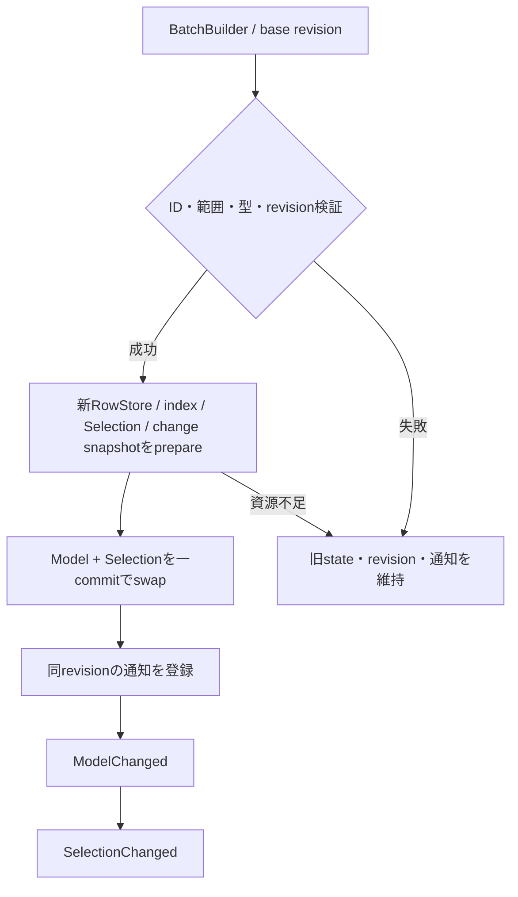

# 未設計レビュー / Collection・Selectionの所有、batch、snapshot

- 文書版: 0.2
- 状態: 全判断承認済み・正本適用済み（2026-10-17）
- 判断ID: REM-COLLECTION-01～09
- 入口: [全件索引](index.md)
- 根拠RQ: [RQ-02-005](../../11_requirements/RQ-02_core-features.md#rq-02-005)、[RQ-02-006](../../11_requirements/RQ-02_core-features.md#rq-02-006)、[RQ-09-019](../../11_requirements/RQ-09_ui-scope.md#rq-09-019)、[RQ-09-020](../../11_requirements/RQ-09_ui-scope.md#rq-09-020)、[RQ-09-050](../../11_requirements/RQ-09_ui-scope.md#rq-09-050)、[RQ-09-051](../../11_requirements/RQ-09_ui-scope.md#rq-09-051)、[RQ-09-052](../../11_requirements/RQ-09_ui-scope.md#rq-09-052)
- 具体化するBD: [BD-33](../../12_design/BD-33_collection-grid-upper-design.md)、[BD-34](../../12_design/BD-34_selection-model-upper-design.md)、[BD-35](../../12_design/BD-35_collection-change-batch-upper-design.md)
- 適用対象DD/SD: [DD-01](../../13_detail_design/01-handle-registry.md)、[DD-02](../../13_detail_design/02-runtime-lifetime.md)、[DD-11](../../13_detail_design/11-ui-tree-lifetime.md)

本書は承認したレビュー記録である。推奨案と代替理由は提案時点の比較として保持する。現行の方式・正式判断IDは[DD-25: Collection・Selectionの所有、batch、snapshot](../../13_detail_design/25-collection-selection.md)を正本とする。採用済みでも本文に将来候補と記した範囲は初期必須へ昇格しない。

## 判断案

| 判断ID | 推奨案・具体的な選択 | 代替と選択理由 | 承認区分 |
| --- | --- | --- | --- |
| REM-COLLECTION-01 | CollectionModelをschema+ordered RowStore+item index+revisionで構成。schemaは作成時固定で列ごとに既存五kindを指定する。 | 任意言語objectをitem値に保持する案はABI/所有規則の追加が必要。 | 次段階DD・REM-RQ-03 |
| REM-COLLECTION-02 | item IDはRuntime内の非再利用u64、column IDはschema内の固定u32、revisionはmodel単調u64。枯渇はcommit前に拒否する。 | 位置をidentityに使うと移動後の編集対象を取り違える。 | DD |
| REM-COLLECTION-03 | BatchBuilderはUI threadでinsert/remove/move/setを蓄積し、base revisionを照合して全件prepare後にCollectionとSelectionを一括commitする。 | 逐次適用後rollbackより事前資源確保・commit swapの方が観測整合性を示しやすい。 | DD |
| REM-COLLECTION-04 | snapshotはschema/revision/ID/値を所有する不変object。範囲の行をcopy-on-write segmentで共有し、callback内でも寿命を独立させる。 | 借用生配列は後続batchで内容が変わる。 | DD |
| REM-COLLECTION-05 | 通知はcommit済みModelChanged→SelectionChangedの順で同revisionのsnapshotを渡す。callback中のbatchは同期拒否しpostで次turnへ送る。 | 再入commitを許すと一batchの観測対象revisionが混ざる。 | DD・REM-RQ-04 |
| REM-COLLECTION-06 | Singleへ変更時に複数選択があれば変更全体を拒否する。削除後currentはnone、後継を自動選択しない。 | 最初の選択を残す縮退は暗黙の利用者状態変更。 | RQ・REM-RQ-05 |
| REM-COLLECTION-07 | Collection差替えは別SelectionModelを作る。既存Selectionの所属Collectionをその場で変更しない。 | rebind+implicit clearは公開observerの変更境界を増やす。 | DD・REM-RQ-05 |
| REM-COLLECTION-08 | 可視range取得は一snapshotとtyped column bulk copyを提供。ListViewは可視範囲+上下1 viewportを再利用候補にする。 | 固定セル数を性能保証にしない。overscanは内部設定で測定により調整する。 | DD |
| REM-COLLECTION-09 | Collection→Selectionの参照はweak index、Selection→Collectionはstrong。Runtime registryはActive subscriptionを保持、snapshotはModelを保持しない。 | 双方strongの循環を避ける。 | DD |

<a id="rem-collection-01"></a>

<a id="rem-collection-02"></a>

<a id="rem-collection-03"></a>

<a id="rem-collection-04"></a>

<a id="rem-collection-05"></a>

<a id="rem-collection-06"></a>

<a id="rem-collection-07"></a>

<a id="rem-collection-08"></a>

<a id="rem-collection-09"></a>

## 実現設計案

### 型・API案

```text
CollectionModel { schema: Arc<Schema>, state: Arc<ModelState>, observers }
ModelState { revision, ordered_rows, item_index }
SelectionModel { collection: Strong, mode, selected_ids, current_id, revision }
CollectionSnapshot { Arc<Schema>, Arc<Segments>, range, revision }
BatchBuilder { collection: Strong, base_revision, operations, PreparedState? }
```

| 操作案 | 入力/出力と所有 | thread / commit点 / 失敗 |
|---|---|---|
| collection_create(schema) | schema入力borrow→copy、owned modelを返す | UI / schema検査と資源準備後登録 / 失敗out=0 |
| collection_begin_batch(model, revision) | model borrow、owned builder | UI / 値変更なし / stale revision拒否 |
| batch_insert/remove/move/set_* | scalar/UTF8入力をbuilderへcopy | UI / builderだけ変更 / OOMで当該operation追加なし |
| batch_commit(builder) | builder borrow、owned change snapshot | UI / PreparedStateをswapする一点 / invalid/stale/OOMはModel/Selection/通知不変 |
| collection_snapshot(model, start, count) | owned immutable snapshot | UI取得、取得後は任意thread読取 / range+revision固定 |
| snapshot_copy_ids / snapshot_copy_<kind> | caller buffer、required count | 任意thread / 容量照合後copy / 不足時部分書込みなし |
| selection_set(ids, current) | IDs borrow→copy | UI / cardinality・所属を検証後commit |

公開C ABIは`ui_abi_1_` prefixと上記snake_case名を使い、行の異種値は列ごとのtyped APIで渡す。schema builderにもadd_column_<kind>を用い、C++/Rustのunionや公開可変長structをABIへ持ち出さない。



insertは現在のbatch仮state上の位置、moveはitem IDと移動後のbefore-item ID（0なら末尾）を指定する。削除済みIDへのsetはbatch全体を拒否する。insertで予約したIDは失敗しても再利用しない。同じitemへの複数setはbatch順の最後の有効操作を最終stateへ適用し、重複removeは無効batchとする。ModelChangedのchange setは観測用で、snapshotの正本と差異がある場合に独立適用して状態を再構築させない。

## 適用結果

全判断を[DD-25](../../13_detail_design/25-collection-selection.md)へ正式IDで適用した。関連要求の変更もRQ本文へ反映した。実装・試験実行は未完了。[全200件の適用表](../remaining-design-application-result.md)で旧新対応を確認できる。

## 承認履歴

| 日付 | 範囲 | 承認者 | 結果 |
| --- | --- | --- | --- |
| 2026-10-17 | 本書の案作成 | 利用者 | 一括生成指示。方式採用・正本適用は未承認 |

## 改訂履歴

| 版 | 日付 | 内容 | 作成者 |
| --- | --- | --- | --- |
| 0.1 | 2026-10-17 | 現行の未設計箇所を実現案・代替・interfaceへ具体化 | Codex |

## 承認履歴（具体化適用）

| 日付 | 対象版・範囲 | 承認者 | 結果・根拠 |
| --- | --- | --- | --- |
| 2026-10-17 | 0.2 / 本書の全推奨案と補足の採用・正本適用 | 利用者 | 全件反映を指示。設計採用・本文適用を承認。実装・公開・試験合格を意味しない |

## 改訂履歴（具体化適用）

| 版 | 日付 | 変更内容 | 作成者 |
| --- | --- | --- | --- |
| 0.2 | 2026-10-17 | 本書の全推奨案と補足の採用・正本適用を正本へ適用し、旧判断との対応を保持 | Codex |
