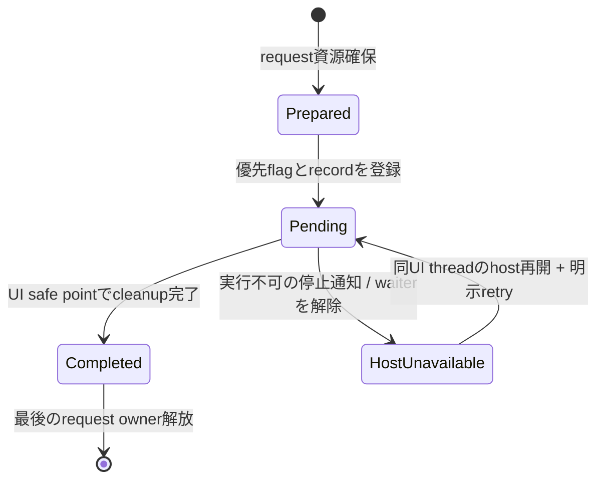

# 未設計レビュー / Host境界・shutdown完了観測・cleanup drain

- 文書版: 0.2
- 状態: 全判断承認済み・正本適用済み（2026-10-17）
- 判断ID: REM-RUNTIME-01～09
- 入口: [全件索引](index.md)
- 根拠RQ: [RQ-06-005](../../11_requirements/RQ-06_threading-dispatch.md#rq-06-005)、[RQ-06-006](../../11_requirements/RQ-06_threading-dispatch.md#rq-06-006)、[RQ-06-007](../../11_requirements/RQ-06_threading-dispatch.md#rq-06-007)、[RQ-05-012](../../11_requirements/RQ-05_ownership-callbacks.md#rq-05-012)、[RQ-02-015](../../11_requirements/RQ-02_core-features.md#rq-02-015)、[RQ-02-016](../../11_requirements/RQ-02_core-features.md#rq-02-016)
- 具体化するBD: [BD-36](../../12_design/BD-36_runtime-shutdown-dispatch-upper-design.md)、[BD-04](../../12_design/BD-04_ui-tree-lifetime-upper-design.md)
- 適用対象DD/SD: [DD-02](../../13_detail_design/02-runtime-lifetime.md)、[DD-03](../../13_detail_design/03-dispatcher.md)、[DD-04](../../13_detail_design/04-callback-lifecycle.md)、[DD-06](../../13_detail_design/06-abi-surface.md)、[DD-16](../../13_detail_design/16-platform-rendering.md)

本書は承認したレビュー記録である。推奨案と代替理由は提案時点の比較として保持する。現行の方式・正式判断IDは[DD-26: Host境界・shutdown完了観測・cleanup drain](../../13_detail_design/26-host-shutdown-api.md)を正本とする。採用済みでも本文に将来候補と記した範囲は初期必須へ昇格しない。

## 判断案

| 判断ID | 推奨案・具体的な選択 | 代替と選択理由 | 承認区分 |
| --- | --- | --- | --- |
| REM-RUNTIME-01 | 既存runtime_shutdownは同期指定の互換入口として保持し、新symbol runtime_request_shutdown(mode,out_request)を追加する。 | 既存signatureへmode引数を足すとABIを破壊する。 | DD |
| REM-RUNTIME-02 | ShutdownRequestはRuntimeのUI objectを所有せずcompletion record/Closed shellを保持。不変終端結果とPendingを任意threadからqueryできる。 | futureを言語ごとに独自実装すると受付/完了の意味がずれる。 | DD・REM-RQ-06 |
| REM-RUNTIME-03 | mode=ASYNC/SYNC。UI callback/event中は両方ともrequest登録後return。worker SYNCは完了またはhost停止の確定まで待つ。 | UI上でnested pumpして待つ方式は採用しない。 | DD |
| REM-RUNTIME-04 | HostRegistrationにbegin_event/end_event、before_stop/stoppedを設ける。outer host scopeをUI callback depthより外に置く。 | thread IDだけではhost eventの途中か判定できない。 | DD・REM-RQ-06 |
| REM-RUNTIME-05 | end_eventの最外境界でpriority shutdownを直接選択し、通常queueを再取得する前にcleanupする。 | OS優先度queueへのpostだけでは現在host event直後を保証できない。 | DD |
| REM-RUNTIME-06 | completionはPending→CompletedまたはHostUnavailable。後者から同UI threadでhostが再開すればPendingへ戻し明示retryできる。 | 待機解除をClosedやcancelled完了へ変換しない。 | DD・REM-RQ-06 |
| REM-RUNTIME-07 | release failure ticketは事前確保intrusive node。managerはtoken/stateをmutexで交換し、native call/destroy/user callbackをlock外で実行する。 | OOM時に新規nodeを確保して回収するfallbackは成立しない。 | DD |
| REM-RUNTIME-08 | native libraryはprocess lifetimeで保持しhot unloadを提供しない。Runtime shellとticket registryがdrain完了後に言語anchorを外す。 | 実行中callbackを含む任意unloadは別の停止protocolを要する。 | RQ範囲・REM-RQ-07 |
| REM-RUNTIME-09 | queueは容量の公開上限を新設せずOOM分類を維持。host wake失敗はstopped/available stateと受付を同じ同期点で照合する。 | 独自backpressure statusの初期追加は見送る。 | DD |

<a id="rem-runtime-01"></a>

<a id="rem-runtime-02"></a>

<a id="rem-runtime-03"></a>

<a id="rem-runtime-04"></a>

<a id="rem-runtime-05"></a>

<a id="rem-runtime-06"></a>

<a id="rem-runtime-07"></a>

<a id="rem-runtime-08"></a>

<a id="rem-runtime-09"></a>

## 実現設計案

### 公開・内部interface案

```c
ui_status ui_abi_1_runtime_request_shutdown(ui_handle runtime, uint32_t mode,
    ui_handle *out_owned_request, ui_handle *out_error);
ui_status ui_abi_1_shutdown_request_query(ui_handle request,
    uint32_t *out_state, uint32_t *out_reason, ui_handle *out_error);
ui_status ui_abi_1_runtime_host_begin_event(ui_handle runtime);
ui_status ui_abi_1_runtime_host_end_event(ui_handle runtime);
ui_status ui_abi_1_runtime_host_stopped(ui_handle runtime, uint32_t reason);
/* mode ASYNC=0 / SYNC=1; state Pending=0 / Completed=1 / HostUnavailable=2 */
```

request tokenのreleaseは待機取消やRuntime終了取消ではない。requestの作成資源を受付前に準備し、失敗時out=0・shutdown flag非変更。受付成功時はrequest handleを返し、未完了ならUI_PENDING、完了ならUI_OK。受付済みのrequestがhost停止で実行不能になった場合、拡張APIはUI_PENDINGとowned requestを返し、queryでHostUnavailableと理由を取得する。これはcleanup完了ではない。受付前からhostが停止済みならUI_UNSUPPORTED + domain1/HOST_LOOP_STOPPED、out_request=0とする。既存runtime_shutdownは内部requestを回収し、同期waitを停止通知で解除する場合はUI_UNSUPPORTEDとerrorを返す。失敗時out=0という既存規則を崩さない。

queryはUI_OKとstate/reasonを返し、Completedだけがcleanup完了を示す。通知callbackを新設せずpoll/言語Async wrapperをqueryへ接続する。worker waitはcondition variableでlockを解放し、Closed commitとhost-stoppedの競合ではcompletion recordを同じlockで判定しCompletedを優先する。UI threadからのrequest_waitは公開しない。



Win32独自loop、Linux poll loopは一eventを処理するRAII HostScopeのfinallyでend_eventを呼ぶ。外部Qt/wx等のhostは入口/出口と停止前通知をadapterで接続する。任意の未登録hostのすべてのeventを自動捕捉するとはしない。bridge destroyはUI cleanup完了後のsafe pointで一度だけ実行し、wake callbackのin-flightもdrainする。

manager stateはOwned→ReleaseInProgress→Released、失敗時はPendingRetry。永久失敗はticketとerrorを保持してdiagnosticを出す。UI thread以外でUI破棄を代行せず、host復旧またはprocess終了まで管理可能なtokenを残す。native libraryの早期unloadや参照循環でticketを失わない。

## 適用結果

全判断を[DD-26](../../13_detail_design/26-host-shutdown-api.md)へ正式IDで適用した。関連要求の変更もRQ本文へ反映した。実装・試験実行は未完了。[全200件の適用表](../remaining-design-application-result.md)で旧新対応を確認できる。

## 承認履歴

| 日付 | 範囲 | 承認者 | 結果 |
| --- | --- | --- | --- |
| 2026-10-17 | 本書の案作成 | 利用者 | 一括生成指示。方式採用・正本適用は未承認 |

## 改訂履歴

| 版 | 日付 | 内容 | 作成者 |
| --- | --- | --- | --- |
| 0.1 | 2026-10-17 | 現行の未設計箇所を実現案・代替・interfaceへ具体化 | Codex |

## Host/contextとcompletionの所有補足

begin_event/end_eventはUI thread専用で、対になるscope IDとdepthを検査する。end_eventの不一致はINVALID_CONTEXTでdepthを変えない。host_stoppedは任意threadから停止の確定を通知できる。before_stopはUI threadの最後の正常event境界でcleanupを先に実行し、stoppedは既に実行不能な状態のwait解除として区別する。

HostRegistrationの外部ownerはRuntime anchorを保持するが、Runtimeのwake userdataはHostRegistrationのweak stateだけを参照する。bridge closureからRuntime facadeを強く逆保持しない。CompletionRecord自体はRuntimeへの所有参照を持たず、公開ShutdownRequest objectがrecordとClosed shellを保持する。Runtime内部はrecordだけを保持し、request→Runtime→requestの循環を作らない。Closed後の再要求は同じ完了recordから新しいowned tokenを発行し、cleanupを再実行しない。

## 承認履歴（具体化適用）

| 日付 | 対象版・範囲 | 承認者 | 結果・根拠 |
| --- | --- | --- | --- |
| 2026-10-17 | 0.2 / 本書の全推奨案と補足の採用・正本適用 | 利用者 | 全件反映を指示。設計採用・本文適用を承認。実装・公開・試験合格を意味しない |

## 改訂履歴（具体化適用）

| 版 | 日付 | 変更内容 | 作成者 |
| --- | --- | --- | --- |
| 0.2 | 2026-10-17 | 本書の全推奨案と補足の採用・正本適用を正本へ適用し、旧判断との対応を保持 | Codex |
