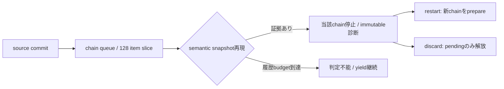

# 未設計レビュー / 通知・非収束・Command・エラーcatalog

- 文書版: 0.2
- 状態: 全判断承認済み・正本適用済み（2026-10-17）
- 判断ID: REM-EVENT-01～10
- 入口: [全件索引](index.md)
- 根拠RQ: [RQ-07-013](../../11_requirements/RQ-07_binding.md#rq-07-013)、[RQ-07-014](../../11_requirements/RQ-07_binding.md#rq-07-014)、[RQ-06-008](../../11_requirements/RQ-06_threading-dispatch.md#rq-06-008)、[RQ-06-009](../../11_requirements/RQ-06_threading-dispatch.md#rq-06-009)、[RQ-06-011](../../11_requirements/RQ-06_threading-dispatch.md#rq-06-011)、[RQ-04-023](../../11_requirements/RQ-04_abi-boundary.md#rq-04-023)、[RQ-04-027](../../11_requirements/RQ-04_abi-boundary.md#rq-04-027)
- 具体化するBD: [BD-03](../../12_design/BD-03_runtime-notification-upper-design.md)、[BD-26](../../12_design/BD-26_async-command-progress-upper-design.md)、[BD-27](../../12_design/BD-27_error-object-upper-design.md)
- 適用対象DD/SD: [DD-06](../../13_detail_design/06-abi-surface.md)、[DD-07](../../13_detail_design/07-property-notification.md)、[DD-08](../../13_detail_design/08-binding-graph.md)、[DD-10](../../13_detail_design/10-async-command.md)

本書は承認したレビュー記録である。推奨案と代替理由は提案時点の比較として保持する。現行の方式・正式判断IDは[DD-27: 通知・非収束・Command・エラーcatalog](../../13_detail_design/27-event-error-catalog.md)を正本とする。採用済みでも本文に将来候補と記した範囲は初期必須へ昇格しない。

## 判断案

| 判断ID | 推奨案・具体的な選択 | 代替と選択理由 | 承認区分 |
| --- | --- | --- | --- |
| REM-EVENT-01 | 循環履歴はchainごと256 snapshot、全体8 MiBを初期内部budgetとする。到達時はUnknownへ移し、循環と断定しない。 | budgetは性能/資源の内部設計値。多い更新を異常と判定する上限にしない。 | DD |
| REM-EVENT-02 | WatchDogはUI setterで更新し、変更時に既存chainの最初の未配信時刻から新閾値を評価。0は無効、既定5秒を保持する。 | chain途中の設定変更を将来chainだけへ適用すると設定直後の意味が分かりにくい。 | DD・REM-RQ-08 |
| REM-EVENT-03 | 診断snapshotにはchain ID、generation、開始/観測時刻、保留item数、判定種別、上限到達を持たせる。queryは任意thread。 | hash一致だけでcycleを確定しない。保存不能はUnknownを返す。 | DD |
| REM-EVENT-04 | 回復APIはdiscard_chain / restart_chain。再開は現確定値と新topology snapshotから別chain IDで作業をprepareする。 | 履歴を消して同じ停止chainを継続する案は診断の因果を混同する。 | DD |
| REM-EVENT-05 | operation ID枯渇はUI_INTERNAL_ERROR/domain4 code1。IDはRuntime内u64、公開済みIDとterminalを再利用しない。 | UI_OUT_OF_MEMORYへ偽装せず原因codeで区別する。 | DD |
| REM-EVENT-06 | start trampolineはWorkerStartLeaseを渡し、worker部分起動後の失敗はcancelを要求しleaseをworker終端まで保持する。execute受付後なのでoperation Failedへ一度だけ遷移する。 | UIからworker joinするrollbackは採用しない。 | DD |
| REM-EVENT-07 | 進捗はoptional F64単一channelの明示report/get APIを提案。0～1を正規化値、unknownは別flag。UI時刻閾値でなく最新slotとwake coalescingを使う。 | 進捗型を任意object/複数channelにすると初期APIが広がる。 | RQ・REM-RQ-09 |
| REM-EVENT-08 | user errorはappend-only error-catalog.jsonを正本にし、4言語enumを生成する。autoは未使用codeへ一度割当しlockをcommitする。 | 実行時の登録順や毎回enum.autoで値を作り直す方式は採用しない。 | DD |
| REM-EVENT-09 | causeは作成済み不変errorへのstrong参照を取得し、生成中のself/cycleを禁止。diagnosticとは別objectで保持する。 | message文字列からmachine codeを推定しない。 | DD |
| REM-EVENT-10 | 標準domainは既存1～5を保持。UI機能はdomain1、artifact検証は別tool catalogで管理しABI statusへ埋め込まない。 | domain番号を新規機能ごと無秩序に割り当てない。 | DD |

## 実現設計案

### 追加code案（既存割当は変更しない）

| domain | code | 名前 | status/用途 |
|---|---|---|---|
| 1 | 1 | HANDLE_TOKEN_EXHAUSTED | 既承認値を保持 |
| 1 | 2 | INVALID_CONTEXT | UI_INVALID_ARGUMENT、禁止contextの拒否 |
| 1 | 3 | HOST_LOOP_STOPPED | UI_UNSUPPORTED、受付済み未完了requestの待機解除 |
| 1 | 4 | RESOURCE_PREPARATION_FAILED | UI_OUT_OF_MEMORY、commit前準備失敗 |
| 1 | 5 | LAYOUT_RANGE_OVERFLOW | UI_INVALID_ARGUMENT、有限geometry範囲外 |
| 1 | 6 | PEER_PREPARATION_FAILED | UI_INTERNAL_ERROR、tree所属前peer準備失敗 |
| 1 | 7 | REVISION_EXHAUSTED | UI_INTERNAL_ERROR、model/revision採番不可 |
| 2 | 1 | VALIDATOR_REJECTED | UI_VALIDATION_FAILED、利用者理由なしの拒否 |
| 2 | 2 | VALIDATOR_CALLBACK_FAILED | UI_INTERNAL_ERROR、判定処理異常 |
| 3 | 1～3 | 既存Binding catalog | GRAPH_CYCLE / TARGET_ALREADY_HAS_INPUT / DUPLICATE_EDGEを保持 |
| 3 | 4 | NONCONVERGENT_CHAIN | diagnostic分類。通常setter成功を事後失敗へ変えない |
| 4 | 1 | OPERATION_ID_EXHAUSTED | UI_INTERNAL_ERROR |
| 4 | 2 | STALE_OPERATION | UI_INVALID_ARGUMENT。過去IDのcomplete拒否 |
| 4 | 3 | START_CALLBACK_FAILED | operation failure snapshot内の分類 |
| 5 | 1 | INPUT_CALLBACK_FAILED | UI_INTERNAL_ERROR、通常Rejectとは区別 |
| 5 | 2 | COMMIT_CANDIDATE_UNAVAILABLE | UI_OUT_OF_MEMORY、IME回復不可の原因 |
| 5 | 3 | COMMITTED_PROPERTY_REJECTED | input reason内の原因。元Property拒否errorをcauseとして保持 |

資源不足でerror snapshotを生成できなければ元statusとout_error=0を返し、codeが得られたと偽らない。

`runtime_set_watchdog_seconds(f64)`はNaN/負数を拒否し、0をdisabledとして保存する。`runtime_chain_diagnostic_snapshot(chain_id)`、`runtime_chain_discard`、`runtime_chain_restart`はUI mutationと不変snapshot readを分ける。各公開操作の失敗で旧chain/診断recordを部分変更しない。

WorkerStartLeaseはcancel token・Command弱参照・Runtimeのpost可能shellを保持する。workerの終了がpostできないClosed時は業務資源を言語内で解放し、UI stateを更新しない。screen ownerは初期APIへ追加せず、明示Command.closeをアプリの画面寿命へ接続する。後続のstructured task groupは別範囲案とする。

## 適用結果

全判断を[DD-27](../../13_detail_design/27-event-error-catalog.md)へ正式IDで適用した。関連要求の変更もRQ本文へ反映した。実装・試験実行は未完了。[全200件の適用表](../remaining-design-application-result.md)で旧新対応を確認できる。

## 承認履歴

| 日付 | 範囲 | 承認者 | 結果 |
| --- | --- | --- | --- |
| 2026-10-17 | 本書の案作成 | 利用者 | 一括生成指示。方式採用・正本適用は未承認 |

## 改訂履歴

| 版 | 日付 | 内容 | 作成者 |
| --- | --- | --- | --- |
| 0.1 | 2026-10-17 | 現行の未設計箇所を実現案・代替・interfaceへ具体化 | Codex |

## error catalog生成とdiagnosticの補足

error-catalog.json案は `schema, namespace, domain, entries[{name,code}], tombstones[], next_code`。domainは利用者が明示的に選ぶuser-defined範囲のu32で、複数catalogの衝突はgeneratorが拒否する。autoはcode未記入の新entryにだけ割当て、既存のname/code変更・tombstone再利用を拒否する。生成物はC++ enum、C# enum、Rust repr(u32) enum、Python IntEnumの確定値を持つ。Python enum.auto()と同様の書き易さを提供しても、wire値は生成lockで安定化する。

diagnosticは最大64 KiB、cause traversal深さ8をlocal保存budgetの候補とし、超過はtruncated flagで明示する。元のerror snapshot/messageを変更しない。診断へ入力文字列・filepath全文・credentialを自動転記しない。callback例外はrule ID・種別・raw status・source locationを優先し、任意messageは明示opt-in policyで保存する。このbudgetは製品errorの許容長制限ではない。

## 承認履歴（具体化適用）

| 日付 | 対象版・範囲 | 承認者 | 結果・根拠 |
| --- | --- | --- | --- |
| 2026-10-17 | 0.2 / 本書の全推奨案と補足の採用・正本適用 | 利用者 | 全件反映を指示。設計採用・本文適用を承認。実装・公開・試験合格を意味しない |

## 改訂履歴（具体化適用）

| 版 | 日付 | 変更内容 | 作成者 |
| --- | --- | --- | --- |
| 0.2 | 2026-10-17 | 本書の全推奨案と補足の採用・正本適用を正本へ適用し、旧判断との対応を保持 | Codex |
