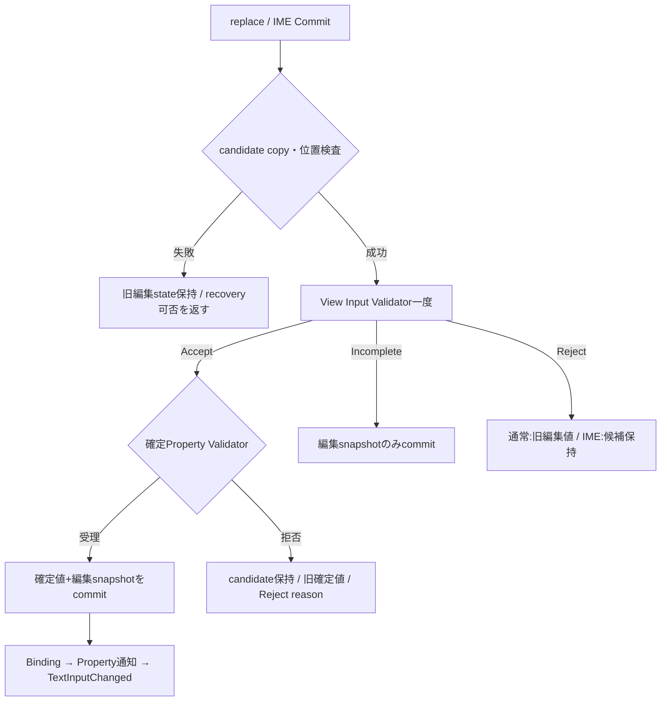

# 未設計レビュー / 編集API・Unicode位置・IME回復

- 文書版: 0.2
- 状態: 全判断承認済み・正本適用済み（2026-10-17）
- 判断ID: REM-TEXTBOX-01～09
- 入口: [全件索引](index.md)
- 根拠RQ: [RQ-09-038](../../11_requirements/RQ-09_ui-scope.md#rq-09-038)、[RQ-09-039](../../11_requirements/RQ-09_ui-scope.md#rq-09-039)、[RQ-09-040](../../11_requirements/RQ-09_ui-scope.md#rq-09-040)、[RQ-09-041](../../11_requirements/RQ-09_ui-scope.md#rq-09-041)、[RQ-09-042](../../11_requirements/RQ-09_ui-scope.md#rq-09-042)、[RQ-09-055](../../11_requirements/RQ-09_ui-scope.md#rq-09-055)、[RQ-09-056](../../11_requirements/RQ-09_ui-scope.md#rq-09-056)
- 具体化するBD: [BD-09](../../12_design/BD-09_ime-focus-transition-upper-design.md)、[BD-10](../../12_design/BD-10_ime-platform-boundary-upper-design.md)、[BD-23](../../12_design/BD-23_text-shaping-upper-design.md)、[BD-24](../../12_design/BD-24_ime-edit-session-upper-design.md)
- 適用対象DD/SD: [DD-09](../../13_detail_design/09-validation-input.md)、[DD-13](../../13_detail_design/13-input-focus.md)、[DD-14](../../13_detail_design/14-textbox-ime.md)

本書は承認したレビュー記録である。推奨案と代替理由は提案時点の比較として保持する。現行の方式・正式判断IDは[DD-28: 編集API・Unicode位置・IME回復](../../13_detail_design/28-text-edit-api.md)を正本とする。採用済みでも本文に将来候補と記した範囲は初期必須へ昇格しない。

## 判断案

| 判断ID | 推奨案・具体的な選択 | 代替と選択理由 | 承認区分 |
| --- | --- | --- | --- |
| REM-TEXTBOX-01 | Core内部の正本位置はUTF8 byte offset、境界はUnicode scalar boundary。OS UTF16/codepoint位置はTextIndexMapで変換する。 | 全内部をgrapheme indexにするとA25 byte offsetとOS変換の更新コストが増える。 | DD |
| REM-TEXTBOX-02 | anchor/caretを別に保持し、selectionはmin/maxから得る。TextSnapshotは本文・位置・composition・feedback・revisionを一体で所有する。 | start/endだけでは逆向きselectionとcaret affinityを表せない。 | DD |
| REM-TEXTBOX-03 | edit_replace(range,utf8,post_selection,origin)を基本操作にし、set_selection/reset_to_committed/ime_cancel/retry_commitを別操作へ分ける。 | 特定キーからの呼出しを仕様へ含めない。 | DD・REM-RQ-10 |
| REM-TEXTBOX-04 | Start snapshotのinput state/reason復元と自身Property拒否後の候補保持は既承認を維持する。 | 旧未決案A/Cへ戻さない。 | 既承認確認 |
| REM-TEXTBOX-05 | IME CommitはCore copy成功を受付点とする。Adapterは可能なprofileだけ再送leaseを持つ。copy失敗はRecoveryAvailable/Unavailableを明示する。 | OOM時の無条件入力保持を保証しない。 | DD |
| REM-TEXTBOX-06 | retry_commitは未評価の所有候補だけ再評価する。既にValidatorへ渡したcommit IDは再実行しない。 | 二重callbackや二重業務副作用を避ける。 | DD |
| REM-TEXTBOX-07 | 通知は同commitのBinding伝播→Property通知→TextInputChanged。snapshotはcommit時に固定し、callback中の変更は次generationへ送る。 | 読出し時のlive値だけを通知payloadにすると原因commitを特定できない。 | DD・REM-RQ-11 |
| REM-TEXTBOX-08 | grapheme navigationはUnicode 16.0 UAX29の導出indexを使う候補とし、文字入力のキー割当・Undo/Redoは初期非採用のまま。 | scalar単位移動とユーザー認識文字単位の保証を区別する。 | 範囲・REM-RQ-10 |
| REM-TEXTBOX-09 | session IDはRuntime単調u64、Startで発行しAdapterへ渡す。外部値変更/FocusLost/Cancel/終了で失効する。 | OSの可変session IDをそのままCore identityにしない。 | DD |

<a id="rem-textbox-01"></a>

<a id="rem-textbox-02"></a>

<a id="rem-textbox-03"></a>

<a id="rem-textbox-04"></a>

<a id="rem-textbox-05"></a>

<a id="rem-textbox-06"></a>

<a id="rem-textbox-07"></a>

<a id="rem-textbox-08"></a>

<a id="rem-textbox-09"></a>

## 実現設計案

### Classとcall flow

```text
TextBoxState { committed_property, Arc<TextSnapshot>, session_counter }
TextSnapshot { utf8, anchor_byte, caret_byte, affinity, composition?, feedback,
               reason: ErrorSnapshot?, revision, recovery }
PreparedEdit { candidate: Arc<Utf8>, positions, origin, session_id, commit_id }
TextIndexMap { scalar_to_byte, utf16_to_byte, grapheme_to_byte }
```



| API案 | 入力・出力 | thread / 所有・失敗 |
|---|---|---|
| text_box_edit_replace | start/end byte、UTF8 borrow、anchor/caret、origin → edit result | UI、保持分をcopy、位置不正で旧state維持 |
| text_box_snapshot | owned TextSnapshot | UI取得、以後任意thread読取。snapshotにUI owner参照を残さない |
| text_snapshot_copy_utf8 / selection / feedback | caller buffer / scalar outputs / owned reason | 任意thread、buffer不足で部分書込みなし |
| text_box_set_selection | anchor/caret byteとaffinity | UI、UTF8 interiorを拒否。値確定やValidatorを呼ばない |
| text_box_reset_to_committed | TextBox borrow | UI、旧session失効後に編集値を確定値へcopyして一commit |
| text_box_retry_commit / discard_recovery | recovery handle | UI、未評価候補を一度だけ消費。失敗でowned recoveryを維持 |

TextInputChangedにはowned snapshotを明示取得できるborrowed snapshotを渡す。snapshot中のreasonは不変内部owner、getterで返す場合だけ独立所有tokenを発行する。Preedit Updateは編集通知だけをenqueueし、確定値のProperty/Binding通知を作らない。属性segmentはbyte range＋Underline/Selectedの中立値で保持し、OS候補UIのpagingはAdapterが処理する。

外部から異なる確定値がcommitされたら旧session/recoveryを失効させ、編集snapshotを差し替える。同値setterでは編集値を置き換えない。copy失敗後にOS側sessionが既に終わっている場合はCore sessionもEndedとして記録し、失われたcandidateを保存済みと表示しない。

位置単位の根拠は[Unicode UAX #29](https://www.unicode.org/reports/tr29/)で確認し、利用する版は[Unicode16.0.0](https://www.unicode.org/versions/Unicode16.0.0/)としてtableを固定する案。Unicode規格の採用版と実際のfont対応範囲は別に管理する。

## 適用結果

全判断を[DD-28](../../13_detail_design/28-text-edit-api.md)へ正式IDで適用した。関連要求の変更もRQ本文へ反映した。実装・試験実行は未完了。[全200件の適用表](../remaining-design-application-result.md)で旧新対応を確認できる。

## 承認履歴

| 日付 | 範囲 | 承認者 | 結果 |
| --- | --- | --- | --- |
| 2026-10-17 | 本書の案作成 | 利用者 | 一括生成指示。方式採用・正本適用は未承認 |

## 改訂履歴

| 版 | 日付 | 内容 | 作成者 |
| --- | --- | --- | --- |
| 0.1 | 2026-10-17 | 現行の未設計箇所を実現案・代替・interfaceへ具体化 | Codex |

## 承認履歴（具体化適用）

| 日付 | 対象版・範囲 | 承認者 | 結果・根拠 |
| --- | --- | --- | --- |
| 2026-10-17 | 0.2 / 本書の全推奨案と補足の採用・正本適用 | 利用者 | 全件反映を指示。設計採用・本文適用を承認。実装・公開・試験合格を意味しない |

## 改訂履歴（具体化適用）

| 版 | 日付 | 変更内容 | 作成者 |
| --- | --- | --- | --- |
| 0.2 | 2026-10-17 | 本書の全推奨案と補足の採用・正本適用を正本へ適用し、旧判断との対応を保持 | Codex |
