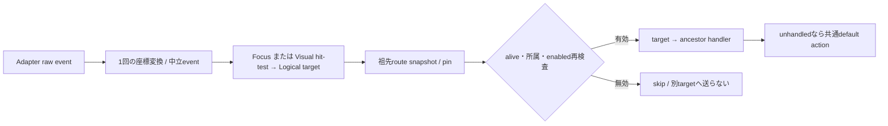

# 未設計レビュー / Layout・座標・Input route・Tree所属

- 文書版: 0.2
- 状態: 全判断承認済み・正本適用済み（2026-10-17）
- 判断ID: REM-GEOMETRY-01～09
- 入口: [全件索引](index.md)
- 根拠RQ: [RQ-09-008](../../11_requirements/RQ-09_ui-scope.md#rq-09-008)、[RQ-09-043](../../11_requirements/RQ-09_ui-scope.md#rq-09-043)、[RQ-09-044](../../11_requirements/RQ-09_ui-scope.md#rq-09-044)、[RQ-09-046](../../11_requirements/RQ-09_ui-scope.md#rq-09-046)、[RQ-09-049](../../11_requirements/RQ-09_ui-scope.md#rq-09-049)、[RQ-09-057](../../11_requirements/RQ-09_ui-scope.md#rq-09-057)
- 具体化するBD: [BD-04](../../12_design/BD-04_ui-tree-lifetime-upper-design.md)、[BD-05](../../12_design/BD-05_logical-visual-tree-upper-design.md)、[BD-06](../../12_design/BD-06_layout-upper-design.md)、[BD-07](../../12_design/BD-07_input-event-boundary-upper-design.md)、[BD-08](../../12_design/BD-08_focus-upper-design.md)
- 適用対象DD/SD: [DD-11](../../13_detail_design/11-ui-tree-lifetime.md)、[DD-12](../../13_detail_design/12-layout.md)、[DD-13](../../13_detail_design/13-input-focus.md)

本書は承認したレビュー記録である。推奨案と代替理由は提案時点の比較として保持する。現行の方式・正式判断IDは[DD-29: Layout・座標・Input route・Tree所属](../../13_detail_design/29-geometry-input-tree-api.md)を正本とする。採用済みでも本文に将来候補と記した範囲は初期必須へ昇格しない。

## 判断案

| 判断ID | 推奨案・具体的な選択 | 代替と選択理由 | 承認区分 |
| --- | --- | --- | --- |
| REM-GEOMETRY-01 | Layoutはf64 DIP、root client左上原点、x右/y下。1 DIP=1/96 inch相当の論理量とし、scale_x/yを環境値で保持する。 | 整数pixelをCoreの正本にするとDPI変更で値・layoutが揺れる。 | DD・REM-RQ-12 |
| REM-GEOMETRY-02 | 上限なしはmax制約に限り+infinityを許す。公開FinalBoundsは有限値。checked sumでoverflowしたpassは旧boundsを維持して失敗する。 | DBL_MAXへの黙示clampで成功扱いにしない。 | DD・REM-RQ-12 |
| REM-GEOMETRY-03 | render境界で共有edgeを最近接偶数pixelへsnap。Inputはraw座標から逆変換して未snap論理boundsでhit-testする。 | 子ごと独立丸めによる隙間を避け、layout正本をpixel値へ上書きしない。 | DD |
| REM-GEOMETRY-04 | 子の描画/hit-testは祖先client clipの交差に限定。Styleのoverflow/scrolling採用は別範囲。 | 親外へ描画する一般overflow APIは初期追加しない。 | DD・REM-RQ-12 |
| REM-GEOMETRY-05 | keyboardはFocus target→Logical祖先のbubble。tunnelなし。handledで既定動作と後続bubbleを止めるが既に実行したhandlerを巻き戻さない。 | target-onlyが代替。bubbleをキー割当の採用と混同しない。 | DD・REM-RQ-13 |
| REM-GEOMETRY-06 | routeは開始時pinした祖先snapshot。detach済みnodeを再検査してskipし、別targetへretargetしない。再入Inputは次turnへ。 | live parent traversalはcallback中のTree変更で配送先を変える。 | DD |
| REM-GEOMETRY-07 | 再addはTree/Visual/peerのprepareを終えてから所属をcommitする。peer準備失敗ならDetachedと値/登録を維持し、明示再試行可能にする。 | Treeだけ先に所属させてpeer失敗を隠す案はRQ-09-044と整合しない。 | DD・REM-RQ-14 |
| REM-GEOMETRY-08 | Container明示Focusableは初期setterでfalse→trueを拒否する案。Window active状態と子Focusを別に扱う。 | Container focus nodeを追加する場合はscope/navigationの要求が必要。 | 範囲・REM-RQ-15 |
| REM-GEOMETRY-09 | Pointerはmouse move/down/upとwheelの中立event、同一pointer captureを提供する候補。gesture/touch/multi-seatは機能採用を別にする。 | 将来機能を現在のkeyboard要件から導かない。 | RQ・REM-RQ-13 |

## 実現設計案

### 型・配置計算

`Size { width: f64, height: f64 }`、`Rect { x, y, width, height }`、`Constraints { min_w,min_h,max_w,max_h }`を内部型とする。C ABIは固定幅f64の個別入出力またはsize付きversioned input structのpointerを使い、struct値渡しはしない。minと実寸はfinite/nonnegative、maxだけ+infinityを認める。Affine2Dは将来render内部で使えるが、初期公開transform Propertyは追加しない。

Sizer.measure → DesiredSize候補 → Locationer.arrange → 全FinalBounds候補 → revision付snapshot swapの順にcommitする。Layout中のTree変更を許さず、dirtyは変更時に祖先へ伝播する。接触するedgeを同じ論理edge keyで一度だけroundし、Renderer側のPixelBoundsへ格納する。

### Input routeとFocus

`input_subscribe(widget,event_mask,callback)`は既存closure lifecycleへ接続する。handler戻りはCONTINUE/HANDLEDのみで、未知値・例外はdiagnostic+CONTINUEとする案。Focusは同じUI transactionで新targetをcommitしてから旧Lost→新Gainedをenqueueし、Focus callbackからのrequestは後続turnへ送る。OS折返しはorigin tokenとFocus revisionを照合して二重通知を抑止する。

Tree APIは`container_insert(parent,index,child)`、`container_remove(parent,child)`、`container_move(parent,child,index)`。跨parent移動は明示remove/addで、atomic reparentは初期非提供。child入力borrow、parent→child strong、child→parent weak。新規所属にはDetached subtreeをpinし、Visual/peer候補をprepareし、成功時にparent ownerを取得して一commitする。失敗で旧Focusや他親の構造を変更しない。

## 適用結果

全判断を[DD-29](../../13_detail_design/29-geometry-input-tree-api.md)へ正式IDで適用した。関連要求の変更もRQ本文へ反映した。実装・試験実行は未完了。[全200件の適用表](../remaining-design-application-result.md)で旧新対応を確認できる。

## 承認履歴

| 日付 | 範囲 | 承認者 | 結果 |
| --- | --- | --- | --- |
| 2026-10-17 | 本書の案作成 | 利用者 | 一括生成指示。方式採用・正本適用は未承認 |

## 改訂履歴

| 版 | 日付 | 内容 | 作成者 |
| --- | --- | --- | --- |
| 0.1 | 2026-10-17 | 現行の未設計箇所を実現案・代替・interfaceへ具体化 | Codex |

## 承認履歴（具体化適用）

| 日付 | 対象版・範囲 | 承認者 | 結果・根拠 |
| --- | --- | --- | --- |
| 2026-10-17 | 0.2 / 本書の全推奨案と補足の採用・正本適用 | 利用者 | 全件反映を指示。設計採用・本文適用を承認。実装・公開・試験合格を意味しない |

## 改訂履歴（具体化適用）

| 版 | 日付 | 変更内容 | 作成者 |
| --- | --- | --- | --- |
| 0.2 | 2026-10-17 | 本書の全推奨案と補足の採用・正本適用を正本へ適用し、旧判断との対応を保持 | Codex |
