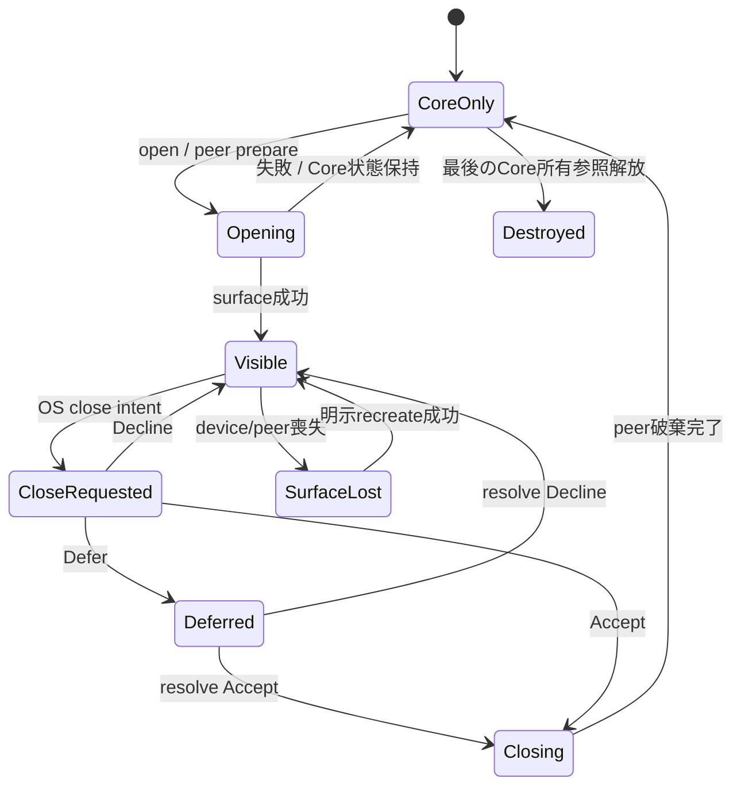

# 未設計レビュー / Control API・Window close・描画backend

- 文書版: 0.2
- 状態: 全判断承認済み・正本適用済み（2026-10-17）
- 判断ID: REM-PLATFORM-01～09
- 入口: [全件索引](index.md)
- 根拠RQ: [RQ-09-001](../../11_requirements/RQ-09_ui-scope.md#rq-09-001)、[RQ-09-006](../../11_requirements/RQ-09_ui-scope.md#rq-09-006)、[RQ-09-048](../../11_requirements/RQ-09_ui-scope.md#rq-09-048)、[RQ-09-058](../../11_requirements/RQ-09_ui-scope.md#rq-09-058)、[RQ-11-008](../../11_requirements/RQ-11_platform.md#rq-11-008)、[RQ-11-009](../../11_requirements/RQ-11_platform.md#rq-11-009)、[RQ-11-020](../../11_requirements/RQ-11_platform.md#rq-11-020)
- 具体化するBD: [BD-11](../../12_design/BD-11_initial-control-contract-upper-design.md)、[BD-12](../../12_design/BD-12_rendering-platform-upper-design.md)
- 適用対象DD/SD: [DD-15](../../13_detail_design/15-controls-v1.md)、[DD-16](../../13_detail_design/16-platform-rendering.md)

本書は承認したレビュー記録である。推奨案と代替理由は提案時点の比較として保持する。現行の方式・正式判断IDは[DD-30: Control API・Window close・描画backend](../../13_detail_design/30-control-surface-renderer.md)を正本とする。採用済みでも本文に将来候補と記した範囲は初期必須へ昇格しない。

## 判断案

| 判断ID | 推奨案・具体的な選択 | 代替と選択理由 | 承認区分 |
| --- | --- | --- | --- |
| REM-PLATFORM-01 | 公開名はWindow/StackPanel/Text/TextBox/Button、Widget/Containerは抽象view。名前は4言語で対応させC ABIはsnake_caseにする。 | 言語ごとにControl状態を複製しない。 | DD |
| REM-PLATFORM-02 | Window.openは明示操作、closeはpeerを閉じCore owner/Tree/Propertyを保持し再open可能とする。 | Window closeをRuntime終了へ直結する案は既存RQに反する。 | RQ・REM-RQ-16 |
| REM-PLATFORM-03 | close requestはAccept/Decline/Defer、既定Accept。Deferはowned CloseRequestで明示resolve、失効IDは拒否。 | OS終了強制通知はveto不能として別originを持つ。強制killのcleanupは保証しない。 | RQ・REM-RQ-16 |
| REM-PLATFORM-04 | ButtonはLabel UTF8 Propertyとtyped Command strong参照。交換は同Runtime検査後commit。Button破棄だけで共有Commandをcloseしない。 | Commandをgeneric OBJECT Propertyにしない。 | DD |
| REM-PLATFORM-05 | 共通SceneSnapshotはClip/FillRect/GlyphRunを初期DrawOpとし、layout revision・damageを持つ。damageは矩形union、失敗時full-dirtyを保持。 | 部分更新の正しさを確立する前に複雑なtile最適化を採用しない。 | DD |
| REM-PLATFORM-06 | WindowsはWin32 peer+Direct2D/DirectWrite、LinuxはDRM/KMS+GBM/EGL/OpenGL ES3を第1profile。Wayland/X11は同Sceneの別surface adapter。 | 全OSにnative controlを使う案はCore意味正本の境界と合わない。 | BD/DD・REM-RQ-17 |
| REM-PLATFORM-07 | GPU/device lossはSurfaceLost→Recreating。自動software fallbackは初期しない。明示software profile選択時だけCPU rasterを使う候補。 | 予期しないfallbackで性能・support表示が変わることを避ける。 | RQ・REM-RQ-17 |
| REM-PLATFORM-08 | FrameStateはIdle→Preparing→Rendering→Presented。submitだけでPresentedにせず、backend completionでframe revisionを公開する。 | 失敗frameでdirtyを消さない。 | DD |
| REM-PLATFORM-09 | Window titleと初期text描画は明示UTF8。Textは単一paragraph、soft-wrapなし、client clip、ellipsisなしを初期案とする。 | wrap/selection/copy/image/styleは次段階範囲で採用する。 | RQ・REM-RQ-18 |

## 実現設計案

### Control接続API案

| 型 | 主要操作・Property | 所有・変更点 |
|---|---|---|
| Widget | enabled_property / accessible_name_property / request_focus | getterは独立owned Property。UI threadでcommit |
| Container | insert/remove/move、children_snapshot | parentのみがchildの所属ownerを保持 |
| Window | content、title_property、open/close、close_requested | closeはpeer終了、shutdownはRuntime全体終了 |
| StackPanel | orientation、child Align、constraints | 各入力の検査後Layout dirtyを立てる |
| Text | content_property | 表示のみ。アプリのsetter/Bindingで更新できる |
| TextBox | value_property、編集snapshotとedit API | 確定値と編集中の値を分離 |
| Button | label_property、set_command / command | typed Command参照をstrong保持、getterは新ownerを返す |

CloseRequestはWindow弱参照・peer generation・request IDを持つ。resolveはUI thread、成功後はConsumed。未解決requestをreleaseした場合はDeclineとしてWindowを表示維持する案で、source ownerが失われたためWindowを黙って閉じない。shutdownはveto/deferを経由せず全peerをUIでtear downする。

SceneSnapshotはCore UI値の不変copyを所有しRendererからControlをstrong保持しない。GPU fenceはbackend ownerが保持し、surface再生成では旧generationのcompletionを無視する。Linuxのraw inputはlibinput+xkbcommonをAdapterに閉じ、TSF/IBus/fcitx等のIMEは別session adapterとして同じTextBox APIへ渡す。候補順の評価と正式profileへの採用を別に記録する。

## 適用結果

全判断を[DD-30](../../13_detail_design/30-control-surface-renderer.md)へ正式IDで適用した。関連要求の変更もRQ本文へ反映した。実装・試験実行は未完了。[全200件の適用表](../remaining-design-application-result.md)で旧新対応を確認できる。

## 承認履歴

| 日付 | 範囲 | 承認者 | 結果 |
| --- | --- | --- | --- |
| 2026-10-17 | 本書の案作成 | 利用者 | 一括生成指示。方式採用・正本適用は未承認 |

## 改訂履歴

| 版 | 日付 | 内容 | 作成者 |
| --- | --- | --- | --- |
| 0.1 | 2026-10-17 | 現行の未設計箇所を実現案・代替・interfaceへ具体化 | Codex |

## 承認履歴（具体化適用）

| 日付 | 対象版・範囲 | 承認者 | 結果・根拠 |
| --- | --- | --- | --- |
| 2026-10-17 | 0.2 / 本書の全推奨案と補足の採用・正本適用 | 利用者 | 全件反映を指示。設計採用・本文適用を承認。実装・公開・試験合格を意味しない |

## 改訂履歴（具体化適用）

| 版 | 日付 | 変更内容 | 作成者 |
| --- | --- | --- | --- |
| 0.2 | 2026-10-17 | 本書の全推奨案と補足の採用・正本適用を正本へ適用し、旧判断との対応を保持 | Codex |
