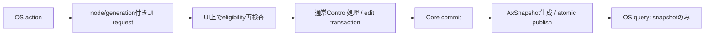

# 未設計レビュー / Text engine・IME OS接続・Accessibility

- 文書版: 0.2
- 状態: 全判断承認済み・正本適用済み（2026-10-17）
- 判断ID: REM-ACCESS-01～09
- 入口: [全件索引](index.md)
- 根拠RQ: [RQ-09-053](../../11_requirements/RQ-09_ui-scope.md#rq-09-053)、[RQ-09-054](../../11_requirements/RQ-09_ui-scope.md#rq-09-054)、[RQ-10-001](../../11_requirements/RQ-10_accessibility.md#rq-10-001)、[RQ-10-005](../../11_requirements/RQ-10_accessibility.md#rq-10-005)、[RQ-10-007](../../11_requirements/RQ-10_accessibility.md#rq-10-007)、[RQ-10-011](../../11_requirements/RQ-10_accessibility.md#rq-10-011)、[RQ-10-013](../../11_requirements/RQ-10_accessibility.md#rq-10-013)
- 具体化するBD: [BD-10](../../12_design/BD-10_ime-platform-boundary-upper-design.md)、[BD-13](../../12_design/BD-13_accessibility-upper-design.md)、[BD-23](../../12_design/BD-23_text-shaping-upper-design.md)、[BD-24](../../12_design/BD-24_ime-edit-session-upper-design.md)
- 適用対象DD/SD: [DD-14](../../13_detail_design/14-textbox-ime.md)、[DD-16](../../13_detail_design/16-platform-rendering.md)、[DD-17](../../13_detail_design/17-accessibility.md)

本書は承認したレビュー記録である。推奨案と代替理由は提案時点の比較として保持する。現行の方式・正式判断IDは[DD-31: Text engine・IME OS接続・Accessibility](../../13_detail_design/31-os-text-accessibility.md)を正本とする。採用済みでも本文に将来候補と記した範囲は初期必須へ昇格しない。

## 判断案

| 判断ID | 推奨案・具体的な選択 | 代替と選択理由 | 承認区分 |
| --- | --- | --- | --- |
| REM-ACCESS-01 | Windows textはDirectWrite、LinuxはFontconfig+HarfBuzz+FreeType、配布fontはNoto Sans/Noto Sans CJK JPの許諾確認済みsubset候補。 | system fontだけではfont未導入profileの日本語結果を固定できない。 | BD/DD・REM-RQ-19 |
| REM-ACCESS-02 | font family/version/hashとshaping engineをprofile lockへ含める。glyph cacheはfont digest+size+scale+glyph IDで索引する。 | script保証とfont実装名を同じ要求にしない。 | DD |
| REM-ACCESS-03 | Windows IMEはTSF text store、Linux desktopはIBus D-Bus adapter。DRM単独は専用IME brokerを明示導入するprofile案。 | DRMだけで日本語IMEが自動提供されるとは表示しない。 | BD/DD・REM-RQ-19 |
| REM-ACCESS-04 | OS UTF16/Unicode scalar位置をTextIndexMapでbyte位置へ変換。surrounding text/caret rectは同revisionのsnapshotで取得する。 | native text bufferを確定値の正本にしない。 | DD |
| REM-ACCESS-05 | UIAはFragment+Invoke/Value/Textの対応部分、LinuxはAT-SPI Accessible/Action/Text/EditableText。TextBoxの公開valueはediting textを使う。 | committed値だけをOS valueとするとRQ-10-005と違う。 | DD |
| REM-ACCESS-06 | queryは不変snapshotを読んでUIを待たない。Invokeは受付後return、同期編集actionはUI request completionを待つprofile別protocol。 | UIAのInvokeに同期業務完了待ちを持ち込まない。 | DD |
| REM-ACCESS-07 | 同期OS actionの待機budgetは2秒をprofile既定候補とし、未開始requestだけcancelする。実行開始後timeoutは結果不明をdiagnosticで区別する。 | timeoutをrollback完了と表示しない。新しい外部制限としてRQレビューが必要。 | RQ・REM-RQ-20 |
| REM-ACCESS-08 | Linux desktopのAT-SPI busを必須profile条件、embeddedは有無を別profileとして宣言。bus不在でAccessibility verifiedとしない。 | 全組み込み装置へdesktop busを無条件導入しない。 | RQ・REM-RQ-19 |
| REM-ACCESS-09 | OS target identityはRuntime ID+Widget ID+generation、providerはweak owner。更新通知はcommit後にrole/name/value/state/children/focusを差分生成する。 | OS proxyの長寿命でCore Windowを延命しない。 | DD |

<a id="rem-access-01"></a>

<a id="rem-access-02"></a>

<a id="rem-access-03"></a>

<a id="rem-access-04"></a>

<a id="rem-access-05"></a>

<a id="rem-access-06"></a>

<a id="rem-access-07"></a>

<a id="rem-access-08"></a>

<a id="rem-access-09"></a>

## 実現設計案

### Provider / text service interface

```text
TextService.shape(text_snapshot, font_profile, width_constraint) -> GlyphRunSnapshot
ImeAdapter.on_start/update/commit/cancel(session_id, event_sequence, input)
AccessibilityStore.publish(Arc<AxSnapshot>)
AxProvider.query(node_id, snapshot_revision) -> immutable value
AxProvider.action(node_id, action, payload) -> ActionRequest
```

| OS接続 | 中立情報との対応 | 失敗・所有 |
|---|---|---|
| Windows TSF | UTF16 position→UTF8 byte、composition range、caret rect | snapshotをpinしOS lock要求の間にCoreを再入更新しない |
| Linux IBus | UTF8 text、surrounding text、preedit attributes | D-Bus messageをcopy、session generation照合後UIへ |
| UIA Value/Text | editing snapshot、UTF16 selection、readonly state | node staleはelement-not-available、無効操作は対応OS error |
| AT-SPI Text/EditableText | editing snapshot、Unicode scalar position | byte変換後edit_replace。bus threadからCoreを直接変更しない |
| Button Invoke | semantic activation | eligibilityをUIで再検査し一度だけexecute依頼 |



同期actionの状態はPending→Executing→Completed、Pending→CancelledBeforeStartのみをcancel可能とする。timeoutがExecutingと競合したら結果不明としてOSエラーを返し、後のcommit通知を正本にする。利用者callbackの停止不能を隠すためにUI threadを強制終了しない。OS providerからqueryだけでFocusを動かさず、UIA Invokeと実際のCommand終端を別に扱う。

公式根拠: [UIA threading](https://learn.microsoft.com/en-us/windows/win32/winauto/uiauto-threading)はOS接続のthread制約を確認する資料。[IInvokeProvider.Invoke](https://learn.microsoft.com/dotnet/api/system.windows.automation.provider.iinvokeprovider.invoke)ではInvokeは非同期で直ちに戻る契約である。本案の2秒等は本プロジェクトの提案値で、OS規格の値ではない。

## 適用結果

全判断を[DD-31](../../13_detail_design/31-os-text-accessibility.md)へ正式IDで適用した。関連要求の変更もRQ本文へ反映した。実装・試験実行は未完了。[全200件の適用表](../remaining-design-application-result.md)で旧新対応を確認できる。

## 承認履歴

| 日付 | 範囲 | 承認者 | 結果 |
| --- | --- | --- | --- |
| 2026-10-17 | 本書の案作成 | 利用者 | 一括生成指示。方式採用・正本適用は未承認 |

## 改訂履歴

| 版 | 日付 | 内容 | 作成者 |
| --- | --- | --- | --- |
| 0.1 | 2026-10-17 | 現行の未設計箇所を実現案・代替・interfaceへ具体化 | Codex |

## AT-SPI参照

API/interfaceの照合先は [GNOME libatspi公式API](https://gnome.pages.gitlab.gnome.org/at-spi2-core/libatspi/)。OS別の文字indexとquery/actionのthread処理を、共通TextSnapshotのbyte位置へ変換する。

## 承認履歴（具体化適用）

| 日付 | 対象版・範囲 | 承認者 | 結果・根拠 |
| --- | --- | --- | --- |
| 2026-10-17 | 0.2 / 本書の全推奨案と補足の採用・正本適用 | 利用者 | 全件反映を指示。設計採用・本文適用を承認。実装・公開・試験合格を意味しない |

## 改訂履歴（具体化適用）

| 版 | 日付 | 変更内容 | 作成者 |
| --- | --- | --- | --- |
| 0.2 | 2026-10-17 | 本書の全推奨案と補足の採用・正本適用を正本へ適用し、旧判断との対応を保持 | Codex |
