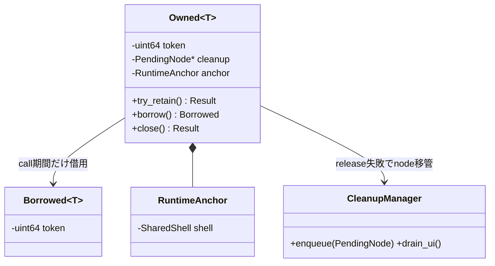

# 未設計レビュー / C++公開型・handler・cleanup同期

- 文書版: 0.2
- 状態: 全判断承認済み・正本適用済み（2026-10-17）
- 判断ID: REM-CPP-01～07
- 入口: [全件索引](index.md)
- 根拠RQ: [RQ-03-001](../../11_requirements/RQ-03_language-support.md#rq-03-001)、[RQ-03-005](../../11_requirements/RQ-03_language-support.md#rq-03-005)、[RQ-05-012](../../11_requirements/RQ-05_ownership-callbacks.md#rq-05-012)、[RQ-05-014](../../11_requirements/RQ-05_ownership-callbacks.md#rq-05-014)、[RQ-04-022](../../11_requirements/RQ-04_abi-boundary.md#rq-04-022)
- 具体化するBD: [BD-19](../../12_design/BD-19_cpp-cmake-package-upper-design.md)、[BD-27](../../12_design/BD-27_error-object-upper-design.md)、[BD-36](../../12_design/BD-36_runtime-shutdown-dispatch-upper-design.md)
- 適用対象DD/SD: [DD-18](../../13_detail_design/18-wrapper-cpp.md)

本書は承認したレビュー記録である。推奨案と代替理由は提案時点の比較として保持する。現行の方式・正式判断IDは[DD-32: C++公開型・handler・cleanup同期](../../13_detail_design/32-cpp-api-ownership.md)を正本とする。採用済みでも本文に将来候補と記した範囲は初期必須へ昇格しない。

## 判断案

| 判断ID | 推奨案・具体的な選択 | 代替と選択理由 | 承認区分 |
| --- | --- | --- | --- |
| REM-CPP-01 | C++17をminimumとし、freemvvm namespaceのOwned<T>/Borrowed<T>/Result<T>/UiError/Decimal64を公開する。 | std::expected依存ならC++23が必要。Resultはmove可能なtagged unionで用意する。 | DD・REM-RQ-21 |
| REM-CPP-02 | Ownedはcopy禁止、move noexcept、try_retain()だけ新tokenを返す。close()はResult<void>で成功時だけemptyにする。 | 参照取得失敗をcopy constructorで隠さない。 | DD |
| REM-CPP-03 | 通常APIはResultを基本、例外有効時のみvalue_or_throw()を補助提供。例外無効時にも同じ基本型を使う。 | ビルドmacroごと戻り型を変えるとconsumerのコードが不安定になる。 | DD |
| REM-CPP-04 | Runtime単位のhandlerは共有HandlerRecordをmutexでsnapshot取得し、lock外でinvoke。交換は以降のinvokeに適用し旧recordは最後のin-flight後destroy。 | raw pointer交換だけではuserdata寿命が競合する。 | DD |
| REM-CPP-05 | handler型はvoid(*)(const CallbackFailure&,void*)、destroy pointerを別保持。handler内例外は捕捉し既定diagnosticへ一度送る。 | handlerからhandlerを再帰呼出ししない。例外無効buildでは通常エラー情報のみを渡す。 | DD |
| REM-CPP-06 | CleanupManagerはstd::mutex+intrusive PendingNode、node/token/anchorの所有移転を一同期点で行う。lock外でnative release、失敗なら同nodeを再登録。 | destructor内allocationとUI待機を避ける。 | DD |
| REM-CPP-07 | UiThreadRefは非所有UI affinity marker、RuntimeAnchorはshellを保持する共有内部owner。Runtime destructorから暗黙shutdownしない。 | shared_ptr<Runtime facade>をcallback registryから逆保持する循環を作らない。 | DD |

## 実現設計案

### Class/所有案

`Result<T>`はsuccess値または`UiError { raw_status, ErrorSnapshot? }`を持つ。success判定をstatus==0だけにせず、shutdownのUI_PENDINGは`ShutdownReceipt`のAcceptedとして表す。unknown status/domain/codeは数値を保持する。UTF8 decode失敗はライブラリ内部不整合としてraw bytesを保持し、置換文字へ黙って変換しない。

| API案 | 呼出し・戻り | 失敗時所有 |
|---|---|---|
| Runtime::create(HostRegistration) | Result<Runtime>、UI thread | nodeを先に確保。native失敗でtokenなし |
| Property<T>::get/set | Result<T>/Result<void>、UI | borrow pin、失敗commitなし |
| Runtime::request_shutdown(Mode) | Result<ShutdownReceipt> | 受付済みUI_PENDINGはHostUnavailableを含むreceiptへ保持 |
| Runtime::set_callback_handler | Result<HandlerRegistration> | 新record prepare失敗なら旧handler維持 |
| Decimal64::try_from_parts | Result<Decimal64>、任意thread | scalarのみ。丸めなし |

handler recordは関数+userdata+destroyを共有所有する。例外有効時のCallbackFailureはstd::exception_ptrをoptionalに含み、例外無効時は空でnative分類を提供する。CallbackFailureはinvoke中borrow、保存には利用者が明示copyする。Runtimeのhandler交換もUI mutationとは分けた同期操作だが、handler userdataのdestroyは最後のinvoke終了後のsafe pointで行う。

moveでは元をemptyにしnode/anchorを一度だけ渡す。destructorはtry_release→失敗node enqueueで戻り、nativeを呼ぶ間manager lockを保持しない。handlerやfinalizerからRuntime facadeへの強い逆参照をmanagerに保存しない。

## 適用結果

全判断を[DD-32](../../13_detail_design/32-cpp-api-ownership.md)へ正式IDで適用した。関連要求の変更もRQ本文へ反映した。実装・試験実行は未完了。[全200件の適用表](../remaining-design-application-result.md)で旧新対応を確認できる。

## 承認履歴

| 日付 | 範囲 | 承認者 | 結果 |
| --- | --- | --- | --- |
| 2026-10-17 | 本書の案作成 | 利用者 | 一括生成指示。方式採用・正本適用は未承認 |

## 改訂履歴

| 版 | 日付 | 内容 | 作成者 |
| --- | --- | --- | --- |
| 0.1 | 2026-10-17 | 現行の未設計箇所を実現案・代替・interfaceへ具体化 | Codex |

## 承認履歴（具体化適用）

| 日付 | 対象版・範囲 | 承認者 | 結果・根拠 |
| --- | --- | --- | --- |
| 2026-10-17 | 0.2 / 本書の全推奨案と補足の採用・正本適用 | 利用者 | 全件反映を指示。設計採用・本文適用を承認。実装・公開・試験合格を意味しない |

## 改訂履歴（具体化適用）

| 版 | 日付 | 変更内容 | 作成者 |
| --- | --- | --- | --- |
| 0.2 | 2026-10-17 | 本書の全推奨案と補足の採用・正本適用を正本へ適用し、旧判断との対応を保持 | Codex |
