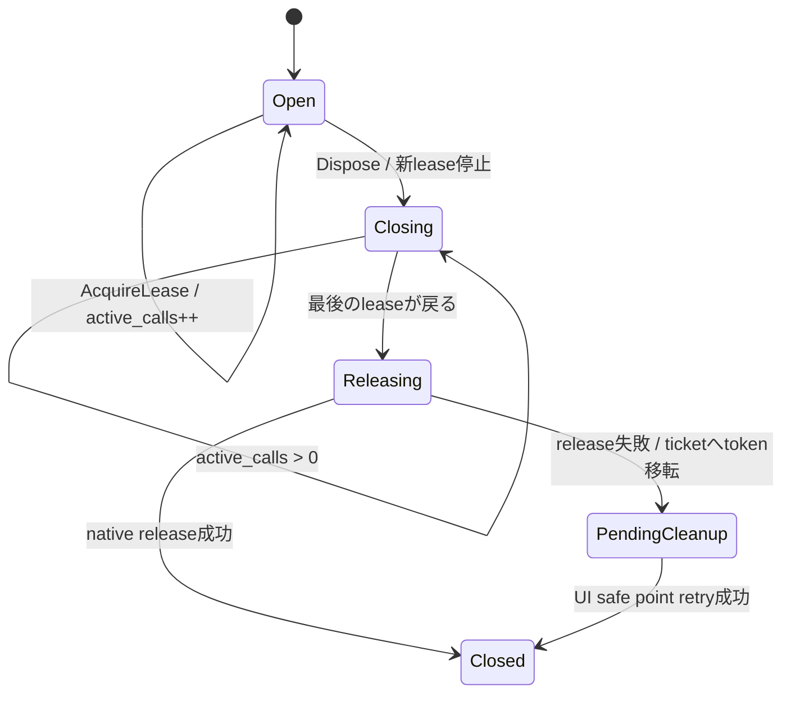

# 未設計レビュー / C# token owner・interop・Dispose・load

- 文書版: 0.2
- 状態: 全判断承認済み・正本適用済み（2026-10-17）
- 判断ID: REM-CSHARP-01～07
- 入口: [全件索引](index.md)
- 根拠RQ: [RQ-03-002](../../11_requirements/RQ-03_language-support.md#rq-03-002)、[RQ-03-006](../../11_requirements/RQ-03_language-support.md#rq-03-006)、[RQ-05-010](../../11_requirements/RQ-05_ownership-callbacks.md#rq-05-010)、[RQ-05-012](../../11_requirements/RQ-05_ownership-callbacks.md#rq-05-012)、[RQ-12-006](../../11_requirements/RQ-12_build-distribution.md#rq-12-006)
- 具体化するBD: [BD-18](../../12_design/BD-18_csharp-nuget-native-assets-upper-design.md)、[BD-27](../../12_design/BD-27_error-object-upper-design.md)、[BD-36](../../12_design/BD-36_runtime-shutdown-dispatch-upper-design.md)
- 適用対象DD/SD: [DD-19](../../13_detail_design/19-wrapper-csharp.md)

本書は承認したレビュー記録である。推奨案と代替理由は提案時点の比較として保持する。現行の方式・正式判断IDは[DD-33: C# token owner・interop・Dispose・load](../../13_detail_design/33-csharp-api-ownership.md)を正本とする。採用済みでも本文に将来候補と記した範囲は初期必須へ昇格しない。

## 判断案

| 判断ID | 推奨案・具体的な選択 | 代替と選択理由 | 承認区分 |
| --- | --- | --- | --- |
| REM-CSHARP-01 | minimum TFMはnet10.0、language C#14、core facadeはunsafeを内部へ隠す案。C#利用者向けminimumを要求変更として明記する。 | net8.0は互換候補だが今回のbaselineからは分ける。 | DD・REM-RQ-21 |
| REM-CSHARP-02 | ulong TokenOwnerを採用しSafeHandleをnative tokenの正本にしない。CallLeaseがactive_callsを増減しDisposeと競合するcallを保護。 | IntPtr幅に依存するSafeHandleへの無条件格納はARMv7 tokenと合わない。 | DD |
| REM-CSHARP-03 | LibraryImportのsource generation、UnmanagedCallersOnly static trampoline、GCHandle rootを使う。native boolはbyte、長さはulong。 | P/InvokeでCLR bool/stringの暗黙marshalを使わない。 | DD |
| REM-CSHARP-04 | UiResult<T>/UiException/UiErrorSnapshotを提供しTry系とthrow系を同じ内部resultへ接続。Disposeは冪等nonthrowing、TryCloseで失敗を取得可能にする。 | Dispose失敗をtoken喪失に置き換えない。 | DD |
| REM-CSHARP-05 | handlerはRuntimeごとのimmutable delegate record。Interlocked交換しinvoke前snapshotを強保持。handler例外は診断へ一度だけ。 | delegate rootの交換と実行を同一lock内で実施しない。 | DD |
| REM-CSHARP-06 | native loadは専用interop assemblyのresolverでverified absolute pathだけを解決し、process lifetime保持。single-file publishではassembly locationに依存しない。 | consumer assemblyの既存resolverを上書きしない。 | DD |
| REM-CSHARP-07 | AssemblyLoadContextのcollectible unloadは初期非対応。active native callback/ticketがある間interop assemblyをrootする。 | 強制unloadはC trampolineのentry先を無効にする。 | RQ範囲・REM-RQ-07 |

<a id="rem-csharp-01"></a>

<a id="rem-csharp-02"></a>

<a id="rem-csharp-03"></a>

<a id="rem-csharp-04"></a>

<a id="rem-csharp-05"></a>

<a id="rem-csharp-06"></a>

<a id="rem-csharp-07"></a>

## 実現設計案

### Dispose/CallLeaseの線形化

```text
TokenOwner { ulong token; OwnerState state; int active_calls;
             CleanupTicket ticket; RuntimeAnchor anchor; lock sync; }
```



AcquireLeaseはlockでOpen確認→count++→token snapshot、lock外でnativeを呼ぶ。DisposeはClosingへ移して戻り、最後のleaseがreleaseまたはticket enqueueを実施する。再入Disposeでもnative call中にtokenを消費しない。CleanupTicketにはfinalizerを持たせ、native release失敗時はstatic managerがticketを保持する。GCHandle callback rootとowner facadeの寿命は同一視しない。

`UiRuntime.RequestShutdown(ShutdownMode)`→`ShutdownReceipt`、`UiProperty<T>.TrySet/Get`、`UiBinding.Cancel`、`UiCommand.Execute`→`OperationId`、`UiTextBox.GetSnapshot/EditReplace`を公開名候補とする。DecimalValueはulong bitsを持ち、System.Decimalとの変換はTryFromDecimal/TryToDecimalで正確な範囲だけ受け付ける。scale31の値を.NET decimalへ黙って丸めない。

resolverはassembly登録時に一度だけ設定し、package assetのselected profile/digestを検証後ロードする。appが独自配置する場合はRuntimeOptions.NativeArtifactPathからverified候補を明示する。ARM assetをdesktop linux-x64のRIDに偽装しない。

minimumの選定根拠は[.NET releases/support](https://learn.microsoft.com/en-us/dotnet/core/releases-and-support)と[.NET 10 supported OS](https://github.com/dotnet/core/blob/main/release-notes/10.0/supported-os.md)。.NET側のsupportと本ライブラリの検証済みprofileを分ける。

## 適用結果

全判断を[DD-33](../../13_detail_design/33-csharp-api-ownership.md)へ正式IDで適用した。関連要求の変更もRQ本文へ反映した。実装・試験実行は未完了。[全200件の適用表](../remaining-design-application-result.md)で旧新対応を確認できる。

## 承認履歴

| 日付 | 範囲 | 承認者 | 結果 |
| --- | --- | --- | --- |
| 2026-10-17 | 本書の案作成 | 利用者 | 一括生成指示。方式採用・正本適用は未承認 |

## 改訂履歴

| 版 | 日付 | 内容 | 作成者 |
| --- | --- | --- | --- |
| 0.1 | 2026-10-17 | 現行の未設計箇所を実現案・代替・interfaceへ具体化 | Codex |

## 承認履歴（具体化適用）

| 日付 | 対象版・範囲 | 承認者 | 結果・根拠 |
| --- | --- | --- | --- |
| 2026-10-17 | 0.2 / 本書の全推奨案と補足の採用・正本適用 | 利用者 | 全件反映を指示。設計採用・本文適用を承認。実装・公開・試験合格を意味しない |

## 改訂履歴（具体化適用）

| 版 | 日付 | 変更内容 | 作成者 |
| --- | --- | --- | --- |
| 0.2 | 2026-10-17 | 本書の全推奨案と補足の採用・正本適用を正本へ適用し、旧判断との対応を保持 | Codex |
