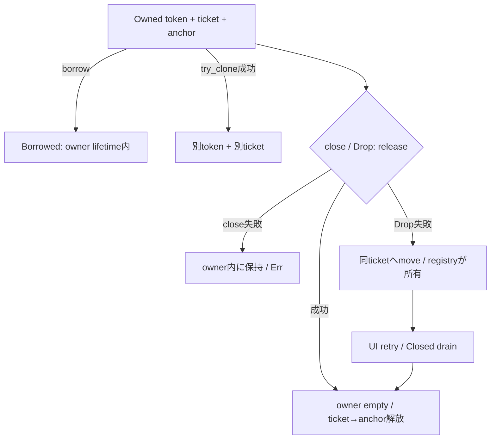

# 未設計レビュー / Rust公開型・receiver・registry・panic

- 文書版: 0.2
- 状態: 全判断承認済み・正本適用済み（2026-10-17）
- 判断ID: REM-RUST-01～07
- 入口: [全件索引](index.md)
- 根拠RQ: [RQ-03-003](../../11_requirements/RQ-03_language-support.md#rq-03-003)、[RQ-03-007](../../11_requirements/RQ-03_language-support.md#rq-03-007)、[RQ-05-012](../../11_requirements/RQ-05_ownership-callbacks.md#rq-05-012)、[RQ-06-003](../../11_requirements/RQ-06_threading-dispatch.md#rq-06-003)、[RQ-12-005](../../11_requirements/RQ-12_build-distribution.md#rq-12-005)
- 具体化するBD: [BD-20](../../12_design/BD-20_rust-cargo-package-upper-design.md)、[BD-27](../../12_design/BD-27_error-object-upper-design.md)、[BD-36](../../12_design/BD-36_runtime-shutdown-dispatch-upper-design.md)
- 適用対象DD/SD: [DD-20](../../13_detail_design/20-wrapper-rust.md)

本書は承認したレビュー記録である。推奨案と代替理由は提案時点の比較として保持する。現行の方式・正式判断IDは[DD-34: Rust公開型・receiver・registry・panic](../../13_detail_design/34-rust-api-ownership.md)を正本とする。採用済みでも本文に将来候補と記した範囲は初期必須へ昇格しない。

## 判断案

| 判断ID | 推奨案・具体的な選択 | 代替と選択理由 | 承認区分 |
| --- | --- | --- | --- |
| REM-RUST-01 | crate名はfreemvvm-sys / freemvvm、edition2024、MSRV1.85.0。最低版testと固定release toolchainを別jobで持つ。 | edition2021/低MSRVは代替だが初期APIの型設計を新しい基準へ揃える。 | DD・REM-RQ-21 |
| REM-RUST-02 | Owned<T>は非Clone、try_clone(&self)->Result<Self>、close(&mut self)->Result<()>、borrow(&self)->Borrowed<T>。 | close(self)だけだと失敗時にownerを返す複雑な戻り型が必要。 | DD |
| REM-RUST-03 | UI型にPhantomData<Rc<()>>、BorrowedにPhantomData<&Owned<T>>。worker用DispatcherだけSend+Sync。 | tokenの整数値がSendであることからUI objectまでSendにしない。 | DD |
| REM-RUST-04 | UiContextはUI thread tokenとdispatch scopeを表し、UI-affine methodは&UiContextを受ける。実call直前にもnative thread検査。 | markerだけでは誤ったContextの持込みを防げない。 | DD |
| REM-RUST-05 | CleanupRegistryのmutex内はticket linkageだけを更新し、callback/panic可能処理を置かない。poison時はinto_inner後に構造検査し不整合なら保持+診断する。 | poisonでDropをpanicさせたりtokenを捨てたりしない。 | DD |
| REM-RUST-06 | catch_unwindをtrampoline境界に置き、notification panicはdiagnostic+他購読継続、Validator panicはUI_INTERNAL_ERRORへ変換する。 | AssertUnwindSafeは復旧可能な局所状態に限定。arbitrary Core継続安全性を推定しない。 | DD |
| REM-RUST-07 | async facadeは初期optional featureとしてrequest queryをpollするFutureだけ。executor/scheduler/JoinHandleをCoreへ組み込まない。 | tokioへの必須依存を避け、Future dropをshutdown取消と扱わない。 | 範囲・REM-RQ-06 |

<a id="rem-rust-01"></a>

<a id="rem-rust-02"></a>

<a id="rem-rust-03"></a>

<a id="rem-rust-04"></a>

<a id="rem-rust-05"></a>

<a id="rem-rust-06"></a>

<a id="rem-rust-07"></a>

## 実現設計案

```rust
// 公開signature案。実装ではない。
pub struct Owned<T> { /* token, ticket, anchor, !Send/!Sync marker */ }
pub struct Borrowed<'a, T> { /* borrowed token, PhantomData<&'a Owned<T>> */ }
impl<T> Owned<T> {
    pub fn try_clone(&self) -> Result<Self, UiError>;
    pub fn borrow(&self) -> Borrowed<'_, T>;
    pub fn close(&mut self) -> Result<(), UiError>;
}
impl<T: PropertyValue> Property<T> {
    pub fn get(&self, ui: &UiContext) -> Result<T, UiError>;
    pub fn set(&self, ui: &UiContext, value: T) -> Result<(), UiError>;
}
```

PropertyValueは初期五型のsealed trait。利用者の任意structでunsafe FFI変換を実装させない。`UiError`はraw status/domain/codeとoptional owned immutable ErrorSnapshotを持つ。cloneがnative retainを伴う型はtry_cloneとし、std::error::Error/sourceは取得済みsnapshotへのborrowで返す。



所有table:

| 処理 | token | ticket | anchor |
|---|---|---|---|
| create前 | なし | 先に確保 | Runtime shellを保持 |
| create成功 | Ownedが一個保持 | 同Owned | 同Owned |
| retain失敗 | 元Owned不変 | 新ticketだけ回収 | 新anchorだけ回収 |
| move | 移動先のみ | 移動先のみ | 移動先のみ |
| Drop失敗 | registry ticketへ移転 | registry保持 | ticketが保持 |
| release成功 | 消費済み | 解放 | 最後に解放 |

Callback登録のclosureはBox<CallbackState>でprepareし、成功時にinto_rawの所有をCore destroyへ移す。失敗はBoxへ戻す。UI-only callbackはSendを強制せず、worker→UI postだけFnOnce+Send+'static。公開UI methodの&selfは内部Core値をUI Contextで直列操作するためで、Rust内のmutable aliasを利用者へ返さない。

[Rust Edition Guide](https://doc.rust-lang.org/stable/edition-guide/rust-2024/)に2024 editionのrelease基準1.85.0が記載されている。これはMSRV選定の根拠で、同版が最新であるという主張ではない。

## 適用結果

全判断を[DD-34](../../13_detail_design/34-rust-api-ownership.md)へ正式IDで適用した。関連要求の変更もRQ本文へ反映した。実装・試験実行は未完了。[全200件の適用表](../remaining-design-application-result.md)で旧新対応を確認できる。

## 承認履歴

| 日付 | 範囲 | 承認者 | 結果 |
| --- | --- | --- | --- |
| 2026-10-17 | 本書の案作成 | 利用者 | 一括生成指示。方式採用・正本適用は未承認 |

## 改訂履歴

| 版 | 日付 | 内容 | 作成者 |
| --- | --- | --- | --- |
| 0.1 | 2026-10-17 | 現行の未設計箇所を実現案・代替・interfaceへ具体化 | Codex |

## 承認履歴（具体化適用）

| 日付 | 対象版・範囲 | 承認者 | 結果・根拠 |
| --- | --- | --- | --- |
| 2026-10-17 | 0.2 / 本書の全推奨案と補足の採用・正本適用 | 利用者 | 全件反映を指示。設計採用・本文適用を承認。実装・公開・試験合格を意味しない |

## 改訂履歴（具体化適用）

| 版 | 日付 | 変更内容 | 作成者 |
| --- | --- | --- | --- |
| 0.2 | 2026-10-17 | 本書の全推奨案と補足の採用・正本適用を正本へ適用し、旧判断との対応を保持 | Codex |
